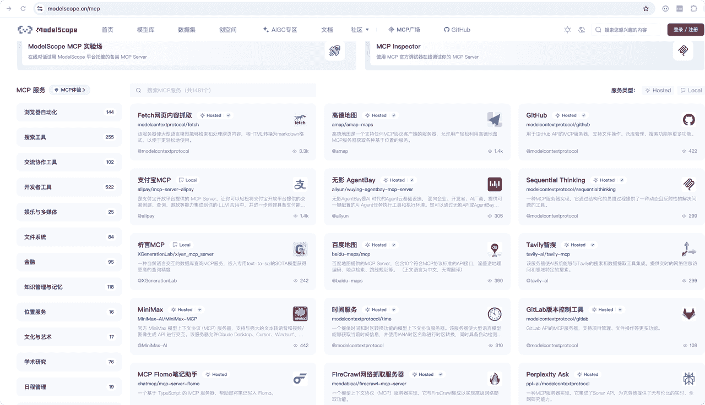

# 懒人福音：让 AI 自动收钱，你只负责数钱

> 来源：[https://qianniucity.feishu.cn/docx/XSVLdtuofojXNAx6RDGc7dUpngc](https://qianniucity.feishu.cn/docx/XSVLdtuofojXNAx6RDGc7dUpngc)

支**付**宝开放平台近期推出的 MCP Server（@alipay/mcp-server-alipay）为开发者提供了一种高效便捷的解决方案，可将支付宝的交易创建、查询、退款等核心支付能力快速集成至 LLM（大语言模型）应用中，助力开发者轻松打造具备支付功能的智能工具。



这一工具的推出，尤其为需要在线交易的 AI 应用场景提供了强大的底层支持。通过 MCP Server，开发者能够直接调用支付宝的支付接口，例如生成支付链接、查询订单状态或发起退款操作。

以插画师服务为例，用于方便理解工具能力：

> 插画师通过智能聊天应用简化交易流程。客户在应用中描述需求，AI 分析后生成报价并创建支付宝支付链接。客户支付后，插画师立即收到通知开始创作，无需人工确认支付状态。此流程提高效率与满意度，让插画师专注创作，轻松实现个性化服务。

在实际应用中，MCP Server 支持多种支付场景适配。若开发者面向

+   桌面端用户（如 PC 网站或软件），可选择“扫码支付”模式，生成二维码供用户扫码完成交易；

+   移动端网页或 H5 应用，则推荐使用“手机支付”模式，直接唤起支付宝客户端完成支付。

这两种模式通过简单的参数配置即可灵活切换，满足不同终端的需求。

接入 MCP Server 前，开发者需在支付宝开放平台注册成为商户并获取私钥，随后在开发环境中配置相关参数，如应用 ID、公钥地址、异步通知回调 URL 等。

```
# 支付宝开放平台配置

AP_APP_ID=2014...222                    # 商户在开放平台申请的应用 ID（APPID）。必需。
AP_APP_KEY=MIIE...DZdM=                 # 商户在开放平台申请的应用私钥。必需。
AP_PUB_KEY=MIIB...DAQAB                 # 用于验证支付宝服务端数据签名的支付宝公钥，在开放平台获取。必需。
AP_RETURN_URL=https://success-page      # 网页支付完成后对付款用户展示的「同步结果返回地址」。
AP_NOTIFY_URL=https://your-own-server   # 支付完成后，用于告知开发者支付结果的「异步结果通知地址」。
AP_ENCRYPTION_ALGO=RSA2                 # 商户在开放平台配置的参数签名方式。可选值为 &quot;RSA2&quot; 或 &quot;RSA&quot;。缺省值为 &quot;RSA2&quot;。
AP_CURRENT_ENV=prod                     # 连接的支付宝开放平台环境。可选值为 &quot;prod&quot;（线上环境）或 &quot;sandbox&quot;（沙箱环境）。缺省值为 &quot;prod&quot;。

# MCP Server 配置

AP_SELECT_TOOLS=all                      # 允许使用的工具。可选值为 &quot;all&quot; 或逗号分隔的工具名称列表。工具名称包括 `mobilePay`, `webPagePay`, `queryPay`, `refundPay`, `refundQuery`。缺省值为 &quot;all&quot;。
AP_LOG_ENABLED=true                      # 是否在 $HOME/mcp-server-alipay.log 中记录日志。默认值为 true。
```

主流的开发工具如 Cursor 和 Cline 均提供配置模板，开发者只需按指引填入信息即可完成初步集成。

```
{
  &quot;mcpServers&quot;: {
    &quot;mcp-server-alipay&quot;: {
      &quot;command&quot;: &quot;npx&quot;,
      &quot;args&quot;: [&quot;-y&quot;, &quot;@alipay/mcp-server-alipay&quot;],
      &quot;env&quot;: {
        &quot;AP_APP_ID&quot;: &quot;2014...222&quot;,
        &quot;AP_APP_KEY&quot;: &quot;MIIE...DZdM=&quot;,
        &quot;AP_PUB_KEY&quot;: &quot;MIIB...DAQAB&quot;,
        &quot;AP_RETURN_URL&quot;: &quot;https://success-page&quot;,
        &quot;AP_NOTIFY_URL&quot;: &quot;https://your-own-server&quot;,
        &quot;...其他参数&quot;: &quot;...其他值&quot;
      }
    },
    &quot;其他工具&quot;: { 
      &quot;...&quot;: &quot;...&quot;
    }
  }
}

```

此外，工具还内置了 MCP Inspector 调试功能，通过环境变量设置和命令行操作，开发者能实时测试支付链路并查看交易详情。

1.  通过 export 设置各环境变量；

1.  执行 npx -y @modelcontextprotocol/inspector npx -y @alipay/mcp-server-alipay 启动 MCP Inspector；

1.  在 MCP Inspector WebUI 中调试即可。

在安全性方面，支付宝 MCP Server 强调对商户私钥的严格保护，建议开发者妥善保管密钥并定期更新，同时遵循平台的安全规范以防范潜在风险。

未来，随着功能的持续迭代，MCP Server 计划扩展更多适配 AI 场景的支付方式，进一步降低开发门槛，推动智能工具生态的繁荣发展。开发者在使用过程中需遵守支付宝开放平台的相关协议，确保业务合规性。

链接内容🔗

+   https://modelscope.cn/mcp/servers/@alipay/mcp-server-alipay