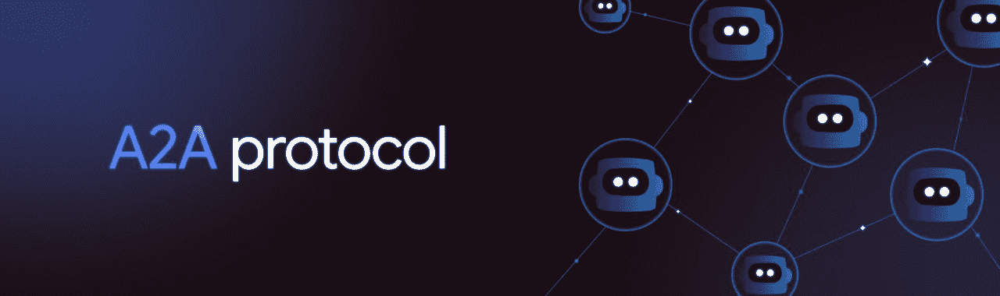
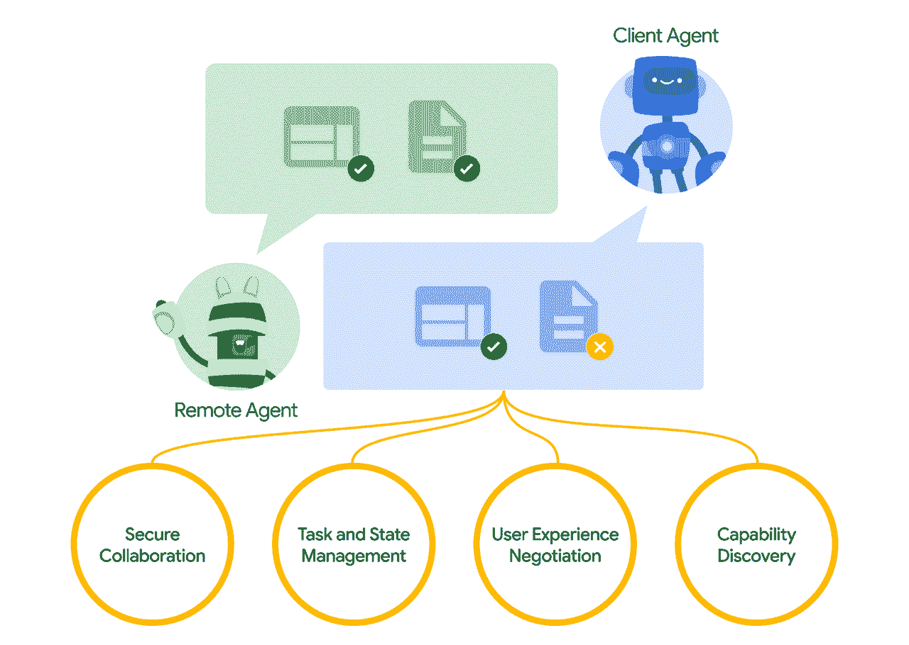
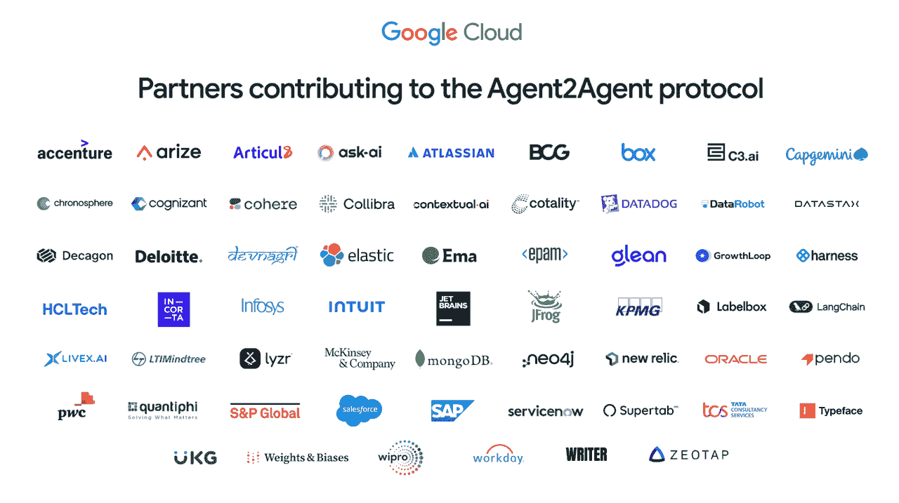

# 多智能体协作困境如何破解？谷歌 A2A 协议让 AI 代理"无障碍沟通"——从技术原理到行业应用全解析

> 来源：[https://qianniucity.feishu.cn/docx/MsQYdVRJLoZxGjxYctHcVvQMn3u](https://qianniucity.feishu.cn/docx/MsQYdVRJLoZxGjxYctHcVvQMn3u)

> 上周与和一个朋友聊天时，他提到一个令人头疼的问题："我们部署了多个 AI 代理来优化供应链，一个负责需求预测，一个处理库存管理，还有一个专注于物流调度。虽然每个代理都很强大，但它们就像被隔离在不同岛屿上的专家，无法有效协作，导致整体效率远低于预期。"

这让我想起谷歌刚刚发布的一项重要创新——Agent2Agent （A2A）协议。这个开源协议专为解决 AI 代理间的"沟通障碍"而设计，有望将多智能体系统的协作效率提升 40%以上。

本文将深入解析 A2A 协议的技术架构、应用场景与行业影响。



## 1. 为什么需要 A2A 协议？

### 1.1 当前多智能体系统面临的三大挑战

**信息孤岛问题**：不同供应商和框架构建的 AI 代理缺乏统一的通信标准，形成相互隔离的"信息孤岛"。就像不同国家的人使用不同语言，虽然各自聪明，却无法有效交流。

**协作效率低下**：在企业自动化、客户服务和供应链管理等领域，多个 AI 代理需要协同处理复杂任务，但缺乏标准化通信协议严重制约了整体效能。

**集成成本高昂**：企业需要为不同 AI 代理间的通信开发定制接口，增加了技术债务和维护成本。

> ▍知识卡片：什么是多智能体系统（MAS）？

> 多智能体系统是由多个能够感知环境、做出决策并相互协作的智能代理组成的网络。例如，在智能工厂中，不同 AI 代理分别负责生产调度、质量控制和设备维护，共同优化整体运营。

### 1.2 A2A 协议：打破 AI 代理间的"巴别塔"

A2A 协议可以理解为 AI 代理世界的"通用翻译官"。它为不同供应商、不同框架构建的 AI 代理提供了一种标准化的通信方式，使它们能够无缝协作和信息交换。



## 2. A2A 协议的技术底座

### 2.1 必须掌握的三个基础概念

**代理卡片机制**：每个 AI 代理通过 JSON 格式的"代理卡片"广播自己的能力，类似于专业人士的技能简历。这使其他代理能够发现并利用最适合特定任务的合作伙伴。

```
// 代理卡片示例
{
  &quot;agent_id&quot;: &quot;inventory-manager&quot;,
  &quot;capabilities&quot;: [&quot;stock_prediction&quot;, &quot;reorder_optimization&quot;],
  &quot;response_formats&quot;: [&quot;json&quot;, &quot;text&quot;],
  &quot;authentication_required&quot;: true
}
```

**任务生命周期管理**：A2A 定义了完整的任务对象生命周期，支持从任务创建、执行、状态更新到完成的全过程跟踪。对于长时间运行的任务，代理可以持续提供实时反馈和状态更新。

**协作消息交换**：代理间可以交换包含上下文、回复、工件和用户指令的结构化消息，实现丰富且上下文相关的交互。

### 2.2 技术架构的五大设计原则

A2A 协议基于五个关键设计原则构建，每一项都针对企业级 AI 应用的实际需求：

| 设计原则 | 核心特点 | 实际意义 |
| --- | --- | --- |
| 拥抱代理能力 | 允许非结构化协作，不要求共享内存或工具 | 尊重各代理的自主性，适应多样化企业环境 |
| 基于现有标准 | 利用 HTTP、SSE 和 JSON-RPC 等成熟技术 | 降低采用门槛，易于与现有 IT 基础设施集成 |
| 默认安全 | 支持企业级身份验证和授权 | 保障敏感数据交换的安全性，满足合规要求 |
| 支持长时间运行任务 | 适应从快速到长达数天的复杂任务 | 能够处理企业级复杂业务流程 |
| 模式无关设计 | 支持文本、音频和视频等多种交互模式 | 为未来多模态 AI 交互提供扩展性 |

## 3. A2A 协议的突破性创新

### 3.1 与传统代理通信协议的对比

A2A 协议相比早期的 KQML 和 FIPA-ACL 等代理通信语言，最大的创新在于其实用性和现代化设计。它不仅基于现代 Web 技术构建，还特别关注企业环境中的实际需求。

### 3.2 与 MCP 协议的互补关系

谷歌将 A2A 定位为 Anthropic 的模型上下文协议（MCP）的补充。这两个协议在功能上形成完美互补：

+   **MCP**：专注于单个 AI 模型与外部工具和数据源的连接（模型到数据/工具）

+   **A2A**：专注于多个 AI 代理之间的通信和协作（代理到代理）

用谷歌的类比来说，如果 MCP 是套筒扳手（用于工具），那么 A2A 就是机械师之间的对话（用于协作）。

> "A2A 和 MCP 的结合为构建复杂的、协作式人工智能代理系统提供了一个全面的框架，其中各个代理既具有知识（通过 MCP）又具有沟通能力（通过 A2A）。" —— 谷歌开发者博客

## 行业支持与生态系统

A2A 协议已获得超过 50 家技术合作伙伴和领先服务提供商的支持，这种广泛的行业认可表明它有望成为代理互操作性的事实标准。



谷歌还将 A2A 与其 Agent Development Kit （ADK）和 Agentspace 平台集成，形成完整的代理开发和部署生态系统。

## 写在最后

正如互联网协议使全球计算机能够相互通信一样，A2A 协议有望成为连接无数 AI 代理的通用语言，释放多智能体系统的全部潜力，为企业创造前所未有的价值。

**您是否正在构建多代理系统？A2A 协议可能是您一直在寻找的解**决方案。欢迎在评论区分享您的想法和问题！

### 参考文献

1.  谷歌开发者博客，《Agent2Agent 协议（A2A）发布公告》，2025 年 4 月

1.  谷歌云博客，《使用 Vertex AI 构建和管理多系统代理》，2025 年 4 月

1.  谷歌 A2A 协议 GitHub 规范，2025 年 4 月

1.  MarkTechPost，《谷歌推出 Agent2Agent （A2A）：一个新的开放协议》，2025 年 4 月

1.  Anthropic，《模型上下文协议介绍》，2024 年 11 月