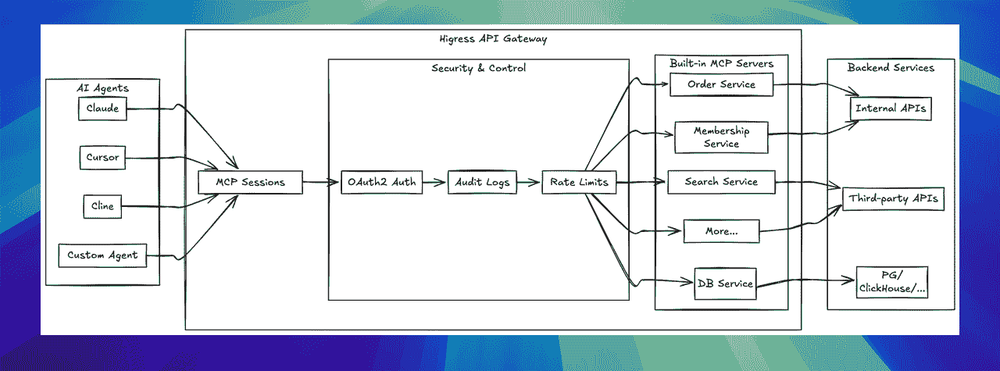

# Higress API 网关全面支持 MCP：助力 AI 应用开发与部署

> 来源：[https://qianniucity.feishu.cn/docx/MwufdOuKDoe2J7xva25cbWJ0ngg](https://qianniucity.feishu.cn/docx/MwufdOuKDoe2J7xva25cbWJ0ngg)

## 阿里巴巴在 MCP 领域的布局，加快 MCP 快速落地

作为基于 Envoy 的高性能 API 网关，Higress 近期宣布全面支持 MCP（Model Context Protocol），并通过插件方式托管 MCP Server。这一功能的加入，不仅简化了 AI 应用的开发与部署，还为工具调用提供了统一的认证、鉴权、限流和观测能力。

## Higress 的 MCP 支持：核心架构亮点

### 1. Higress 及其云产品 API 网关

Higress 与通义灵码合作，采用 SSE（Server-Sent Events）+ Tool + Redis 的技术方案，提供了强大的 MCP Server 托管能力。一方面，Higress 作为平台提供简单高效的 Tool 能力；另一方面，通过网关对 MCP Server 的访问进行身份验证和授权管理，确保调用过程安全可靠。

### 2. Nacos 的新功能

Nacos 即将发布 MCP Register 相关能力，包括动态发现和管理 MCP Server。通过动态 Prompt 下发和管理 MCP 协议，Nacos 将帮助传统非 MCP 服务快速转变为支持 MCP 的服务。

### 3. Nacos 与 Higress 的组合优势

将 Nacos 与 Higress 结合使用，可以极大降低经典互联网应用构建 MCP Server 的工程化成本。这种组合方案为开发者提供了更加灵活、高效的解决方案。

## 使用 Higress 托管 MCP 服务器的优势

通过 Higress 托管 MCP 服务器，开发者可以享受到以下核心优势：

+   统一认证授权机制，保障 AI 工具调用安全

+   细粒度的速率限制，防止滥用和资源耗尽

+   全面的审计日志记录所有工具调用行为

+   丰富的可观察性，用于监控工具调用的性能和运行状况

+   通过 Higress 的插件机制简化部署和管理，快速添加新的 MCP 服务器

+   无中断动态更新：得益于 Envoy 对长连接的友好处理和 Wasm 插件的动态更新机制，MCP Server 逻辑可以即时更新，不会出现任何流量中断或连接断开的情况

## 一句话总结

对于想要快速构建 MCP Server 的开发团队来说，Higress 和 Nacos 的组合无疑是一项理想选择。未来，我们有理由期待更多基于 MCP 构建的创新应用，为 AI 技术的发展注入新的活力。