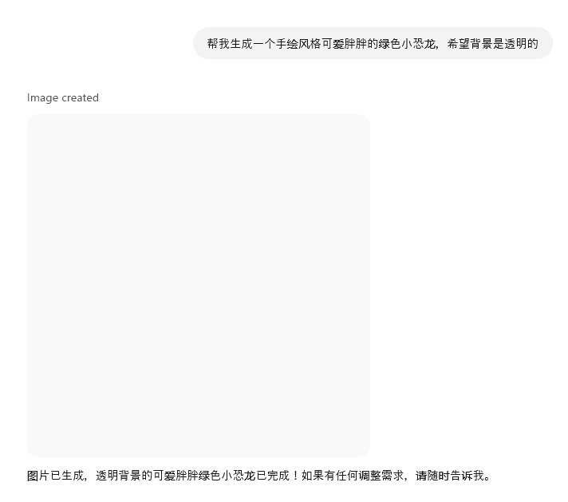
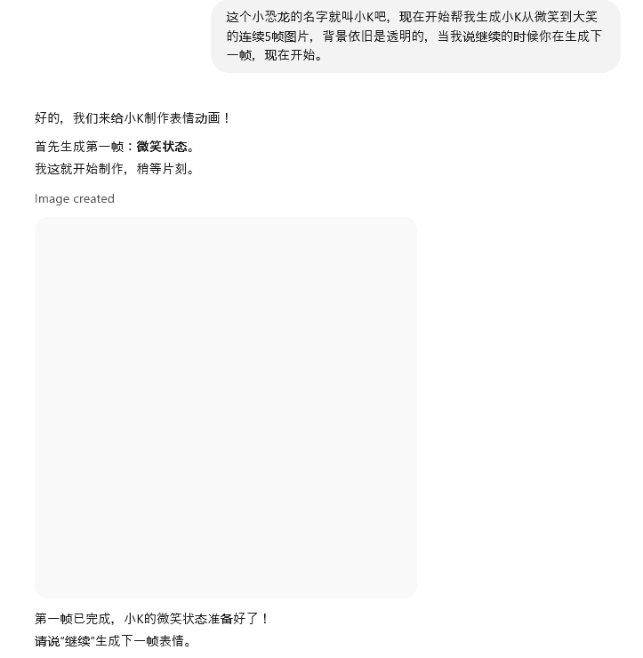
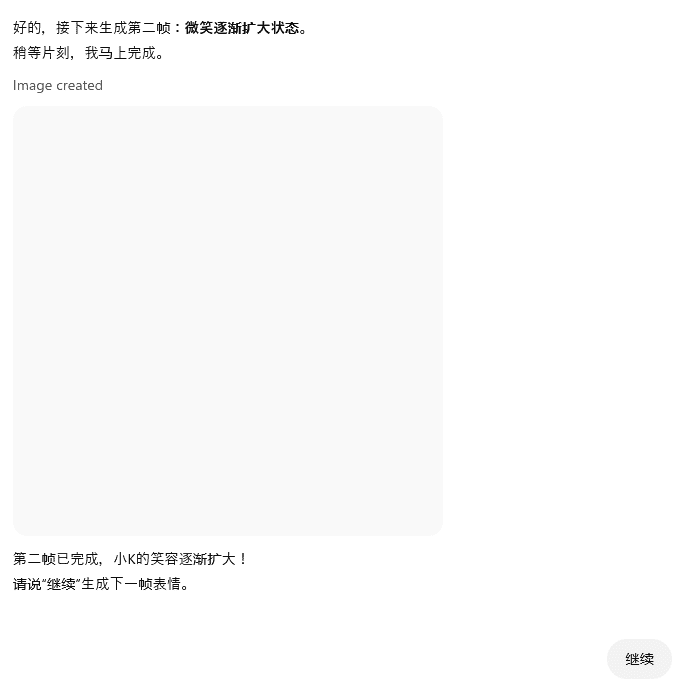
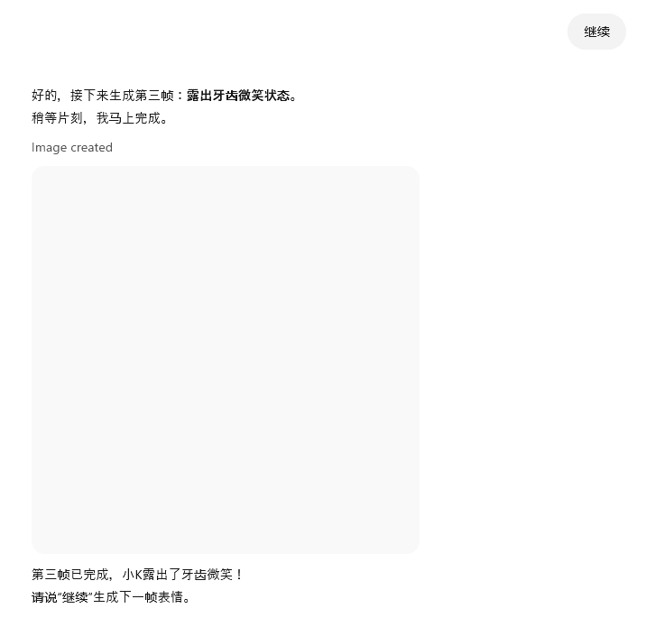
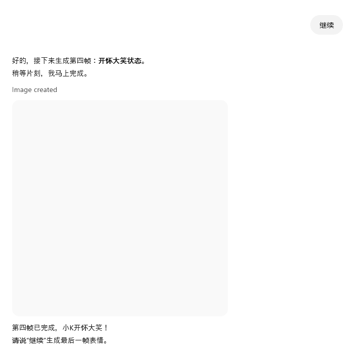
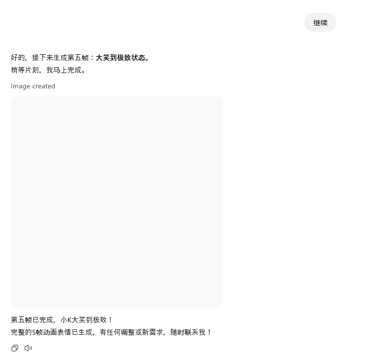
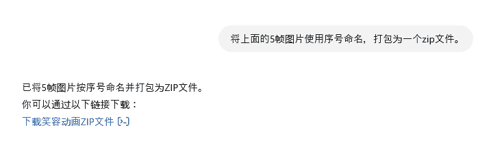
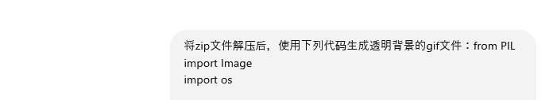
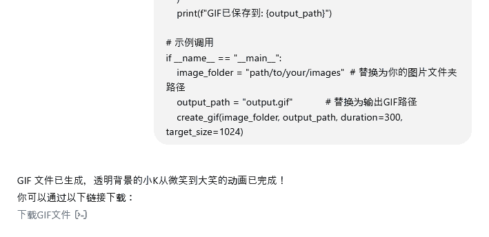
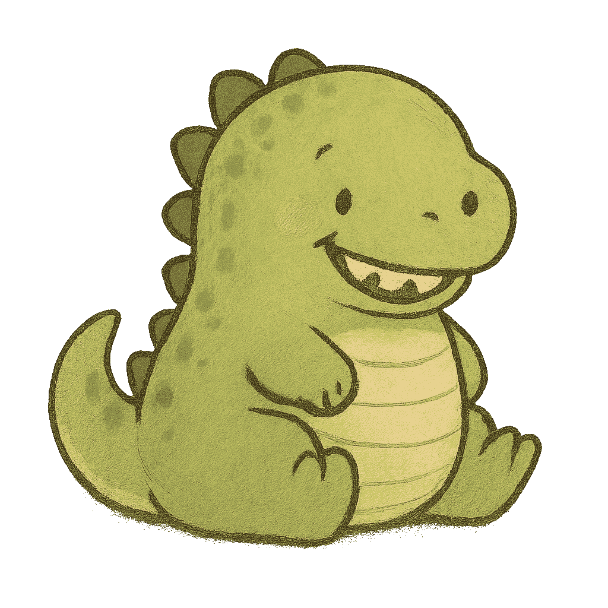

# 如果调整动图的播放速度和动图尺寸大小，修改最后一行代码就可以，其他的都不需要修改。

> 来源：[https://qianniucity.feishu.cn/docx/LFnOdpxAAoqUpExT5pKcEWOPnmc](https://qianniucity.feishu.cn/docx/LFnOdpxAAoqUpExT5pKcEWOPnmc)


先说一下大概思路，掌握了不看下边详细教程也可以。

1.  借助gpt4o生成背景为透明的表情包

1.  通过每次一张图的方法，生成连续的5-10张图

1.  使用gpt4o的python代码执行能力，让gpt执行代码将之前生成的表情包合并为gif动图。

注意，过程中看不到图片也没关系，可能是网络问题导致的，不影响最后一步。

下面是详细教学：

## 1.先让gpt4o生成表情包

prompt示例:（可以随意调整，但是最后结果要求元素简单，为了后期合成的稳定，避免使用复杂元素）

> 生成一个【主体】，可爱的手绘风格，画风简单，背景要求是透明的。

如果出现多次调整后，才出现满意的表情包图片，请复制图片到新对话再开始下面的步骤。



## 2.让gpt4o按照表情包动图所需要的指定动作生成连续的图片

这里需要注意的是，尽量提供动作从开始到结束的描述，让ai可以更好地理解并执行prompt。

GIF动图是由主体动作连续的数张图片轮播而成的，这里的每张图片成为每帧，一帧就是一张图片。笔者测试过的最大数量是10帧，超过10帧出现了后期素材无法获取，不知道是不是网络原因导致的。

prompt示例：

> 生成【主体】从【微笑】到【大笑】连续的【5】帧图片，每次生成一帧，当我说“继续”的时候，再生成下一帧，现在开始。











## 3.将生成的图片合并为一个透明背景的gif表情包

### 3.1 让ai将图片合并为压缩包

经历数次的继续之后，直接发送指令，让ai将之前生成的所有图片打包成一个zip压缩包。这里可以直接下载到本地查看，同时也是给下一步做准备。

prompt：

> 将上述生成的所有图片打成一个zip压缩包。



### 3.2 让ai将压缩包内图片合成为gif

接着，让ai执行下列代码，将生成的图片合并为一个gif文件，完整代码见结尾。







完整代码如下：

```
将zip文件解压后，使用下列代码生成透明背景的gif文件：from PIL import Image
import os

def resize_to_square(img, target_size=1024):
    &quot;&quot;&quot;
    将图片调整为指定尺寸（target_size×target_size），保持透明背景
    &quot;&quot;&quot;
    width, height = img.size
    # 创建透明画布
    new_img = Image.new(&#x27;RGBA&#x27;, (target_size, target_size), (0, 0, 0, 0))
    # 计算缩放比例，保持图片比例
    scale = min(target_size / width, target_size / height)
    new_width = int(width * scale)
    new_height = int(height * scale)
    # 缩放图片
    img_resized = img.resize((new_width, new_height), Image.Resampling.LANCZOS)
    # 居中粘贴
    paste_x = (target_size - new_width) // 2
    paste_y = (target_size - new_height) // 2
    new_img.paste(img_resized, (paste_x, paste_y), img_resized)  # 使用img_resized作为掩码保留透明度
    return new_img

def create_gif(image_folder, output_path, duration=1000, target_size=1024):
    &quot;&quot;&quot;
    将透明PNG图片合成透明背景的GIF，调整为指定尺寸
    &quot;&quot;&quot;
    images = []
    for filename in sorted(os.listdir(image_folder)):
        if filename.endswith(&#x27;.png&#x27;):
            file_path = os.path.join(image_folder, filename)
            img = Image.open(file_path)
            img = img.convert(&#x27;RGBA&#x27;)
            # 二值化Alpha通道
            alpha = img.getchannel(&#x27;A&#x27;)
            alpha = alpha.point(lambda x: 0 if x &lt; 128 else 255)
            img.putalpha(alpha)
            # 调整为1024x1024
            img = resize_to_square(img, target_size)
            images.append(img)
    
    if not images:
        print(&quot;没有找到图片文件！&quot;)
        return
    
    # 保存GIF，确保透明背景
    images[0].save(
        output_path,
        save_all=True,
        append_images=images[1:],
        duration=duration,
        loop=0,
        disposal=2,         # 每帧显示后清除前一帧
        transparency=0,     # 设置透明色索引为0（完全透明）
        background=255,     # 背景色设置为非透明色，避免与透明色冲突
        optimize=False      # 关闭优化，避免透明度丢失
    )
    print(f&quot;GIF已保存到: {output_path}&quot;)

# 示例调用
if __name__ == &quot;__main__&quot;:
    image_folder = &quot;path/to/your/images&quot;  # 替换为你的图片文件夹路径
    output_path = &quot;output.gif&quot;            # 替换为输出GIF路径
    create_gif(image_folder, output_path, duration=200, target_size=1024)
```

如果调整动图的播放速度和动图尺寸大小，修改最后一行代码就可以，其他的都不需要修改。

```
create_gif(image_folder, output_path, duration=200, target_size=1024)
//duration=200 默认每帧图象显示200毫秒，需要更快就将数字调小，需要更慢就将数字调大
//target_size=1024 尺寸是1024*1024 尺寸过大的话无法导入微信，也无法分享。
```