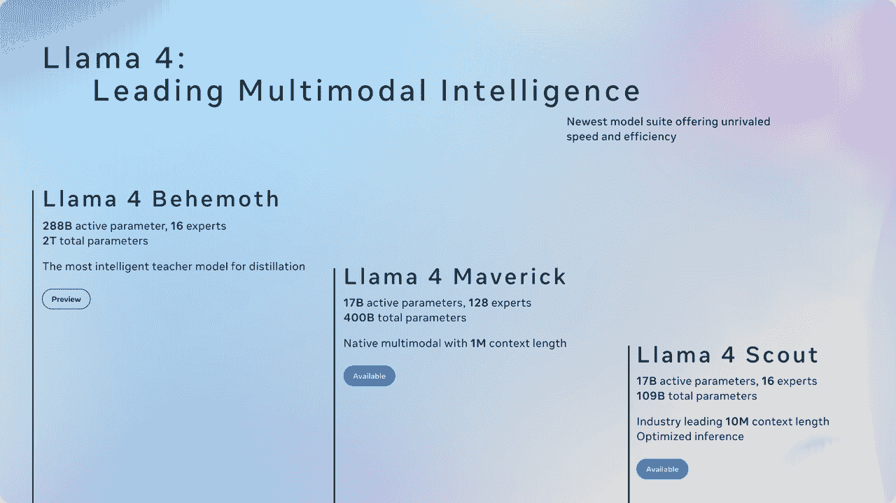

# Llama4 在 Cline 中高效使用指南

> 来源：[https://qianniucity.feishu.cn/docx/Abp8d5w4RoWntOx3xCucz8WWnfe](https://qianniucity.feishu.cn/docx/Abp8d5w4RoWntOx3xCucz8WWnfe)

Llama 4 的 Scout 与 Maverick 模型现已在 Cline 中上线，为开发流程带来了更强大的新选择。以下是如何高效使用它们的指南：

⸻

Llama 4 Scout：系统级分析师

Scout 的最大特点是其 高达 1000 万 tokens 的超大上下文窗口。这意味着 Cline 可以一次性分析整个代码库，首次实现真正的系统级理解。虽然它的基准测试表现中规中矩（HumanEval 得分 67.8），但它的核心优势在于全面、整体的视野。对于大规模分析，它的性价比非常高（0.34 每百万 tokens）。

+   **最适合场景**： 理解复杂或遗留代码、规划大型重构、识别横切关注点、分析系统架构影响等。

+   **使用建议**： 在 Cline 的 Plan 模式 中使用 Scout，利用其全局视角做出战略决策与全面的任务规划。

⸻

Llama 4 Maverick：精准代码生成器

Maverick 专为代码生成与复杂推理任务而优化，内置 128 个专家模型，在 HumanEval（86.8）和 MATH（65.0）等基准测试中表现优异，超越了许多主流模型。它擅长高准确率的代码输出，能有效处理复杂逻辑。

+   **最适合场景**： 生成新功能、编写复杂算法、调试疑难问题、实现精确的代码逻辑。

+   **使用建议**： 在已有明确计划后，在 Cline 的 Act 模式 中使用 Maverick，以实现高质量、高还原度的代码执行。虽然它的价格较高（0.77 每百万 tokens），但对应的是强大的专业能力。

⸻

何时使用 Scout 或 Maverick？

+   需要系统级分析与规划时（Plan 模式）→ 用 Scout

+   需要高性能代码生成与精准实现时（Act 模式）→ 用 Maverick

合理搭配 Scout 与 Maverick，将显著提升你在 Cline 中的开发效率与代码质量。