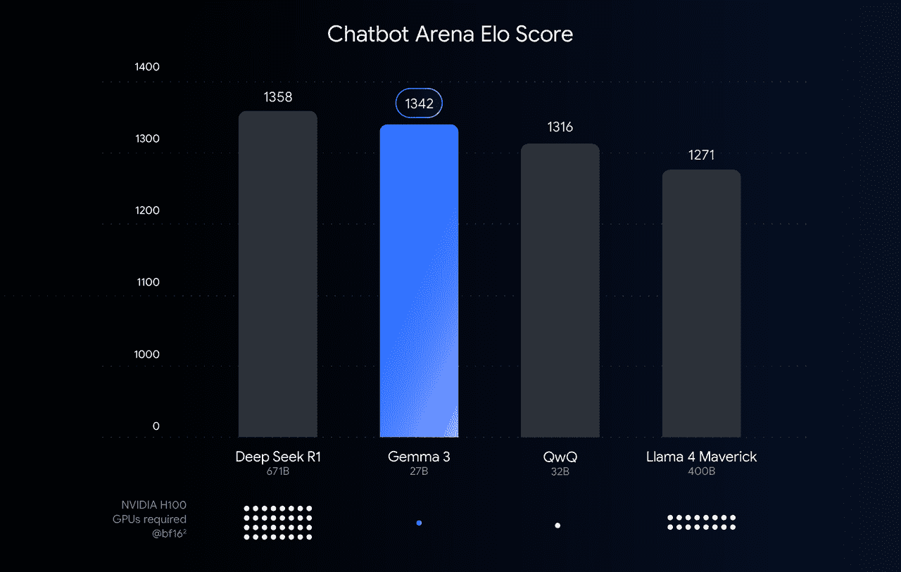
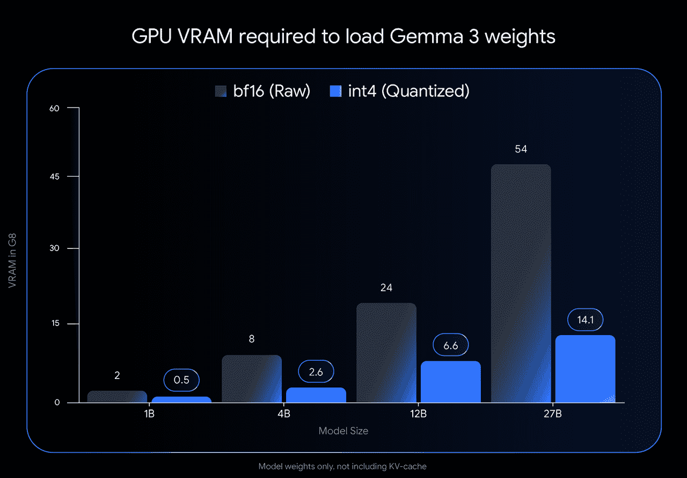
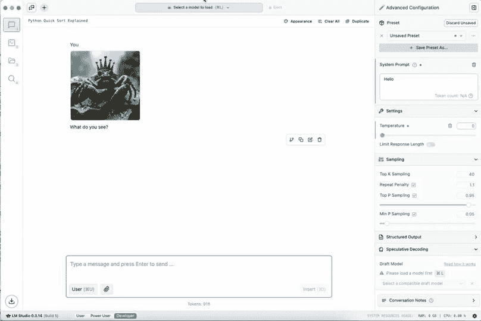

# Google 发布 Gemma 3 QAT 模型：将先进 AI 技术带入消费级 GPU

> 来源：[https://qianniucity.feishu.cn/docx/OjfDdKVDCoeKR4x6zFucFEgwnce](https://qianniucity.feishu.cn/docx/OjfDdKVDCoeKR4x6zFucFEgwnce)


> 经过量化感知训练的 Gemma 3 模型保留了与半精度模型 （BF16） 相似的质量，同时保持了较低的内存占用（与非量化模型相比少 3 倍）。

Google 最近宣布了 Gemma 3 量化感知训练（QAT）模型系列，这是对上个月发布的 Gemma 3 开源模型的重要优化。这一创新使得高性能 AI 模型能够在普通消费者级别的 GPU 上运行，大幅降低了先进 AI 技术的硬件门槛。

Gemma 3 原本就是一款性能出色的模型，能够在单个高端 NVIDIA H100 GPU 上以原生 BFloat16（BF16）精度运行。而新推出的 QAT 优化版本通过量化感知训练技术，显著减少了内存需求，同时保持了高质量的模型性能。这意味着强大的 Gemma 3 27B 模型现在可以在 NVIDIA RTX 3090 等消费级 GPU 上本地运行。



量化技术本质上是减少 AI 模型中数字（参数）的精度。与使用 16 位（BFloat16）表示每个数字相比，量化后的模型可以使用更少的位数，如 8 位（int8）或 4 位（int4）。使用 int4 意味着每个数字仅用 4 位表示，与 BF16 相比数据大小减少了 4 倍。然而，量化通常会导致性能下降，因此 Google 特别开发了对量化具有鲁棒性的 Gemma 3 模型。

Google 采用量化感知训练（QAT）来维持模型质量。与在完全训练后才进行量化不同，QAT 在训练过程中就融入了量化过程，模拟低精度操作，从而在后续量化时减少性能损失。具体来说，他们在约 5,000 步训练中应用了 QAT，使用非量化检查点的概率作为目标，这使得量化到 Q4_0 时困惑度下降减少了 54%。

量化带来的 VRAM（GPU 内存）节省非常显著：

+   Gemma 3 27B：从 54 GB（BF16）降至仅 14.1 GB（int4）

+   Gemma 3 12B：从 24 GB（BF16）缩减至 6.6 GB（int4）

+   Gemma 3 4B：从 8 GB（BF16）减少至 2.6 GB（int4）

+   Gemma 3 1B：从 2 GB（BF16）降至 0.5 GB（int4）



这些大幅减少使得在广泛可用的消费级硬件上运行更大、更强大的模型成为可能：

+   Gemma 3 27B（int4）：现在可以舒适地在单个桌面 NVIDIA RTX 3090（24GB VRAM）或类似显卡上运行

+   Gemma 3 12B（int4）：可以在笔记本电脑 GPU 如 NVIDIA RTX 4060 笔记本 GPU（8GB VRAM）上高效运行

+   更小的模型（4B， 1B）：为资源更受限的系统提供更高的可访问性

Google 还确保了这些模型可以轻松集成到流行的开发工具中。官方 int4 和 Q4_0 未量化 QAT 模型已在 Hugging Face 和 Kaggle 上提供。此外，Google 与 Ollama、LM Studio 和 MLX 等流行开发者工具合作，使用户能够无缝试用基于 QAT 的量化检查点。

```
# 1B参数模型
ollama run gemma3:1b-it-qat
# 4B参数模型
ollama run gemma3:4b-it-qat
# 12B参数模型
ollama run gemma3:12b-it-qat
# 27B参数模型
ollama run gemma3:27b-it-qat
```

这一进展代表了 AI 民主化的重要一步，使更多开发者和爱好者能够在自己的硬件上运行强大的 AI 模型，而不必依赖昂贵的云服务或高端专业设备。

## 相关链接：

+   [ 模型部署体验（Gemma 3 QAT 在消费级设备上的表现）](https://qianniucity.feishu.cn/wiki/THLfwG91biLgbQkBDNwcpMNnnHh)

+   原文：https://developers.googleblog.com/en/gemma-3-quantized-aware-trained-state-of-the-art-ai-to-consumer-gpus/

## 图像识别



[fUiF0gcER-08-g2j.mp4](https://internal-api-drive-stream.feishu.cn/space/api/box/stream/download/all/Xhb2bJsgHoGRKtxi3wVcpW7XnNd)