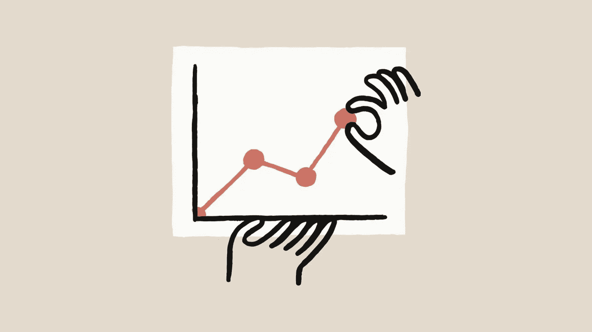
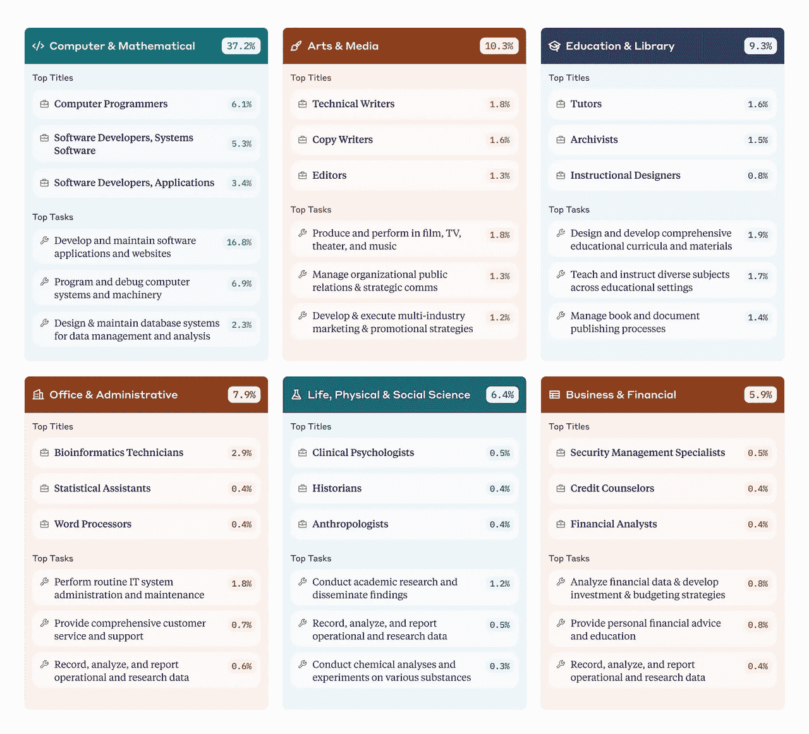
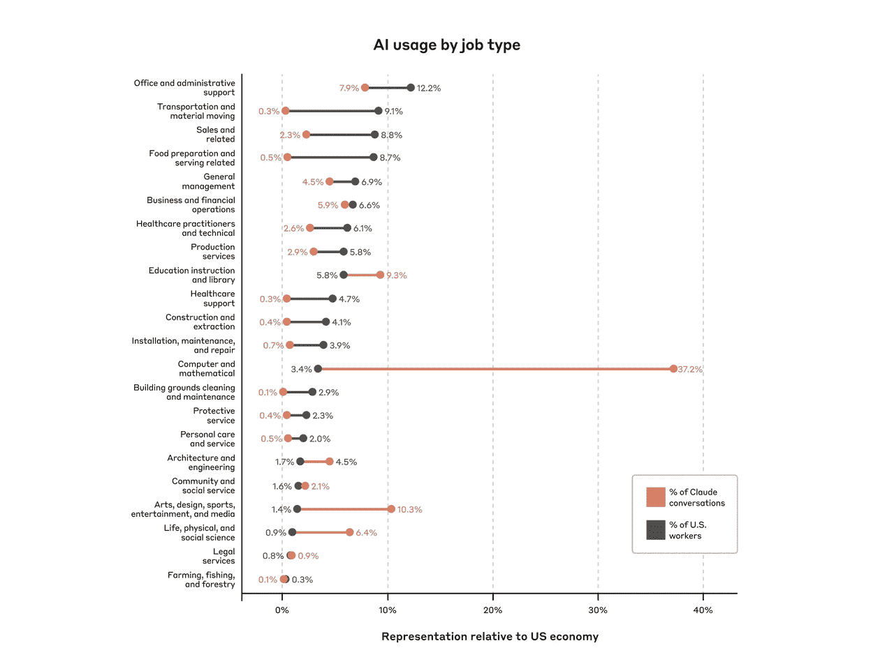
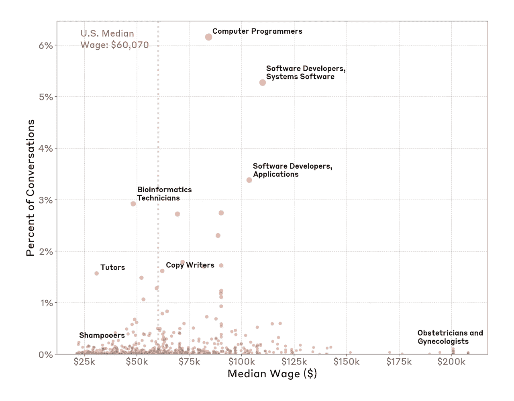

# Anthropic 经济指数

> 来源：[https://qianniucity.feishu.cn/docx/EkCSddOctoqW64xlrRQcNH8rn5A](https://qianniucity.feishu.cn/docx/EkCSddOctoqW64xlrRQcNH8rn5A)

## **导读**

Anthropic 经济指数，通过深入分析数百万个匿名对话，揭示了 AI 如何渗透到现代经济中的各个角落。

研究发现，AI 的使用正逐渐集中于软件开发和技术写作任务，且更倾向于增强人类能力而非完全自动化。这一趋势在中等至高薪职业中尤为明显，但在低薪和最高薪角色中的使用相对较低。

我们的分析还表明，尽管 AI 在某些任务中得到了广泛应用，但很少有职业在其大部分任务中完全依赖 AI。此外，AI 的使用与薪资水平呈现出有趣的关系，中等至高薪资范围的工作成为 AI 的最大用户之一。

本文不仅提供了关于 AI 如何改变劳动力市场的独特视角，还为未来的研究和政策制定提供了重要参考。通过揭示 AI 在经济中的实际应用情况，我们希望能激发更多关于如何应对这一变革的讨论和思考。

欲了解更多关于 Anthropic 经济指数的细节和发现，请继续阅读本文。

在未来几年里，人工智能系统将对人们的工作方式产生重大影响。因此，我们推出了 Anthropic 经济指数，这是一个旨在了解人工智能对劳动力市场和经济的长期影响的倡议。

该指数的首份报告提供了基于数百万个匿名对话的首次数据和分析，这些对话来自 Claude.ai，揭示了人工智能如何被整合到现代经济中的实际任务的清晰画面。

我们还开源了用于此分析的数据集，以便研究人员可以基于我们的发现进行扩展。为应对劳动力市场的变革及其对就业和生产力的影响，制定政策反应需要多种观点。为此，我们还邀请经济学家、政策专家和其他研究人员为指数提供意见。

经济指数首篇论文的主要发现包括：

+   目前，人工智能的使用集中在软件开发和技术写作任务上。超过三分之一的职业（约 36%）在其相关任务的至少四分之一中看到人工智能的使用，而大约 4%的职业在其相关任务的四分之三中使用人工智能。

+   人工智能的使用更倾向于增强（57%），即人工智能与人类能力协作并增强，而不是自动化（43%），即人工智能直接执行任务。

+   人工智能的使用在中等至高薪职业（如计算机程序员和数据科学家）的任务中更为普遍，但在最低和最高薪酬角色中的使用较低。这可能反映了当前人工智能能力的限制，以及使用该技术的实际障碍。

有关我们初步发现的更多细节，请参见下文。

从 Claude.ai 的真实世界使用数据中绘制的人工智能在经济中的使用情况。数字表示与 Claude 的对话中有多少与那些单独的任务、职业和类别相关。

## 劳动力市场中人工智能的使用

我们的新论文基于关于技术对劳动力市场影响的一系列研究，从工业革命时期的珍妮纺纱机到当今的汽车制造机器人。我们关注人工智能的持续影响。我们没有调查人们的人工智能使用情况，也没有试图预测未来；相反，我们拥有直接关于人工智能实际使用情况的数据。

### 分析职业任务

我们的研究始于经济学文献中的一个重要见解：有时关注职业任务而不是 职业本身是有意义的。工作通常具有某些共同的任务和技能：例如，视觉模式识别是由设计师、摄影师、安全检查员和放射科医师执行的任务。

某些任务比其他任务更适合被新技术自动化或增强。因此，我们预计人工智能将在不同职业的不同任务中被选择性采用，分析任务（以及整个工作）将为我们提供一个更完整的关于人工智能如何融入经济的画面。

### 使用 Clio 将人工智能使用与任务匹配

这项研究得益于 Claude 的洞察力和观察，或者说“Clio”，这是一种自动化分析工具，允许我们在保护用户隐私的同时分析与美国 Claude 的对话。我们在一个大约一百万个与美国 Claude 的对话（具体来说，是美国 Claude.ai 上的免费和 Pro 对话）的数据集上使用了 Clio，并用它来按职业任务组织对话。

我们根据美国劳工部维护的一个包含约 20,000 个特定工作相关任务的数据库，即职业信息网络（ONET）的分类来选择任务。Clio 将每个对话与最能代表对话中人工智能角色的 ONET 任务匹配（该过程在下图中总结）。然后我们按照 O* NET 方案将任务分组到它们最佳代表的职业中，再将职业分组到一小组总体类别中，如教育和图书馆、 商业和金融等。

我们的 Clio 系统将与美国 Claude 的对话（严格保密；左上角）转换为职业任务（中上角）以及从 O*NET 派生的职业/职业类别（右上角）。然后可以将这些输入到各种分析中（底部行；在下文中更详细地讨论）。

## 结果

**按工作类型划分的人工智能使用。** 我们数据集中采用人工智能最多的任务和职业是“计算机和数学”类别，该类别在很大程度上涵盖了软件工程角色。发送给 Claude 的查询中有 37.2%属于此类别，涵盖了诸如软件修改、代码调试和网络故障排除等任务。

第二大类别是“艺术、设计、体育、娱乐和媒体”（占查询的 10.3%），主要反映了人们使用 Claude 进行各种写作和编辑。不出所料，涉及大量体力劳动的职业，如“农业、渔业和林业”类别（占查询的 0.1%）最少。

我们还将我们的数据中的比率与一般劳动力市场中每个职业出现的比率进行了比较。比较结果如下图所示。

对于每种工作类型，与美国经济中具有该工作类型的工人百分比（来自美国劳工部的 O*NET 类别）相比，与美国 Claude 的相关对话的百分比显示为橙色。

**职业中人工智能使用的深度。** 我们的分析发现，很少有职业在其大部分相关任务中使用人工智能：只有大约 4%的工作至少在 75%的任务中使用人工智能。然而，更适度的人工智能使用更为普遍：大约 36%的工作至少在 25%的任务中有一些人工智能使用。

正如我们预测的那样，我们的数据集中没有证据表明工作被完全自动化：相反，人工智能在经济中的许多任务中得到扩散，对某些任务群体的影响更大。

**人工智能使用和薪资。** O*NET 数据库为列出的每个职业提供了美国薪资中位数。我们将这一信息添加到我们的分析中，允许我们比较职业的中位薪资和相应任务中的人工智能使用水平。

有趣的是，低薪和非常高薪的工作人工智能使用率都非常低（这些工作通常涉及大量的手动灵巧度，如洗发师和产科医生）。在我们的数据中，特定职业的中等至高薪资范围，如计算机程序员和文案撰写者，是人工智能使用的最大用户之一。

年薪（x 轴）与涉及该职业的与美国 Claude 的对话百分比（y 轴）。一些说明性的职业被突出显示。

**自动化与增强。** 我们还更详细地研究了任务是如何执行的——特别是哪些任务涉及“自动化”（人工智能直接执行任务，如格式化文档）与“增强”（人工智能与用户合作执行任务）。

总的来说，我们看到略微倾向于增强，有 57%的任务被增强，43%的任务被自动化。也就是说，在略多于一半的情况下，人工智能没有被用来替代人们完成任务，而是与他们一起工作，参与诸如验证（例如，复查用户的工作）、学习（例如，帮助用户获取新知识和技能）和任务迭代（例如，帮助用户头脑风暴或以其他方式进行重复的生成任务）等任务。

与美国 Claude 的对话中涉及增强与自动化的百分比，以及每个类别中的任务子类型的细分。子类型在我们的论文中定义如下。指令：最小互动的完整任务委派；反馈回路：环境反馈指导的任务完成；任务迭代：协作细化过程；学习：知识获取和理解；验证：工作验证和改进。

### 注意事项

我们的研究为我们提供了一个独特的视角，了解人工智能如何改变劳动力市场。但与所有研究一样，它也有一些重要的局限性。其中一些包括：

+   我们不能确定使用 Claude 完成任务的人是否在工作。例如，有人可能会向 Claude 寻求写作或编辑建议，可能是在工作中，但也可能是为了他们作为爱好的小说。

+   相关地，我们不知道用户是如何使用 Claude 的回应的。例如，他们是在复制粘贴代码片段吗？他们是在核实回应还是不加批判地接受？我们数据中的一些自动化可能实际上是增强：例如，用户可能会让 Claude 为他们写一份完整的备忘录（这会显示为自动化），但之后他们会自己编辑（这将是增强）。

+   我们只分析了 Claude.ai 免费和 Pro 计划的数据，而不是 API、团队或企业用户的数据。虽然 Claude.ai 数据包含一些非工作对话，但我们使用了语言模型来过滤这些数据，只保留与职业任务相关的对话，这有助于减轻这种担忧。

+   不同任务的数量之多意味着 Clio 可能错误地分类了一些对话（请参阅完整论文，特别是附录 B，了解我们如何验证分析的详细信息）；

+   Claude 无法生成图像（除非通过代码间接），因此一些创造性用途不会在数据中引用；

+   鉴于 Claude 被宣传为最先进的编码模型，我们可能会期望编码作为用例被过度代表。因此，我们不认为我们数据集中的用途是人工智能使用的一般代表样本。

## 结论和未来研究

人工智能的使用正在迅速扩大，模型变得越来越强大。劳动力市场的画面可能在相对较短的时间内发生很大变化。因此，我们将重复上述许多分析，以帮助跟踪可能发生的社会和经济变化。我们将定期发布结果和相关数据集，作为 Anthropic 经济指数的一部分。

这些类型的纵向分析可以为我们提供关于人工智能和就业市场的新见解。例如，我们将能够监测职业中人工智能使用深度的变化。如果人工智能仍然只用于某些任务，而只有少数工作使用人工智能执行大部分任务，那么未来可能是一个大多数当前工作演变而不是消失的世界。我们还可以监测自动化与增强的比例，提供自动化变得越来越普遍的领域的信号。

我们的研究提供了关于人工智能如何被使用的数据，但它没有提供政策建议。关于如何为人工智能对劳动力市场的影响做好准备的问题，不能仅仅来自孤立的研究；相反，它们将来自证据、价值观和广泛视角的经验的结合。我们期待使用我们的新方法来揭示这些问题。

阅读完整论文以获取我们分析和结果的更多细节。

## 开放数据和呼吁输入

本文和 Anthropic 经济指数最重要的贡献是其提供关于人工智能影响详细数据的新方法。我们立即公开分享了用于上述分析的数据集，并计划在未来提供进一步的数据集。

完整的数据集可以在此处下载。

研究人员提供对我们数据的反馈并建议新研究方向的表格在此处。

## 致谢

我们感谢 Jonathon Hazell、Anders Humlum、Molly Kinder、Anton Korinek、Benjamin Krause、Michael Kremer、John List、Ethan Mollick、Lilach Mollick、Arjun Ramani、Will Rinehart、Robert Seamans、Michael Webb 和 Chenzi Xu 对早期发现和论文草稿的建设性评论和讨论。

## 加入我们

如果您有兴趣在 Anthropic 研究人工智能对劳动力市场的影响，我们鼓励您申请我们的社会影响研究科学家和研究工程师职位。