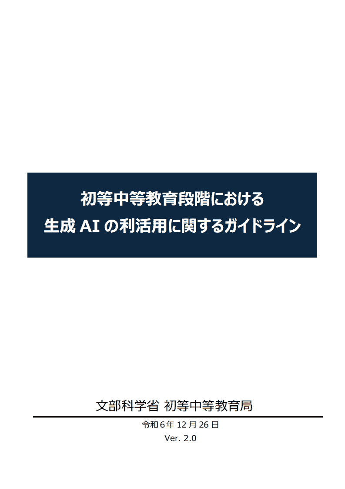
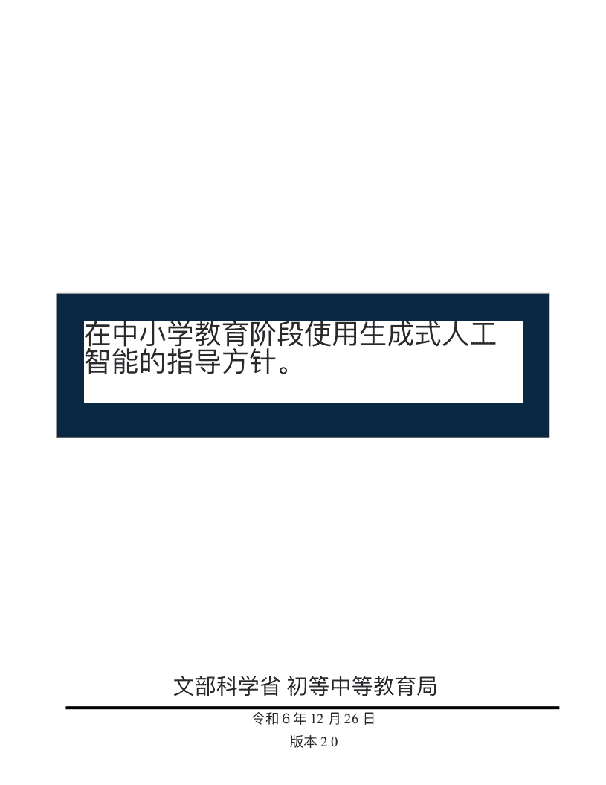

# （翻译）《日本初等中等教育阶段生成AI的利用指南》概要总结

> 来源：[https://qianniucity.feishu.cn/docx/VgXrdacLGobTdrxDWHJcO1Mzn4c](https://qianniucity.feishu.cn/docx/VgXrdacLGobTdrxDWHJcO1Mzn4c)

#### **1. 文件背景与目的**

+   近年来生成AI（如ChatGPT）迅速普及，其在教育领域的潜力和风险引发广泛关注。本指南旨在帮助初等和中等教育阶段合理利用生成AI，明确其在学校教育中的定位、基本方针以及实践要点，避免一刀切式的禁止或强制使用。文部科学省基于教育技术专家、AI研究人员及教育工作者的意见，于2023年7月发布了初版指南（Ver.1.0），本次更新为Ver.2.0，进一步考虑技术进展和学校实际情况。

#### **2. 生成AI的核心特点与价值**

+   **特点**：生成AI通过学习大量数据生成高质量的文本、图像、代码等，具备辅助学习和工作的潜力，但也存在如偏见、错误输出（幻觉）等风险。

+   **价值**：在学校场景中，生成AI可用于提升学生的学习体验（如个性化学习支持、语言学习），改善教师的工作效率（如备课、文档生成）。

#### 3. 学校场景中的生成AI利用原则

+   **人本中心原则**：生成AI是工具而非替代品，其输出仅为参考，最终判断和责任由人类承担。

+   **培养信息能力**：通过生成AI的使用，提升学生的信息素养、批判性思维和问题解决能力。

+   **平衡技术与教育**：在实际教学中，需兼顾传统教育方法与生成AI的技术应用。

#### 4. 学校应用的具体场景与注意事项

+   **教师校务应用**：

+   用于备课（如生成教材、测试题草案）、校内外沟通（如通知文、家长信）及校内研修（如会议记录）等。

+   利用时需遵守信息安全规定，避免输入个人信息或敏感数据。

+   **学生学习应用**：

+   可用于语言学习（如英语写作、口语练习）、创意活动（如编程）及问题解决等。

+   禁止将生成AI输出直接作为个人成果提交，需强调信息真实性与引用规范。

+   **教育委员会的支持**：

+   制定区域性政策，提供培训和技术支持，灵活应对学校实际需求。

+   确保服务的安全性与经济可行性，避免因技术或费用问题对教育公平造成影响。

#### **5. 风险与伦理考量**

+   **技术风险**：生成AI可能输出带有偏见、不准确或侵权的内容。

+   **信息安全**：输入的个人信息可能被AI利用或泄露。

+   **教育伦理**：过度依赖生成AI可能削弱学生的学习能力和批判性思维。

#### **6. 实践与参考资源**

+   **先行试点案例**：

+   如大阪市立天王寺中学利用生成AI生成测试题草案，极大提升了工作效率。

+   茨城县学园的森义务教育学校通过生成AI辅助学生进行小组讨论，拓展了思维深度。

+   **参考资料**：

+   包括生成AI的使用检查清单、培训教材（如文部科学省的在线研修视频）及国内外相关政策文件。

#### **7. 总结**

本指南为初等中等教育阶段的生成AI利用提供了全面框架，既强调技术的教育潜力，又注重风险管控及伦理规范。通过合理利用生成AI，学校可在提升教学质量与效率的同时，培养学生适应未来社会的关键能力。

原文内容及翻译内容

[初等中等教育段階における生成AIの利活用に関するガイドライン.pdf](https://internal-api-drive-stream.feishu.cn/space/api/box/stream/download/all/B6PHbKc9IomIpQxQpAHcYkhInad)

[初等中等教育阶段生成AI的利用指南.pdf](https://internal-api-drive-stream.feishu.cn/space/api/box/stream/download/all/NF8HbHPFdoqOaXx0V3vcwcJqnic)