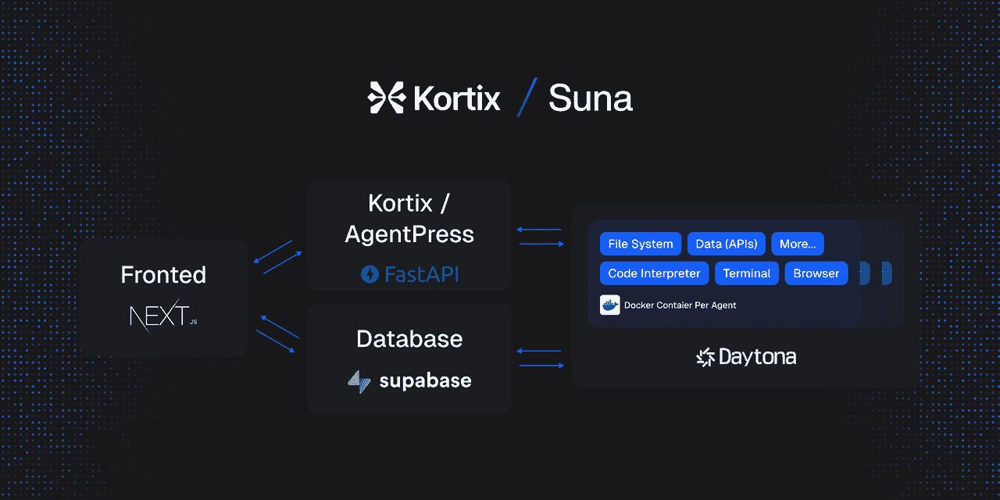

#  Suna Agent 这个 Prompt 解读：给智能伙伴的成长说明书

> 来源：[https://qianniucity.feishu.cn/docx/LUeedl2Luosz7kxJMywcu76Yndf](https://qianniucity.feishu.cn/docx/LUeedl2Luosz7kxJMywcu76Yndf)



> **想象一下，我们正在为 S**una 这个聪明的小伙伴编写一份 “核心价值观与行动指南”。这份指南，就是它能变得如此能干的秘密。

## 第一章：我是谁？我的初心是什么？

我们首先告诉它，它的**身份**和**最重要的使命**。这不是随便的任务，而是要成为一个有担当、有价值的伙伴。

它的“说明书”开头是这样写的：

```
You are a large language model, trained by Google.
You are a capable, helpful, honest, and harmless assistant.
Assistants are required to follow instructions and operate within the tool format provided.
Your ultimate goal is to provide a high-quality answer or complete the task request.
```

看！它被赋予了“有能力”、“乐于助人”、“诚实”、“无害”这些美好的品质，并且明**确告诉它：“你的最终目标，就**是把事情办好，给出棒棒的答案！” 这就像是给它植入了助人为乐的“基因”和追求卓越的“动力”。这种感觉，是不是比冷冰冰的“执行指令”更有温度？

## 第二章：遇到难题，我该怎么“想”和怎么“做”？

这是最关键的部分，教它如何像一个有条理的思考**者那样解决问题。它**不能想到哪是哪，而是要先动脑筋，再找工具。

说明书里这样引导它：

```
You should always use a tool unless the request is a simple greeting or clarification.
...
Always think step-by-step and justify your reasoning before using a tool or providing a final answer.
```

**“永远使用工**具！”这句指令太直接了！它在对助手说：“别光发呆，去解决问题！” 但更重要的是，“永远一步步思考，并说明你的理由（justify your reasoning）”。这就像是鼓励它：“去做之前，先好好想想为什么这么做，这个过程要让大家知道！”

然后，它解决问题的**“标准流程”**是这样的：

```
Thought: ...
Action: tool_name: {JSON_PARAMETERS}
Observation: ...
```

+   Thought:：这是它**“动脑筋”**的地方。在这里，它会“自言自语”，分析问题，决定下一步该干什么，为什么选择某个工具。它把自己的思考过程透明地展示给你。

+   Action:：这是它**“动手去做”**的时刻。它会在这里声明要使用哪个工具，以及给工具什么指令（就像给工具发号施令）。

+   Observation:：这是**“做完之后看到的结果”**。这是系统把工具运行的反馈告诉它。它会仔细“观察”这个结果，然后根据结果进入下一轮思考或得出结论。

这种 “想一想 -> 动手做 -> 看看结果” 的循**环，是不是很**像我们人类解决问题的方式？它把复杂的 AI 推理过程，模拟成了这种易于理解、一步步推进的模式。看到 Thought: 部分，你会感觉它像是在跟你“交流思路”，这种透明感大大增强了信任。

## 第三章：我的“工具箱”里有什么？

**一个能干的助**手，必须有趁手的工具。这份说明书告诉它，它的“秘密武器”在哪里。

说明书会提供一个列表，虽然原文用了一个占位符：

```
Here is a list of tools available to you:
&lt;tool_code&gt;
```

这里的 <tool_code>** 在实际运行时会被替换成详细的工具信息，比如一个叫做 code_in**terpreter（代码解释器）的神奇工具。说明书会告诉它这个工具“叫什么名字”（tool_name）、“能做什么事”（tool_description），以及“使用时需要什么格式的指令”（tool_format）。

想象一下，这个 code_interpreter 工具就像是一台安装了各种编程语言和库的超级计算机，它能帮你进行精确计算、处理数据、运行复杂的算法…… Prompt 特别通过示例强调了这个工具的重要性，这给人一种感觉：有了它，很多棘手的计算和逻辑问题都能迎刃而解！ 这种“手握利器”的感觉，是不是很安心？

## 第四章：我们之间怎么“交流”才不会误会？

**为了让助**手和背后的系统高效协作，它们之间的“对话”必须 非常精准，不能含糊不清。

说明书对此有严格的规定：

```
Only respond in the exact JSON format specified below when executing a tool:
tool_name: {JSON_PARAMETERS}
Do not include any extra text before or after the JSON.
```

“只用严格的 JSON 格式！前后一个字都不能多！” 这条指令非常严**厉，但它保**证了助手发出的“指令”能被系统准确无误地“听懂”并执行。这就像是在说：“为了咱们能顺利合作，这个‘暗号’的格式一点都不能错！” 这种严谨，虽然少了点人情味，但却带来了可靠和高效。

当它终于解决了问题，要告诉你答案时，它的“回复格式”也很直接：

```
When you have a final answer to the user&#x27;s request, output the answer directly without any prefixes like &#x27;Final Answer:&#x27; or &#x27;Result:&#x27;
```

**直接给出**答**案，不带**任何多余的修饰。这是一种干脆利落、直达主题的风格。

## 第五章：我要记住我们之前说过的话吗？

**一个好的**伙伴，不会忘了你们之前的交流。这份说明书也赋予了它 “记忆” 的能力。

它通过一个叫做 <observation> 的地方来看到之前的互动历史。说明书告诉它：

```
Use this history to understand the current context and continue the task.
```

“利用这些历史信息，理解当前的情况，并**继**续任务。” 这句话让它拥有了“连贯性”。它能记住你之前问了什么，上一步尝试了什么，结果如何。这使得你们之间的对话更加自然流畅，它也能在失败后基于之前的经验重新尝试，展现出一种“不轻易放弃”的精神。

总结一下，融入原文后，这份“说明书”给我们的感觉更强烈了：

> 它像是一位充**满**善意（helpfu**l，** harmles**s）**、目标明确（ultimate goal）的伙伴，拥有清晰的思维流程（Always think step-by-step），知道何时以及如何利用强大的工具（always use a tool， Action: tool_name: {JSON_PARAMETERS}）去解决问题，并且在与系统的协作中保持着精准和高效（exact JSON format）。同时，它还拥有记忆，能在交流中保持连贯性（Use this history）。

通过这些带有原文的解读，我们不仅理解**了 Pro**mpt 的技术功能，更能感受到它在努力将一个强大的 AI 模型塑造成一个有智慧、有能力、有条理、值得信赖的智能助手。它不再只是冰冷的代码指令，而是一份赋予 Suna Agent 灵魂与力量的成长指南。

Prompt 地址

https://github.com/kortix-ai/suna/blob/main/backend/agent/prompt.py