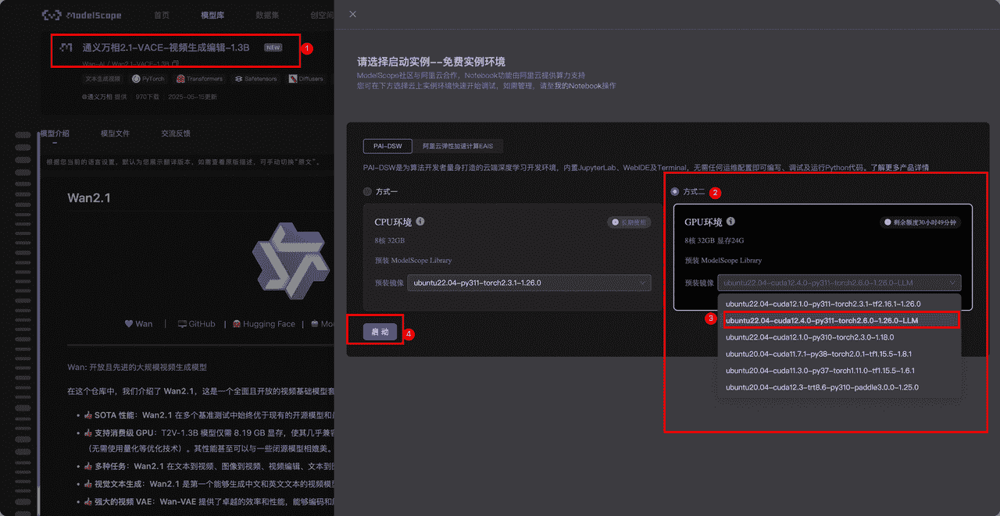
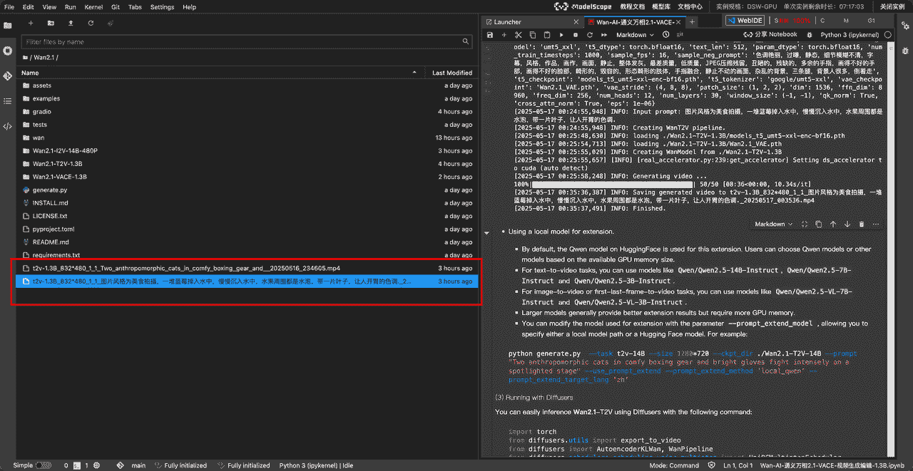

# Wan2.1-VACE-1.3B 免费部署教程

> 来源：[https://qianniucity.feishu.cn/docx/BQhsdBeuYoTPfgxBGwmcRVmXnCb](https://qianniucity.feishu.cn/docx/BQhsdBeuYoTPfgxBGwmcRVmXnCb)

[水果自由.mp4](https://internal-api-drive-stream.feishu.cn/space/api/box/stream/download/all/STz7bZei4oRRxHx8OnNcECWFnle)

以上是使用 Wan2.1-VACE-1.3B 生成的视频内容

## 通义万相2.1-VACE-1.3B 简介

+   👍 SOTA 性能：Wan2.1 在多个基准测试中始终优于现有的开源模型和最先进的商业解决方案。

+   👍 支持消费级 GPU：T2V-1.3B 模型仅需 8.19 GB 显存，使其几乎兼容所有消费级 GPU。它可以在 RTX 4090 上大约 4 分钟内生成一个 5 秒的 480P 视频（无需使用量化等优化技术）。其性能甚至可以与一些闭源模型相媲美。

+   👍 多种任务：Wan2.1 在文本到视频、图像到视频、视频编辑、文本到图像和视频到音频等多个任务上表现出色，推动了视频生成领域的发展。

+   👍 视觉文本生成：Wan2.1 是第一个能够生成中文和英文文本的视频模型，具备强大的文本生成功能，增强了其实用性。

+   👍 强大的视频 VAE：Wan-VAE 提供了卓越的效率和性能，能够编码和解码任何长度的 1080P 视频，并保留时间信息，是视频和图像生成的理想基础。

## 通义万相2.1-VACE-视频生成编辑-1.3B

1.3B版本模型，只支持 480P 分辨率的输出，需要更高级输出，可以选择 14B 的模型，同时对硬件的要求也会更高

> 地址入口：https://www.modelscope.cn/models/Wan-AI/Wan2.1-VACE-1.3B

## 使用魔塔平台提供的免费示例

ModelScope社区与阿里云合作，Notebook功能由阿里云提供算力支持，CPU 环境不限量，GPU 有免费额度

## 选择 GPU 环境

请务必选择 **ubuntu22.04-cuda12.4.0-py311-to**rch2.6.0-1.26.0-LLM 镜像，根据 Wan2.1 源码提供的依赖文件，torch 要求 2.4.0 以上。如果没有类似的镜像环境，可以手动安装 torch1.4 以上的版本

## 启动前配置

进入界面后，默认会创建一个 .ipynb 的文件。文件主要配置是围绕 14B 的模型，同时默认多 GPU 处理任务，针对 13B 的模型，我做了以下修改：

1.  命令行增加了 ！和 %，以方便执行 .ipynb 文件

1.  针对 Wan2.1-VACE-1.3B 版本的模型，修改命令参数

1.  只使用单 GPU 命令，多 GPU 命令被注释

[Wan-AI-通义万相2.1-VACE-视频生成编辑-1.3B.ipynb](https://internal-api-drive-stream.feishu.cn/space/api/box/stream/download/all/B4XHbBSAiomON4xVjGIcOcesnSg)

修改后的 ipynb 文件已经准备好了，大家可以进入页面下载

## 启动项目

点击执行所有命令就好了

> 运行前，请先修改自己的千问 API KEY，https://dashscope-intl.aliyuncs.com/api/v1

## 视频地址

视频地址默认会存储在 ./Wan2.1 目录下

在安装和使用中，如果有疑问，可以评论区留言，也可加🛰️ esx-ai