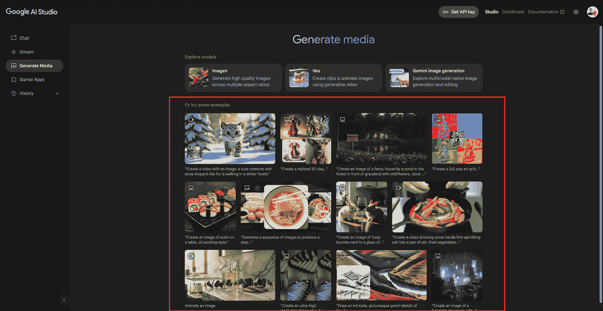
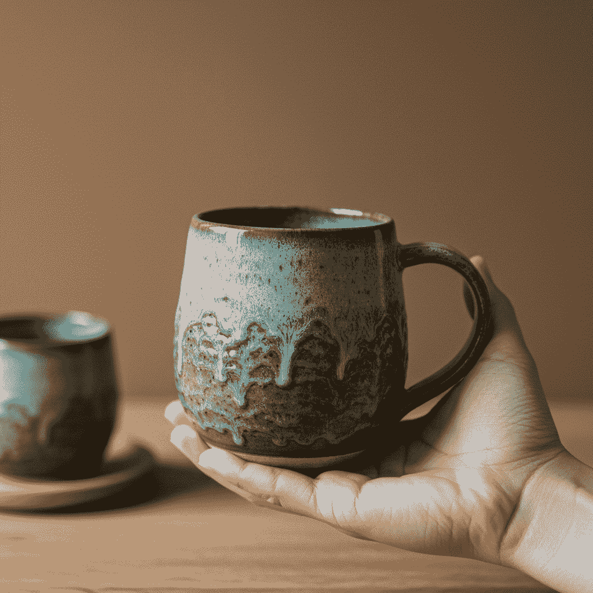
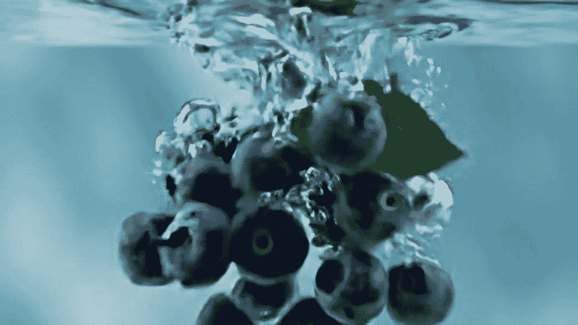
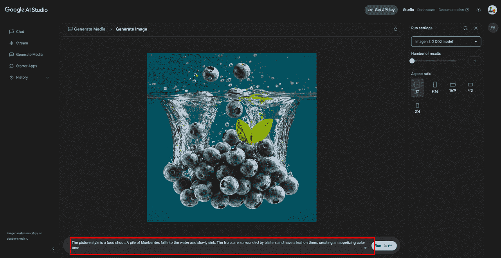
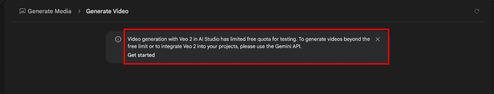

# AI Studio 新增 Veo2 和 Imagen3.0 生成功能，中文支持有待优化

> 来源：[https://qianniucity.feishu.cn/docx/BnmEdQr0Rou79Ox07uZcIg4UnLg](https://qianniucity.feishu.cn/docx/BnmEdQr0Rou79Ox07uZcIg4UnLg)

Google AI Studio 最近悄然新增了多媒体生成功能的支持，包括 Veo 2 用于生成视频，以及 Imagen 3.0 用于生成图片。这些功能涵盖了多种生成方式，如文字生成图片、文字生成视频，以及通过参考图片生成视频。


体验入口已经开放，用户可以通过以下链接尝试：https://aistudio.google.com/gen-media。

官方还贴心地提供了多种风格的示例，供用户参考和使用

> 更多提示词：https://qianniucity.feishu.cn/wiki/JUMBwXdIiiZD8ck8LhxcwOz3n7d?from=from_copylink



用户可以输入提示词来生成所需的图片。例如：

> The picture style is a food shoot. A pile of blueberries fall into the water and slowly sink. The fruits are surrounded by blisters and have a leaf on them, creating an appetizing color tone


> {

> "task": "Generate Product Description and Image Spec",

> "product_name": "Handmade Ceramic Mug",

> "key_selling_points": ["Unique Glaze Finish", "Ergonomic Handle", "Microwave Safe"],

> "target_customer": "Artisan craft lovers",

> "text_description_spec": {

> "length": "Approx. 150 words",

> "tone": "Warm and Craftsmanship-focused",

> "structure": ["Highlight uniqueness", "Mention practicality", "Suggest usage scenarios"]

> },

> "image_spec": {

> "number_of_images": 2,

> "image_1": {

> "subject": "The mug from the side, showing the glaze texture",

> "style": "Natural lighting, focus on detail, soft background"

> },

> "image_2": {

> "subject": "The mug being held, showing scale and handle feel",

> "style": "Lifestyle shot, warm atmosphere"

> }

> }

> }



视频生成支持文字生成视频，以及通过参考图片生成视频。效果也是非常非常炸裂



[Generated video 1.mp4](https://internal-api-drive-stream.feishu.cn/space/api/box/stream/download/all/SjGjbE3GioCOeIxUVfyc0ZBDnFc)

需要注意的是，目前文生图对中文的支持还不够理想，常见的处理方式是将中文提示词转换成英文。

比如相同的提示词

```
英文：The picture style is a food shoot. A pile of blueberries fall into the water and slowly sink. The fruits are surrounded by blisters and have a leaf on them, creating an appetizing color tone

中文：图片风格为美食拍摄，一堆蓝莓掉入水中，慢慢沉入水中，水果周围都是水泡，带一片叶子，让人开胃的色调 
```




此外，对于 Veo 2 的视频生成功能，用户在 AI Studio 中可以享受有限的免费测试配额。如果需要生成超出免费限额的视频，或将 Veo 2 集成到自己的项目中，可以通过 Gemini API 实现。（Imagen 3.0 的文生成图也一样）



Google 最近推出的一系列新功能，无论是编程还是多媒体生成，对创作者或者开发者来说，都充满了吸引力。