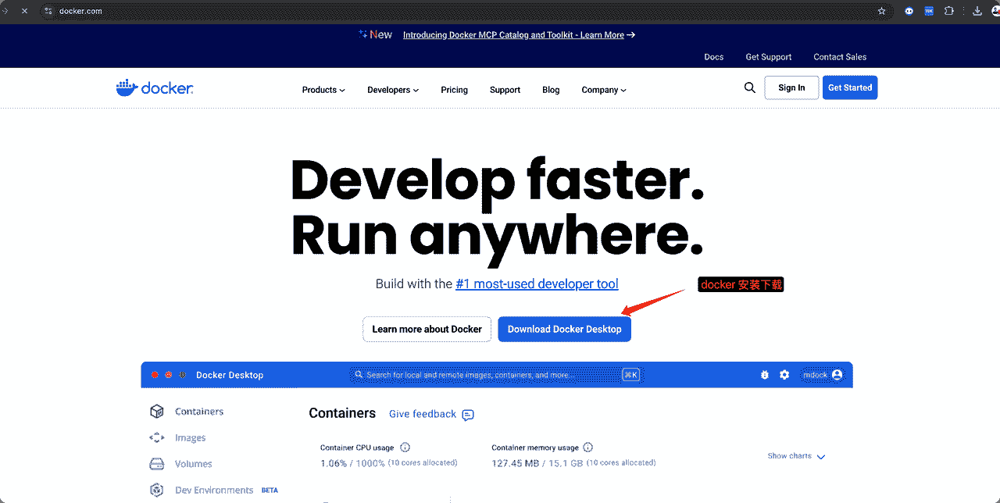
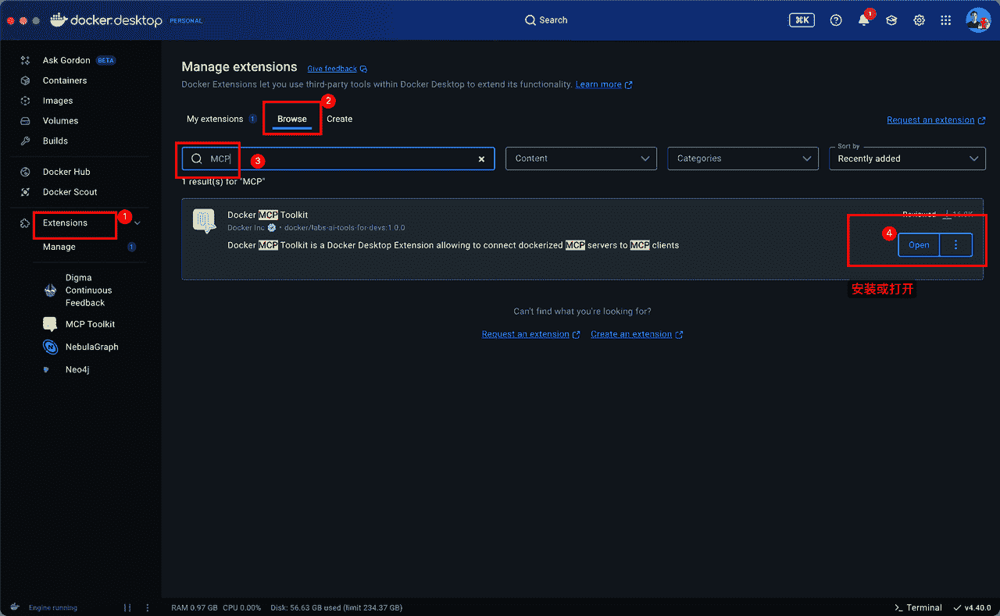
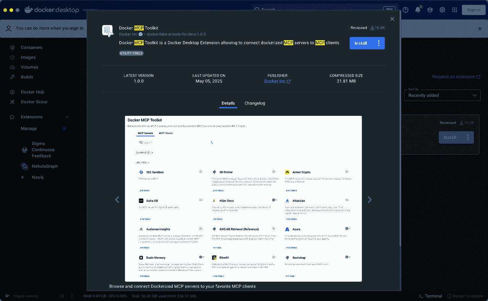
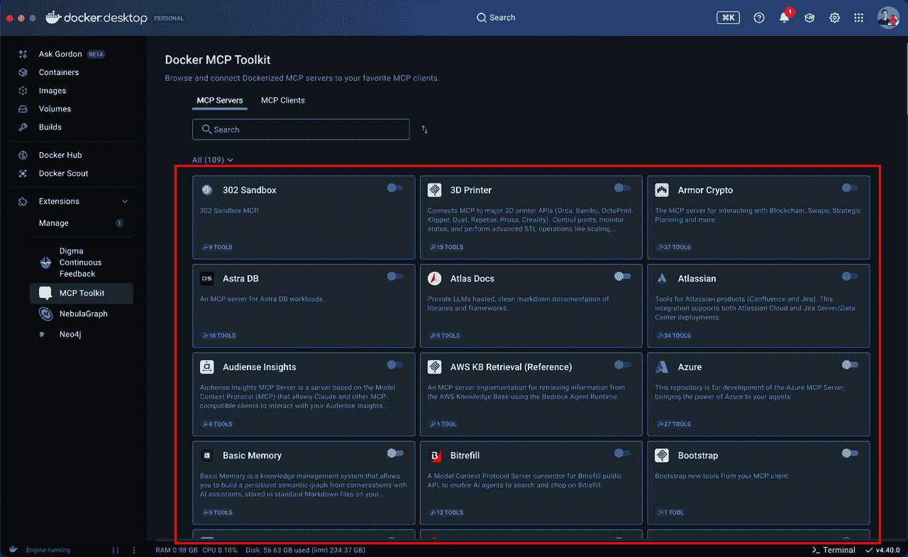
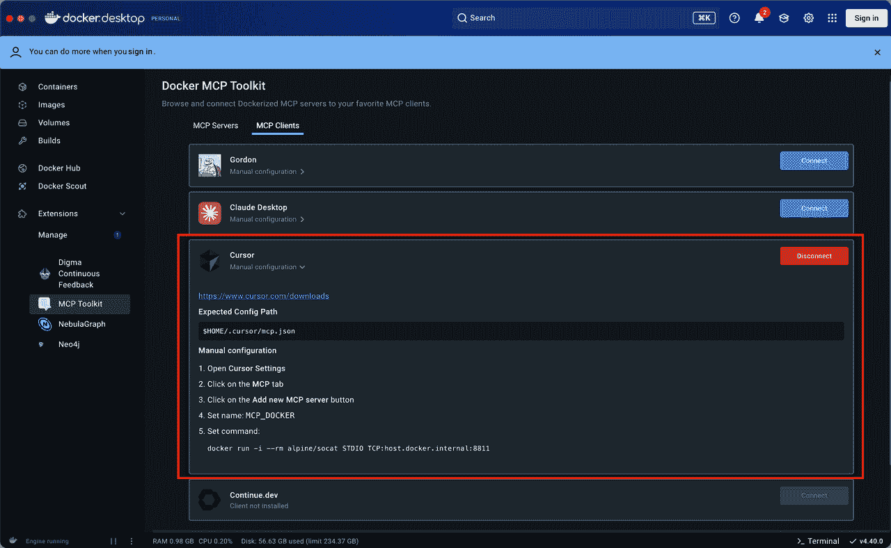
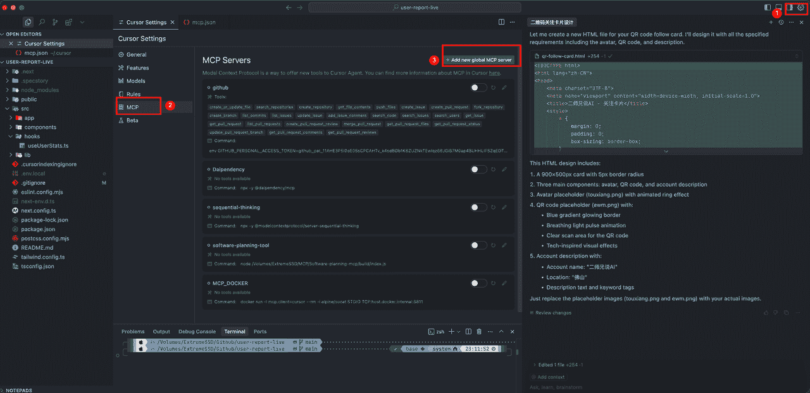
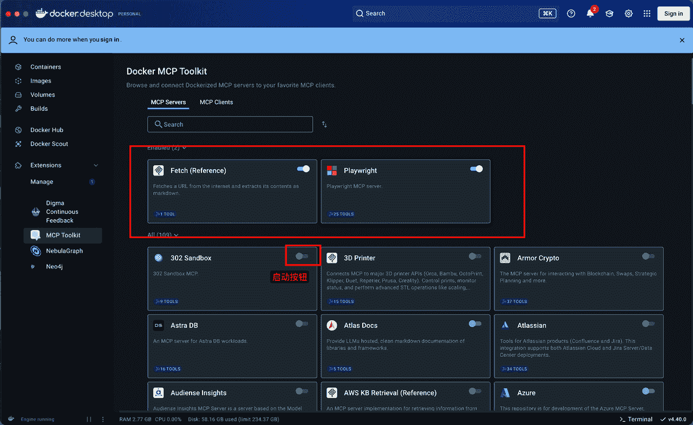
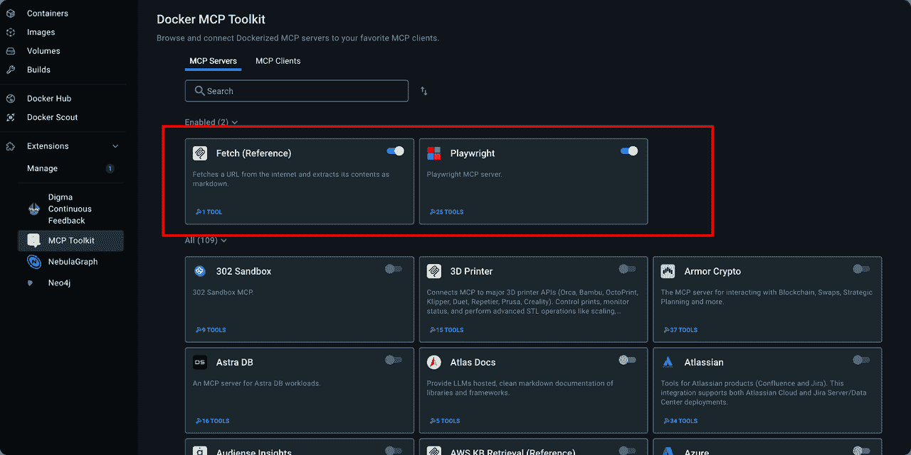
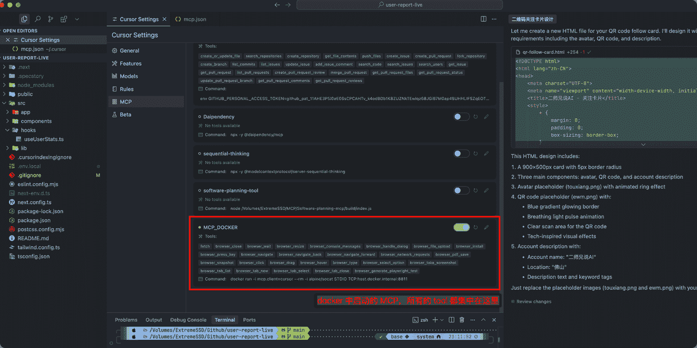

# 解锁 MCP 工具管理新姿势：Docker MCP 如何让开发者的生活更简单、更安全？

> 来源：[https://qianniucity.feishu.cn/docx/SoGedThxBoP3TYxcPYAcNsnnnTc](https://qianniucity.feishu.cn/docx/SoGedThxBoP3TYxcPYAcNsnnnTc)

> 因为频繁的使用 MCP，所以在管理和使用 MCP 的过程中会越来越关注它的可靠性和易用性，很多时候 API 密钥一不小心就 push 到 Github，又还有 MCP 太多，也不好管理。

近期看到 Docker 针对 MCP 在功能上做了升级，而且 Docker 在多任务管理，沙箱环境等方面，本来就是他的强项，体验下来觉得不错，推荐给大家。

接下来，我会想列举出使用 Docker MCP 的好处，还有在 IDE 上的配置，以及喂饭级别的安装教程

### **Docker MCP 的的优势**

+   **一个就够**：配置 Docker MCP 一次，即可享受 Docker MCP 市场的的所有 MCP 服务

+   **提高效率和资源利用**：当工具执行请求到达 Toolkit 后，它会启动容器、注入凭证、执行调用、获取响应，然后停止容器 1，意味着容器不会持续占用资源。

+   **增强运行时安全性**：利用容器提供的隔离层和沙盒保护，限制了 MCP 工具对主机系统的潜在损害

+   **MCP 工具发现**：Docker Hub 帮你筛选优质 MCP，包含发布者验证，节省了开发者寻找和验证工具的精力

+   **提供安全的凭证和访问管理**：避免将敏感凭证（如 API 密钥）以明文环境变量形式暴露。Docker MCP Toolkit 提供内置的 OAuth 支持和安全的凭证存储

+   **简化安装和配置复杂性**：开发者无需再手动处理复杂的依赖、环境问题或自行托管本地服务

以上这些好处都得益于 Docker MCP Catalog 和 Toolkit，其核心设计理念就是让 MCP 工具的使用变得简单且安全。它从根本上改变了开发者管理 MCP 工具的方式，带来了急需的结构、信任和可扩展性

### IDE 中配置 Docker MCP

```
{
    &quot;mcpServers&quot;: {
        &quot;MCP_DOCKER&quot;: {
            &quot;command&quot;: &quot;docker&quot;,
            &quot;args&quot;: [
                &quot;run&quot;,
                &quot;-l&quot;,
                &quot;mcp.client=cursor&quot;,
                &quot;--rm&quot;,
                &quot;-i&quot;,
                &quot;alpine/socat&quot;,
                &quot;STDIO&quot;,
                &quot;TCP:host.docker.internal:8811&quot;
            ]
        }
    }
}
```

### **Docker MCP 安装流程**

1.  **Docekr 安装**

> 下载地址：https://www.docker.com/



1.  **MCP 插件安装**

2.1 安装或打开 MCP Toolkit



2.2 Toolkit 安装页面



**2.3 MCP 工具列表**



1.  Cursor 链接 Docker MCP

**3.1 点击 Connect**



**3.2 Cursor 配置入口**



3.3 Cursor 中配置 Docker MCP

```
{
    &quot;mcpServers&quot;: {
        &quot;MCP_DOCKER&quot;: {
            &quot;command&quot;: &quot;docker&quot;,
            &quot;args&quot;: [
                &quot;run&quot;,
                &quot;-l&quot;,
                &quot;mcp.client=cursor&quot;,
                &quot;--rm&quot;,
                &quot;-i&quot;,
                &quot;alpine/socat&quot;,
                &quot;STDIO&quot;,
                &quot;TCP:host.docker.internal:8811&quot;
            ]
        }
    }
}
```

1.  Docker 中启动/添加 MCP



**启动 MCP**

> 启动 Fetch ，Playwright



1.  **Cursor MCP 显示鲜果**

> Docker 启用后的 MCP Tool，全都集中在 MCP_Docker 下



看到绿色的标志，并将 MCP_Docker 设置为打开状态，即可开始使用。