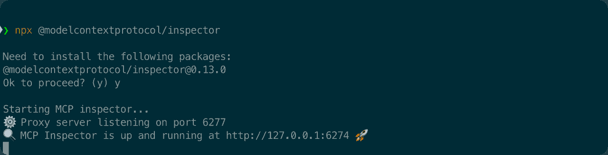
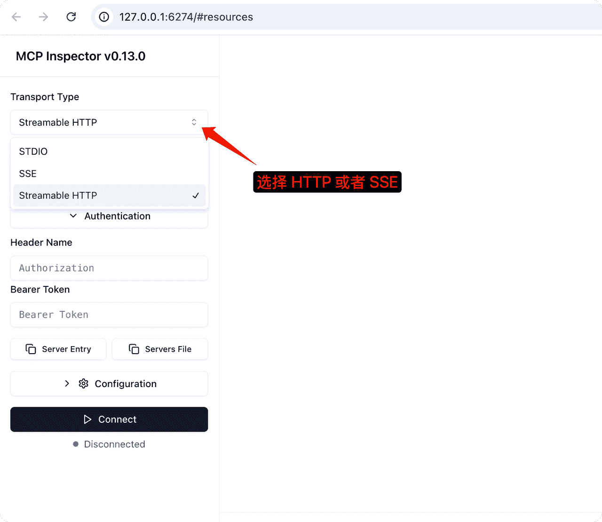
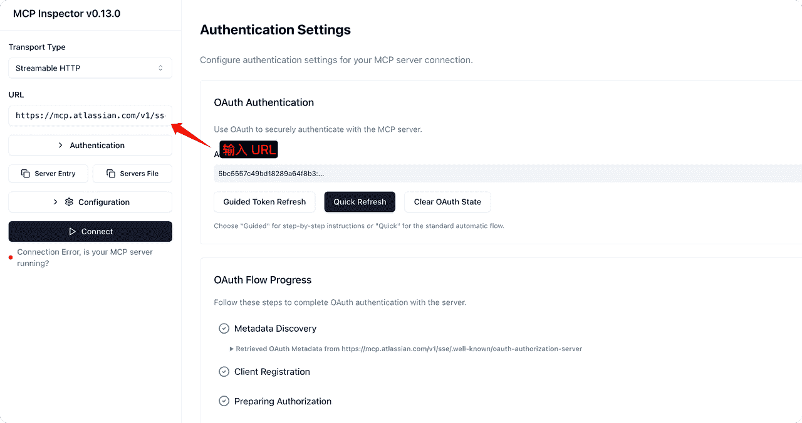
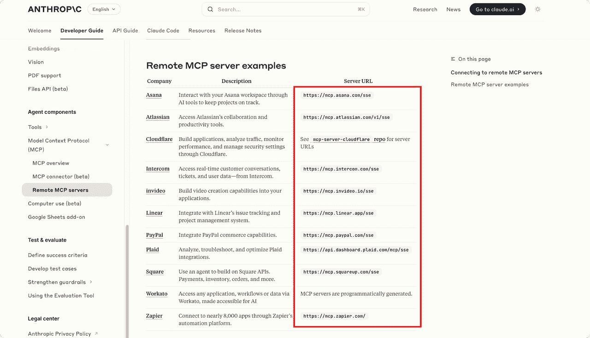
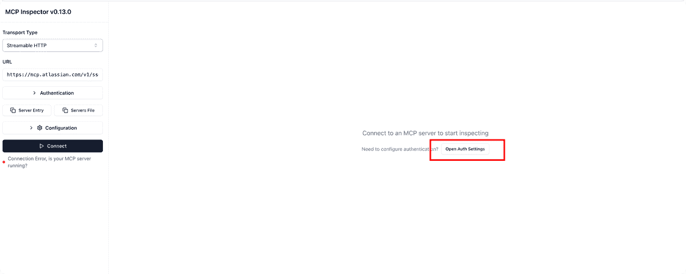
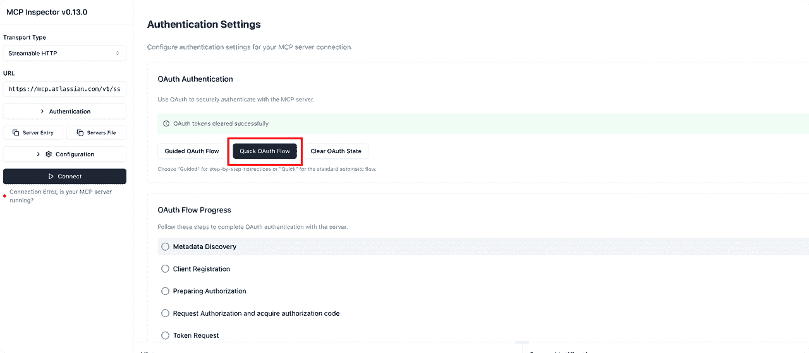
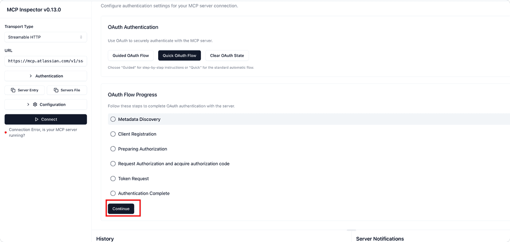
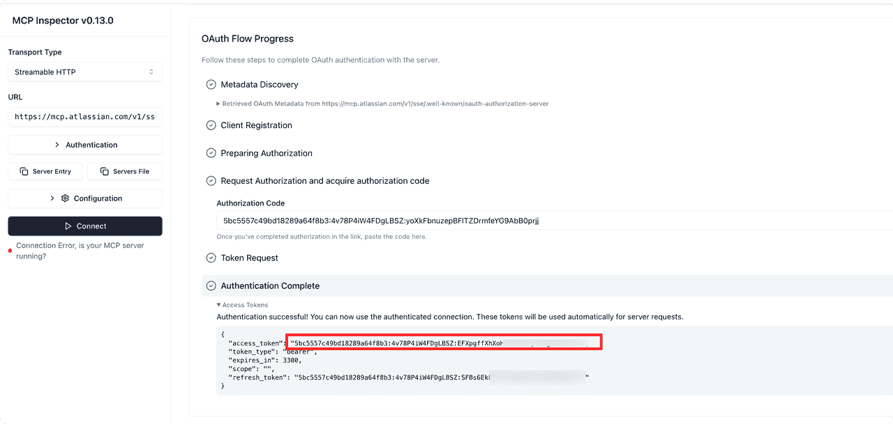

# 震惊！Claude MCP Connector: 无需客户端直连 MCP 服务器

> 来源：[https://qianniucity.feishu.cn/docx/TyPhdMWoaoQsxBxDfYbcPLqdntD](https://qianniucity.feishu.cn/docx/TyPhdMWoaoQsxBxDfYbcPLqdntD)

刚刚，Claude4 发布，性能和编程能力又是一次超越，在一篇震惊声音中，Anthropic 同时带来一次革命性的新功能-- Claude 的 Model Context Protocol （MCP） Connector。

> **C**laude 的 MCP connector 是一个重要的进步，它直接将 Model Context Protocol （MCP） 功能集成到 Anthropic 的 Messages API 中。这意味着开发者直接通过 API 就能请求远程的 MCP 服务，不需要像之前一样 需要运行独立的 MCP Client。

## MCP connector 基本介绍

以下是 MCP connector 的一些关键方面和能力：

+   **直接 API 集成**：这是核心优势，无需实现 MCP 客户端即可连接到 MCP 服务器。

+   **工具调用支持**：通过 Messages API 访问 MCP 服务器提供的工具。

+   **OAuth 身份验证**：它支持使用 OAuth Bearer 令牌连接到需要身份验证的服务器。

+   **连接多个服务器****：可以在单个 Mes**sages API 请求中配置和连接到多个 MCP 服务器。

目前该功能还是 beta 版，使用时需要在请求中包含一个特定的测试版请求头："anthropic-beta": "mcp-client-2025-04-04"。这给了做 MCP Client 的用户更多的时间去调整策略。

同时，尽管功能强大且简化了流程，但是目前也有一些限制：

+   目前只支持 MCP 规范中的**工具调用**。

+   MCP 服务器必须是**通过 HTTP 公开暴露的**；不支持直接连接本地 STDIO 服务器。

+   目前在 Amazon Bedrock 和 Google Vertex 上不受支持。

## **工具调用详细教程及字段说明**

在 Messages API 中使用 MCP 连接器

> 为了链接到 MCP Server，需要在 Messages API 的请求中包含 mcp_servers参数

```
curl https://api.anthropic.com/v1/messages \
  -H &quot;Content-Type: application/json&quot; \
  -H &quot;X-API-Key: $ANTHROPIC_API_KEY&quot; \
  -H &quot;anthropic-version: 2023-06-01&quot; \
  -H &quot;anthropic-beta: mcp-client-2025-04-04&quot; \
  -d &#x27;{
    &quot;model&quot;: &quot;claude-sonnet-4-20250514&quot;,
    &quot;max_tokens&quot;: 1000,
    &quot;messages&quot;: [{&quot;role&quot;: &quot;user&quot;, &quot;content&quot;: &quot;What tools do you have available?&quot;}],
    &quot;mcp_servers&quot;: [
      {
        &quot;type&quot;: &quot;url&quot;,
        &quot;url&quot;: &quot;https://example-server.modelcontextprotocol.io/sse&quot;,
        &quot;name&quot;: &quot;example-mcp&quot;,
        &quot;authorization_token&quot;: &quot;YOUR_TOKEN&quot;
      }
    ]
  }&#x27;

```

### **MCP 服务器配置 **

> 每个 MCP 服务器在 mcp_servers 数组中支持以下配置：

```
{
  &quot;type&quot;: &quot;url&quot;,
  &quot;url&quot;: &quot;https://example-server.modelcontextprotocol.io/sse&quot;,
  &quot;name&quot;: &quot;example-mcp&quot;,
  &quot;tool_configuration&quot;: {
    &quot;enabled&quot;: true,
    &quot;allowed_tools&quot;: [&quot;example_tool_1&quot;, &quot;example_tool_2&quot;]
  },
  &quot;authorization_token&quot;: &quot;YOUR_TOKEN&quot;
}

```

### 字段描述

⚠️如果 MCP 服务器需要，OAuth 授权令牌。请参见 MCP 规范：https://modelcontextprotocol.io/specification/2025-03-26/basic/authorization

同时，文章末尾有关于如何获取 授权令牌的完整操作视频。

### **响应内容类型**

> 当 Claude 使用 MCP 工具时，响应将包括两种新的内容块类型：

#### MCP Tool Use Block（MCP 工具使用块）

```
{
  &quot;type&quot;: &quot;mcp_tool_use&quot;,
  &quot;id&quot;: &quot;mcptoolu_014Q35RayjACSWkSj4X2yov1&quot;,
  &quot;name&quot;: &quot;echo&quot;,
  &quot;server_name&quot;: &quot;example-mcp&quot;,
  &quot;input&quot;: { &quot;param1&quot;: &quot;value1&quot;, &quot;param2&quot;: &quot;value2&quot; }
}

```

#### MCP Tool Result Block MCP 工具结果块

```
{
  &quot;type&quot;: &quot;mcp_tool_result&quot;,
  &quot;tool_use_id&quot;: &quot;mcptoolu_014Q35RayjACSWkSj4X2yov1&quot;,
  &quot;is_error&quot;: false,
  &quot;content&quot;: [
    {
      &quot;type&quot;: &quot;text&quot;,
      &quot;text&quot;: &quot;Hello&quot;
    }
  ]
}

```

### **多个 MCP 服务器 **

> 您可以通过在 mcp_servers 数组中包含多个对象来连接多个 MCP 服务器：

```
{
  &quot;model&quot;: &quot;claude-sonnet-4-20250514&quot;,
  &quot;max_tokens&quot;: 1000,
  &quot;messages&quot;: [
    {
      &quot;role&quot;: &quot;user&quot;,
      &quot;content&quot;: &quot;Use tools from both mcp-server-1 and mcp-server-2 to complete this task&quot;
    }
  ],
  &quot;mcp_servers&quot;: [
    {
      &quot;type&quot;: &quot;url&quot;,
      &quot;url&quot;: &quot;https://mcp.example1.com/sse&quot;,
      &quot;name&quot;: &quot;mcp-server-1&quot;,
      &quot;authorization_token&quot;: &quot;TOKEN1&quot;
    },
    {
      &quot;type&quot;: &quot;url&quot;,
      &quot;url&quot;: &quot;https://mcp.example2.com/sse&quot;,
      &quot;name&quot;: &quot;mcp-server-2&quot;,
      &quot;authorization_token&quot;: &quot;TOKEN2&quot;
    }
  ]
}

```

## Authentication 身份验证

> 对于需要身份验证的 MCP 服务器，Claude 的 MCP connector 支持使用 OAuth Bearer 令牌。您需要在调用 API 前，自行处理好 OAuth 流程，获取到访问令牌，并将其包含在对应服务器配置的 authorization_token 字段中。API 调用方负责获取和刷新这些令牌

### 如何获取测试访问令牌

> 通过 MCP inspector 可以获取测试访问令牌。

#### 运行以下命令运行检查器。您的机器上需要安装 Node.js。

```
npx @modelcontextprotocol/inspector
```



#### 在左侧边栏中，对于"传输类型"，选择"SSE"或"可流式 HTTP"。



#### 输入 MCP 服务器的 URL。

#### 根据自己的业务情况，输入对应的 URL



官方提供的远程 URL 地址列表

> https://docs.anthropic.com/en/docs/agents-and-tools/remote-mcp-servers



#### 在右侧区域，在"需要配置身份验证？"后单击"打开身份验证设置"按钮。



#### 单击"快速 OAuth 流"并在 OAuth 屏幕上授权。



#### 按照检查器中"OAuth 流程进度"部分的步骤操作，单击"继续"直到到达"身份验证完成"。



#### 复制access_token的值



#### 将其粘贴到 MCP 服务器配置中的authorization_token字段

```
{
  &quot;mcp_servers&quot;: [
    {
      &quot;type&quot;: &quot;url&quot;,
      &quot;url&quot;: &quot;https://example-server.modelcontextprotocol.io/sse&quot;,
      &quot;name&quot;: &quot;authenticated-server&quot;,
      &quot;authorization_token&quot;: &quot;YOUR_ACCESS_TOKEN_HERE&quot;
    }
  ]
}

```