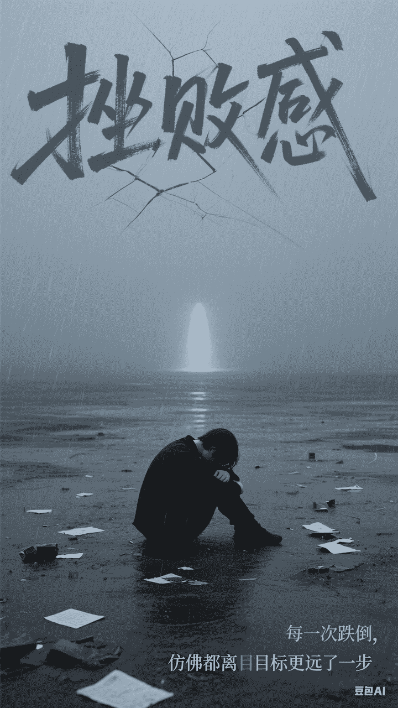

# 充满情绪价值的图片

> 来源：[https://qianniucity.feishu.cn/docx/RfcedkvvFo4vkDxVXWcciAMznFb](https://qianniucity.feishu.cn/docx/RfcedkvvFo4vkDxVXWcciAMznFb)

> "设计一张主题为**“挫败感”**的海报。整体画面需传递出深刻的情感冲击力，展现失败、无助和孤独的氛围。画面主体为一个模糊的、笼罩在阴影中的人影，坐在空旷、荒凉的环境中，姿态低沉，充满疲惫感。背景以深色调为主（如深灰、深蓝或黑色），营造出压抑的视觉效果。细节元素可以加入散落的纸张、破碎的物品、模糊的雨滴或裂痕，增强失败的象征性。远处可有一束微弱的光线照射，象征着渺茫的希望。

> 文字设计：

>

> 主标题：“挫败感”，字体使用粗重、破碎感的手写风格，颜色为深灰或黑色，放置于画面上方中央，突出主题。

> 副标题：“每一次跌倒，仿佛都离目标更远了一步”，字体较小，采用简约风格，颜色为暗红或浅灰，放置于画面下方或角落，低调但有存在感。

>

> 整体风格：

> 极简主义设计，情感氛围浓厚，采用强烈的明暗对比，人物和文字为视觉中心，背景元素简洁但有故事性。色彩避免使用明亮或鲜艳的颜色，专注冷色调和低饱和度的配色，突出挫败感的沉重与孤独。"

