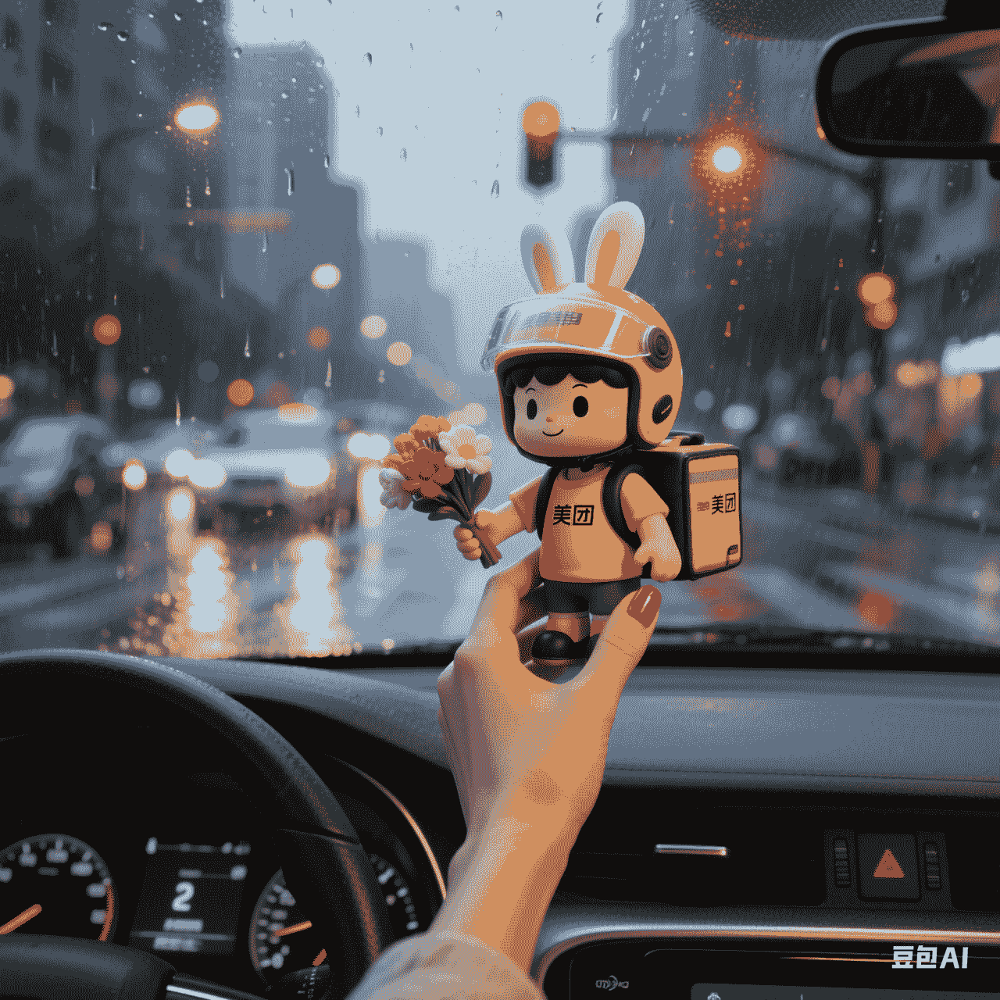

# 外卖玩偶

> 来源：[https://qianniucity.feishu.cn/docx/ZQUYd1nqAopwAWxlkGnces6FnCe](https://qianniucity.feishu.cn/docx/ZQUYd1nqAopwAWxlkGnces6FnCe)

```
{
  &quot;task&quot;: &quot;Generate Image&quot;,
  &quot;output_format&quot;: &quot;Photo-realistic Rendering&quot;,
  &quot;scene_description&quot;: {
    &quot;setting&quot;: &quot;Inside a car, view towards the windshield&quot;,
    &quot;outside_environment&quot;: {
      &quot;type&quot;: &quot;Busy Urban Intersection&quot;,
      &quot;time_of_day&quot;: &quot;Evening (Approx. 18:30)&quot;,
      &quot;traffic_status&quot;: &quot;Waiting at a Red Light&quot;,
      &quot;weather&quot;: &quot;Raining&quot;
    },
    &quot;foreground_elements&quot;: [
      {
        &quot;type&quot;: &quot;Hand&quot;,
        &quot;owner&quot;: &quot;Female Person&quot;,
        &quot;details&quot;: [&quot;Manicured Nails&quot;, {&quot;nail_color&quot;: &quot;Specify if needed, e.g., &#x27;Bright Red&#x27;&quot;}, {&quot;nail_style&quot;: &quot;Specify if needed, e.g., &#x27;Glossy&#x27;&quot;}],
        &quot;action&quot;: &quot;Holding a small object (figurine)&quot;
      },
      {
        &quot;type&quot;: &quot;Figurine&quot;,
        &quot;character&quot;: &quot;Crayon Shin-chan&quot;,
        &quot;render_style&quot;: &quot;Realistic 3D Model&quot;,
        &quot;size&quot;: &quot;Handheld&quot;,
        &quot;costume&quot;: {
          &quot;base&quot;: &quot;Meituan Delivery Uniform&quot;,
          &quot;details&quot;: [
            &quot;Yellow Meituan T-shirt&quot;,
            &quot;Delivery Helmet with clear visor&quot;,
            &quot;Helmet decorated with a pair of White Rabbit Ears&quot;
          ]
        },
        &quot;accessories&quot;: [
          &quot;Meituan Delivery Box (backpack style)&quot;,
          &quot;Bouquet of Flowers (in left hand)&quot;
        ],
        &quot;pose&quot;: &quot;Extending left hand forward, as if presenting the flowers&quot;
      }
    ],
    &quot;midground_elements&quot;: [
      {
        &quot;type&quot;: &quot;Car Interior&quot;,
        &quot;details&quot;: [&quot;Dashboard visible&quot;, &quot;Steering wheel edge (optional)&quot;, &quot;Focus on the area under the windshield&quot;]
      }
    ],
    &quot;background_elements&quot;: [
      {
        &quot;type&quot;: &quot;View through windshield&quot;,
        &quot;details&quot;: [&quot;Blurred city lights due to rain&quot;, &quot;Streaks of rain on glass&quot;, &quot;Reflections on wet road surface&quot;, &quot;Other vehicles (blurred)&quot;]
      }
    ]
  },
  &quot;lighting&quot;: {
    &quot;type&quot;: &quot;Natural Environmental Light&quot;,
    &quot;characteristics&quot;: [
      &quot;Soft evening light&quot;,
      &quot;Filtered through rain and car glass&quot;,
      &quot;Ambient light from street lamps and traffic lights&quot;,
      &quot;Potential interior car light spill&quot;
    ],
    &quot;mood&quot;: &quot;Atmospheric, slightly moody due to rain, highlighting foreground subjects&quot;
  },
  &quot;visual_style&quot;: {
    &quot;overall_aesthetic&quot;: &quot;Photo-realistic&quot;,
    &quot;focus&quot;: &quot;Sharp focus on the hand and figurine, blurred background&quot;
  },
  &quot;camera&quot;: {
    &quot;perspective&quot;: &quot;Slightly low angle, focusing on the hand and figurine from the car interior&quot;,
    &quot;field_of_view&quot;: &quot;Medium shot, showing hand, figurine, and the immediate windshield view&quot;
  }
  // You could add more specific technical parameters like aspect_ratio, resolution etc. if the model supports it
}
```

