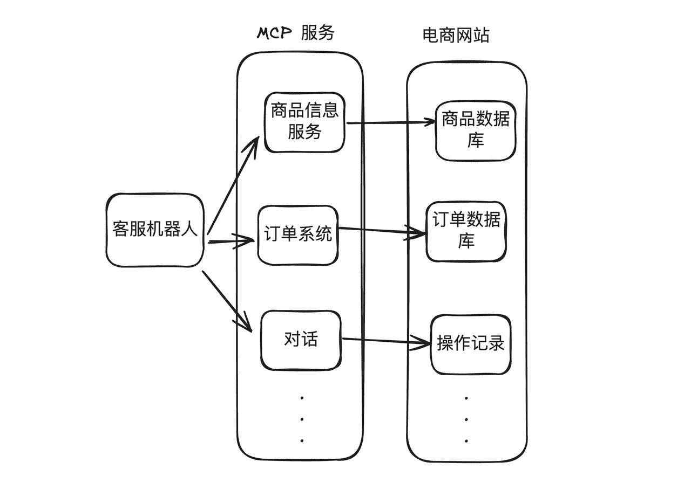

# MCP 常见使用场景

> 来源：[https://qianniucity.feishu.cn/docx/SOlEdZwy7o1YYgxEjHdcxd7Sn2H](https://qianniucity.feishu.cn/docx/SOlEdZwy7o1YYgxEjHdcxd7Sn2H)

1.  **智能代码助手**

想象一下，你正在使用一个集成 MCP 的代码编辑器。当你编写代码时，这个编辑器可以利用 MCP 连接到你的代码库、API 文档、Stack Overflow 等资源。例如：

+   当你遇到一个不熟悉的函数时，编辑器可以自动查询 API 文档，并将相关信息显示在侧边栏。

+   当你遇到一个难以解决的 bug 时，编辑器可以自动搜索 Stack Overflow，并找到类似问题的解决方案。

+   当你编写新的代码时，编辑器可以根据你的代码库和 API 文档，提供代码补全建议，甚至自动生成部分代码。

通过 MCP，代码编辑器可以访问更广泛的上下文信息，从而提供更智能、更实用的辅助功能，极大地提高你的开发效率。

1.  **个性化学习助手**

假设你正在学习一门新的编程语言，你可以使用一个集成了 MCP 的学习平台。这个平台可以根据你的学习进度和兴趣，动态调整学习内容，并提供个性化的学习资源。例如：

+   当你遇到难以理解的概念时，平台可以自动搜索相关的解释性文章、视频教程等，并推荐给你。

+   当你完成一个练习题时，平台可以根据你的代码，提供个性化的反馈和改进建议。

+   平台可以根据你的学习记录，预测你可能感兴趣的学习内容，并推荐给你。

通过 MCP，学习平台可以更好地理解你的学习需求，并提供更有效的学习支持，帮助你更快地掌握新的知识和技能。

1.  **智能客服机器人**

假设你正在运营一个电商网站，你可以使用一个集成了 MCP 的客服机器人。这个机器人可以连接到你的商品数据库、订单系统、物流信息等，从而提供更准确、更全面的客户服务。例如：

+   当客户询问某个商品的详细信息时，机器人可以自动查询商品数据库，并将相关信息回复给客户。

+   当客户查询订单状态时，机器人可以自动连接到订单系统，并将最新的物流信息告诉客户。

+   当客户遇到问题时，机器人可以根据客户的问题和历史记录，自动判断客户的需求，并提供相应的解决方案。

通过 MCP，客服机器人可以访问更广泛的业务数据，从而提供更智能、更专业的客户服务，提升客户满意度。

