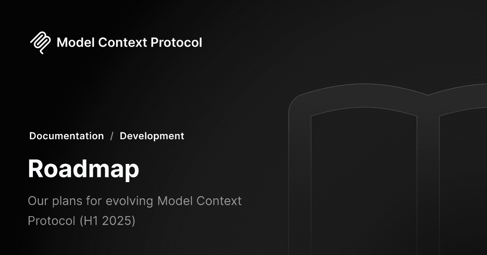

# 从开发者视角解读：MCP H1 2025 路线图详解

> 来源：[https://qianniucity.feishu.cn/docx/Qmzdd2k6ooZsC2x0Nhkc5iHSnCh](https://qianniucity.feishu.cn/docx/Qmzdd2k6ooZsC2x0Nhkc5iHSnCh)

作为开发者，我们经常需要关注各种新技术和标准的发展，以便更好地构建和维护我们的应用程序。最近，MCP（Machine Learning Communication Protocol）发布了一份更新的路线图，展示了他们未来的发展方向。让我们从开发者的角度来解读一下这份路线图。

远程 MCP 支持

首先，让我们来看远程 MCP 支持这一重要特性。对开发者来说，这意味着不再局限于本地运行 AI 模型，而是可以像调用普通 API 一样调用远程的 AI 服务。这将极大地扩展了我们的应用场景，使得我们可以更灵活地使用各种 AI 服务。同时，通过 OAuth 2.0 认证，我们可以复用现有的身份系统，这对于企业应用来说尤为重要。另外，服务发现机制和无状态操作的支持也让我们能更容易地部署和扩展应用，特别适合于 Serverless 环境。

参考实现

其次，MCP 将提供了完整的客户端参考实现，这对开发者来说非常实用。有现成的代码可以参考，大大降低了接入门槛。我们可以通过研究这些实现来学习最佳实践，并且可以更容易地参与协议改进。

分发与发现机制

MCP 还将改进了分发与发现机制，使得使用 MCP 更加方便。标准化的包管理类似于 npm/pip，意味着安装和部署 MCP 服务器会变得简单。服务器注册中心让我们能更容易找到需要的 AI 服务，而沙箱机制提高了安全性，这对于在生产环境中使用非常重要。

Agent 支持

针对更复杂的 AI 应用，MCP 将提供重要更新：层级化的 Agent 系统意味着可以构建更复杂的 AI 应用，而交互式工作流支持和流式结果支持则让我们能更好地处理用户权限和信息请求，并且满足实时反馈的需求。

更广泛的生态系统

最后，MCP 展示了对更广泛生态系统的野心。开放的标准制定过程意味着我们作为开发者可以参与进来影响协议的发展。同时，MCP 也支持更多模态（音频、视频等），这意味着未来可以构建更丰富的 AI 应用。标准化意味着这个协议可能会成为行业标准，投入学习会更有价值。

作为开发者，我们可以从现在开始关注和学习 MCP 的基础概念，并参与 GitHub Discussions 了解最新进展。另外，也可以考虑将现有的 AI 集成方案设计得更模块化，为未来迁移做准备。特别需要关注远程 MCP 支持、参考实现发布以及Agent 支持的新特性。有可能的还，可以考虑参与协议的开发和完善，并关注社区动态，可能会有早期采用者的机会。