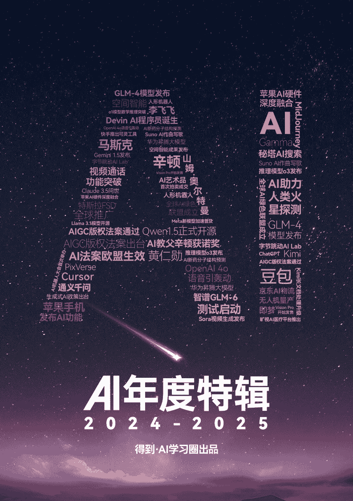
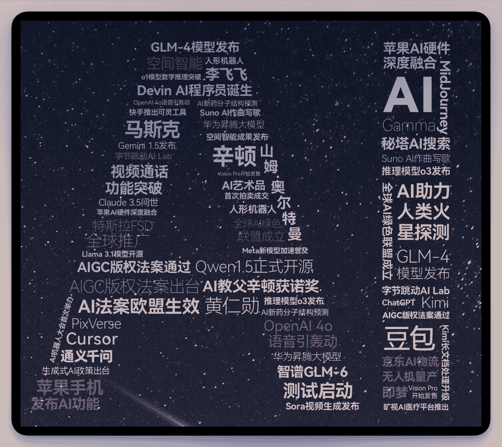

# 得到AI学习圈AI年度特辑 AI 总结

> 来源：[https://qianniucity.feishu.cn/docx/P4ftdve96oB1enxUPeNc0whRnDh](https://qianniucity.feishu.cn/docx/P4ftdve96oB1enxUPeNc0whRnDh)

[得到AI学习圈AI年度特辑（2024-2025）.pdf](https://internal-api-drive-stream.feishu.cn/space/api/box/stream/download/all/CUEmbjmgZoC6kSx0IEmcikkqnOh)

这本来自得到AI学习圈的特刊杂志回顾了2024到2025年间AI领域的重大事件和趋势。报告强调了以下关键趋势和见解：

**1. AI在各行业的加速整合**：AI正在迅速融入金融、制造、医疗和教育等各个领域。这一转变在WAIC等行业活动中对大型模型的关注减少以及对特定AI应用的重视增加中显而易见。

**2. 从概念到实用**：AI市场正在超越炒作，朝着实际应用迈进。公司正在优先开发能够提供切实商业价值的AI解决方案。

**3. AI驱动搜索的崛起**：像秘塔AI这样的AI搜索引擎正在获得越来越多的关注，为用户提供更直接和相关的结果。这一发展标志着人们获取和互动信息方式的重大转变。

**4. 工作角色的演变**：AI可能导致未来工作不再是必需，而是一种选择。随着AI自动化任务，人们可能会专注于更有意义的追求。这一转变引发了对社会结构和普遍基本收入概念的思考。

**5. 终身学习的重要性**：适应能力、学习能力和自我激励是AI时代至关重要的技能。个人需要拥抱持续学习，并适应技术变革的快速步伐。

**6. AI对组织结构的影响**：组织正在变得更小、更灵活，适应AI带来的效率。人类与AI的合作崛起正在改变传统的等级制度和工作流程。

**7. 超级个体的出现**：具备高认知技能和利用AI能力的个体可以放大他们的影响力。这些超级个体可能独立运作，推动创新和创业。

**8. 用AI重新定义制造业**：AI正在改变制造业的格局，推动智能工厂和机器人技术的进步。软件定义工厂的概念突显了软件和仿真在制造过程中的日益重要性。

**9. 人才需求的变化**：在AI时代，认知能力、批判性思维和适应能力等通用技能变得越来越有价值。能够有效与AI合作的个人将会受到高度需求。

**10. 拥抱AI革命**：为了在AI时代蓬勃发展，个人和组织需要主动拥抱AI工具和技术。早期采用、持续实验和适应能力是成功的关键。

一点尝试，针对这份 AI 特辑，生成了一个 10 分钟博客

[2024-2025 AI Annual Report.wav](https://internal-api-drive-stream.feishu.cn/space/api/box/stream/download/all/RI3YbazyFohtYCxRnuMcKBlLnud)