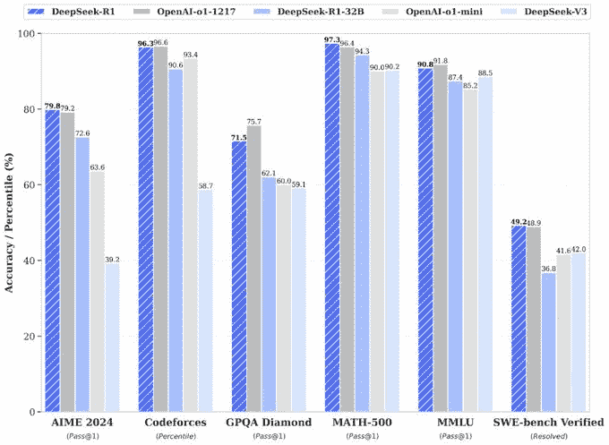
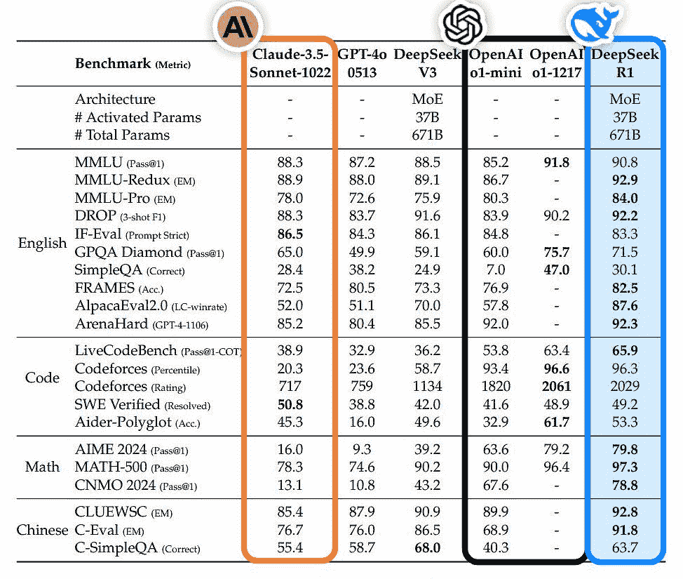
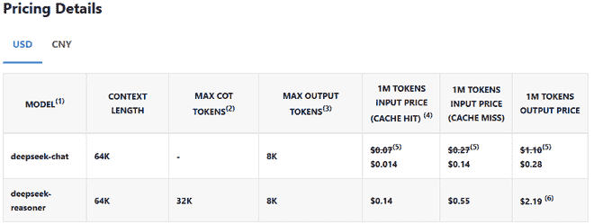
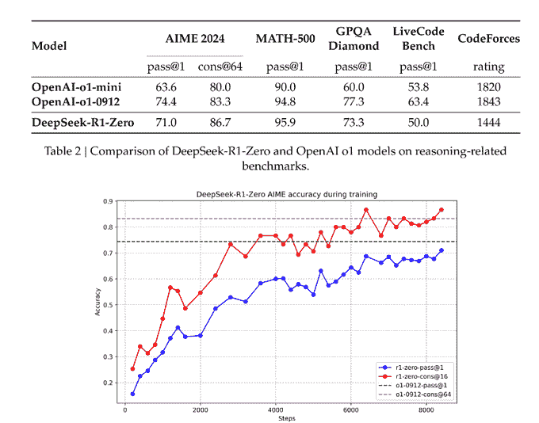

# 文章 2

> 来源：[https://qianniucity.feishu.cn/docx/PNbPdJlbMoZXJVxqBy3cTM9Gn4b](https://qianniucity.feishu.cn/docx/PNbPdJlbMoZXJVxqBy3cTM9Gn4b)

@deepseek_ai R1：比 O1 便宜 90%——无需大量预标注样本即可学会推理！

关于为何这摧毁了“碰壁”论点的讨论，以及这对 2025 年人工智能可能意味着什么

首先，这是一个极其出色的模型。

根据他们的论文，基准测试结果令人惊叹：

基本上在大多数方面与 O1 一样好（甚至更好）

第二？定价。

他们提供的智能水平看似相同，但成本仅为@OpenAI 的 10%

但这并不是他们最近论文中最令人印象深刻的部分。

他们自己在这里提到了：

值得注意的是，这是首个公开研究，验证了LLMs的推理能力可以纯粹通过强化学习（RL）来激励，而无需监督式微调（SFT）。这一突破为该领域的未来进展铺平了道路。

这意味着什么？

基本上，他们首次展示了一个大型 AI 语言模型能够仅通过“强化学习”掌握高级推理技能——而无需事先通过展示“正确答案”进行训练。换句话说，AI 可以通过仅获取其表现好坏的反馈来自我教导，有效推理，而不是一开始就被灌输示例。这一点非常重要，因为它为以新方式使 AI 在解决问题时变得更聪明、更快、更灵活打开了大门。

传统上，人们担心大型 AI 模型会“碰壁”，因为我们已经用尽了互联网上大部分易于获取的标注数据。但这种新方法表明，你并不需要持续供应预先标注的示例：模型仍能通过强化学习（RL）掌握高级推理技能，这基本上涉及模型自我测试并获取关于其表现如何的信号。这意味着我们不再需要等待新的标注数据——AI 可以通过直接从反馈中学习来持续改进。

我认为这张图比其他任何图表都更能说明问题：

在此图表中，红色和蓝色线条代表 DeepSeek-R1-Zero 在数千次训练步骤中，在数学基准测试上的准确率，完全通过强化信号而非预先标注的答案学习。粉色和绿色虚线展示了监督模型（OpenAI-o1）起初领先的情况；然而随着训练的持续，DeepSeek-R1-Zero 逐渐赶上——到第 8,000 步时几乎与监督方法持平甚至超越。同时，表格在多个推理基准测试中证实了这一趋势，表明 DeepSeek-R1-Zero 仅依赖强化学习的策略能够与依赖大量标注数据集的模型相抗衡（有时甚至表现更优）。

在当下人人都在谈论 TikTok 和数据隐私的一周里，中国可能正在部署与美国/欧盟公司同样强大——甚至可能更为先进的人工智能模型。这不仅仅是关于搞笑视频或社交媒体戏剧；而是关乎谁掌握着全球人工智能创新的钥匙，以及随之而来的所有经济、安全和社会连锁反应。我们或许应该对此给予更多关注。

相关链接：

+   HuggingFace：https://huggingface.co/deepseek-ai/DeepSeek-R1-Distill-Llama-70B