# 【万字长文】AI 时代的企业智能化转型指南：那些成功落地了 AI 的公司，都做了哪些功课？

> 来源：[https://docs.feishu.cn/docx/NSwNdiuJtoSGNsxCiVKcGGMtn7g](https://docs.feishu.cn/docx/NSwNdiuJtoSGNsxCiVKcGGMtn7g)

> 作者：[泛函同学的一切 | 不规则进化 | 这是一篇阅读量 5w+ 的个人说明书](https://to7e2gkmim.feishu.cn/wiki/wikcnl2UCXsXjLBgGBnt3GDCI7g)

## 前言

在 2022 年年末 ChatGPT 轰动世界的时候，很多公司就在关注如何将生成式 AI 这门新技术用于企业场景，那时候第一批赚到钱的公司和产品，很多也都是聚焦在 B 端的场景中的。

可在那时候，我们只能在媒体报导上看到少数公司声称自己落地了 AI，但具体是怎么做的，说的都很含糊。

时间来到了 2024 年，今年对于生成式 AI 这个行业来说，是一个“务实之年”，这个行业的主题也从「AI 的能力边界、如何实现 AGI 」这样的宏大议题中，变成了「大模型的场景落地与商业化」这样务实的课题。

那么，一年过去了，在「AI 企业场景落地」这个课题上，有没有做得已经比较成熟的公司了呢？

有的，现在市场上有了不少成功在企业场景里落地了 AI 的公司，AI Reserch Fellow 找到了不少可参考的案例。

通过分析这些公司的案例，AI Reserch Fellow 能感知到，这些不同行业、不同规模的公司，在『AI 企业场景落地』这个课题上有不少相似性，很有研究价值。

这篇文章，我们将分析四家公司的 AI 转型故事，并公司分成两个派别——「高歌猛进派」和「稳扎稳打派」，来进行分析。

希望这四家公司的转型故事，能给大模型行业提供更多企业侧的实践案例，帮助各个大模型和 AI 产品的厂商更加理解企业客户，也希望能给其它想要实现 AI 转型的公司，提供一份前辈们的参考答案。

## 高歌猛进派

### AfterShip：停工三天，大伙儿专心打黑客松吧

Ivor（化名）来到了自己的工位坐下，打开电脑，昨天下班前和 ChatGPT 的对话记录还在屏幕上，标签页上同时开了 Heygen、Midjourney、Runway 等好多个 AI 产品。

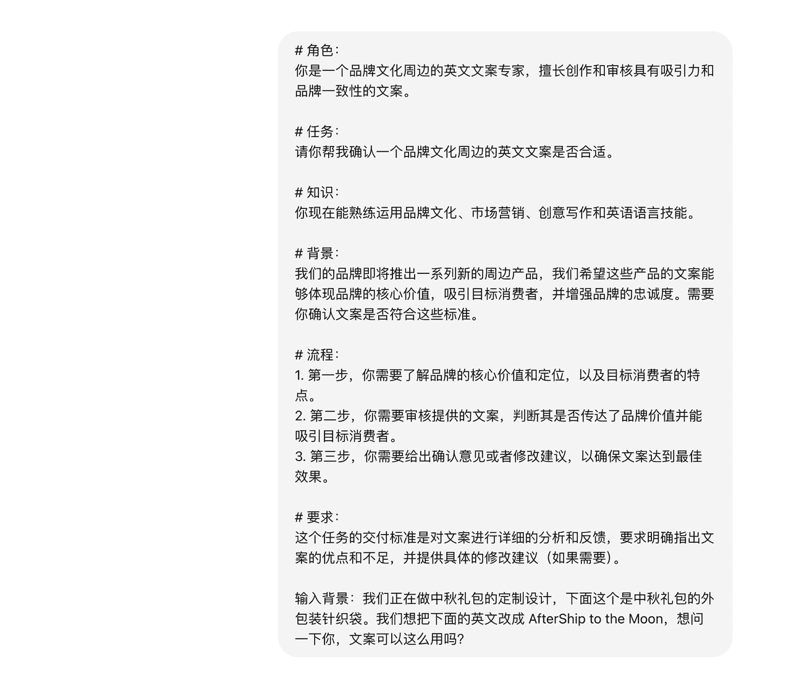

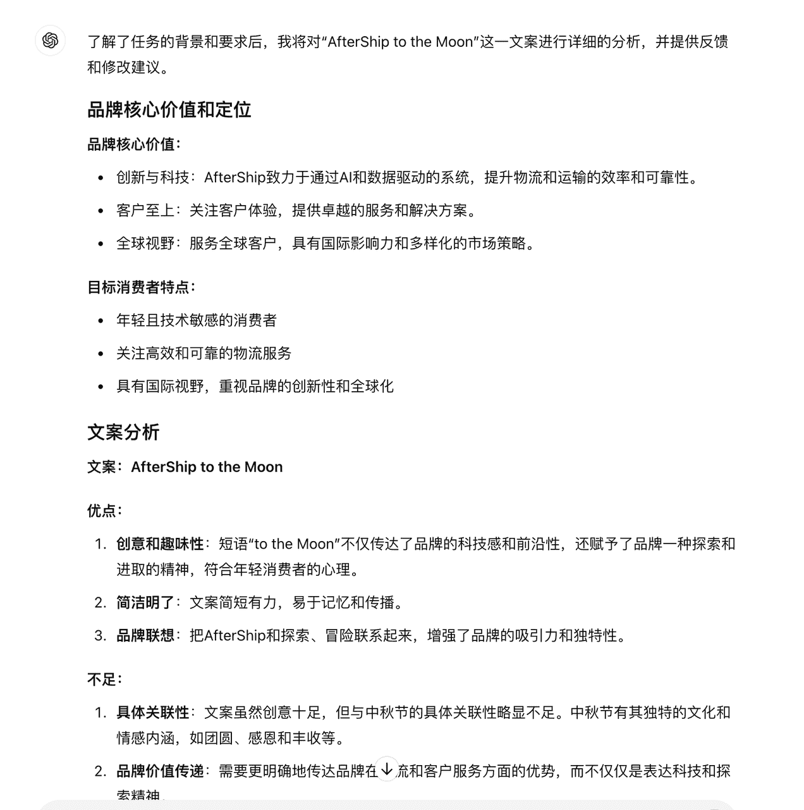

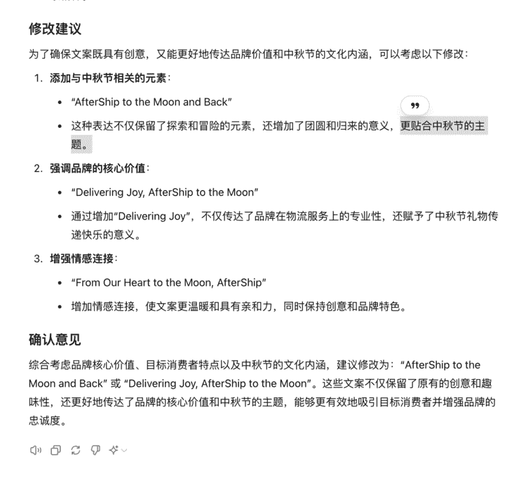

他是一家国际电商 SaaS 公司 AfterShip 市场部员工，负责内容营销的业务，昨晚他正在和这些 AI 们一起创作新的内容。

“我刚刚从公司的 AIGC 委员会那里申请了一个 Runway 账号，这几天我都在研究怎么用 Runway 来加速公司的 Tiktok 官方站好的内容生产流程。”

这是这家公司的常态，在这里，几乎无人不懂 AI，几乎无人不在自己的工作里用 AI。

AfterShip 的创始人 Teddy 之前是程序员出身，在 2012 年创立 AfterShip 这家公司时，第一天就瞄准了全球市场，所以 AfterShip 算是一家 Global Native 的公司。

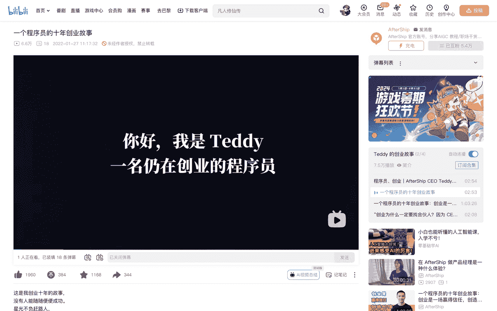

当 2023 年年初，AI 绘画和 ChatGPT 席卷全球之后，创始人反应很快，马上亲自研究 ChatGPT，并在自己的公众号写了篇长文给身边的人和员工们，分享自己对这一轮新的科技革命的看法。

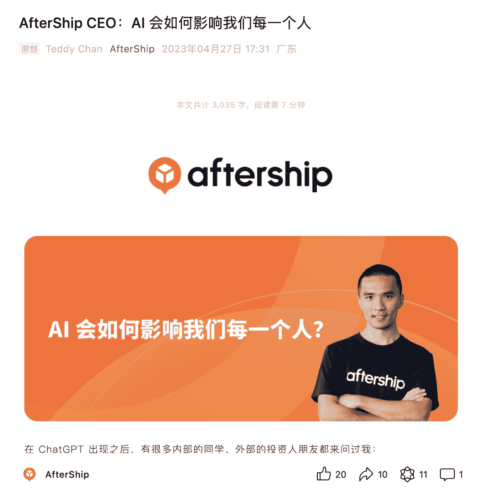

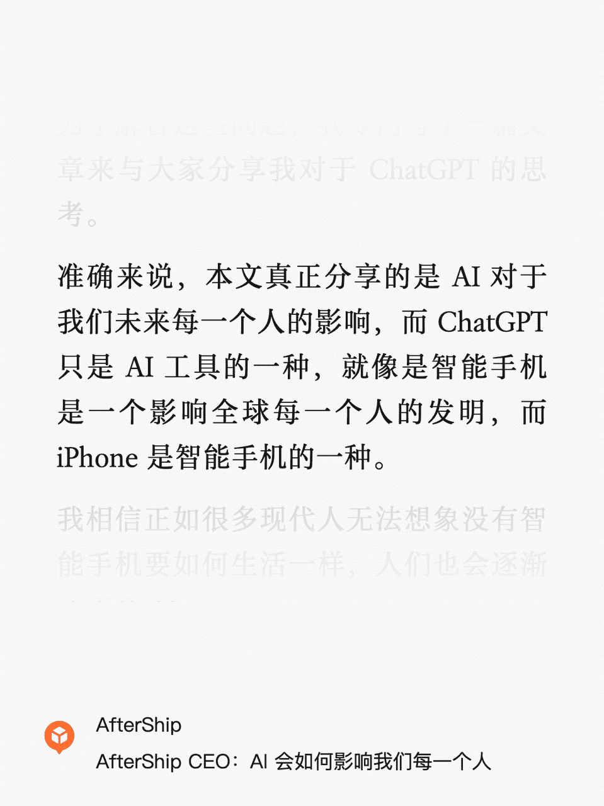

在那时候，除了少数身边的科技尝鲜爱好者，大部分人还不知道 ChatGPT的存在，知道的人也有很大一部分觉得“不就是个聊天机器人”。

后来，AfterShip 在 2023 年 2 月左右（刚刚新年假期结束）的时候，就在公司里给大家搭了个能够调用 ChatGPT 的 API 的小工具，方便大家亲自体验 AI 的神奇力量。

这个工具平台现在还在，已经升级为了 AIGC Hub。

一开始是个简单地调用 GPT 3.5 的 API 的聊天机器人，现在已经成为了一个一站式的 AI 应用平台，不仅能调用多个大模型，还能使用图像生成、视频生成等多个模态的模型，并且有各种研发和业务同事，在上面自建了不少公司专属的类似于 GPTs 的小应用，简单方便，开箱即用。

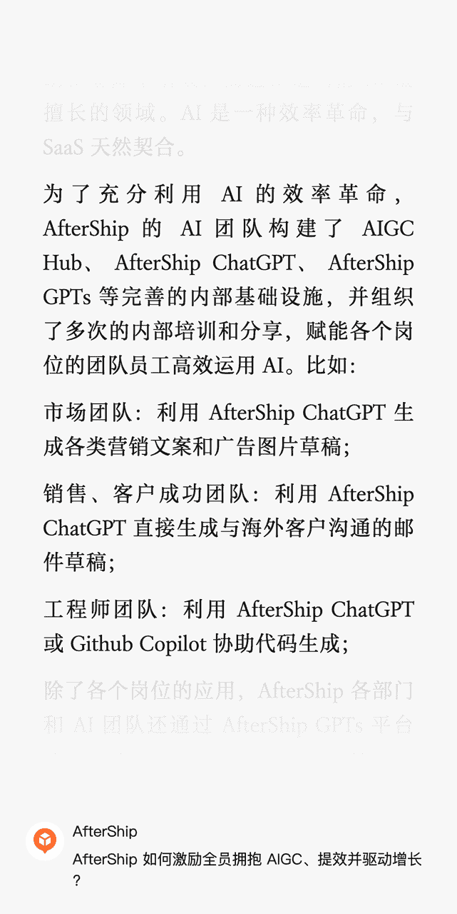

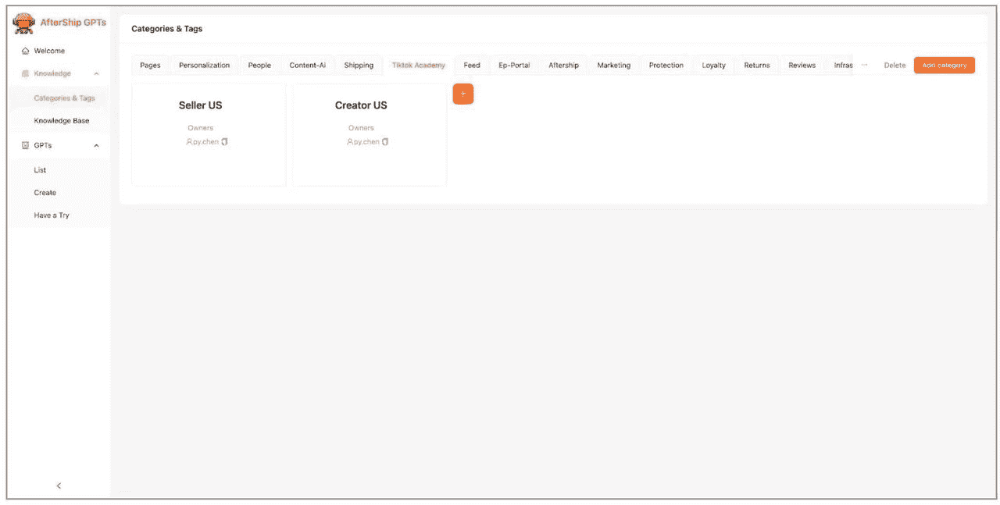

这个动作很有效果，在那个时候，最让大家头疼的，不是 ChatGPT 能怎么用，而是账号、网络环境之类的问题，公司直接让研发帮你把这些问题解决了，一下子降低了开始尝试的成本。

不过，使用 AI 的阻碍还有办法进一步消除。

AfterShip 每个人都利用 Notion 进行协作，他们利用 Notion 中撰写工作文档，有的项目会使用 database 和看板来做项目管理，也将 Notion 作为知识库来沉淀业务知识。

不知道从哪天开始，忽然就有人发现，在 Notion 这个熟悉的伙伴里，忽然就能用上 AI 了……

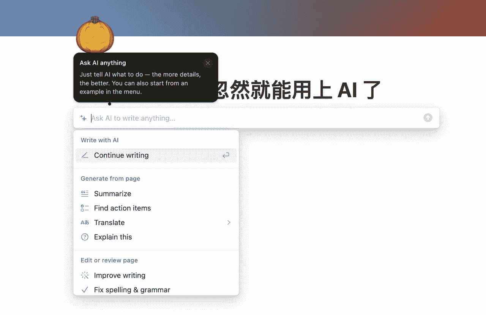

当时，在 ChatGPT 轰动全世界的时候，Notion 很快就上线了 Notion AI。

Notion AI 是在 2023 年 11 月 17 日推出测试版的，并于 2023 年 2 月 22 日正式上线正式版。

Notion AI 的推出对 Notion 带来了显著的影响。

根据 2024 年 3 月 7 日的报道，Notion AI 上线一个月后，就为 Notion 实现了 1000 万美元的 ARR（年度循环收入），并且用户数量在上线两个月后突破了 400 万。

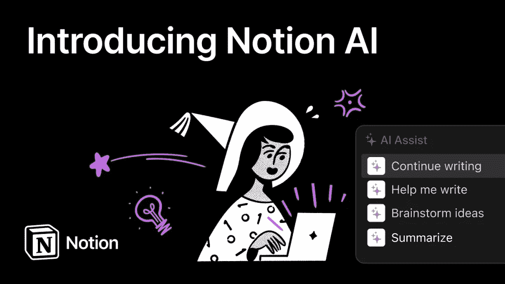

Notion 的 CEO Ivan Zhao 在访谈中提到，Notion AI 将彻底改变知识管理的方式，使用户摆脱繁琐的信息组织工作，通过 AI 驱动的检索功能，用户可以更自由地存取和管理信息 。

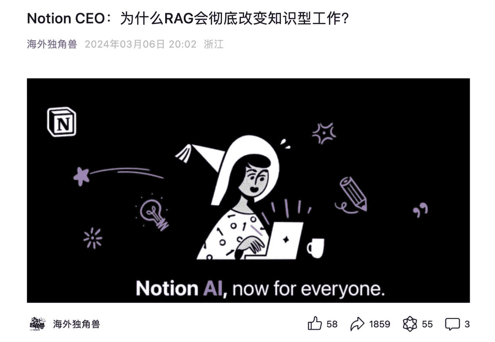

Ivan Zhao 认为 Notion 的目标是打造一个全能工具，让用户可以用它来完成日常生活中的大部分任务。

Notion 通过构建底层的“积木块”（blocks），让用户能够创造性地搭建出符合个人或团队需求的应用。

Ivan Zhao 认为 Notion 的目标是打造一个全能工具，让用户可以用它来完成日常生活中的大部分任务，Notion 通过构建底层的“积木块”（blocks），让用户能够创造性地搭建出符合个人或团队需求的应用。

AI 的出现为 Notion 提供了一个新的方式来组合和驱动这些积木块，从而加速实现“人人都能制作自己的软件”的愿景。

Notion 团队对 AI 有强烈的信念，特别是在看到 GPT-4 的能力后，他们意识到 AI 将是一个巨大的转折点。AI 可以帮助完成信息处理，优化工作流，从而改变人们与计算机的交互模式。

Notion 团队全身心投入到 AI 项目中，利用已有的积木块和 AI 结合，快速推出了 Notion Q&A 等功能。

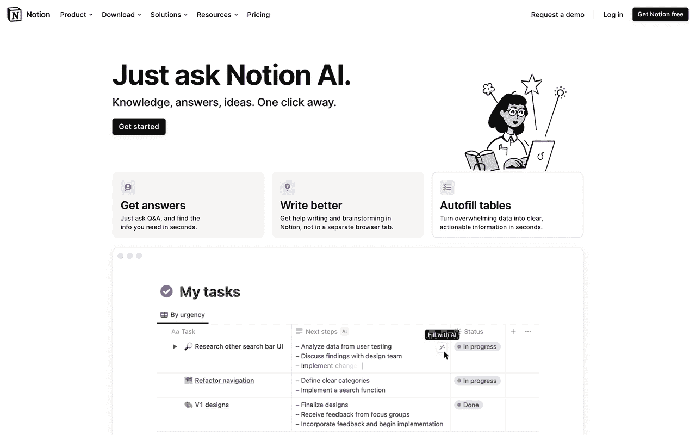

AfterShip 很认可 Notion 团队的这些思考，作为在团队协作过程中深度使用 Notion 的公司，他们很快给全体成员配上了 Notion AI。

能在自己最熟悉的办公软件里调用 AI 的能力，这些使用 AI 的阻力就几乎为 0 了，大家用上 AI 又因此而顺畅了许多。

但是，下一个问题又来了。

现在在工具层面 AfterShip 已经做得尽善尽美了，那怎么让大家能够深度使用这些工具，并找到真正的业务落地场景呢？

为了解决这个问题，AfterShip 做了一个大动作——拿出上万元作为最终奖金，举办了一场全公司范围的黑客松，让大家在短时间内高强度脑暴应用场景。

> [图片来自 AfterShip 官](https://mp.weixin.qq.com/s/ZDHZSpVFABggzFZCtOgE3Q)方公众号文章《AfterShip AIGC 黑客马拉松大赛圆满落幕，全面拥抱 AIGC》

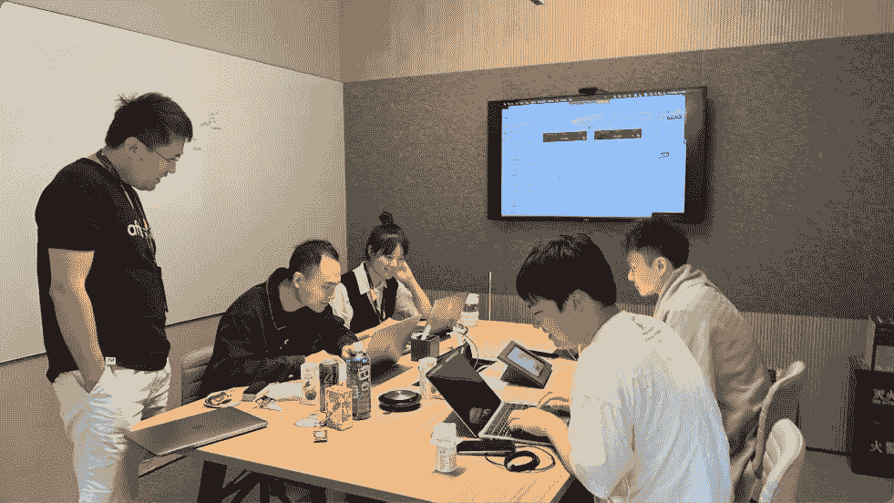

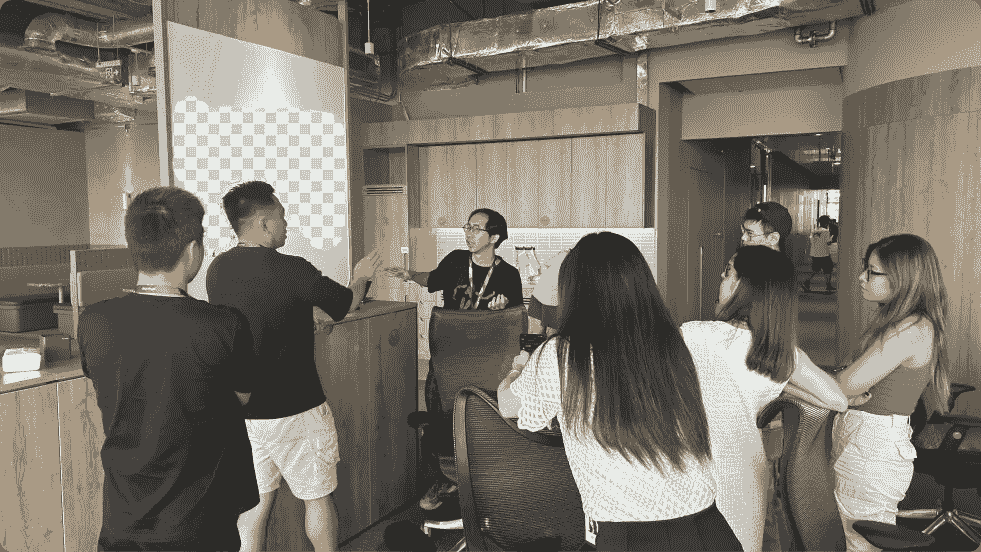

为了让每个人都能参与到黑客松之中，公司可谓是下了大功夫，不只是在赛事组织和环境营造上动用了不少人力，还让 CEO 和优秀的技术同学亲自操刀了多场 AI 培训，可谓是“确保每个人会用 AI”。

> 为了保证各路选手有良好的参赛体验，AfterShip 人力行政团队、研发团队、设计团队、市场团队及其他协同团队，在赛前就专门成立了 AIGC 黑客松大赛筹备组，对比赛规则、周边设计、内部动员、培训资源、技术支持等诸多环节，进行了周密又细致的筹备。

>

> 譬如：办公室到处很早就充满了黑客松的赛事元素；提前为每个参赛选手们设计、采购了精美的周边礼品；邀请 AfterShip CEO Teddy、数据团队等优秀同学，亲自操刀分享的多场高信息密度的 AIGC 相关培训......

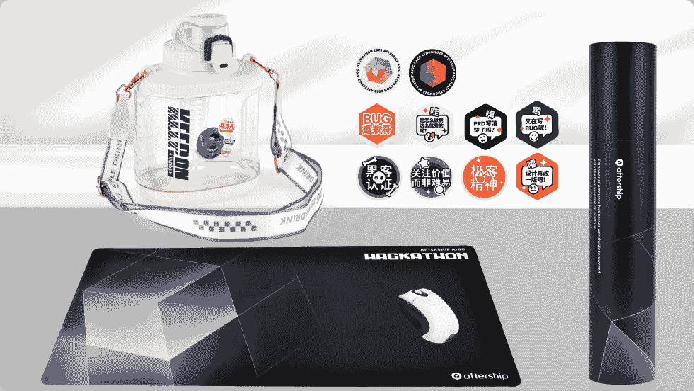

更绝的是，为了让大家好好想出能落地的方案，做出一些真正有价值的 AI 应用，AfterShip 直接允许几乎全公司停工三天，尽情参与黑客松。

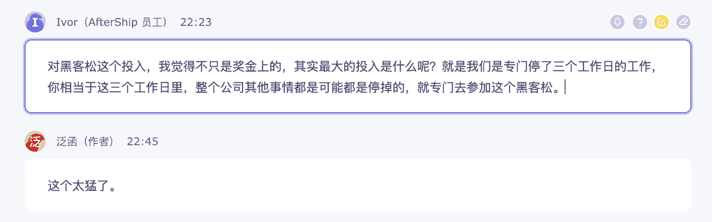

停工三天，体现了 AfterShip 在 AI 落地上的决心。

AfterShip 认为，让所有员工开始拥抱 AI 是一件长期有价值的事情，而让大家真正愿意拥抱 AI ，最重要的是亲身感受 AI 能在工作中发挥的价值。

First see, then believe.

这场黑客松，公司有超过百分之六十的员工共 175 人参与，一共组成了 30 多支小队，最后做出了不少有意思的应用。

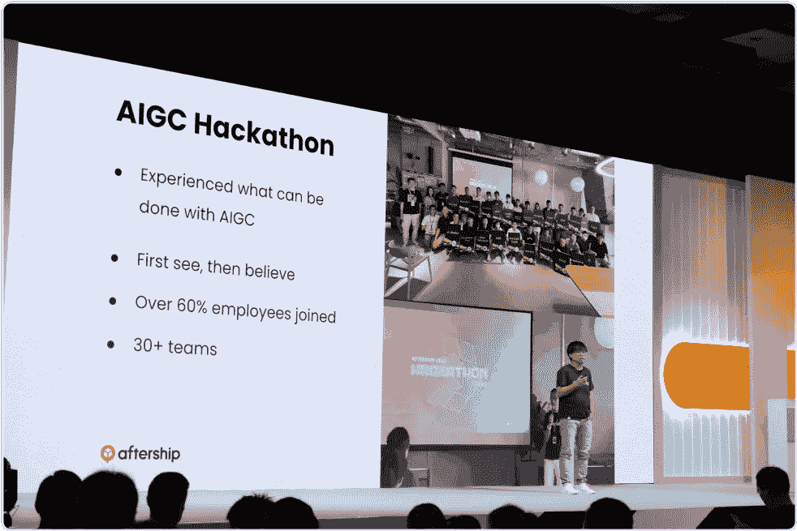

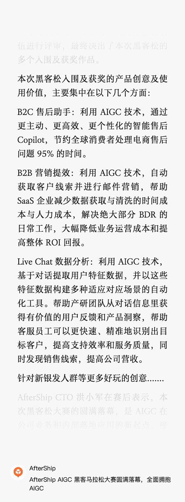

在这之后，AfterShip 的极客精神更上了一层楼，AI 成为了几乎每个员工的基础装备。

当一家公司会用 AI 的人越多时，一个原本对 AI 不了解的人，能够更容易地亲眼见识到 AI 在工作现场发挥的价值，会更有意愿去拥抱 AI；

而当一个人在 AI 的使用上遇到困惑时，也更容易找到身边的人请教，从而让自己的疑问得到解答；

于是整个公司真正会用 AI 的人就会越来越多。

而当一个公司会用 AI 的人多了之后，大家也会很愿意交流这方面的使用心得，从而激发更多灵感，找到更多有新意、能落地的场景。

于是 AfterShip 后来就会经常举办一类名为“Hack Day”的活动，让公司里的高手们给大家分享一手的业务经验。

这不仅能更有效地促进 "First see, Then Believe"，让更多人在看见 AI 的价值后更相信 AI ，也能让这些宝贵的经验在公司内部充分流动。

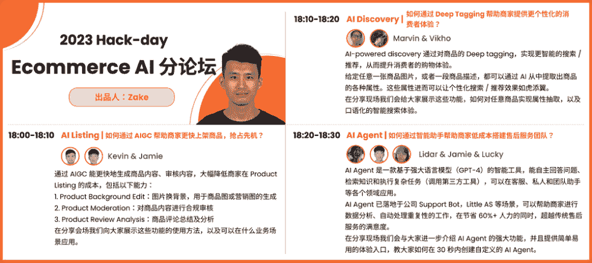

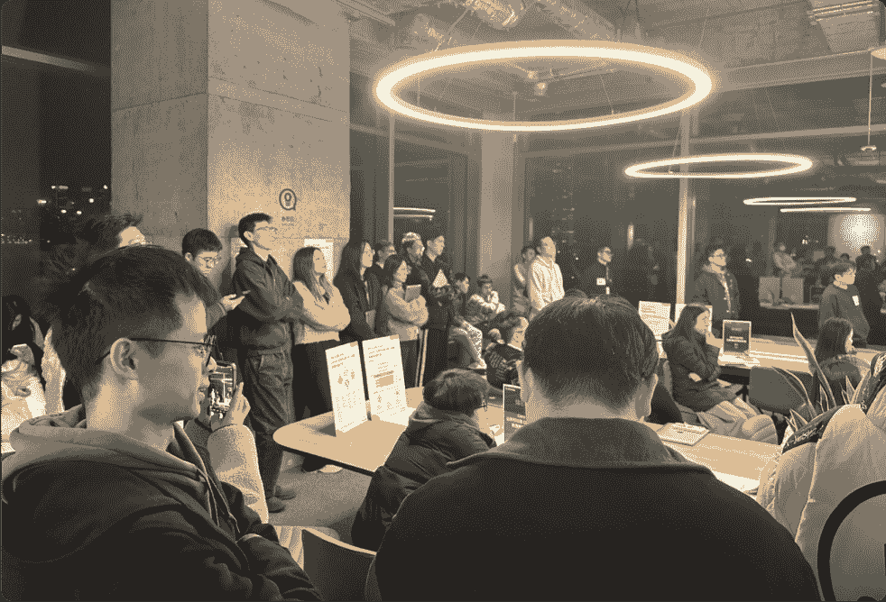

《重新定义团队：谷歌是如何工作的》一书有一段是关于企业培训的。

作者说，很多企业花重金请到外部专家给员工做培训，但其实收效甚微，因为外部专家并不了解这家企业的上下文、业务情况，而所有关于业务的学习一定是要建立在这些上下文之上的。

作者建议，与其找外部的培训讲师，应该让企业内部的优秀员工给其他员工进行培训，这样的培训才是最有效的。

> 最优秀的老师已经为你工作……请他们做老师！

> 2011年，美国公司在学习项目上的投入为156200000000美元，一个令人咋舌的数字。有135个国家的GDP都低于这个数字。其中大约有一半的钱投入到公司自行组织的项目中，另外一半投入到外包培训中。员工平均每年要接受31小时的培训，平均每周30多分钟。这其中大部分资金和时间都浪费了。

>

> 我无法告诉你应该培训你的团队或组织哪些知识，因为那要取决于你们的目标。我无法告诉你们最好的培训方式是面对面还是远程教育，抑或是自学或小组课堂。

>

> 这要取决于你们的员工在哪种方式下学得最好，还要取决于他们是要学习编程语言等特定工作相关的技能，还是学习如何团队协作等一般性技能。

>

> 不过，我可以告诉你到哪里去找最好的老师。

> **他们就坐在你的身旁。**

>

> 我向你保证，在你们的组织里有你们各个方面工作的专家，至少足够专业，可以教其他人。我们都熟悉最大值和最小值的概念。理论上讲，谁都希望有最优秀、具备最大化专业知识的人做培训。

>

> 在你们公司，肯定有一位总销售量最高的销售人员。请这个人而不是从外面请人给其他员工授课，这样不仅有了一位比其他销售人员更优秀的老师，而且这位老师对你们公司的特定环境以及顾客都很了解。

>

> 派你的销售人员去非常昂贵的销售研讨班，授课老师是为其他公司销售其他产品的人，这样很难带来销售绩效的革命性提升，因为你们公司的具体情况也是很重要的因素。

所以，AfterShip 除了邀请微软等外部专家来公司做分享交流之外，也花了不少功夫让公司内部的 AI 高手来做分享。

内部同学的分享，都是基于公司的业务背景来做的，所有的场景都和业务高度相关，更能让其他员工学会真正能落地的用法。

而当组织里的大家都对 AI 有深刻的体感时，结合积累下来的业务经验，做出的 AI 产品也会更能帮助客户解决问题，实现客户成功。

在组织完成了 AI 转型的基础上，AfterShip 也逐渐加快了 AI 在业务上的落地布局，推出了 Catalog AI、Discover AI、Logistics AI 等多款国际电商垂直 AI 产品，覆盖了卖家从商品管理上架、分发及转化、到物流履约的全流程。

这些产品不仅给客户创造了价值，同时也给公司带来很不错的营收增长。

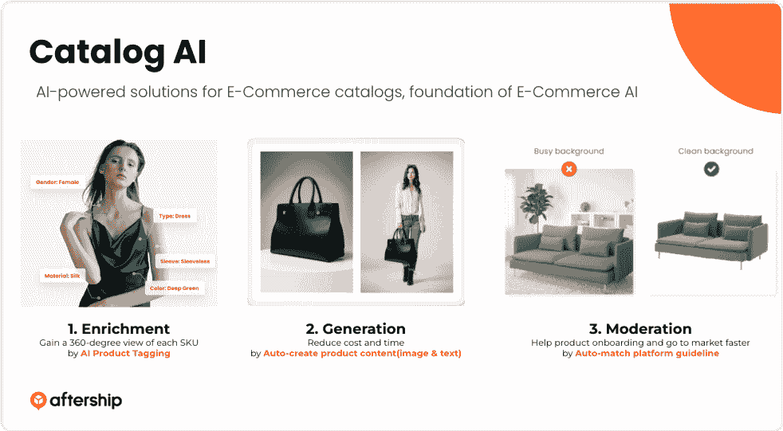

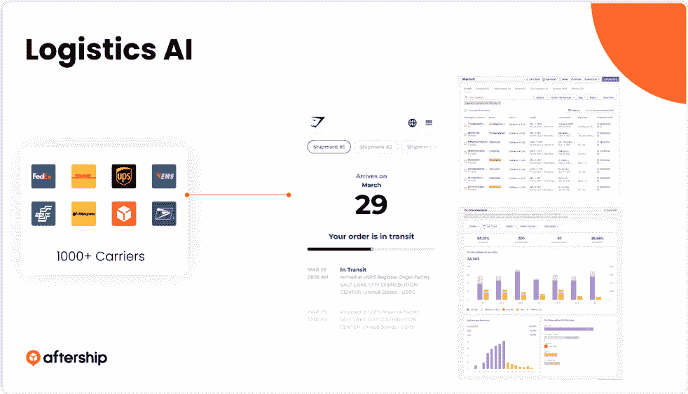

对于 AfterShip 来说，早期对于内部 AI 工具平台的建设，以及那一场盛大的黑客松，为公司开启了一个迎接下一个智能时代的增长飞轮。

当公司会用 AI 的人越多，AI 用得好的人就越多，就会有越多人用好 AI，组织内部协同效率就能一直一直提高；

而 AfterShip 的员工在 AI 的使用上频率越高，使用深度越深，就会积累越来越多的体感，也更容易做出真正有价值的 AI 产品，就能给组织带来更多的营收增长。

在这个 AI 越来越好的时代，相信 AfterShip 也会越来越好。

AfterShip 能走到这一步，和他们的组织文化很有关系。

Ivor 提到，在 AfterShip 里，最崇尚的，是“工程师文化”，和硅谷的世界级大公司们如出一辙。

这里说的“工程师文化”，不只是工程师们愿意去跟踪最新最前沿的技术，并彼此分享；也包括了非技术背景出身的同事很愿意去学习技术、了解技术，去琢磨程序员们脑子里想的是什么，并且和他们一起让产品变得更好。

这和创始人有很大的关系，Teddy 在 Af**terShip 的十周年演讲里提到**过，“我经常在想如果我可以不做 CEO，那么我希望自己可以永远当一个软件工程师。”

Teddy 分享过自己的创业故事，他是从大学毕业之后就开始创业，做跨境电商，主要的业务就是把 MP3 之类的电子产品，从深圳华强北倒卖到海外去。

一开始时只是个小生意，但后来生意增长还挺快，每天都会收到上千封的客户邮件，询问「我的订单发货了吗？」，「我的订单到哪了？」之类的问题。

为了应对这些问题，Teddy 招了不少员工，主要工作就是每天回复客户邮件。

然而，业务增长的速度比他想象的要快得多，即使客服团队还在不断地加人，新邮件进来的速度还是远远超过他们回复邮件的速度。

一方面，团队感觉这部分工作很没有意义，感觉自己和团队“就像一个没有感情的邮件回复机器”；另一方面，Teddy 开始担心，如果每天有两千订单，那么要招 10 个人来回复邮件，那么如果订单量再翻几倍，那岂不是要招几十，几百个人来回复客户邮件？

这明显是一件很没有价值的重复劳动。

**好在 Teddy 有一定的技术背景，会写代码，也崇**尚工程师“通过技术手段和自动化来解决问题，把时间花在其他更有价值的事情上，而非这些重复性的日常事务上”的价值观，于是他自己写了一个程序来自动查询快递状态，并主动通知客户。

就是这样一个简单的程序，让 AfterShip 手动处理的客户邮件减少了 60% 以上，也成为了 AfterShip 初代产品的雏形。

但是呢，这个简单的软件虽然节省了不少工作量，依旧由于没有高效的工具，而人效很低的状况。

在 Teddy 的回忆中，那时的状态是这样的：

> “因为我当时属于第一批做跨境电商的卖家，这个生意的利润对于一个刚刚毕业的人来说还算不错。

> 所以我那两年为了挣钱几乎每天都在工作，基本上每周都会熬两个通宵。

> 结果在我熬了两年之后，身体就垮了，当时的我甚至觉得自己可能要死了。

>

> 我不禁开始思考：

> **「如果我现在真的死了，那么除了赚了一些**钱以外，那我给这个世界留下了点什么呢？」

> 我猛然发现自己好像什么都没有留下。

>

> 甚至说得难听一点，我就是在做倒买倒卖的生意，低价买进来，高价卖出去，并没有自己的品牌，也没有创造任何价值。

> 这让我开始想要做一个软件公司，做一个能真正为客户创造价值的产品。”

于是后来 Teddy 开始寻找合伙人，开始他的 SaaS 创业之路，这个过程磨难重重。

在他们创业的过程中，一个一直令 Teddy 头疼的问题就是研发团队的人才很难招到，研发进度一直跟不上公司发展。

不过好在公司一直坚持了下去，一直走到了国际电商的爆发期，才有了今天的规模和成绩。

这些经历让 AfterShip 很重视工程师，在他们的企业文化中，「极客精神」也占了很大比例的权重。

所以，这家公司才会对 AI 反应那么敏锐，也才会愿意让几乎全体员工停工三天来举办一场盛大的黑客松，让整个公司朝着最新最热的技术转型。

### 安克创新：对症下药，不同的人用不同的方式拥抱 AI

和 AfterShip 一样，在消费电子领域的知名公司安克创新也是在 2023 年年初的时候就开始了拥抱 AI 的尝试。

不过，安克创新作为一家 4000 人左右的公司，人数是 AfterShip 的十倍左右，要完成一次新技术的落地，难度会大得很多。

不过，这两家规模差别很大的公司，在落地方法上，相似度很高。

和 AfterShip 的早期动作很像，在 2023 年 3月的时候，公司飞书系统全面接入 ChatGPT 工具，每个同事都可以无障碍使用 ChatGPT，同时公司也举办了多场培训和比赛，来征集全公司的落地案例。

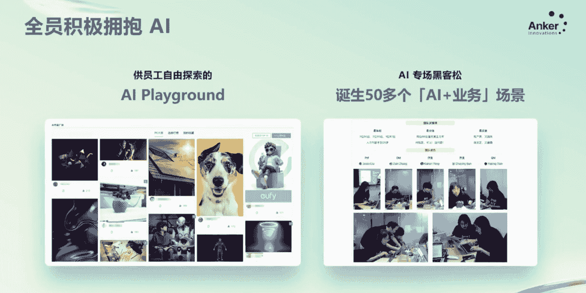

为了让全公司的人能用上更方便地用上更强的 AI，在 2023 年 7月 的时候，安克创新成为在大中华区继字节跳动后第二家部署微软企业专属GPT4服务的企业。

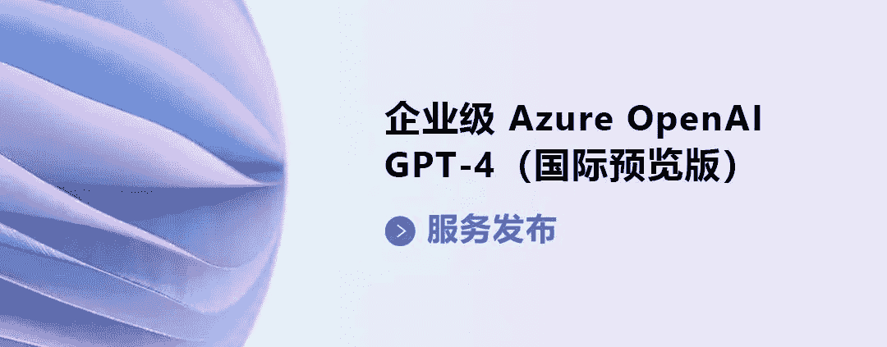

那么，在企业内部 AI 工具的基础设施搭建好之后，安克创新是怎么让公司里的那 4000 多人用上的呢？

安可创新的 AI 应用研发负责人张俊旗在《2024稀土开发者大会-大模型工具链的应用与实践》中提到，他们将公司的所有员工分成了三类员工：新人小白、资深业务人员和应用开发者。

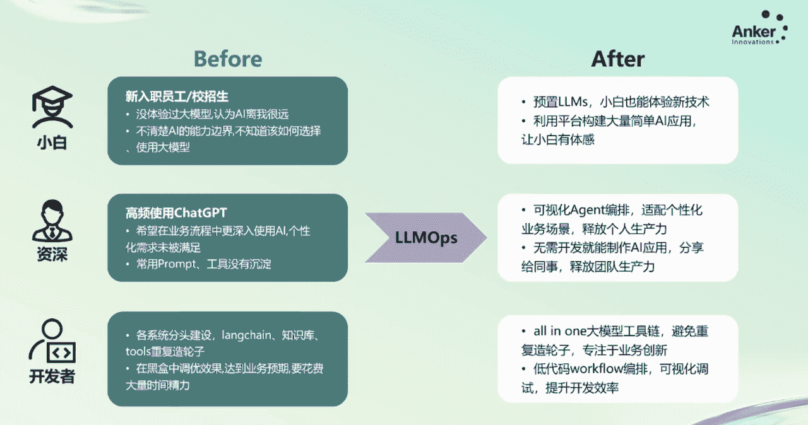

新人小白的特点是主观上感觉 AI 离自己很远，几乎没有体验过大模型，不清楚 AI 的能力边界，于是并不知道怎么在工作中用上 AI。

针对他们，安克创新的做法是在平台上搭建一个个操作简单的小工具，让他们在不具备提示词能力的情况下，也能感受到 AI 的价值。

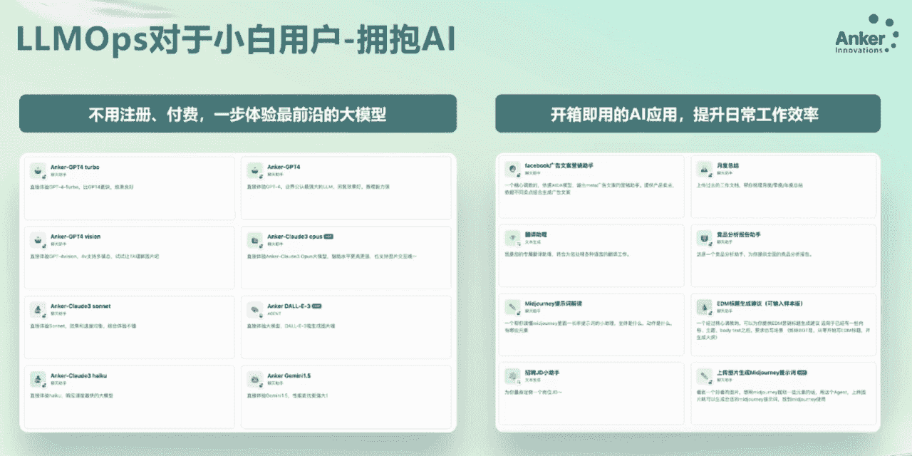

资深业务人员的特点是要处理多环节的复杂工作流程，这样的流程通常没办法用一段提示词或一个小工具解决。

于是安克创新给他们提供了基于 Dify 的可视化 AI Agent 工作流编排产品，让业务同事能在不具备代码能力的情况下，也能更具业务定制化地创造 AI 工具，释放个人生产力。

这些搭建好的工具，还能通过一个网页链接分享给其他同事，释放团队生产力。

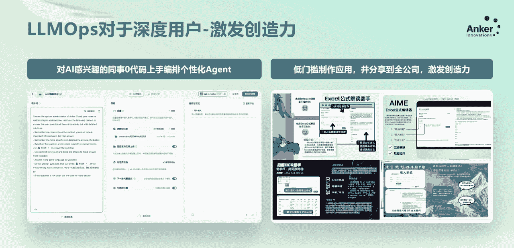

而对于公司里的开发者来说，让大家用上 AI 的过程会相对来说复杂一些。

对于开发者来说，由于能够利用生成式 AI 辅助代码编写，开发 AI 应用其实是一件很简单的事情。

但是呢，由于 LLM 生成效果存在一定的不确定性，每个开发者都经历过“开发两星期，调优三个月”这样的至暗时刻，都经历过从“特别上头”到“热情浇灭”的整个过程。

安克创新的做法是在工具链这样的基础设施上下了功夫，尽可能地减少开发者造轮子的时间，同时鼓励开发者多花时间在 workflow 编排这样相对可视和可控的流程上，增加大家的掌控性。

这些针对不同类型的员工的不同落地策略，给安克创新在“全员拥抱 AI”这件事情上起到了不小的作用。

除了让员工用上 AI 外，选取合适的业务场景来落地 AI 也是一门学问。

比如，在《2024稀土开发者大会-大模型工具链的应用与实践》的大会上，安克创新的张俊旗分享了一个他们用 AI 绘画来生成更好的营销素材的案例，并提到在引进了 AI 绘画之后，营销素材的制作成本减少了 90%。

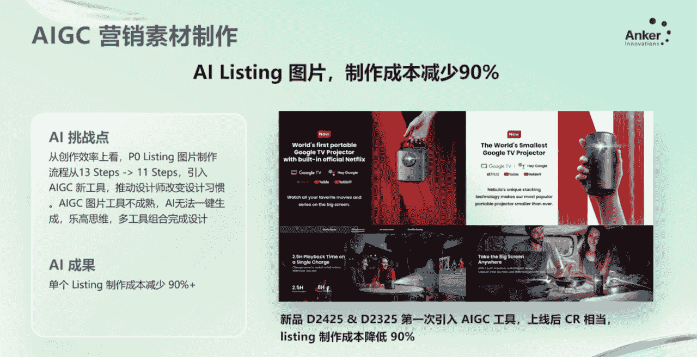

但是，在场的一位观众提出了质疑。

在营销素材生成（比如海报设计）上，图像模型生成的并不好，安可创新会不会是以牺牲素材质量为代价，来换取的效率？

这个问题，张俊旗做了解释，他提到，首先从企业的角度来看，还是有一部分物料，是不需要特别高的质量的，这一部分 AI 能很好地替人类设计师代劳。

其次，AI 在营销素材的生产中，最主要的作用并不是提高每份素材的质量，而是生成更多适配更多语言、更多文化的营销内容。

因为安可创新的客户不止来自国内，也来自全球多个国家，所以在这点上，AI 帮了不小的忙。

经过了这样的一番过程，安克创新已经利用 AI 极大地为企业提高了效率，AI 在安可创新的各个部门、各个团队都被广泛应用、覆盖客服、研发、营销等等多个业务场景。

> 用AI工具作图和创作视频脚本，市场营销团队原本需要2小时的工作量只需要15分钟；

> 用 ChatGPT 做说明书等资料的翻译，包装团队每年节约翻译费40-50万/年；

> 将AI应用于首封邮件的回复和的邮件辅助功能中，客服部门每周提效累计150小时；

> 广告部门平均广告收入再次提升8%，开发效率从5小时压缩至分钟级……

能做到这点，和安可创新的组织文化也有很大的关系。

和这家公司的名字一样，这家公司的各类业务都是创新驱动的。

张俊旗提到，“之前我们在安克一直在提倡的一个口号是‘建立一个学习型组织’，但是去年的时候，我们把这个口号改成了打造一个 AI 驱动的学习型组织。”

所以，这家公司天然会对所有的新事物抱有热情，更加愿意拥抱创新，落地创新。

在 36氪专访安克创新的文章《AIGC重塑工作流，超140亿年营收的安克创新想尝试「10倍速提效」丨数智化的秘密》文章里，描写了一段这家公司的江湖往事：

> 这一波AI大模型在安克创新内部的应用和推广并非偶然,数字化基因可以说是从安克创新与生俱来的。

>

> 安克创新的创始人阳萌一直就读计算机专业，在谷歌做了5年算法工程师后才出来创业。创立企业前，阳萌用2个月时间写出了一个架构，并找人开发成系统，这才有了安克创新的第一个订单。

>

> 正式创业后，IT 部门也是公司最早成立的团队之一。

> 2021年，高性能机器学习计算专业博士左鑫从华为财经首席数字化/AI专家岗位上离职，加入安克创新。

>

> 那时，随着业务发展，安克创新成立之初搭建的IT平台已经建成了能支持多个业务模块的系统群，而左鑫等人的加入，除了帮助这个系统群持续优化，也开始建设能看到业务全景，能力集成式的智能整合系统“数据驾驶舱”。

>

> 数据驾驶舱让公司各关键业务模块的的运作效率悉数展现，除了不断提升准确性和积累有效数据，左鑫所在团队的工作重心也来到了支持各关键业务的运作效率提升。

>

> 这一波AI技术的成熟，以及最新的AI技术带来的巨大底层基础IT能力变化，让公司切实地看到了应用AI的潜力。

>

> 经过一段时间的研究后，公司创始人阳萌和左鑫团队开始尝试通过AI，对公司内传统岗位人员进行技能重塑，提升工作效率之余，更能重塑工作流程和协作方式，来实现关于流程，方法，组织，人才等的全方位“10倍速提效”。

如今，虽然安克已经取得了很大的成就了，但他们也还在积极寻访市面上的各类AI工具和方案，寻求进一步的创新落地，所以你大抵能经常在各种行业活动和各种报导中看到安克创新的身影。

AI 时代，变化本身是最大的不变量，所以脚步不停，是对一家创新型企业的基本要求。

## 稳扎稳打派

介绍完了两家高歌猛进、大力出奇迹型的公司，你应该已经学到了一些在企业里落地 AI 的基本策略了。

可是，这两家公司毕竟之前就有一定的资源积累，所以才敢为 AI 这个变量投入这么大的资源进行改革。

那，有没有更经济实惠一点的做法呢？

有的，接下来我们介绍的两家公司，采取得做法就都比较冷静，相信能给另一面的视角。

### 得到：知识型企业怎么低成本实现 AI 转型

得到是一家很克制的公司。

得到的联合创始人快刀青衣在《2024稀土开发者大会-大模型工具链的应用与实践》提到，“刚开始创业的时候，大家都立志，我们要做一家永远正向现金流的公司，一切不盈利的业务都不许有，一切不创造用户价值的业务都不允许有。”

所以，得到在拥抱 AI 这件事情上采取的各种策略，都很省钱。

快刀青衣也在开场时自嘲了一下，“所谓的知识型企业，其实说的是我们公司没有那么强的研发能力，不是那种在技术道路上一路狂飙的公司。

但我觉得，我们更能代表中国的大部分公司。”

在工具层面，得到没有像 AfterShip 和安可创新一样选择自研 AI 工具，而是采购了知名 AI 开源工具 Dify 的内部部署服务，将这套成熟的开源产品进行了私有化线上部署。

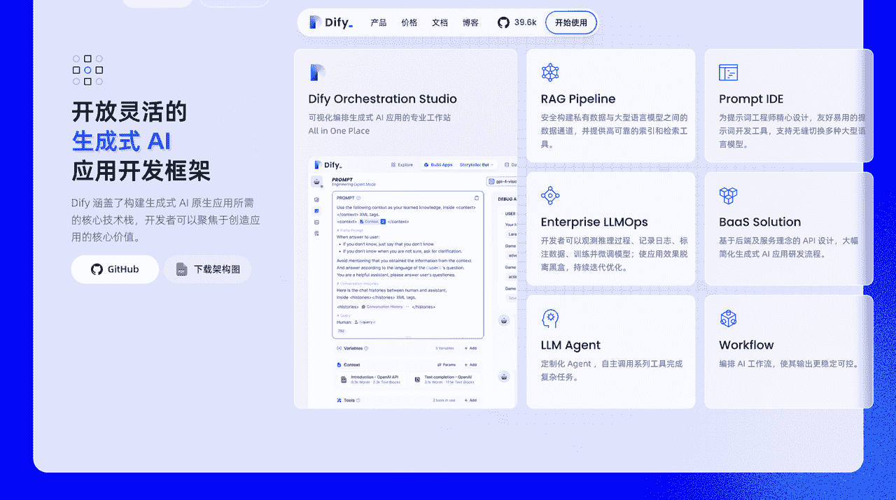

得到的员工，用这款产品做了很多务实的小工具，比如帮助编辑校对听书、课程等内容稿件的「总编室老师 - 内容校对助手」、用来检查运营文案是否违反广告法的「广告发合规助手」、用来精准查询《得到品控手册》的「得到品控手册助手」等等。

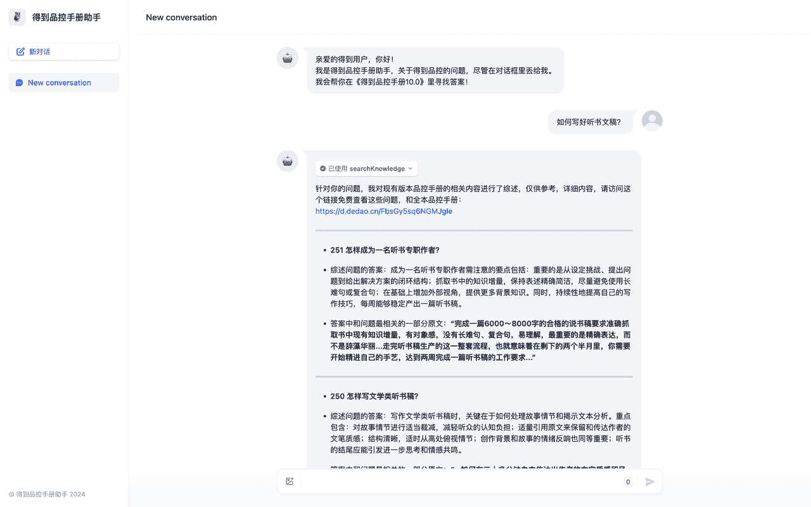

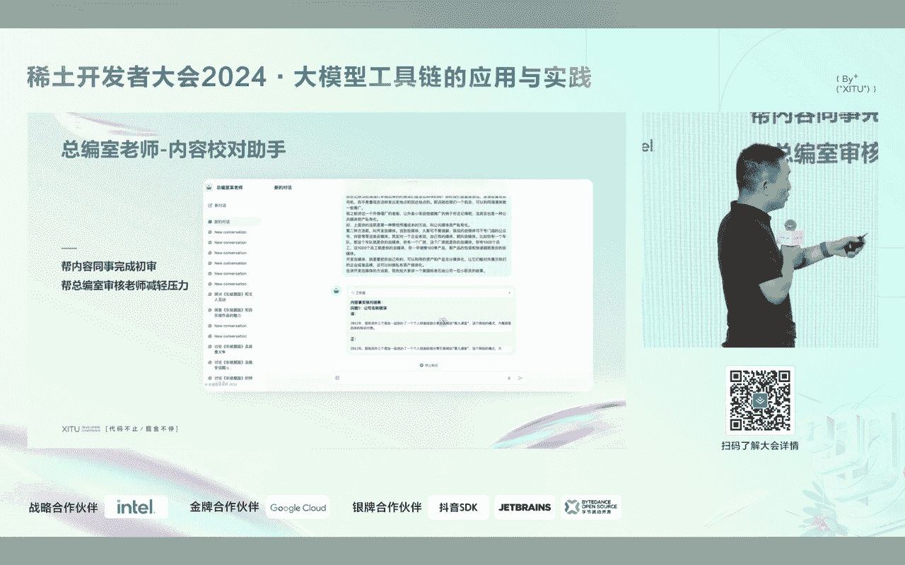

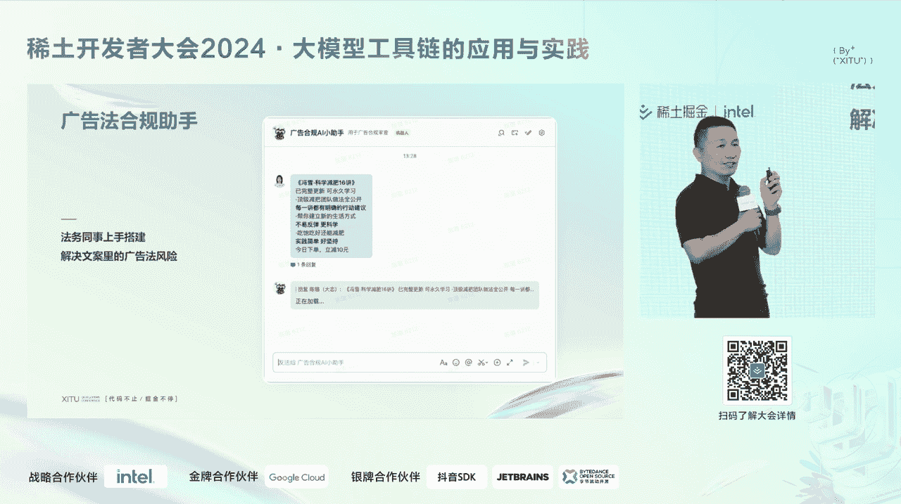

这些应用，很多都是非研发岗的同事搭建的，比如上面提到的『广告法合规助手』，是得到的一个法务同事，根据自己从法务角度审核稿件和文案的经验，一点一点调试指令词，并且利用广告法的一些反面案例作为知识库所搭建出来的 AI 助手。

“这是我们产研完全想不到的角度。”快刀青衣这样评价。

在把工具平台做好了之后，为了让大家能把这个工具平台用上，得到采取了和前两家公司相似的做法，也是办了一场内部的比赛。

不过，得到这边的原则是能省则省，这场比赛办得非常精简。

这场比赛呢，没有让全公司停工三天，也没有万元奖金激励，就是先让研发搭好 Dify 的测试环境，让运营同事用 AI 做了张海报、写了份文档发在了全员群里，邀请大家参加比赛，最后在全员群里发起一场直播，让每个小队展示自己的参赛作品。

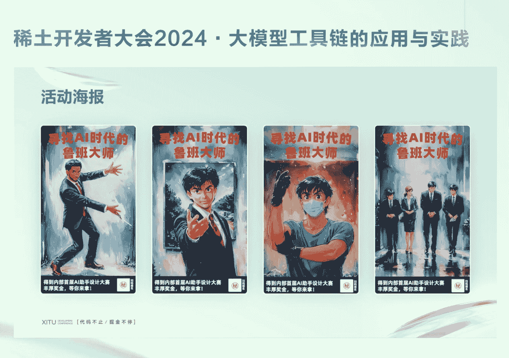

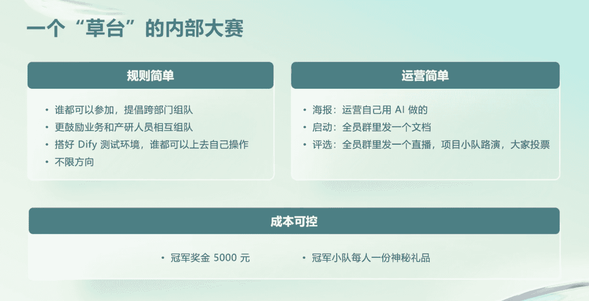

不过，虽然这场比赛办起来很简单，但是效果还是不错的。

在这场比赛中，有 40 人参与组队，一共提交了 14 个 AI 小工具，近 200 个得到员工参与了投票和体验，让几乎全员都感受到了 AI 的有趣和有用。

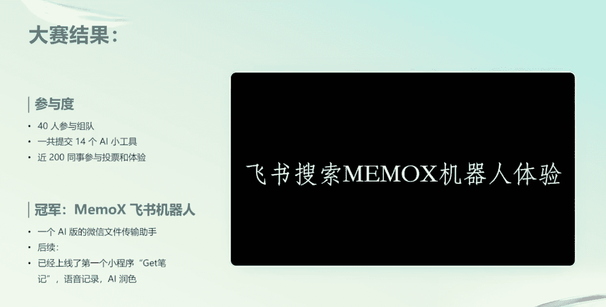

值得一提的是，在这个比赛过程中，得到的员工们不仅做出了很多内部的提效工具，也孵化出了可以交付给 C 端用户的产品。

得到上线了一个新的微信小程序，名叫【Get 笔记】，这是一款录音笔记产品，你可以用说话的方式记录你的思考，在完成记录后，你的录音会由 AI 来进行润色加工，帮你将含有错别字、口癖词的凌乱录音，在不改变原意的情况下，整理成精简、可读的文字笔记。

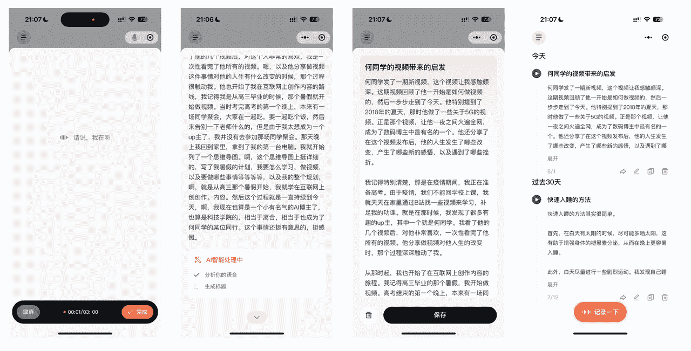

这款笔记不仅产品不仅帮助得到内部的员工提升了内容生产的效率，同时也很受得到的用户们喜欢。

到今天，Get 笔记的用户量已经过万了，网页版也即将上线。

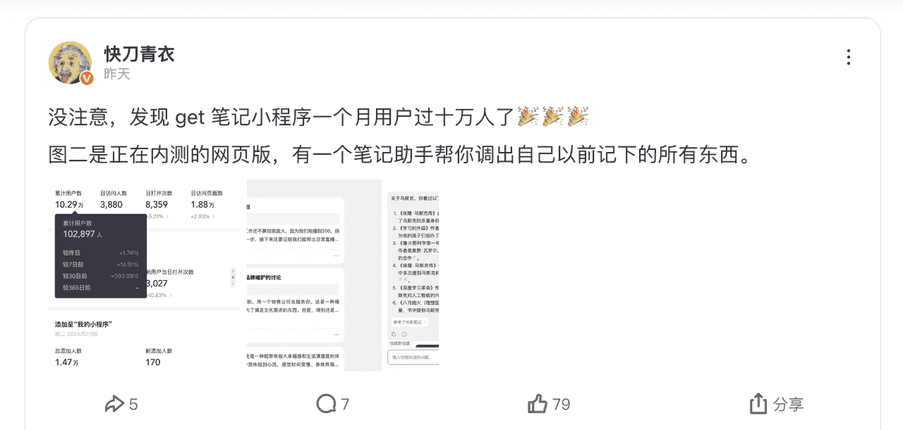

虽然市面上相似的产品有很多，比如“闪念贝壳”、“Voicenotes”等等。

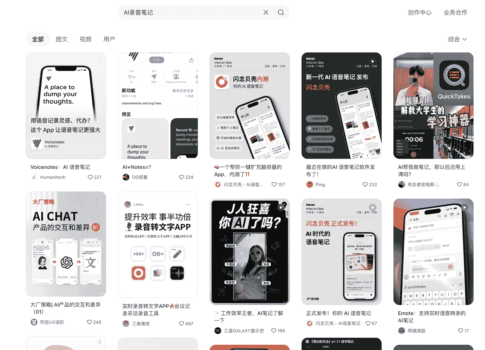

不过得到做的这款 AI 语音笔记产品很有特色，是基于得到自己润色课程文稿的方法论调试出来的指令和工作流，有一些独特的内容优化方法内嵌在了产品里。

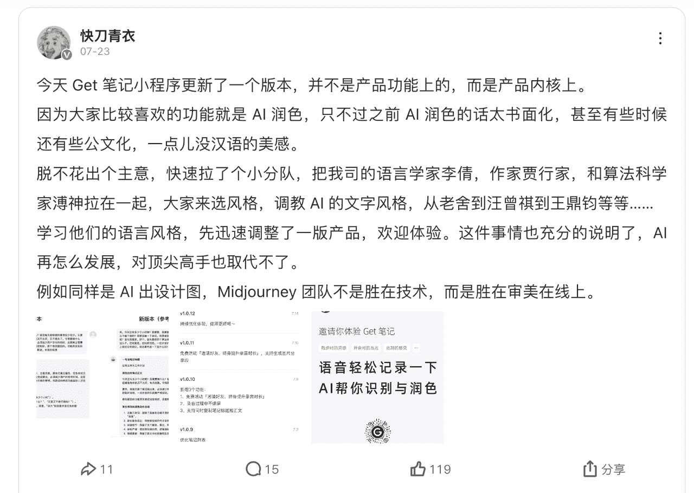

快刀青衣分享得到落地 AI 的心得时，提到了这么几个要点：

第一，AI 是用来解决问题的，不是用来解决人的。

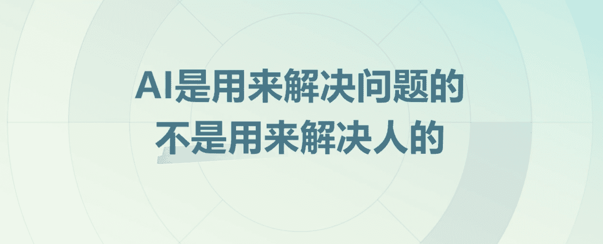

很多企业主在看到 AI 的时候，第一反应是想用它来替代公司里的某个岗位，比如 AI 能画画了，我是不是就可以裁掉插画师了；AI 能写代码了，我是不是就能裁掉程序员了……

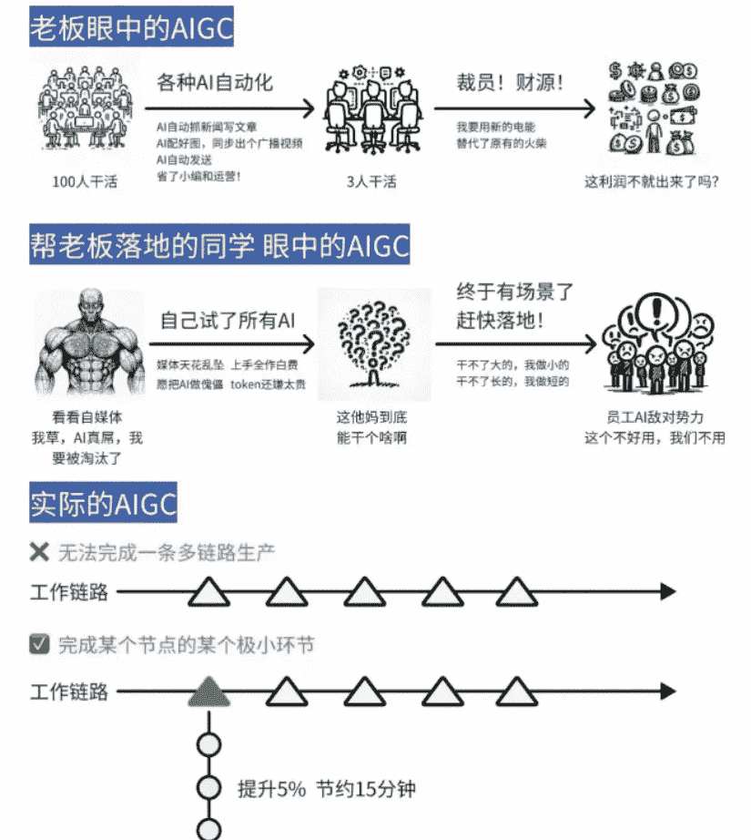

但是快刀青衣强调了，现在即使是最好的大模型、最好的 AI 产品，它的输出也还不太稳定，如果贸然用 AI 来替代掉一些岗位的员工的话，很容易让业务来出问题。

如果我们关注的不是替代哪个岗位，而是去帮助员工解决一些让他们很头疼的问题的话，那落地 AI 的思路就能一下被打开。

比如检查课程文稿的错别字和事实错误、审核运营文案是否违反广告法，都是之前在业务里很花时间的小问题，现在有了 AI 之后，这些小问题能很快被解决。

第二个要点，用 AI 解决的问题越小越好。

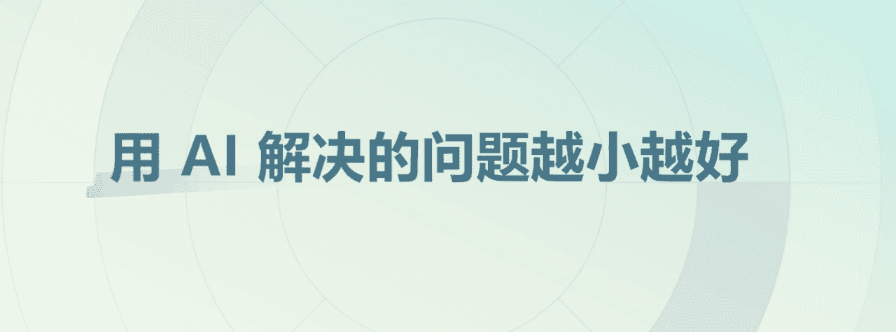

快刀青衣提到，如果你用 AI 切入的场景特别大的话，就没有同事愿意用 AI 了。

大家多少会有些抵触心理，会想着，如果 AI 能处理那么复杂的问题了，那么会不会就把我取代了。

于是这些同事会很不愿意配合你的 AI 落地策略。

相反，如果你帮员工们解决的是一个个工作中的小问题，并且，你反复告诉员工，你写的文案很重要，你的产出很重要，但是你的很多时间，被各种工作中的小问题浪费掉了，我来用 AI 帮你解决掉这些头疼的问题，让你能花更多时间在那些真正重要的事情上，员工就会很配合你。

第三个要点，“领导”自己不用，那就没法服众。

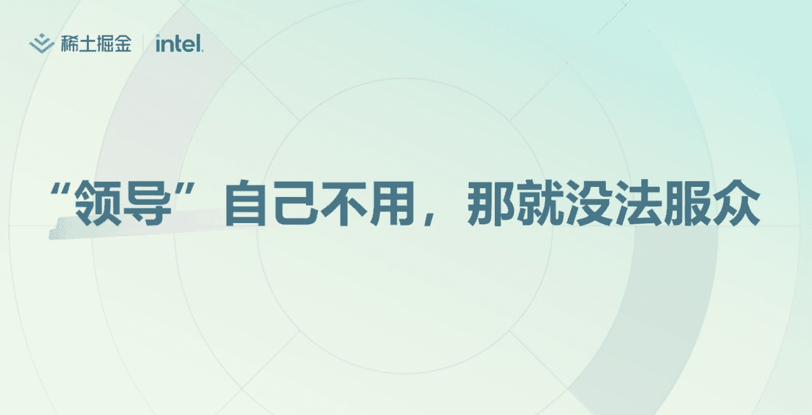

很多老板喜欢在工作群里转发各种公众号的文章，并且反复强调一定要拥抱 AI。

可是他自己却从来不用。

这样必然是无法服众的。

所以，如果想让公司能更好地落地 AI 的话，老板至少自己得率先用起来，起个带头作用，自己积累了体感之后，才知道如何带动整个团队进行 AI 转型。

快刀青衣提到，在得到里，有不少 AI 的应用的搭建，都是因为罗振宇需要大量使用 AI，因为他做《文明之旅》这档节目中，需要读到不少外文的文献，各种语言的都有。

以及有时候甚至要读一些竖版的古籍，读起来很不方便，需要用 OCR 将图片转成文字后，再用 AI 来调整成一个更加阅读友好的格式。

老板是在亲自用着的。

### 有赞：无需全员参与，即可实现转型

另一家公司的转型故事也很有特色，这就是「有赞」，一家两千多人的电商 SaaS 公司。

这家公司没有一上来就让全员拥抱 AI ，而是采取了更谨慎的“渐进式变革”的方式。

有赞的创始人白鸦在得到的直播里提到，“我记得哈佛有个研究人类行为的教授切诺韦思写过一本书，他在书里说，如果你要搞一次社会运动，只需要 3.5% 的人真诚地参与，就能搞定。

这个事情不是需要所有人参与，只要有 3.5% 的人真诚地参与和带动就能做成。”

推动公司进行 AI 转型也是这个道理，你其实并不需要让所有人都参与进来，也不是非得每条业务线、每个部门、每个团队、每个项目都进行 AI 改革。

白鸦认为，现在一些企业动不动就说要 all in AI，这其实挺危险的，因为公司里很多人是不愿意改变的，大部分人是因为惯性和恐惧，还有一少部分人可能会因为改变影响到他们的利益。

所以如果直接 All in，全公司都冲进去干这件事，而公司里没有形成认知和共识的基础，变革很难完成。

那有赞是怎么做的呢？

创始人白鸦亲自挂帅，在公司里圈了个会议室，作为有赞的 AI 作战室，并且成立了一个「赞 AI 小组」，专门负责公司的 AI 转型。

有趣的是，其实『赞 AI 小组』里只有两个人，非常敏捷。

AI 改革方式也不是按照部门或者团队进行改革，而是按照项目进行。

怎么操作呢？我们可以想象一下，大概是这么一番场景：

在有赞的 AI 作战室里，「赞 AI 小组」的成员先把公司的各种项目表给拉出来，挑出一些能够丝滑融入 AI 的项目，让白鸦老师拍板。

白鸦老师拍板之后，再拉着项目负责人和项目的参与者一起进来，一起研究并落地以这个项目为单位的 AI 改革。

不得不说，这个策略很科学。

有赞算是 SaaS 行业的头部玩家了，是一家 2000 多人的公司。

如果创始人思考不够成熟，直接让公司 2000 多人一起大多阔斧地进行 AI 改革，那势必会引起组织的反噬，让这场改革困难重重；

但是通过现在这种「创始人亲自挂帅，圈定专门的会议室」+『成立敏捷的 AI 小组』+「以项目为最小单元进行改革」的方式推动组织变革，既能保证像创业公司一样敏捷，又能把试错成本控制在一定的范围内，让局面始终可控。

这个过程还是有不小的阻力的，比如，有赞一开始让客服人员提供语料来训练智能客服，客服人员还不太配合，但是白鸦坚持让团队成员花时间去参与研发，当后来相应的模型训练好了之后，80% 的问题都不需要客服人工处理了，这让大家真真切切地感受到了 AI 创造的价值。

后来越来越多的场景都用上了 AI，比如有有赞的官方网站中的大部分新图片都是 AI 生成的。

最终，有赞用了不到 20 个人，就推动了整个 2000 人的公司的变化。

白鸦认为，有赞能成功转型的核心在于，这 20 个人，真正做出了成绩，让更多人看到了好的结果，于是更多人参与了进来，他们所在的整个部门也跟着参与了进来。

直到现在，有赞也没有停下 AI 落地的脚步。

白鸦提到，今年他们把公司的角色分成两类，一类叫直接生产力，另一类叫非直接生产力。

直接生产力是指直接面对用户的人员，包括客服、交付的客户成功、销售等。

有赞规定，每 10 个直接生产力需要有一个直接生产力的运营人员，这些运营人员的职责是总结一线直接生产力面对客户时的最佳实践和最佳发现，并且将这些最佳实践和最佳发现沉淀下来，变成训练 AI 的语料，让智能飞轮转动起来。

白鸦希望在未来有赞将从一个研发软件、销售软件的公司，变成一个给商家提供智能化消费者运营系统的公司，并从一个软件公司变成一个运营商，

通过运营这套智能化系统，让直接生产力在一线看到的所有最佳实践和最佳总结变成语料来训练系统，使系统越来越懂用户，更好地传播最佳实践。

AI 的内部落地，让有赞获得了更多服务客户的新思路，这让他们面对这个 AI 越来越好的时代时，有了新的应对策略。

## 总结：给「 AI 企业落地」积极行动者的行动清单

看了上面这四家公司的转型故事之后，相信你对「AI 企业场景落地」这个课题，已经有了充分的了解了。

我们根据这四个转型故事，为你总结了一个「企业 AI 转型五步法」，如果你也想让自己的公司落地 AI 这门新技术，可以试着通过以下步骤来进行：

第一步，自研或购买一个 AI 工具平台，让全体员工都能低成本、无障碍地用上 AI 的能力。

第二步，在内部举办 AI 场景实践、AI 产品开发的黑客松或比赛，让业务高手们自行探索 AI 落地场景。

第三步，选取几个出彩的内部 AI 解决方案，让公司里的 AI 高手来给其它同事分享，自己是怎么在业务里用上 AI 的，或者做出了一个什么样的 AI 产品。

第四步，以业务中的问题或者项目为最小变革单元，基于项目或问题，而不是岗位或部门，来推动 AI 的落地。

第五步，当内部的同事学会了 AI 的基本使用方法之后，当公司里的部分业务流程能稳定地让 AI 发挥价值之后，邀请外部专家或者合作伙伴来交流分享，进一步打开 AI 应用思路。

AI 还在以意想不到的速度持续进步，对企业的要求，也从之前的「数字化转型」，变成了『智能化转型』。

故事还在继续，新时代也才刚刚拉开帷幕，相信未来的 AI，能让每家公司，也让我们每一个人，迈入一个更加智能、更加高效、更加人性化的商业未来。