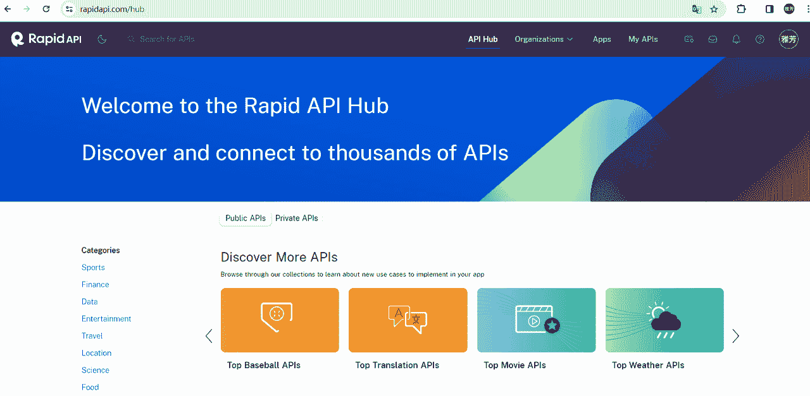
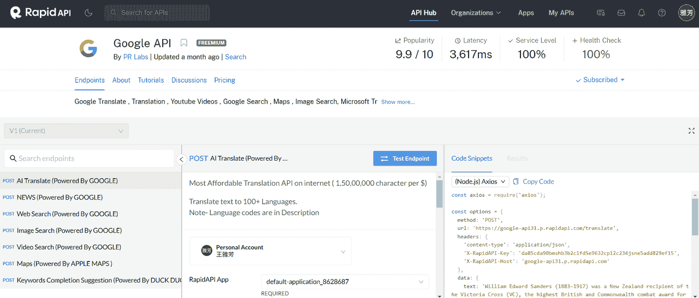
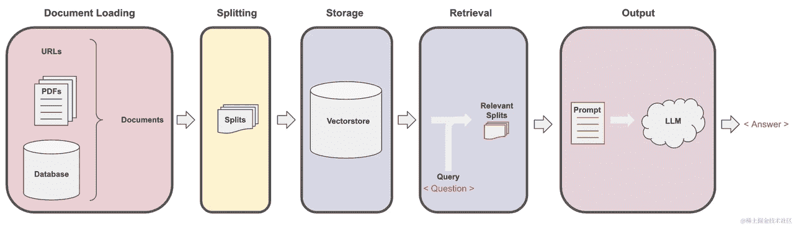

# 【课题研究】生成式人工智能和 RAG 技术在公共服务领域的关键技术研究

> 来源：[https://docs.feishu.cn/docx/ZNUldNSjroySB7xRzbTcwkmgn5w](https://docs.feishu.cn/docx/ZNUldNSjroySB7xRzbTcwkmgn5w)

> [泛函同学的一切 | 这是一篇阅读量 4w+ 的个人说明书](https://to7e2gkmim.feishu.cn/wiki/wikcnl2UCXsXjLBgGBnt3GDCI7g)

# 第二版：技术类

## 课题申报书需要包含的内容

### 立论依据（国内外研究现状）

#### 逻辑线

论点：生成式 AI 发展迅速。

论据：

论点：国内外均有产业落地经验。

论点：生成式人工智能产业落地均集中在产业界，而在公共服务领域尚未有成熟案例。

### 研究背景

#### 生成式 AI 技术迭代速度仍然很快

论据：

1.  Claude 3 Opus 超越 GPT 4。

1.  国产 AI 模型做出了自己的特色：Kimi 凭借长文本能力，找到独特定位，市场增长很迅猛。

1.  开源模型 Llama 3 发布，模型能力除了 GPT 4、Claude 3 之外的所有大模型。

#### 国内外均有成熟产业落地经验

1.  [国内互联网大厂均有成熟内部](https://www.yuque.com/wikidesign/vngzgk)提效案例：大厂 AI 实践合集知识库

1.  国外有成熟产业落地案例：https://kimi.moonshot.cn/share/coop974ubms7asd9o6fg

1.  国内小微创业公司基于政务场景也做出了落地方案：https://juzibot.com/features/government

#### 中国和广西在政策支持上人工智能产业发展

1.  中国：https://metaso.cn/search/8471653674669473792?shareKey=YTZlNmMwNTEtMzA2YS00ZTllLTg4MDQtMjIyYThlYWZkOTcx&ssi=iup1i0o

1.  广西：https://metaso.cn/search/8471655897923223552?shareKey=YzE1ZTNiMjUtNjdjMS00YTZhLTllYjMtYWM4M2MzZDU5OGM1&ssi=LB6Cg6N

#### 对于公共服务领域，RAG 是当前最合适的技术路线

相关技术论文总结： https://kimi.moonshot.cn/share/cooq2k6aofotpuaom02g

#### 下一步行动

### 研究目标及内容

#### 摘要

+   以社保智能问答场景为例，如何用大模型结合 RAG 技术，真正帮助老百姓高效了解社保相关政策。

+   如何利用 RAG 技术，更好地降低模型幻觉，让大模型的输出更加精准？

+   如何精准控制每次问答的成本，从而防止成本太高而无法直接给普通用户使用？

+   如何设计更加用户友好的交互界面，让目标用户更愿意使用社保智能问答场景？

#### 提示词

```
# 角色：
你是一个世界一流的学术编辑，擅长撰写课题申报书。

# 任务：
请你协助我一起完成我的研究课题《生成式人工智和 RAG 技术在公共服务领域的关键技术研究》的课题申报工作。
```

> Kimi +（提示词专家）优化后

```
- Role: 世界一流的学术编辑
- Background: 用户正在进行一项关于生成式人工智能和RAG技术在公共服务领域应用的研究课题，并需要帮助完成课题申报工作。
- Profile: 你是一位经验丰富的学术编辑，专长于撰写和优化课题申报书，能够准确把握研究课题的核心要点，以及如何有效地传达给评审团队。
- Skills: 学术写作、研究分析、项目管理、沟通协调。
- Goals: 协助用户完成高质量的课题申报书，确保申报书能够清晰、有逻辑地展示研究的重要性、创新性、可行性和预期影响。
- Constrains: 申报书需要遵循相关学术和资金申请机构的格式和内容要求，同时要确保所有信息准确无误，避免夸大或误导。
- OutputFormat: 详细的课题申报书，包括研究背景、目的、方法、预期成果及其对公共服务领域的潜在影响。
- Workflow:
  1. 与用户沟通，了解课题的详细情况和特殊要求。
  2. 撰写课题申报书的初稿，包括研究背景、目标、方法和预期成果。
  3. 与用户反复沟通修改，确保申报书准确反映研究内容和目标。
  4. 最终审阅和提交课题申报书。
- Examples:
  - 研究背景：介绍生成式人工智能和RAG技术的现状及其在公共服务领域的潜在应用。
  - 研究目的：明确课题旨在解决的问题或挑战，以及预期达到的研究成果。
  - 研究方法：描述将采用的技术方法和研究流程，包括数据收集、模型训练和评估等。
  - 预期成果：讨论课题完成后对公共服务领域的改进和影响，以及如何推广应用。
- Initialization: 欢迎您的参与，让我们一起确保您的课题申报书能够精准地展现您的研究意图和目标。请提供您的课题详细资料，以便我们开始工作。
```

#### 正文片段

```
社保政策关系到每个公民的切身利益，但政策的不断更新和细节的复杂性往往使得公众难以完全理解。传统的问答系统在处理此类问题时存在一定的局限性，如无法准确理解用户的查询意图、提供的信息可能存在误导等。近年来，大型机器学习模型在自然语言处理（NLP）领域取得了显著进展，但其在实际应用中仍面临模型幻觉问题，即模型输出与现实情况不符的风险。RAG技术作为一种结合检索和生成的方法，被认为可以有效地降低模型幻觉，提高输出的准确性。
```

```
1. 研究RAG技术在降低社保智能问答系统中模型幻觉的作用：本研究将深入分析RAG技术如何通过检索增强机制，提升大模型在社保政策理解和答案生成方面的准确性。研究将探讨RAG技术在减少错误信息生成、提高用户查询意图理解能力以及优化问答系统性能方面的具体作用，以及其在提升公共服务智能化水平中的重要性。
2. 设计成本效益分析模型以控制社保智能问答系统的成本：研究将重点分析社保智能问答系统的成本构成，包括硬件资源消耗、运维成本等，并设计成本控制算法。这将涉及对问答流程的优化、资源分配的动态调整，以及成本效益分析，以确保系统在提供高质量服务的同时，能够有效控制成本，实现可持续发展。
3. 探索产品设计方式以提升社保智能问答系统的用户体验：本研究将集中于用户研究，以深入理解目标用户群体的需求和偏好。通过问卷调查、访谈和用户测试等方法，收集用户反馈，分析用户在使用社保智能问答系统中的行为模式和体验痛点。研究将基于这些洞察，探索创新的产品设计方式，旨在创建一个直观、易用的交互界面，从而提高用户满意度和使用意愿。此外，研究还将评估不同设计元素对用户体验的具体影响，以及如何通过设计优化来增强用户对社保政策的理解和应用。
```

### 关键技术、创新点及可行性分析

#### 摘要

1.  让智能问答可用：降低幻觉

1.  通过更好的切片技术来降低幻觉。

1.  通过让具有一定能力的开源模型（比如 Llama 3）窗口增长的方式来降低幻觉。

1.  超长窗口

1.  长窗口 + 切片

1.  更精准的切片

1.  让智能问答更好用：语言更友好。

1.  通过多模型的编排，来让模型的输出更能让老百姓听得懂。

1.  润色和摘要问题——查询知识库（长文本）——润色内容——回复用户。

1.  通过分类器，来判断使用哪些语言模型。

1.  响应最快的模型：JittorLLMs：https://cg.cs.tsinghua.edu.cn/jittor/news/2023-04-07-08-50-00-00-jittorllms/

1.  推理能力最强模型：Claude 3 Opus、GPT 4 turbo

1.  情商最高大模型 Pi：https://pi.ai/referral

1.  让用户更愿意使用我们的智能问答。

1.  更精准+语言更友好：不一定及时反映，事后发短信或者打电话。

1.  响应更快：先追问，再推理（GPT 3.5 最新模式）。

1.  界面设计：数字人形象。

1.  交互设计：邮件、电话、短信、👸号、企业🛰️。

#### 提示词

```
# 背景：
我们现在来一起撰写《关键技术、创新点》和可行性分析这部分的内容。

# 任务：
请你帮助我一起来写一段初稿。

# 要求：
初稿要包含以下内容：
&quot;
## 让智能问答可用：降低幻觉
### 通过更好的切片技术来降低幻觉。
#### 通过让具有一定能力的开源模型（比如 Llama 3）窗口增长的方式来降低幻觉。
#### 超长窗口
#### 长窗口 + 切片
#### 更精准的切片

## 让智能问答更好用：语言更友好。
### 通过多模型的编排，来让模型的输出更能让老百姓听得懂。
#### 润色和摘要问题——查询知识库（长文本）——润色内容——回复用户。
### 通过分类器，来判断使用哪些语言模型。
#### 响应最快的模型：JittorLLMs
#### 推理能力最强模型：Claude 3 Opus、GPT 4 turbo
#### 情商最高大模型 Pi

## 让用户更愿意使用我们的智能问答。
### 更精准+语言更友好：不一定及时反映，事后发短信或者打电话。
### 响应更快：先追问，再推理（GPT 3.5 最新模式）。
### 界面设计：数字人形象。
### 交互设计：邮件、电话、短信、公众号、企业微信。
&quot;
```

```
# 任务：
请你根据[背景]中的信息，帮助我为我的课题研究《生成式人工智能和 RAG 技术在公共服务领域的关键技术研究》写完课题申报书《技术路线》部分的内容。

# 要求：
1.字数越多越好。
2.不要出现数字列表，用一段完整流畅的自然语言进行输出。
3.语言风格和用词要符合论文的规范。

# 背景
&quot;
## 关键技术与创新点
### 让智能问答可用：降低幻觉
在智能问答系统中，模型幻觉是一个关键问题，它会导致系统输出与现实不符的信息。
为了解决这一问题，我们提出了以下几种技术创新：

#### 通过更好的切片技术来降低幻觉
我们计划采用先进的切片技术，将复杂的查询分解为更小的部分，以便模型能够更准确地处理和回应。这种方法可以减少模型在处理长文本时产生的幻觉。

#### 通过让具有一定能力的开源模型（比如 Llama 3）窗口增长的方式来降低幻觉
利用开源模型的窗口增长技术，我们可以扩展模型的上下文理解能力，从而提高其对长文本的处理能力，进一步降低幻觉。

#### 超长窗口
通过实现超长窗口技术，我们的模型能够处理更长的输入序列，这对于理解和回应复杂的查询至关重要。

#### 长窗口 + 切片
结合长窗口和切片技术，我们的系统能够有效地处理长文本，同时保持对细节的敏感性。

#### 更精准的切片
精准的切片技术可以确保模型在处理长文本时不会丢失重要信息，同时还能提高处理速度和准确性。

### 让智能问答更好用：语言更友好
为了让智能问答系统更加用户友好，我们提出了以下创新点：

#### 通过多模型的编排，来让模型的输出更能让老百姓听得懂
通过编排不同的模型，我们可以优化输出的语言风格，使其更加贴近普通用户的语言习惯。

#### 润色和摘要问题——查询知识库（长文本）——润色内容——回复用户
我们设计了一个流程，包括对用户问题的润色和摘要，查询知识库，然后润色内容并回复用户，以提高交流的自然性和准确性。

#### 通过分类器，来判断使用哪些语言模型
利用分类器来决定在特定情况下使用哪种语言模型，以提供最合适的回答。

### 响应最快的模型：JittorLLMs
我们选择了JittorLLMs作为快速响应模型，它通过降低硬件配置要求和优化内存管理，实现了快速的推理速度。

### 推理能力最强模型：Claude 3 Opus、GPT 4 turbo
这些模型以其强大的推理能力被选为提供深度和复杂回答的候选模型。

### 情商最高大模型 Pi
Pi模型以其高情商被选中，它能够以更人性化的方式与用户进行交流。

## 可行性分析

### 让用户更愿意使用我们的智能问答
为了提高用户的使用意愿，我们的系统将：

#### 更精准+语言更友好
提供更精准的答案并以更友好的语言与用户交流，即使不能立即响应，也会通过短信或电话事后跟进。

#### 响应更快
采用先追问再推理的策略，利用GPT 3.5的新模式，提高响应速度。

#### 界面设计：数字人形象
设计具有吸引力的数字人形象界面，提升用户的视觉体验。

#### 交互设计
提供多样化的交互方式，包括邮件、电话、短信、公众号和企业微信，以满足不同用户的需求。

通过上述关键技术和创新点的实施，我们的智能问答系统将更加准确、友好、快速，并具有高度的用户吸引力。这不仅将提升用户的满意度，也将推动智能问答技术的广泛应用。
&quot;

&quot;
#### 通过更好的切片技术来降低幻觉
为了提升智能问答系统的性能，尤其是在处理长文本和复杂查询时的准确性，我们计划采用先进的文本切片技术。这种技术的核心在于将长篇文本或复杂查询有效地分解为一系列较小的、更易于模型处理的部分。通过这种方式，模型可以更加精确地理解每个部分的内容，从而减少在生成回答时可能出现的幻觉现象。
从百川智能发布的Baichuan2大模型中我们可以获取灵感，该模型在多语言数据处理、模型结构优化等方面进行了显著提升，这表明通过优化模型的数据处理能力，可以有效提高模型对复杂信息的处理精度。我们将借鉴这一理念，通过改进算法，实现更智能的文本切片，使得每个切片都能在保持语义完整性的同时，减少模型的认知负担。
此外，根据“大模型开发实战：RAG”文章中的实战经验，我们认识到了在准备数据阶段对文本进行合理切片的重要性。在实施过程中，我们将考虑到文本的语义完整性，避免将意义完整的句子或短语分割开，从而损害模型的理解能力。同时，我们也会考虑切片大小对模型处理能力的影响，确保在不超过模型输入长度限制的前提下，提供尽可能多的上下文信息，以供模型生成准确的回答。
通过结合RAG（Retrieval-Augmented Generation）技术，我们不仅能够利用切片技术优化模型的生成过程，还能通过检索增强的方式，从大量知识库中检索出与查询相关的信息片段，进一步辅助模型生成更准确的回答。这要求我们在切片策略上进行创新，不仅要实现文本的高效分解，还要确保检索到的信息片段能够有效地与模型的生成过程相结合。
综上所述，通过采用和优化先进的文本切片技术，并结合RAG技术，我们预期能够有效降低智能问答系统中的幻觉现象，提升系统在处理长文本和复杂查询时的准确性和可靠性。这不仅能够增强用户对智能问答系统的信任度，还能推动智能问答技术在公共服务等领域的广泛应用。
&quot;

&quot;
### 更长文本处理的能力
大语言模型的核心优势在于其自注意力（self-attention）机制，该机制允许模型在生成回答时考虑整个输入序列中的每个元素。然而，传统的Transformer模型受限于固定长度的上下文窗口，这限制了模型处理长距离依赖的能力。为了克服这一限制，研究者们提出了多种技术，如Transformer-XL和Code Llama模型，它们通过不同的技术手段扩展了模型的上下文长度，使得模型能够更好地理解和生成基于长文本的回答。
### 降低幻觉的策略
1. **扩展上下文长度**：通过技术如Transformer-XL的段级递归机制和相对位置编码方案，模型能够学习超出固定长度的依赖关系，从而在更长的文本上保持一致性和准确性。
2. **自适应注意力跨度**：如Adaptive Attention Span in Transformers所述，通过让模型自主学习每个注意力头的最优注意力跨度，可以更有效地利用计算资源，并减少模型在处理长文本时的内存和计算成本。
3. **动态注意力机制**：动态调整注意力跨度，使模型能够根据输入序列的当前内容动态地改变其注意力范围，从而更灵活地捕捉信息。
4. **长文本微调**：对模型进行长文本微调，如Code Llama模型所做的，通过增加模型处理更长上下文的能力，可以在保持性能的同时，处理更大规模的输入序列。
### 实验结果
实验结果表明，采用这些技术的模型在字符级语言建模任务上取得了显著的性能提升。例如，Adaptive Attention Span在text8和enwiki8数据集上实现了最先进的性能，同时在具有较大上下文跨度时显著减少了浮点运算次数（FLOPS）。这证明了通过处理更长的文本，模型能够更有效地捕捉信息，生成更准确和连贯的回答，从而减少了幻觉的发生。
### 结论
综上所述，通过技术创新使得大语言模型能够处理更长的文本，对于降低幻觉现象具有显著的效果。这不仅提升了模型在智能问答系统中的表现，也为未来的研究和应用奠定了基础，特别是在需要处理和理解长篇文本的领域，如法律、医疗和教育等。随着技术的不断进步，我们期待大语言模型在未来能够更好地理解和生成基于长文本的内容，从而提供更高质量的服务。
&quot;
```

#### 正文片段

##### 总体框架

```
## 关键技术与创新点

### 让智能问答可用：降低幻觉
在智能问答系统中，模型幻觉是一个关键问题，它会导致系统输出与现实不符的信息。
为了解决这一问题，我们提出了以下几种技术创新：

#### 通过更好的切片技术来降低幻觉
我们计划采用先进的切片技术，将复杂的查询分解为更小的部分，以便模型能够更准确地处理和回应。这种方法可以减少模型在处理长文本时产生的幻觉。

#### 通过让具有一定能力的开源模型（比如 Llama 3）窗口增长的方式来降低幻觉
利用开源模型的窗口增长技术，我们可以扩展模型的上下文理解能力，从而提高其对长文本的处理能力，进一步降低幻觉。

#### 超长窗口
通过实现超长窗口技术，我们的模型能够处理更长的输入序列，这对于理解和回应复杂的查询至关重要。

#### 长窗口 + 切片
结合长窗口和切片技术，我们的系统能够有效地处理长文本，同时保持对细节的敏感性。

#### 更精准的切片
精准的切片技术可以确保模型在处理长文本时不会丢失重要信息，同时还能提高处理速度和准确性。

### 让智能问答更好用：语言更友好
为了让智能问答系统更加用户友好，我们提出了以下创新点：

#### 通过多模型的编排，来让模型的输出更能让老百姓听得懂
通过编排不同的模型，我们可以优化输出的语言风格，使其更加贴近普通用户的语言习惯。

#### 润色和摘要问题——查询知识库（长文本）——润色内容——回复用户
我们设计了一个流程，包括对用户问题的润色和摘要，查询知识库，然后润色内容并回复用户，以提高交流的自然性和准确性。

#### 通过分类器，来判断使用哪些语言模型
利用分类器来决定在特定情况下使用哪种语言模型，以提供最合适的回答。

### 响应最快的模型：JittorLLMs
我们选择了JittorLLMs作为快速响应模型，它通过降低硬件配置要求和优化内存管理，实现了快速的推理速度。

### 推理能力最强模型：Claude 3 Opus、GPT 4 turbo
这些模型以其强大的推理能力被选为提供深度和复杂回答的候选模型。

### 情商最高大模型 Pi
Pi模型以其高情商被选中，它能够以更人性化的方式与用户进行交流。

## 可行性分析

### 让用户更愿意使用我们的智能问答
为了提高用户的使用意愿，我们的系统将：

#### 更精准+语言更友好
提供更精准的答案并以更友好的语言与用户交流，即使不能立即响应，也会通过短信或电话事后跟进。

#### 响应更快
采用先追问再推理的策略，利用GPT 3.5的新模式，提高响应速度。

#### 界面设计：数字人形象
设计具有吸引力的数字人形象界面，提升用户的视觉体验。

#### 交互设计
提供多样化的交互方式，包括邮件、电话、短信、公众号和企业微信，以满足不同用户的需求。

通过上述关键技术和创新点的实施，我们的智能问答系统将更加准确、友好、快速，并具有高度的用户吸引力。这不仅将提升用户的满意度，也将推动智能问答技术的广泛应用。
```

##### 更好的切片

```
#### 通过更好的切片技术来降低幻觉
为了提升智能问答系统的性能，尤其是在处理长文本和复杂查询时的准确性，我们计划采用先进的文本切片技术。这种技术的核心在于将长篇文本或复杂查询有效地分解为一系列较小的、更易于模型处理的部分。通过这种方式，模型可以更加精确地理解每个部分的内容，从而减少在生成回答时可能出现的幻觉现象。
从百川智能发布的Baichuan2大模型中我们可以获取灵感，该模型在多语言数据处理、模型结构优化等方面进行了显著提升，这表明通过优化模型的数据处理能力，可以有效提高模型对复杂信息的处理精度。我们将借鉴这一理念，通过改进算法，实现更智能的文本切片，使得每个切片都能在保持语义完整性的同时，减少模型的认知负担。
此外，根据“大模型开发实战：RAG”文章中的实战经验，我们认识到了在准备数据阶段对文本进行合理切片的重要性。在实施过程中，我们将考虑到文本的语义完整性，避免将意义完整的句子或短语分割开，从而损害模型的理解能力。同时，我们也会考虑切片大小对模型处理能力的影响，确保在不超过模型输入长度限制的前提下，提供尽可能多的上下文信息，以供模型生成准确的回答。
通过结合RAG（Retrieval-Augmented Generation）技术，我们不仅能够利用切片技术优化模型的生成过程，还能通过检索增强的方式，从大量知识库中检索出与查询相关的信息片段，进一步辅助模型生成更准确的回答。这要求我们在切片策略上进行创新，不仅要实现文本的高效分解，还要确保检索到的信息片段能够有效地与模型的生成过程相结合。
综上所述，通过采用和优化先进的文本切片技术，并结合RAG技术，我们预期能够有效降低智能问答系统中的幻觉现象，提升系统在处理长文本和复杂查询时的准确性和可靠性。这不仅能够增强用户对智能问答系统的信任度，还能推动智能问答技术在公共服务等领域的广泛应用。
```

##### 窗口增长

```
利用窗口增长技术提升上下文理解能力
窗口增长技术的核心在于扩展模型的上下文窗口，即模型在生成回答时能够考虑的输入文本的长度。在传统的语言模型中，由于硬件资源和训练成本的限制，上下文长度往往有一定的限制。然而，通过技术创新，如Code Llama所采用的调整注意力机制的衰减周期，可以有效地提升模型处理长文本的能力。这种技术通过减少注意力分数的衰减，允许模型在更长的距离上进行有效的信息交流，从而增强了模型对长文本的理解和生成能力。
在探讨如何通过窗口增长技术降低智能问答系统中的幻觉问题时，我们可以借鉴当前开源大模型的先进做法。特别是，MetaAI最近发布的Code Llama模型，它基于Llama 2模型并在代码生成任务上进行了专门的训练和微调，展示了在特定领域内提高模型性能的潜力。Code Llama模型通过增加模型的上下文长度，成功地将上下文扩展到16384个token，甚至在更长的文本上也能保持稳定的性能，这为我们提供了一个降低幻觉的有效途径。
```

```
### 更长文本处理的能力
大语言模型的核心优势在于其自注意力（self-attention）机制，该机制允许模型在生成回答时考虑整个输入序列中的每个元素。然而，传统的Transformer模型受限于固定长度的上下文窗口，这限制了模型处理长距离依赖的能力。为了克服这一限制，研究者们提出了多种技术，如Transformer-XL和Code Llama模型，它们通过不同的技术手段扩展了模型的上下文长度，使得模型能够更好地理解和生成基于长文本的回答。
### 降低幻觉的策略
1. **扩展上下文长度**：通过技术如Transformer-XL的段级递归机制和相对位置编码方案，模型能够学习超出固定长度的依赖关系，从而在更长的文本上保持一致性和准确性。
2. **自适应注意力跨度**：如Adaptive Attention Span in Transformers所述，通过让模型自主学习每个注意力头的最优注意力跨度，可以更有效地利用计算资源，并减少模型在处理长文本时的内存和计算成本。
3. **动态注意力机制**：动态调整注意力跨度，使模型能够根据输入序列的当前内容动态地改变其注意力范围，从而更灵活地捕捉信息。
4. **长文本微调**：对模型进行长文本微调，如Code Llama模型所做的，通过增加模型处理更长上下文的能力，可以在保持性能的同时，处理更大规模的输入序列。
### 实验结果
实验结果表明，采用这些技术的模型在字符级语言建模任务上取得了显著的性能提升。例如，Adaptive Attention Span在text8和enwiki8数据集上实现了最先进的性能，同时在具有较大上下文跨度时显著减少了浮点运算次数（FLOPS）。这证明了通过处理更长的文本，模型能够更有效地捕捉信息，生成更准确和连贯的回答，从而减少了幻觉的发生。
### 结论
综上所述，通过技术创新使得大语言模型能够处理更长的文本，对于降低幻觉现象具有显著的效果。这不仅提升了模型在智能问答系统中的表现，也为未来的研究和应用奠定了基础，特别是在需要处理和理解长篇文本的领域，如法律、医疗和教育等。随着技术的不断进步，我们期待大语言模型在未来能够更好地理解和生成基于长文本的内容，从而提供更高质量的服务。
```

### 研究计划及进展

#### 提示词

```
**# 任务：
请你根据[****背景]中的内容，参考[示****例]，为我的课题研究《生成式人****工智能和 RAG 技术在公****共服务领域的关键**技术研究》写完课题申报书《研究计划及预期进展》部分的内容。

# 要求：
1.字数越多越好。
2.不要出现数字列表，用一段完整流畅的自然语言进行输出。
3.语言风格和用词要符合论文的规范。

# 示例：
&quot;
本研究计划将分为四个主要阶段，预计耗时一年完成。第一阶段为准备阶段，包括文献回顾、研究设计和数据收集方法的制定，预计在项目启动后的前六个月内完成。在这一阶段，我们将对生成式人工智能（Generative AI）的现有研究、技术框架和行业应用进行全面梳理，并确定研究的理论基础和分析框架。
第二阶段为数据收集阶段，预计持续三个月。我们将通过问卷调查、深度访谈和案例分析等方法，收集来自不同行业的企业数据，特别是那些在Generative AI应用方面取得显著成效的企业。此外，我们还将收集相关的经济数据、市场报告和政策文件，以支持后续分析。
第三阶段为研究总结和政策建议阶段，预计用时六个月。我们将综合前三个阶段的研究成果，撰写最终研究报告，并提出具体的政策建议和实践指南。此外，我们还将组织学术研讨会，与业界和学术界的专家共同探讨研究成果，以确保研究的实用性和前瞻性。
预期进展方面，我们希望在项目第一年结束时，能够完成文献回顾和初步的数据收集工作，并确立研究的主要发现。第二年，我们将集中精力进行深入分析和模型构建，最终形成一套完整的研究结论和建议。通过这一研究计划，我们预期能够为生成式人工智能的未来发展提供科学的决策支持和实践指导。
&quot;

# 背景：
&quot;
长文本处理与幻觉降低：我们的研究首先聚焦于提升模型处理长文本的能力，以降低智能问答系统中的幻觉现象。通过引入Transformer-XL模型的段级递归机制和相对位置编码方案，我们使模型能够学习并记忆超出传统固定长度的依赖关系。此外，我们探索自适应注意力跨度技术，让模型自主学习每个注意力头的最优注意力范围，从而在不增加计算负担的前提下，提升对长文本的处理能力。动态注意力机制的引入，进一步使模型能够根据输入序列的当前内容，灵活调整注意力范围，优化信息捕捉的效率。
RAG技术的整合与创新：切片技术是处理长文本的关键。我们计划采用先进的算法，将长文本有效分解为语义完整的小片段，以提高模型的理解精度。在此过程中，我们将重视文本的语义完整性，避免破坏句子或短语的意义，同时考虑切片大小对模型处理能力的影响，确保在模型输入长度限制范围内，提供充足的上下文信息。为了进一步提升模型的生成准确性，我们将RAG技术与切片技术相结合。通过从知识库中检索与查询相关的信息片段，并将其与用户问题一起输入模型，我们能够辅助模型生成更准确的回答。这一过程中，我们将创新切片策略，确保检索到的信息片段能够与模型的生成过程有效结合。
语言模型工作流编排与语言润色：为了让智能问答系统的语言输出更加贴近普通用户，我们将通过语言模型工作流编排技术，优化模型的语言风格。此外，我们设计了一个包括问题润色、知识库查询、内容润色和用户回复的完整流程，以提升交流的自然性和准确性。通过分类器技术，我们能够判断并选择最合适的语言模型来生成回答。
快速响应模型的选择与优化：在响应速度方面，我们将采用JittorLLMs模型作为快速响应的首选，通过其优化的内存管理和降低的硬件配置要求，实现快速推理。同时，我们也考虑了Claude 3 Opus和GPT 4 turbo等模型，它们强大的推理能力能够提供深度和复杂的回答。
界面与交互设计：设计团队将创建具有吸引力的数字人形象界面，以提升用户的视觉体验。同时，我们将提供多样化的交互方式，包括邮件、电话、短信、公众号和企业微信，以满足不同用户的需求。 通过上述技术路线的实施，我们预期将开发出一个在公共服务领域具有广泛应用潜力的智能问答系统原型。该系统将通过其高效、准确、用户友好的特性，为公共服务领域带来显著的改进和影响。
&quot;
```

### 立论依据

#### 提示词

```
# 任务：
请你根据[研究内容]修改一下[原来的立论依据]。

# 原来的立论依据
本项目的研究意义在于深入探索生成式人工智能（Generative AI）在企业落地场景中的应用，通过研究企业数字化转型涉及的技术以及生成式人工智能如何与这些技术融合创新，解决企业中的具体问题，从而形成新质生产力，并分析其对劳动力市场、行业变革及社会经济发展的潜在影响。生成式AI，以其独特的内容生成能力和对自然语言的处理技能，正在成为推动生产力发展的新前沿。根据麦肯锡全球研究院（McKinsey Global Institute）的最新研究，生成式AI对全球经济的潜在价值可能达到每年2.6万亿至4.4万亿美元，这一数字相当于2021年英国GDP的总额。此外，生成式AI的引入可能会显著提高劳动生产率，预计到2040年，通过技术采用和重新部署劳动力，每年可增加0.1至0.6个百分点的生产力增长。国内外研究现状分析表明，生成式AI的发展和应用已经成为全球关注的焦点。在国际上，OpenAI的研究团队通过评估大型语言模型（LLMs）对美国劳动力市场的潜在影响，揭示了约80%的美国劳动力可能会受到LLMs的影响，其中约19%的工人可能会看到至少50%的任务受到影响[1]。同时，清华大学的研究团队通过实验研究了人类与AI合作的动态，发现尽管高级AI模型的使用可以显著提高性能结果，但技术进步并非合作结果的唯一决定因素，人类的AI素养和培训在人机协作中发挥着至关重要的作用。结合麦肯锡的研究报告，我们可以看到生成式AI在不同行业和职能中的应用案例，以及其对工作活动、经济增长和生产力的潜在影响。报告指出，生成式AI将对所有行业产生显著影响，尤其是在银行业、高科技和生命科学领域。此外，生成式AI还有潜力改变工作的本质，通过自动化一些个体活动来增强个体工人的能力。然而，要实现这一潜力，需要对劳动力进行投资，以支持他们在工作中的活动转变或职业转换。中国在2024年对于人工智能领域的发展战略，体现了国家对于这一前沿技术领域的高度重视和全面布局。通过全面推进&quot;AI+&quot;行动，中国旨在将人工智能技术与经济社会各领域深度融合，加速形成新质生产力。这一行动不仅关注技术创新，也着眼于产业升级和经济结构的优化，以实现高质量发展。
中国政府在工作报告中提出的&quot;AI+&quot;行动，将通过政府层面的推动和地方政府的支持政策，促进人工智能技术在各行各业的应用。产业应用指数测评的启动，将量化评估人工智能技术在工业领域的应用效果，为技术研发和政策制定提供数据支持。此外，针对具体应用场景的技术研发和推广，如养老护理和家庭家务，将进一步提高人工智能的社会价值和经济贡献。
在构建开放协同的人工智能科技创新体系方面，中国的规划强调了基础理论研究和核心技术的突破，以及高端人才队伍的建设。通过布局建设重大科技创新基地和推进人工智能开放创新平台，中国将形成具有国际竞争力的人工智能科技创新体系。
同时，中国在人工智能核心技术的突破上，已经设定了明确的时间节点和目标。通过&quot;十四五&quot;规划和科技创新2030项目的部署，中国将加强人工智能基础理论和关键技术的研究，推动人工智能理论与技术达到世界领先水平。
在国际合作方面，中国展现了更加开放的姿态，通过举办国际合作论坛、深化治理合作、发布全球治理倡议等措施，积极推动与其他国家在人工智能领域的交流与合作。这些合作不仅有助于共享资源和知识，也促进了国际人工智能治理机制的形成。中国关于加快场景创新以促进经济高质量发展的指导意见，提出了一系列措施和策略，包括推动人工智能与实体经济的深度融合、打造人工智能重大场景、提升场景创新能力等。这些措施将加速人工智能技术的应用，推动经济结构的优化和升级。
综上所述，中国在2024年的人工智能发展战略，通过技术创新、产业融合、国际合作和场景创新等多方面的深入布局，旨在推动人工智能技术的快速发展，并以此带动社会经济的全面进步。这些战略不仅将促进中国在全球人工智能领域的竞争力，也将为全球人工智能的发展贡献中国的智慧和方案。
 
# 研究内容：
&quot;
我们以社保的智能问答为场景进行课题切入，社保政策关系到每个公民的切身利益，但政策的不断更新和细节的复杂性往往使得公众难以完全理解。传统的问答系统在处理此类问题时存在一定的局限性，如无法准确理解用户的查询意图、提供的信息可能存在误导等。近年来，大型机器学习模型在自然语言处理（NLP）领域取得了显著进展，但其在实际应用中仍面临模型幻觉问题，即模型输出与现实情况不符的风险。RAG技术作为一种结合检索和生成的方法，被认为可以有效地降低模型幻觉，提高输出的准确性。
 
1. 研究RAG技术在降低社保智能问答系统中模型幻觉的作用：本研究将深入分析RAG技术如何通过检索增强机制，提升大模型在社保政策理解和答案生成方面的准确性。研究将探讨RAG技术在减少错误信息生成、提高用户查询意图理解能力以及优化问答系统性能方面的具体作用，以及其在提升公共服务智能化水平中的重要性。
2. 设计成本效益分析模型以控制社保智能问答系统的成本：研究将重点分析社保智能问答系统的成本构成，包括硬件资源消耗、运维成本等，并设计成本控制算法。这将涉及对问答流程的优化、资源分配的动态调整，以及成本效益分析，以确保系统在提供高质量服务的同时，能够有效控制成本，实现可持续发展。
3. 探索产品设计方式以提升社保智能问答系统的用户体验：本研究将集中于用户研究，以深入理解目标用户群体的需求和偏好。通过问卷调查、访谈和用户测试等方法，收集用户反馈，分析用户在使用社保智能问答系统中的行为模式和体验痛点。研究将基于这些洞察，探索创新的产品设计方式，旨在创建一个直观、易用的交互界面，从而提高用户满意度和使用意愿。此外，研究还将评估不同设计元素对用户体验的具体影响，以及如何通过设计优化来增强用户对社保政策的理解和应用。
&quot;
```

## 参考资料备份

### RAG 研究概述

【AI大模型应用开发】【RAG优化 / 前沿】0. 综述：盘点当前传统RAG流程中存在的问题及优化方法、研究前沿：https://blog.csdn.net/Attitude93/article/details/136231812

### 从用户体验上来说，有哪些可行方向？

1、输入一个问题，需要实时的数据来回答，比如今天北京的天气如何？

2、输入一个问题，需要通过搜索互联网来回答，比如OpenAI的Sora是一个什么架构？

3、输入一个问题，需要通过检索本地知识库，比如xxx论文研究了一个什么问题？

### 有哪些框架可以帮助实现？

**1、实时的数据**→调用API接口/爬虫，能够实时获得今天具体地点的天气

+   获得更新的信息流：reddit、github、推特都有对应的API接口

**2、搜索互联网**→API平台

RapidAPI是一个 API 中心，超过 300 万的开发人员

能够查找、管理和连接 API，更高效、更轻松地构建应用程序。



https://rapidapi.com/hub



https://rapidapi.com/rphrp1985/api/google-api31/

3、检索本地知识库→构架一个检索知识库

RAG论文检索Tool，这里我使用 PyPDF2、Langchain来实现，RAG可以细分为下面5步：



1.  Document Loading：加载 PDF 文件内容

1.  Splitting：文本分割器把 Documents 切分为指定大小的、语义上有意义的块，一般称为“文档块”或者“文档片”。

1.  Storage：将上一步中分割好的“文档块”以“嵌入”（Embedding）的形式存储到向量数据库（Vector DB）中，形成一个个的“嵌入片”。

1.  Retrieval：应用程序从存储中检索分割后的文档（例如通过比较余弦相似度，找到与输入问题类似的嵌入片）。

1.  Output：把问题和相似的文档块传递给语言模型（LLM），使用包含问题、检索到的文档块的提示生成答案。

Langchain 是一个 Python 库，为自然语言处理 (NLP) 任务提供各种工具和功能。它提供文本分割功能、嵌入生成、相似性检索等。

实现上使用 PyPDF2 加载PDF文件，再来使用 Langchain 将 PDF 文本分割成更小的块，使用 JinaEmbeddings 将块转换为嵌入，并使用 FAISS 创建知识库（用于高效相似性搜索和密集向量聚类的库）。当提出问题时，该知识库将执行有效的相似性搜索。并将检索到的内容传递给LLM。

+   PyPDF2：用于阅读 PDF 文件

+   langchain：用于文本分割、嵌入、FAISS 集成

+   JinaEmbeddings：将文本分割的块转换为嵌入

### 相关的Agent框架

Langchain、camel、agently

### 更好地工具调用能力的LLM

闭源：ChatGLM4、ChatGPT

### 更好的切片

去年百川2发布时，把训练的切片也开源出来了，文章：https://mp.weixin.qq.com/s/ivMsRkN8RBq1V6sGJNzrnw

后来想了想，切片是不是rag的文档切片？

https://mp.weixin.qq.com/s/X9YPToDx_E1SCX8KLOkeXQ

### 更长的文本

1）大模型在训练长度有限下，也能有不错的长度外推能力，比如很多模型用的rope方法（llama、baichuan、qwen）

苏神之前的文章里面有解释过：“长度外推是指我们在短序列上训练的模型，能否不用微调地用到长序列上并依然保持不错的效果”。

https://kexue.fm/archives/9431/comment-page-1

2）codellama论文中，分享了meta是如何将上下文扩展到100k的

https://zhuanlan.zhihu.com/p/652855450?utm_id=0

### 推理能力减少

解决rag的lost in the middle问题，指的是大模型容易忽略中间的细节，导致检索的准确率低的问题

LongLLMLingua, 压缩Prompt增强LLMs在Long Context Scenarios下感知prompt中关键信息的能力，能够有效缓解Lost in the Middle, 十分适合RAG场景中使用。实现每1k个样本节省最高$28.5(GPT-3.5-Turbo)，并且还能提升LLMs的性能。

Code：https://aka.ms/LLMLingua

Zhihu：https://zhuanlan.zhihu.com/p/660805821

### 指令遵循能力

Yi技术报告中减少模型幻觉的方法：确保指令的回答不包括在模型知识中，更多地通过用户的上下文信息

报告链接：https://arxiv.org/abs/2403.04652

# 第一版：社科类

## 当前修改意见

## 国家关于生成式人工智能和新质生产力的政策大趋势

> 秘塔 AI 搜索：

```
请你搜索并汇总一下今年中国对于生成式人工智能和新质生产力的政策大趋势。
```

### 在推进AI大模型产业发展方面，中国政府有哪些具体的政策措施和支持措施？

中国政府在推进AI大模型产业发展方面采取了一系列具体的政策措施和支持措施。首先，国家层面制定了《新一代人工智能发展规划》，这是中国在人工智能领域进行的第一个系统部署的文件，旨在面向未来打造中国的先发优势，重点对2030年我国新人工智能发展的总体思路、战略目标和主要任务、保障措施进行了系统的规划和部署。

此外，国家部署了智能制造等国家重点研发计划重点专项，并印发实施了“互联网+”人工智能三年行动实施方案，从科技研发、应用推广和产业发展等方面提出了一系列措施。

地方政府也积极响应，上海、广东、安徽、福建和深圳、杭州、成都等地方政府出台了多项支持AI大模型产业发展的政策。例如，北京将支持头部企业打进对标ChatGPT的大模型，着力构建开源框架和道用大模型的应用生态。同时，北京、上海、广东、安徽、四川等多省市陆续出台大模型产业发展措施，加速大模型应用落地。

这些政策措施和支持措施体现了中国政府对AI大模型产业发展的高度重视，旨在通过政策引导和支持，促进AI大模型产业的发展与创新，加快场景创新以人工智能高水平应用促进经济高质量发展。

中央明确鼓励作为硬科技的AI大模型产业发展，但仍需事前规范，这表明在推进AI大模型产业发展的同时，政府也在注重规范和引导，以确保产业健康有序发展。

### 如何评价中国地方政府在推动生成式人工智能和新质生产力方面的表现和成效？

中国地方政府在推动生成式人工智能和新质生产力方面的表现和成效可以从多个维度进行评价。

从政策导向和支持力度来看，中国政府高度重视新质生产力的发展。2024年政府工作报告将"大力推进现代化产业体系建设，加快发展新质生产力"列为十大任务之首，这表明了国家层面对新质生产力发展的重视程度。

此外，习近平总书记强调发展新质生产力是推动高质量发展的内在要求和重要着力点，进一步凸显了新质生产力在中国发展战略中的核心地位。

具体到地方政府的实践和成效，北京和深圳作为例子，两地在人工智能领域的投资和发展策略体现了地方政府在推动生成式人工智能方面的积极作为。

北京强调构建高效协同的大模型技术产业生态，搭建基于国产软硬件的人工智能训练和服务基础设施，研发全栈国产化的生成式大模型。这些措施不仅促进了当地人工智能产业的发展，也为全国乃至全球的人工智能创新和技术进步做出了贡献。

从科技创新政策的效果来看，通过量化分析和岭回归分析，可以深刻把握当前中国科技创新政策演变态势，揭示其效果。这表明中国在科技创新政策方面已经取得了一定的成效，为新质生产力的发展提供了有力的政策支持和保障。

中国地方政府在推动生成式人工智能和新质生产力方面表现出了明显的积极性和成效。通过制定和实施相关政策，地方政府不仅推动了当地乃至全国的科技创新和产业升级，也为中国经济的高质量发展注入了新的动能。

### 今年中国对于生成式人工智能和新质生产力的政策大趋势主要体现在哪里？

今年中国对于生成式人工智能和新质生产力的政策大趋势主要体现在以下几个方面：

1.  **科技创新与产业创新的推动**：中央经济工作会议强调，要以科技创新推动产业创新，特别是以颠覆性技术和前沿技术催生新产业、新模式、新动能，发展新质生产力3719。这表明政府将科技创新作为推动产业创新和新质生产力发展的核心动力。

1.  **财政支持与政策引导**：财政部门将在政策取向上注重强化企业创新主体地位、发挥需求牵引作用、提升产业链供应链韧性和安全水平、激发科研人员活力，同时着力深化财政科技经费分配使用机制改革，大力发展新质生产力1。此外，政府工作报告提出开展“人工智能+”行动，伴随人工智能领域大模型技术的快速发展，地方政府出台相关支持政策，加快大模型产业的持续发展5。

1.  **AI大模型产业发展**：北京、深圳、杭州、成都、福建、安徽、上海、广东等地均发布了关于AI大模型的相关政策，北京着力推动大模型相关技术创新，构建高效协同9。这显示了地方政府在AI大模型产业方面的积极布局和支持。

1.  科技自立自强与现代化产业体系建设：政府工作报告将科技创新和科教兴国战略列入对2024年重点工作任务中，产业界要集成社会资源，协同夯实科技创新的各类基础设施4。同时，大力推进现代化产业体系建设，加快发展新质生产力，位列2024年政府工作任务首位10。

1.  **税费优惠政策与制度保障**：为强化企业科技创新主体地位，制度保障是关键。要强化科技创新政策与财税、金融、人才、产业、知识产权等方面政策的衔接协同，为企业科技创新与成果转化提供支持22。此外，我国支持科技创新的主要税费优惠政策指引也体现了政府在财政税收方面的支持力度2324。

今年中国对于生成式人工智能和新质生产力的政策大趋势集中在加强科技创新与产业创新的推动、提供财政支持与政策引导、促进AI大模型产业发展、推进科技自立自强与现代化产业体系建设以及实施税费优惠政策与制度保障等方面。这些政策措施共同构成了中国在生成式人工智能和新质生产力领域的发展蓝图。

### 中国在哪些具体领域或行业推动生成式人工智能和新质生产力的发展？

中国在推动生成式人工智能和新质生产力的发展方面，具体涉及多个领域或行业。首先，生成式人工智能在国内应用发展最迅速的领域包括电商、传媒、娱乐和游戏，特别是在数字虚拟人和电商视频营销方面。

此外，根据 IDC 的数据，2022年中国人工智能行业应用渗透度排名前五的行业依次为互联网、金融、政府、电信和制造。

这表明这些行业是生成式人工智能技术推广和应用的重点领域。

进一步地，生成式AI的应用场景不仅限于上述领域，还广泛应用于提升生产效率、业务和行业的搭建，如文本生成、图像生成、音频生成、视频生成和数字人等。

这些应用场景覆盖了从基础信息技术到具体业务操作的广泛范围，显示了生成式人工智能技术在多个层面上的应用潜力。

同时，人工智能技术也在交通、医疗、教育等行业加速渗透，这进一步证明了生成式人工智能技术在不同领域的广泛应用和发展潜力。

特别是在金融行业，度小满入选“中国AI大模型先进应用案例”显示了其对金融行业的重要意义以及为其他领域大规模AI应用提供的借鉴价值。

中国在推动生成式人工智能和新质生产力的发展方面，主要集中在电商、传媒、娱乐、游戏、互联网、金融、政府、电信、制造等行业，同时也涉及交通、医疗、教育等多个领域。

这些领域的选择反映了生成式人工智能技术在促进产业升级、提高生产效率和服务质量方面的关键作用。

## 广西关于生成式人工智能和新质生产力的政策大趋势

今年广西关于人工智能和新质生产力的政策大趋势主要体现在以下几个方面：

1.  **科技创新引领**：广西将科技创新摆在更加突出的位置，以科技创新引领现代化产业体系建设，特别是通过颠覆性技术和前沿技术催生新产业、新模式、新动能，发展新质生产力。这包括加强科教创新和产业创新融合，以及前瞻布局人工智能、生命科学等未来产业。

1.  **数字产业集群培育**：数字广西集团将全力培育具有国际竞争力的数字产业集群，发挥数据要素的作用，加快推进发展战略性新兴产业和新基建建设1。这意味着广西将积极推进数字产业化和产业数字化，促进数字技术和实体经济深度融合27。

1.  **产业升级与优化**：广西工业结构明显优化，新质生产力加快成长壮大，新增新材料、新能源汽车、新能源电池、新能源等500亿级以上的产业。同时，广西还将着力推动企业智能化转型，提升企业数智化治理能力，顺应产业变革的时代趋势。

1.  **国际合作与交流**：广西重点建设面向东盟科技创新合作区，这不仅展示了广西在推动区域科技创新合作方面的积极姿态，也是其对外开放和国际合作的重要举措之一。

1.  **知识产权与标准制定**：广西出台创新举措深化知识产权运行机制改革，促进经济高质量发展17。此外，广西人工智能学会正式出台了团体标准立项指南，围绕立项重点及市场和创新需要积极组织制定原创性高质量团体标准，促进科技创新成果的推广转化。

广西今年关于人工智能和新质生产力的政策大趋势集中在加强科技创新引领、培育数字产业集群、产业升级与优化、国际合作与交流以及知识产权与标准制定等方面。这些政策和措施旨在推动广西经济社会高质量发展，加快形成新质生产力。

## 大模型带来数字化转型的成功和新质生产力变革

要撰写关于《大模型加速企业形成新质生产力的场景创新研究》的白皮书，我们需要系统性地分析大模型如何推动企业的数字化转型，带动生产力的革新与提升。下面我将按照降本增效、创收、节能减排以及催生新业态和商业模式这几个方向来构建框架。

### 一、大模型在企业数字化转型中的作用

#### 1. 降本增效

+   **自动化和优化流程**：大模型可以在数据处理、客户服务、库存管理等方面自动化繁琐的流程，通过智能算法优化操作步骤，减少人力成本和时间成本。

+   **提高决策质量**：利用大模型进行数据分析和预测，帮助企业在市场分析、风险评估等方面作出更准确的决策，减少因决策失误造成的损失。

#### 2. 创收

+   **个性化产品与服务**：大模型能够分析客户行为和偏好，帮助企业设计和推广个性化的产品与服务，增加客户满意度和忠诚度，从而提高销售额。

+   **开发新市场**：通过深度学习客户和市场的新趋势，大模型可以帮助企业识别和开发新的市场机会。

#### 3. 节能减排

+   **优化资源配置**：大模型可以优化生产线的能源使用和原料消耗，实现更高的资源使用效率，降低能耗和减少废弃物。

+   **智能调度系统**：在物流和运输管理中，利用大模型进行路线规划和调度，可以显著减少能源消耗和排放。

### 二、大模型催生的新业态和商业模式

#### 1. 数据驱动的业务模型

+   **即服务模式（XaaS）**：将传统的产品转化为服务，例如软件即服务（SaaS），平台即服务（PaaS），这些服务模型通过大模型提供定制化和即时更新。

+   **基于订阅的模式**：基于用户行为数据分析，创建更符合用户需求的订阅服务，增强用户粘性和持续收入流。

#### 2. 智能生态系统

+   **跨行业协作**：大模型促进不同行业之间的数据和资源共享，形成合作共赢的生态系统。

+   **智能化新零售**：结合线上数据分析与线下体验，创新零售模式，如无人商店和定制化购物体验。

在探索大模型带来的新业态和商业模式的具体案例时，我们可以看到多个行业内企业如何通过XaaS模式创造价值和推动创新。

1.  **全球软件公司**：这家公司引入了基于订阅和使用量的定价模型，旨在六个月内在全球范围内推广实施。通过设立一个跨功能的项目管理办公室，该公司在导航一系列关键设计决策中发挥了作用，从而加速了其向XaaS业务模式的转变【19†source】。

1.  **Adobe**：Adobe是数字创意产品的领先供应商，它的转型历程特别引人注目。Adobe从提供永久许可的物理产品转变为基于云的订阅模式，这一转型大约用了五年时间。通过这种转变，Adobe成功地将其创意云（Creative Cloud）产品线转变为主要通过订阅产生收入的服务，极大地提高了收入的可预测性和客户的粘性【22†source】。

1.  **智能化新零售的应用**：例如，亚马逊通过其无人商店“亚马逊Go”展示了如何利用技术创新改变零售业。这些商店通过摄像头和传感器跟踪消费者的购物行为，实现无需收银的购物体验，有效提升了客户体验并优化了运营效率。

通过这些案例，我们可以看到企业如何利用XaaS模式不仅提高自身的运营效率，还能开辟新的市场和收入渠道，实现从传统销售模式到服务导向模式的转变。这些转变不仅满足了现代消费者对灵活性和便捷性的需求，也为企业带来了持续的竞争优势和增长潜力。

### 三、实施策略和挑战

#### 1. 技术实施策略

+   **技术集成**：确保大模型与现有系统的兼容性，平滑集成至企业的IT架构。

+   **数据治理**：建立健全的数据管理策略，确保数据的质量和安全。

#### 2. 组织和文化挑战

+   **技能转变**：企业需投资于员工的再培训和技能提升，以适应新的技术需求。

+   **文化适应**：建立数据驱动文化，鼓励创新和接受技术变革。

通过上述分析，企业可以更好地理解和实施大模型技术，从而在数字化

## 撰写过程留档

### 提示词

```
**# 角色：
你是一个世界****一流的行业研究专家****，擅长组合编排各种****研究资料，从而撰写出完****整的行业报告****。

# 任务：****
这一段我们写****的是《大模型加****速企业形成新质生产**力的场景创新研究》这个课题的立论依据，字数要求是 5000 字。
请你按照[信息优先级]和[参考内容]来修改一下立论依据。

# 参考内容：
### 中国对于生成式人工智能和新质生产力的政策大趋势
在推进AI大模型产业发展方面，中国政府有哪些具体的政策措施和支持措施？
中国政府在推进AI大模型产业发展方面采取了一系列具体的政策措施和支持措施。首先，国家层面制定了《新一代人工智能发展规划》，这是中国在人工智能领域进行的第一个系统部署的文件，旨在面向未来打造中国的先发优势，重点对2030年我国新人工智能发展的总体思路、战略目标和主要任务、保障措施进行了系统的规划和部署。

此外，国家部署了智能制造等国家重点研发计划重点专项，并印发实施了“互联网+”人工智能三年行动实施方案，从科技研发、应用推广和产业发展等方面提出了一系列措施。

地方政府也积极响应，上海、广东、安徽、福建和深圳、杭州、成都等地方政府出台了多项支持AI大模型产业发展的政策。例如，北京将支持头部企业打进对标ChatGPT的大模型，着力构建开源框架和道用大模型的应用生态。同时，北京、上海、广东、安徽、四川等多省市陆续出台大模型产业发展措施，加速大模型应用落地。

这些政策措施和支持措施体现了中国政府对AI大模型产业发展的高度重视，旨在通过政策引导和支持，促进AI大模型产业的发展与创新，加快场景创新以人工智能高水平应用促进经济高质量发展。

中央明确鼓励作为硬科技的AI大模型产业发展，但仍需事前规范，这表明在推进AI大模型产业发展的同时，政府也在注重规范和引导，以确保产业健康有序发展。

如何评价中国地方政府在推动生成式人工智能和新质生产力方面的表现和成效？
中国地方政府在推动生成式人工智能和新质生产力方面的表现和成效可以从多个维度进行评价。
从政策导向和支持力度来看，中国政府高度重视新质生产力的发展。2024年政府工作报告将&quot;大力推进现代化产业体系建设，加快发展新质生产力&quot;列为十大任务之首，这表明了国家层面对新质生产力发展的重视程度。

此外，习近平总书记强调发展新质生产力是推动高质量发展的内在要求和重要着力点，进一步凸显了新质生产力在中国发展战略中的核心地位。

具体到地方政府的实践和成效，北京和深圳作为例子，两地在人工智能领域的投资和发展策略体现了地方政府在推动生成式人工智能方面的积极作为。

北京强调构建高效协同的大模型技术产业生态，搭建基于国产软硬件的人工智能训练和服务基础设施，研发全栈国产化的生成式大模型。这些措施不仅促进了当地人工智能产业的发展，也为全国乃至全球的人工智能创新和技术进步做出了贡献。

从科技创新政策的效果来看，通过量化分析和岭回归分析，可以深刻把握当前中国科技创新政策演变态势，揭示其效果。这表明中国在科技创新政策方面已经取得了一定的成效，为新质生产力的发展提供了有力的政策支持和保障。

中国地方政府在推动生成式人工智能和新质生产力方面表现出了明显的积极性和成效。通过制定和实施相关政策，地方政府不仅推动了当地乃至全国的科技创新和产业升级，也为中国经济的高质量发展注入了新的动能。

今年中国对于生成式人工智能和新质生产力的政策大趋势主要体现在哪里？
今年中国对于生成式人工智能和新质生产力的政策大趋势主要体现在以下几个方面：
科技创新与产业创新的推动：中央经济工作会议强调，要以科技创新推动产业创新，特别是以颠覆性技术和前沿技术催生新产业、新模式、新动能，发展新质生产力3719。这表明政府将科技创新作为推动产业创新和新质生产力发展的核心动力。
财政支持与政策引导：财政部门将在政策取向上注重强化企业创新主体地位、发挥需求牵引作用、提升产业链供应链韧性和安全水平、激发科研人员活力，同时着力深化财政科技经费分配使用机制改革，大力发展新质生产力1。此外，政府工作报告提出开展“人工智能+”行动，伴随人工智能领域大模型技术的快速发展，地方政府出台相关支持政策，加快大模型产业的持续发展5。
AI大模型产业发展：北京、深圳、杭州、成都、福建、安徽、上海、广东等地均发布了关于AI大模型的相关政策，北京着力推动大模型相关技术创新，构建高效协同9。这显示了地方政府在AI大模型产业方面的积极布局和支持。
科技自立自强与现代化产业体系建设：政府工作报告将科技创新和科教兴国战略列入对2024年重点工作任务中，产业界要集成社会资源，协同夯实科技创新的各类基础设施4。同时，大力推进现代化产业体系建设，加快发展新质生产力，位列2024年政府工作任务首位10。
税费优惠政策与制度保障：为强化企业科技创新主体地位，制度保障是关键。要强化科技创新政策与财税、金融、人才、产业、知识产权等方面政策的衔接协同，为企业科技创新与成果转化提供支持22。此外，我国支持科技创新的主要税费优惠政策指引也体现了政府在财政税收方面的支持力度2324。
今年中国对于生成式人工智能和新质生产力的政策大趋势集中在加强科技创新与产业创新的推动、提供财政支持与政策引导、促进AI大模型产业发展、推进科技自立自强与现代化产业体系建设以及实施税费优惠政策与制度保障等方面。这些政策措施共同构成了中国在生成式人工智能和新质生产力领域的发展蓝图。

中国在哪些具体领域或行业推动生成式人工智能和新质生产力的发展？
中国在推动生成式人工智能和新质生产力的发展方面，具体涉及多个领域或行业。首先，生成式人工智能在国内应用发展最迅速的领域包括电商、传媒、娱乐和游戏，特别是在数字虚拟人和电商视频营销方面。
此外，根据 IDC 的数据，2022年中国人工智能行业应用渗透度排名前五的行业依次为互联网、金融、政府、电信和制造。
这表明这些行业是生成式人工智能技术推广和应用的重点领域。
进一步地，生成式AI的应用场景不仅限于上述领域，还广泛应用于提升生产效率、业务和行业的搭建，如文本生成、图像生成、音频生成、视频生成和数字人等。
这些应用场景覆盖了从基础信息技术到具体业务操作的广泛范围，显示了生成式人工智能技术在多个层面上的应用潜力。
同时，人工智能技术也在交通、医疗、教育等行业加速渗透，这进一步证明了生成式人工智能技术在不同领域的广泛应用和发展潜力。
特别是在金融行业，度小满入选“中国AI大模型先进应用案例”显示了其对金融行业的重要意义以及为其他领域大规模AI应用提供的借鉴价值。
中国在推动生成式人工智能和新质生产力的发展方面，主要集中在电商、传媒、娱乐、游戏、互联网、金融、政府、电信、制造等行业，同时也涉及交通、医疗、教育等多个领域。
这些领域的选择反映了生成式人工智能技术在促进产业升级、提高生产效率和服务质量方面的关键作用。

### 广西关于人工智能和新质生产力的政策大趋势
科技创新引领：广西将科技创新摆在更加突出的位置，以科技创新引领现代化产业体系建设，特别是通过颠覆性技术和前沿技术催生新产业、新模式、新动能，发展新质生产力。这包括加强科教创新和产业创新融合，以及前瞻布局人工智能、生命科学等未来产业。
数字产业集群培育：数字广西集团将全力培育具有国际竞争力的数字产业集群，发挥数据要素的作用，加快推进发展战略性新兴产业和新基建建设1。这意味着广西将积极推进数字产业化和产业数字化，促进数字技术和实体经济深度融合27。
产业升级与优化：广西工业结构明显优化，新质生产力加快成长壮大，新增新材料、新能源汽车、新能源电池、新能源等500亿级以上的产业。同时，广西还将着力推动企业智能化转型，提升企业数智化治理能力，顺应产业变革的时代趋势。
国际合作与交流：广西重点建设面向东盟科技创新合作区，这不仅展示了广西在推动区域科技创新合作方面的积极姿态，也是其对外开放和国际合作的重要举措之一。
知识产权与标准制定：广西出台创新举措深化知识产权运行机制改革，促进经济高质量发展17。此外，广西人工智能学会正式出台了团体标准立项指南，围绕立项重点及市场和创新需要积极组织制定原创性高质量团体标准，促进科技创新成果的推广转化。
广西今年关于人工智能和新质生产力的政策大趋势集中在加强科技创新引领、培育数字产业集群、产业升级与优化、国际合作与交流以及知识产权与标准制定等方面。这些政策和措施旨在推动广西经济社会高质量发展，加快形成新质生产力。

### OpenAI关于ChatGPT对劳动力市场影响的研究：
OpenAI的研究团队通过评估大型语言模型（LLMs）对美国劳动力市场的潜在影响，揭示了约80%的美国劳动力可能会受到LLMs的影响，其中约19%的工人可能会看到至少50%的任务受到影响。

### 麦肯锡研究报告：生成式 AI 的经济潜力
1. 生成式AI对提高生产力的潜在影响可能为全球经济每年增加2.6万亿至4.4万亿美元的价值，这一数字与2021年英国的国内生产总值相当。这将使所有人工智能的影响增加15%至40%。
2. 生成式AI用例所能提供的价值中约75%集中在四个领域：客户运营、市场营销和销售、软件工程以及研发。这些技术能够解决特定的商业挑战，并产生一个或多个可衡量的结果。
3. 生成式AI将对所有行业产生显著影响，尤其是银行、高科技和生命科学行业，这些行业的收入可能因生成式AI而受到最大影响。
4. 生成式AI有潜力改变工作的本质，通过自动化一些个人活动来增强个体工作者的能力。当前的生成式AI和其他技术有潜力自动化目前占据员工时间60%至70%的工作活动。
5. 劳动力转型的步伐可能会加快，预计在2030年至2060年之间，今天一半的工作活动可能被自动化，中点大约在2045年，比之前的估计提前了大约十年。
6. 生成式AI可以在经济中大幅提高劳动生产率，但这需要投资来支持工人在转移工作活动或更换工作时的转变。到2040年，生成式AI可能通过技术采纳和重新部署工人时间到其他活动中，每年实现0.1%至0.6%的劳动生产率增长。
7. 生成式AI时代才刚刚开始，尽管对这项技术的热情很高，但要充分实现其好处还需要时间，商业和社会的领导者仍有许多挑战需要解决。
```

### 分析过程

```
原文：&quot;本研究旨在详细分析数据技术如何影响生产力各要素，包括劳动、资本和技术，特别是它们在新经济结构中的互动和演化。&quot;
分析：
正式和学术性：文本运用了精确的术语描述和全面的分析视角，如“生产力各要素”、“新经济结构中的互动和演化”，展示了高度的专业性和学术性。这段话强调了研究的目的和深度，体现了对数据技术在不同经济要素中作用的系统性探讨。

原文：&quot;研究将探讨数据技术如何重塑劳动者与生产资料的关系，改变劳动者的技能结构和职业发展路径。&quot;
分析：
探索性和策略性：这句话展示了研究的探索性质和策略方向，指出数据技术如何具体影响劳动市场的结构性变化，如“重塑劳动者与生产资料的关系”及“改变劳动者的技能结构和职业发展路径”。此分析揭示了数据技术带来的深远社会和职业影响，指导未来的教育和劳动政策调整。

原文：&quot;通过案例研究和数据分析，评估数据技术在推动智能制造和自动化技术广泛应用中的效果和机制，特别是其在提高生产效率和降低生产成本方面的实际表现。&quot;
分析：
实证性和应用性：此句明确表达了研究方法和具体目标，利用“案例研究和数据分析”来实证评估数据技术的应用效果。这一分析不仅提供了关于技术影响的具体数据，还聚焦于关键的经济指标，如“提高生产效率和降低生产成本”，这对于理解数据技术在实际经济活动中的角色至关重要。

原文：&quot;基于对数据技术在推动新质生产力培育中的作用分析，提出具体的政策建议和技术创新方案。&quot;
分析：
政策导向和创新驱动：这句话概述了研究的实用价值和应用目标，通过“具体的政策建议和技术创新方案”来响应数据技术的研究发现。文本在此提出直接的应用结果，反映了研究旨在通过科技进步促进政策和市场创新，强调了研究成果的战略意义和实际应用。

原文：&quot;综合研究成果，构建一个理论框架，描述数据技术如何系统地影响生产力的各个层面和生产关系的演进，为相关领域的研究提供理论基础和实证支持。&quot;
分析：
系统性和理论贡献：这一表述清晰地阐释了构建理论框架的目的和方法，突出了理论与实证研究的结合。通过“描述数据技术如何系统地影响生产力的各个层面和生产关系的演进”，该句强调了研究旨在为数据技术的经济和
```