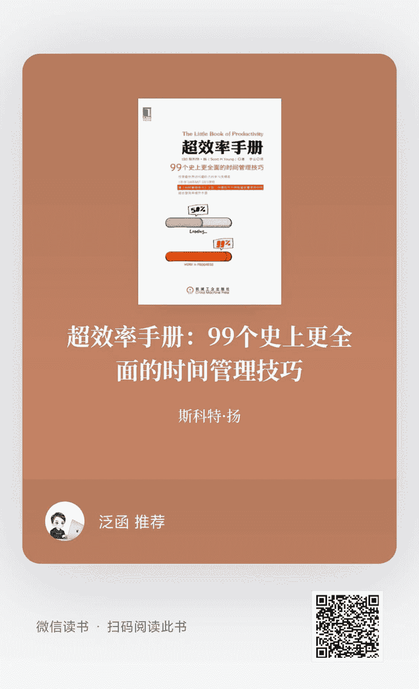
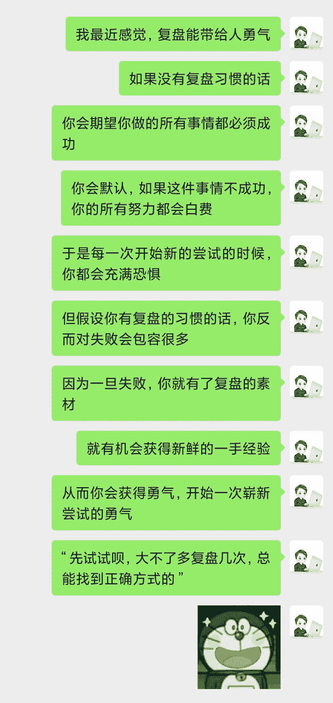
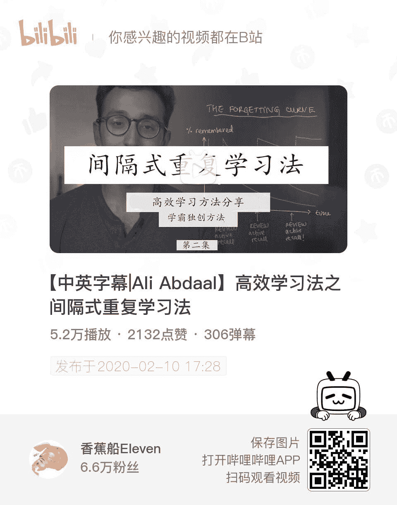
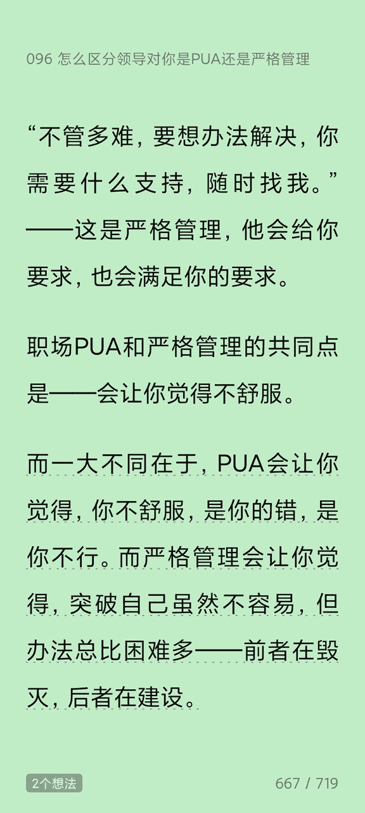
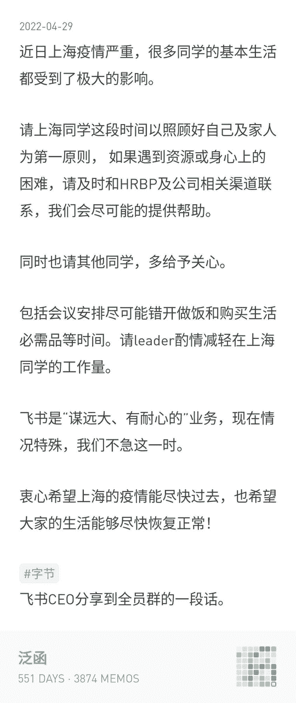
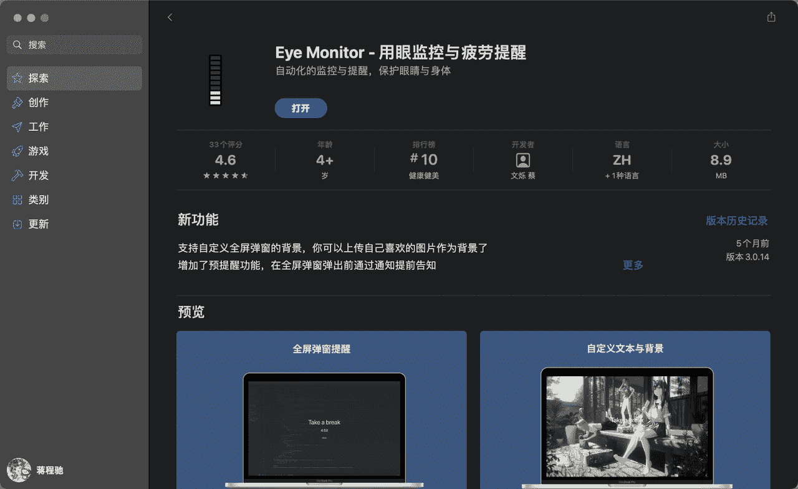

# 职场是商业文明的微缩景观 | 故事&笔记合集

> 来源：[https://docs.feishu.cn/docx/Ik0ndVMbjo6M79xjbxocHafmnPb](https://docs.feishu.cn/docx/Ik0ndVMbjo6M79xjbxocHafmnPb)

> [泛函同学的一切 | 这是一篇阅读量破万的个人说明书](https://to7e2gkmim.feishu.cn/docx/Ivved3LBtoUj7qxVdBhcEzXInpe)

## 在选每份新的工作开始之前，先想想自己的主要课题

我在找每一份工作开始之前，都会先想好自己的核心课题，然后根据核心课题来选择匹配的工作。

我的第一段实习做的是产品经理实习生，在一家青年组织，负责在一个小程序的项目里。

当时这份工作甚至没有工资，不过好在包吃包住，不至于让我赔钱上班，但我还是欣然接受了这份工作。

因为那时候我没有任何职业经历，手上也没什么过硬的本事，唯一的优势就是体力好，年纪小，一点激励就能热血沸腾。

以及，我想明白了，那时我的职业课题非常明确，就是「上道」。

像一个真正的产品经理一样，去面对一些具体的挑战，而不是每天一边记笔记，一边听产品经理系统课；

像一个真正的职场人一样，去用职场的标准和人协作，而不是每天捧着看职场博主的视频，幻想自己面对那些难题时的应对方式。

后来运气挺好，去到了字节的飞书团队，做产品营销。

那时，我的核心课题是“成熟职场人的工作方式”，像可能是全中国职场素养最高的一批人学习怎么好好工作。

于是在那段时间很努力地去观察、模仿、请教身边的同事，那些新人应该学会的职场课题。

在那段时间写在即刻上的，也都是一条一条职场思考。

第二次去字节时，那会儿刚刚找到点运营社交媒体的感觉，还挺想成为个能盈利的博主。

那会儿的职业课题是“甲方视角的博主生态”，

在去新出路团队实习之前，我的核心课题是“商业的最小单元”。

于是在这段时间里，都在认真和很多超级个体们，学习一个一个轻资产的小项目是怎么完成商业闭环的。

后来，生成式 AI 的风从硅谷刮到了每个人的身边，率先悟道的高手们让我们意识到，这是一次“自启蒙运动以来未有之大变局”。

我们乘风而起，都在努力地在风里拼装起一部飞机，试图让自己留在天空。

我在这个阶段选择的课题是「企业级 AI 解决方案」，我特别好奇，这门新技术是怎么在企业场景中发挥作用点。

于是我去了一家风头正盛的 Agent SaaS 公司，在商业化团队做解决方案的交付。

但那会儿其实很多项目进展得并不顺利，一方面是这个行业确实存在泡沫，市场对于新技术总是会短期低估，长期高估；

另一方面是我自己能力确实不足，炽热的风把我吹到了一个本不属于我的位置，社交媒体上关注我的人、公司甚至我自己都高估了我的能力。

所以离开之后，我就很好奇，部分大厂一定不可能不知道外面已经烽烟四起了，但是他们并没有那么急着去分地盘。

那么从大厂视角来看，AI 生态又是什么模样？

这成了我新的职业课题——「大厂视角的 AI 策略」。

所以我重新回到了飞书，来到了飞书 AI 的用户研究团队。

以前做的都是和营销相关的，都是在学习怎么影响用户的心智，怎么把自己的理念植入到对方的脑海里。

当一个用户在你面前时，虽然你也试着会试着去了解 ta、共情 ta，但你始终知道，你们是存在博弈的，这会让你们之间，隔着一堵不可言说的墙。

但用户研究就不会有这个问题，你和 ta 面对面访谈，只是为了了解 ta，听 ta 真实的想法，感受 ta 真实的感受，你们之间，没有博弈。

这样的一个过程，会让你有不少之前没有过的洞察。

以及，之前我们做生成式 AI 的商业项目，是站在上帝视角做的。

创业，或者给创业公司打工最兴奋的事情是，我们有自己的高观点，对技术和商业有自己的洞察，还有机会能借助资本的力量，去把世界改造成我觉得应该成为的样子。

但不得不说，这很傲慢。

不过没有办法，创业维艰，所以创业者们一定得现实扭曲力场，让员工、客户、投资人去相信那些还未发生的事情。

而在大厂做 AI 产品的用户研究，是凡人视角，你不企图改变什么，而是去探索、去发现，去了解真实的用户们的真实感受，去了解真实世界的真实情况。

这个过程，还挺新鲜。

同时呢，每次在做访谈之前，你找到那些值得问用户的好问题，所以得做大量的桌面研究，这倒是个好好学习的机会，这个过程中能积累不少知识，对于好学的人来说，是个福音。

这份工作还在进行的过程中，目前我还在职，很期待从这个课题里能学到什么新的东西。

## 热爱的增长飞轮

我们受到的教育都在使劲地告诉我们，一个人能获得多少成功，取决于 ta 承受了多大的苦难

给大家分享另外一套逻辑：

1️⃣会不会有些事情，别人觉得很难受，很花时间很需要意志力，但对于你来说，你能很轻松地沉浸在其中？

2.做这些事情的时候，你会不会忍不住在上面多花时间？

3.你会不会忍不住关注更多和这件事情有关的信息？

4.你会不会忍不住和朋友谈起这件事情？

5.你会不会常常不知不觉认识很多同样对这件事情感兴趣的朋友？

6.你对这件事的热情会不会感染到你身边的朋友？当你的朋友发现和这方面有关的机会时，会不会忍不住告诉你？

这就是传说中的，“做自己真正喜欢的事情”。

这件事情，对一些人来说，可能是创作、是产品设计、是写代码、是琢磨数学题、是约人一对一访谈

你觉得，在这个过程里，你会不会很丝滑地成为这方面的高手？

但，痛苦嘛？

别人觉得你痛苦极了，会觉得，你之所以取得如此大的成功，就是因为你付出了太多的努力，承受了足够多的苦难

然后他们会勉励自己也要更加努力，去承受更多的努力。

哈哈，但你自己知道，其实这个过程可开心了，哪有啥苦难。

关键其实在于，如何找到自己热爱的事业，然后放任自己沉迷其中。

## 优势的三个简单标准

> 摘录自得到

大家都对「个人优势」这个词有一个误解，认为我身上的某项能力、某个特质，一定得超越 95% 的人才能被称为优势。

其实不然，我们换个思路，「优势」并不需要和别人比，只用某项能力、某个特质相比你自己的其它能力和特质比较突出就可以啦。

那么，如何找到自己的优势呢？

最简单的方法，就是看看自己在做某一类特定任务时，有没有如下这三个现象：

1️⃣ 做事之前很期待

2️⃣ 做事过程中会不由自主地沉浸其中

3️⃣ 事情做完之后会有一种强烈的成就感或满足感

如果符合这三点，那么那一项任务就是你的优势啦。

## 优势探索的「探险家」模式和『科学家』模式

我曾经写过一条很高赞的帖子，叫作「热爱的增长飞轮」，今天又有了新的感悟，过来分享一下。

我们从小到大花了太多的时间，去补齐自己的短板，试图让自己成为一个十全十美的人。

但这条路从未真正让人成功过，因为人去做自己的不喜欢的事情时，阻力是正常情况的十倍。

人去做自己真正喜欢的事情时，动力是正常情况下的十倍。

所以呢，你人生的传奇之路的起点，在于找到自己真正的优势，并且在这条路上，快乐地一路狂奔

不过呢，认识自己其实是一个比自己想象中要难得多得多的事情。

绝大多数人，用的是「探险家」的方式。

通过不停地尝试新事物，来认识真正的自己。

但，探索是一件耗时很长的事情，你可能得同时经历一些以为自己很喜欢，结果不喜欢；以为自己不喜欢，结果发现很喜欢的事情，才能真正的认识到你自己。

「探险家」的方式属于人生平稳期的人。

生活的真相是，你常常会处在人生的十字路口，生活并不会给你那么多时间来探索你的优势。

所以，另外一条路径在此时便显得格外重要，那就是用『科学家』的方式。

通过完成盖洛普这样专业的优势测评，得到全面的优势报告后，再找一位咨询师来解读，会让这个过程加速很多。

我非常庆幸自己在最近想明白了这个道理，去找一位熟悉的优势咨询师购买了盖洛普测评+咨询的服务。

昨天和咨询师聊完了优势测评以后，忽然感觉对「自己是谁」真的清晰了太多太多太多，很多在心中遗留了多年的困惑一下子豁然开朗了。

同时，对自己要努力的方向也坚定了很多，知道了自己在什么事情上该使劲做加法，在什么事情上该勇敢做减法。

太值得了。

## 大家对于「赚钱」有一个很大的误解

“所有教你[挣钱的人，](https://m.okjike.com/users/C3895C3C-FB42-4476-9050-186A739B337C)都是想挣你的钱。”

我发现大家对这句话存在着很深的误解。

确实，教你赚钱的人，是想赚你的钱。

但是，他们也确确实实比任何人都希望你挣到钱。

在真正高段位的老师的认知里，整个逻辑链是这样的：

1️⃣ 我把我挣钱的方法论毫无保留地分享给你，只要你有一定的行动力，大概率能根据我教你的方法论挣到钱。

2️⃣ 大多数人在靠自己挣到钱后，都会想着增长，想着将这个挣钱的业务扩张。

3️⃣ 这个时候，你就会有一笔预算，用来为更优质的方法论、更细致的服务付费。

4️⃣ 由于我的方法论很好地帮助了你挣到钱，所以我们之间有着非常强的信任基础，所以你会很愿意购买我更高客单价的服务。

5️⃣ 当你购买了我更高客单价的服务后，我获得了更多的收益，我会很愿意继续帮你挣钱，给你也创造更多价值。

6️⃣ 重复这个循环，生意就能一轮一轮扩大，我们彼此都会挣得越来越多。

这套逻辑，也符合我们最朴素的商业直觉：

我们挣来的每一份钱，都应该来自于为用户创造实实在在的价值。

这个是我向@项有妙 老师做完咨询后，最大的收获了。

我购买了两小时的咨询服务，花了整个一个小时梳理了十多个我自己遇到的问题，

项老师是也是真的掏心掏肺、毫无保留地将她所有的方法论分享给了我。

太值得了。

我对知识付费这个行业的情感非常复杂。

很多知识产品在我的一个个人生节点上给了我非常大的帮助，

让我真正地做出了许多极大程度影响命运的决策，也让我在一件件小事上做得远远比别人更好。

但这个行业确实利润诱人，也吸引了不少心怀不轨之人入场，让我遭受过一些经济上的损失。

相信大家的感受也是一样的。

希望这个行业能有更多像有妙老师一样的人，让更多人能收获价值。

同时，也给这个行业的从业者们，树立一个该有的榜样。

## 那些学历背景不是很出色的人，最终是怎么取得职业成功的？

用心观察过一阵子我身边的一些学历背景并不出彩，但是最后取得了很大成就的朋友，发现其中很多人有这么个共同的特点：

他们都在「超级个体的团队」实习过。

前几年到今天，很多资历优秀的人的职业出路共识是去 BBAT 这样的大厂，但是随着增长放缓，很多人的工作并不能满足它成长的需求。

以及在这个背景下，团队会出现沟通成本激增等令人难受的问题，所以近几年的一个普遍现象是有一大批人在逃离大厂。

从大厂离开找到了新出路的人，在收入闭环相对稳定之后，会自己招一个助理向的角色，或者自己带一个精简的小团队。

对于职场新人来说，这其实是非常好的职业机会。

如果你在一个这样的团队中，你和老板的距离会非常近。

稍微好学一些，你就有很多很多的机会将创始人的技能复刻在自己身上；

稍微真诚一些，你就能在对自己的人生选择的迷茫中得到很多一位阅历丰富的前辈的建议。

同时，这样的团队，创始人自己通常有很不错的人脉和其它方面的资源，这些资源也有很多机会能成为你的资源。

最重要的是，你能完整的看到一个商业的闭环。

你能见识到，一个小产品，或者某个流程精简的服务，是如何被创造出来的；

被创造出来后，是如何获得第一批种子用户的；

获得种子用户后，是如何创造收益的；

创造收益后，业务是如何一步一步增长的。

无论你未来是选择进入大厂，走职业经理人路线；还是创业或者选择当一个自由职业者，这样的经历对你来说都无比宝贵。

我自己就加入过这样的团队，受益匪浅，用在这样的团队里学到的经验和得到的机会，挣了不少钱。

可惜的是，这样的机会还挺难被发现的。

在 boss 直聘这样的垂类求职平台，很难找到这样的机会，因为我作为招聘方在 boss 直聘发一个招聘 JD 是要花不少钱的，『超级个体团队』并没有这方面的预算。

以及，这类招聘需求出现后，通常在小部分人的朋友圈、🛰️群 + 熟人推荐就能被消化掉，甚至很难出现在公开渠道。

因为通过熟人间的相互背书，招到的人大体来说会靠谱很多，通过公域平台招募比朋友圈招募靠谱许多。

想要这样的机会，真还得自己鼓起勇气多去认识人。

或者像我一样在社交媒体上经常写东西🙃

## 通过社交媒体找到了七份实习，我是怎么做到的？

我其实一直有在把即刻当成求[职平台来用，在这](https://m.okjike.com/users/BB769515-C724-4652-8838-6AA32EC1A8DF)个过程中还真的有不少洞察，真诚给即友们开源一下：

一般呢，大伙儿提到个人品牌，想到的都是去做博主，然后通过接广告、带货、知识付费等方式来获得收益。

我当时呢，还是一个没啥资历，没啥经历，又没有高学历的小实习生，但意识到了，有一种个人品牌，叫作『求职者品牌』。

如何做好这个品牌呢，在看了@刘飞Lufy 老师的专栏《内容即品牌》，学到的方法就是持续地在正确的平台上，持续输出符合你的定位，且真诚利他的内容。

好，想到这儿定位已经差不多明确了，按照做个人品牌的套路，接下来，就该想两个问题：

第一个问题是如何获得收益，第二个问题是如何你的目标人群是谁。

对我而言，获得收益的方式，就是能够找到一个前沿的新兴行业，能给人带来高速成长的新工作。

比如去了之前来飞书实习，就是个很好的机会，SaaS 行业很新变化很快，飞书传递的又是先进的工作方式和工作理念，这让当时初入职场的我收获特大。

想明白了获得收益的方式，目标人群就很自然地推导出来了。

我在认真即刻的时候，心里想着的读者画像，就是我的“潜在老板”。

这即刻的用户画像高度重合：一二线城市互联网、SaaS、科技、新消费等新兴行业的从业者，且大多为产品经理、投资人、产品营销经理等新兴职业。

这群人呢，平常应该没时间去看一个小朋友写的👸号长文，应该没时间去刷一个小朋友做的视频，没时间去听小朋友录的播客。

但是像即刻动态这样的信息媒介，肯定还是能或多或少刷到的，万一哪条真的让他们感兴趣了，顺手点个关注，咱就建立联系了。

这个信任会在我输出内容，ta 消费内容的过程中慢慢建立起来，招聘转化就会自然而然的发生。

而且，因为彼此因为内容而相识，信任感会比简单面试过一次强很多，ta 将你招进去之后，通常也会更愿意在你身上花心思培养你，愿意带你成长。

这几年求职都挺难的，但根据创业者们总结的规律，当一个渠道内卷时，咱们就得去找一个新的渠道，发现蓝海，打开一个新的增长空间。

通过社交媒体找工作，就是这么个蓝海。

## 用「兴趣电商」与『搜索电商』的区别，思考怎么在社交媒体上找工作

上面分享了自己在即刻找工作的思考，有朋友问过我，那为什么不去领英或者脉脉上输出内容呢？

这两个平台本来也就是为求职服务的，会不会更精准一点？

我之前也没想明白，今天忽然顿悟了，这一条一定得给朋友们好好写写。

下面，来做一个很有意思的类比：

在领英和脉脉这样的平台写东西，很像是淘宝这样的搜索电商。

大家都有清晰的目标，并且有清晰的评价体系，好处是人群足够精准，坏处是竞争会因此变得激烈，会内卷成红海。

领英和脉脉的用户，大多都会先关注对方的 title 和职业经历，才会去对对方的内容打分。

如果你的 title 和职业经历暂时没有那么光鲜的话，即使内容足够好，用户也不太容易感兴趣。

而在即刻找工作，很像抖音电商，这是兴趣电商的逻辑。

大家用即刻大多还是用来消遣和娱乐的，是用来“刷”的。

讲究的就是一个，在不知不觉中，心甘情愿地被转化。

不论你是谁，总会有不少的人愿意读完你的动态，再根据内容来判断你是一个什么样的人。

而且，像即刻这样的社区产品，大家都是即友，感觉上的距离会更近一些，信任也更容易被建立。

而品牌的核心，不就是信任嘛。

所以呢，还是非常推荐朋友们多在即刻输出，很多意想不到的好运气，会在这里开始。

## 如何设计一次精彩纷呈的闲聊？

无论和任何人聊天，感觉这几个话题都能让双方快速打开话匣子：

人生节点、风口浪尖、江湖故人、心路历程。

1️⃣ 人生节点：那些人生的转折点，你当时是怎么做决策的，当时发生了哪些故事？

第一份工作、第一次创业、出国、结婚、离婚等等等等，都有好多可说可讲。

2️⃣ 风口浪尖：那些时代的大变局，是怎么作用在我们这些小普通人身上的。

AIGC、自媒体、web 3、移动互联网、PC 互联网、经济危机、改革开放……

这些风口出现时，我们的生活发生了哪些改变？

3️⃣ 江湖故人：在这一系列的事件中，我们遇到了、见识了、深交了哪些独特的人，他们的哪些故事打动了你？

4️⃣ 心灵旅程：可能在外人看来，那只是一件小事，但是在你的内心世界里掀起了持久的波澜。

那些细腻的感受，是怎么样的？

这四个元素并不是并列而孤立的，而是相互联系、相互耦合的。

亲测有效，根据这四个元素开展对话，整场聊天都会精彩纷呈。

## 知识管理基本功——PARA 体系

在各个平台刷到过一种知识管理方法，叫作 PARA 体系。

一直对它很有印象，但是不明白其中具体的含义。

今天去问了问 chatGPT ，终于把这套体系弄明白了，下面加上一些自己的思考来转述一下：

P.A.R.A. 是由知识管理专家 Tiago Forte 提出的方法，它的目的是帮助人们更好地组织和管理他们的知识，并让他们更高效地利用这些知识。

P.A.R.A. 描述了四个关键要素：

1️⃣ Projects 项目

这是您需要花费时间和精力来完成的特定任务或目标。在 P.A.R.A. 方法中，项目是指需要您采取行动才能完成的任务或目标。

可以将项目分为长期和短期的两类。长期项目可能需要几个月或几年的时间才能完成，而短期项目可能只需要几天或几周的时间就能完成。

我们常说，“失败不是成功之母，高质量的复盘才是。”

当一个项目结束之后，将项目中的收获通过复盘的方式沉淀下来，是知识管理中很重要的一个步骤。

2️⃣ Areas 领域

个人理解，这里的领域其实可以分为三种。

第一种是你关注的专业知识、行业洞察、技能等等。

比如有的人喜欢钻研心理学、有人对互联网行业有多年的观察和思考、有人喜欢在业余时间研究怎么做好 PPT。

领域是指你生活或工作中的各个领域，例如家庭、工作、健康、学习等。每个领域都需要您投入一定的时间和精力来维护和管理。

3️⃣ Resources 资源

这是你获取信息、学习知识和完成任务所需要的各种资源。

这个资源也分两种，一个是你的信息源，你从哪些渠道获得信息，或者保存的文章和自己写的笔记；

一个是你使用的工具，包括各种软件、网站等。

4️⃣ Archives 存档

存档可以理解为你的产出，包括发表过的内容、开发过的产品、输出的报告等等。

在理解了 PARA 这个知识管理框架之后，再去看各种笔记软件的功能和各种大神分享的最佳实践，就会学得更有条理了。

## 反向构建你的信息茧房

在尝试了一个新的行为之后，我感觉浏览各个内容平台变得快乐多了。

这个行为就是用行动而不是用语言来表达「我不喜欢」。

在刷到不喜欢的视频时，直接点击『我不喜欢』；

在听到自己不喜欢的歌时，主动点击「我不喜欢」；

在看到自己不喜欢的动态时，主动点击『不喜欢该动态』。

这样背后的推荐算法会越来越智能，让我能够接触到越来越多自己真正喜欢的内容。

我以前几乎没有这么做过，因为我会感觉：

1️⃣ 我会不会因为这个行为，而错过一些本来我会刷到的好内容呀？

2️⃣ 大伙儿做内容实在不容易，我这样会不会显得不太友善？

现在不这么想了。

对于 1️⃣ 来说，这是一个典型的 FOMO 心态（Fear of Missing Out），其实大可不必。

我的收藏夹里的内容已经够优质够丰富了，把它们好好吸收和实践，已经能让我变得比现在好很多了，大可不必担心错过新的内容。

而且，在我真的需要新的信息的时候，我大概率会用搜索引擎去主动检索，大概率不会去搜索之前刷到过的信息。

对于 2️⃣ 来说，如果那一条我不感兴趣的内容的创作者，真的是一位优秀的创作者，那么

ta 自然会吸引到喜欢 ta 认可 ta 的人，ta 的粉丝并不缺我一个。

如果 ta 还不够优秀，那我即使为 ta 贡献了一个浏览量，那也无济于事。

对于 ta 来说，我并不是一个重要的人。

这样想的话，就自洽多了。

还挺推荐你也这么做的。

如果你刷到了一条不感兴趣的内容，你如果去评论区里和人吵架，这不仅是对于这位创作者和 ta 的关注者的伤害，

而且，背后的算法会以为你喜欢这条内容，还会推荐给你更多这一类的内容，让你经常能刷到不喜欢的这类内容。

你的上网体验会因此越来越差，双输。

反倒是你点了一个「我不喜欢」之后，倒达成了一种奇妙的双赢。

## 容易坚持的极简时间管理方法

我用了很多年的极简时间管理方法，十分容易坚持：

1️⃣ 在待办清单中创建三个分区「收集箱」、『本周任务』、「今日任务」

2️⃣ 将所有你想做的事情收录进收集箱，不论大小。

3️⃣ 每个星期一，将『收集箱』中将你认为重要的事情放进「本周任务」中。

4️⃣ 每晚睡前，在『本周任务』挑选几个合适的放进第二天的「今日任务」中，并通过日历安排好在哪些时间段做哪些事情。

5️⃣ 在日历上设置消息提醒（如果可以的话加上闹钟），确保你能在那个时间段做计划好的事情。

6️⃣ 每晚检查一下『今日任务』，没做完的移到下一天

7️⃣ 每周根据任务完成情况做一个简单的复盘。

这套习惯配上滴答清单真的极其舒适。

## 对齐目标，与强者互赖

最近养成了一个新的思考习惯，感觉对我帮助特别大。

当你看到了一个特别厉害的人，不妨试着这么想：

1.  ta 的目标是什么？ ta 最近想实现一些什么事情？

1.  我做的这些事情中，有没有是能和 ta 目标对齐的？

1.  如果有，那怎么设计一套合作机制，让咱俩都能受益，我还能顺便从 ta 身上学到些有意思的知识？

1.  如果没有，那我的某个朋友好像和 ta 挺搭的，要不撮合撮合？

不过啊，这种思考方式虽然好处挺多，但确实显得功利心重了些，容易被朋友吐槽🙃

## 职业生涯&副业冷启动 SOP

1.如果你感觉自己好像没有任何特别突出的能力，但业余时间还算充足，且没有在求职、考研、考公这么个关口。

我倒可以给你分享一条个人进阶&职业进阶的路线，亲测有效。

2. 首先，找到一门自己还算感兴趣的手艺，通过免费或者付费的课程好好学学。

3. 这个手艺包括但不限于：写作、平面设计（UI、PPT、海报、📕笔记）、原画、视频剪辑、写代码、编曲等等。

4. 学得差不多之后，做出一点属于你的作品，写一篇文章、做一个视频、开发一个小网页等等。

5. 如果你想挣点零花钱，去闲鱼上开个铺子，或者去淘宝上搜索“代剪视频”、“📕笔记代做”等等，问对方招不招学生兼职。

6. 通过你的技能，去和市场自由发生交易，挣点儿小钱。

7. 一段时间后，找一个在线文档，放上你的所有满意的作品，并在上面写明白：

通过xx技能，完成过多少次交易闭环，服务过多少用户，累计变现多少钱💰。

8. 这就是你的第一份简历。

9. 拿着这份简历，加上一点点社交媒体宣发技巧，你应该能轻松找到一份小公司的实习。

10. 牢牢记住「实习生三大美德」：谦虚好学、敢于沟通、手艺熟练，好好干活，学习一些职场基本功，在认知层你也不会差了。

11. 在小公司做出点成绩，靠平台的力量拿到一些可量化的数据结果，你的简历就很能打了。

12. 这时候，投一些你心仪的厉害一些的公司，想方设法过五关斩六将，拿到 offer。

13. 在一个个具体的项目中，去忍受高强度高压力的磨练，然后浴火重生，凤凰涅槃。

14， 你已经很厉害了，感谢你对自己的付出。

15. 把你的经验总结总结，写给后来人吧。

16. 谢谢你，世界又因你而美好了一点点。

## 大二那年，我删掉了所有课程，去字节实习

我在大二那年，看着自己学的课程，感受到了一种很强烈的虚无感。

就在那时候做了一个决定，我要花至少一个学期的时间，去丰富自己的职业体验，去真实的世界中，经历一些真实的故事，做一些更具体的事情。

于是删掉了下学期几乎所有的课程，去做一些小项目，去创业公司实习，最后到了字节跳动。

半年过去了，此时此刻的我坐在「市场营销课』的教室里，看着老师讲着 PPT 里的概念，感触颇深。

你会感觉，那些东西不再是书本上的信息了，而是一个个曾经扇在你脸上的巴掌。

每一页 PPT 都能回忆起三四个曾经你亲临现场的故事和事故，以及五六个来到你的生命长河里，给你上完一课又匆匆离去的人……

## 我是团队中学历最低的那个，所以我真的好开心

“在字节的时候，我是团队中学历最低的那个。

所以我真的好开心，每个人都比我厉害，每个人都有比我多十倍百倍的学识 见识和行业经验。

和他们一起工作，我可以在潜移默化中学到好多东西。”

这是我刚刚和朋友打电话的时候说的一段话，很明显地能感受到自己这一年心态的一个变化。

以前看到一个优秀的人：

“天哪人家怎么那么厉害”

“天哪我是不是个废物”

“555为什么我以前不够努力，和人家相比我真的好不行”

现在看到一个优秀的人：

“哇塞这人好棒，有好多东西可以请教 ta ”

“好想认识 ta ，和 ta 交流应该会特别有启发”

“感觉有挺多东西可以和 ta 合作的”

## 在大厂是不是会沦为螺丝钉，只能干一些简单且无聊的杂活？

就我个人体验而言，这个问题“是”和“不是”都不算好答案。

真实的情况其实是这样的：

1.  一开始，你只能负责一些简单且基础的工作。

2 如果你没有出错，很多细节做得比较好的话，你很快会获得一个机会，去负责一些更重要、难度更大的事情。

3 如果你接受了这个机会，那么，你将会去做一件超出你能力的事情。

4 如果你做好了，你会收获巨大的成长，并且你的「职场能见度」也会大幅度提升。

5 但是吧，如果你搞砸了，那么大家以后会对你不太放心，你可能得等待更长的时间，才能获得新的机会。

在大厂嘛，这个循环会发生很多次。

能走到哪一步，就还挺看造化的。

## 如何安慰一个比自己厉害的人

> 我的上一个恋人是一个 94 年的姐姐，比我大了七岁左右，在这个过程中掌握了一些独特的安慰人的技巧；
>
> 在字节实习的时候，我也是整个团队年龄最小的实习仔，由于对每个人都特别真诚 热情 友善，常常会充当小树洞的角色，据同事们反馈，我还常能治愈他们。
>
> 不论是作为那段姐弟恋中的弟弟，还是作为宇宙大厂的小实习仔，我安慰的都是比我厉害非常多的人，这里面有一些很有意思的技巧，想在这里分享一下。
>
> 方法就是：不讲道理 + 肯定情绪 + 上个请教
>
> 首先，通过引导性地提问 + 追问，让对方描述出自己真实、细致的情绪感受，并且接纳并肯定对方的情绪。
>
> 下一步呢，巧妙地上个请教，引导说出一段过往经历中积极的、成功的成长故事。
>
> 我的经验是，在这个过程中如果顺利的话，可以调动起对方“好想教会你一些道理”的感觉，通常对方会和你聊起自己成功 成长的一段故事。
>
> 在这个过程中，你会明显地感受到对方的情绪在一点一点地从悲伤变为兴奋。
>
> 在对方讲完之后，你再夸夸人家，“哇塞这段故事真的好精彩呀，我感觉我学到了好多，启发好大”
>
> 通常，对方会在这个时候和你讲更多更多，慢慢地，她会想起，噢原来我是这么厉害的一个人呀。
>
> 我有一个同事，一个超级厉害的姐姐，而且生活态度、工作态度特别特别积极、特别特别上进的那种。
>
> 有天晚上，她🛰️私信我说，她特别焦虑。
> 我还挺意外的，因为她平常看起来就是个神挡杀神、佛挡杀佛的人。
>
> “咱们可以打个语音聊聊天，我愿意当你的树洞”。
>
> 我们那天晚上打了一个多小时的电话，先是从一些具体的问题，聊到处理这些问题时的情绪，又聊起了好多好多过往的经历。
>
> “我其实一直挺想请教一下你的，很多刚刚工作的人会非常热血，但是工作了三五年之后，很多人身上会带着很明显的倦怠感。
>
> 但你不同，你工作了这么多年，依然特别热血，这是怎么做到的呢？”
>
> 她一下子就精神了，和我聊了好多好多的故事：
>
> 当年如何跨行业到了一家自己喜欢的创业公司，在这家公司怎么和创始人肩并肩一起从 0 到 1 到 100 把事业做大，最后怎么决定离开，离开后又去做了什么等等
>
> 聊这些的时候，我能非常非常明显地感受到这个人的能量在一点一点回来。
>
> 我其实也没做什么，就是让她想起了，woc原来自己这么厉害。
>
> 那天晚上她好像睡得挺好的，因为第二天一大早醒来我就刷到了她的动态来。
>
> 啊对了，光写实习的故事了，那段年龄差七岁的姐弟恋还没来得及写🙃
>
> 哪天兴致起来了再更新吧。

## 推荐一本好书：《超效率手册》

> 最近常常和朋友推荐一本书——《超效率手册》。
>
> 这本书很薄，快的话一个星期左右就能读完，每章内容都非常短，看完一章的时间和刷一个短视频差不太多。
>
> 每章都是一些提高工作 & 学习 & 创作效率的小技巧，看完之后马上就能在你的生活中用上。
>
> 你可以每天读一章，并且拿里面的方法在你日常的学习 & 工作 & 创作中用用，大概两周到三周之后，你的效率会有特别大的提升。

## 如果你被隔离了，不妨趁这个机会，去找那些你一直想约的人聊聊天吧

> 刚被隔离的时候，感觉这是一件特别倒霉的事情，但现在回过头来看看，感觉还挺不一样的
>
> 因为被隔离了，有一个安静的环境，也没有太多别的事情可做，于是不停地约人聊天
>
> 在和 Dora 拍了那个视频之后，现在已经有差不多 400 多人加了我的好友了
>
> 趁着这七天约了特别多人一对一语音聊天，聊天的时长加起来快 20 个小时了，最多的一天聊了 5 个朋友，聊了六七个小时
>
> 也约了许多一直想见，但没有机会见面的老朋友，挺感慨的，大家都发生了好多变化
>
> 真的有一种看到众生万象的感觉，听到了好多新鲜的故事 认识了不少有趣的人
>
> 大家真的都好友善，感觉和每个人聊完之后都特别开心
>
> 如果没有被隔离的话 可能这一切都不会发生吧，哈哈
>
> 终于隔离结束啦！重见天日的感觉真的好棒！
>
> 看到这一条的你，现在应该也很开心吧！
>
> 710

## 担心沟通技巧会显得你不真诚？这个得看你的发心

> 可能会有人觉得，学一些沟通的技巧，包括怎么夸奖、怎么向人求助、怎么回应话题等等，会让你显得不够真诚
>
> 我的感受是，这个得看你的发心
>
> 如果你的发心是希望一个你不喜欢的人误以为你很喜欢 ta，从而实现一些你的其它目的，那么那些技巧确实会显得不够真诚
>
> 但如果你是真心喜欢＆欣赏＆崇拜对方，这些沟通技巧能让对方更加无损地接受你的善意，并把误解的可能性降到最低
>
> 在这样的情况下，沟通技巧就变得非常非常非常非常非常非常非常非常非常有用啦
>
> 1950

## 如果你想去请教一个很厉害的人，这些是你可以做好的细节

> 最近也在疯狂约人聊天，想起了以前有过一段经常线下找人做小访谈的经验，分享一下
>
> 如果你约了一个很厉害的人聊天，以下这些是你可以做得更好的小细节：
>
> 1. 选一个离对方住的地方&公司比较近的餐厅&咖啡馆，并大胆地告诉对方：“为了节省你的通勤时间，我选了一个离你住的地方很近的餐厅，这样就不用麻烦你跑太远啦”
>
> 2. 在约对方聊天前，提前准备一个话题清单，写在备忘录或者 flomo 上就行，不必死板地按照这个清单来聊。
>
> 这个清单最重要的作用就是以防万一，毕竟再好的朋友聊起来总还是不免冷场，这个清单就是冷场时你的救星
>
> 3. 在聊天完之后，最好能给对方写一段小作文，记下一些对方给你分享的观点，真诚地感谢一下对方 ta 给你的启发啥的，如果是前辈的话，这个小细节能让 ta 特别开心，后续你若想寻求什么帮助，对方也特别愿意帮你
>
> 这是我很久以前的复盘笔记了，不过感觉自己最近在这些方面做得没有太好，得好好反省😣
>
> 4102

## 复盘能带给人勇气

## 分享三个颠覆了我对学习方法认知的视频

> 分享三个曾经极大地颠覆了我对学习方法的认知的视频，里面的方法亲测有效，真的让我快速地学会了很多新鲜的知识和技能

## 浅聊产品经理和产品营销的区别

> 我的第一份实习做的是产品经理，后来在字节在飞书做的是产品营销。
>
> 这两个岗位其实在业务上挺近的，但常被身边的人问起这两个岗位的区别，在这儿简单分享一下吧：
>
> 1. 假设某个用户提出了一个需求，产品经理要做的，是将这一个用户的需求，抽象成一类用户的需求，并落实在产品的功能上。
>
> 2. 产品营销要做的是，将产品经理这些个抽象的思考，翻译成一个一个具体的用户场景故事，无损地向用户传递产品的价值。
>
> 让用户意识到，这个产品与我有关，能帮到我，真的能改变我的生活。
>
> 3. 这个岗位最大的价值，就是传递价值。
>
> 4. 产品经理对人的逻辑能力要求非常高，理性色彩更重；
>
> 而产品营销，需要对传播、对情绪、对感受有更加敏感的觉察，感性色彩更重。
>
> 5. 总而言之，产品经理讲逻辑，产品营销讲故事。
>
> 2821

## 实操性超强的保持高效能的秘诀 | 《状态的科学》读书笔记

> 读完了《状态的科学》，写的一份读书笔记，里面也有一些自己的实践经验和一些辅助阅读推荐。
>
> 《状态的科学》：如何保持持续的巅峰表现
>
> - 一个核心：成长 = 主动创造压力 + 战略性休息
>
> - 《状态的科学》问题清单
>
> - 如何正确地看待压力？
>
> - 如何正确地进行休息？
>
> - 有哪些克服 “职业倦怠” 的好习惯？
>
> - 启发点：
>
> - 与另外一本书《和压力做朋友》中的观点相关联，压力并不会带来坏处，“觉得压力有害这种观点” 本身有害。
>
> - 对于一些本身没有压力的事情，我们可以主动创造一些限制条件，增加一些难度，可以提高我们的能力，带来成长。
>
> - 写目前这份读书笔记可能正常需要四十分钟，此时我设置了一个倒计时，让自己在 20 分钟内把这篇文档写完，这就是主动创造压力的例子。
>
> - 玩手机、打游戏、刷视频、追剧这样的行为不能算作真正意义上的休息，引用另外一本书《萝卜计划》和该作者的另外一本书《秘籍》中的两个概念：耗能式休闲和充电式休闲。
>
> - 耗能式休闲指的就是那些你做完之后会让你精力更差的事情，比如玩手机。
>
> - 充电式休闲指的是那些你能因此得到真正的休息从而恢复能量的那种休息方式。
>
> - 我常用的充电式休闲方式：
>
> - 健身、打篮球、跑步
>
> - 简单的室内运动。
>
> - 约人聊天，聊有价值的内容，比如凌波微步 36 问那一期中最后总结出的那几个话题。
>
> - 参加一些高质量的线下活动，比如无意义沙龙、自在饭局等等。
>
> - 冥想
>
> - 书中还提到了一些具体的实操技巧，有三条：
>
> - 在做一些复杂工作时，准备一套热身策略：
>
> - 我的热身策略：在做一些难度较大的工作时，我会在电脑旁边放上白纸和水性笔，以方便自己在纸上自由书写来梳理思路。
>
> - 在开始工作时，像拳击手上台前一样扭一下手腕，伸个懒腰，然后正襟危坐地开始工作。
>
> - 在生活中多做减法：
>
> - 和扎克伯格一样，我在学校里，在家里时每天都穿同款的衣服，以减少这方面的决策精力。
>
> - 定期删掉一些不常用的 App
>
> - 在🛰️聊天框里，如果感觉这个聊天可以结束了，果断 “我还有别的事要忙，先溜啦”，然后拍一拍对方。
>
> - 运动时感觉自己体力不支时，果断披上外套回家。
>
> - 寻找意义感
>
> - 当你有一个超越当前现实的宏大目标时，就会有源源不断的动力了
>
> - 找到自己的 PFE，我的是：推动教育的去中心化
>
> - 推荐阅读《世界尽头的咖啡馆》。
>
> 531

## 学会“情绪按摩”，用善良的方式获得好感 | 《如何让你爱的人爱上你》 摘录

> 我特别喜欢一本书，叫《如何让你爱的人爱上你你》
>
> 乍一听这书名，很有 PUA 的味道，但是这本书里的核心方法和 PUA 恰恰相反
>
> PUA 是通过贬低和打压对方的价值，从而抬高自己的地位，而这本书提倡的是“情绪按摩”
>
> 通过一些真诚的、主动的、经常性的赞赏和夸奖，打一束追光到对方身上，让对方能够深切地体会到，“我是一个特别特别有价值的人”，从而让 ta 对你产生好感
>
> 这是一套很温暖的逻辑，我一直对此深信不疑。它也真的让我收获到了特别多的好朋友，也曾让我收获过一个恋人
>
> 还挺希望让更多人能知道这个的，更多人知道，应该就能带来更多美好吧

## 怎么区分老板是在PUA你，还是在严格管理

> 《怎么区分老板是在 PUA 你，还是严格管理》
>
> 在地铁上翻电子书，看到这一段感觉太受触动了，分享一下
>
> from 崔璀 《职场晋升101》

# 我们是谋远大，有耐心的业务，不急这一时 |上海疫情时，CEO 发到全员群里的一段话

> 这是当时上海疫情封控最严重的时候，我们的 CEO 发在全员群里的一段话，挺感动的，于是摘抄了下来

## 调研的目的，是回答决策者的问题

> 最近在研究怎么做好【市场调研】，趁着双十一得到 app 上买了一门课，叫作《跟张弛学市场调研》，获得了不少启发，应该会写很多条内容分享。
>
> 我猜不少朋友应该平常都会需要写调研报告、做数据分析之类的，我们把这一类的工作，统一称之为『调研』。
>
> 但好像咱一直没认真琢磨过，「调研」的目的到底是什么？
>
> 这门课的第一个知识点，就是用一句话，讲清楚了这个问题。
>
> 【调研的目的，是回答决策者的问题，帮助决策者降低风险。】
>
> 就拿我自己来说吧，我之前没这个意识，所以在写报告的时候，都是去问上级要个文档模板，然后像做填空题把这个文档填完。
>
> 在分析数据的时候，都是生搬硬套一些数据分析方法，或者无脑去做一些看起来很厉害的可视化图表，然而并没有通过这些得出什么结论。
>
> 而意识到「调研的目的是回答决策者的问题」之后，在做调研之前，我就能仔细地梳理一遍，我到底要通过调研来回答一些什么问题。
>
> 或者，当别人给我类似「你去调研一下xxx」任务的时候，我就能追问一句：我们想通过这个调研，来回答一个什么问题？
>
> 把这一点意识到以后，做调研的思路，应该就会清晰不少啦。
>
> 1630

## 所谓被讨厌的勇气，是被自己讨厌的勇气

> 想通了，所谓“被讨厌的勇气”，重要的不是“被别人讨厌的勇气”，而是“被自己讨厌的勇气”。
>
> 我们应该放下这些想法：
>
> “我都这样了，ta还没意识到吗？”
>
> “这真的没办法呀，我能怎么办呢？”
>
> “因为我经历过这些，我就是一个这样的人呀，所以这件事情我做不好呀”
>
> 我们会因为批评职责而感到难过，会不会是因为担心，对方眼中那个无能的自己，就是自己真实的样子呢？
>
> 所以，我们才更需要“被自己讨厌的勇气”
>
> 对，那个无能的人，就是我真实存在的自己，对方没有看错。
>
> 那我该怎么做呢？
>
> 解决问题呀！
>
> 我TM此刻就是个混蛋，但我可不想一直当混蛋，我想当英雄。
>
> 冷静地接受我无能的事实，冷静地想想哪些地方真的出了毛病，冷静地想想还有哪些部分是我该做的？
>
> 去他妈的放过自己，你应该学会，自己拿着手术刀切开皮肤，自己止血，再自己缝上。
>
> 然后像个冰冷的机器一样运行，去解决问题。
>
> 这时，你惊讶地发现，你也有了被别人讨厌的勇气。
>
> 先讨厌着我吧，等我把结果交付再说。
> 先讨厌着我吧，等我把事情做好再说。
> 先讨厌着我吧，等我把问题解决再说。
>
> 常犯错的人，得学会自己赢回尊重。
>
> 1752

## 精力管理神器：可千万不要消耗殆尽哦

> 如果用苹果电脑的话，我强烈安利你使用一款软件：eye monitor
>
> 你可以设定一个时间，比如一小时，当你工作一小时后，你的电脑会缓缓熄屏，提醒你该休息一下了。
>
> 即使你再忙碌，每隔一个小时站起来伸个懒腰也能让你健康不少了，对精力管理会很有帮助。
>
> 如果你在它提醒你休息的时候还有急事，比如在开会，你也可以方便地点击屏幕上的【跳过休息】来保证不被打断。
>
> 自动熄屏是个强提醒，对于休息提醒很有帮助，比弹窗管用多了。
>
> 在 Mac app store 里就能下载，很方便。
>
> 这种软件就特别适合那种经常久坐的打工人。
>
> 😔比如某些因为单元楼被封，而几个小时连续打工好几个小时屁股不离椅子的人。

## 学会控制别人的期待，是一个人迈向成熟的必经之路

> 学会控制别人对自己的期待，是一个人迈向成熟的必经之路。
>
> 我以前总会给自己加很多的title，主动拉高身边的人对我的期待。
>
> 这确实给我带来了太多的好处了，我因此获得了很多人的赏识，很多人给了我很多机会。
>
> 我的初始能力，也是通过这一次次的机会，在一件件具体的事情中积攒起来的。
>
> 随着经历的项目多了，我没有意识到自己其实已经过了那个急需“被人看见”的阶段了。
>
> 现在的我经常会让合作者觉得我的能力和他们对我的预期不太符合，给不少人带来了不少失望😔。
>
> 最近我觉得自己最大的进步，就是能够更加勇敢地表达：
>
> “我的目前的能力并不足以达到你的要求。”
>
> 我确实读过不少书，听过不少课，脑子里攒下的知识还挺多。
> 在构思一个问题时，我能很容易地“推理”出一个解决方案。
>
> 所以我以前会常常告诉大家，“这事我来，我知道该怎么做”。
>
> 但在实操性的工作做得多了之后，那些“推理”，无非是在填上一个洞时，撕开另一个洞。
>
> 保持上进是好事，精力充沛是好事，主动承担责任也是好事。
>
> 但也要学会实事求是，看清自己的局限。
>
> 不仅要思考“要做什么”，而且要花更多的时间和精力想想“不做什么”。
