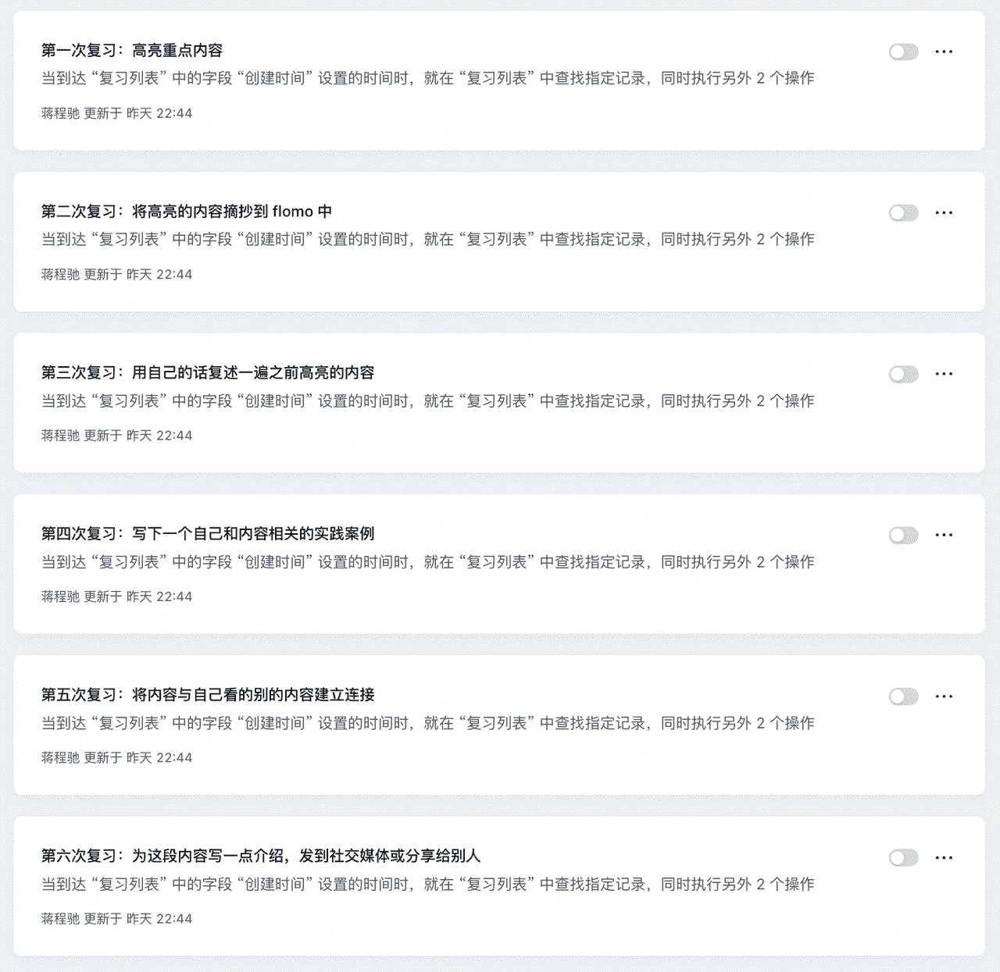
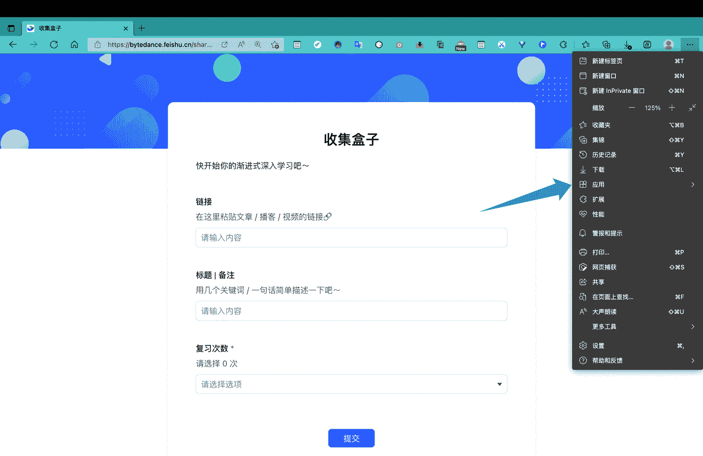
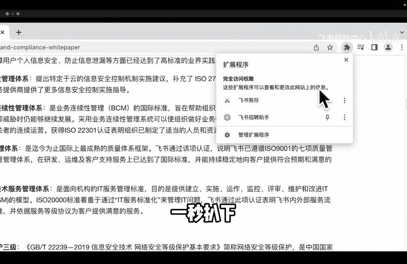
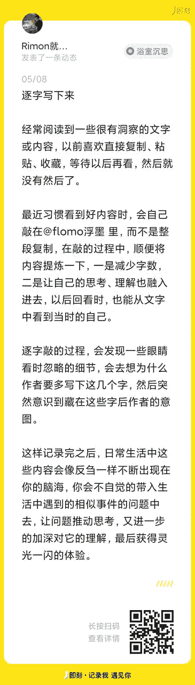

# 渐进式深入学习：让知识无压力地进脑子 | 智能复习提醒多维表格模板使用说明书

> 来源：[https://docs.feishu.cn/docx/doxcnDirEjKlVtA9B5IpvY7ujae](https://docs.feishu.cn/docx/doxcnDirEjKlVtA9B5IpvY7ujae)

> 鄙人关于知识管理的毕生修为都在这儿啦，还请客官赏脸看下去~

# 功能简介

---

> 我做了个好东西：[渐进式深入学习 | 艾宾浩斯记忆曲线智能推送复习内容](https://bytedance.feishu.cn/base/bascndv1mteTQMLfwH0jaWFM3ag)

1.  这是一个多维表格模板

1.  你可以将自己最近读的文章、看到视频、听的播客的链接🔗通过对应的表单录入到这个多维表格里

1.  然后它会根据艾宾浩斯记忆曲线（近似符合）提醒你复习内容

1.  并提示你每一次复习可以做点什么

# 方法简述

---

1.  通过【收集盒子】表单，将你看过的文章&视频&播客链接复制粘贴进去

1.  当每次收到【复习】的消息提醒时，按照上面的指示来做就行

1.  当然，你可以通过修改多维表格的字段来加入更多功能

1.  也可以通过更改【自动化流程】来增加或减少推送次数

## ❗️必要操作 1：将自动化流程中的接收者改为你自己

不然你的文章就会都推送给我了。

## ❗️必要操作 2：将按钮链接🔗改成你用模板生成的你的多维表格的链接

## ❗️记得用模板生成表格后，开启自动化流程

##

## 🧑🏻‍💻一些高效使用的小技巧

---

### 开启【收集盒子】，并将其安装为网页应用

选择【将此站点安装成应用】，下次即可快速打开，快速收藏文章。

### 配合【飞书剪存】插件使用更佳

[屏幕录制2022-05-15 11.50.25.mov](https://internal-api-drive-stream.feishu.cn/space/api/box/stream/download/all/boxcni3cqL4XENN3uvmZJGvlkwe)

飞书剪存效果视频演示

将剪存好的文章录入多维表格后，在【链接】这一栏可以直接看到原文章名。

# 🤔设计理念&产品思考

## 第一次复习：高亮所有内容

---

> 推送时间为【两天后】

+   复习是一件重要但是挺难坚持的事情

+   所以根据《微习惯》的原理，第一次复习一定要足够地轻松愉悦

+   于是，第一次复习的推荐操作是将重点内容进行高亮

+   这是一个很轻松的事情，不太费脑子

+   且能为后面的几次复习做好预备工作

+   但是，单纯地将内容进行高亮并不能达到很好的学习效果

+   所以你还需要后面几次复习

## 第二次复习：将高亮内容摘抄到flomo中

---

> 推送时间为一周后

+   这一步最主要的目的，是将链接中的信息，纳入你的知识中台

+   这里的摘抄并不是让你将高亮的内容复制粘贴到flomo中

+   而是需要你一个字一个字的敲进去

+   为什么呢？因为👇🏻

+   在摘抄的过程中，通常你会对文字内容字斟句酌，仔细揣摩每个字背后的思考

+   自然地，你会产生很多新鲜的灵感

+   别忍着，当灵感产生的时候就写下来吧，写在flomo中吧

+   指不定哪天，那个小小的灵感就忽然改变了你的人生了呢

## 第三次复习：用自己的话复述一遍高亮的内容

---

> 推送时间为两周后

+   用自己的话记录内容，更容易被你记住，更不容易被你忘记

+   同时，用自己的话复述也是又一遍对原有知识加深理解的过程

+   ** 如果你想**更进一步的话，不妨在这一步中运用上费曼学习法

+   用自己的话复述那些优质的知识，是创作的开始，是学习者成长为创作者的最短路径

## 第四次复习：写下一个自己与此有关的实践案例

---

> 推送时间为一个月后

+   为什么我读了那么多书，还是过不好这一生呢？

+   因为我一直都只把它当成书本上的“知识”，让它和我的生活、工作是割离的

+   我虽然认同那些知识，理解那些道理，可我并没有让它成为我决策的依据

+   我在生活、工作中依旧我行我素，还是用自己最熟悉的方式来行事

+   而不是走出舒适区，用更加科学的办法，来做各种决策

+   见新知时，主动写下一个自己与此有关的实践案例，便是破除这种割离的最好办法

+   纸上得来终觉浅，绝知此事要躬行

+   知识不能直接改变命运，可知识能让你做出更好的决策，决策能改变命运

+   如果你还没有过实践案例，太好了，那就赶紧去实践一下吧

+   假设今天你学了“六顶思考帽”，那不妨用六顶思考帽来分析一个你工作中遇到的复杂问题吧

+   你肯定会有很惊喜很惊喜的收获

+   如果你有过实践经历，那更好，同样的一段经历，用不同的模型、分析思路进行梳理，你肯定会有很多不同的收获

## 第五次复习：将内容与别的知识进行连接

---

> 推送时间为

+   连接的目的是为了让你的知识结构达到“万物互联”的状态

+   这样的知识结构最能让你产生创新的灵感

+   你会收获到一种能力，一种看到不同事物之间潜在关联的能力

+   这种能力，也叫“洞察力”

+   同时，在你的脑海中，当一个知识与别的知识连接的越多，它就越不容易被忘掉

+   方法也很简单，在飞书文档中@一下就行

## 第六次复习：为这段内容写一点介绍，发到社交媒体或者分享给别人

---

+   这是我自己的一个经验，当知识被我分享过给身边的人时，它会被记得格外的清楚

+   同时，这对你来说，也是一次电梯测试🛗

+   你看完了一篇万字长文，你大受启发，但是你和别人分享的时候，别人却始终get不到，到底这篇文章好在哪里

+   你无法精炼、简明地说出这份知识的价值，说明你思考得还不算充分

+   用简洁的语言在社交媒体上介绍一篇文章、一个视频的价值，或者给你的一个朋友讲明白它的价值，还挺考验人的，它真的需要你进行很多轮的深度思考

+   况且，这个内容你已经来来回回审视了5遍了呀！

+   它已经是经过优秀的你花时间精力筛选过的优质内容了呀！

+   它真的特别值得被别人看到

# 📚推荐阅读

---

## 为什么不推荐你只收藏&复制粘贴文章呢？

## 我自己的一次知识实践

有[流沙视频书学习平台全周期战略](https://to7e2gkmim.feishu.cn/docs/doccntYfalLSv4w7lLdEQeqm80c)天我学会了一套分析商业的方法——混沌商学院的“一思维”，那会儿恰好手上在做着一个创业项目，于是我写下了：

# 关于我

[关于泛函的一切 | 00后字节实习生 | 飞书市场部 ](https://to7e2gkmim.feishu.cn/docx/doxcn9WU8MscjPuUK0ImTVjXHwd)

# 🥰 如果你感觉这些内容对你有帮助

> 不妨请我喝杯咖啡吧

