# 全流程效率管理系统：整合工作相关的一切，这可能是你见过最先进的多维表格

> 来源：[https://docs.feishu.cn/docx/doxcnHLgX5xvS2wiMNnfuiZu7jd](https://docs.feishu.cn/docx/doxcnHLgX5xvS2wiMNnfuiZu7jd)

+   这篇文章是[作为一个00后职场人，我为什么喜欢用飞书办公？|  从飞书爱好者到飞书实习生 ](https://bytedance.feishu.cn/docx/doxcnt6gSPbVQ71aIweKznRWeOg)的一个片段，感兴趣的话，可以点击👆🏻的链接阅读原文。

# 👨🏻‍💻先进工具带来高效而愉悦的工作体验

---

飞书的整体性特别好，飞书的 IM、飞书文档、多维表格、思维笔记等等不同的模块并不是割裂的，而是畅通无阻的。

给你分享一个我用多维表格、飞书文档、飞书机器人三个模块搭建我的工作系统的案例吧。

## 自动排序优先级的任务看板

---

我的用多维表格搭建了一套任务管理系统，最上面的是我的任务看板：

> 以下所有数据均用于演示，不代表真实数据

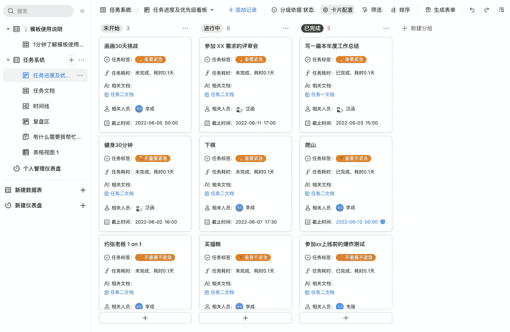

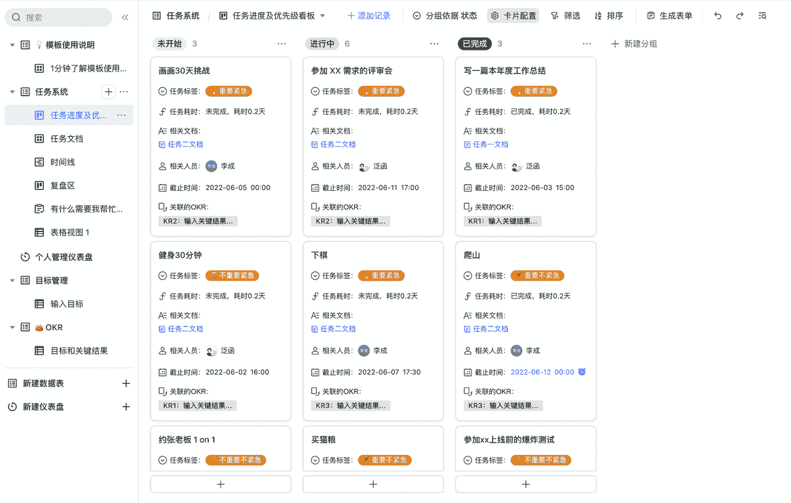

当我向其中添加了一条任务后，🔥重要紧急的任务会自动地排在最上面，其次是📌重要不紧急、🤣不重要紧急、👇🏻不重要不紧急。

在**看板的一张卡片中，**我能很清楚地看到任务的名称、优先级、目前所花费的时间、相关人员、相关文档，这样直接打通了任务、文档、对接人三个维度，我能目标清晰、行动高效地去完成我的任务。

同时，这也让我养成了良好的习惯，在每次整理任务时顺便整理相关的文档资料，并和上级确认好可以和哪些人合作。

## 多维度提高任务执行效率

---

这个任务看板极大地提高了我执行任务的效率：

我可以直接打开卡片中的文档链接，快速在相应的文档上进行协同。

我可以直接在任务卡片中@相关的同事，对着任务卡片高效地和同事交流。

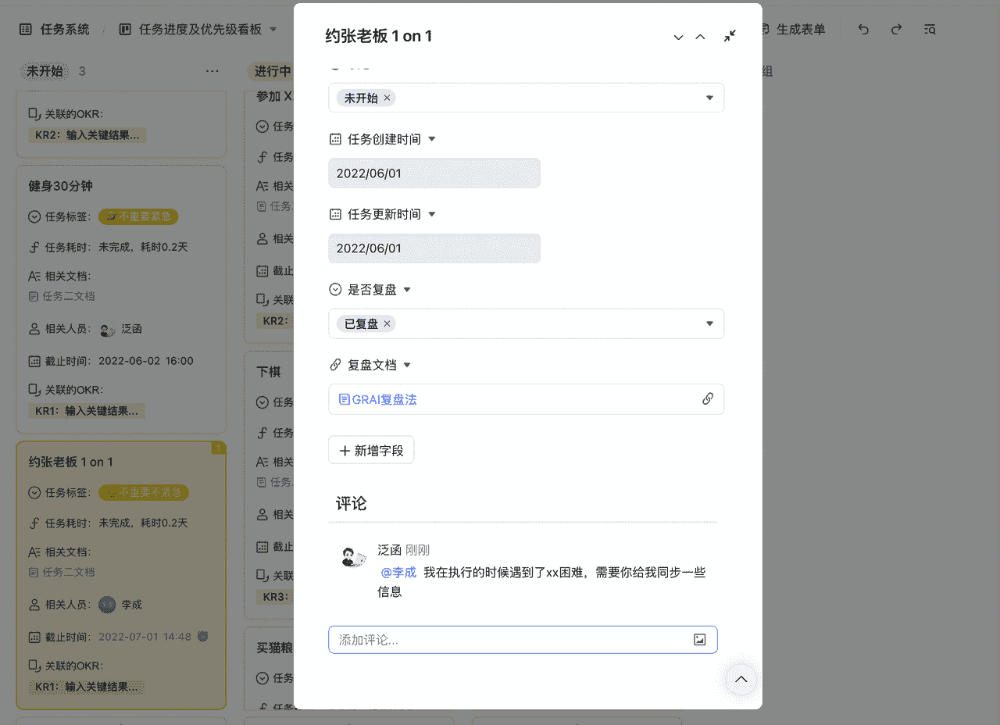

也可以在【相关人员】的部分直接点开同事的头像，快速给对方发消息：

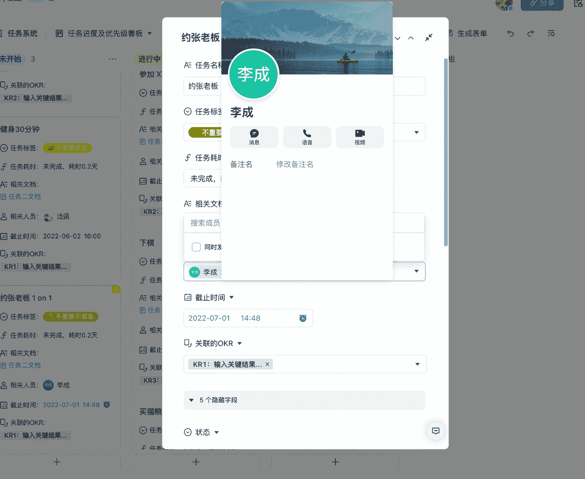

## 任务关联OKR

---

我的每一条任务是和我的 OKR 关联的，我能清晰地看到，我完成的每一个任务，是怎么推动我实现最终目标的。

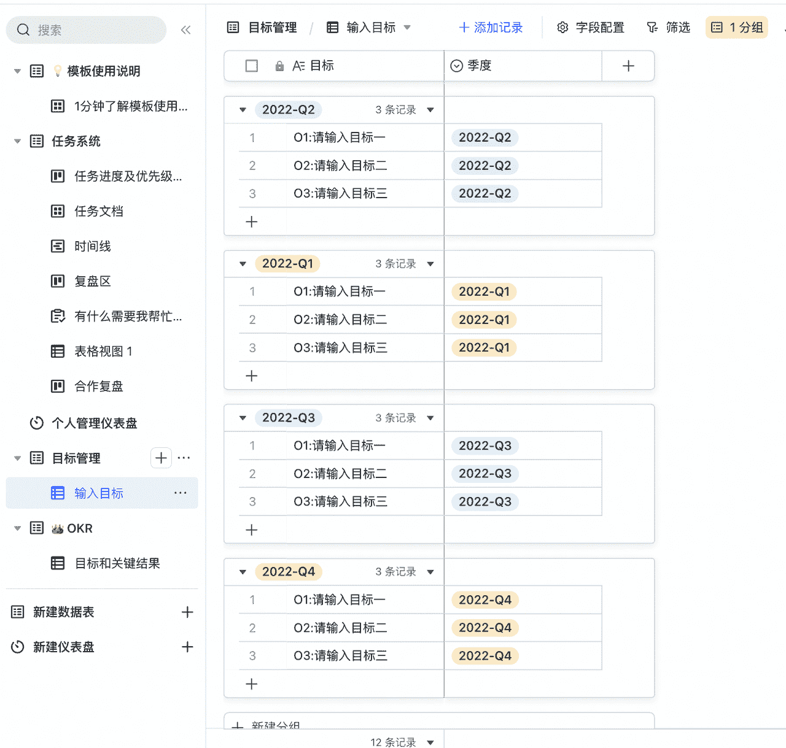

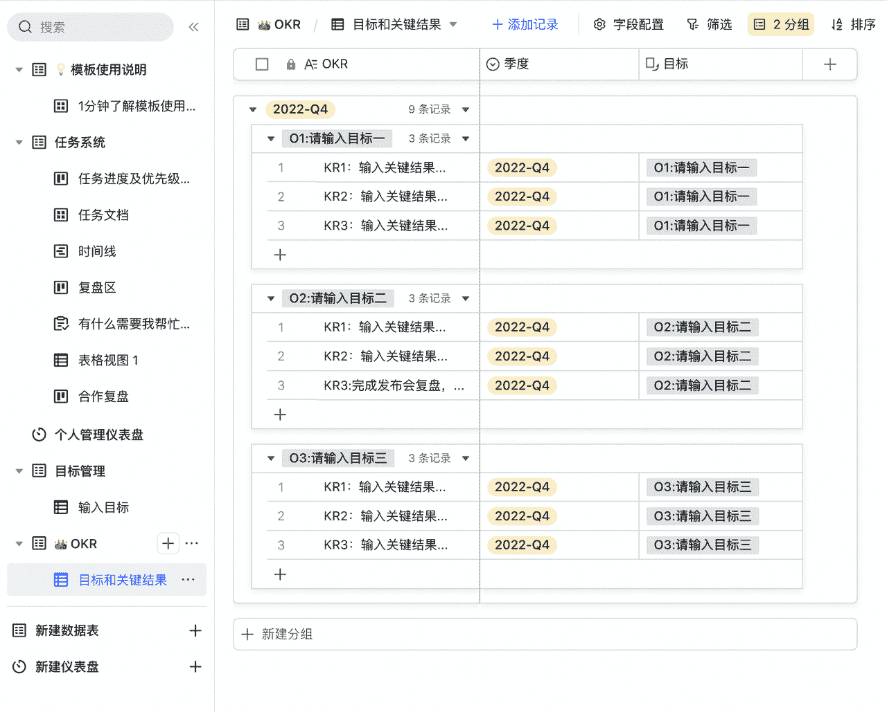

## 每个任务自动生成复盘文档

---

对于一个职场新人来说，高频次、高质量的复盘，是快速成长的关键。

我认为复盘应该颗粒度足够小，复盘的频率应该足够高。

通过多维表格的自动化流程，我每添加一个任务，表格中就会自动生成一条复盘模板文档。

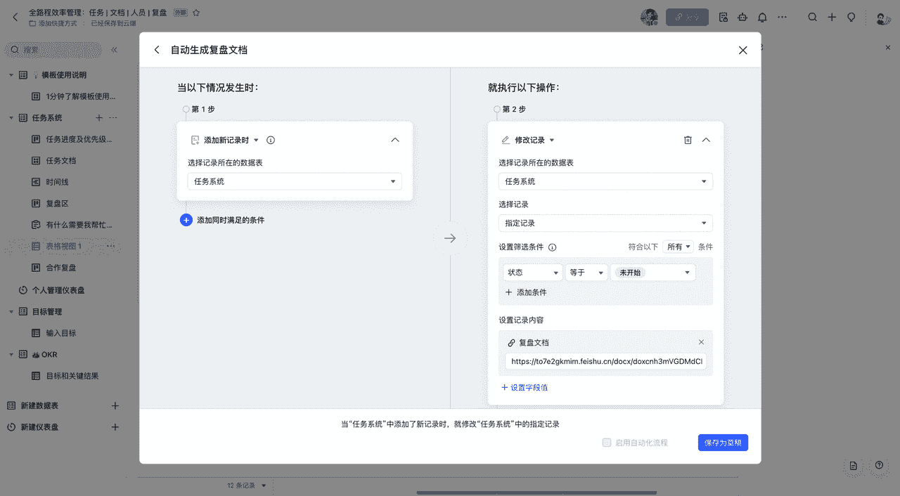

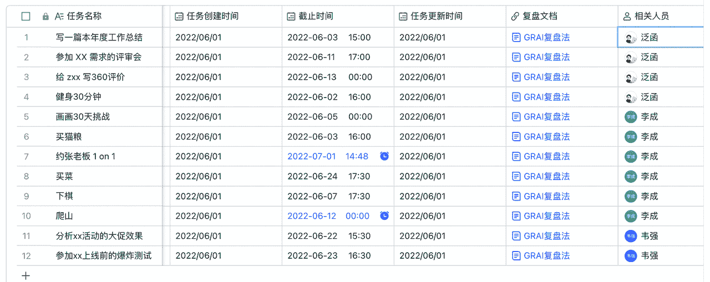

我复盘时用的思考框架是GRAI复盘法 ，这个复盘方法在模板中有详细的解释。

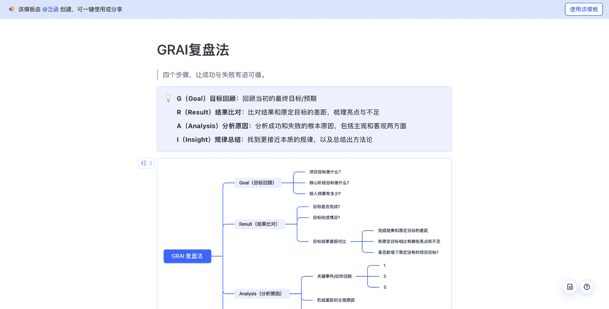

我还专门在表格中设立了一个【复盘区】，用来管理我的复盘进度。

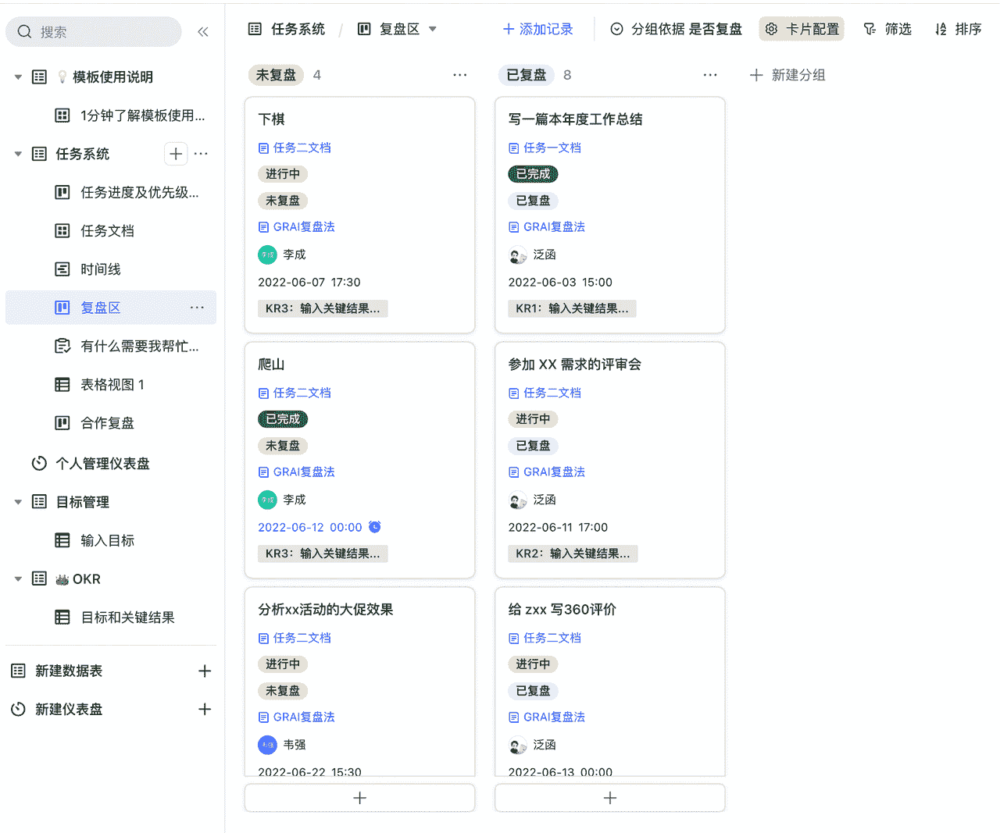

每次我想要对我的任务进行复盘时，只需要点开【复盘区】中的复盘文档链接，并一键【使用该模板】，便可以特别快速地进行复盘。

我把这样的复盘方式称之为“微复盘”，微复盘必须及时、轻量、有条理，因为：

1.  如果复盘不够及时，比如你在较长时间之后，用过于正式的方式进行复盘，你会丢失掉很多过程中的细节，丢失很多微小但有复利效应的经验

1.  如果复盘不够轻量，比如你需要进行很多步骤之后才能开始复盘，那你会很难坚持做这件事情

1.  如果复盘没有条理，比如不借助GRAI 复盘法的思考框架，那么你 100% 完全从一个任务中吸取教训，你复盘得来的经验也很难复用

>

高质量、高频次的复盘，让我能够快速积累经验，很快就能自己独立地承担起很多的工作，让我的馒头能有更多的时间和精力去做更重要的事情。

## 《有什么需要我帮忙的吗》问卷：领导布置的任务，自动入库

---

有人可能会问：

> “很多时候，是领导发消息给你发消息告诉你，你需要完成 xxx 任务。

>

> 收到消息后，再手动去录入到多维表格中，那不是很麻烦吗？”

哈哈，关于这个，我想到了一个绝佳的好办法

我利用任务管理的多维表格成了一个问卷，名字叫《有什么需要我帮忙的吗？》

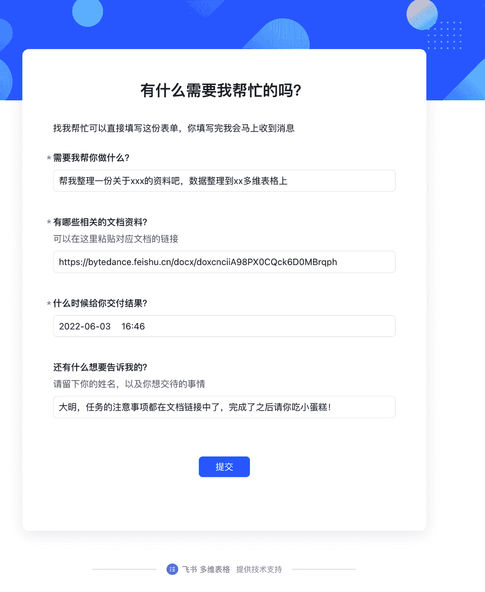

这个表单的链接我直接挂在了我的飞书签名中，让我能够随时一键打开。

当同事给我分配任务时，我就能直接在聊天界面中一键打开，快速录入了啦。

## 实习生也能有助理？？？

---

**这时候有人可能会说：**

> 这么复杂的任务管理系统，肯定要特别自律才能坚持使用下来吧，我可坚持不了。

确实，我之前尝试过很多种效率管理工具，最后都没能坚持使用，但是这张多维表格，我使用得格外久。

我是怎么做到的呢？

找一个助理来监督你呀！

什么？你不信？实习生怎么可能有助理？

哈哈，我的助理就是多维表格的机器人。

通过设置自动化流程，小机器人会在对应的时间提醒我做对应的事情，完全不用我自己费脑筋来！

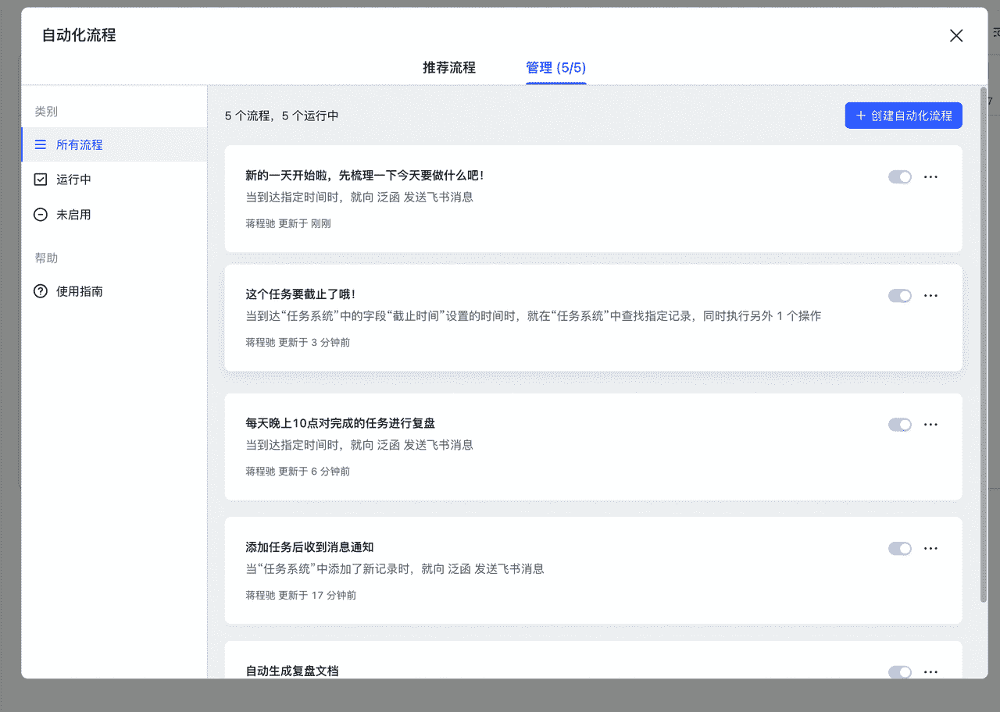

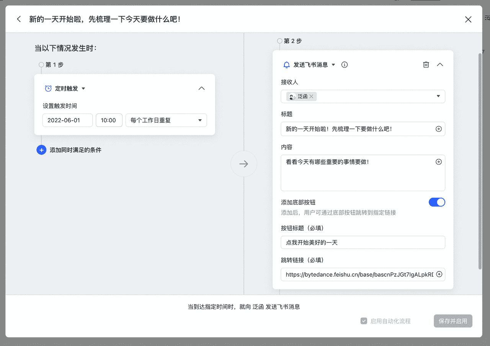

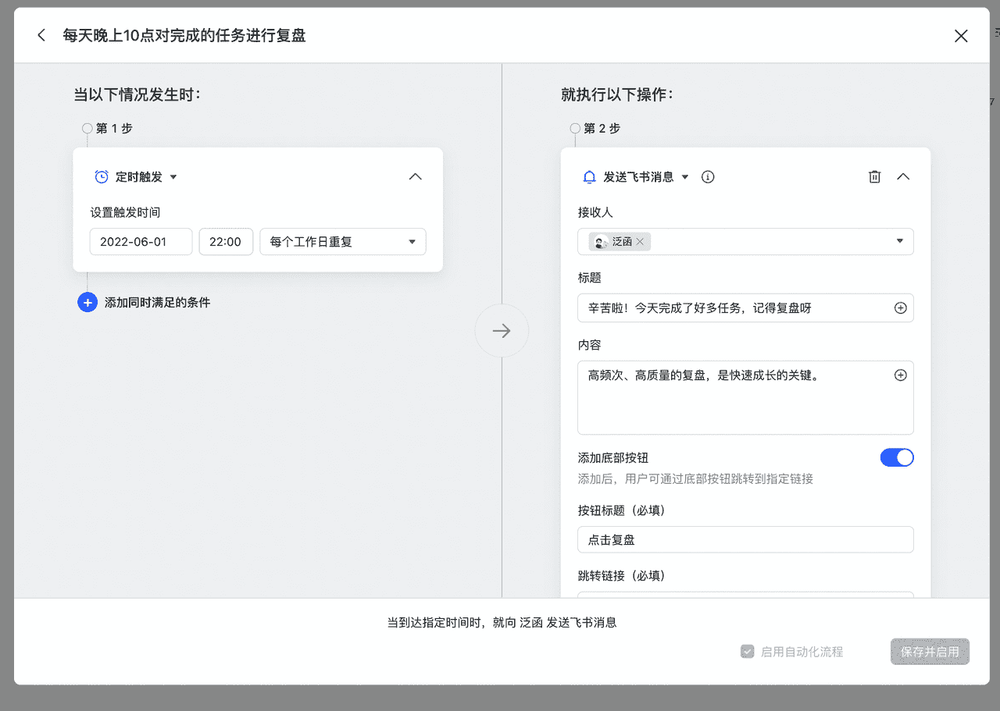

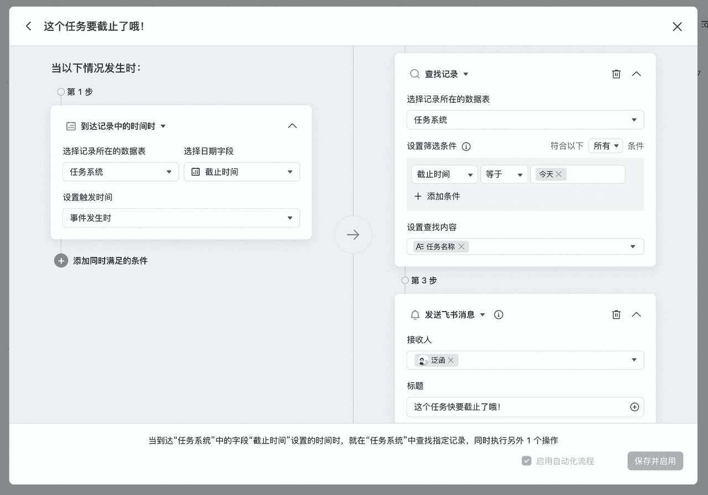

> 通过多维表格的小机器人，实习生竟然也能享受到有一个专属私人助理的待遇！

## 任务统计仪表盘：可视化你的所有辛勤付出

---

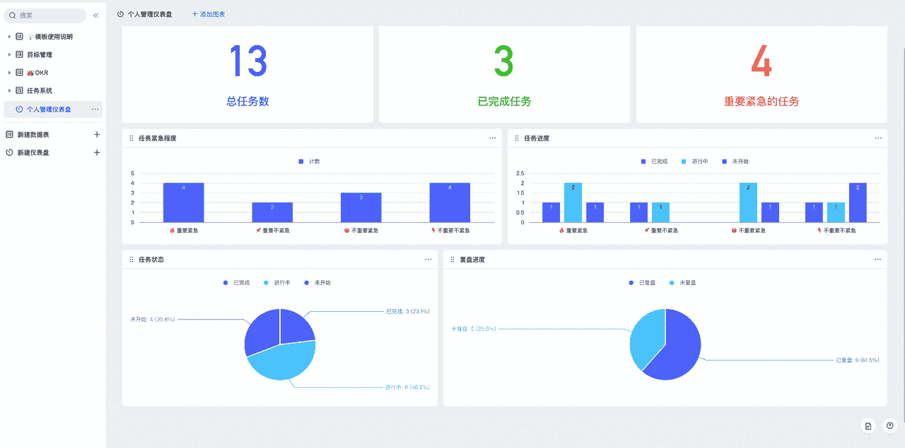

通过多维表格的仪表盘功能，我的所有努力都能被高颜值地可视化，既赏心悦目，又能很直观地看出最近的工作状态。

而且，这个仪表盘还能起到监督的作用。

我将我的任务管理多维表格公开给了很多团队的小伙伴，每个获得链接的人都能看到我在做什么、状态怎么样。

😰如果任务完成情况不太理想，那可会很尴尬的哦。

# 🤣我已经被飞书宠坏啦！

---

很不幸（bushi），飞书已经完完全全地把我宠坏了，我的生活已经离不开它了。

我已经无法想象不用飞书工作是一件多么令人难受的事情。

对于一款自己真正热爱的产品，00后们真的愿意特别主动去给身边的人种草，去想出各种各样的新鲜点子帮助它做大做强。

我心中最理想的工作就是能够为自己真正喜欢的产品付出努力，能够为一款我认为真的能够帮到很多人的好产品工作。

真的很幸运能遇见飞书，真的很幸运能加入飞书。

# 🎁一键 get 同款模板

---

+   真的很感谢你能看到这里，刚刚提到的那个多维表格模板，已经帮你整理到下面啦

+   还能什么呢，赶紧拿去用起来吧！

+   [全流程程效率管理：OKR | 任务 | 文档 | 人员 | 复盘 | 专属机器人助理](https://bytedance.feishu.cn/base/bascnPzJGt7IgALpkRDBsO6dkKg?table=tbly92qC8YtQUzhS&view=vewStWU5IS)

+   📢注意注意！模板中自动化流程里的【接收人】记得都改成你自己，按钮下面的链接记得改成你的表格的链接哦

# 推荐阅读

---

[泛函同学的一切 | 00后字节实习生 | 飞书市场部 ](https://to7e2gkmim.feishu.cn/docx/doxcn9WU8MscjPuUK0ImTVjXHwd)

[渐进式深入学习 | 艾宾浩斯记忆曲线智能推动复习内容 | 多维表格模板 | 说明书](https://bytedance.feishu.cn/docx/doxcn8Gx1s6RZIU4JEAizAM0Jdg)

[用了飞书文档半年，我和朋友们开始了“Doc Chat”](https://to7e2gkmim.feishu.cn/docs/doccnRDoLVW6dh2scWhsJf7JGOd)

[这可能是最无压力的写作方法：一个写了超过百万字的00后如是说](https://to7e2gkmim.feishu.cn/docx/doxcn1eCgLtTamm1Np3gx5ORbPh)

## 🥰 如果你感觉这些内容对你有帮助

> 不妨请我喝杯咖啡吧

