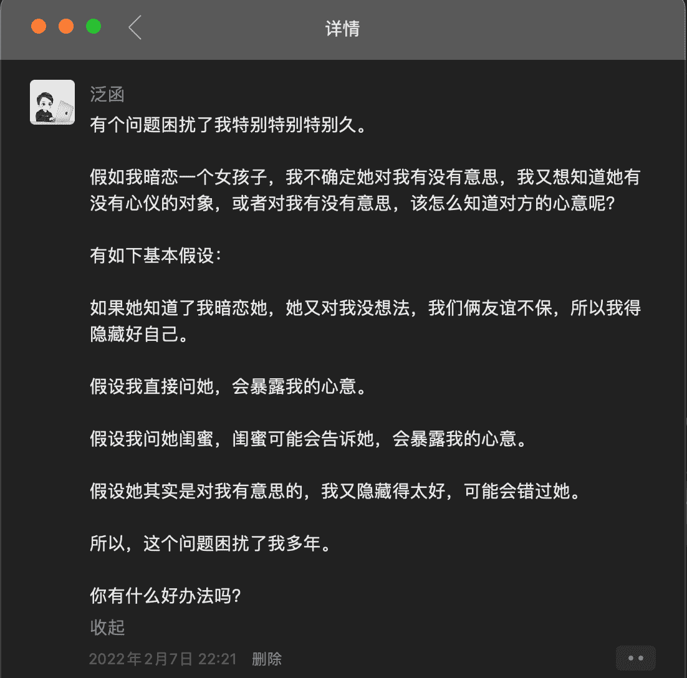
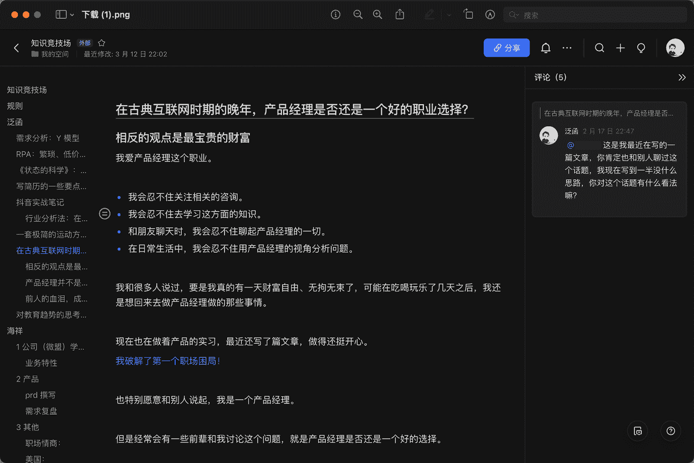

# 这可能是最无压力的写作方法：一个写了超过百万字的00后如是说

> 来源：[https://docs.feishu.cn/docx/doxcn1eCgLtTamm1Np3gx5ORbPh](https://docs.feishu.cn/docx/doxcn1eCgLtTamm1Np3gx5ORbPh)

> 读完这篇文章，你可以收获：

1.  对于写作的新认知；

1.  写作的具体方法论；

1.  那些帮助你更好写作的称手兵器。

# 认知层

## 写作的“聚类算法”

> 写作就是将网状的思考，整理成树状的结构，最后用线性的文字进行表达。

+   我在想写一个主题的文章时，会先将关于这个主题的零碎思考，一句一句地写下来。

+   当写的句子够多了，你会发现，好像有些句子可以打包成一个组。

+   有些组，好像可以形成一个新的子主题。

+   慢慢地，就能找到一个树状的结构，稍加调整，文章的框架就出来了。

+   最后，对段落、句子进行精修，一篇文章就写出来了。

> 解释一下**聚类算法：**

> 打个比方，你把一群蝌蚪丢进一个池塘里，然后相似的蝌蚪惺惺相惜，自发地游到了一起，这就是聚类。

> 与之相对应的，是主动分类，就是你将不同类别的蝌蚪放在不同的池塘里。

> 写作的“聚类算法”，就是先将蝌蚪洒在池塘里（先将零碎思考写下来），然后让蝌蚪自发地游到一起（让零碎思考自发地形成结构）。

## 功夫在写作之外

> 没有人真的可以从0开始创作。

+   如果你觉得写作很困难，不是你的语言表达能力不行，而是你根本没将这个问题想明白。

+   这时，你应该做的，不是输出，而是带着你的困惑去进行一些输入。

+   当有了足够的输入之后，你慢慢地也会有自己的独特观点，这时候，再来进行写作吧。

##

## 有思路者埋头干，无思路者走四方

> 不要当“孤独的哲人”，要做一个“好问的晚辈”。

+   写作可以不是你一个人的事情，当你思路堵塞时，不妨去找人聊聊。

+   罗振宇说过，写不出东西，无非就两种情况：

+   一种根本没有思路；

+   一种是有模糊的思路，不明白怎么好好表达。

+   找人聊聊，可以在你没有思路时，帮你找到思路。

+   你也可以在聊天的过程中，练习如何清晰表达。

+   聊着聊着，你就会获得一种“忍不住想写下来”的冲动，这时候再开始写作，就丝滑多了。

# 方法层

## 如何有效输入？

+   想找到这方面的信息非常简单，你只要打开几个平台：即刻、小宇宙、b站、📕、知乎、抖音··

+   在这些平台的搜索框中输入相应的关键词之后，用不了几天，推荐算法就能将你想知道的一切送到你的面前。

+   信息一多，必然能发现矛盾和对立的观点，这时候，就可以挑两个“打起来”的观点，去深入想想。

+   如果是“方法论”一类的，那就更简单了，直接自己试试。

+   这时候，问题你已经想得很明白了，就可以自己开始动笔了。

+   当然，读书还是最推荐的，一本书比那些碎片信息有用多了。

## 如何积累写作的素材？

+   找一个称手的笔记软件，建立一个标签。

+   每当你对这个主题有灵感时，就写一小段，写到你感觉不想写的时候，就可以停下来了。

+   或者你浏览到和这个主题相关的咨询时，存进去。

+   不过别当“松鼠🐿”哈，每次贴个链接的时候最好也写两句，为啥我要存这玩意。

## 如何有效地“找人聊聊”

+   🛰️&飞书里找一个特熟的朋友，直接告诉他：

+   “我最近在写这么一东西，不过思路不太清晰，我先给你讲讲”

+   “我最近在写这么一东西，没啥思路，你有什么看法嘛？”

+   或者找一个相关的群，直接问大家：

+   **发个朋友圈，搜集一下意见：**

+   或者直接请人喝个咖啡：

只要你愿意打开自己，就能收获到一大堆有意思的反馈，这时候再动笔写，就丝滑多啦。

# 工具层

> 君子性非异也，善假于物也。

---

## 得到

+   得到app能解决上面提到的“输入”不够的问题。

+   同时，它也是一个特别好的搜索引擎，你想了解的内容上去搜索，常有惊喜。

+   使用方法是用移动端听，用网页端阅读、搜索、整理。

## flomo

+   最丝滑的笔记软件。

+   “先写下你关于这个主题的所有的零碎思考”，这个过程我都是在flomo中完成的。

+   不妨在想写某个主题的内容时，先写一个问题，比如“如何进行压力更小的写作？”

+   然后将这条memo置顶，一有想法就为它写一条【批注】。

+   写得多了，“正式写作”的时候就格外容易了。

## 思维导图

+   这玩意是你不得不“从0开始创作”时才用的，而且真的在这样的紧急情况下，它无比好用。

+   老规矩，同样是先写、搜集、整理所有零碎观点，再让它们聚合成主题。

+   也有人喜欢先定框架，再往每个框架里填内容，这也是好办法。

+   最好的办法是两者同时进行，一边写碎观点，一边搭框架，一边整合两者。

+   好用的思维导图软件超多的啦，我喜欢飞书的思维笔记、XMind和幕布。

+   还有一种有意思的玩法，叫作“思维草图”。

+   这玩意我独创的，有空再展开讲讲🤓

## 飞书文档

+   这是我“正式写文章”的时候用的东西。

+   文档中的@功能还能解决“找人聊聊”的难题。

+   用飞书文档写作、交流、都特别方便，有兴趣地可以看看我最后贴的那篇文章。

# 真相

+   放轻松啦homie，你如果真的常输入、常输出，并且那几个工具都用的熟练的话。

+   在面对任何一个话题时，你基本都是张口就能说，提笔就能写的。

+   甚至啊，你甚至得用你的意志力来抑制自己分享、表达、写作的欲望。

+   因为熟练以后，你稍有感悟、稍有进步，都会“忍不住想将它写下来”。

> 辛苦啦，都读了这么多了，待会好好休息吧，晚点写也不迟。

> 不管写不写作，开心才是最重要的嘛！

> Have a nice day🥳

# 关于我

[泛函同学的一切 | 00后字节跳动实习生 | 飞书市场部](https://to7e2gkmim.feishu.cn/wiki/wikcnl2UCXsXjLBgGBnt3GDCI7g)

# 推荐阅读

[用了飞书文档半年，我和朋友们开始了“Doc Chat”](https://to7e2gkmim.feishu.cn/docs/doccnRDoLVW6dh2scWhsJf7JGOd)

[我破解了第一个职场困局！](https://to7e2gkmim.feishu.cn/wiki/wikcnJRFOcLicQ9BNOccOtPcWZb)

## 🥰 如果你感觉这些内容对你有帮助

> 不妨请我喝杯咖啡吧

