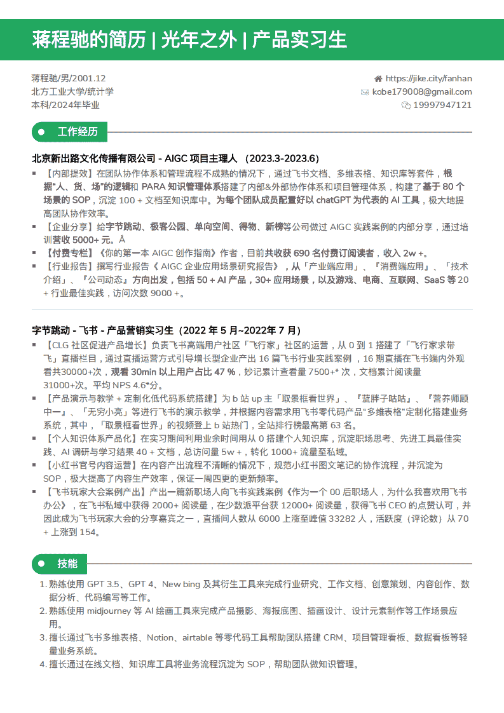

# 蒋程驰的简历 | 产品实习生 | 光年之外 | 在线文档版

> 来源：[https://docs.feishu.cn/docx/QeDHdkI3DocrIQxA1XLc2oTEnXe](https://docs.feishu.cn/docx/QeDHdkI3DocrIQxA1XLc2oTEnXe)

> [**职业轨迹图**](https://to7e2gkmim.feishu.cn/docx/QeDHdkI3DocrIQxA1XLc2oTEnXe#doxcnwMOApTEVMOAXyasloz0Fbb)

> [**项目经历→**](https://to7e2gkmim.feishu.cn/wiki/wikcnee8uAnhcCVMVXfUPuRIn5e#doxcnf7qpfFI7rZcX5VXlfU9t3g)

> [**作品集→**](https://to7e2gkmim.feishu.cn/docx/QeDHdkI3DocrIQxA1XLc2oTEnXe#doxcnE2v1PDjFi7r14JFJ12PAue)

+   你好呀，感谢你打开这份简历，我叫蒋程驰，在各个平台的花名叫泛函。

+   给自己的职业定位是专注科技产品&工具产品的营销和解决方案，痴迷于钻研各种科技产品、各行各业的最佳实践。

+   01 年，目前大三，在找暑期实习机会，希望能成为光年之外的产品实习生，愿意实习 6 个月以上。

+   目前 all in AIGC，在这波浪潮起来时抓住了不少机会，以获得额外收入 3w + 人民币。

+   粉丝量最多的平台是即刻，将近 5000 粉丝，主要输出的内容和自己的职业定位强相关。

---

👇🏻本在线文档简历仅为方便查看，如果要上传到到您的招聘系统里，请下载这份简历👇🏻

[蒋程驰的简历 光年之外 产品实习生 投递用.pdf](https://internal-api-drive-stream.feishu.cn/space/api/box/stream/download/all/K9v7bCmzJopjrzxntM4c8O4Zn7e)

---

#### 北京新出路文化传播有限公司 -  AIGC 项目主理人（2023. 3~2023.6）

+   **【内部提效】**在团**队协作体系和管理流程**不成**熟的情况下，通过飞书文**档、多维表格、知识库等套件，根据“人、货、场”的逻辑和 PARA 知识管理体系搭建了内部&外部协作体系和项目管理体系，构建了基于 80 个场景的 SOP，沉淀 100 + 文档至知识库中。并为每个团队成员配置好以 chatGPT 为代表的 AI 工具，极大地提高团队协作效率。

+   **【行业报告】**撰写行业报告《 AIGC 企业应用场景研究报告》，从「产业端应用」、『消费端应用』、「技术介绍」、『公司动态』方向出发，包括 50 + AI 产品，30+ 应用场景，以及游戏、电商、互联网、SaaS 等 20 + 行业最佳实践，访问次数 9000 +。

+   **【企业分享】**给字节跳动、极客公园、单向空间、得物、新榜等公司做过 AIGC 实践案例的内部分享，通过培训营收 5000+ 元。

+   **【付费专栏】**《你的第一本 AIGC 创作指南》作者，目前共收获 690 名付费订阅读者，收入营收 2w +。

---

#### 字节跳动 - 飞书 - 产品营销实习生 （2022 年 5 月 ~ 2022 年 7 月）

+   **【CLG 社区促进产品增长】**负责飞书高端**用户社区「飞行家**」社区的运营，从 0 **到 1 搭建**了「飞行家求带飞」**直播栏目，通过直**播运营方**式****引导增****长型企业产**出 16 篇飞书行业实践案例 ，16 期直播在飞书端内外观看共 30000+ 次，观看 30min 以上用户占比 47 %，妙记累计查看量 7500+ 次，文档累计阅读量 31000+ 次。平均 NPS 4.6 分。

+   **【产品演示与教学 + 定制化****低代码****系统搭建】**为 b 站 up 主「取景框看世界」、『蓝胖子咕咕』、『营养师顾中一』、「无穷小亮」等进行飞书的演示教学，并根据内容需求用飞书零代码产品“多维表格”定制化搭建业务系统，其中，「取景框看世界」的视频登上 b 站热门，全站排行榜最高第 63 名。

+   **【小红书官号内容运营】**在内容产出流程不清晰的情况下，规范小红书图文笔记的协作流程，并沉淀为 SOP，极大提高了内容生产效率，保证一周四更的更新频率。

+   **【****飞书****玩家大会案例产出**】产出一篇新职场人向飞书实践案例《作为一个 00 后职场人，为什么我喜欢用飞书办公》，在飞书私域中获得 2000+ 阅读量，在少数派平台获 12000+ 阅读量，获得飞书 CEO 的点赞认可，并因此成为飞书玩家大会的分享嘉宾之一，直播间人数从 6000 上涨至峰值 33282 人，活跃度（评论数）从 70 + 上涨到 154。

+   **【个人知识体系产品化】**在实习期间利用业余时间用从 0 搭建个人知识库，沉淀职场思考、先进工具最佳实践、AI 调研与学习结果 40 + 文档，总访问量 5w +，转化 1000+ 流量至私域。

---

### **个人技能**

1.  熟练使用 GPT 3.5、GPT 4、Claude 及其衍生工具来完成行业研究、工作文档、创意策划、内容创作等工作。

1.  熟练使用 midjourney 等 AI 绘画工具来完成产品摄影、海报底图、插画设计、设计元素制作等工作场景应用。

1.  擅长通过飞书多维表格、Notion、airtable 等零代码工具帮助团队搭建 CRM、项目管理看板、数据看板等轻量业务系统。

1.  擅长通过在线文档、知识库工具将业务流程沉淀为 SOP，帮助团队做知识管理。

### **作品集**

1.  给企业做 AI 内部分享的案例合集：[泛函的 AI 演示文稿弹药库](https://gamma.app/public/-AI--sbq40uzzyfgqa67)

1.  行业报告：[AIGC 企业应用场景研究报告](https://to7e2gkmim.feishu.cn/wiki/wikcnx7g6fmM0lejchNBXyq93Qg)

1.  访问量[泛函同学的一切 | All in AIGC | 这是一篇阅读量破万的个人说明书](https://to7e2gkmim.feishu.cn/wiki/wikcnl2UCXsXjLBgGBnt3GDCI7g)近 3 w 的个人说明书及知识库：

1.  付费专栏：《你的第一本 AIGC 创作指南》

1.  参与录制的播客：[AI写作全方位指南 主讲: 泛函(来自2位](https://www.xiaoyuzhoufm.com/episode/6430c5b49361a4e7c3f2f928?s=eyJ1IjoiNjBiYjRhYWNlMGY1ZTcyM2JiZmVjYzA2In0%3D)ChatGPT高频用户) - 人工智能季

1.  数字名片：泛函 - Yellow Page