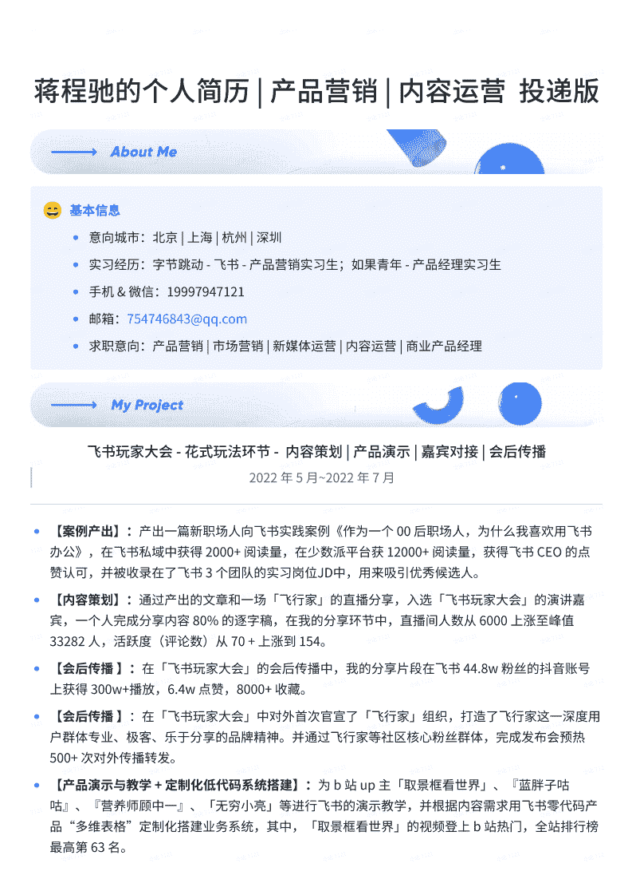

# 蒋程驰的个人简历 | 产品营销 | 内容运营

> 来源：[https://docs.feishu.cn/docx/doxcn9Pi7IygBCxmyUan7ni8gqc](https://docs.feishu.cn/docx/doxcn9Pi7IygBCxmyUan7ni8gqc)

> [**关于我→**](https://to7e2gkmim.feishu.cn/docx/doxcn9Pi7IygBCxmyUan7ni8gqc#doxcn7NMq0qpgY4V4BqBIFRAMVc)

> [**项目经历→**](https://to7e2gkmim.feishu.cn/wiki/wikcnee8uAnhcCVMVXfUPuRIn5e#doxcnf7qpfFI7rZcX5VXlfU9t3g)

> [**作品集→**](https://to7e2gkmim.feishu.cn/docx/doxcn9Pi7IygBCxmyUan7ni8gqc#doxcnvZckUtlb95OHHGbmFBUnxb)

---

> **基本信息**

+   意向城市：北京 | 上海 | 杭州 | 深圳

+   实习经历：字节跳动 - 飞书 - 产品营销实习生；如果青年 - 产品经理实习生

+   手机 & 🛰️：19997947121

+   邮箱：754746843@qq.com

+   求职意向：产品营销 | 市场营销 |  内容运营

#### 飞书玩家大会 - 花式玩法环节 -  内容策划 | 产品演示 | 嘉宾对接 | 会后传播

> 2022 年 5 月~2022 年 7 月

---

+   **【案例产出】：**产出一篇新职场人向飞书实践案例《作为一个 00 后职场人，为什么我喜欢用飞书办公》，在飞书私域中获得 2000+ 阅读量，在少数派平台获 12000+ 阅读量，获得飞书 CEO 的点赞认可，并被收录在了飞书 3 个团队的实习岗位JD中，用来吸引优秀候选人。

+   **【内容策划】：**通过产出的文章和一场「飞行家」的直播分享，入选「飞书玩家大会」的演讲嘉宾，一个人完成分享内容 80% 的逐字稿，在我的分享环节中，直播间人数从 6000 上涨至峰值 33282 人，活跃度（评论数）从 70 + 上涨到 154。

+   **【会后传播】：**在「飞书玩家大会」的会后传播中，我的分享片段在飞书 44.8w 粉丝的抖音账号上获得 300w+播放，6.4w 点赞，8000+ 收藏。

+   **【会后传播】**：在「飞书玩家大会」中对外首次官宣了「飞行家」组织，打造了飞行家这一深度用户群体专业、极客、乐于分享的品牌精神。并通过飞行家等社区核心粉丝群体，完成发布会预热 500+ 次对外传播转发。

+   【产品演示与教学 + 定制化低代码系统搭建】：为 b 站 up 主「取景框看世界」、『蓝胖子咕咕』、『营养师顾中一』、「无穷小亮」等进行飞书的演示教学，并根据内容需求用飞书零代码产品“多维表格”定制化搭建业务系统，其中，「取景框看世界」的视频登上 b 站热门，全站排行榜最高第 63 名。

#### 「飞行家」社区运营 | 用户增长

> 2022 年 4 月 ~ 2022年 9 月

---

+   【**内容运营】**： 从 0 到 1** 搭建了「飞行家**求带飞」直播栏目，每周**邀请一位不同**行业飞书深度客户，**深度分享行业内的**飞书实践**内容。目前累计直播** 1**6 期，飞****书端内外观**看共 30000+ 次，观看30min以上用户占比47%，妙记累计查看量 7500+ 次，文档累计阅读量 31000+ 次。平均 NPS 4.6 分，「飞行家」粉丝群累计8452人。打造了深度客户直播带货的『飞行家』栏目品牌，得到飞书团队内外一致好评。

+   【销售赋能】：开辟了新型的“用户带货”的打单物料形式，在销售物料调研中获得反馈“最好的打单物料内容之一”，30+位业务同事反馈对于销售、客户服务、功能推广等工作有很大价值，直接帮助转化成单3单。

+   【活动运营】：组织多场飞行家线上交流活动（飞行家面对面、产品讨论会等），4 场线下粉丝活动，营造了飞书核心用户对于飞书的归属感和认同感。

+   【对外传播】乌呀、人工智能小黄鸭、用工具的人、王壮（先进版）等视频博主建立合作，发布飞书相关主题内容，在对外的 SaaS 点评平台输出了数十条优质飞书测评内容。

+   【线索转化】：和中小企业孵化团队合作，打通孵化链路，目前是社区渠道最优质的孵化线索来源之一，获得有效商业线索 1000 +。

### **作品集**

##### 一份 10000+ 访问量的【个人说明书】：[泛函同学的一切 | 00后字节跳动实习生 | 飞书市场部](https://to7e2gkmim.feishu.cn/wiki/wikcnl2UCXsXjLBgGBnt3GDCI7g)

---

##### **职场类文章合集**

---

##### 深度参与内容策划 + 拍摄的视频

<https://player.bilibili.com/player.html?bvid=1MW4y1t7rR&spm_id_from=333.999.0.0>

[飞书20220903-231955.mp4](https://internal-api-drive-stream.feishu.cn/space/api/box/stream/download/all/boxcn0jPErEMlc3pUkntFJ7ndZg)

<https://player.bilibili.com/player.html?bvid=1rb4y1k7Ku>

---

##### 用飞书的低代码工具【多维表格】搭建的业务系统

+   [泛函的多维表格作品合集](https://to7e2gkmim.feishu.cn/wiki/wikcnvhQy0zffyyA0cQIgZajRtd)

1.  用于投递的 PDF 版本的简历

[蒋程驰的个人简历 _ 产品营销 _ 内容运营  投递版.pdf](https://internal-api-drive-stream.feishu.cn/space/api/box/stream/download/all/boxcnqjzXwDf9t7QJ7azshVIq8g)