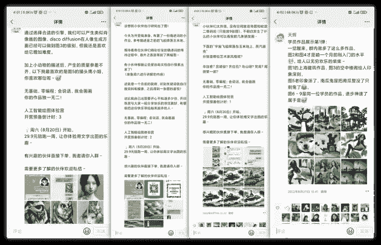
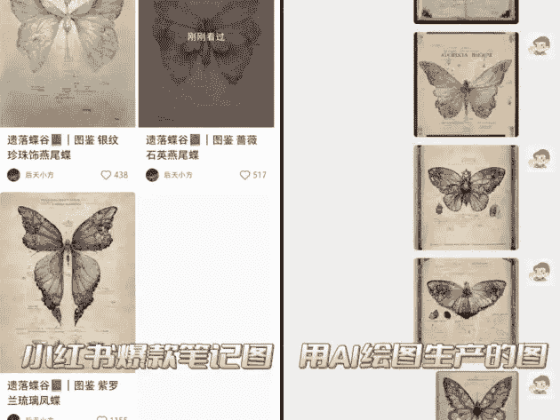
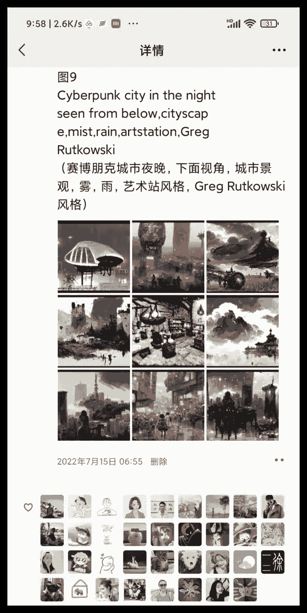
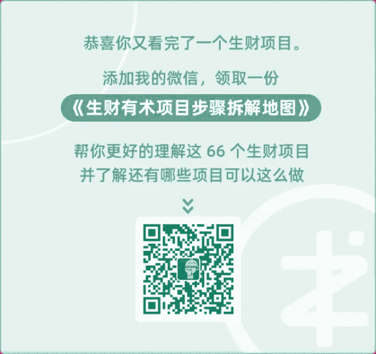

# 以AI绘画为例，如何把一门刚学会的新技能快速变成赚钱的生意 - 龙哥盟小报童

> 来源：[https://docs.feishu.cn/docx/KfcadTIdHoHWAFxy7O6czZK2n3d](https://docs.feishu.cn/docx/KfcadTIdHoHWAFxy7O6czZK2n3d)

> 🔗 原文链接： h[ttps://xiaobot.net](https://xiaobot.net/post/72a1b701-dcc8-4c7e-9a33-abce7840a469)/post/72a1b701-d...

> ⏰ 剪存时间：2023-02-25 11:11:50 (UTC+8)

> ✂️ 本文档由 [飞书剪存 ](https://www.feishu.cn/hc/zh-CN/articles/606278856233?from=in_ccm_clip_doc)一键生成

## **项目亮点**

> 给一段文字，绘图网站就会按照文字信息自动画出相应的图片，不知道你心里的绘画梦有没有蠢蠢欲动？

> 如果你通过做图收获了快乐和成就感，那么一定可以找到一群和你志同道合的人。给这些人提供对应的价值，也可以实现收益增长。

> 本文很好地说明了，如何在提升技能的过程中去变现。

## **项目信息**

**人物标签： **@天辉，生物实验室科研人员，绘画小白。

**背景： **在帮助朋友通过AI绘图制作插画时，天辉发现了其中的商机。他想到自己可以通过提供AI绘图咨询和相关产品，实现变现闭环，于是开启尝试。

**收益： **3900＋，目前还在持续。

## **产品是什么？**

1.  **1V1指导做图**

卖AI绘图的使用攻略，即如何通过 disco diffusion 生成图片，一份攻略收费19.9元。

1.  **AI****绘图体验营**

帮助小伙伴体验文字绘图的体验营，一个名额可以设置29.9元。

1.  **AI****绘图小报童专栏**

把绘图需要用到的知识、技巧、工具、信息渠道总结成文，放在小报童（内容平台）上进行订阅售卖。

1.  **AI****绘图****IP**

塑造专业的AI绘图IP形象，接咨询和商单。

## **流量从哪里来？**

1.  **朋友圈产品宣发**

发布产品相关的朋友圈，吸引意向用户注意。比如：展示AI绘图体验营的售价、效果图、学员评价图，以及宣传文案、交付目标等。

1.  **做AI绘图IP**

拆解📕平台的爆款笔记，然后批量生产类似风格的图片。将图片发布到📕做账号，吸引意向用户进入私域。

## **如何变现？**

1.  **1V1指导做图**

发布朋友圈，文案为：“打一段文字就能画出这样的图”。感兴趣的用户会主动私聊，通过给他们进行作图指导变现。

1.  **AI绘图体验营**

办一个一周的AI绘图体验营，教会学员如何生成7种不同风格的图，以及过程中可以修改哪些参数。

招募方式包括：

+   发布朋友圈；

+   在其他社群进行合作分享：聊聊产品的制作过程与价值观，吸引相同的人加入；

+   通过体验营的超预期交付，提升转介绍。

1.  **AI绘图小报童专栏**

把社群用到的知识、技巧总结成文，沉淀在小报童，内容包括：

+   思路发散：拆解AI绘图过程中的描述词，包括怎么想到的、在哪些网站会有怎样的效果等；

+   AI绘图信息：分享自己平时会从哪些地方获取AI绘图信息；

+   AI发展趋势：同步AI绘图的进展，比如除了文生图，还有文生视频（起步阶段）、文生3D模型（部分开放）等；

+   同类内容推荐：哪些博主值得关注，他们分享了哪些信息，哪些图片可以复刻等。

## 延展思路

任何阶段我们都有可能从0-1做一件事情，可能是学画画、学瑜伽、学游泳，也可能是学做饭、学买房、学写作......这些东西都可以是我们值得分享的东西。

只要你在这个过程中有收获，那么分享出来给大家就一定有价值。30分的可以教0分的，60分的可以教30分的，以此类推。只要保证过程中的交付，能够让对应用户有所收获，就会有人愿意为此买单。

