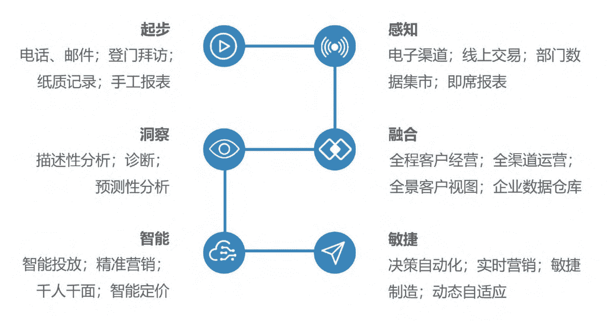
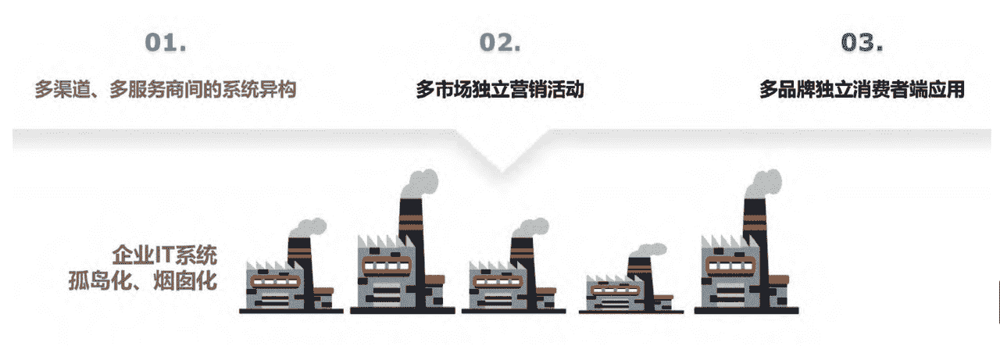
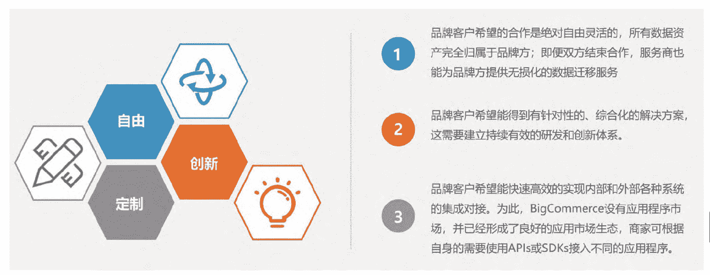
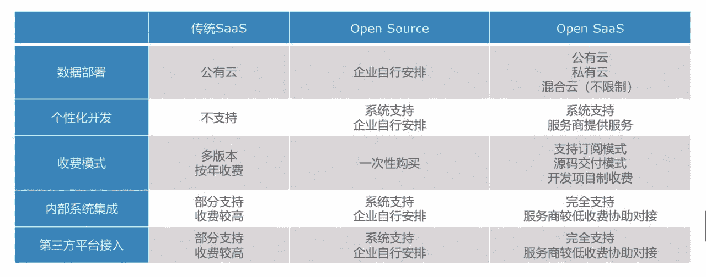
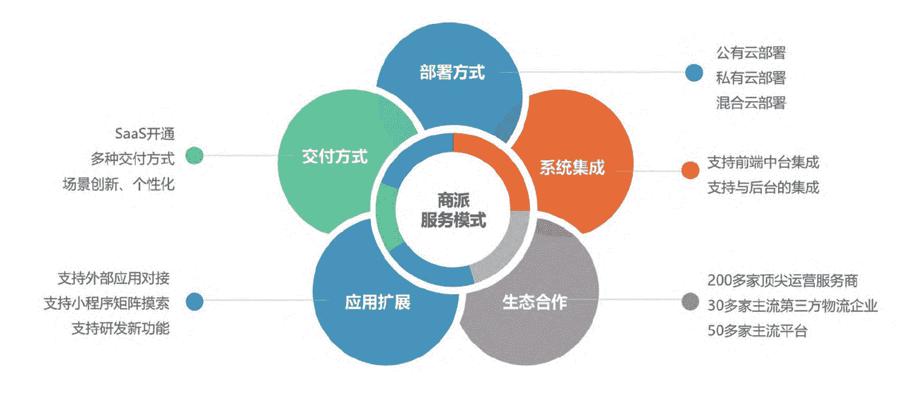

# Open SaaS助力品牌零售企业能力提升

> 来源：[https://docs.feishu.cn/docx/doxcnVApn7vQ2YAgSrn8FmfI95g](https://docs.feishu.cn/docx/doxcnVApn7vQ2YAgSrn8FmfI95g)

> 🔗 原文链接： h[ttps://kns-cnki-ne](https://kns-cnki-net-443.fastvpn.ncut.edu.cn/KXReader/Detail?invoice=BqaBefHrqa7smBAJ0ASGX0XBOVBmqplrrvMEufyoakk%2FhPoS34JGuT2gYSms6Z0Qf0daiOEFWq6xjIeRlTaOsAjTVEmrL581g%2FhsdDl2scL359JfVBFChnKASlIO35HbFV3LBcd1R4xIUg01NB5XJFVGyMsnOpWP8WhRoHxtO8o%3D&DBCODE=CJFD&FileName=RJSJ202205023&TABLEName=cjfdlast2022&nonce=584A34FC62034669AA1BA956C47B407E&uid=&TIMESTAMP=1660869857968)t-443.fastvpn.nc...

> ⏰ 剪存时间：2022-08-19 08:44:52 (UTC+8)

> ✂️ 本文档由 [飞书剪存 ](https://www.feishu.cn/hc/zh-CN/articles/606278856233?from=in_ccm_clip_doc)一键生成

[软件和集成电路 ](https://navi-cnki-net.fastvpn.ncut.edu.cn/KNavi/JournalDetail?pcode=CJFD&pykm=RJSJ)2022,(05),78-85 DOI:10.19609/j.cnki.cn10-1339/tn.2022.05.015

[亿欧智库](https://kns-cnki-net-443.fastvpn.ncut.edu.cn/kcms/detail/knetsearch.aspx?dbcode=CJFD&sfield=in&skey=%E4%BA%BF%E6%AC%A7%E6%99%BA%E5%BA%93&code=&uid=WEEvREcwSlJHSldSdmVpbEs1TGZ1YWdWRHZvakx5S1JEYk14UTVsRVVzND0=$9A4hF_YAuvQ5obgVAqNKPCYcEjKensW4IQMovwHtwkF4VYPoHbKxJw!!)

**作者简介： **亿欧智库,亿欧EqualOcean旗下研究与咨询机构，为全球企业和政府决策者提供行业研究、投资分析和创新咨询服务;

Open SaaS或许是切入零售数字化的绝佳方向，有望成为助力品牌零售企业实现能力升维的新途径。

当下，随着互联网的高速发展，消费者的行为发生了翻天覆地的变化，这些变化不仅体现在消费者的行为习惯上，更是打破了传统企业的经营方式。从长远发展的角度来看，传统零售模式需要转型，特别是需要适应当前零售市场的变化，适应全渠道带来的市场结构变化，探讨新的零售模式。新冠肺炎疫情让越来越多的商家意识到，数字化能力已经成为零售行业的必备技能。

目前，零售数字化转型正当时，但这一过程中的痛点也极为明显。对于品牌方而言，究竟该如何找到低成本、可衡量、可复制的数字化模式和方法论？对于服务商而言，数字化过程中品牌层出不穷的个性化需求该如何满足？O p en S a aS 或许是切入零售数字化的绝佳方向，有望成为助力品牌零售企业实现能力升维的新途径。

### 中国零售行业的关键变化

#### 零售行业基础设施的变化

近年来，零售业的变化多被归结为“人”的变化，但我们认为，基础设施是零售业的基石，也是零售业出现变化的底层原因。

零售基础设施的变化对于零售业态的创造、零售管理的创新、零售效率的提升、顾客服务的改善等环节都会产生影响。随着流量、渠道、物流、支付、技术五大零售基础设施发生翻天覆地的变化，零售业也在不断迭代。

细数零售基础设施的种种变化，最核心的是渠道由传统“分散化”转向“整合化”。在中国互联网渗透率接近饱和的背景下，传统中心化电商的自然增量减少导致其获客成本日益增加。

与此同时，商业基础设施外溢也给以社交、内容类转型为主的电商企业提供了更多机会。

中国零售业已全面进入数字化时代，品牌需获得更多来自销售通路的数据信息，建立品牌数字化资产，指导研发生产和销售。销售通路的演化逻辑是渠道叠加，全渠道零售的本质是以品牌为核心，构建品牌复合式销售通路。

一般而言，在基础设施完备后，新品牌会开始涌现。从20世纪20年代开始，美国物流（汽车）、支付（信贷与信用卡）、渠道（全国性连锁超市）、流量（电视与广告业）等基础设施逐渐萌芽，并在之后20年间完成渗透。在此期间，玛氏、卡夫、可口可乐、宝洁等强功能性的品牌迅速发展并确立了行业龙头地位。此后，更多强精神属性的品牌陆续迎来大发展，雅诗兰黛、Nike等应运而生。

图1 零售企业的数字化发展阶段  下载原图

在中国新零售基础设施已准备完毕的当下，品牌这个大赛道在中国才刚刚开启。除了基础设施的变化之外，头部品牌的能力溢出使其商业模式转变趋向于更高维度的价值实现，头部品牌越来越多地向平台模式转化，如珀莱雅自2019年便提出了全新的“四化”建设战略，准备通过“国际化、年轻化、平台化、生态化”再次成长。

#### 零售数字化的重要性

数字化是品牌方发展的必要手段。从长远来看，传统零售模式需要转型以适应当前的零售市场变化，适应全渠道带来的市场结构变化。

从现实来看，传统零售业作为劳动密集型行业，尤其需要借助新的技术手段降低人力成本，提升企业运营效率。这对企业、行业的发展都是特别重要的，而疫情则是零售企业数字化转型的“加速器”。

2020年被部分业内人士称为“数字化元年”，很大一部分原因就在于疫情推动了企业的数字化转型，数字化工具成为助力疫情防控、复工复产、经济复苏的有力帮手。

数字化转型的本质是企业治理模式的转变，即企业根据自身实际情况，以业务为导向，以数据为基础，与传统生产要素相结合，利用新一代数字技术反向赋能业务，驱动业务与服务创新。

当前，为了适应不断变化的消费者的需求，零售企业最需要的转变是从以职能管控为核心的科层制组织管理结构，转向以客户为中心的“平台化赋能型+分布式自主经营体”组织管理结构。

例如，在品牌创新速度方面，疫情期间，一家传统线下商超需要在短期内部署完成线上云店、全渠道订单管理、仓储管理等模块，如果按照传统的方式来建设系统，需要定制开发或购买套件、采购服务器、买带宽、租IDC、培训员工等，而现在只要购买 SaaS 模板，并对员工进行简单的培训，就可以对一个全新业务模式进行MVP（最小可行性产品）试错。

如果从“人”“货”“场”的视角看零售数字化发展，则品牌目前面临“大量消费者数据存储于中间商”“消费者运营成本高”“平台分利多”“利润空间被严重挤压”等问题。在品牌纷纷布局线上、线下、公域、私域全渠道的当下，多元异构数据的治理是打造消费者全渠道无缝体验的关键基础。

#### 数字化过程中的痛点

---

零售数字化转型涉及品牌方、服务商两大主体，二者在转变过程中各自面临一些难题。

数据“烟囱”逐渐成为品牌方面临的首要难题。企业理念、体制的变化以及各业务机制不统一、过程标准规范缺失，导致各系统之间兼容性与集成性难以提高，如品牌商家在客户管理、库存管理、物流管理等不同环节都要面对众多系统供应商，而多系统难以融合，这使得数据割裂问题日益凸显。

与此同时，各类系统的打通，又面临技术标准不同、权责边界不清等问题，绝大多数商家难以独立应对。

交错的销售通路决定了品牌零售企业数字化的复杂性。典型的品牌零售销售通路包括线下自营门店、线下分销体系、第三方销售平台等。为此，品牌方需要优化、整合分散的零售销售通路，消除内部利益掣肘，避免各自为战产生的数据“孤岛”，而这一历程无疑极为繁杂。

头部零售品牌数字化过程中有很多个性化需求。在数字化的过程中，头部零售品牌在前端交易流程中有多样化的参与者，因而会产生多样的消费者互动方式与业务模式。以积分体系为例，若品牌方有传统的积分系统，则品牌方会要求服务商将两者打通，原有的积分也能在新的系统进行兑换。同时，针对消费者的个性化需求，品牌方也希望进行个性化的用户运营，提高消费者触达和转化效率，提升复购率，驱动业务快速增长。差异化竞争是企业取胜的关键，所以企业更应该通过在系统和技术层面进行个性化定制来放大差异化价值。

品牌方零售数字化转型尚无成体系的方法论。虽然某些零售细分环节在头部企业的示范下已逐渐形成体系化的数字化方法论，如阿里妈妈在广告营销环节提出了“深链经营”（DeepLink），以此实现品牌人群资产定量化、链路化运营。然而，囿于可供参考的零售数字化案例过少、企业间信息沟通不畅等因素，零售数字化的整套流程尚缺乏成体系的方法论，而这也是多数品牌正面临的问题。例如，在商品销售、服务和支付的过程中，如何有效实现会员的连接和触达，从而找到数字化的准心，让数字化真正能为企业精准营销、商品定价优化等服务，目前尚无行业公认的解决方案。

从服务商的视角来看，针对中小企业的SaaS模式难以获得正向现金流。对于SaaS公司的经营效率，可以借用公式做简单判定：单位投资回报率=LTV（客户生命周期价值）/CAC（获客成本）。

图2 品牌方面临的数据“烟囱”难题  下载原图

假如，单个客户的获得成本为1万元，订阅费5000元/年，在客户持续订阅的情况下，2年即可收回成本（不考虑增值服务），第3年开始才能净盈利。

若第2年客户不再续订，那么公司在这个客户拓展上就是亏损的。然而，在消费行业剧烈变化的当下，中小零售企业会经常性地出现重大转型，而按需订阅的Sa aS产品仍有固定成本，服务商前期推广也有着高额的销售费用。因此，多数以中小零售企业为目标用户的服务商都会出现“越增长越亏损”的情况。

此外，服务商针对头部品牌提供定制服务难以获得规模化优势。头部商家虽然有更强的付费意愿与能力，但往往会伴生个性化、定制化需求，影响产品研发资源。若需求处理出现问题，则极有可能会影响线上产品主线，出现分支，最终沦为“工具人”的角色。

同时，若业务以定制化的项目为主，则基本只能赚取“人头费”，营收可以根据公式进行粗略的计算：项目制公司总体营收（Z）=每人每月费用（X）×总人月数（Y）。

这会导致出现三个方面的问题：一是从机制层面看，营收取决于每人每月费用（X）和总人月数（Y）两个变量，其中的X各家差异不大，因此可提升空间有限，而Y则取决于项目需求和解决方案，由于定制化开发不提供标准化产品，入行门槛低，因而竞争极为激烈，在与竞争对手和商家博弈后，最终Y也不会太高；二是项目方的需求变动风险大，许多行业标准化程度低、增长快的企业组织变革频繁，其本身需求稳定性不高；三是项目型公司发展的可持续性差，公司没有核心竞争力，技术和销售人才成长后，很容易脱离公司自主创业。

#### 中国品牌零售行业亟须新的解决方案

B i g C o m m e r c e 或许可为品牌零售行业新的解决方案提供参考。与S h o p i fy相似，BigCommerce主要业务是向商家提供电子商务工具，帮助商家在网上销售产品与服务，产品涵盖买方的前台体验和卖方的后台管理，如商品的网页呈现、结账服务、折扣管理、库存管理、销售数据分析等。

不同点在于，BigCommerce提供了比Shopify和其他任何公司更多的内置工具，使商户不必增加成本、依赖第三方应用程序获取更多高级功能。如果商户确实需要向网站添加其他功能，BigCommerce的应用程序市场也提供了约250种可供选择的工具。

对于企业级商户，BigCommerce提供了更有利的自定义计划。与Shopify Plus主要依赖其应用程序市场实现大部分自定义功能相比，BigCommerce Enterprise具有范围更广的内置工具，可以帮助大型企业最大程度地发挥在线潜力。

通过分析BigCommerce的发展历程，我们不难发现，品牌方核心需求已经发生了转变。简而言之，可以将其总结为“自由、创新、定制”。

在自由方面，品牌客户希望的合作是绝对自由灵活的，所有数据资产完全归属于品牌方，即便双方结束合作，服务商也能为品牌方提供无损化的数据迁移服务。

在创新方面，品牌客户希望能得到有针对性的、综合化的解决方案，这需要建立持续有效的研发和创新体系。在定制方面，品牌客户希望能快速高效地实现内部和外部各种系统的集成对接。

### Open SaaS赋能品牌零售行业转型

#### 从业务视角看Open SaaS

Open SaaS指通过在整个平台上公开、强大的APIs和SDKs，将开源和SaaS的最佳元素结合起来，快速响应市场波动和客户体验期望变化，达到两全其美的效果。

如果以装修类比，那么传统S a a S交易平台更像是品牌方入驻一个标准化的公寓，品牌方扮演的只是权利有限的“租客”，而Open SaaS则可以让品牌方成为“业主”。

对服务商而言，Open SaaS兼容了标准化与个性化。在软件服务行业，受制于S a aS产品无法独立部署、无法个性化定制等问题，很多企业客户会选择Open Source模式，即直接向软件服务商购买全套源代码，然后再安排服务商或自己的IT团队进行个性化定制开发，这种方案存在明显劣势。

相较于传统SaaS或Open Source,Open SaaS在个性化开发、内部系统集成等方面都有显著的优势。简而言之，Open SaaS模式主要定位于中大型客户，用比较标准化的产品满足企业的需求，其中个性化的部分可由企业自行完成或交由第三方服务商优化。

对品牌方而言，Open SaaS有效满足了其All-in-one的需求。

在消费互联网时代，消费者趋向于使用超级App，即囊括了不同场景下所有用户需求的移动应用软件，其意义在于互联网可以深度渗透生活的方方面面。

产业互联网时代同样如此，品牌方数字化也有All-in-one的需求。因此，对于服务商而言，如何做好集成就显得至关重要，这也是 Open SaaS 所满足的另一大需求。

同时，在这一过程中，中大型品牌一直在寻找能独立发展的数字化手段，而第三方服务商相较于头部互联网公司会更为中立，所以其布局All-in-one存在一定的先天优势。

#### Open SaaS模式成立的原因

商业模式能否成立的核心在于单位经济模型UE(Unit Economics）是否成立，具体到S a aS行业来看，续费是非常重要的部分。

我们可以模拟一家经营了20年的 SaaS 公司，假设它在创立的第3年拿到投资，之后17年陆续获得投资回报，设定变量如下：新购增速为30%，研发等固定费用增速为20%，新单毛利率为20%，续费及增购毛利率为70%，首年营收300万元，首年研发等固定费用为600万元。

在此条件下，如果这家 SaaS 公司的续费率（含增购）在50%以下，那么其17年的累计投资回报仅有1.3倍，几乎没有任何投资价值；假设其续费率（含增购）达到80%，则17年之后会有13.6倍的回报；若续费率（含增购）能达到100%，则17年之后会有29倍的回报。

从这一视角来看，续费率较低的 SaaS 企业几乎没有任何投资的价值，而 Open SaaS 适配头部品牌的特性无疑为其带来了先天的优势。

图3 品牌零售数字化方案的三要义  下载原图

表1 Open SaaS的特性  下载原图

当品牌知名度越高时，品牌的价值越高，其忠实的消费者就越多，占有的市场份额也就越大。反之，品牌知名度越小，品牌的价值越低，其忠实的消费者也就越少，将有可能被品牌知名度高的产品或服务代替。零售领域已显露出了这一态势，一线品牌凭借渠道、产品、生产力等核心优势，有望依靠提升市场占有率来维持高增长。

而出于业务稳定性的考量，头部品牌对服务商有更强的稳定性需求，续约率普遍很高，Open SaaS的市场空间更大。

对于多数头部零售品牌而言，数字化路径大体上是相似的，只不过由于业务的渐进性差异，不同企业会处于不一样的阶段。随着数字化转型理念被越来越多的头部品牌商接受和认可，其他品牌商开始效仿头部品牌商进行数字化升级。

简而言之，品牌方在市场营销和零售交易前端的需求一定是经常变化的，需要根据市场需求进行灵活、自由、个性化的创新，所以Open SaaS是最佳的服务模式。

### Open SaaS交付实例

#### 商派的Open SaaS模式

作为国内率先提出 O p en S a aS 模式的企业，上海商派网络科技有限公司（以下简称“商派”）的应用案例是非常成功的。零售行业Open S a a S模式的本质是“以品牌客户为中心，紧贴需求，提供更加自由、个性和开放的软件服务”。

商派也正是基于Open SaaS模式的理念，不断完善全渠道零售数字化系统产品的研发，构建Open SaaS三方应用生态，提升全生命周期的企业级数字化服务能力。

在不断发展的零售数字化环境中，业务敏捷性是保持竞争优势的关键，灵活的数字化系统可以为企业带来更大的竞争优势。商派的Open SaaS服务模式可在以下五个方面提供品牌方急需的价值。

一是自由，不绑架客户。品牌客户与商派的合作是自由、灵活的，所有数据资产完全归属于客户，即便结束合作，商派也能为客户提供无损化的数据迁移服务。

二是个性化与标准化结合。在强大的SaaS产品基础上，商派可以为品牌客户提供前端场景的个性化创新定制，实现品牌客户与竞争对手差异化的市场区隔，提升竞争优势。

三是灵活，具备高扩展性。商派强大的APIs和SDKs能力可以帮助企业快速高效地实现内部和外部各种系统的集成对接，使品牌客户的多个系统发挥出最佳的协同作用。

四是更稳定、更安全。商派的产品已获得国际和国内多个权威机构的安全认证，品牌客户使用商派的产品更加符合各种审计的要求。

五是开放性合作。品牌客户可以基于商派的系统，自由选择与其他第三方合作，不受商派产品和技术的限制。

基于Open SaaS的理念，商派搭建了oneX平台。“O n e”即构建零售行业一体化、一站式的一个超级商业操作平台；“X”则代表着数字化，探索创新，持续进化。

商派oneX平台已对接了近百个外部销售平台，实现了企业全渠道一盘货经营、全渠道会员身份统一识别和多层级经销商在线赋能。

同时，商派oneX平台内嵌了微信生态、企业微信、微信支付、腾讯有数、京东开普勒、汇付天下等成熟模块与服务，共同服务于品牌企业。更关键的是，商派oneX平台本身是一个开放型平台，通过不断集成第三方应用、对接多渠道数据，完成一系列复杂的“拼图”工作，为品牌客户提供一张完整的零售数字化转型蓝图。

#### 商派的交付案例

某知名连锁品牌为提升客户体验，创新O2O新零售业务，进行了数字化转型。为此，商派提供了一整套基于Open SaaS模式的解决方案。

在提供了标准化的购物路径优化之外，该品牌在运营中发现线上会员有很强的复购能力。

基于此，商派在会员营销层面提供了差异化的数字化路径，通过帮助品牌方引入企业微信的形式，有效提升了导购的效率。导购可通过门店物料或主动添加顾客微信来建立关系，再通过企业微信与品牌自有的C D P系统连接，数据系统可以为导购提供顾客喜好方面的数据分析。导购可以有针对性地推荐商品，下发优惠券，实现精准转化。

此外，在数字化方向，该品牌方近年来对全渠道库存可视化、统一化、自动化、订单智能路由等有极强的需求。商派以智能运营中台和Open SaaS为技术依托，为品牌企业构建了全渠道的数字化解决方案。

该方案核心在于多渠道订单统一快速流转，集合多仓库存和多渠道履约方式，通过中台的算法规则，智能路由生成最符合品牌业务的派单路线，提升配送效率和客户体验。

### 中国零售数字化行业洞察

#### 趋势一：“私域”是个“大金矿”，但需以恰当方式撬动

自瑞幸咖啡爆火之后，很多品牌都开始布局私域流量，无论是大企业还是小企业，都将其奉若“金矿”。新冠肺炎疫情更是加速了这一进程，很多线下品牌都通过私域流量转型自救。私域流量不仅可以帮助企业营销拓客，还可以提升消费者黏性，使得重复购买率不断上升。但品牌如果想切实做好私域流量，盲目的凑热闹显然是不可取的，更多的是需要在一体化数字化服务商的加持下统一运筹，先有一致化认知，再有一致化行动，而最重要的是实现数据一致化。

#### 趋势二：品牌建设能力强的数字化服务商有更强的竞争力

企业数字化的价值最终要体现在业务上，业务部门是数字化的需求方，业务部门与数字化实施团队无缝沟通、协同作战，可以减少对业务理解的偏差，节约沟通成本，提高落地效率。

而营销正是优化业务的首要手段，通过开展全链路营销，品牌商可以对消费者进行全面管理，提升消费者全生命周期价值。由于是直接面向消费者，品牌商也可以快速验证数字化转型的效果。

图4 商派Open SaaS的服务模式  下载原图

市场动态变化不断加快，新品牌定位与成熟品牌产品迭代难度增大，品牌商对服务商的品牌建设能力提出更高要求。未来，品牌建设能力越强的服务商对品牌的吸引力强，越能稳住市场地位，使得自身的发展处于上升期；反之，品牌建设能力越弱的服务商对品牌的吸引力会越小，会使自身的发展走下坡路。

#### 趋势三：系统型数字化模式或成为主流形态

零售数字化就是品牌基于自身的零售基础，嫁接适合自己的外部商业能量，选择适合自己的数字化系统而形成的零售新局面。

大部分企业走进了一个误区，数字化转型其实并不是简单的IT改造，关键在于按照数字化、智能化驱动的思想来提升业务战略和运营能力，从而为业务带来增量和独一无二的价值。目前，市场上大部分的零售数字化服务商只是提供了一个系统或某一环节的工具，并未从思想、组织、运营等高阶层面帮助企业进行数字化转型。对于品牌方而言，不考虑自身情况，僵硬学习他人模式，又应用了不适合自己的孤岛型、碎片型零售系统，失败的概率极高。因此，系统型数字化服务模式或将成为未来的主流形态。

#### 趋势四：零售商业正由“消费红利”时代转向“全面创新”时代

数字化正重塑零售品牌的成长生态，品牌正由“消费红利”时代转向“全面创新”时代。其中，最典型的代表是从单节点成本和效率提升向全生态重塑增长方式转变。具体到操作层面，以下三点转型最为明显。

一是从单向商流效率提速转向全链路要素价值共振。传统模式关注产品生产和售卖的单向商流效率，通过成本集约、效率提升等方式提升利润，而数字化转型则以消费者为中心，重构商流价值链，组织、技术、金融和物流与商流充分融合，形成增量式协同。

二是从消费互联转向生态互联。传统模式关注消费者与商品/服务以及场景之间的链接关系，注重提高存量商品售卖效率，而数字化转型则注重通过消费端拉动供给侧，整合和优化配置，充分调动全产业中各角色的动能。

三是从数字化转型走向数智化赋能。当前的模式是通过技术实现信息化，提升流程效率、数据一致性和透明度，提高作业和管理效率，而未来的发展着力点是通过技术实现数据资产化、数据价值转化，推进运营和决策能力持续迭代优化，实现全产业可持续发展。