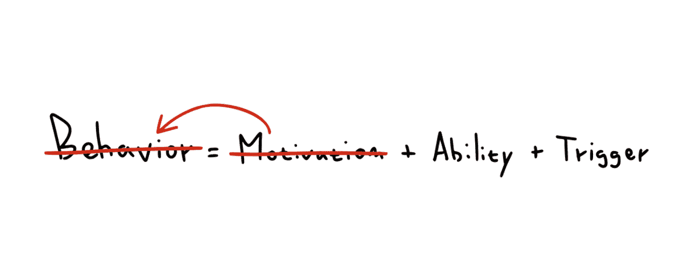
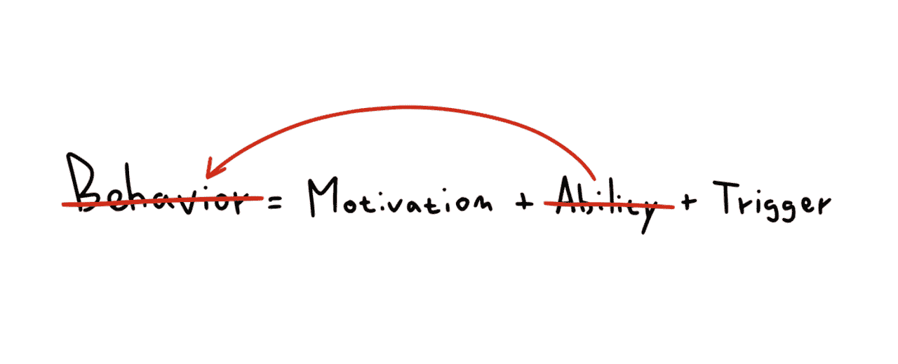
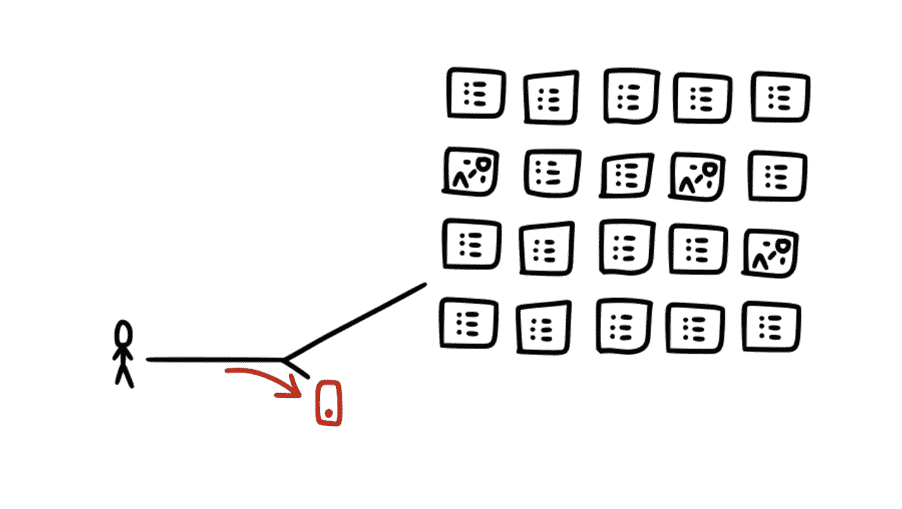
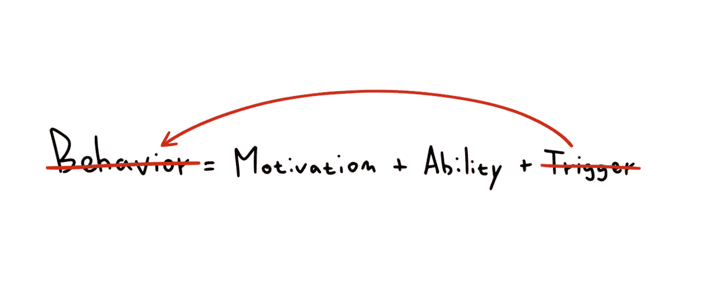

# 354 | 怎么用“福格行为模型”战胜拖延症？ - 得到APP

> 来源：[https://docs.feishu.cn/docx/SKVcdKpf4oLQNPxhErqciFf9n0B](https://docs.feishu.cn/docx/SKVcdKpf4oLQNPxhErqciFf9n0B)

> 🔗 原文链接： h[ttps://www.dedao.c](https://www.dedao.cn/course/article?id=w06eGYrQb1gzVxoPGRKPl73kZRqOaB&source=search)n/course/article...

> ⏰ 剪存时间：2022-11-09 15:44:05 (UTC+8)

> ✂️ 本文档由 [飞书剪存 ](https://www.feishu.cn/hc/zh-CN/articles/606278856233?from=in_ccm_clip_doc)一键生成

354 | 怎么用“福格行为模型”战胜拖延症？ 11分11秒

邵恒亲述

策划人：韩亮

你好，这里是《邵恒头条》，我是邵恒。

去年年底，我们有一期节目是讨论新年该立一个什么样的flag才人间值得，当时我给你的提议是：立一个不光自己变好，也要让别人从中受益的flag。

老实说，设定这样一个目标并不难，难的是如何完成它。我看到一个说法很有意思，说当代人立flag的现状是“今年立的flag，就是完成去年承诺的、前年没做到的、大前年立下的flag”，你说说，这让人情何以堪啊。于是，有人干脆就不敢定目标了，怕打脸。

到底是什么阻碍我们完成这些目标呢？除了客观原因之外，我想最大的拦路虎就是拖延症了。我身边很多朋友都饱受拖延症的困扰，包括我自己。明明是重要的事，也制定了计划，却总是无法按时完成。更可怕的是，打脸多了，自我评价变低，还容易掉入负面情绪的旋涡。

要怎么打败拖延症呢？我最近在36氪的神译局栏目里看到一篇文章，很受启发。文章来自一个国外专门研究拖延症的网站，叫Deprocrastination，标题是《如何用福格行为模型治疗拖延症》（How to stop procrastinating by using the Fogg Behavior Model）。

读完这篇文章之后，我突然明白了拖延症的“底层逻辑”，也对如何应对它有了清晰的思路。在今天的《邵恒头条》中，我就把我从这篇文章中得到的收获分享给你。

你一定注意到了，文章的标题叫“如何用福格行为模型治疗拖延症”。那什么是福格行为模型呢？这个行为模型是美国斯坦福大学的教授布莱恩·福格（Brian Fogg）提出来的，所以是以他的名字命名的。福格行为模型的主要用途，是用来解释人们为什么会做出某种行为，比如“为什么你会早起跑步？”当然，它也能用来解释人们为什么没有做出某种行为，比如“你本来计划早起跑步，今天却没去，为什么？”对于这两类问题，福格行为模型都能给出合理的解释。

在互联网领域，福格行为模型常被用来设计引导用户行为。你可能听说过尼尔·埃亚尔的那本著名的《上瘾：让用户养成使用习惯的四大产品逻辑》，这本书的理论基础，就是福格行为模型。

**简单来说，福格行为模型可以用一个公式来表示： 行为=动机+**能力+触发（Behavior=Motivation+Ability+Trigger）。

从这个公式中你就可以看出，人的行为背后有三大要素：一个是动机，也就是做这件事的理由或目的；一个是能力，你得有能力完成这个行为才行；还有一个是触发，也就是在某个时刻促使人们采取行动的信号。要想使人们完成特定的行为，“动机”、“能力”、“触发”这三个要素缺一不可。

那你可能想问，福格行为模型和拖延症又有什么关系呢？其实，福格行为模型给了我们理解和分析拖延症的一个抓手。毕竟，拖延也是一种“行为”，那么它就可以被拆解成“动机”、“能力”和“触发”三个环节。你可以把它们想象成三根“链条”，任何一根链条断了，都会导致拖延发生。

这么说有点抽象，我举一些具体的例子。先来说第一根断掉的链条：动机。

不知道你有没有发现，我们拖延的事并不是什么小事，往往还挺重要的。比如说，你要写毕业论文，这关乎到你能不能顺利毕业；你想要瘦身，因为以前的衣服已经穿不进去了；你计划新的一年在知识城邦上多做分享，将来能成为“粉丝”过万的大V。这些都是对你来说重要的事，可问题是，当你把这些事放进待办列表之后，你的动机就不再像最开始那么强烈了。

不信，你回忆一下，有多少次你麻木地盯着待办事项列表，却发现找不到一件让自己感到兴奋，想马上就动手去做的事？随着时间的推移，你的动机会不断地被稀释淡化。

那该怎么办呢？最佳的解决方案，就是重新帮自己建立动机。你可以找出一件自己一直在拖延的事，想想当初为什么要计划做这件事，让自己再一次直观地感受到这件事的价值和意义。

这里有一个小窍门： 尽量把这件事和个人收益关联起来。 比如说，做完它能让你获得什么好处？你的个人能力会提升吗？未来会因此得到更多的机会吗？这件事有可能帮助到更多人吗？别人看到你穿着好看的衣服，会向你投来钦佩或羡慕的眼光吗？想得越细致，你的动机就会越明确，也就会感到越兴奋，动力越足。

好，这就是从动机上应对拖延的方法。再来说第二根断掉的链条：能力。

如果一项任务看起来特别难，你就不愿意做了，至少不愿意马上做。你有没有这种体会，做一件困难的事情时会特别容易分心。手机一有新消息提示就恨不得马上拿起来，干一会儿活就不自觉地打开购物网站刷一刷。这是为什么呢？

原因就出在能力上。从能力上来说，分心比工作要简单多了。工作你要耗费很多脑细胞，但回微信你只需要拿起手机就好了。人会本能地回避困难的事情，去做简单的事情。

更可怕的是，研究发现，你越不常做某事，就会越觉得它难。打个比方，如果日拱一卒，你会觉得每一步都比较轻松，但要是全憋到最后，那你就会觉得自己必须要下一盘大棋，无从下手了。

那该怎么办呢？你得学会把工作变简单。最好的方式就是拆分任务： 把大任务拆分成若干个小任务，这样就能降低整体任务的难度。

如果你面对的只是一个小任务，那就不会觉得那么难了。比如爬山，爬到山顶很难，但先爬到50级台阶并不难；写完一篇上万字的论文很难，但先写出三个段落并不难；一下子瘦20斤很难，但上一次跑步机，跑个半小时并不难；成为知识城邦大V很难，但发一篇读书笔记并不难。而每完成一件这样的小任务，都会带给你信心和能量，让你更愿意把剩下的任务完成。

同时，你还需要做一个时间表，把所有的小任务串联起来。这里有一个小技巧是：倒推。也就是说， 先写好最后一天要完成的任务，然后往回倒推 ，依次写下每一个时间点完成的小任务，一直写到今天为止。

举个例子，你要做一次公众演讲，一共有10天的准备时间，那时间表就要从第10天开始列，比如：

第10天：完整排练三次

第9天：熟练背诵整篇演讲稿

第8天：做完PPT，和文稿对照，确定翻页的时间点

……

第3天：先写出开头

第2天：收集和整理所有可用素材

第1天：理清演讲目的，构思结构框架

用“倒推”的方式设计时间表，你会更合理地安排小任务，不会出现到最后几天任务量积压的情况。

这是从能力上应对拖延的办法。再来说第三根断掉的链条：触发。

有时候，我们有充分的动机，也把任务拆好了，可还有会拖延，那原因就可能出在“触发不够”上。

触发，是提醒我们当下马上行动的信号。比如说，你这几天要交一份报告，结果突然接到老板一条信息说“报告写完了吗？写完赶紧发给我，我等着用”。本来你还想拖一拖，结果一接到老板的这条信息，屁股一下就从沙发上弹起来了。你看，这条信息就是一个触发，它会让你立即行动起来。可是，触发也不能光靠老板啊，要战胜拖延的毛病，你要学会主动设置触发信号。

什么样的触发最有效呢？文章里给了一个妙招： 设置连锁触发。

第一个触发，是用手机设置一个定时提醒，让自己在设定好的时刻在办公桌前坐下来。你可能并没想好做什么，没关系，先坐下来。

第二个触发，就是倒计时5分钟，在5分钟之内盯着待办事项列表，挑出一项任务来做。如果5分钟计时结束，你仍然没决定做哪项任务的话，那就随机选择一项任务，立即去做。

通过连锁触发，你能快速让自己投入到工作状态中。

还有一种触发，是增加你“看见”任务的概率。 什么意思呢？举个例子，假如你要制定春节假期的旅行计划，那得提前订机票啊，是吧。为了让自己不拖延，你可以下载一张飞机图片，设成手机壁纸。这样每次你拿起手机，就会看到飞机的图片，然后就会想起要赶紧订机票——这就是一种增加看见概率的触发。

除此之外，你还可以反过来，用减少触发的方式来提升专注力。比如说，在工作的时候，把手机放在别的房间或者打开勿扰模式；关闭微信电脑端的新消息通知；把工作用的软件全屏，这样就看不到其他软件的图标……你看，这些做法都是减少或消除导致分心的触发。你越难分心，也就越不会分心。

好了，总结一下，在今天的《邵恒头条》中，我跟你分享了如何用福格行为模型来分析和治疗拖延症。按照这个模型，拖延症可以被拆分为三个因素：动机不足、能力欠缺以及触发不够。很多人会认为拖延症就是自律性不强导致的，所以每次拖延都很自责。而这篇文章的启发在于，拖延症是个系统问题，它和人固有的行为模式有着密切的关系，你没必要苛责自己。你需要做的，是聪明地调整做事的方法。

今后当你拖延的时候，不妨想一想，到底是动机、能力和触发哪个环节出了问题？然后对症下药，制定应对策略。欢迎你把你的思考分享在留言区。

好了，这就是今天的《邵恒头条》。我是邵恒，我们明天见。

