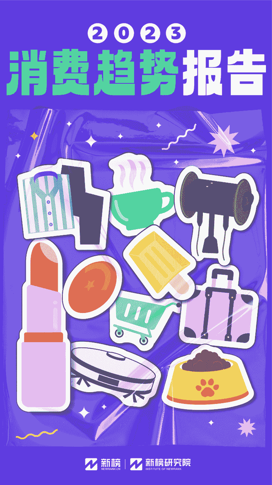
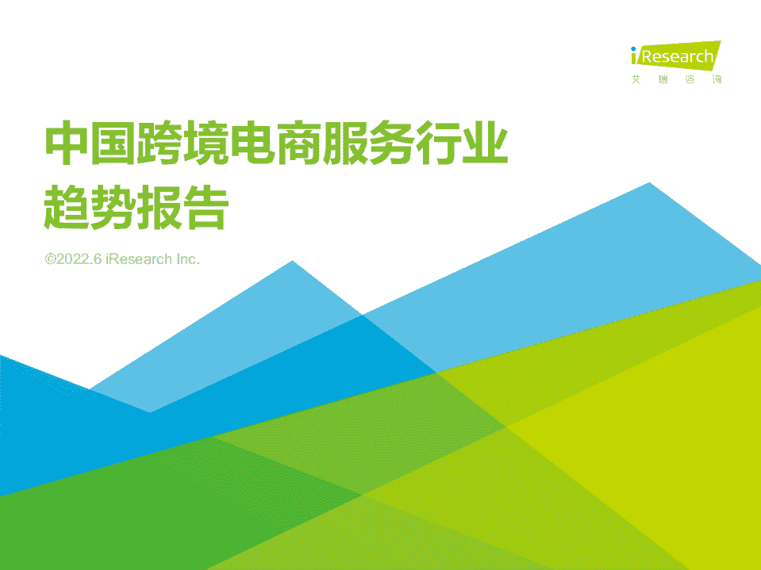
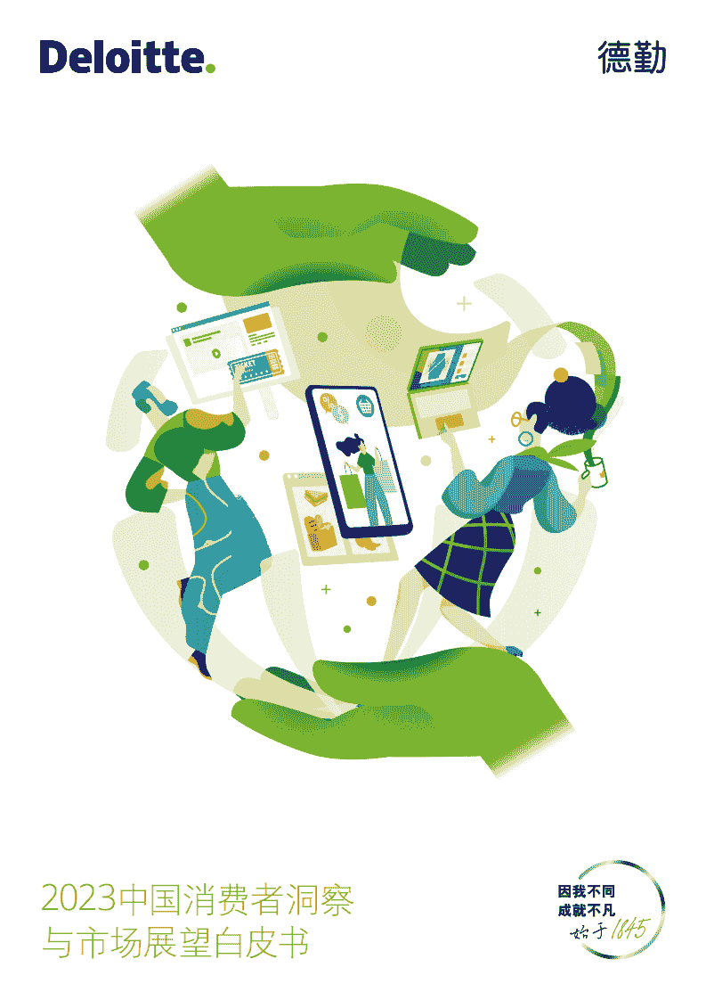
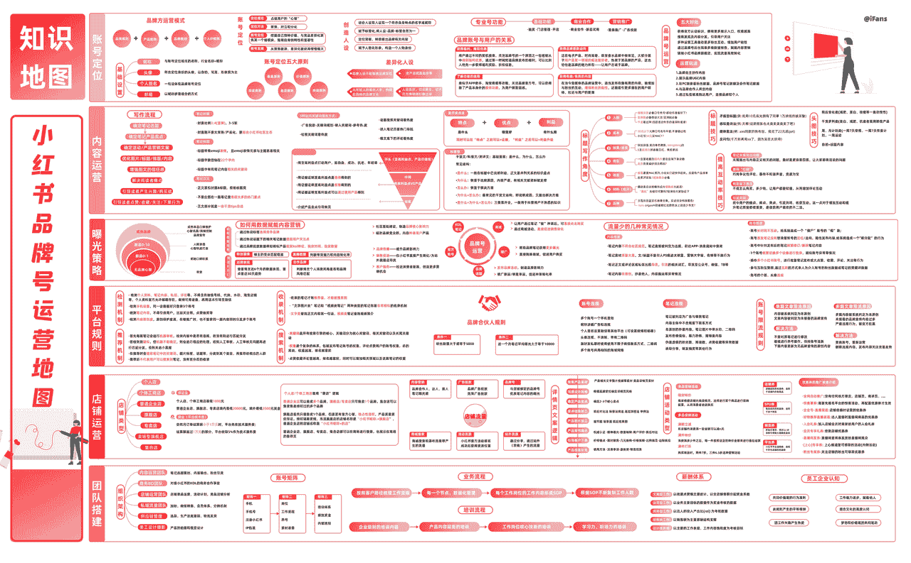
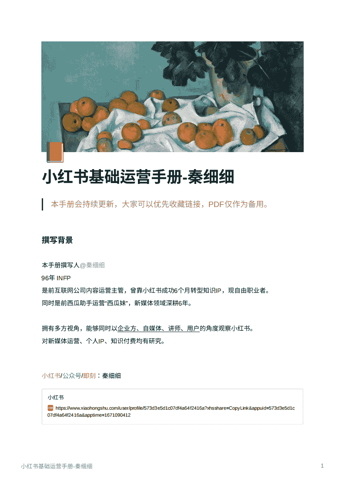

# 消费&电商行业资料合集

> 来源：[https://docs.feishu.cn/docx/RQSIdEChKoFfYEx4zbEcwP2mnIe](https://docs.feishu.cn/docx/RQSIdEChKoFfYEx4zbEcwP2mnIe)

# 趋势报告

+

[【新榜】2023消费趋势报告【发现报告 fxbaogao.com】.pdf](https://internal-api-drive-stream.feishu.cn/space/api/box/stream/download/all/boxcnZcHzUYkMC7b3eubMNueEac)

+

[艾瑞咨询-2022年中国跨境电商服务行业趋势报告-220628.pdf](https://internal-api-drive-stream.feishu.cn/space/api/box/stream/download/all/boxcnOpA7Ossy9rZtqXiLqfvsif)

+   📕4大主要人群的消费特征，你占了几个?_千瓜的博客-CSDN博客

+

[2023中国消费者洞察与市场展望白皮书.pdf](https://internal-api-drive-stream.feishu.cn/space/api/box/stream/download/all/boxcnA8ToPLEnDxAbrsbPNq9Uob)

# 社交媒体

## 📕

+

[📕整体框架及玩法.pdf](https://internal-api-drive-stream.feishu.cn/space/api/box/stream/download/all/boxcnz6QqwUBsC7OppyO5vU1o3d)

+

[📕常见50问Q&A.pdf](https://internal-api-drive-stream.feishu.cn/space/api/box/stream/download/all/boxcnnnzYeRoI5SPFC6VZXtHU2c)

+

[📕基础运营手册-秦细细 (1).pdf](https://internal-api-drive-stream.feishu.cn/space/api/box/stream/download/all/boxcnSw95GWFIQ5Ts3dVpptPA9e)

+   [📕新人博主，如何挖掘爆款的底层逻辑，成功打造单篇100w点击，10w+赞爆款笔记？](https://qdrlbziuml.feishu.cn/docx/XRuedQoEboZUs6xbNM2cnl3FnRf)

# 播客

# 资料合集

+   [2023运营人常用的1000套方案【红人汉克】](https://amg7714o7y.feishu.cn/docx/SJpjdBfM6oFXhsxLoORceyfanTe)