# 更新日志传送门

> 来源：[https://feicaiclub.feishu.cn/docx/WzGMdO2UsogSl9x4XkhcOwg5nfg](https://feicaiclub.feishu.cn/docx/WzGMdO2UsogSl9x4XkhcOwg5nfg)

> 建议使用电脑端浏览器访问。否则部分页面会遇到“该内容不支持显示 或 Sorry, the item is not availiable yet”情况

## 2026年4月1日

> **社群资料库更新**

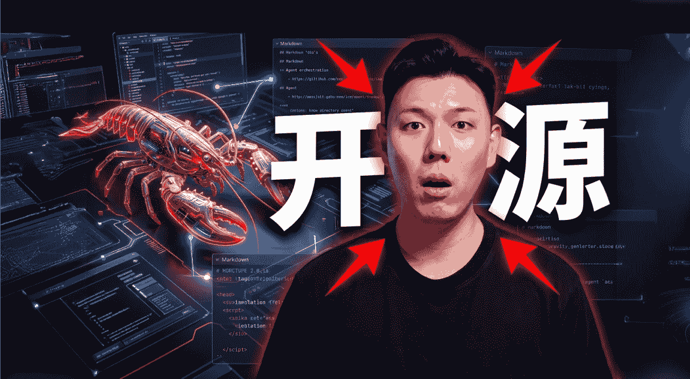

OpenClaw 火了。GitHub 上涨速最快的开源项目，全民养龙虾，国内外技术社区几乎同一时间炸开。但说实话，我对"火"这件事本身没太大兴趣。我更好奇的是：这玩意到底是怎么设计的？它凭什么能让这么多人觉得"这才是 AI 应该有的样子"？

我花了一周多的时间，纯 vibe coding，一行代码没写，全程跟 AI 对话把产品搓出来了。基于 Anthropic 的 Claude Agent SDK，用 Electron + Next.js 做桌面端。项目叫 Forge，现在已经在 GitHub 上开源了。

**🔗 原文链接：**

---

## 2026年3月3日

> **社群资料库更新**

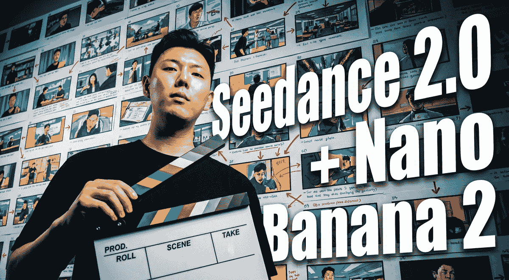

这期内容解决一个问题：怎么高效、高质量地自动化生成 Seedance 2.0 影视级提示词。不是拿到剧本就硬写提示词、全靠人肉反复调参，而是把导演讲戏、服化道设计、分镜编写的方法论写进七个Skill，通过三阶段流程加两步审核，充分调动 Seedance 2.0 的分镜编导能力，让每条提示词都经得起专业标准检验。

**🔗 原文链接：**

---

## 2026年2月14日

> **社群资料库更新**

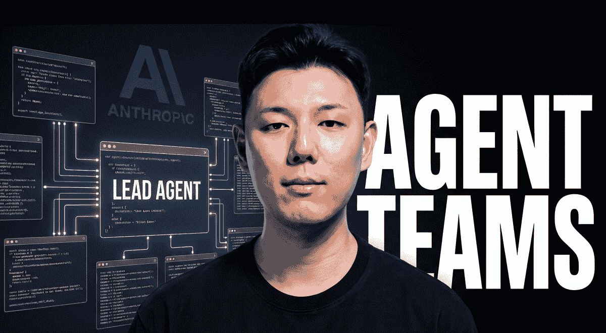

用 Claude Code Agent Teams 搭建 AI 编辑部——让深度长文自动化生产

用 AI 写过长文的应该都有体会，写作本身只是冰山一角。

一篇好的深度文章从来不是一个人闷头写出来的。你得先调研，搜集足够深的素材和论据；然后设计结构，让几千字的内容形成递进而不是堆砌；写完初稿还要反复审核打磨。这几件事串在一起，大量时间花在了来回折腾上。

所以我们用 Claude Code 的 Agent Teams 功能搭了一个 AI 编辑部。核心思路是把写作方法论和研究方法论写进 Skill，让 AI 按照从范文中提取的专业标准去调研选题、设计大纲、撰写初稿、审核修订。你只需要提供选题和参考素材，剩下的从研究简报到终稿交付全部自动完成。

**🔗 原文链接：**

---

## 2026年1月15日

> **社群资料库更新**

用 Claude Code（或者`OpenCode`）+ `Skill` 搭建 AI 开发流程 - 从想法到可运行项目

Vibe Coding 火了之后，很多人想用 AI 写代码，但真正动手就发现问题：需求没想清楚就开写，方向跑偏；不给设计稿，界面丑得没法看；改了几轮代码，文档还是旧的，下次打开完全想不起来改过什么。

所以我们用 Claude Code 的 Agent + `Skill` 搭了一套开发流程，把产品经理、UI 设计、全栈开发的方法论写进三个 `Skill`，让 AI 按专业标准去收集需求、生成原型、实现代码。你只需要说出想法，剩下的自动完成。

整体架构是一个主控加三个技能：毒舌产品经理负责需求收集，UI 提示词设计师负责原型图，全栈开发工程师负责代码。每次新增或修改功能，产品经理会先更新文档，再交给开发实现，文档和代码始终同步。

**🔗 原文链接：**

---

## 2026年1月7日

> **社群资料库更新**

用 Claude Agent `Skill` 搭建 AI 分镜师 - 提升分镜出图有效率

做 AI 视频的应该都有体会，分镜是最烧钱的环节之一。分镜数量本来就大，生图又是抽卡——单张图要控制人物、场景、光影的一致性，多张图之间还要基于剧本拆解出连贯的镜头序列。这两件事都不容易，大量时间和成本都浪费在重复抽卡上。

所以我们用 Claude 的 Agent + `Skill` 功能搭建了一个 AI 分镜师，核心思路是把影视分镜的方法论（清晰、简洁、连贯、分层渐进）写进 `Skill`，让 AI 按照专业标准去拆解剧情、设计镜头、生成提示词。你只需要上传剧本并确定视觉风格，剩下的节拍拆解、九宫格提示词、四宫格提示词、动态提示词就自动完成。

**🔗 原文链接：**

---

## 2025年12月24日

> **社群资料库更新**

2025年终总结：开发 AI Agent 产品的实战方法

这期内容解决一个问题：怎么从一个模糊的想法，一路做出一个能跑起来的 AI Agent 应用。不是静态页面，而是从需求收集、快速搭建、到本地迭代、最终跑通的完整流程。

开发 AI Agent 的难点不在于让 AI 写代码，而在于你能不能把想法讲清楚，然后一轮一轮迭代到位。很多人卡在第一步：脑子里有个大概的想法，但说不清楚这个 Agent 具体要做什么、怎么和用户交互、AI 能力怎么串联。

所以我们用两个工具的组合打法：Google AI Studio 负责快速搭框架，几分钟就能出一个能跑的原型；Claude Code 负责后续迭代和细节打磨。另外还配了一个产品经理 `Skill`，在动手之前先帮你把需求想清楚，生成一份包含完整 AI 系统提示词的 Product Spec 文档——这份系统提示词就是整个 Agent 的大脑，所有 AI 功能怎么执行、怎么串联、怎么和用户交互，都靠它来指挥。

**🔗 原文链接：**

---

## 2025年12月06日

> **社群资料库更新**

0代码，用Gemini 3.0 Pro 开发AI产品方案 - 人人都可以自定义自己的产品

Google AI Studio Builder 配合 Gemini 3.0 Pro 的超强前端能力已经把 AI 产品开发的门槛降到了前所未有的低点——你甚至不需要会写代码，只要有想法就能做出一个能用的AI产品。但对于普通人来说，真正的卡点往往不在开发，而在开发之前：不知道怎么描述需求，不清楚一份产品文档该包含什么，想法模糊却不知道从哪里开始梳理。

所以这套方案就是来解决这个问题。我们通过 Claude 的 `Skill` 功能搭建了一个产品经理角色，把需求挖掘方法、追问策略、AI 能力清单、文档模板都打包进去，让 Claude 扮演一个犀利的产品经理，用直白的追问逼你想清楚每个细节。你只需要说出想法，剩下的需求拆解、布局设计、AI 能力匹配、文档输出就由 AI 按照标准流程完成。

工作流程按照产品设计的自然顺序推进：需求探索 → 需求完善 → 文档生成。`SKILL.md` 定义角色和对话策略，`reference.md` 提供 Google AI Studio 的能力清单用于匹配，`product-spec-template.md` 规定输出格式和标准。从模糊想法到生成可用文档，整个流程在对话中自然完成。

这个方案让没有产品经验的普通人也能输出结构完整、可直接用于 Google AI Studio Builder 的 Product Spec，真正实现从想法到产品的完整闭环。

**🔗 原文链接：**

---

## 2025年11月23日

> **社群资料库更新**

用 Claude Agent `Skill` 改编网文漫剧 - 让长篇小说快速转化为剧本

这套方案主要解决一个问题：将60万-300万字的网络小说改编成漫剧剧本，传统流程往往耗时长且质量难控制。传统做法是通读小说、提取冲突、拆解剧情、标注分集、逐集写剧本，每一步都需要专业经验和大量时间，一个人可能需要数周甚至数月才能完成初稿。

所以我们通过 Claude 的 `Skill` 功能搭建了一个专业的改编编剧。把网文改编方法论、压缩策略、视觉化写作风格、文档模板都打包进 `webtoon-skill`，让 Claude 在改编的每个环节都能调用这些专业知识。你只需要上传小说章节并确定类型，剩下的剧情拆解、分集标注、单集剧本创作就由 AI 按照改编标准自动完成。

工作流程按照改编的自然顺序推进：类型确定 → 剧情拆解（每6章一批）→ 单集剧本创作。`CLAUDE.md` 负责整体流程调度和文件管理，`webtoon-skill` 提供改编标准和执行能力，`breakdown-aligner` 和 `webtoon-aligner` 构成双重质量把关体系，确保拆解准确、剧本一致。从上传小说到生成可用剧本，整个流程可以按批次持续推进。

这个方案让长篇网文从小说文本快速转化为符合漫剧规格的剧本初稿，显著提升改编效率。不过要注意，生成的内容遵循通用改编标准，实际使用时可能需要根据具体项目需求进行调整优化。

**🔗 原文链接：**

---

## 2025年11月17日

> **社群资料库更新**

用 Claude Agent `Skill` 写末世重生题材漫剧剧本

这套方案主要解决一个问题：有了故事灵感后，从构思到完成一个完整的60集末世重生漫剧剧本往往需要很长时间。传统流程是想大纲、设计人物、规划分集、写正文，每一步都需要反复打磨，效率很低。

所以我们通过 Claude 的 `Skill` 功能搭建了一个专业的创作写手。把末世重生漫剧的创作方法论、文档模板、写作风格、实战示例都打包进 `doomsday-skill`，让 Claude 在每个创作环节都能调用这些专业知识。你只需要回答几个问题，剩下的大纲、人物、分集目录就由 AI 按照专业标准自动生成。

工作流程按照漫剧创作的自然顺序推进：故事大纲 → 人物小传 → 分集目录 → 正文创作。`CLAUDE.md` 负责整体流程管控，`doomsday-skill` 提供创作标准，`doomsday-aligner` 确保质量一致。从有灵感到生成完整初稿，整个过程可以在几小时内完成。

这个方案让故事灵感从脑海里的想法变成可以直接阅读的漫剧初稿，大幅提升创作效率。不过要注意，生成的内容是初稿，还需要根据个人风格润色调整。

**🔗 原文链接：**

---

## 2025年11月14日

> **社群资料库更新**

用 Claude Agent `Skill` 写玄幻类题材漫剧剧本

这套方案主要解决一个问题：有了故事灵感后，从构思到完成一个完整的60集漫剧剧本往往需要很长时间。传统流程是想大纲、设计人物、规划分集、写正文，每一步都需要反复打磨，效率很低。

所以我们通过 Claude 的 `Skill` 功能搭建了一个专业的创作写手。把玄幻漫剧的创作方法论、文档模板、写作风格、实战示例都打包进 `xuanhuan-skill`，让 Claude 在每个创作环节都能调用这些专业知识。你只需要回答几个问题，剩下的大纲、人物、分集目录就由 AI 按照专业标准自动生成。

工作流程按照漫剧创作的自然顺序推进：故事大纲 → 人物小传 → 分集目录 → 正文创作。`CLAUDE.md` 负责整体流程管控，`xuanhuan-skill` 提供创作标准，`xuanhuan-aligner` 确保质量一致。从有灵感到生成完整初稿，整个过程可以在几小时内完成。

这个方案让故事灵感从脑海里的想法变成可以直接阅读的漫剧初稿，大幅提升创作效率。不过要注意，生成的内容是初稿，还需要根据个人风格润色调整。

**🔗 原文链接：**

---

## 2025年11月4日

> **社群资料库更新**

用 Claude Agent `Skill` 写现代言情类短篇小说

这套方案主要解决一个问题：有了故事灵感后，从构思到完成一个完整短篇小说往往需要几天甚至更久。传统流程是想大纲、设计人物、规划章节、写正文，每一步都需要反复打磨，效率很低。

所以我们通过 Claude 的 `Skill` 功能搭建了一个专业的创作助手。把现代言情的创作方法论、文档模板、写作风格、实战示例都打包进 Claude `Skill`，让 Claude 在每个创作环节都能调用这些专业知识。你只需要回答几个问题，剩下的大纲、人物、章节就由 AI 按照专业标准自动生成。

工作流程按照小说创作的自然顺序推进：故事大纲 → 人物小传 → 章节目录 → 章节正文。`CLAUDE.md` 负责整体流程管控，`skill` 提供创作标准。从有灵感到生成完整初稿，整个过程可以在一两小时内完成。

这个方案让故事灵感从脑海里的想法变成可以直接阅读的小说初稿，大幅提升创作效率。不过要注意，生成的内容是初稿，还需要根据个人风格润色调整。

原文链接：[小说 | 现代言情类 短篇小说 Claude Skill](https://feicaiclub.feishu.cn/wiki/I6r3wWSrrihoL4ku0Y8cmOl7nrg?from=from_copylink)

---

## 2025年11月3日

> **社群资料库更新**

用 Claude Agent `Skill` 写古代权谋短篇小说

这套方案主要解决一个问题：有了故事灵感后，从构思到完成一个完整短篇小说往往需要几天甚至更久。传统流程是想大纲、设计人物、规划章节、写正文，每一步都需要反复打磨，效率很低。

所以我们通过 Claude 的 `Skill` 功能搭建了一个专业的创作助手。把古代权谋的创作方法论、文档模板、写作风格、实战示例都打包进 `gudai-skill`，让 Claude 在每个创作环节都能调用这些专业知识。你只需要回答几个问题，剩下的大纲、人物、章节就由 AI 按照专业标准自动生成。

工作流程按照小说创作的自然顺序推进：故事大纲 → 人物小传 → 章节目录 → 章节正文。`CLAUDE.md` 负责整体流程管控，`gudai-skill` 提供创作标准。从有灵感到生成完整初稿，整个过程可以在一两小时内完成。

这个方案让故事灵感从脑海里的想法变成可以直接阅读的小说初稿，大幅提升创作效率。不过要注意，生成的内容是初稿，还需要根据个人风格润色调整。

原文链接：[小说 | 古代权谋类 短篇小说 Claude Skill](https://feicaiclub.feishu.cn/wiki/QvAhwkSClivoEmktuYDcqs5Vn2d?from=from_copylink)

---

## 2025年11月2日

> **社群资料库更新**

用 Claude Agent `Skill` 写现实题材类短篇小说

这套方案主要解决一个问题：有了故事灵感后，从构思到完成一个完整短篇小说往往需要几天甚至更久。传统流程是想大纲、设计人物、规划章节、写正文，每一步都需要反复打磨，效率很低。

所以我们通过 Claude 的 `Skill` 功能搭建了一个专业的创作助手。把现实题材的创作方法论、文档模板、写作风格、实战示例都打包进 Claude `Skill`，让 Claude 在每个创作环节都能调用这些专业知识。你只需要回答几个问题，剩下的大纲、人物、章节就由 AI 按照专业标准自动生成。

工作流程按照小说创作的自然顺序推进：故事大纲 → 人物小传 → 章节目录 → 章节正文。`CLAUDE.md` 负责整体流程管控，`skill` 提供创作标准。从有灵感到生成完整初稿，整个过程可以在一两小时内完成。

这个方案让故事灵感从脑海里的想法变成可以直接阅读的小说初稿，大幅提升创作效率。不过要注意，生成的内容是初稿，还需要根据个人风格润色调整。

原文链接：[小说 | 现实题材类 短篇小说 Claude Skill](https://feicaiclub.feishu.cn/wiki/M16vwH6P4iVGEvk7rlScpdptncx?from=from_copylink)

---

## 2025年10月28日

> **社群资料库更新通知**

Skill Creator - 快速创建 Claude 自定义技能

这套方案主要解决一个问题：虽然 Claude 官方提供了 Skill Creator，但它生成的技能提示词往往过于冗长复杂。对于想要快速创建符合自己工作流程的技能来说，需要一个更精简、更高效的工具。

所以我们自己搭建了一个 Skill Creator Agent。它通过结构化的问答方式收集你的需求，然后自动生成完整的技能包。你只需要回答几个问题 - 技能是做什么的、什么时候用、需要什么输入输出 - 它就能生成标准的 `SKILL.md` 文件，必要时还会自动创建 Reference 参考文档、Python 脚本或使用示例。

更关键的是，用这个方案可以批量生产技能。一旦建立了 Skill Creator，你就能快速把各种工作流程标准化：产品分析、代码审查、文档生成、设计规范...每个流程都能沉淀成可复用的 `Skill`。甚至可以让多个 `Skill` 协同工作，形成完整的开发流程。

**🔗 原文链接：**

---

## 2025年10月18日

> **社群资料库更新通知**

Claude Code 搭建短剧编剧团队 - 多Agent协作创作方案

这套方案主要解决一个问题：用AI写短剧时，生成的内容往往不符合短剧的商业逻辑和创作规律。单纯一次性输出很难把握短剧特有的节奏感、爽点分布和付费转化设计。

所以我们通过 Claude Code 搭建了一个编剧团队。主编剧负责创作，`Script Aligner` 审核是否符合短剧标准，`Script Recorder` 记录创作过程。通过 Output Style 把原本用于编程的 Claude Code 改造成懂短剧节奏的编剧，同时保留它的文件管理和自动化能力。

工作流程基于 ReAct 框架：主编剧创作初稿，`Aligner` 审核是否符合预设的短剧创作标准，不达标就提出修改建议，主编剧据此优化，循环直到通过。整个过程的决策和修改都会被 `Recorder` 实时记录，形成完整的创作记忆。

这个方案让 AI 创作从一次性生成变成了多轮优化，能稳定产出符合短剧风格的剧本初稿。不过要注意，最终还需要人工润色，而且 Token 消耗需要提前考虑。

🔗 原文链接： 

# 2025年9月22日

> 社群资料库更新通知

## Claude Code 项目记忆管理 - Progress Recorder Agent方案

这套方案主要解决一个问题：用 Claude Code 开发项目时，重要的决策、任务进度、技术约束等信息会散落在对话历史中。随着对话轮次增加，前面确定的内容容易被遗忘或难以查找。

所以我们设计了 `Progress Recorder`，这是一个专门负责记录的 Subagent。它会自动识别对话中的关键信息，并持续维护一个 `progress.md` 文件作为项目的核心文档。所有重要信息都会被结构化地记录在这里。

它的识别机制基于语义理解。当你说"决定使用 Next.js"，会记录到 Decisions 区块；说"必须支持 Safari"，会写入 Pinned 约束；提到"完成了认证模块"，会移到 Done 并标注日期。系统还会根据表达的确定性来分类 - "必须"和"可能"会被区别对待，避免把不确定的信息当作确定决策。

🔗 原文链接： [AI Agent | 项目记忆管理 - Progress Recorder Agent](https://feicaiclub.feishu.cn/wiki/DqRcwvHrSigDd5kZluPcLon4nkc?from=from_copylink) ◀️ 戳这里

# 2025年9月9日

> 社群资料库更新通知

## Nano Banana 分镜图生成全攻略

创作优秀的分镜，需要一套系性的方法论，这套方法论的核心在于对提示词进行结构化。通过将画面拆解成不同的层次，我们可以更精准地控制AI生成的每一帧画面，实现从宏观构图到微观细节的全方位把控。

本篇内容包含 5 个 Nano Banana 分镜图技巧详解，以及一套Nano Banan 分镜图生成的Prompt Framework。

🔗 原文链接： [AI 短剧｜Nano Banana 分镜图生成全攻略](https://feicaiclub.feishu.cn/wiki/TnUHwRqbsi7lY8ku7hVcfOk6nEc?from=from_copylink) ◀️ 戳这里

# 2025年8月28日

> 社群资料库更新

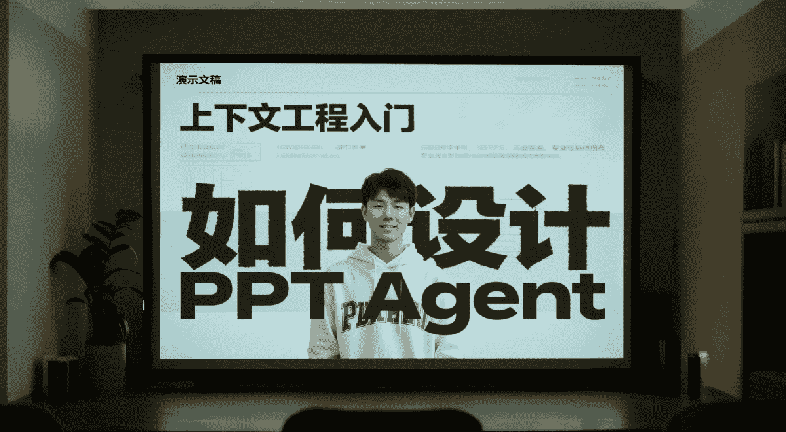

## 如何用 Claude Code 开发一个能生成定制化 PPT 的 Agent

这套方法主要解决一个长期困扰很多人的问题：市面上的AI PPT工具基本都是套模板，千篇一律没有个性。传统AI PPT工具的问题在于缺乏专业的设计思维和制作流程。通常是一步生成，无法深度定制，结果就是做出来的PPT要么内容空洞，要么设计平庸，很难满足我们平时的定制需求。

所以我通过Claude Code构建了一个专业的PPT设计Agent。它具备真正的设计师思维，会先收集需求、制定内容大纲、规划分镜方案，最后才生成代码。整个过程严格按照专业流程执行，每一步都可以人工确认和调整。

技术核心是"上下文工程"的应用：通过思考引擎进行专业分析决策，工具系统读取文档和搜索信息，外部记忆机制保存完整设计方案。最关键的是有一套完整的视觉设计语言，包括配色系统、布局规范、动效策略，确保输出质量一致性。

这套方法适合经常学生、白领、自媒体等对做 PPT有高频和速度要求的用户，用严格的规则和流程驾驭AI创造力，让它能够像专业设计师一样工作，从根本上解决了AI PPT工具"能用但不够好"的问题。

🔗 原文链接： [AI Agent ｜ 如何开发一个能生成定制化 PPT 的 Agent](https://feicaiclub.feishu.cn/wiki/RUZhwbrmfiO1MOkhhPTc7j4Ynpc?from=from_copylink) ◀️ 戳这里

# 2025年8月11日

> 社群资料库更新通知

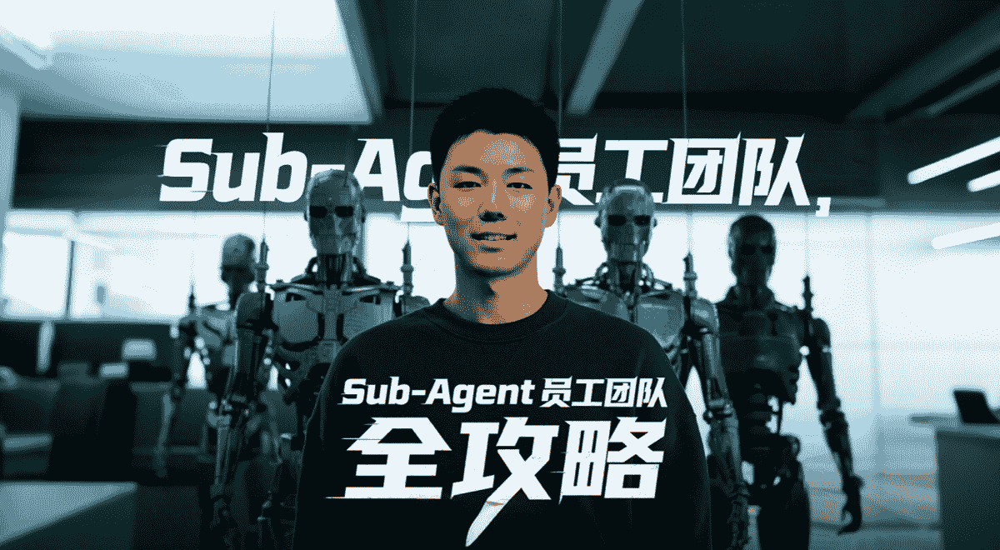

## Claude Code Sub Agent数字员工团队搭建方法

这套方法主要是为了解决一个痛点：当我们面对复杂的多专业协作任务时，传统的AI一问一答模式往往力不从心。

单个AI既要懂产品又要会设计还要能编程，结果是什么都做得不够专业。而且上下文一长，前面分析的内容后面容易被新任务干扰。这就像让一个人同时胜任团队里所有岗位，效果肯定不理想。

所以我们用Claude Code的Subagent功能组建了一个专业分工的数字员工团队。每个Subagent都有独立的上下文窗口和专业提示词，就像真正的专业员工一样，在自己的"办公室"里专注完成工作，不会被其他任务打扰。

方法的核心是用Claude Code的Subagent功能，每个专业角色都是一个独立运行的AI智能体。主控Agent负责整体流程调度，决定什么时候该哪个专家出场。每个Subagent会在独立环境中深度执行任务，还能主动搜索最新信息，工作成果自动传递给下一个环节。

这套方法特别适合需要多专业协作但缺乏相应团队的个人或小企业，让你能够组建一个专业分工明确的AI团队，从想法到最终交付物，提升工作效率和专业度。

🔗 原文链接： [AI Agent | 如何用 Claude Code 搭建 Sub Agent 员工团队](https://feicaiclub.feishu.cn/wiki/QGCzwTt8nipBXAk0VaWcwh0pnxh?from=from_copylink) ◀️ 戳这里

# 2025年7月28日

> 社群资料库更新通知

## Claude Code AI数字员工团队搭建方法

这套方法主要是为了解决一个痛点：当我们面对复杂的多专业协作任务时，传统的AI一问一答模式往往力不从心。

无论你是要做产品开发、内容创作、营销策划、财务分析，还是任何需要多个专业角色配合的工作，都会遇到这种情况 - 单个AI既要懂产品又要会设计还要能编程，或者既要写文案又要做策略还要懂数据分析。结果是什么都做得不够专业，而且聊着聊着还会"失忆"，前面分析的内容后面就忘了。

这套方法的核心是基于Claude Code的`/commands`自定义指令功能，把每个专业角色都定义成一个"指令"，需要谁工作就召唤谁。每个角色都有独立的专业提示词，会按照标准化流程输出工作成果，并自动传递给下一个环节。所有AI Agent还会主动搜索最新信息，确保输出内容专业且前沿。

用这套方法，你可以根据任何工作场景自由组建AI团队，从想法到最终交付物，大大提升工作效率和质量。特别适合那些需要多专业协作但缺乏相应团队的个人或小企业，让你拥有一个24小时在线、随叫随到、比真员工还靠谱的AI数字团队。

🔗 原文链接： [AI Agent ｜如何用 Claude Code 搭建 Agent 团队](https://feicaiclub.feishu.cn/wiki/TWoWwqnwSiMFv7kW0YicnH6qnSb?from=from_copylink) ◀️ 戳这里

# 2025年7月14日

> 社群资料库更新通知

## n8n AI Agent 工作流设计提示词框架

这套框架主要是为了解决一个痛点：很多人想用n8n做自动化，但不知道怎么把自己的想法变成实际的工作流。

你可能遇到过这种情况 - 比如你想自动化处理邮件，或者定时生成报表，想法很清楚，但打开n8n后就懵了：我该用哪些节点？怎么连接？参数怎么设置？这些技术细节往往比写代码还让人头疼。

所以我们做了这套框架，让AI来充当你的工作流设计师。你只需要用自然语言描述你想要什么，比如"我希望每天自动从邮箱下载附件然后上传到网盘"，AI就会帮你分析需求，设计出完整的节点架构，甚至生成可以直接导入n8n的JSON文件。

🔗 原文链接： [AI Agent ｜n8n AI Agent 工作流设计提示词框架](https://feicaiclub.feishu.cn/wiki/DsMmwAbtKibq54kf1CmcGykhnnd?from=from_copylink) ◀️ 戳这里

# 2025年6月30日

> 社群资料库更新

## 🔗 提示词框架链接： AI短剧 ｜ 分镜脚本提示词框架

粉丝福利，免费阅读

🔗 原文链接： [AI短剧 ｜ 分镜脚本提示词框架](https://feicaiclub.feishu.cn/wiki/XLu5wolRViSXs1kezX3ckq2ynog?from=from_copylink)

# 2025年6月9日

> 社群资料库更新

## 🛰️小程序开发Cursor Rule框架介绍

这套🛰️小程序开发Cursor Rule框架为个人开发者、小团队和产品经理设计，旨在通过结构化AI对话将小程序创意转化为实际代码。

这套框架适合初学者和有一定开发经验的人员使用，能够帮助用户更系统地完成🛰️小程序的开发过程，减少开发中的常见问题，让创意实现变得更加有序和可控。

🔗 原文链接： [AI 编程 | 🛰️小程序 Cursor Rule 框架](https://feicaiclub.feishu.cn/wiki/FvSLwJCf6iIMt8k9tS9cj7fxnjc?from=from_copylink) ◀️ 戳这里

# 2025年5月16日

> 人工智能论文区更新通知

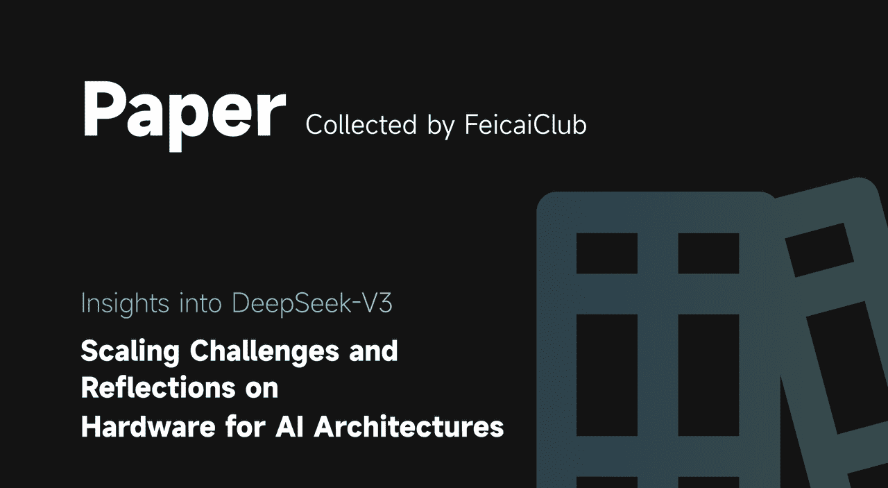

这篇论文《DeepSeek-V3: 扩展挑战与AI架构硬件反思》详细探讨了如何通过硬件感知的模型协同设计来解决大规模语言模型的训练和推理挑战。DeepSeek-V3在仅使用2,048台NVIDIA H800 GPU的情况下，通过四项关键创新实现了高效扩展：多头潜在注意力机制(MLA)显著减少了KV缓存大小(每令牌仅70KB)，解决了内存效率问题；专家混合(MoE)架构实现了671B总参数但每令牌仅激活37B参数，大幅降低了计算需求；FP8混合精度训练减少了50%的内存使用而准确率损失不到0.25%；多平面网络拓扑优化集群级网络通信，降低了基础设施成本。论文还基于实际开发经验，提出了未来AI硬件发展方向，包括精确低精度计算单元、规模扩展和规模扩展融合、以及低延迟通信架构创新，为硬件和模型协同设计提供了实用蓝图，对解决AI工作负载不断增长的需求具有重要参考价值。

🔗 原文链接： 

# 2025年5月07日

> 社群资料库更新

## 报告可视化提示词框架介绍

这套市场分析可视化框架为分析师提供了一种实用工具，有效解决了报告呈现的效率问题。作为分析师，我们经常需要为各种会议准备PPT或者演示资料，这个过程往往占用大量时间，减少了实际分析工作的深度。

该框架将传统报告转换为数据新闻式的可视化呈现，采用了Bento Grids设计风格和泡菜绿为主色调的深色主题。通过精心设计的布局和卡片系统，复杂的市场数据和分析洞察被转化为直观、专业的可视化页面，便于快速理解和交流。

🔗 原文链接： [行业分析｜行研报告可视化提示词框架](https://feicaiclub.feishu.cn/wiki/Mzh5wIuz3icdG2kdtjkchrRRnNG?from=from_copylink) ◀️ 戳这里

# 2025年4月29日

> 会员专区更新通知

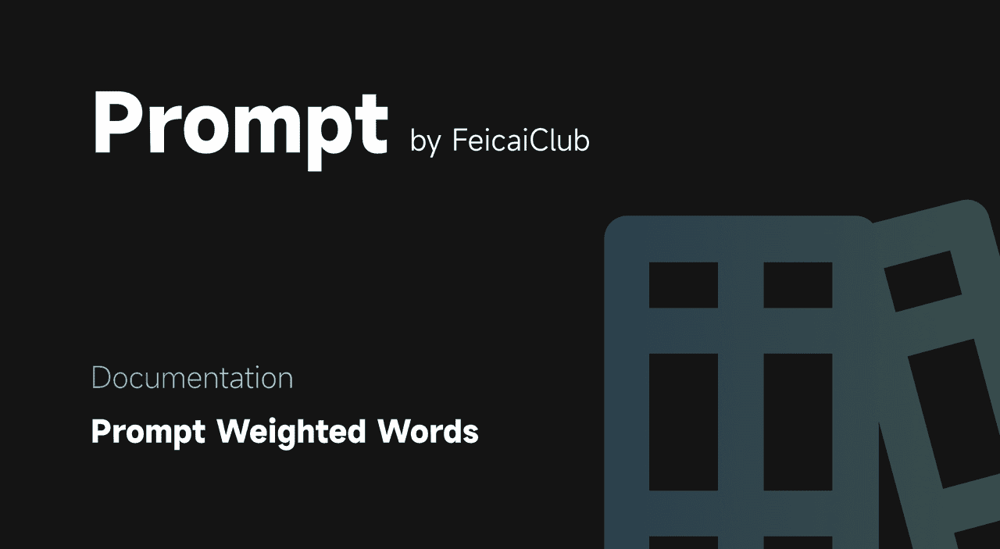

## 12 个常用场景 Prompt权重词整理

在提示词（prompt）里，小到一个形容词、语言切换，甚至标点顺序，都会改变大模型“看到”的 token 序列，从而左右理解与输出质量。本文综合行业基准测试、开源实验与各家文档，按照12个成熟AI使用场景归档整理。每个场景列出30组，总共 360 对强弱权重词，以"语义 | 弱词 | 强词 | 典型影响"格式呈现表格。帮助你有意识地挑词、换词，提升效果并控制成本。

🔗 原文链接： [12 个常用场景 Prompt权重词整理](https://feicaiclub.feishu.cn/wiki/HW6BwZ3rui7Ye5kMcYYcoMyzn4e?from=from_copylink) ◀️ 戳这里

# 2025年4月21日

> 社群资料库更新

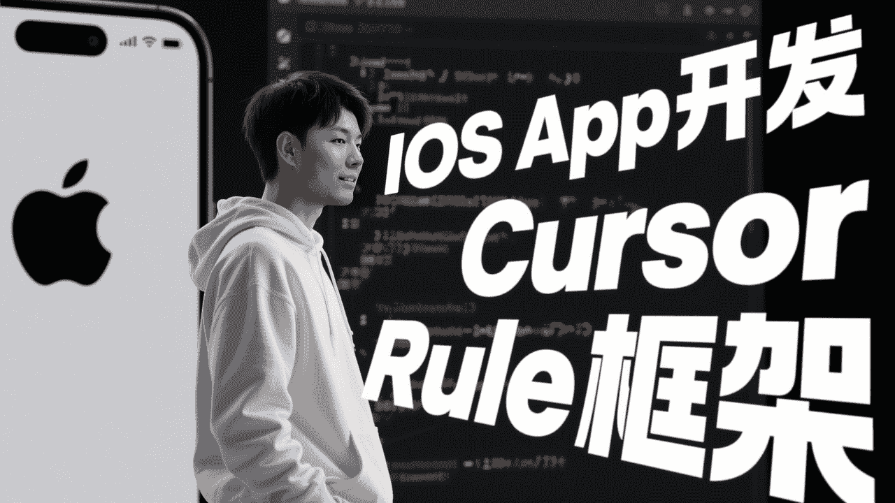

## iOS应用开发Cursor Rule框架介绍

这套iOS应用开发Cursor Rule为个人开发者特别是没有编程基础的个人设计，帮助他们通过AI对话将iOS应用创意转化为实际代码。

这一流程简化了从创意到代码实现的转化过程，让没有编程基础的个人能专注于产品创意而非技术细节。规则中融入了iOS开发实践，包括合理的架构设计、自适应布局和可访问性支持。

用户可以通过简单指令如`/开发`、`/检查`等控制开发流程，选择批量生成所有页面或专注开发单个功能。项目文档会自动保存在`README.md`文件中，提供清晰的项目结构和进度信息。

这套IOS应用开发的Cursor Rule适合个人开发者快速验证应用创意、构建最小可行产品，让iOS应用开发变得更加平易近人，即使对编程知识有限的个人也能在AI引导下开发出功能相对完整的iOS应用。

🔗 原文链接： [AI 编程 ｜ IOS APP开发 Cursor Rule](https://feicaiclub.feishu.cn/wiki/XUbqwajFtiSrkkkCjWhc1AJNn0c?from=from_copylink) ◀️ 戳这里

# 2025年4月14日

> AI人工智能论文区更新

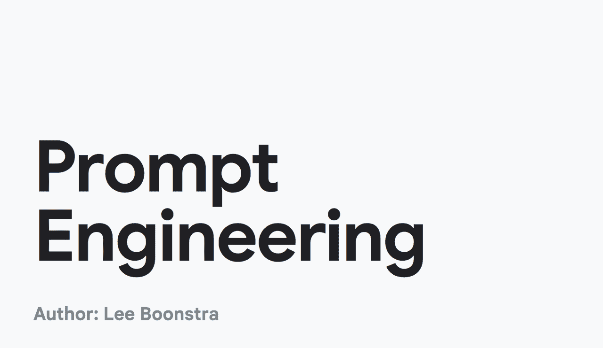

## 解析大语言模型与提示工程：从原理到实践

在人工智能快速发展的今天，提示工程已经成为企业充分利用AI能力的关键技能。谷歌首席软件工程师Lee Boonstra基于丰富的实践经验撰写了这份报告，深入探讨大语言模型的工作原理、提示工程面临的现实挑战，以及如何为企业选择和配置最合适的模型。

这篇报告，旨在帮助技术人员和决策者更好地理解这一领域，从而有效应对AI实施过程中的各种难题。

🔗 原文链接： 

> AI Agent区更新

## Google的AI Agent白皮书

Google最近发布的一篇名为"Agents"的白皮书展望了人工智能在商业领域扮演更加主动和独立角色的未来。这份42页的文档现在正在X.com(前Twitter)和LinkedIn上引起关注。

该白皮书介绍了AI代理(AI agents)的概念——这种软件系统旨在通过推理、规划和采取行动来实现特定目标，从而超越当今的AI模型。与仅基于预先存在的训练数据生成响应的传统AI系统不同，AI代理可以与外部系统交互，做出决策并独立完成复杂任务。

🔗 原文链接： 

# 2025年4月12日

> 社群资料库更新

## 抖音直播带货话术提示词框架介绍

这套提示词框架为抖音电商直播带货场景设计，帮助主播、内容创作者和电商运营人员构建专业的直播话术脚本。框架通过结构化的流程，指导用户完成从直播开场到结束的话术设计。

框架提供四种主播风格选择：专业亲和型、情感共鸣型、幽默活泼型和专业权威型，用户可根据产品特性和目标受众选择合适的风格。同时，框架允许用户选择产品卖点数量和转化重点，实现话术的个性化定制。

🔗 原文链接： [抖音直播带货话术提示词框架 - 通用](https://feicaiclub.feishu.cn/wiki/FTHgwRP7xixeRjkQ6XKc5bA7n5f?from=from_copylink) ◀️ 戳这里

# 2025年4月11日

> 会员专区 - 社群资料库更新

## 新闻稿件提示词框架介绍

这套提示词框架旨在帮助记者、编辑和内容创作者构建专业的新闻稿件，通过清晰的步骤引导完成新闻撰写的各个环节。

框架包含四种常见新闻类型：动态消息、典型消息、综合消息和述评消息，用户可根据需求选择。同时提供多种新闻结构选择，如倒金字塔结构、新华体等，以及不同风格的导语和结尾方式。框架注重新闻基本要素，引导用户关注5W1H(何人、何事、何时、何地、为何、如何)，帮助梳理新闻素材，形成结构合理的报道。

**🔗 原文链接：** [新闻稿件提示词框架 - 通用](https://feicaiclub.feishu.cn/wiki/T837wTqpxiHxLykJakTcnIkEn9e?from=from_copylink) ◀️ 戳这里

---

## 2025年4月9日

> 热门AI用书推荐上新

《驱动AI提示词指令入门与场景应用》

这本书是废才俱乐部与清华大学出版社一起精心打磨的AI教学指导图书，这本书真的很实用！不管是DeepSeek还是其他AI模型，提示词的本质从未变过——你的输入质量决定输出质量。提示词的设计和方法论在AI智能体开发及大模型协作中至关重要。

书中提供的10种设计模式、提示词框架写作规范和16个实战案例都是经过近两年验证的有效方法，适用于DeepSeek、ChatGPT、Claude、Gemini等主流大语言模型，帮助你摆脱简单的一问一答的模式，并且教你如何进行标准的、可复用的人与AI的交互方法。

现在使用AI已经成为普遍现象，但在这个人人都在使用AI的时代，谁能够更好地利用AI来提升生产力才是真正的竞争优势。这本书正是帮助你建立这种优势的实用指南，这本书绝对值得入手！

**🔗 下单链接：**

---

## 2025年4月7日

> 社群资料库更新

高质量海报设计提示词框架 - ChatGPT 4o专用

这套提示词框架有效利用ChatGPT 4o强大的文生图能力，为设计师、小型营销团队和自媒体创作者提供标准化的海报设计流程。

框架内置多种实用海报类型，从纯文字到产品展示、活动宣传等；涵盖15+种视觉风格，包括吉卜力风、3D渲染、创意排版等；并提供2025年流行配色方案，如爱马仕橘、泡菜绿、未来黄昏等特色色调。这种结构化的选择体系让海报设计变得简单直观，无需专业设计背景也能快速上手。

**🔗 原文链接：** [AI 设计 | 高质量海报设计提示词框架 - ChatGPT 4o专用](https://feicaiclub.feishu.cn/wiki/WszTwg2ASigtBrke6oCcbH4mnoh?from=from_copylink) ◀️ 戳这里

---

## 2025年3月31日

> 社群资料库更新

产品UI设计提示词框架 - 暗黑模式科技风

这份提示词框架为产品经理和设计团队提供了将创意转化为交互原型的高效工具。通过结构化工作流程，框架引导用户明确需求和目标用户，由AI规划页面结构并生成设计方案，最终创建可交互的HTML原型。

特别的是，所有设计作品统一采用暗黑模式科技风格，融合毛玻璃效果、霓虹渐变和精致图标，呈现高端现代的视觉体验。用户无需过多对页面UI风格进行描述。

**🔗 原文链接：** [AI 编程 | 产品UI设计提示词框架 - 暗黑模式科技风](https://feicaiclub.feishu.cn/wiki/ZuYSwBOKqib54nkOXwtcWRSvnYc?from=from_copylink) ◀️ 戳这里

---

## 2025年3月25日

> 社群资料库更新

🛰️👸号文章生成提示词框架介绍

这套提示词框架是为创作🛰️👸号文章而设计的 - 无论你想做行业分析、生活指南还是知识科普，都能用上。它特别适合需要制作逻辑清晰、有传播力的👸号内容的创作者。这个框架的目标是帮你将各类素材转化为适合在🛰️平台传播的文章。

**🔗 原文链接：** [自媒体 | 🛰️👸号文章生成提示词框架](https://feicaiclub.feishu.cn/wiki/UyumwOUisivFVckYxjgcoHWDnHb?from=from_copylink) ◀️ 戳这里

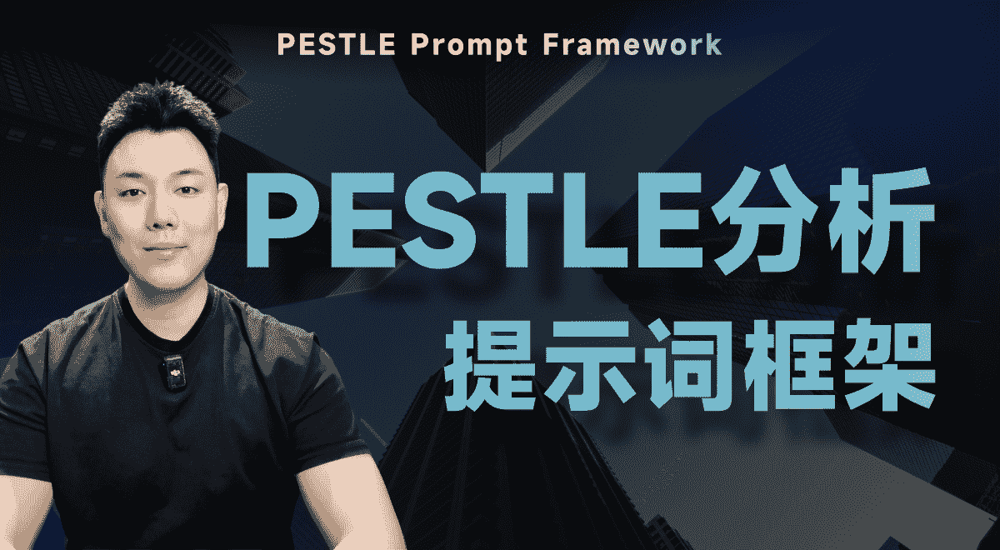

PESTLE 提示词框架 2.0介绍

这个PESTLE分析提示词框架是为那些需要了解外部环境的企业团队和个人设计的。不管你是企业管理者、战略顾问还是市场分析师，它都能帮你更有条理地完成政治、经济、社会、技术、法律和环境六个维度的分析工作。

**🔗 原文链接：** [行业分析 | PESTLE分析提示词框架 2.0](https://feicaiclub.feishu.cn/wiki/CCB8wJ2VEiBBsPkS01ScsZcsnKf?from=from_copylink) ◀️ 戳这里

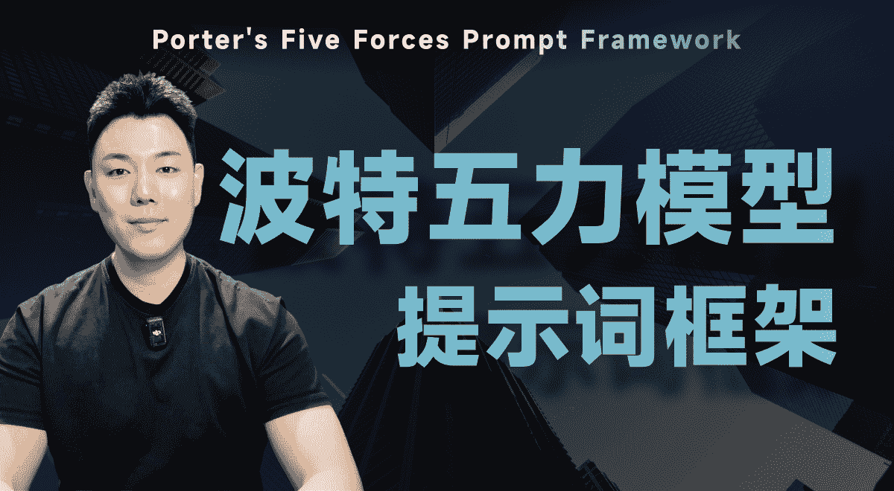

波特五力模型提示词框架 2.0 介绍

这个波特五力分析提示词框架主要为需要评估竞争环境的企业和团队设计，无论你是企业管理者、市场分析师还是战略顾问，它都能帮你更系统地完成行业竞争格局的分析工作。

**🔗 原文链接：** [行业分析 | 波特五力模型提示词框架 2.0](https://feicaiclub.feishu.cn/wiki/BzbewunZ8iyq51kl5DeckTdUnPc?from=from_copylink) ◀️ 戳这里

---

## 2025年3月21日

> 社群资料库更新通知

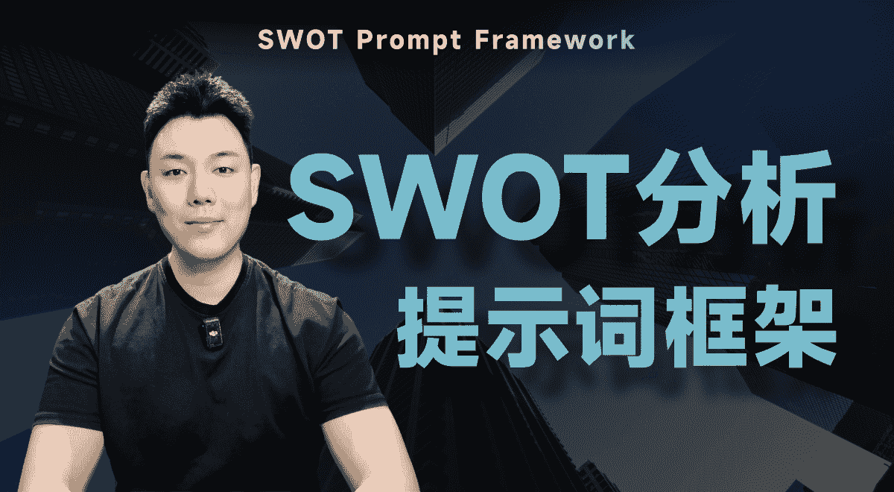

SWOT分析提示词框架介绍 2.0

这个SWOT分析提示词框架主要是给想做战略分析的团队和个人用的，不管你是公司决策者还是商业顾问，都能帮你更轻松地完成优劣势和机会威胁的分析工作。

**🔗 原文链接：** [行业分析 | SWOT分析提示词框架 2.0](https://feicaiclub.feishu.cn/wiki/IPRgwBXUqi5MbKkPTHDcLScznjf?from=from_copylink) ◀️ 戳这里

---

## 2025年3月20日

> AI Agent智能体专区更新通知

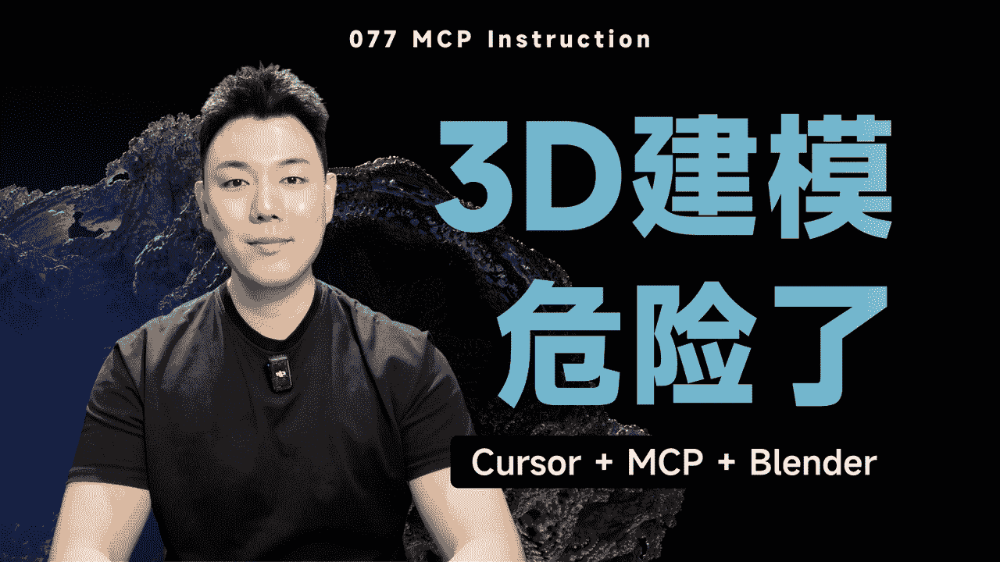

如何使用Cursor通过MCP操作Blender

Blender MCP（Multi-Client Protocol）是一个开源项目，它允许你通过Cursor等工具远程控制和操作Blender。本教程将指导你完成从安装到配置的全过程，帮助你实现通过MCP协议与Blender进行交互。

文字教程链接：[如何使用Cursor通过MCP操作Blender](https://feicaiclub.feishu.cn/wiki/Nezqwh6wGiLDWCk1W1lc9i1YnQC?from=from_copylink)

---

## 2025年3月13日

> 社群资料库更新

产品开发/设计提示词框架介绍

这份产品开发/设计提示词框架是为产品经理和设计团队打造的实用工具，帮助他们将产品创意快速转化为可交互的原型设计。

框架采用了结构化的工作流程：首先引导用户明确产品需求和目标用户特征，然后由AI根据这些需求自主判断合适的技术方案并规划页面结构。接着，针对每个页面生成独立的设计方案并创建可交互的HTML原型。最后，将所有设计整合为一个完整的预览页面，展示整体用户流程。

这个过程简化了从需求到原型的转化过程，让团队无需过多关注技术细节和设计规范，便能高效地获得可视化的产品原型，加速产品迭代和沟通效率。

**🔗 原文链接：** [AI编程 | 产品开发/设计提示词框架](https://feicaiclub.feishu.cn/wiki/V43LwJrOWiqnYZkWewPcgaVZnC0?from=from_copylink) ◀️ 戳这里

---

## 2025年3月6日

> 社群资料库更新

市场/行业分析提示词框架介绍 2.0

这份行业分析提示词框架主要是为研究团队和项目团队设计的实用工具，帮助分析师更方便地搜集资料并生成行业或市场研究报告。

框架采用了一种类似路由的工作流方式：首先由用户说明自己需要分析什么，然后DeepSeek负责组织报告的基本框架和分析思路。接着，通过秘塔AI或Deep Research等搜索引擎来收集相关资料。最后，DeepSeek将这些资料整合起来，形成完整的报告正文。这个过程简化了传统行业分析的繁琐步骤，让团队能够更高效地完成研究工作，节省时间的同时保证报告质量。

🔗 原文链接： [行业分析 | 市场/行业分析报告提示词框架 2.0](https://feicaiclub.feishu.cn/wiki/NEo3wVukji7fpmkYWsPcAUO8nRf?from=from_copylink) ◀️ 戳这里

> 社群资料库更新通知

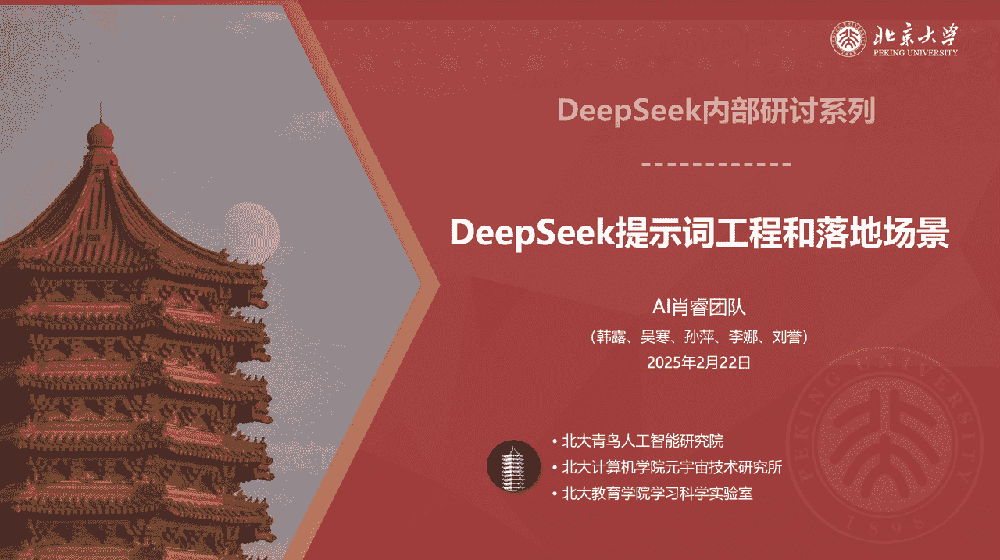

北京大学DeepSeek讲座2套完整版

由AI肖睿团队（孙萍、周嵘、李娜、张惠军、刘誉）撰写，包括：

1. 北京大学--DeepSeek与AIGC应用
2. 北京大学--提示词工程和落地场景

🔗 原文链接： [北京大学DeepSeek讲座2套完整版](https://feicaiclub.feishu.cn/wiki/OeOXwbJvci1OkukYAnLcnZWLnVb?from=from_copylink) ◀️ 戳这里

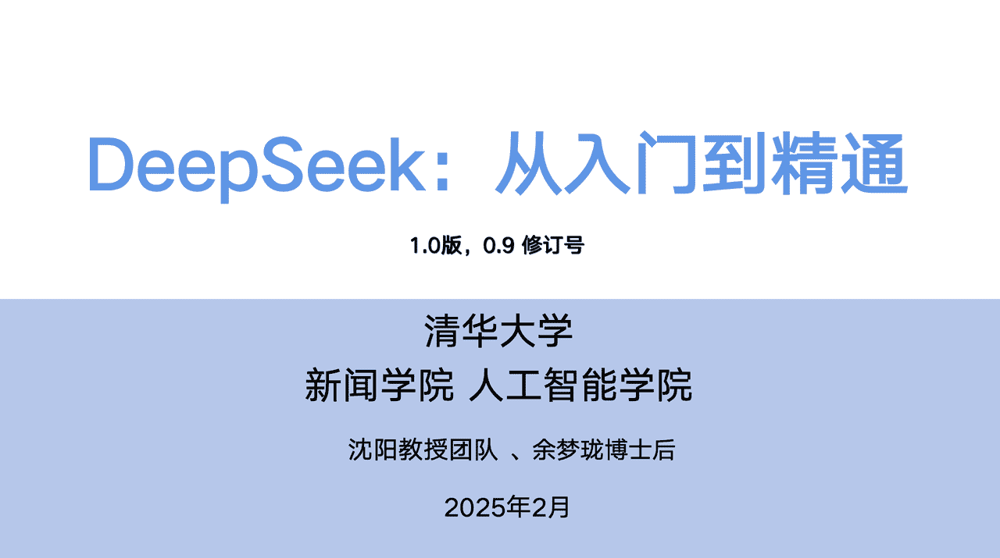

清华大学DeepSeek教程5套完整版

由清华大学新闻学院 人工智能学院，沈阳教授团队 、余梦珑博士后撰写，包括：

1. 清华大学的DeepSeek从入门到精通
2. 清华大学 普通人如何抓住DeepSeek红利
3. 清华大学/中央民族大学 DeepSeek如何赋能职场应用？
4. 清华大学DeepSeek+DeepResearch：让科研像聊天一样简单
5. 清华大学DeepSeek与AI幻觉

🔗 原文链接： [清华大学DeepSeek教程5套完整版](https://feicaiclub.feishu.cn/wiki/QV16wGR6gi329XkMrKpcauFdnwb?from=from_copylink) ◀️ 戳这里

---

## 2025年2月19日

> AI人工智能论文专区：DeepSeek 发布最新论文，原生稀疏注意力机制

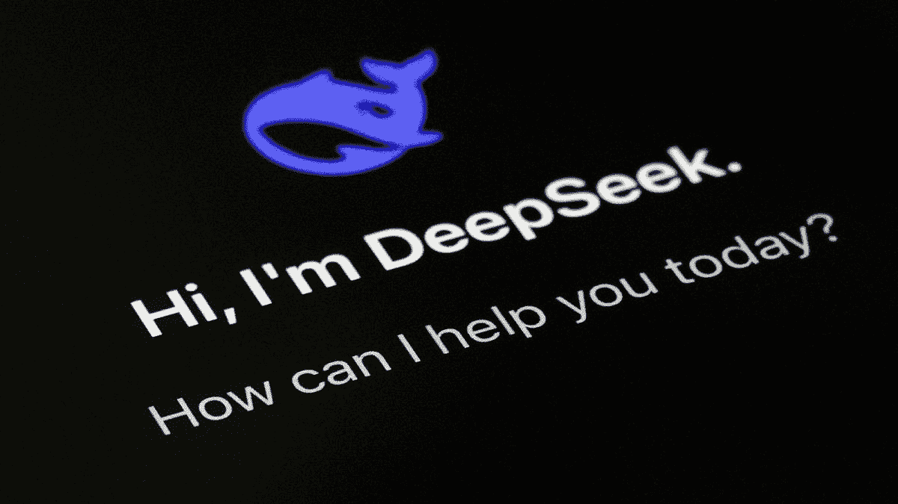

当前大语言模型在处理长文本时面临着巨大的计算挑战。随着任务需求的增长，从代码生成、文档检索到多轮对话，长文本建模的重要性日益凸显。然而，传统的全注意力机制在处理超长文本时，计算复杂度和显存消耗呈平方级增长，导致推理速度下降，训练成本高昂。尽管稀疏注意力（Sparse Attention）提供了一种解决方案，但现有方法往往在推理阶段优化计算量，仍然需要在训练过程中依赖全注意力，从而限制了其效率和可扩展性。此外，许多现有的稀疏注意力方法在实际应用中未能达到理论上的计算加速效果，主要是由于其与现代硬件架构的不兼容性，例如 GPU 计算密度的不足以及访存带宽的瓶颈。

因此，DeepSeek 团队提出了 Native Sparse Attention（NSA），一种从底层架构上优化的原生可训练稀疏注意力机制。本文将详细解读 NSA 机制的核心创新、其在计算加速方面的优势，以及实验结果所验证的性能提升。

🔗 原文链接：

---

## 2025年2月17日

> 社群资料库更新

短篇世情文小说提示词框架介绍：

这是一套帮助创作短篇世情文的提示词框架。它的设计初衷很简单：帮你把想法变成一个完整的故事。不管你是想写职场故事、情感纠葛，还是生活百态，这个框架都能派上用场。

框架分两个主要部分：先是帮你明确故事想法，选择合适的叙事视角，再把这个核心想法展开成一个五幕结构的完整故事。写作过程中，每一幕都会先有详细规划，然后再写正文，这样能保证故事的连贯性。

这个框架最实用的地方是它的写作要求：要用自然的口语来写，要描写细节，要通过对话和行为来表现人物。它告诉你具体怎么写，而不是泛泛而谈。整个创作过程也很清晰，一步步来，每一步都知道该做什么。

🔗 原文链接：

---

## 2025年2月12日

> 社群资料库更新

适用于DeepSeek口播文案提示词框

这套提示词是为了制作竖屏口播视频而设计的 - 不管你是想做怼脸讲解、户外边走边讲，还是在车里录制口播，都能用得上。特别适合做时事解读、读书笔记、论文解读这类内容。核心目标很简单：就是帮你把专业的内容（比如论文报告、研究资料、专业书籍）转成大家都能听懂的视频脚本。整个创作过程分四个步骤，每步都很直观清晰。

🔗 原文链接：

---

## 2025年2月8日

> AI人工智能论文专区：李飞飞 | s1: Simple test-time scaling

AI教母”李飞飞等斯坦福大学和华盛顿大学的研究人员以不到50美元的费用，使用了16张英伟达H100 GPU，耗时26分钟就完成了训练，成功“打造”出了一个名为s1-32B的人工智能推理模型。

🔗 原文链接：

---

## 2025年2月3日

> 大模型专区：ChatGPT深度研究功能发布

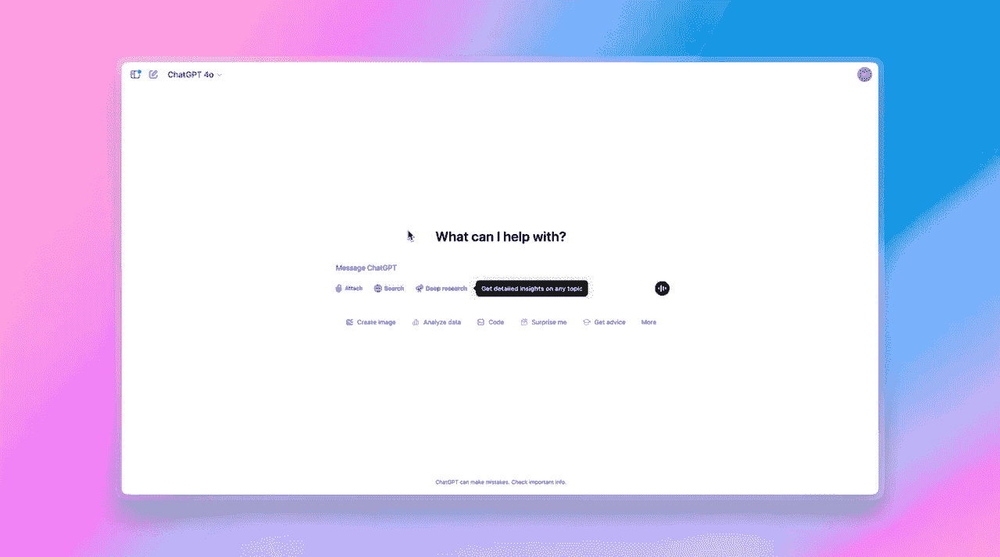

ChatGPT推出了“深度研究”功能，这是一个新型的智能助手功能，能够在互联网上进行多步骤的研究，处理复杂任务。它能在短短几十分钟内完成通常需要人类几小时才能做完的工作。

深度研究是OpenAI推出的最新智能助手，可以独立完成任务。用户只需给出一个提示，ChatGPT就会寻找、分析并整合数百个在线资源，生成一份类似研究分析师撰写的综合报告。这项功能基于即将发布的OpenAI o3模型，该模型特别优化了网页浏览和数据分析能力，能够通过推理来搜索、解读和分析大量的文本、图片和PDF文件，并根据获取的信息灵活调整策略。

🔗 原文链接：

---

## 2025年1月26日

> 大模型专区：如何调用DeepSeek R1模型的API

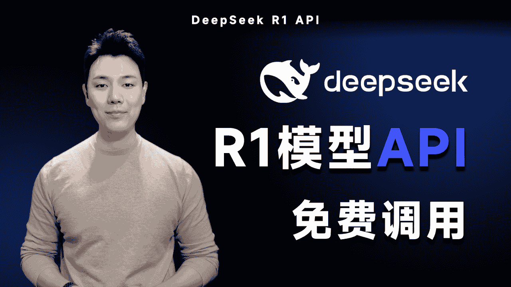

DeepSeek R1模型的开源发布让AI行业掀起了一波新热潮。如果你想灵活地使用这个模型，调节其参数来满足特定需求，调用API是最佳方式。本教程将详细介绍如何通过调用DeepSeek R1的API，设置和调整参数

🔗 原文链接：

---

## 2024年12月30日

> 社群资料库更新

网文改编短剧提示词框架 - 拓展收入新方向

这套专为网文短剧改编设计的提示词框架,旨在帮助编剧将网文内容高效转化为优质短剧。无论是初涉短剧领域还是经验丰富的编剧,都能通过这套框架快速掌握网文改编的核心技巧。框架通过系统化的分析流程和规范化的创作步骤,确保改编作品忠实原著的同时,又能适配短视频平台对剧情节奏和情感冲突的要求。

🔗 原文链接：

---

## 2024年12月12日

> 社群资料库更新

爽文短剧提示词框架 - 网文作者的新方向

这套专为爽文短剧创作设计的提示词框架，旨在帮助编剧在短时间内完成高质量的短剧创作。无论是新手还是经验丰富的编剧，都能够借助这套框架迅速进入创作状态，保持高效输出。框架通过明确的创作步骤和规范化的流程，确保作品情节紧凑、冲突激烈、节奏快速，完美契合“爽文”类型短剧的需求。

🔗 原文链接：

> 大模型专区：Google发布Gemini 2.0

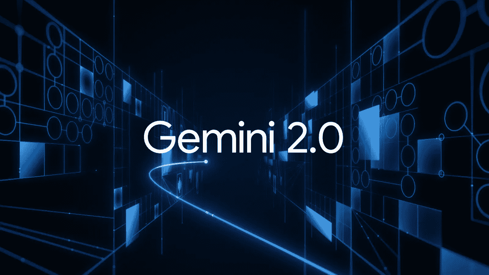

发布Gemini 2.0：面向代理时代的全新AI模型

Gemini 2.0 Flash延续了1.5 Flash的成功，后者是迄今为止最受开发者欢迎的模型。新版本在保持快速响应时间的同时进一步提升了性能。值得注意的是，2.0 Flash在关键基准测试中甚至超越了1.5 Pro，同时速度提升了两倍。

此外，2.0 Flash还引入了全新功能。在支持图像、视频和音频等多模态输入的基础上，2.0 Flash现在还支持多模态输出，包括原生生成的图文混合内容，以及可调节的多语言文本转语音（TTS）音频输出。

它还能够原生调用工具，例如Google搜索、代码执行，以及第三方用户定义的功能。

🔗 原文链接：

---

## 2024年12月7日

> 大模型专区：Meta发布开源Llama 3.3

Meta发布开源Llama 3.3，将强大模型从庞大体量精简至更小规模

Llama 3.3在核心性能上有显著提升，同时成本更低，使整个开源社区能够更轻松地使用这一技术。

拥有700亿参数（即控制模型行为的设定项）的Llama 3.3，其表现可与今年夏季推出的Llama 3.1中的4050亿参数模型相媲美，但成本和计算开销显著降低，例如运行推理所需的GPU容量得以大幅缩减。

该模型旨在以更小的规模提供高端性能和高可用性，相较此前的基础模型而言体量更为紧凑。

**原文链接：**

---

# 2024年12月6日

> 大模型专区：ChatGPT Pro发布

## ChatGPT Pro 简介

随着人工智能不断进步，它将能够解决日益复杂和关键的问题。同时，驱动这些能力所需的计算资源也会大幅增加。

今天，OpenAI 推出了 ChatGPT Pro，这是一款月费 200 美元的套餐，可在大规模使用场景中充分利用 OpenAI 最先进的模型和工具。该套餐包括对 OpenAI 最智能的模型——OpenAI o1，以及 o1-mini、GPT-4o 和高级语音功能的无限访问权限。套餐中还包含 o1 的专业模式（o1 pro mode），这一模式将投入更多的计算资源，使其能更深入地思考，并为最棘手的问题提供更优质的答案。未来，OpenAI 计划在该套餐中加入更多强大而高计算消耗的生产力功能。

ChatGPT Pro 为需要研究级智能处理的研究人员、工程师以及相关专业人士提供了高效途径，使他们能够更快提升工作效率，并始终走在人工智能技术前沿。

**原文链接：**

> **AI人工智能论文区：OpenAI o1 System Card 12-06-2024**

这份报告详细介绍了 OpenAI 的 o1 系列模型（包括 o1 和 o1-mini），涵盖了其训练方法、性能表现、安全性评估以及风险管理策略。o1 系列的主要创新在于使用链式推理（Chain of Thought, CoT）技术，这种方法能够显著增强模型的复杂推理能力，但也带来了需要特别注意的新型风险。

**原文链接：**

---

# 2024年12月5日

> OpenAI开启连续12天的圣诞直播活动

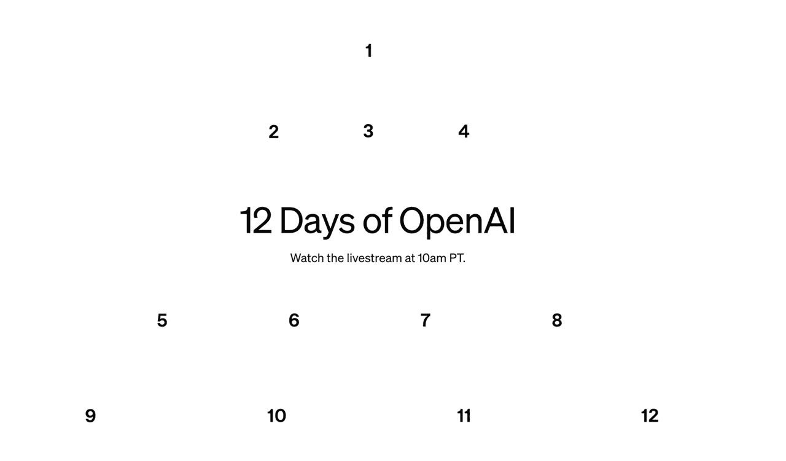

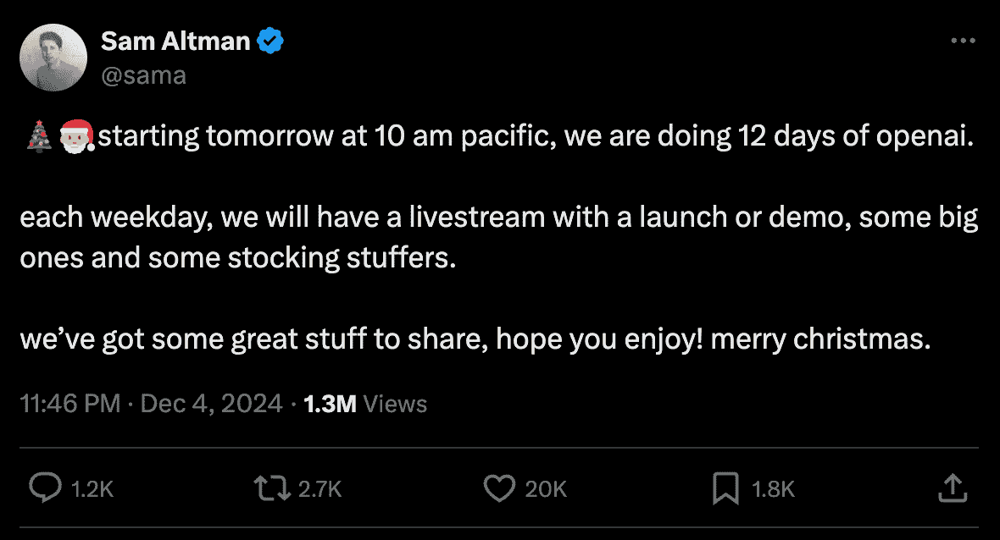

OpenAI首席执行官萨姆·阿尔特曼（Sam Altman）近日在X平台上宣布，从12月5日（星期四）上午10点（太平洋时间）开始。也就是北京时间12月6日凌晨2点，OpenAI将开启为期12天的活动，每个工作日都会通过直播发布或演示新产品或新功能，其中既有重磅发布，也有小型更新。他表示：“我们有很多精彩内容要分享，希望大家喜欢！圣诞快乐。”

这一消息引发了广泛关注和讨论。据《The Verge》报道，活动期间，OpenAI计划推出备受期待的文本生成视频AI工具“Sora”，以及新的推理模型。

然而，Sora的推出也伴随着一些争议，部分艺术家抗议其在未经付费的情况下被用于研究和开发。此外，谷歌已抢先发布了其视频生成模型Veo，增加了市场竞争的激烈程度。

在社交媒体上，OpenAI员工也纷纷预告即将发布的内容。一位技术人员在社交媒体上询问：“你的圣诞愿望清单上有什么？”另一位员工则表示：“刚好赶上布置‘shipmas’树。”Sora项目负责人比尔·皮布尔斯（Bill Peebles）回应称：“没错。”

此外，有用户发现ChatGPT的代码中出现了雪花图标，暗示可能会推出圣诞老人风格的语音功能，为节日增添趣味。

总体而言，网友们对OpenAI的这一系列发布表示期待，认为这将为人工智能领域带来新的创新和体验。然而，也有部分人对Sora的推出持保留态度，关注其可能引发的版权和艺术家权益问题。随着活动的展开，更多细节将陆续揭晓，值得持续关注。

---

# 2024年12月4日

> **社群资料库更新**

这套专为自媒体创作者打造的短视频脚本提示词框架，针对AI创作常见的文案呆板机械、创意单一等问题，通过规范化的写作指导和专业的分镜转化，帮你更高效地完成创作中最耗时的环节。框架设计支持反复调用，每次创作只需输入提示词并跟随引导即可，帮助实现稳定的内容创作。

## 核心功能模块

### /**逐字稿 - 逐字稿自动生成**

框架提供了一套结构化的文案创作体系，帮助AI生成结构完整、表达自然的视频文案。在用语风格方面，注重生动的口语化表达；在结构设计上，采用渐进式的信息展开和合理的悬念设计；在内容呈现上，强调场景化描述；在情感表达上，着重设计情感共鸣点，增强内容感染力。

### /分镜 - 将逐字稿转化为分镜脚本

框架能将逐字稿转换为可操作的分镜脚本，提供具体的视觉呈现建议。通过画面类型、运镜方式、音频规范等六大核心规范，结合基于说话速度的时长规划，以及包含画面、转场、字幕在内的标准分镜设计，为创作者提供实用的视频制作参考。

**原文链接：**

---

# 2024年11月28日

> **大模型专区：AI 杂谈更新**

大语言模型凭借其强大的自然语言处理能力，在各个领域展现出惊人的应用潜力。然而，在实际应用场景中，用户往往需要模型具备更专业、更及时或更有针对性的能力。接下来我们将深入探讨三种主流的模型增强技术：上下文学习、RAG和微调，详细分析它们如何提升模型性能，以及在实际应用中的优势与局限。

**原文链接：**

---

# 2024年11月27日

> 大模型专区：Claude相关更新

今天，Claude.ai宣布为所有用户推出自定义风格功能。现在，用户可以根据自己的需求和工作流程，调整Claude的回复方式。

**原文链接：**

**Claude宣布**[介绍模型上下文协议（MCP）发布](https://feicaiclub.feishu.cn/wiki/IqWowOzspimu7WkKUoAc9Cvcnfd?from=from_copylink)出模型上下文协议（MCP），这是一项新的标准，旨在将AI助手与存储数据的系统连接起来，包括内容库、业务工具和开发环境。MCP的目标是帮助前沿模型生成更好、更相关的回应。

**原文链接：**

---

# 2024年11月23日

> 大模型专区：OpenAI最新动态

红队测试是评估人工智能系统潜在风险和提升安全性的重要方法，OpenAI 结合外部专家和自动化工具，通过多元化测试团队、动态模型版本选择和优化测试接口，识别和应对AI可能存在的滥用和漏洞。自动化红队测试利用强化学习和奖励机制，大规模生成多样且有效的攻击示例，用于模型优化和安全评估。

然而，红队测试存在时效性限制、信息危害和对人类知识要求提高等局限性。尽管如此，OpenAI 认为通过结合公众意见和更强大的AI技术，红队测试可以为更安全、更可靠的AI系统发展提供持续支持。

**原文链接：**

> **AI人工智能论文专区更新**

OpenAI的外部红队测试:保障AI系统安全的重要实践

随着GPT-4、DALL-E 3等大型AI模型的不断涌现,如何确保这些模型的安全性和可控性成为了一个重要课题。在这种背景下,OpenAI发布了一篇重要论文,详细阐述了他们在外部红队测试方面的方法论和实践经验。这种方法不仅帮助发现了模型中潜在的风险,还为整个AI行业的安全评估提供了有益借鉴。

**原文链接：**

---

# 2024年11月20日

> 大模型专区：Grok系列相关更新

**原文链接：**

---

# 2024年11月15日

> **社群资料库更新**

网文小说提示词框架 2.0 - 让AI写作更进一步

[小说 | 网文小说提示词框架 1.0](https://feicaiclub.feishu.cn/wiki/JmPGwC7E9izf3GkIFRdcFYaVn2b?from=from_copylink)新升级的AI网文小说提示词框架作为上一版本【  】的全面进化版本，这套框架针对AI创作中常见的伏笔遗漏、人物前后矛盾、情节逻辑混乱等问题，开发了四大智能监测功能:

## 全新升级亮点：

1. /**内容一致检查**

   新版框架会对已创作章节进行8个维度的一致性检查，及时发现遗漏的伏笔和设定偏差。系统会生成详细的分析报告并给出优先级排序的修改建议。这些发现会自动转化为后续创作的注意事项，确保新内容与已有设定完美衔接。

1. /**人物塑造检查**

   框架会从8个不同角度持续监测人物塑造，识别性格、行为的不一致表现，提供针对性的修改建议。通过严格把控这些要素，避免角色前后矛盾，让人物形象始终保持连贯性。

1. /**情节控制检查**

   通过8个关键维度的情节检查，框架能够及时发现并纠正故事发展中的逻辑漏洞和冲突设置问题。这套严格的监测机制确保了剧情推进的合理性和完整性。

1. /**氛围营造检查**

   框架会对已创作内容的意境和情感表达进行8个方面的实时监测，识别氛围转换和情感递进中的突兀之处，并提供具体的改进方案。这些建议将帮助创作者塑造出更加流畅自然的场景氛围。

**原文链接：**

---

# 2024年10月24日

> **社群资料库更新**

AI播客脚本提示词框架助力创作者打造高质量播客

随着播客创作的兴起，AI播客脚本提示词框架应运而生，帮助创作者轻松制作高质量的播客内容。该框架通过智能生成和对话模拟，提供高效、自然的播客脚本创作体验，成为创作者们的新宠。

## 框架核心功能介绍

1. **需求确认与内容上传**：创作者可以上传讨论内容，系统精准确认播客的目标和听众需求，并提供详细的需求总结，确保内容的方向清晰。

1. **智能对话生成**：AI框架可将书面内容转换为自然的对话形式，通过主持人之间的互动来确保对话生动、逻辑连贯，保持听众的兴趣。

1. **互动性和口语化增强**：创作者可以对脚本进行口语化调整，并加入互动问题，引导听众深度思考，提升播客的亲和力和参与感。

1. **深度内容扩展**：通过深化脚本功能，用户可以添加更多案例和分析，以满足对复杂主题的深入探讨需求。

1. **灵活的指令集**：创作者可以使用简单指令随时调整脚本风格和内容，简化创作过程，提高效率。

## 高效生成个性化播客内容

AI播客脚本提示词框架凭借其高效的内容生成、灵活的个性化调整和深度内容挖掘能力，帮助创作者轻松应对不同风格和需求的播客制作。无论是轻松有趣的对话，还是深入的学术分析，这套框架都能为创作者提供理想的解决方案。

该框架推荐使用Claude 3.5 Sonnet或ChatGPT-4等先进语言模型，以保证脚本生成的最佳效果。

**原文链接：**

---

# 2024年10月23日

> 点击查看 👉🏻 2024年10月23日 AI领域新闻简报

Anthropic发布新一代AI模型及突破性功能

Anthropic于10月22日发布两款新AI模型：升级版Claude 3.5 Sonnet和全新的Claude 3.5 Haiku。其中，Sonnet模型在编程领域取得重大突破，SWE-bench评分达49%，领先所有公开AI模型。同时，公司推出突破性的"电脑使用"功能测试版，使AI能像人类一样操作电脑，包括观看屏幕、移动光标和点击按钮等。新版Haiku模型将保持与前代相同价格，但性能显著提升，将于本月晚些时候正式发布。

**原文链接：**
