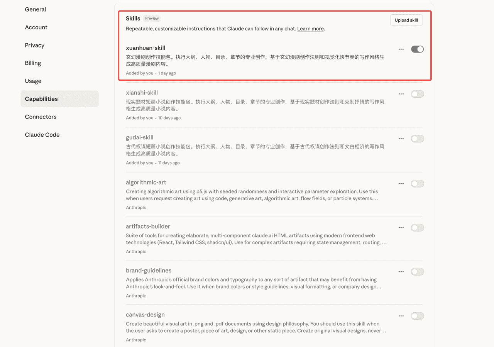

# 漫剧 | 网文改编漫剧 Claude Agent+Skill方法

> 来源：[https://feicaiclub.feishu.cn/docx/YKcKddXQXoYNzoxQvr8cWE6Wn0b](https://feicaiclub.feishu.cn/docx/YKcKddXQXoYNzoxQvr8cWE6Wn0b)


<https://player.bilibili.com/player.html?bvid=1r7SMB2E5t&share_source=copy_web&vd_source=1adb0321bdfa6d9eb5d1bf5665ffc381>

# **用 Claude Agent Skill 改**编网文漫剧 - 让长篇小说快速转化为剧本

这套方案主要解决一个问题：将60万-300万字的网络小说改编成漫剧剧本，传统流程往往耗时长且质量难控制。传统做法是通读小说、提取冲突、拆解剧情、标注分集、逐集写剧本，每一步都需要专业经验和大量时间，一个人可能需要数周甚至数月才能完成初稿。

所以我们通过 Claude 的 Skill 功能搭建了一个专业的改编编剧。把网文改编方法论、压缩策略、视觉化写作风格、文档模板都打包进 webtoon-skill，让 Claude 在改编的每个环节都能调用这些专业知识。你只需要上传小说章节并确定类型，剩下的剧情拆解、分集标注、单集剧本创作就由 AI 按照改编标准自动完成。

工作流程按照改编的自然顺序推进：类型确定 → 剧情拆解（每6章一批）→ 单集剧本创作。CLAUDE.md 负责整体流程调度和文件管理，webtoon-skill 提供改编标准和执行能力，breakdown-aligner 和 webtoon-aligner 构成双重质量把关体系，确保拆解准确、剧本一致。从上传小说到生成可用剧本，整个流程可以按批次持续推进。

这个方案让长篇网文从小说文本快速转化为符合漫剧规格的剧本初稿，显著提升改编效率。不过要注意，生成的内容遵循通用改编标准，实际使用时可能需要根据具体项目需求进行调整优化。

---

# **核心功能模块**

**Skill调用机制**

通过 webtoon-skill 技能包为 Claude 提供专业改编知识。每个改编阶段开始前，主Agent会自动调用对应的资源文件：剧情拆解阶段读取 adapt-method.md（改编方法论）+ plot-breakdown-template.md（模板）+ plot-breakdown-example.md（示例），单集剧本阶段读取 adapt-method.md + output-style.md（写作风格）+ script-template.md（模板）+ script-example.md（示例）。这种模块化设计让 Claude 不是简单翻译小说文本，而是基于明确的改编标准和压缩策略进行重构。

**分阶段改编流程**

改编严格遵循"类型确定 → 剧情拆解 → 单集剧本"的流程，每个阶段对应独立文档。用户通过 /breakdown、/script 命令推进流程，系统会自动读取小说原文和已有文档确保连贯性。比如创作单集剧本时，会同时读取 plot-breakdown.md（剧情点和分集信息）、小说源文件（具体情节）、已创作的剧本（风格参考），确保剧情还原准确、风格一致。剧情拆解采用批次模式，每批处理6章小说，单集剧本也按批次生成，创作完成后自动进入质量检查环节。

**双重质量把关机制**

这套方案的特色是两层质量检查。第一层是 breakdown-aligner，在剧情拆解完成后自动触发，以 adapt-method.md 为核心基准，检查8个维度：冲突强度、情绪钩子识别、冲突密度、分集合理性、压缩策略、剧情点描述、原文还原准确性、类型特性符合度。第二层是 webtoon-aligner，在单集剧本完成后自动触发，以 plot-breakdown.md 为核心基准，检查11个维度：剧情点还原、剧情点使用、跨集连贯、节奏控制、视觉化风格、人物行为、时间线逻辑、格式规范、悬念设置、类型特性、改编禁忌。如果检查返回FAIL状态，系统会调用 webtoon-skill 修改问题内容，然后重新检查，直到通过（PASS状态）才写入文档。这种源头把关+输出把关的双重机制，确保改编质量符合标准。

**模板驱动生成**

所有文档格式由 templates/ 目录下的模板文件定义，包括剧情拆解和单集剧本两类。Claude 改编时严格遵循模板结构，确保输出格式统一、信息完整。比如剧情拆解必须使用【剧情n】格式，包含场景、角色、事件、情绪钩子类型、集数、状态；单集剧本必须使用※△【】等视觉描述符号，每集以【卡黑】结尾。模板的统一性让批量生成的内容保持格式一致，便于后续管理和使用。

**上下文连贯性**

每个阶段改编前都会读取已有文档内容。剧情拆解基于小说原文和小说类型，单集剧本基于剧情拆解+小说原文+已创作剧本，形成递进式上下文积累。系统通过文档驱动而非对话记忆来维护上下文，即使对话被清空，只要文件还在，就能通过 /status 命令查看进度并继续改编。这种设计让改编过程可中断、可恢复，适合处理长篇小说的分批改编。

**文档结构管理**

项目采用标准化目录结构：novel/（小说源文件）、plot-breakdown.md（剧情拆解+分集标注）、scripts/Episode-XX.md（各集剧本）。剧情拆解采用批次追加模式，每处理6章小说就追加一个新批次。剧本创作根据剧情点的分集标注自然生成集数，不预设固定集数。剧情点有"未用/已用"状态管理，创作剧本后自动更新状态。这种结构化存储让改编过程可追溯、可修改，文档本身就是交付物。

> **注**：这套方案适合改编60万-300万字的长篇网文，生成的是符合漫剧规格（每集500-800字）的剧本初稿。改编质量取决于小说本身的内容密度——冲突密集、爽点频繁的小说改编效果更好，铺垫过多、节奏慢的小说需要大量压缩。AI的工作是提取情绪钩子、压缩冲突密度、转化视觉语言，而不是创造新情节，所以小说原文的质量直接影响改编结果。另外，生成的剧本遵循通用改编方法论，实际项目可能需要根据具体类型（玄幻、都市、言情等）或平台要求进行调整优化。

---

# **如何配置**

### 方式一：在 Claude.ai 网页版配置（推荐新手）



1.  **进入Skills设置**

+   选择 "Settings" → "Capabilities" → "Skills"

+   点击 "Upload file" 按钮

1.  **上传技能包**

+   选择 zip 压缩包文件

+   系统会自动解压并识别skill结构

1.  **启用技能包**

+   在Skills列表中找到新创建的技能

+   确保状态为 "Enabled"（已启用）

1.  **开始创作**

+   回到对话界面，开始新对话

+   直接向Claude说明你的创作需求即可

+   Claude会自动调用进行创作

### 方式二：在 Claude Code 中配置（适合熟手）

请按照以下步骤配置改编系统，配置完成后，你的项目结构应该是这样：

```
project/
├── novel/                               # 小说源文件目录（用户上传）
│   ├── chapter-001.txt
│   ├── chapter-002.txt
│   └── ...
├── plot-breakdown.md                    # 剧情拆解+分集标注（改编后生成）
├── scripts/                             # 单集剧本目录（改编后生成）
│   ├── Episode-01.md
│   ├── Episode-02.md
│   └── ...
└── .claude/
    ├── CLAUDE.md                        # 项目规则和主Agent配置（必须创建）
    ├── skills/
    │   └── webtoon-skill/               # 网文改编漫剧技能包（必须创建）
    │       ├── SKILL.md                 # 技能包核心配置
    │       ├── adapt-method.md          # 改编方法论
    │       ├── output-style.md          # 写作风格
    │       ├── templates/               # 文档格式模板
    │       │   ├── plot-breakdown-template.md
    │       │   └── script-template.md
    │       └── examples/                # 改编示例
    │           ├── plot-breakdown-example.md
    │           └── script-example.md
    └── agents/
        ├── breakdown-aligner.md         # 剧情拆解质量检查Agent（必须创建）
        └── webtoon-aligner.md           # 单集剧本一致性检查Agent（必须创建）
```

1.  **创建项目规则**

+   在 .claude/ 目录下创建 CLAUDE.md 文件

+   粘贴完整的项目规则内容，包含角色定义、工作流程、指令集

+   确保包含初始化脚本和所有改编阶段的流程定义

1.  **创建 Skill 技能包**

+   在 .claude/skills/ 目录下创建 webtoon-skill/ 文件夹

+   创建 SKILL.md 作为技能包核心配置

+   粘贴技能包说明和执行流程

1.  **添加改编方法论**

+   在 webtoon-skill/ 目录下创建 adapt-method.md

+   粘贴改编方法论，包含冲突识别、情绪钩子提取、压缩策略、类型适配等内容

+   这是核心文档，定义了从小说到漫剧的转化标准

1.  **配置写作风格**

+   创建 output-style.md 文件

+   粘贴视觉化、快节奏的写作风格定义

+   包含具体行为规范和语言禁忌

1.  **添加文档模板**

+   在 webtoon-skill/templates/ 目录下创建两个模板文件

+   plot-breakdown-template.md：定义剧情拆解的格式结构

+   script-template.md：定义单集剧本的格式结构

+   这些模板会严格约束 AI 的输出格式

1.  **添加改编示例**

+   在 webtoon-skill/examples/ 目录下创建示例文件

+   plot-breakdown-example.md：展示剧情拆解的实际案例

+   script-example.md：展示单集剧本的实际案例

1.  **创建质量检查Agents**

+   在 .claude/agents/ 目录下创建 breakdown-aligner.md 文件

+   粘贴剧情拆解质量检查标准和执行流程

+   创建 webtoon-aligner.md 文件

+   粘贴单集剧本一致性检查标准和执行流程

+   breakdown-aligner 会在每批6章拆解完成后自动触发，检查8个维度

+   webtoon-aligner 会在每批剧本创作完成后自动触发，检查11个维度

## **重要配置细节**

+   **Skill调用**：CLAUDE.md 中定义了何时调用 webtoon-skill，每个改编阶段会自动读取对应资源

+   **双重检查机制**：breakdown-aligner 检查剧情拆解质量（源头把关），webtoon-aligner 检查剧本一致性（输出把关），返回PASS或FAIL状态，FAIL时触发修改流程

+   **模板约束**：templates/ 中的格式是强制性的，AI 必须按照模板结构输出

+   **方法论指导**：adapt-method.md 是核心，定义冲突提取、情绪钩子识别、压缩策略、类型适配等改编标准

+   **风格一致性**：output-style.md 确保视觉化、快节奏风格贯穿全剧，使用※△【】等符号，每集以【卡黑】结尾

+   **示例学习**：examples/ 提供具体范式，让 AI 理解什么是符合标准的输出

+   **质量保障**：breakdown-aligner 以 adapt-method.md 为基准检查冲突强度、情绪钩子、分集合理性等8个维度，webtoon-aligner 以 plot-breakdown.md 为基准检查剧情还原、跨集连贯、节奏控制等11个维度

+   **批次处理**：剧情拆解每批处理6章小说，单集剧本按批次生成5-10集，适合处理长篇网文

+   **状态管理**：剧情点有"未用/已用"状态标记，创作剧本后自动更新

+   **自然生成集数**：不预设固定集数，根据小说内容和剧情点自然生成

+   **小说准备**：需要将小说按章节保存为txt文件，放入 novel/ 目录

+   **改编局限**：AI改编基于小说原文内容，不会创造新情节。改编质量取决于小说的冲突密度和爽点频率，铺垫过多、节奏慢的小说需要大量压缩，可能影响改编效果

---

# **核心设计理念**

```
┌─────────────────────────┐
│  webtoon-skill          │ ← 知识层：提供专业改编指导
│  ├─ adapt-method.md     │    方法论、风格、模板、示例
│  ├─ output-style.md     │
│  ├─ templates/          │
│  └─ examples/           │
├─────────────────────────┤
│  CLAUDE.md              │ ← 流程层：控制改编流程
│                         │    定义工作流和指令集
├─────────────────────────┤
│  Main Agent             │ ← 改编层：调用Skill进行改编
│                         │    读取资源→拆解/创作→质量检查
├─────────────────────────┤
│  breakdown-aligner      │ ← 源头检查：确保拆解质量
│  webtoon-aligner        │    8维检查→PASS/FAIL→触发修改
│                         │ ← 输出检查：确保剧本一致
│                         │    11维检查→PASS/FAIL→触发修改
├─────────────────────────┤
│  novel/*.txt            │ ← 文档层：结构化存储
│  plot-breakdown.md      │    小说源文件
│  scripts/*.md           │    剧情拆解+分集标注
│                         │    单集剧本
└─────────────────────────┘
```

## **工作流程**

1.  **类型确定** - 主Agent收集小说名称和类型信息

1.  **调用Skill** - 根据改编阶段，调用webtoon-skill读取对应的方法论、模板、示例

1.  **剧情拆解** - 每批处理6章小说，提取冲突点、识别情绪钩子、标注分集

1.  **源头检查** - 调用breakdown-aligner检查8个维度的拆解质量，以adapt-method.md为核心基准

1.  **单集创作** - 基于剧情点和小说原文，批量生成单集剧本，每集500-800字

1.  **输出检查** - 调用webtoon-aligner检查11个维度的剧本一致性，以plot-breakdown.md为核心基准

1.  **修改循环**（如需要） - 如检查返回FAIL，调用webtoon-skill修改问题内容，重新检查直到PASS

1.  **文档写入** - 将通过检查的内容写入对应的结构化文档

1.  **流程推进** - 通知用户当前批次完成，引导进入下一批改编

## **关键特性**

+   **Skill驱动** - 每个阶段自动调用对应资源，确保改编有标准可循

+   **双重质量保障** - 剧情拆解和单集剧本分别触发质量检查，检查-修改-再检查形成闭环

+   **模板约束** - 严格遵循templates/定义的格式，保证输出规范统一

+   **批次处理** - 剧情拆解每批6章，单集剧本按批次生成，适合长篇网文分批改编

+   **上下文积累** - 通过文档驱动而非对话记忆维护上下文，支持长期改编

+   **状态管理** - 剧情点标记"未用/已用"状态，确保不重复使用或遗漏

+   **结构化存储** - 所有内容分文件管理，便于查看、修改和复用

+   **自然生成集数** - 不预设固定集数，根据小说内容和剧情密度自然生成

---

# **模型选择说明**

这套方案依赖Claude Code的Agent Skill功能来实现自动化改编流程。但考虑到Claude账号的使用限制，你可以选择在Claude Code中配置其他大语言模型的API，比如Gemini 3.0 Pro、Kimi K2 Thinking、GLM 4.6等。这样可以使用Claude Code的完整项目管理和Skill调用能力，但实际改编工作由你配置的模型完成，不会占用Claude的使用额度。

需要注意的是，不同模型在理解改编方法论、执行复杂指令、保持长上下文一致性等方面的能力存在差异。从实测效果来看：

+   **理解能力**：模型对adapt-method.md中改编法则的理解深度会影响剧情拆解的准确性，比如能否准确识别核心冲突、判断情绪钩子强度

+   **执行能力**：模型遵循模板格式、应用视觉化写作风格的严格程度会影响输出质量

+   **一致性维护**：模型在批次处理过程中保持设定不矛盾、人物行为连贯的能力会影响最终剧本的可用性

建议选择支持长上下文的模型。初次使用时可以先用少量章节测试改编效果，确认该模型能否满足你的质量要求，再进行大批量改编。如果发现生成内容偏离方法论标准较多，可以尝试更换模型或调整配置。

---

# **👀 先睹为快**

我们使用的是在Claude Code中调用G**emini 3.0** Pro模型，改编了起点上SSS集IP《我的治愈系游戏》，从上传小说前12章到完成剧情拆解和前10集剧本创作，整个过程用了约20分钟。所有内容都是基于改编方法论直接生成的初稿，未经人工润色。每批次拆解完成后，breakdown-aligner会自动检查冲突强度、情绪钩子识别、分集合理性等8个维度；每批次剧本完成后，webtoon-aligner会检查剧情还原、跨集连贯、节奏控制等11个维度，确保改编质量符合标准。这样你可以直观地看到这套系统在实际应用中能达到什么效果。

## **使用时的注意事项**

1.  **小说选择影响改编效果**。冲突密集、爽点频繁、节奏快的小说改编效果更好，能直接生成高质量剧本。但如果小说本身铺垫过多、节奏慢、心理描写占比大，AI会按照方法论大量压缩删减，可能导致剧情跳跃或逻辑不够连贯，需要人工补充过渡。建议选择情节推进快、对话动作多的类型网文。

1.  **这是改编初稿，不是成品**。AI能快速完成从小说到剧本的转化，提取情绪钩子、压缩冲突密度、标注视觉符号，但细节打磨、语言润色、节奏微调还需要人工完成。特别是一些关键爽点场景，AI可能会处理得不够震撼，需要调整增强视觉冲击力。

1.  **及时检查和调整**。剧情拆解阶段就要检查冲突提取是否准确、分集是否合理，不要等到剧本都写完才发现拆解有问题。每个阶段都可以修改，改得越早成本越低。如果发现系统理解有偏差，可以明确指出修改方向。

1.  **注意原作版权**。这套系统是改编工具，改编的内容基于原小说。如果要用于商业用途，需要获得原作者授权。建议用于自己创作的小说改编，或者获得授权的作品改编。

## 剧情拆解

> **小说名称**：《我的治愈系游戏》

> **小说类型**：悬疑/推理/科幻

>

### 第1批（第1-6章）

>

> 【剧情1】出租屋，韩非戴上《完美人生》头盔被不明物体刺入大脑，危机悬念，第1集，状态：已用

> 【剧情2】游戏内自家客厅，韩非苏醒发现环境破旧诡异，反差悬念，第1集，状态：已用

> 【剧情3】楼道，邻居孟诗阿婆邀请韩非吃饺子，温情陷阱，第1集，状态：已用

> 【剧情4】孟诗家，韩非帮阿婆更换保险丝并激活系统面板，金手指觉醒，第2集，状态：已用

> 【剧情5】孟诗家，孙子晨晨摔碗尖叫"我才不吃从棺材里取出的东西"，惊悚反转，第2集，状态：已用

> 【剧情6】孟诗家厨房，韩非检查冰箱发现黑色塑料袋但无尸体，悬疑铺垫，第3集，状态：已用

> 【剧情7】孟诗家，孟诗警告韩非"晚上必须锁好卫生间门"，规则悬念，第3集，状态：已用

> 【剧情8】自家卧室，韩非尝试退出游戏发现被锁死（需玩满3小时），绝望困境，第3集，状态：已用

> 【剧情9】自家客厅，卫生间门把手自动转动，恐怖降临，第4集，状态：已用

> 【剧情10】自家客厅，韩非发现沙发旁蹲着一个人影，惊悚高潮，第4集，状态：已用

> 【剧情11】自家客厅，韩非冲出房门逃生发现楼道灯全灭，生死时速，第4集，状态：已用

> 【剧情12】楼道，韩非发现整栋楼都贴满符纸且大门上锁，绝境升级，第5集，状态：已用

> 【剧情13】一楼大门，韩非被鬼勒死前最后一秒退出游戏，极限逃生，第5集，状态：已用

> 【剧情14】现实自家，韩非发现头盔带血且脑中出现系统警告"泄密即抹杀"，打破次元壁，第6集，状态：已用

> 【剧情15】现实自家，警察上门询问纵火案，韩非试图求助被系统禁言，无助困境，第6集，状态：已用

>

### 第2批（第7-12章）

>

> 【剧情16】派出所，韩非接受审讯并结识刑警厉雪，得知古董店老板死于三天前，灵异悬念，第7集，状态：已用

> 【剧情17】派出所，系统评定韩非危险指数为0，刑警队长反怀疑其为高智商罪犯，反差人设，第7集，状态：已用

> 【剧情18】《恶之花》片场，韩非试镜受害者魏有福，调动游戏恐惧记忆惊艳全场，爽点打脸，第8集，状态：已用

> 【剧情19】现实老城区，韩非与厉雪探访孟诗住处，得知孟诗祖孙死于十年前冰柜藏尸案，悬疑揭秘，第9集，状态：已用

> 【剧情20】现实魏有福家，韩非探访受害者父亲并决定"打不过就加入"（和鬼做朋友），策略转变，第9集，状态：已用

> 【剧情21】自家卧室，韩非查阅"人体拼图案"资料并于零点再次登录游戏，危机前奏，第10集，状态：已用

> 【剧情22】游戏内楼道，韩非敲孟诗门无果，与6楼下行的鬼脸遭遇，生死竞速，第10集，状态：已用

## 第1集：治愈系游戏？

> ※ 出租屋，深夜，暴雨

>

> △ 窗外电闪雷鸣，一道道惨白的闪电撕裂夜空，破旧的窗帘被狂风卷起，像某种巨大的黑色翅膀在屋内疯狂拍打。

> △ 暴雨如注，疯狂地砸在玻璃上，发出密集的"噼啪"声，仿佛无数根手指在敲击。

> △ 桌上放着一个漆黑的游戏头盔，表面没有任何LOGO，只有一行血红色的编号：0000。

> △ 房间内光线昏暗，只有电脑屏幕发出幽幽的蓝光，映照出韩非（25岁，脸色苍白，黑眼圈严重）那张写满疲惫和绝望的脸。

> △ 他的手微微颤抖，指尖触碰到头盔冰冷的金属外壳，一股寒意瞬间钻入指尖。

>

> 【独白】被辞退，被封杀...所有人都说我没有搞笑天赋，说我演什么都像是在哭...这是我最后的机会了。只要能治愈我的抑郁症...哪怕是假的也好。

>

> △ 韩非深吸一口气，双手捧起沉重的头盔，缓缓戴在头上。

> △ 咔哒一声轻响，头盔严丝合缝地扣住。

> △ 指示灯骤然亮起，不是常见的柔和绿光，而是一抹刺眼的、如同鲜血般的红光！

>

> 【音效】刺耳的电流声骤然炸响，仿佛指甲刮过黑板，尖锐得让人牙酸。

>

> △ 韩非身体猛地一僵，瞳孔瞬间放大。

> △ 头盔内侧，十几根细长、锋利的金属尖刺突然弹出，闪烁着寒光！

> △ 噗嗤！尖刺没有丝毫停顿，狠狠扎入韩非的后脑、太阳穴和头顶！

> △ 鲜血瞬间涌出，顺着脸颊滑落。

>

> 【独白】啊！！！等等...这是什么？！这不是...这就是个游戏头盔吗？！

>

> △ 剧烈的疼痛让韩非想要惨叫，但身体却完全失去了控制，只能发出"荷荷"的窒息声。

> △ 视线迅速模糊，世界仿佛被撕裂。

>

> 【特效】视线迅速黑屏，无数血红色的数据流在眼前疯狂刷屏，如同瀑布般倾泻而下，每一个字符都在扭曲、跳动。

>

> 【系统面板】（血红色字体，带有故障的闪烁效果）

> 神经连接成功...

> 生物痛觉同步率：100%...

> 记忆读取中...

> 欢迎来到...完美人生（Deep Nightmare Version）。

>

> ---

>

> ※ 游戏内，破旧客厅，阴暗

>

> △ 韩非猛地从地上弹起，剧烈喘息，双手下意识地死死捂住后脑。

> △ 手心全是冷汗，那股钻心的剧痛依然残留在神经末梢，真实得令人发指。

> △ 他大口呼吸着，心脏在胸腔里疯狂撞击。

> △ 慢慢地，他抬起头，环顾四周，瞳孔骤缩。

>

> △ 这是一间极其破旧的公寓，墙皮大片脱落，露出里面发霉、长满青苔的砖块，像是一块块腐烂的伤口。

> △ 天花板上的吊灯摇摇欲坠，结满了厚厚的蜘蛛网。

> △ 空气中漂浮着肉眼可见的灰尘颗粒，在昏暗的光线下舞动，散发着一股令人作呕的、腐烂的霉味。

> △ 墙角的电子钟发出"滴答、滴答"的声响，显示时间：00:00。

>

> 【独白】这就是...店老板说的温馨治愈系游戏？温馨在哪里？治愈在哪里？这特么是阴间游戏吧！我要退出！

>

> △ 韩非刚想呼出系统面板，一阵异响突然打断了他。

>

> △ 咚！咚！咚！

> △ 沉重、缓慢而有节奏的敲门声突然响起，在死寂的房间里回荡，每一声都像是敲在韩非的心脏上。

> △ 门缝下，缓缓渗出一丝肉眼可见的阴冷白气，如同触手般在地板上蔓延。

>

> △ 韩非吞了口口水，喉结艰难地滚动。

> △ 他抓起桌上一把生锈的水果刀（虽然钝得连苹果都切不开），身体紧贴着墙壁，小心翼翼地挪到门口。

> △ 他屏住呼吸，凑近猫眼。

> △ 透過猫眼，外面一片漆黑，浓稠得化不开，什么都看不见。

>

> △ 咚！咚！咚！敲门声再次响起，比刚才更急促，仿佛门外的东西有些不耐烦了。

>

> △ 韩非咬牙，猛地拉开门！

>

> ---

>

> ※ 楼道，昏黄灯光

>

> △ 门外，声控灯滋啦闪烁两下，发出电流接触不良的爆裂声。

> △ 昏黄、浑浊的光线下，站着一个满脸慈祥、满头银发的老太太。

> △ 老太太穿着一件过时的碎花棉袄，手里端着一碗冒着热气的饺子。

> △ 她的脸上堆满了笑容，皱纹如同沟壑般纵横，那笑容慈祥得有些过分，眼神却直勾勾地盯着韩非，透着一股说不出的诡异寒意。

>

> △ 孟诗（声音沙哑，慈祥中透着诡异）："小伙子，新搬来的吧？今天是元旦，阿婆家里包了饺子，来家里吃顿饺子？热闹热闹？"

>

> △ 韩非看着那碗饺子，那热气在阴冷的楼道里显得格外诱人，每一个饺子都白白胖胖，像是一个个微缩的人耳。

> △ 他感到一股寒气顺着脊背直冲天灵盖。

>

> △ 孟诗见韩非不说话，又往前凑了一步，那张布满皱纹的脸几乎贴到了韩非面前。

> △ 孟诗："来吧，别客气。这楼里...好久没人这么热闹了。"

>

> 【卡黑】

## 第2集：我才不吃死人饭！

> ※ 孟诗家，客厅，烛光摇曳

>

> △ 屋内没开灯，只在餐桌上点了几根白蜡烛。

> △ 烛火在风中摇曳，忽明忽暗，光影在墙上投射出扭曲、巨大的影子，仿佛张牙舞爪的怪物。

> △ 空气中弥漫着一股说不出的怪味，像是肉香，又夹杂着一丝若有若无的腥臭。

>

> △ 韩非正踩在一张摇摇晃晃的板凳上，手里拿着新的保险丝，小心翼翼地更换着。

> △ 孟诗在厨房里忙碌，切菜的声音"笃、笃、笃"，沉闷而有节奏，听得人心里发慌。

>

> △ 咔哒！

> △ 随着韩非将保险丝按好，头顶那盏昏黄的灯泡闪烁了几下，终于亮起。

> △ 就在灯光亮起的瞬间，韩非眼前突然跳出一个半透明的血色面板，字体像是鲜血淋漓地写在视网膜上。

>

> 【系统面板】

> 编号0000玩家请注意！

> 任务完成：更换保险丝

> 奖励：孟诗友善度+5

> 提示：和睦的邻里关系是完美人生的第一步。请珍惜每一位对你释放善意的邻居。

>

> 【独白】真的有系统？看来确实是个游戏...但这画风...这真的是给人玩的吗？

>

> ---

>

> ※ 孟诗家，餐桌

>

> △ 孟诗端着一锅奶白色的鱼汤走出厨房，热气腾腾。

> △ 那香味浓郁得有些发腻，甚至让人感到一丝反胃。

> △ 卧室门"吱呀"一声打开，一个五六岁的小男孩（晨晨）低着头走了出来。

> △ 他穿着一身鲜红的衣服，脸色却惨白如纸，没有一丝血色，眼睛大得有些不协调，眼白多眼黑少。

>

> △ 孟诗（笑得更加慈祥）："晨晨，快来喝汤，特意为你炖的，很补的。"

>

> △ 三人围坐在狭小的餐桌旁，气氛压抑得令人窒息。

> △ 墙上的影子随着烛光晃动，仿佛随时会扑下来。

> △ 韩非拿起勺子，舀起一勺鱼汤，那汤白得像牛奶，里面飘着几块碎肉。

> △ 他刚要送到嘴边。

>

> △ 啪！！！

> △ 一声脆响骤然炸开！

> △ 晨晨突然暴起，小小的身体爆发出惊人的力量，将盛满鱼汤的碗狠狠摔在地上！

> △ 瓷片飞溅，划破了韩非的手背，鲜血渗出。

> △ 鱼汤洒了一地，冒着热气，那几块碎肉在地上蠕动了一下，仿佛活物。

>

> △ 晨晨（尖叫，声音尖锐刺耳）："我才不吃从棺材里取出的东西！"

>

> △ 韩非手一抖，勺子里的汤洒在桌上，溅到了孟诗的手上。

> △ 孟诗没有去擦，她的脸色瞬间阴沉下来，原本慈祥的五官此刻变得扭曲而狰狞，死死盯着晨晨。

>

> △ 孟诗（声音冰冷）："你说什么？"

>

> △ 晨晨指着厨房里的那台老旧冰箱，歇斯底里地大喊，眼中满是恐惧和血丝。

> △ 晨晨："楼长说过！只有棺材里才会放死人！你那就是棺材！我不吃死人饭！"

>

> △ 说完，晨晨转身冲回卧室，"砰"地一声狠狠关上门，还反锁了。

> △ 客厅里陷入死一般的寂静，只剩下墙上电子钟的滴答声。

> △ 孟诗缓缓转过头，看向韩非。

> △ 她的脸部肌肉抽搐着，一点点挤出一个极其僵硬、皮笑肉不笑的表情。

>

> △ 孟诗："小孩子...不懂事，别见怪。这孩子...总是胡说八道。"

>

> 【卡黑】

## 第3集：绝望困境

> ※ 孟诗家，厨房，深夜

>

> △ 趁着孟诗去卧室哄孩子的间隙，韩非悄悄溜进了厨房。

> △ 厨房里弥漫着那股令人作呕的腥味，比外面更浓烈。

> △ 他盯着角落里那台老旧的冰箱，冰箱发出"嗡嗡"的制冷声，像是一个垂死之人的低泣。

>

> 【独白】如果孩子说的是真的...那这冰箱里...装的到底是什么？

>

> △ 韩非深吸一口气，屏住呼吸，猛地拉开冰箱下层！

> △ 一股刺骨的寒气扑面而来，夹杂着浓重的血腥味。

> △ 冰箱里塞满了鼓鼓囊囊的黑色塑料袋，每一个都系得死死的。

> △ 袋子表面凝结着红色的冰霜，隐约透出暗红色的液体，看起来触目惊心。

>

> △ 韩非颤抖着手，指尖冰凉，他解开最上面的一个袋子。

> △ 心脏狂跳，仿佛要从嗓子眼里蹦出来。

> △ 呼...是一只冻硬的鸡，鸡脖子被拧断，姿势扭曲。

> △ 他又连翻几个袋子，都是冻肉、冻鱼，并没有看到想象中的尸块。

>

> △ 就在这时，一只枯瘦、冰冷的手突然搭在他的肩膀上！

> △ 五指用力，指甲深深陷入他的肉里。

>

> △ 孟诗（幽幽地，声音仿佛从地狱传来）："你在找什么？"

>

> △ 韩非心脏猛地一缩，全身汗毛倒竖。

> △ 他强作镇定，缓缓回头。

> △ 孟诗站在阴影里，半张脸隐没在黑暗中，眼神晦暗不明，直勾勾地盯着他。

>

> △ 韩非（挤出一个比哭还难看的笑容）："我看冰箱好像漏水了，地上有水渍...我想帮您修修..."

>

> △ 孟诗定定地看了他三秒，那目光像是在看一个死人。

> △ 突然，她叹了口气，脸上的阴霾散去，又恢复了那副慈祥的模样。

> △ 孟诗："小伙子，你是好人。听阿婆一句劝，赶紧搬走吧。你那屋子...出过事。"

> △ 孟诗凑近韩非耳边，压低声音，语气森然："还有，晚上睡觉，一定要锁好卫生间的门。不管听到什么声音...都别开门。"

>

> ---

>

> ※ 自家卧室，凌晨

>

> △ 韩非逃也似的回到自己家，"咔哒"一声反锁房门，背靠着门大口喘气。

> △ 他越想越不对劲，孟诗的话像诅咒一样在耳边回荡，那种被窥视的感觉让他如芒在背。

>

> 【独白】这游戏太邪门了，我不玩了！不管是不是真的，我都不玩了！退出！我要退出！

>

> △ 韩非调出系统面板，手指疯狂点击右上角的【退出游戏】按钮。

> △ 按钮是灰色的，纹丝不动，仿佛在嘲笑他的无助。

>

> 【系统面板】（血红色弹窗）

> 警告！

> 游戏时长未满3小时。

> 当前时长：00:45:12

> 无法退出。

>

> △ 韩非看着墙上的电子钟：00:45。

> △ 还有两个多小时...在这该死的地方，每一秒都像一年那么漫长。

>

> △ 他想起孟诗的警告，猛地冲到卫生间门口。

> △ 伸手去拧门锁，却发现锁芯早就锈死了，根本锁不上。

> △ 韩非急得满头大汗，他环顾四周，搬来沉重的鞋柜，又拖来椅子，死死抵住卫生间的门。

> △ 做完这一切，他还不放心，跑去厨房拿了把菜刀。

> △ 他握着那把钝刀，蜷缩在发霉的床上，裹紧被子，眼睛死死盯着墙上的时间。

>

> 【卡黑】

## 第4集：它来了

> ※ 自家卧室，凌晨02:44

>

> △ 墙上的电子钟不知疲倦地跳动，发出单调的"滴答"声。

> △ 整个房间死一般的寂静，连韩非自己的心跳声都清晰可闻。

> △ 韩非保持着握刀的姿势，身体僵硬，眼睛布满血丝，一眨不敢眨。

>

> △ 咔...咔...

> △ 一声极其细微的摩擦声突然响起，打破了死寂。

> △ 韩非猛地坐直身体，全身肌肉紧绷，死死盯着客厅方向。

>

> △ 咔嚓！咔嚓！

> △ 声音变大，变得清晰，那是金属摩擦的声音。

> △ 像是有人在外面，疯狂地转动卫生间的门把手！

>

> △ 韩非屏住呼吸，冷汗顺着额头滑落，滴进眼睛里，辣得生疼。

> △ 卫生间里明明没有人！他检查过的！甚至连浴缸下面都看过了！

>

> △ 嘭！嘭！嘭！

> △ 撞击声越来越剧烈，仿佛有一头野兽被关在里面，正在拼命撞门。

> △ 抵在门口的椅子开始剧烈颤动，发出"吱嘎、吱嘎"的哀鸣，一点点被推开。

> △ 鞋柜也在地板上摩擦，发出刺耳的声响。

>

> △ 吱呀——

> △ 随着一声令人牙酸的长音，卫生间的门，缓缓打开了一条缝。

> △ 黑暗从门缝里溢出，仿佛有生命一般。

>

> △ 一只惨白、细长、只有四根手指的手，从门缝里伸了出来！

> △ 那只手没有血色，皮肤紧紧贴在骨头上，指甲尖锐发黑。

> △ 它死死扣住门框，指甲深深陷入木头里，抓出几道深深的痕迹。

>

> ---

>

> ※ 自家客厅，黑暗中

>

> △ 韩非此时已经退到了大门口，背靠着防盗门，手里的刀都在剧烈颤抖。

> △ 他不敢开灯，借着窗外透进来的微弱月光，死死盯着客厅。

>

> △ 卫生间里并没有东西冲出来，那只手也缩了回去。

> △ 一切又恢复了平静，仿佛刚才只是幻觉。

> △ 走了？

>

> △ 韩非稍稍松了口气，视线不自觉地扫过客厅的沙发。

> △ 他的心脏瞬间停跳，血液仿佛凝固！

>

> △ 沙发旁边的阴影里，不知何时，多出了一团漆黑的影子。

> △ 那影子像是一个人，正以一种极其扭曲、反关节的姿势蹲在地上，背对着他。

> △ 它的头几乎垂到了地面，脊椎骨高高隆起，像是一只潜伏的蜘蛛。

>

> △ 突然，那团影子动了。

> △ 它的头颅缓缓转动，发出"咯咯"的骨骼摩擦声，像是生锈的齿轮在转动。

> △ 一百八十度。

> △ 它要转过来了！

>

> 【独白】跑！！！

>

> △ 韩非没有任何犹豫，猛地转身拉开防盗门，发疯一般冲了出去！

> △ 就在他冲出的瞬间，身后的客厅里传出一声凄厉、尖锐的笑声。

> △ "嘻嘻嘻……"

> △ 啪！楼道里的声控灯，像是被某种力量掐灭，瞬间全黑。

>

> 【卡黑】

## 第5集：极限逃生

> ※ 楼道，漆黑一片

>

> △ 韩非在伸手不见五指的黑暗中狂奔，脚步声在空荡的楼道里回响，显得格外孤寂和恐怖。

> △ 他不敢回头，但身后传来的声音让他头皮发麻。

> △ "沙沙沙……沙沙沙……"

> △那是某种软体动物在地面上快速爬行的声音，越来越近，越来越急促！

>

> △ 他几乎是连滚带爬地冲到一楼大门前，双手用力推门。

> △ 纹丝不动！

> △ 借着门缝透进来的微弱月光，他绝望地发现，大门上贴满了密密麻麻的黄色符纸，层层叠叠，像是一道道封印。

> △ 一把锈迹斑斑、拳头大小的大锁死死锁住了铁门！

>

> △ "嘻嘻...抓到你了..."

> △ 一个冰冷、粘腻的声音贴着他的耳边响起。

>

> △ 韩非僵硬地回头。

> △ 黑暗中，一张惨白、浮肿的人脸正贴着楼梯扶手，对他露出诡异的笑容。

> △ 它的眼睛只有眼白，嘴角裂到了耳根。

> △ 更恐怖的是，它没有身体，只有一颗头和一条长长的、带血的脊椎骨，像蛇一样盘在扶手上！

>

> △ 鬼脸猛地弹射而出！

> △ 一股冰冷的触感瞬间缠上韩非的脖子，那是它的脊椎骨！

> △ 窒息感瞬间袭来，韩非拼命挣扎，双手抓挠着脖子上的骨头，指甲崩断，鲜血直流。

> △ 视线开始模糊，眼前一阵阵发黑。

>

> 【系统面板】

> 游戏时长：02:59:58...

> 警告！玩家生命值极速下降！

> 02:59:59...

>

> △ 韩非的意识即将消散，他用尽最后一丝力气，手指在虚空中疯狂点击那个即将亮起的【退出】按钮。

> △ 鬼脸张开大嘴，露出满口尖牙，朝着他的鼻子咬下来！

>

> 【系统面板】

> 03:00:00

> 退出条件达成。

> 正在断开连接...

>

> △ 就在鬼脸即将触碰到韩非鼻尖的一瞬间——

> △ 唰！

> △ 韩非的身体瞬间化作一道强烈的白光，消散在空气中。

> △ 鬼脸扑了个空，重重撞在铁门上，发出一声愤怒、不甘的嘶吼，震得整栋楼都在颤抖。

>

> 【卡黑】

## 第6集：这游戏...是真的？

> ※ 现实，韩非家，凌晨

>

> △ 韩非猛地从桌子上弹起，整个人从椅子上摔下来，重重砸在地上。

> △ 他大口大口地喘息，胸膛剧烈起伏，仿佛刚从深海中溺水上岸。

> △ 他手脚并用，像受惊的野兽一样退到墙角，惊恐地看着桌子上的那个黑色头盔。

>

> △ 房间里灯火通明，窗外是熟悉的城市夜景，霓虹灯闪烁。

> △ 回来了...真的回来了...

>

> △ 韩非颤抖着手，摸向后脑。

> △ 湿漉漉的，黏糊糊的。

> △ 他把手伸到眼前，瞳孔骤缩。

> △ 鲜血！满手的鲜血！

> △ 他惊恐地看向地上的头盔，头盔内部的尖刺上，竟然也沾满了新鲜的血液和几缕头发！

>

> 【独白】这不是梦...那痛觉...那伤口...全都是真的！这根本不是游戏，这是谋杀！

>

> △ 突然，脑海中毫无征兆地响起冰冷的机械音，震得他脑仁生疼。

>

> 【系统面板】（直接在视网膜上显示，血红色大字）

> 警告！编号0000玩家！

> 严禁向任何人泄露《完美人生》深层世界内容。

> 违者，抹杀！

> 违者，抹杀！

> 违者，抹杀！

>

> ---

>

> ※ 现实，韩非家，清晨

>

> △ 阳光透过窗帘照进来，却驱不散韩非心底的寒意。

> △ 咚咚咚！急促的敲门声响起。

> △ 惊魂未定、一夜未睡的韩非手里握着菜刀，颤颤巍巍地打开门。

> △ 门口站着两名身穿制服的警察，一脸严肃。

>

> △ 警察A："你好，我们是警察。昨晚古董街发生纵火案，那家'来生'旧货店被烧毁了，监控显示你昨天去过那里。"

>

> △ 听到警察的话，韩非眼中瞬间迸发出希望的光芒，仿佛抓住了最后一根救命稻草。

> △ 他扔下菜刀，激动地冲上去抓住警察的手。

>

> △ 韩非（语无伦次）："警官！救命！我要报警！那家店老板...那个游戏头盔有问题！它是杀人机器！里面有..."

>

> △ 嗡——！

> △ 话音未落，韩非大脑猛地一阵剧痛，仿佛有千万根钢针同时扎入脑髓。

> △ 他的喉咙像是被无形的大手死死扼住，发不出任何声音，只能发出"咯咯"的怪声。

>

> 【系统面板】

> 警告！检测到泄密行为！

> 脑部微波炸弹已激活...

> 倒计时：3...2...

>

> △ 韩非痛苦地捂住头，跪倒在地，冷汗如雨下，浑身抽搐。

> △ 警察疑惑地看着他，伸手想要扶他："先生？你怎么了？里面有什么？"

>

> △ 韩非抬起头，看着警察，眼神从希望变成绝望。

> △ 他知道，如果那个字说出口，他真的会死。脑子会像西瓜一样炸开。

>

> △ 韩非（艰难地，咬着牙，从牙缝里挤出几个字）："没...没什么...我是说...里面有个BUG...很严重的BUG..."

>

> 【卡黑】

订阅年度会员解锁

CLAUDE.md

SKILL.md

改编方法论、输出风格要求

规则和模板

Breakdown/Webtoon Agent System Prompt

后续更新

...

# **💰 订阅社群年度会员**

> **💰 加入废才俱乐部**

> 加入社群，一次性解锁所有AI实战攻略。

> 包括现有的全部内容——提示词框架、Agent搭建教程、Skill开发攻略等，以及未来每一期视频更新的配套资料。不再零散获取，系统地学习和应用。

> ⚠️ 购买提醒：请仔细浏览页面内容，谨慎购买，不退不换。如未看到支付按钮，请使用桌面端网页浏览器访问。

> **光看文字不够？实操遇到卡点？**

> 加入社群后，你还可以进入专属交流群，获得废才老师的亲自指导。在这里，你不仅能与数百位AI实践者交流经验，更能随时提问，解决实操中遇到的问题。

> 我们期待你成为社群的第 n+1 位成员！

> [年度会员专属群](https://feicaiclub.feishu.cn/wiki/JBNXwZ5QZidRtuk1HCCcvgZmnNg?from=from_copylink)（戳这里，跳转去社群微信群页面扫码入群）