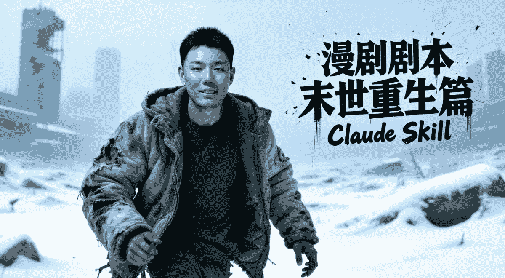
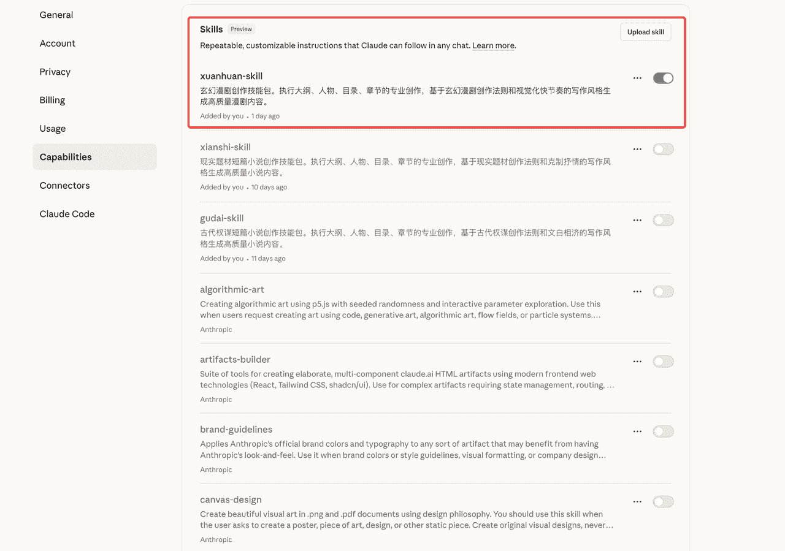

# 漫剧 | 末世重生类 漫剧剧本创作 Claude Skill

> 来源：[https://feicaiclub.feishu.cn/docx/ZW4edkWV8oa0acxKypkcIAmontc](https://feicaiclub.feishu.cn/docx/ZW4edkWV8oa0acxKypkcIAmontc)



<https://player.bilibili.com/player.html?bvid=1oVyGBMEyn&share_source=copy_web&vd_source=1adb0321bdfa6d9eb5d1bf5665ffc381>

# 用 Claude Agent Skill 写末世重生题材漫剧剧本

这套方案主要解决一个问题：有了故事灵感后，从构思到完成一个完整的60集末世重生漫剧剧本往往需要很长时间。传统流程是想大纲、设计人物、规划分集、写正文，每一步都需要反复打磨，效率很低。

所以我们通过 Claude 的 Skill 功能搭建了一个专业的创作写手。把末世重生漫剧的创作方法论、文档模板、写作风格、实战示例都打包进 doomsday-skill，让 Claude 在每个创作环节都能调用这些专业知识。你只需要回答几个问题，剩下的大纲、人物、分集目录就由 AI 按照专业标准自动生成。

工作流程按照漫剧创作的自然顺序推进：故事大纲 → 人物小传 → 分集目录 → 正文创作。CLAUDE.md 负责整体流程管控，doomsday-skill 提供创作标准，doomsday-aligner 确保质量一致。从有灵感到生成完整初稿，整个过程可以在几小时内完成。

这个方案让故事灵感从脑海里的想法变成可以直接阅读的漫剧初稿，大幅提升创作效率。不过要注意，生成的内容是初稿，还需要根据个人风格润色调整。

---

# **核心功能模块**

**Skill调用机制**

通过 doomsday-skill 技能包为 Claude 提供专业创作知识。每个创作阶段开始前，主Agent会自动调用对应的资源文件：大纲阶段读取 doomsday-outline-method.md（方法论）+ doomsday-outline-template.md（模板）+ outline-example.md（示例），正文阶段读取 doomsday-output-style.md（写作风格）+ doomsday-chapter-template.md（模板）。这种模块化设计让 Claude 不是凭感觉写作，而是基于明确的创作标准和范式进行输出。

**分阶段创作流程**

创作严格遵循"故事大纲 → 人物小传 → 分集目录 → 正文创作"的流程，每个阶段对应独立文档。用户通过 /character、/catalog、/write 命令推进流程，系统会自动读取前序文档确保连贯性。比如创作正文时，会同时读取 outline.md、character.md、chapter_index.md，确保情节不偏离大纲、人物行为符合设定。正文创作采用批次模式，每批生成5集，创作完成后自动进入质量检查环节。

**一致性检查机制**

每批5集创作完成后，系统会自动调用 doomsday-aligner 进行质量检查。检查以大纲为核心基准，覆盖10个维度：剧情进度、天灾进程/数值一致性、爽点分布、人物行为、时间线、伏笔处理、金手指规则、格式规范、写作风格、创作禁忌。如果检查返回FAIL状态，系统会调用 doomsday-skill 修改问题内容，然后重新检查，直到通过（PASS状态）才写入文档。这种检查-修改-再检查的闭环机制，避免了前后矛盾、设定崩坏等常见问题。

**模板驱动生成**

所有文档格式由 templates/ 目录下的模板文件定义，包括大纲、人物小传、分集目录、正文四类。Claude 创作时严格遵循模板结构，确保输出格式统一、信息完整。比如人物小传必须包含"主角→炮灰反派→前世仇人→终极boss"的层级，每个角色都有明确的功能定位。

**上下文连贯性**

每个阶段创作前都会读取已有文档内容。人物创作基于大纲设定，正文创作基于大纲+人物+目录，形成递进式上下文积累。系统通过文档驱动而非对话记忆来维护上下文，即使对话被清空，只要文件还在，就能通过 /status 命令查看进度并继续创作。

**文档结构管理**

项目采用标准化目录结构：outline.md（大纲）、character.md（人物）、chapter_index.md（目录）、chapters/Episode-XX.md（各集正文）。固定60集结构对应三幕式布局（第1-20集、第21-45集、第46-60集），每集500-800字。这种结构化存储让创作过程可追溯、可修改，文档本身就是交付物，而不需要从对话记录中复制粘贴整理。

> 注：AI生成的是初稿,能帮你快速把故事框架搭起来,但最终还需要人工润色才能达到投稿标准。输入质量直接决定输出质量——你在Q1-Q3提供的核心创意、前世死因、复仇目标越详细具体,生成的大纲和人物就越贴合预期。AI的工作是基于你的创意进行填充和扩展,而不是100%从零创造,所以前期构思越清晰,后期调整成本越低。另外,固定的60集结构适合标准末世重生漫剧,如果需要不同集数,需要调整模板和方法论。

---

# **如何配置**

## **配置步骤：**

### 方式一：在 Claude.ai 网页版配置（推荐新手）



1.  **进入Skills设置**

+   选择 "Settings" → "Capabilities" → "Skills"

+   点击 "Upload file" 按钮

1.  **上传技能包**

+   选择 zip 压缩包文件

+   系统会自动解压并识别skill结构

1.  **启用技能包**

+   在Skills列表中找到新创建的技能

+   确保状态为 "Enabled"（已启用）

1.  **开始创作**

+   回到对话界面，开始新对话

+   直接向Claude说明你的创作需求即可

+   Claude会自动调用进行创作

### 方式二：在 Claude Code 中配置（适合熟练）

请按照以下步骤配置创作系统，配置完成后，你的项目结构应该是这样：

```
project/
├── outline.md                                     # 故事大纲（创作后生成）
├── character.md                                   # 人物小传（创作后生成）
├── chapter_index.md                               # 分集目录（创作后生成）
├── chapters/                                      # 分集正文目录（创作后生成）
│   ├── Episode-01.md
│   ├── Episode-02.md
│   └── ...
└── .claude/
    ├── CLAUDE.md                                  # 项目规则和主Agent配置（必须创建）
    ├── skills/
    │   └── doomsday-skill/                        # 末世重生漫剧创作技能包（必须创建）
    │       ├── SKILL.md                           # 技能包核心配置
    │       ├── doomsday-outline-method.md         # 大纲创作方法论
    │       ├── doomsday-output-style.md           # 写作风格
    │       ├── templates/                         # 文档格式模板
    │       │   ├── doomsday-outline-template.md
    │       │   ├── doomsday-character-template.md
    │       │   ├── doomsday-chapter-index-template.md
    │       │   └── doomsday-chapter-template.md
    │       └── examples/                          # 创作示例
    │           ├── outline-example.md
    │           ├── character-example.md
    │           ├── catalog-example.md
    │           └── chapter-example.md
    └── agents/
        └── doomsday-aligner.md                    # 一致性检查Agent（必须创建）
```

## 配置步骤：

1.  **创建项目规则**

1.  在 .claude/ 目录下创建 CLAUDE.md 文件

1.  粘贴完整的项目规则内容，包含角色定义、工作流程、指令集

1.  确保包含初始化脚本和所有创作阶段的流程定义

1.  **创建 Skill 技能包**

1.  在 .claude/skills/ 目录下创建 doomsday-skill/ 文件夹

1.  创建 SKILL.md 作为技能包核心配置

1.  粘贴技能包说明和执行流程

1.  **添加创作方法论**

1.  在 doomsday-skill/ 目录下创建 doomsday-outline-method.md

1.  粘贴大纲创作方法论，包含三幕式结构、人物塑造、囤货复仇设计等内容

1.  **配置写作风格**

1.  创建 doomsday-output-style.md 文件

1.  粘贴写作风格定义和具体行为规范

1.  **添加文档模板**

1.  在 doomsday-skill/templates/ 目录下创建四个模板文件

1.  包括大纲、人物小传、分集目录、分集正文的格式定义

1.  这些模板会严格约束 AI 的输出格式

1.  **添加创作示例**

1.  在 doomsday-skill/examples/ 目录下创建示例文件

1.  **创建一致性检查Agent**

1.  在 .claude/agents/ 目录下创建 doomsday-aligner.md 文件

1.  粘贴完整的检查标准和执行流程

1.  这个subagent会在每批5集创作完成后自动触发，检查10个维度的一致性

## 重要配置细节：

+   **Skill调用**：CLAUDE.md 中定义了何时调用 doomsday-skill，每个创作阶段会自动调用对应资源

+   **Aligner检查**：每批5集创作完成后，主Agent会自动调用 doomsday-aligner 检查一致性，返回PASS或FAIL状态，FAIL时触发修改流程

+   **模板约束**：templates/ 中的格式是强制性的，AI 必须按照模板结构输出

+   **方法论指导**：doomsday-outline-method.md 是核心，定义整体三幕式结构、单集起承转钩、人物塑造、天灾进程体系等创作标准

+   **风格一致性**：doomsday-output-style.md 确保视觉化、快节奏风格贯穿全剧，避免出现过度文学化表达或圣母心台词

+   **示例学习**：examples/ 提供具体范式，让 AI 理解什么是符合标准的输出

+   **质量保障**：doomsday-aligner 以大纲为核心基准，检查天灾进程体系、爽点分布、人物行为、时间线等10个维度，确保前后不矛盾

+   **固定结构**：漫剧固定60集对应三幕式布局（第1-20集、第21-45集、第46-60集），不支持自定义集数

+   **人工润色**：AI生成初稿后仍需人工调整细节、润色语言、补充情节

---

# **核心设计理念**

```
┌──────────────────────────────────┐
│  doomsday-skill                  │ ← 知识层：提供专业创作指导
│  ├─ doomsday-outline-method.md   │    方法论、风格、模板、示例
│  ├─ doomsday-output-style.md     │
│  ├─ templates/                   │
│  └─ examples/                    │
├──────────────────────────────────┤
│  CLAUDE.md                       │ ← 流程层：控制创作流程
│                                  │    定义工作流和指令集
├──────────────────────────────────┤
│  Main Agent                      │ ← 创作层：调用Skill进行创作
│                                  │    读取资源→生成内容→质量检查
├──────────────────────────────────┤
│  doomsday-aligner                │ ← 检查层：确保一致性
│                                  │    10维检查→PASS/FAIL→触发修改
├──────────────────────────────────┤
│  outline.md                      │ ← 文档层：结构化存储
│  character.md                    │    故事大纲
│  chapter_index.md                │    人物小传
│  chapters/*.md                   │    分集目录
│                                  │    分集正文
└──────────────────────────────────┘
```

## 工作流程：

1.  **需求收集** - 主Agent询问核心创意、金手指类型、题材议题三个问题

1.  **调用Skill** - 根据创作阶段，调用doomsday-skill读取对应的方法论、模板、示例

1.  **内容创作** - 基于Skill提供的指导和用户需求，生成符合标准的内容

1.  **质量检查**（仅正文阶段）- 调用doomsday-aligner检查10个维度的一致性，以大纲为核心基准

1.  **修改循环**（如需要）- 如检查返回FAIL，调用doomsday-skill修改问题内容，重新检查直到PASS

1.  **文档写入** - 将通过检查的内容写入对应的结构化文档

1.  **流程推进** - 通知用户当前阶段完成，引导进入下一个创作阶段

## 关键特性：

+   **Skill驱动** - 每个阶段自动调用对应资源，确保创作有章可循

+   **质量保障** - 正文创作每批5集完成后自动触发一致性检查，检查-修改-再检查形成闭环

+   **模板约束** - 严格遵循templates/定义的格式，保证输出规范统一

+   **阶段递进** - 按照"大纲→人物→目录→正文"顺序推进，后续阶段基于前序文档

+   **上下文积累** - 通过文档驱动而非对话记忆维护上下文，支持长期创作

+   **结构化存储** - 所有内容分文件管理，便于查看、修改和复用

+   **快速落地** - 从灵感到初稿，整个流程可在几小时内完成

+   **固定框架** - 60集结构对应三幕式布局，单集起承转钩结构，适合快速产出标准化漫剧

---

# 👀 先睹为快

我们用这套系统测试了Claude Sonnet 4.5模型，从提出故事创意到生成完整的60集漫剧大纲和前20集正文，整个过程用了一个多小时。所有内容都是基于框架直接生成的初稿，未经人工润色。每批5集创作完成后，doomsday-aligner会自动检查天灾进程体系、爽点分布、人物行为等10个维度，确保前后不矛盾。这样你可以直观地看到这套系统在实际应用中能达到什么效果。

## 使用时的注意事项：

1.  **输入质量决定输出质量**。Q1-Q3回答得越详细，生成的内容就越贴合你的预期。比如核心创意如果只写"末世重生囤货"，生成的内容会很空泛；但如果写"女主被舅舅抛弃冻死在暴雪中，重生回末世前一个月，觉醒玉镯空间，这次她要疯狂囤货，让那些抛弃她的人在末世中跪地求饶"，生成的内容就会具体很多。

1.  **这是初稿，不是成品**。AI生成的内容能帮你快速搭起框架，但节奏细节、天灾场面、复仇打脸场景还需要人工润色。特别是对比场景和物资碾压部分，AI有时会写得过于平淡，需要调整成更具视觉冲击力和爽感的表达。

1.  **及时反馈和调整**。如果大纲阶段就发现内容偏离预期，直接提出修改意见，不要等到写完多集再推倒重来。每个阶段都可以修改，改得越早成本越低。

1.  **注意版权问题**。虽然这套系统是基于方法论和模板创作，但如果你的故事创意本身借鉴了某部作品，还是要注意避免抄袭。建议用自己的原创构思，或者对经典题材进行充分的改编创新。

## **故事大纲**

## 漫剧信息

+   **剧名**：冰封末世：双生复仇

+   **类型**：末世重生漫剧

+   **故事调性**：双重生+囤货复仇+女性觉醒+极寒末日生存

+   **集数规格**：60集

+   **每集时长**：1-2分钟

+   **总时长**：60-120分钟

## 主要人物

+   **林念（女主）**：前世被渣男PUA、被闺蜜背叛，在极寒末日第五年冻死街头；今生重生携带记忆，房产中介，精通房屋改造与资源布局

+   **叶澜（闺蜜）**：前世富二代，因恋爱脑被渣男利用害死林念后自己也惨死；今生同样重生携带记忆，会计师，精通资金运作与供应链管理

+   **陈俊（渣男）**：林念前世男友，表面深情实则冷血，利用林念和叶澜在末日中谋取私利，最终抛弃二人

+   **极寒末日Boss**：全球气候崩溃引发的终极危机，最低温度达零下80度，伴随冰封风暴和资源枯竭

## 核心梗概

> 极寒末日第五年，林念被渣男抛弃、被闺蜜背叛，最终冻死在零下80度的街头；闺蜜叶澜在害死林念后也遭渣男背叛惨死。两人同时重生回末日前三个月，携带完整时间线记忆和三百万遗产，从前世仇敌转为今生盟友，利用职业技能疯狂囤货、改造安全屋、布局复仇，誓要让渣男和所有曾伤害她们的人在极寒中付出代价。

## 导语

> 零下80度的暴风雪中，林念靠在冰封的墙边，生命最后一刻，她看见渣男陈俊搂着另一个女人走进温暖的安全屋。而曾经的闺蜜叶澜，正是那个出卖她的人。林念闭上眼睛的瞬间，听到叶澜的惨叫——原来她也被抛弃了。下一秒，两人同时睁眼，回到了末日前三个月。林念看着手机上的日期，叶澜的电话响起："林念，我知道你也重生了。这次，我们合作。"两个女人冷笑对视，打开电脑开始疯狂下单——三百万遗产、房产中介的专业眼光、会计师的资金运作能力...这一次，她们要囤满整座城的物资，让那个渣男跪着求饶。极寒末日即将降临，前世的仇人，准备好接受审判了吗？

## 故事大纲

### 【第一幕：开端】第1-20集（20集）

#### 第1-5集：双重生觉醒+结盟囤货启动

> 极寒末日第五年，林念在零下80度的暴风雪中被渣男陈俊抛弃，她虚弱地靠在冰墙上，眼睁睁看着陈俊搂着新欢走进温暖的安全屋。林念绝望闭眼的瞬间，听到闺蜜叶澜的惨叫——原来曾经出卖她的闺蜜，也被同一个男人抛弃了。两人在同一刻冻死在极寒中，脑海中闪过前世所有背叛与痛苦。下一秒，林念和叶澜同时惊醒，发现自己回到了末日前三个月。林念手机响起，是叶澜打来的："林念，我知道你也重生了。我们前世互相伤害，都是因为那个男人。这次，我们合作，一起复仇。"两人约在咖啡馆见面，在前世记忆的对照下，她们坦诚相见——叶澜承认前世被陈俊PUA，为了帮他抢物资才背叛林念；林念也承认前世因嫉妒叶澜而做过错事。两人决定放下前世恩怨，结成同盟。叶澜拿出存款三百万，林念凭房产中介的专业眼光选定一栋适合改造的别墅，两人开始疯狂布局：叶澜负责资金运作和供应链联系，林念负责房屋改造和物资采购。她们列出详细囤货清单——米面油盐各50吨、肉类30吨、御寒装备、发电机、保暖材料...利用前世记忆，她们精准避开所有会涨价的时间节点，以最低价囤积最多物资。同时，她们开始改造别墅：加厚墙体、安装工业级保暖系统、挖掘地下储藏室、建立独立供电供暖系统。前世的痛苦记忆让她们比任何人都清楚极寒的可怕，她们要把这栋别墅打造成零下80度也能生存的堡垒。

#### 第6-10集：末日征兆+渣男现身+初步碾压

> 末日前一个月，全球气候开始异常：北极冰川加速融化、洋流紊乱、气温骤降。新闻开始播报异常天气，但大部分人还没意识到危机。林念和叶澜按照前世记忆，知道这是极寒末日的征兆，她们加快囤货速度。此时，渣男陈俊出现了——他热情地来找林念，想要复合，用尽前世那套PUA话术。林念看着他虚伪的表情，想起前世被他利用和抛弃的惨状，眼神冰冷。她没有揭穿，只是淡淡拒绝："我们不合适。"陈俊不死心，又去找叶澜，用同样的套路撒网捕鱼。叶澜表面敷衍，暗地里和林念分析陈俊前世的行为模式——他会在末日降临后伪装成受害者，骗取女性信任，然后抢夺物资，最后抛弃她们自己逃生。两人决定反向利用他：表面保持距离，暗中监视他的动向。末日前两周，气温骤降至零下20度，城市开始混乱，超市被抢购一空。而林念和叶澜坐在温暖的别墅里，看着监控屏幕上抢购物资的人群，冷笑着喝热茶。她们的地下仓库已经堆满了物资，足够两人在零下80度的环境下生存十年。第10集结尾，新闻播报：全球气温将在一周内骤降至零下50度，极寒末日真正来临。林念和叶澜对视一眼，等待前世所有仇人跪地求饶的时刻。

#### 第11-20集：极寒降临+连环复仇+队伍初建

> 极寒末日正式降临，气温在三天内骤降至零下50度，暴风雪席卷全城，电力系统瘫痪，供暖中断，城市陷入冰封。林念和叶澜的别墅里依然温暖如春——工业级保暖系统、独立供电、地下储藏的海量物资，让她们生活得比末日前更舒适。而外界已经惨不忍睹：没有准备的人冻死在家中、街上到处是因抢夺物资而打斗的人群、医院爆满却无力救治。第一个来求救的是陈俊。他敲响林念的门，脸上带着前世那种深情的表情："林念，我知道错了，我们一起度过难关好吗？"林念透过防盗门的猫眼看着他，想起前世他同样这么说，然后在她信任他之后抢走她的物资，把她关在门外冻死。这一次，林念连门都没开："陈俊，前世你怎么对我的，记得吗？这次，你自己想办法。"陈俊震惊地瞪大眼睛——她怎么会知道前世的事？林念已经关上监控，任由他在暴风雪中挣扎。接下来几天，前世那些曾经伤害过她们的人陆续出现：抢过她们物资的邻居、背叛过她们的同事、利用过她们的亲戚...林念和叶澜按照前世记忆的罪恶清单，一一冷眼拒绝。她们不是圣母，不会救任何前世害过她们的人。但当前世曾经帮助过她们的老人和孤儿出现时，她们选择了救助，收留了三个可靠的队友。随着极寒持续，气温降至零下70度，陈俊和其他仇人的下场陆续传来——冻死、饿死、或在绝望中疯癫。第20集，林念和叶澜打开地下仓库的大门，震撼的物资储备在灯光下一览无遗：成吨的食物、成箱的御寒装备、成套的生存器材...她们站在物资山前，相视而笑："前世的债，今生已清。接下来，是我们的时代。"

### 【第二幕：对抗】第21-45集（25集）

#### 第21-30集：建立势力+极寒升级+更大危机

> 极寒末日进入第二阶段，气温降至零下80度，这是人类生存的极限。林念和叶澜凭借前世记忆和充足物资,开始在别墅周边建立小型幸存者基地。她们选择性地收留了一些有用的幸存者：前世的工程师、医生、战士...这些人在前世末日中都是关键角色,今生被她们提前拉拢。基地迅速成为方圆十里内唯一还能正常运转的避难所,引来其他势力的注意。官方建立的大型避难所派人来"征用"她们的物资和设施,林念和叶澜凭借前世记忆知道这些官员的嘴脸,果断拒绝并展示了强大的防御系统。在冲突中,她们展现出远超常人的应变能力——因为她们知道这些人下一步会做什么、会说什么。与此同时,极寒带来了新的危机:冰封风暴。这种风暴会让气温瞬间降至零下100度,前世林念和叶澜都死在这种风暴前。这一次,她们提前准备好了应对方案:加固的避难室、超高规格的保暖系统、足够的能源储备。当第一场冰封风暴来临时,其他基地死伤惨重,而她们的基地却安然无恙,这让所有人都震惊于她们的"先知"能力。随着名声传开,前世末日中的关键人物开始主动靠近,林念和叶澜根据前世记忆判断这些人的价值,逐步扩大势力。但更大的危机也在酝酿——她们知道,极寒末日背后有人为因素,前世有一个神秘组织在操控天气,而那个组织的首领,在前世末日中差点杀死她们。

#### 第31-40集：进入更大舞台+真相揭露+实力曝光

> 随着势力扩大,林念和叶澜被迫进入官方建立的中央避难所——这是全球幸存者的最后希望,也是前世她们遭遇背叛的地方。她们低调进入,但很快被高层注意到——因为她们对极寒末日的应对太过完美,仿佛提前知道一切。避难所的权贵们开始怀疑和试探,林念和叶澜小心应对,利用前世记忆一步步化解危机。在这个过程中,她们逐渐接触到前世害死她们的幕后黑手——避难所科学顾问张教授。前世就是他秘密操控了气候武器,导致极寒末日失控,并在混乱中谋取私利。林念和叶澜开始暗中收集证据,准备揭露真相。但张教授也不简单,他很快察觉到两人的异常,开始反击。一场暗中的博弈展开:张教授设局陷害、林念叶澜反向利用前世记忆破局、双方斗智斗勇。期间,她们不得不展现出部分"先知"能力,引起避难所所有人的震惊——她们怎么能提前预知每一次危机？怎么能精准判断每个人的行为？第40集,在一次生死对决中,林念和叶澜彻底曝光了她们的秘密:她们是重生者,携带前世五年的完整记忆。全场震撼,张教授的罪行也被她们揭露,避难所陷入混乱。但真正的危机才刚刚开始——张教授在临死前启动了气候武器的自毁程序,极寒末日将迎来最终阶段:全球冰封。

#### 第41-45集：终极危机前夕+人类存亡一线

> 气候武器失控,全球气温将在七天内降至零下150度,这是任何人类设施都无法抵御的极限。中央避难所陷入绝望,所有人都在等死。林念和叶澜站出来——她们在前世见过这个结局,虽然前世她们也死了,但她们记得有一个理论上的解决方案:必须在72小时内找到气候武器的核心,手动关闭它。问题是,武器核心在北极,需要穿越零下100度的冰封地带,前世没有人能活着到达。这一次,林念和叶澜决定亲自前往。她们利用五年来准备的最高规格装备、招募的精英队伍、以及前世积累的经验知识,开始这场不可能的任务。避难所所有人都认为她们必死无疑,但两人眼中只有决绝——前世她们被命运摆布,今生她们要改写结局。出发前,她们把基地的物资分给了所有幸存者,并留下遗言:"如果我们失败,至少你们还能多活几天。如果我们成功,记得我们的名字。"两个曾经在前世互相伤害的女人,在今生成为拯救人类的英雄。第45集结尾,她们踏上冰封的北极之路,身后是整个人类最后的希望。

### 【第三幕：高潮】第46-60集（15集）

#### 第46-55集：北极之战+关闭武器+改写命运

> 林念和叶澜带领五人小队穿越零下120度的冰封地带,前往北极的气候武器核心。这是一场极限生存的考验:冰封风暴、物资耗尽、队员牺牲、体力极限...但她们凭借前世的经验和今生的准备,一步步接近目标。途中,她们遇到前世末日中最强的变异生物——冰封巨兽,这些生物在极寒中进化,攻击力惊人。前世林念和叶澜就是死在这些巨兽手中。这一次,她们利用提前准备的武器和战术,与巨兽激战,付出巨大代价但最终突破。当她们到达武器核心时,发现张教授留下的最后陷阱:核心被设置了密码锁,必须在30分钟内破解,否则将永久锁死,人类将彻底灭绝。林念和叶澜对视一眼,开始破解——她们没有密码,但她们有前世的记忆、今生的知识、以及彼此的默契。在最后一秒,她们成功关闭气候武器。全球气温开始缓慢回升,极寒末日被终止。但代价是,武器核心爆炸,她们被困在北极。就在所有人以为她们牺牲时,第55集,林念和叶澜凭借最后的应急装备,奇迹般地活着回到了中央避难所。全人类为之欢呼,两个女人成为拯救世界的传奇。

#### 第56-60集：重建秩序+女性觉醒+开放结局

> 极寒末日结束,全球气温恢复至零下30度,人类开始重建。林念和叶澜成为新世界的领袖,她们建立了以女性互助和平等为核心的新秩序。在这个新世界里,不再有PUA、不再有情感剥削、不再有性别压迫。她们用前世的痛苦记忆教育幸存者:什么是真正的爱、什么是健康的关系、如何避免被控制。同时,她们也开始追查极寒末日的真正起源——气候武器到底是谁制造的？张教授只是执行者,背后还有更大的阴谋。第60集,就在一切看似尘埃落定时,林念收到一条神秘信息:"你们以为结束了吗？极寒只是第一阶段。"屏幕上显示:气候武器制造者,代号"冰神",正在启动第二阶段——永恒冰封。林念和叶澜对视,嘴角勾起冷笑:"看来,战斗还没结束。"画面定格在两人并肩站立、眺望冰封世界的背影,字幕浮现:"第一季完,敬请期待《冰封末世2:永恒之战》"。

## 爽点分布规划

### 超级爽点

+   **第20集**：林念和叶澜打开地下仓库,震撼的物资储备展示+前世所有仇人惨死的蒙太奇回顾,前世的债今生已清

+   **第40集**：林念和叶澜公开重生者身份,揭露张教授罪行,全场震撼;同时展现五年重生记忆的完整时间线,观众才明白她们为何能步步领先

+   **第60集**：关闭气候武器成功,拯救全人类;建立女性平等新秩序;神秘信息引出第二季悬念——永恒冰封即将来临

### 大爽点

+   **第10集**：极寒末日正式降临,林念和叶澜坐在温暖别墅里喝茶,监控屏幕显示外界混乱;渣男陈俊敲门求救被冷眼拒绝,【闪回】前世他抛弃她们的场景

+   **第30集**：第一场冰封风暴来临,其他基地死伤惨重,林念叶澜的基地安然无恙;她们凭借前世记忆成功预判并应对,震撼所有人

+   **第50集**：北极之战启动,林念叶澜穿越零下100度冰封地带,与冰封巨兽激战,展现惊人的战斗力和求生意志

### 付费转化节点

+   **第10集结尾**：极寒末日降临,渣男陈俊跪在门外求救,林念透过猫眼看着他,冷笑:"前世你怎么对我的,记得吗?"【卡黑】观众急需知道前世发生了什么、陈俊会有什么下场

+   **第30集结尾**：冰封风暴后,避难所高层开始怀疑林念叶澜的"先知"能力,幕后黑手张教授出现,危险升级【卡黑】

+   **第50集结尾**：林念叶澜到达气候武器核心,发现密码锁和30分钟倒计时,人类存亡一线【卡黑】观众必须知道她们能否成功

## 天灾进程体系

> [注：末世重生漫剧60集标准,采用三幕式结构,每集500-800字,总字数3-4.8万字。本作品为双女主重生设定,强调女性觉醒与互助主题,极寒末日贯穿始终,无异能设定。]

## 人物小传

## 主角（必需）

> **林念**（女主）

> 前世是普通房产中介，被男友陈俊PUA三年后在极寒末日第五年被抛弃，冻死在零下80度的街头；今生重生携带五年完整记忆，28岁，气质疏离冷淡，眼神锐利如冰。冷静理智不圣母、腹黑复仇记仇狠、专业能力强。金手指：前世五年记忆+房产结构专业眼光+改造设计能力。复仇目标：让前世所有害过她的人在极寒中付出代价，尤其是渣男陈俊；同时与叶澜结盟，建立女性互助的新世界。前世与叶澜互相伤害，今生成为最强盟友；对陈俊恨之入骨但表面冷漠；对前世恩人有恩必报。

> **叶澜**（女主/闺蜜）

> 前世是富二代会计师，因恋爱脑被陈俊利用，在他PUA下背叛林念、抢夺物资，最终同样被抛弃冻死；今生重生携带五年完整记忆，26岁，气质优雅但眼神犀利，长发及腰。温柔外表狠辣内核、擅长算计与布局、对爱情彻底觉醒。金手指：前世五年记忆+三百万遗产+资金运作能力+供应链管理经验。复仇目标：与林念合作扳倒陈俊，报前世之仇；用钱和智慧为女性开辟新路。前世害过林念但今生坦诚道歉、结成死党；对陈俊从爱到恨；负责基地的资金和物资管理。

## 炮灰反派（必需）

> **说明**：各阶段被碾压的龙套，每批5-10集出现一批，打完就死，不重复利用。

> **李建国**（第11-15集）

> 林念的前邻居，五十多岁，秃顶啤酒肚。贪婪自私、见风使舵。前世末日初期抢过林念的物资，还反咬一口说她偷东西。今生极寒降临后带着全家上门求救，被林念冷眼拒绝。在暴风雪中冻死在别墅门外，死前还在诅咒林念。

> **王芳**（第11-15集）

> 林念的前同事，三十岁出头，妆容精致。表面客套内心刻薄。前世在公司造谣林念勾引客户，导致她失业。今生极寒降临后找到林念，想用前同事身份套近乎。被林念当场揭穿前世所为，狼狈离开后在抢劫中被杀。

> **赵老板**（第16-20集）

> 小区物业经理，四十多岁，一脸横肉。势利狗眼看人低。前世因林念交不起物业费而断水断电，间接害死她。今生带着物业保安想强行征用林念的别墅。被林念和叶澜的防御系统震慑，灰溜溜离开后在极寒中饿死。

> **刘队长**（第21-25集）

> 官方避难所派来的军官，三十五岁左右，国字脸。官僚主义、仗势欺人。奉命来"征用"林念叶澜的物资和设施，态度强硬。被两人展示的武力和先知能力震撼，回去后被上级问责，在避难所内部斗争中被清洗。

> **孙大虎**（第26-30集）

> 流民团伙头目，壮汉，满脸胡茬。凶残暴力、欺软怕硬。带着手下袭击林念叶澜的基地，想抢劫物资。被基地的防御系统击退，在逃跑途中遇到冰封风暴，全团覆灭。

## 前世仇人（必需 - 打脸复仇的对象）

> **说明**：这是复仇打脸的核心对象。

### 渣男（核心仇人）

> **陈俊**

> 29岁，外貌斯文帅气、戴金丝眼镜，实则冷血自私的PUA高手。表面深情体贴、善于伪装，实则把女人当工具，擅长同时操控多个女性为他服务。前世利用林念的感情骗取她的信任和物资，又用同样手法拉拢富二代叶澜；在末日中让两人互相争斗、帮他囤货；等物资到手后，他抛弃二人，搂着新猎物躲进安全屋，眼睁睁看着林念和叶澜冻死。今生末日前再次出现，用前世那套深情话术想复合，被林念冷淡拒绝；又去找叶澜，同样碰壁。极寒降临后，他失去所有物资，狼狈不堪地来求救，被林念当面揭穿他前世的罪行："前世你怎么对我的，记得吗？"被拒后震惊恐惧，试图强闯被驱离。最终在零下70度的暴风雪中，像前世抛弃她们一样被抛弃，冻死在林念别墅外，死前想起前世所有罪恶，充满恐惧和后悔。

> [注：本作品中，林念和叶澜前世互为仇人，但今生已和解结盟，不再是打脸对象。]

## 前世恩人（可选 - 展现主角恩怨分明）

> **说明**：展现主角不是纯恶，有恩必报。

> **周奶奶**

> 七十多岁，独居老人，头发花白但精神矍铄。善良坚韧、不求回报。前世末日初期，林念被陈俊抛弃后流落街头，是周奶奶分给她仅有的半碗热粥，让她多活了两天。今生极寒降临后，林念主动找到她，接她进入安全屋，悉心照顾。周奶奶避免了前世冻死的命运。

> **小宇**

> 12岁孤儿，瘦小但机灵，大眼睛透着聪慧。懂事早熟、学习能力强。前世末日中曾救过叶澜一次，把自己捡到的食物分给她。今生极寒降临后，叶澜找到他，收养并保护他。小宇在基地中帮忙做杂事，对两位姐姐感恩戴德。

## 队友/家人（可选 - 保护对象）

> **说明**：协助主角建立基地的可靠队友。

### 忠诚队友（适合基建流、团队流）

> **高工**

> 42岁，前建筑工程师，沉稳寡言，戴厚重眼镜。专业能力强、忠诚可靠、不问私事。前世是避难所的技术骨干，因太过正直被权贵排挤。今生被林念叶澜提前拉拢，负责基地的加固和防御系统建设，对两人的先知能力从不多问，默默贡献专业技能。

> **李医生**

> 35岁，外科医生，清瘦干练，眼神温和。医术精湛、心思细腻、重情重义。前世在避难所救治过无数人，最后因物资匮乏累死。今生被林念叶澜救下，负责基地的医疗，对救命之恩铭记于心，誓死效忠。

> **老兵**

> 50岁，退伍军人，身材魁梧，脸上有疤。战斗经验丰富、纪律严明、疾恶如仇。前世组织过幸存者抵抗变异生物，战死沙场。今生被两人招募，负责基地的安保和战斗训练，对两人的指挥佩服得五体投地。

## 最终对手（必需）

> **张教授**

> 55岁，避难所首席科学顾问，斯文儒雅、头发花白，实则野心勃勃、冷酷无情。气候学家出身，掌握气候武器核心技术，表面为人类谋福利，实则是极寒末日的幕后黑手。前世秘密操控气候武器，制造极寒末日以实施人口清洗计划，在混乱中建立独裁政权。林念和叶澜前世发现真相后试图揭露，被他设局杀害。今生两人重生后，凭借前世记忆逐步接近真相。张教授察觉异常，布局陷害，与两人展开智斗。第40集被揭露罪行后，临死前启动气候武器自毁程序，企图让全人类陪葬。实力体现：掌控避难所高层、操控气候武器、精通政治手腕。最终对决：林念叶澜揭露其罪行，他启动自毁程序后被击毙，两人必须前往北极手动关闭武器。

## 其他角色（如有）

> **梁所长**：中央避难所负责人，60岁，威严正直。前世被张教授架空，后期觉醒但已晚。今生在林念叶澜协助下看清张教授真面目，成为重要盟友。

> **小美**：陈俊在今生的新猎物，22岁，天真单纯。被他用套路哄骗，最后识破真面目，在极寒中自救成功，后期感激林念叶澜的提醒。

> **冰封巨兽**：极寒中的变异生物，三米高，全身冰晶铠甲。前世杀死过林念叶澜，今生被两人提前准备的武器击败。不是智慧生命，只是环境产物。

## 【人物配置说明】

> 本作品为**双女主重生+囤货复仇+基建流**，人物配置如下：

> **核心角色**：

+   双女主：林念+叶澜（前世仇敌，今生盟友）

+   核心仇人：陈俊（渣男，PUA双女主的罪魁祸首）

+   终极Boss：张教授（气候武器操控者，前世害死双女主）

> **功能角色**：

+   炮灰反派5批（各阶段打脸对象）

+   前世恩人2人（展现恩怨分明）

+   忠诚队友3人（建立基地的专业人才）

+   其他角色3人（推动剧情）

> **人物关系核心**：

+   林念↔叶澜：前世互害，今生结盟，姐妹情深

+   双女主→陈俊：前世被PUA，今生复仇

+   双女主VS张教授：前世被杀，今生对决

> **女性觉醒主题体现**：

+   两人从为男人争斗到联手对抗男权压迫

+   从恋爱脑到独立自主的女性意识觉醒

+   建立以女性互助为核心的新秩序

## 章节目录

## 【第一幕：开端】第1-20集

### 第1-5集：双重生觉醒+姐妹结盟

> **第1集** 冰封绝境

> 极寒末日第五年，林念被渣男陈俊抛弃，冻死在零下80度街头；叶澜同样被抛弃惨死，两人在绝望中听到彼此的惨叫。

> **第2集** 重生归来

> 林念和叶澜同时惊醒回到末日前三个月，叶澜主动致电："我知道你也重生了，我们合作吧。"

> **第3集** 前世恩怨

> 咖啡馆对谈，两人坦诚前世所有恩怨——都是被陈俊PUA利用，今生决定放下仇恨，结成复仇同盟。

> **第4集** 疯狂囤货

> 叶澜拿出三百万，林念凭房产眼光选定别墅；两人列出囤货清单，开始疯狂网购和批发扫货。

> **第5集** 改造堡垒

> 林念设计改造方案：加厚墙体、工业级保暖系统、地下储藏室；叶澜负责资金运作，囤货计划全面展开。

### 第6-10集：末日征兆+渣男现身

> **第6集** 气候异常

> 全球新闻播报气候异常，北极冰川加速融化；林念叶澜加快囤货，物资已达50吨规模。

> **第7集** 渣男登门

> 陈俊热情来找林念想复合，用尽前世PUA话术；林念眼神冰冷："我们不合适。"叶澜暗中监视。

> **第8集** 套路重演

> 陈俊碰壁后又去找叶澜，同样的深情表演；叶澜表面敷衍，私下和林念分析他前世行为模式。

> **第9集** 城市混乱

> 气温骤降至零下20度，城市开始混乱，超市被抢购一空；林念叶澜坐在温暖别墅里，看监控冷笑。

> **第10集** 极寒降临【免费段结尾】

> 新闻预警：气温将在一周内降至零下50度；林念叶澜检查地下仓库，物资堆成山，足够生存十年。

### 第11-20集：极寒肆虐+连环复仇

> **第11集** 冰封城市

> 气温骤降至零下50度，暴风雪席卷全城，电力瘫痪；林念叶澜别墅依然温暖如春，外界已是人间地狱。

> **第12集** 渣男求救

> 陈俊狼狈敲门求救："林念，我知道错了！"林念透过猫眼冷笑："前世你怎么对我的，记得吗？"

> **第13集** 冷眼拒绝

> 陈俊震惊林念知道前世事，苦苦哀求；林念关上监控，任由他在暴风雪中挣扎，叶澜在旁淡然喝茶。

> **第14集** 邻居惨状

> 前世抢过林念物资的邻居李建国带全家求救，被冷眼拒绝；三天后冻死在别墅门外。

> **第15集** 同事打脸

> 前世造谣林念的同事王芳登门套近乎，被林念当场揭穿前世所为；狼狈离开后在抢劫中被杀。

> **第16集** 物业经理

> 前世断水断电的物业赵老板想强征别墅，被林念叶澜的防御系统震慑；灰溜溜离开后饿死。

> **第17集** 救助恩人

> 前世救过林念的周奶奶和救过叶澜的孤儿小宇出现，两人主动接他们进入安全屋。

> **第18集** 组建队伍

> 收留前世的工程师高工、医生李医生、退伍军人老兵，组建基地核心团队。

> **第19集** 渣男之死

> 气温降至零下70度，陈俊在别墅外彻底冻死；临死前想起前世所有罪恶，充满恐惧和后悔。

> **第20集** 物资震撼【第一大高潮】

> 林念叶澜打开地下仓库大门，震撼的物资储备展示；前世仇人惨死蒙太奇回顾："前世的债，今生已清。"

## 【第二幕：对抗】第21-45集

### 第21-30集：建立势力+冰封风暴

> **第21集** 基地建立

> 气温降至零下80度，林念叶澜开始建立小型幸存者基地，选择性收留有用的幸存者。

> **第22集** 官方征用

> 官方避难所派刘队长来"征用"物资，态度强硬；被林念叶澜的先知应对能力震撼，灰溜溜离开。

> **第23集** 流民袭击

> 流民头目孙大虎带团伙袭击基地想抢劫，被防御系统击退；逃跑途中遇到冰封风暴，全团覆灭。

> **第24集** 风暴预警

> 林念叶澜凭前世记忆预判：冰封风暴即将来临，气温瞬降至零下100度；加固避难室，储备能源。

> **第25集** 冰封风暴

> 第一场冰封风暴降临，其他基地死伤惨重；林念叶澜基地安然无恙，所有人震惊于她们的"先知"能力。

> **第26集** 名声传开

> 幸存者开始传言基地有"先知"，前世关键人物主动靠近；林念叶澜根据记忆判断价值，逐步扩大势力。

> **第27集** 神秘组织

> 林念叶澜私下讨论：前世极寒末日背后有人为因素，神秘组织操控气候武器。

> **第28集** 幕后黑手

> 林念回忆前世：避难所科学顾问张教授就是幕后黑手，他们必须进入中央避难所揭露真相。

> **第29集** 决定出发

> 气温略有回升至零下60度，林念叶澜决定带队前往中央避难所——那里是前世遭遇背叛的地方。

> **第30集** 舞台升级【大爆点】

> 进入官方中央避难所，全球幸存者最后希望；林念叶澜低调进入，但她们的"先知"名声已传开。

### 第31-40集：揭露真相+实力曝光

> **第31集** 权贵试探

> 避难所高层注意到林念叶澜对危机的完美应对，开始怀疑和试探；两人小心应对，利用前世记忆化解。

> **第32集** 接触张教授

> 林念叶澜终于见到前世害死她们的张教授，表面恭敬，暗中观察他的一举一动。

> **第33集** 收集证据

> 林念叶澜开始暗中收集张教授操控气候武器的证据，发现他在秘密实施"人口清洗计划"。

> **第34集** 张教授反击

> 张教授察觉两人异常，开始设局陷害；林念叶澜反向利用前世记忆破局，暗中博弈升级。

> **第35集** 展现先知

> 为了自保，林念叶澜不得不展现部分"先知"能力，精准预判一次次危机，震撼所有人。

> **第36集** 怀疑加深

> 避难所所有人震惊："她们怎么能提前知道一切？"张教授更加警惕，加大陷害力度。

> **第37集** 生死对决

> 张教授设下死局，林念叶澜险些丧命；关键时刻，她们用前世记忆中的关键信息反杀。

> **第38集** 揭露罪行

> 林念叶澜公开张教授操控气候武器的证据，避难所哗然；张教授狡辩，双方对峙。

> **第39集** 前世记忆

> 为了彻底证明，林念叶澜展示前世五年的完整记忆时间线，详细描述未来每个节点，无人可辩。

> **第40集** 重生曝光【第二大高潮】

> 林念叶澜公开重生者身份，携带前世五年记忆；全场震撼，张教授罪行彻底揭露，但他临死前启动气候武器自毁程序！

### 第41-45集：终极危机+决战前夕

> **第41集** 自毁程序

> 气候武器失控，全球气温将在七天内降至零下150度；中央避难所陷入绝望，所有人等死。

> **第42集** 理论方案

> 林念叶澜站出来：前世记忆中有理论解决方案——必须72小时内到达北极，手动关闭武器核心。

> **第43集** 不可能任务

> 武器核心在北极，需穿越零下100度冰封地带，前世无人能活着到达；所有人认为她们必死无疑。

> **第44集** 出发准备

> 林念叶澜利用五年准备的最高规格装备、招募的精英队伍，决定亲自前往；把物资分给幸存者。

> **第45集** 踏上征途

> 林念叶澜留下遗言："如果失败，多活几天；如果成功，记得我们。"踏上冰封的北极之路。

## 【第三幕：高潮】第46-60集

### 第46-55集：北极之战+拯救人类

> **第46集** 极限穿越

> 零下120度的冰封地带，冰封风暴肆虐；林念叶澜带领五人小队艰难前进，物资逐渐耗尽。

> **第47集** 队员牺牲

> 小队遭遇极端天气，两名队员牺牲；林念叶澜凭前世经验调整路线，但体力已接近极限。

> **第48集** 冰封巨兽

> 遇到前世杀死她们的变异生物——冰封巨兽，三米高，全身冰晶铠甲；林念叶澜用提前准备的武器激战。

> **第49集** 险胜突破

> 付出巨大代价击败冰封巨兽，又一名队员牺牲；林念叶澜带着剩余两人，继续向武器核心前进。

> **第50集** 密码陷阱【大爆点】

> 到达气候武器核心，发现张教授留下的最后陷阱：密码锁，30分钟倒计时，失败则永久锁死！

> **第51集** 生死破解

> 林念叶澜没有密码，但她们有前世记忆、今生知识、彼此默契；开始疯狂破解，倒计时一秒秒流逝。

> **第52集** 最后一秒

> 倒计时3、2、1...林念叶澜在最后一秒成功破解！气候武器关闭，全球气温开始缓慢回升。

> **第53集** 核心爆炸

> 代价是武器核心爆炸，林念叶澜被困北极；所有人以为她们牺牲了，全人类为两位英雄默哀。

> **第54集** 奇迹生还

> 就在所有人绝望时，林念叶澜凭借最后的应急装备和前世经验，奇迹般地活着走出北极。

> **第55集** 英雄归来

> 林念叶澜回到中央避难所，全人类欢呼；两个曾在前世互相伤害的女人，今生成为拯救世界的传奇。

### 第56-60集：重建秩序+女性觉醒

> **第56集** 新世界领袖

> 极寒末日结束，气温恢复至零下30度；林念叶澜成为新世界领袖，开始重建人类文明。

> **第57集** 女性秩序

> 林念叶澜建立以女性互助和平等为核心的新秩序：不再有PUA、不再有情感剥削、不再有性别压迫。

> **第58集** 教育觉醒

> 用前世痛苦记忆教育幸存者：什么是真正的爱、什么是健康的关系、如何避免被控制。

> **第59集** 追查源头

> 林念叶澜开始追查极寒末日真正起源：气候武器到底是谁制造的？张教授只是执行者，背后还有更大阴谋。

> **第60集** 永恒冰封【终极高潮+续集钩子】

> 就在一切尘埃落定时，林念收到神秘信息："你们以为结束了吗？极寒只是第一阶段。"屏幕显示：气候武器制造者代号"冰神"，正在启动第二阶段——永恒冰封！林念叶澜对视冷笑："看来，战斗还没结束。"【第一季完】

> [注：末世重生漫剧固定60集，采用三幕式结构]

## 第1集：冰封绝境

> ※ 极寒末日第五年，零下80度暴风雪中

> 【文字】末世第五年，全球气温：-80℃

> △ 林念靠在冰封的墙边，嘴唇发紫，眼神空洞

> △ 她抬头，看见五十米外温暖的安全屋

> 【特效】屋内灯火通明，玻璃窗透出温暖的橙色光芒

> △ 陈俊搂着一个年轻女人，正要推门进去

> △ 林念伸出手，想喊，却发不出声音

> 【音效】暴风雪呼啸

> △ 陈俊回头，看了她一眼

> △ 那眼神冰冷漠然，仿佛在看一具尸体

> △ 他转身，搂紧怀里的女人，走进安全屋

> △ 防盗门"砰"地关上

> ※ 同一时刻，另一条街道

> △ 叶澜倒在雪地里，全身冻僵

> △ 她曾经精致的妆容早已花掉，长发结满冰霜

> 【闪回】三天前：叶澜跪在陈俊脚边："陈俊，求你...我什么都给你了..."

> 【闪回】陈俊一脚踢开她："你已经没用了。"

> △ 叶澜眼泪冻成冰珠

> △ 她听到不远处传来微弱的声音

> △ 是林念在绝望地呼喊

> 【独白】林念...原来她也...

> △ 两人在零下80度的暴风雪中，视线交汇

> △ 那一刻，她们明白了一切

> 【文字】都是被同一个男人抛弃的女人

> ※ 林念的视角

> △ 林念意识开始模糊

> 【闪回】前世片段快速闪过：

> △ 陈俊深情告白："念念，我只爱你一个人。"

> △ 陈俊恳求："帮我囤点物资吧，你懂房子，知道怎么改造。"

> △ 末日来临，陈俊夺走她的物资："对不起，我要活下去。"

> △ 林念被关在门外，看着叶澜替代了她的位置

> △ 然后，叶澜也被抛弃了

> △ 林念闭上眼睛，身体渐渐僵硬

> 【文字】林念，卒于末世第五年

> 【音效】心跳声逐渐减弱，直至消失

> ※ 下一秒

> △ 林念猛然睁眼，大口喘息

> 【特效】刺眼的阳光照进来

> △ 周围是熟悉的卧室，温暖明亮

> △ 她愣了三秒，猛地抓起床头的手机

> 【文字】手机屏幕：2025年6月15日

> 【文字】距离末世降临：90天

> △ 林念瞪大眼睛，手机摔在地上

> 【独白】我...重生了？

> △ 手机突然响起

> △ 屏幕显示：来电人——叶澜

> △ 林念盯着这个名字，前世的记忆如潮水涌来

> △ 她颤抖着接通电话

> △ 电话那头传来叶澜冷静的声音："林念，我知道你也重生了。"

> △ 林念握紧手机，声音沙哑："你怎么知道？"

> △ 叶澜："因为我也是。我们需要谈谈。"

> 【卡黑】

## 第2集：重生归来

> ※ 市中心咖啡馆，下午两点

> △ 林念坐在靠窗的位置，指尖敲击桌面

> △ 她穿着简单的T恤牛仔裤，眼神警惕

> △ 叶澜推门而入

> △ 不同于前世的精致妆容，今天的她素颜，扎着高马尾

> △ 两人对视，空气凝固

> △ 林念冷笑："坐。"

> △ 叶澜坐下，直视林念的眼睛："我们都经历了前世五年。"

> △ 林念没说话，只是盯着她

> △ 叶澜深吸一口气："前世，陈俊让我去抢你的物资，我照做了。"

> △ 林念拳头紧握："然后呢？"

> △ 叶澜自嘲一笑："然后他抛弃了我，就像抛弃你一样。"

> ※ 咖啡馆内

> △ 服务员送来两杯咖啡

> △ 叶澜端起杯子，声音平静："我在零下80度的雪地里躺了三天。"

> △ 林念眼神闪动："我看到了，你叫我的名字。"

> △ 叶澜点头："那一刻我才明白，我们都是他的棋子。"

> △ 林念冷声道："所以你找我，是来道歉的？"

> △ 叶澜放下杯子，眼神锐利："不，我是来谈合作的。"

> △ 林念挑眉

> △ 叶澜拿出一张银行卡，推到林念面前："我家有三百万存款，我爸前世末日前就因病去世了，这笔钱在末日来临前一文不值，但现在..."

> △ 林念盯着银行卡："你想做什么？"

> △ 叶澜："囤货，改造安全屋，然后活下去。"

> ※ 咖啡馆，继续

> △ 林念靠在椅背上："为什么找我？"

> △ 叶澜："因为你是房产中介，懂房屋结构，知道哪里适合改造成安全屋。"

> △ 叶澜顿了顿："我是会计师，懂资金运作和供应链管理。"

> △ 林念不语

> △ 叶澜凑近，压低声音："我记得前世每一天发生的事，每一次天灾的时间节点。"

> △ 林念眼神一凛："我也记得。"

> △ 两人对视

> △ 叶澜："所以，合作吗？"

> △ 林念沉默三秒："前世的仇怎么算？"

> △ 叶澜眼神坚定："今生一起报。对准真正的仇人——陈俊。"

> △ 林念嘴角勾起冷笑："说下去。"

> ※ 咖啡馆外，傍晚

> △ 两人走出咖啡馆

> △ 叶澜："还记得前世，陈俊是怎么操控我们的吗？"

> 【闪回】前世：陈俊对林念说："念念，叶澜那个女人看不起你，她炫耀自己家有钱。"

> 【闪回】前世：陈俊对叶澜说："澜澜，林念在背后说你是靠家里的富二代。"

> △ 林念声音冰冷："他让我们互相嫉妒，互相伤害。"

> △ 叶澜："然后坐收渔利。"

> △ 两人站在夕阳下

> △ 林念伸出手："这次，我们联手。"

> △ 叶澜握住她的手："让他在极寒中，体验我们前世的绝望。"

> △ 两人眼中闪过寒光

> 【文字】距离末世降临：89天

> 【卡黑】

## 第3集：前世恩怨

> ※ 叶澜的公寓，晚上八点

> △ 林念坐在沙发上，环顾四周

> △ 豪华的装修，落地窗外是城市夜景

> △ 叶澜端来两杯热茶："我们需要把前世所有的事情说清楚。"

> △ 林念接过茶杯："从什么时候开始？"

> △ 叶澜深吸一口气："从我第一次见到陈俊开始。"

> ※ 公寓内，回忆交织

> 【闪回】前世：叶澜视角

> △ 大学毕业聚会，陈俊端着酒杯走来："你好，我叫陈俊。"

> △ 他笑容温柔，眼神深情

> △ 叶澜一见倾心

> 【闪回】半年后，陈俊："澜澜，末世要来了，我们要一起活下去。"

> △ 叶澜相信了，倾尽所有帮他囤货

> 【闪回】末日第一年：陈俊："那个林念，她有很多物资，你能帮我拿过来吗？"

> △ 叶澜犹豫

> △ 陈俊抱住她："我只爱你一个人，那些物资是为了我们的未来。"

> △ 叶澜去了，用尽手段抢走林念的物资

> ※ 公寓内，现在

> △ 叶澜低头："我以为，只要帮他，他就会永远爱我。"

> △ 林念冷笑："然后他抛弃了你。"

> △ 叶澜抬头，眼中含泪但声音坚定："末日第五年，我发现他又找了新的女人。"

> △ 叶澜："我质问他,他一脚把我踢到雪地里。"

> △ 林念沉默

> △ 叶澜："那一刻我才明白，我从来不是他的爱人，只是他利用的工具。"

> △ 林念声音沙哑："我也一样。"

> ※ 公寓内，林念的回忆

> 【闪回】前世：林念视角

> △ 末世前一个月，陈俊温柔地说："念念，我爱你。"

> △ 林念心动了，把自己改造的安全屋地址告诉他

> 【闪回】末日第一天，陈俊："念念,那些物资我先拿去避难所,我们一起用。"

> △ 林念相信了

> 【闪回】三天后，林念被挡在避难所门外

> △ 陈俊搂着叶澜，冷漠地说："对不起，只够两个人的份。"

> △ 林念在零下50度的暴风雪中，被活活冻死在门外

> ※ 公寓内，现在

> △ 两人沉默

> △ 良久，林念开口："所以，我前世恨你。"

> △ 叶澜："我知道。"

> △ 林念："但我更恨他。"

> △ 叶澜眼神坚定："今生，我们不再是敌人。"

> △ 林念站起来，走到落地窗前："前世的恩怨，一笔勾销。"

> △ 叶澜也站起来，站在她身旁："今生的目标，只有一个——"

> △ 两人同时转头，眼神冰冷

> △ 齐声说："让陈俊付出代价。"

> ※ 公寓内，深夜

> △ 叶澜打开笔记本电脑："我们有90天时间。"

> △ 林念坐下："首先，需要一个合适的别墅。"

> △ 叶澜："要求呢？"

> △ 林念："远离市中心，独立供电供暖，便于改造成堡垒。"

> △ 叶澜打开银行APP，三百万余额显示在屏幕上

> △ 林念眼神一凛："够了。"

> △ 叶澜："够买房，够改造，够囤货。"

> △ 两人对视，嘴角同时勾起冷笑

> 【文字】距离末世降临：88天

> 【卡黑】

## 第4集：疯狂囤货

> ※ 郊区别墅区，三天后

> △ 一栋三层独栋别墅前，挂着"已售"的牌子

> △ 林念站在别墅前，拿着卷尺测量

> △ 叶澜拿着平板电脑，记录数据

> △ 林念："墙体厚度30厘米，可以加装保温层。"

> △ 叶澜记下："地下室面积200平，可以改造成储藏室。"

> △ 林念环顾四周："前后院都可以加装太阳能板和风力发电机。"

> △ 叶澜抬头看向三楼："顶层改造成温室？"

> △ 林念点头："前世零下80度时，能种菜的人活得最久。"

> △ 两人对视，眼中闪过决然

> ※ 别墅内，客厅

> △ 叶澜打开笔记本电脑，林念坐在旁边

> △ 叶澜："三百万，我们这样分配——"

> △ 她在Excel表格上快速输入

> 【文字】房屋购买+改造：100万

> 【文字】主食（米面油盐）：50万

> 【文字】肉类蛋奶：40万

> 【文字】蔬菜水果：20万

> 【文字】御寒装备：30万

> 【文字】医药用品：20万

> 【文字】发电设备：20万

> 【文字】武器防御：20万

> △ 林念盯着屏幕："全都是必需品。"

> △ 叶澜："按照前世的物价涨幅，我们要在一个月内全部买完。"

> △ 林念："一个月后，气温开始异常，物价会暴涨十倍。"

> △ 叶澜点头，手指飞快敲击键盘

> ※ 蒙太奇：疯狂囤货

> 【蒙太奇】第一周

> △ 林念坐在电脑前，打开各大购物网站

> 【特效】鼠标疯狂点击，加入购物车

> 【文字】米×10吨、面×8吨、油×5吨、盐×2吨

> △ 叶澜在另一台电脑上，联系批发商

> 【文字】电话记录显示：肉类供应商、蔬菜批发、罐头工厂...

> △ 快递员源源不断送货上门

> △ 林念签收，货物直接搬进地下室

> 【蒙太奇】第二周

> △ 叶澜开车，林念坐副驾驶

> △ 车停在大型批发市场门口

> △ 两人推着购物车，扫荡式采购

> 【文字】牛肉×500斤、猪肉×600斤、鸡肉×400斤

> △ 冷冻柜前，林念指挥工人："全部装车。"

> △ 叶澜刷卡，面不改色

> 【文字】消费金额：￥58,000

> 【蒙太奇】第三周

> △ 五金建材市场

> △ 林念指着保温材料："这种最好，全要了。"

> △ 老板震惊："姑娘，这是一整车啊！"

> △ 叶澜拿出银行卡："多少钱?"

> △ 林念又指向防盗门、防弹玻璃、钢板

> △ 老板更震惊："你们...要干什么？"

> △ 林念冷淡："装修。"

> △ 老板不敢多问，赶紧安排发货

> ※ 别墅地下室，晚上十点

> △ 两人坐在堆满物资的地下室里

> △ 林念拿着清单："主食，完成。肉类，完成。"

> △ 叶澜在平板上勾选："医药用品，完成。发电设备，完成。"

> △ 林念抬头："还剩什么？"

> △ 叶澜："武器防御类。"

> △ 林念眼神一冷："前世，人比天灾更可怕。"

> △ 叶澜点头："我知道去哪里买。"

> △ 两人对视

> △ 林念："还有三周。"

> △ 叶澜："足够了。"

> △ 镜头拉远，地下室已经堆满了物资

> 【文字】已囤货物资总价值：180万

> 【文字】剩余资金：120万

> 【文字】距离末世降临：60天

> 【卡黑】

## 第5集：改造堡垒

> ※ 别墅工地，上午九点

> △ 施工队正在作业

> △ 林念戴着安全帽，手拿图纸，指挥工人

> △ 工头走过来："林小姐，这墙体加厚到80厘米，真的有必要吗？"

> △ 林念眼神冷淡："照做就行。"

> △ 工头不敢多问，继续指挥

> △ 叶澜走过来，手里拿着平板："保温材料到了，五吨。"

> △ 林念点头："全部夹在墙体里。"

> 【文字】墙体改造：防寒保温层×3，钢板加固×2

> ※ 别墅地下室，下午三点

> △ 林念和叶澜站在空旷的地下室里

> △ 林念："这里200平，要分区规划。"

> △ 她用粉笔在地上画线

> △ 林念："这边是主食区，米面油盐。"

> △ 林念："这边是肉类区，全冷冻。"

> △ 林念:"这边是医药区，恒温恒湿。"

> △ 叶澜记录："还需要五台工业冷柜。"

> △ 林念抬头看向天花板："这里要装除湿机和空气净化器。"

> △ 叶澜："前世，地下室潮湿，很多物资发霉了。"

> △ 林念眼神一凛："这次不会。"

> ※ 别墅顶楼，傍晚六点

> △ 工人正在安装太阳能板

> △ 叶澜检查设备："10千瓦太阳能系统，够用吗？"

> △ 林念："不够，还要装风力发电机。"

> △ 林念指向后院："那里是风口，装三台小型风机。"

> △ 叶澜皱眉："会不会太显眼？"

> △ 林念冷笑："一个月后，没人在乎这些。"

> △ 叶澜点头

> △ 林念继续："柴油发电机买两台备用，柴油储备5000升。"

> △ 叶澜记下："独立供电系统，完成。"

> ※ 别墅内，厨房

> △ 两人站在改造好的厨房里

> △ 墙上装满了各种储物柜

> △ 林念打开柜子，里面是满满的罐头和调料

> △ 叶澜："防盗门呢？"

> △ 林念："三层防护，外层防盗门，中层防火门，内层钢板门。"

> △ 叶澜："窗户？"

> △ 林念："全部换成双层防弹玻璃,还要加装防护栏。"

> △ 叶澜满意地点头："前世，很多人死于入室抢劫。"

> △ 林念眼神冰冷："今生，谁敢来，谁死。"

> ※ 别墅外，深夜十一点

> △ 两人站在三楼阳台上

> △ 俯瞰整栋别墅

> 【文字】已完成改造项目：

> 【文字】墙体加固+保温层

> 【文字】地下储藏室分区

> 【文字】独立供电系统

> 【文字】防盗防护系统

> 【文字】恒温恒湿设备

> △ 叶澜："还剩多少钱？"

> △ 林念："80万。"

> △ 叶澜："接下来呢？"

> △ 林念转头，眼神锐利："继续囤货，囤到极限。"

> △ 叶澜："还有什么要买的？"

> △ 林念一字一句："武器。"

> ※ 别墅客厅，深夜

> △ 两人坐在沙发上，各自拿着笔记本电脑

> △ 林念打开一个加密网站

> △ 屏幕上显示各种防身武器

> △ 叶澜皱眉："这些...合法吗？"

> △ 林念冷笑："末世来临后,法律就是笑话。"

> △ 林念点击购买：电击棍×10、防狼喷雾×50、钢棍×20、弩×5

> △ 叶澜深吸一口气，也开始下单

> △ 两人眼神坚定

> △ 突然，林念的手机响了

> △ 屏幕显示：来电人——陈俊

> △ 林念和叶澜同时抬头，对视

> △ 叶澜声音冰冷："他来了。"

> △ 林念盯着手机，嘴角勾起冷笑

> 【文字】距离末世降临：30天

> 【卡黑】

订阅年度会员解锁

CLAUDE.md

SKILL.md

创作方法论、规则和模板

Aligner Agent System Prompt

...

# **💰 订阅社群年度会员**

> **💰 加入废才俱乐部**

> 加入社群，一次性解锁所有AI实战攻略。

> 包括现有的全部内容——提示词框架、Agent搭建教程、Skill开发攻略等，以及未来每一期视频更新的配套资料。不再零散获取，系统地学习和应用。

> ⚠️ 购买提醒：请仔细浏览页面内容，谨慎购买，不退不换。如未看到支付按钮，请使用桌面端网页浏览器访问。

> **光看文字不够？实操遇到卡点？**

> 加入社群后，你还可以进入专属交流群，获得废才老师的亲自指导。在这里，你不仅能与数百位AI实践者交流经验，更能随时提问，解决实操中遇到的问题。

> 我们期待你成为社群的第 n+1 位成员！

> [社群🛰️群入口](https://feicaiclub.feishu.cn/wiki/JBNXwZ5QZidRtuk1HCCcvgZmnNg?from=from_copylink)（戳这里，跳转去社群🛰️群页面扫码入群）