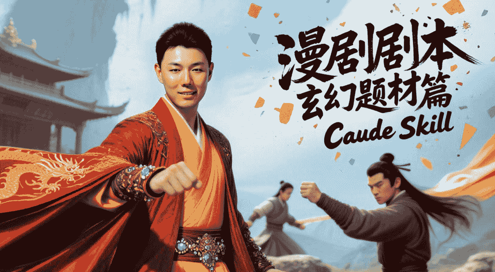
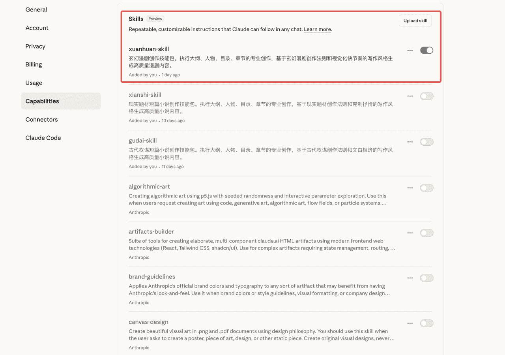

# 漫剧 | 玄幻类 漫剧剧本创作 Claude Skill

> 来源：[https://feicaiclub.feishu.cn/docx/R7F9dKZf2orEqZxG5K5cMroPnAg](https://feicaiclub.feishu.cn/docx/R7F9dKZf2orEqZxG5K5cMroPnAg)



<https://player.bilibili.com/player.html?bvid=1oVyGBMEyn&share_source=copy_web&vd_source=1adb0321bdfa6d9eb5d1bf5665ffc381>

# 用 Claude Agent Skill 写玄幻类题材漫剧剧本

这套方案主要解决一个问题：有了故事灵感后，从构思到完成一个完整的60集漫剧剧本往往需要很长时间。传统流程是想大纲、设计人物、规划分集、写正文，每一步都需要反复打磨，效率很低。

所以我们通过 Claude 的 Skill 功能搭建了一个专业的创作写手。把玄幻漫剧的创作方法论、文档模板、写作风格、实战示例都打包进 xuanhuan-skill，让 Claude 在每个创作环节都能调用这些专业知识。你只需要回答几个问题，剩下的大纲、人物、分集目录就由 AI 按照专业标准自动生成。

工作流程按照漫剧创作的自然顺序推进：故事大纲 → 人物小传 → 分集目录 → 正文创作。CLAUDE.md 负责整体流程管控，xuanhuan-skill 提供创作标准，xuanhuan-aligner 确保质量一致。从有灵感到生成完整初稿，整个过程可以在几小时内完成。

这个方案让故事灵感从脑海里的想法变成可以直接阅读的漫剧初稿，大幅提升创作效率。不过要注意，生成的内容是初稿，还需要根据个人风格润色调整。

---

# **核心功能模块**

**Skill调用机制**

通过 xuanhuan-skill 技能包为 Claude 提供专业创作知识。每个创作阶段开始前，主Agent会自动调用对应的资源文件：大纲阶段读取 outline-method.md（方法论）+ outline-template.md（模板）+ outline-example.md（示例），正文阶段读取 output-style.md（写作风格）+ chapter-template.md（模板）。这种模块化设计让 Claude 不是凭感觉写作，而是基于明确的创作标准和范式进行输出。

**分阶段创作流程**

创作严格遵循"故事大纲 → 人物小传 → 分集目录 → 正文创作"的流程，每个阶段对应独立文档。用户通过 /character、/catalog、/write 命令推进流程，系统会自动读取前序文档确保连贯性。比如创作正文时，会同时读取 outline.md、character.md、chapter_index.md，确保情节不偏离大纲、人物行为符合设定。正文创作采用批次模式，每批生成5集，创作完成后自动进入质量检查环节。

**一致性检查机制**

每批5集创作完成后，系统会自动调用 xuanhuan-aligner 进行质量检查。检查以大纲为核心基准，覆盖10个维度：剧情进度、境界体系、爽点分布、人物行为、时间线、伏笔处理、金手指规则、格式规范、写作风格、创作禁忌。如果检查返回FAIL状态，系统会调用 xuanhuan-skill 修改问题内容，然后重新检查，直到通过（PASS状态）才写入文档。这种检查-修改-再检查的闭环机制，避免了前后矛盾、设定崩坏等常见问题。

**模板驱动生成**

所有文档格式由 templates/ 目录下的模板文件定义，包括大纲、人物小传、分集目录、正文四类。Claude 创作时严格遵循模板结构，确保输出格式统一、信息完整。比如人物小传必须包含"主角→炮灰反派→其他角色"的层级。

**上下文连贯性**

每个阶段创作前都会读取已有文档内容。人物创作基于大纲设定，正文创作基于大纲+人物+目录，形成递进式上下文积累。系统通过文档驱动而非对话记忆来维护上下文，即使对话被清空，只要文件还在，就能通过 /status 命令查看进度并继续创作。

**文档结构管理**

项目采用标准化目录结构：outline.md（大纲）、character.md（人物）、chapter_index.md（目录）、chapters/Episode-XX.md（各集正文）。固定60集结构对应三幕式布局，每集500-800字。这种结构化存储让创作过程可追溯、可修改，文档本身就是交付物，而不需要从对话记录中复制粘贴整理。

> 注：AI生成的是初稿,能帮你快速把故事框架搭起来,但最终还需要人工润色才能达到投稿标准。输入质量直接决定输出质量——你在Q1-Q3提供的核心创意、冲突设定越详细具体,生成的大纲和人物就越贴合预期。AI的工作是基于你的创意进行填充和扩展,而不是100%从零创造,所以前期构思越清晰,后期调整成本越低。另外,固定的60集结构适合标准玄幻漫剧,如果需要不同集数,需要调整模板和方法论。

---

# **如何配置**

## **配置步骤：**

### 方式一：在 Claude.ai 网页版配置（推荐新手）



1.  **进入Skills设置**

+   选择 "Settings" → "Capabilities" → "Skills"

+   点击 "Upload file" 按钮

1.  **上传技能包**

+   选择 zip 压缩包文件

+   系统会自动解压并识别skill结构

1.  **启用技能包**

+   在Skills列表中找到新创建的技能

+   确保状态为 "Enabled"（已启用）

1.  **开始创作**

+   回到对话界面，开始新对话

+   直接向Claude说明你的创作需求即可

+   Claude会自动调用进行创作

### 方式二：在 Claude Code 中配置（适合熟练）

请按照以下步骤配置创作系统，配置完成后，你的项目结构应该是这样：

```
project/
├── outline.md                           # 故事大纲（创作后生成）
├── character.md                         # 人物小传（创作后生成）
├── chapter_index.md                     # 分集目录（创作后生成）
├── chapters/                            # 分集正文目录（创作后生成）
│   ├── Episode-01.md
│   ├── Episode-02.md
│   └── ...
└── .claude/
    ├── CLAUDE.md                        # 项目规则和主Agent配置（必须创建）
    ├── skills/
    │   └── xuanhuan-skill/              # 玄幻漫剧创作技能包（必须创建）
    │       ├── SKILL.md                 # 技能包核心配置
    │       ├── outline-method.md        # 大纲创作方法论
    │       ├── output-style.md          # 写作风格
    │       ├── templates/               # 文档格式模板
    │       │   ├── outline-template.md
    │       │   ├── character-template.md
    │       │   ├── chapter-index-template.md
    │       │   └── chapter-template.md
    │       └── examples/                # 创作示例
    │           ├── outline-example.md
    │           ├── character-example.md
    │           ├── catalog-example.md
    │           └── chapter-example.md
    └── agents/
        └── xuanhuan-aligner.md          # 一致性检查Agent（必须创建）
```

1.  **创建项目规则**

+   在 .claude/ 目录下创建 CLAUDE.md 文件

+   粘贴完整的项目规则内容，包含角色定义、工作流程、指令集

+   确保包含初始化脚本和所有创作阶段的流程定义

1.  **创建 Skill 技能包**

+   在 .claude/skills/ 目录下创建 xuanhuan-skill/ 文件夹

+   创建 SKILL.md 作为技能包核心配置

+   粘贴技能包说明和执行流程

1.  **添加创作方法论**

+   在 xuanhuan-skill/ 目录下创建 outline-method.md

+   粘贴大纲创作方法论，包含三幕式结构、人物塑造、爽点设计等内容

1.  **配置写作风格**

+   创建 output-style.md 文件

+   粘贴写作风格定义和具体行为规范

1.  **添加文档模板**

+   在 xuanhuan-skill/templates/ 目录下创建四个模板文件

+   包括大纲、人物小传、分集目录、分集正文的格式定义

+   这些模板会严格约束 AI 的输出格式

1.  **添加创作示例**

+   在 xuanhuan-skill/examples/ 目录下创建示例文件

1.  **创建一致性检查Agent**

+   在 .claude/agents/ 目录下创建 xuanhuan-aligner.md 文件

+   粘贴完整的检查标准和执行流程

+   这个subagent会在每批5集创作完成后自动触发，检查10个维度的一致性

## **重要配置细节：**

+   **Skill调用**：CLAUDE.md 中定义了何时调用 xuanhuan-skill，每个创作阶段会自动调用对应资源

+   **Aligner检查**：每批5集创作完成后，主Agent会自动调用 xuanhuan-aligner 检查一致性，返回PASS或FAIL状态，FAIL时触发修改流程

+   **模板约束**：templates/ 中的格式是强制性的，AI 必须按照模板结构输出

+   **方法论指导**：outline-method.md 是核心，定义整体三幕式结构、单集起承转钩、人物塑造、冲突设计等创作标准

+   **风格一致性**：output-style.md 确保视觉化、快节奏风格贯穿全剧，避免出现过度文学化表达

+   **示例学习**：examples/ 提供具体范式，让 AI 理解什么是符合标准的输出

+   **质量保障**：xuanhuan-aligner 以大纲为核心基准，检查境界体系、爽点分布、人物行为、时间线等10个维度，确保前后不矛盾

+   **固定结构**：漫剧固定60集对应三幕式布局，不支持自定义集数

+   **人工润色**：AI生成初稿后仍需人工调整细节、润色语言、补充情节

---

# **核心设计理念**

```
┌─────────────────────────┐
│  xuanhuan-skill         │ ← 知识层：提供专业创作指导
│  ├─ outline-method.md   │    方法论、风格、模板、示例
│  ├─ output-style.md     │
│  ├─ templates/          │
│  └─ examples/           │
├─────────────────────────┤
│  CLAUDE.md              │ ← 流程层：控制创作流程
|                         │    定义工作流和指令集
├─────────────────────────┤
│  Main Agent             │ ← 创作层：调用Skill进行创作
|                         │    读取资源→生成内容→质量检查
├─────────────────────────┤
│  xuanhuan-aligner       │ ← 检查层：确保一致性
|                         │    10维检查→PASS/FAIL→触发修改
├─────────────────────────┤
│  outline.md             │ ← 文档层：结构化存储
│  character.md           │    故事大纲
│  chapter_index.md       │    人物小传
│  chapters/*.md          │    分集目录
|                         │    分集正文
└─────────────────────────┘
```

## **工作流程：**

1.  **需求收集** - 主Agent询问核心创意、金手指类型、故事调性三个问题

1.  **调用Skill** - 根据创作阶段，调用xuanhuan-skill读取对应的方法论、模板、示例

1.  **内容创作** - 基于Skill提供的指导和用户需求，生成符合标准的内容

1.  **质量检查**（仅正文阶段）- 调用xuanhuan-aligner检查10个维度的一致性，以大纲为核心基准

1.  **修改循环**（如需要）- 如检查返回FAIL，调用xuanhuan-skill修改问题内容，重新检查直到PASS

1.  **文档写入** - 将通过检查的内容写入对应的结构化文档

1.  **流程推进** - 通知用户当前阶段完成，引导进入下一个创作阶段

## **关键特性：**

+   **Skill驱动** - 每个阶段自动调用对应资源，确保创作有章可循

+   **质量保障** - 正文创作每批5集完成后自动触发一致性检查，检查-修改-再检查形成闭环

+   **模板约束** - 严格遵循templates/定义的格式，保证输出规范统一

+   **阶段递进** - 按照"大纲→人物→目录→正文"顺序推进，后续阶段基于前序文档

+   **上下文积累** - 通过文档驱动而非对话记忆维护上下文，支持长期创作

+   **结构化存储** - 所有内容分文件管理，便于查看、修改和复用

+   **快速落地** - 从灵感到初稿，整个流程可在几小时内完成

+   **固定框架** - 60集结构对应三幕式布局，单集起承转钩结构，适合快速产出标准化漫剧

---

# **👀 先睹为快**

我们用这套系统测试了Claude Sonnet 4.5模型，从提出故事创意到生成完整的60集漫剧大纲和前20集正文，整个过程用了一个多小时。所有内容都是基于框架直接生成的初稿，未经人工润色。每批5集创作完成后，xuanhuan-aligner会自动检查境界体系、爽点分布、人物行为等10个维度，确保前后不矛盾。这样你可以直观地看到这套系统在实际应用中能达到什么效果。

## **使用时的注意事项：**

1.  **输入质量决定输出质量**。Q1-Q3回答得越详细，生成的内容就越贴合你的预期。比如核心冲突如果只写"修炼变强"，生成的内容会很空泛；但如果写"废材主角觉醒吞噬系统，需击败各境界天才夺取机缘，但每次吞噬都会引来更强敌人追杀"，生成的内容就会具体很多。

1.  **这是初稿，不是成品**。AI生成的内容能帮你快速搭起框架，但节奏细节、打斗场面、爽点设计还需要人工润色。特别是战斗描写部分，AI有时会写得过于平淡，需要调整成更具视觉冲击力的表达。

1.  **及时反馈和调整**。如果大纲阶段就发现内容偏离预期，直接提出修改意见，不要等到写完多集再推倒重来。每个阶段都可以修改，改得越早成本越低。

1.  **注意版权问题**。虽然这套系统是基于方法论和模板创作，但如果你的故事创意本身借鉴了某部作品，还是要注意避免抄袭。建议用自己的原创构思，或者对经典题材进行充分的改编创新。

## 故事大纲

## 漫剧信息

+   **剧名**:神文觉醒:我用小学语文碾压异世界

+   **类型**:玄幻漫剧

+   **故事调性**:知识降维打击流(轻幽默+文化自信+爽感碾压)

+   **集数规格**:60集

+   **每集时长**:1-2分钟

+   **总时长**:60-120分钟

## 主要人物

+   **林书白(男主)**:现代中文系研究生,穿越到异世界后发现神文竟是汉字,凭借现代汉字学知识体系实现文化降维打击

+   **慕容雪**:青云文院第一女学员,悟文境天才,容貌倾城性格高冷,后与主角产生交集

+   **墨渊**:青云文院院长,文道宗师,见证主角崛起

+   **苍古**:神文殿殿主,异世界最强者之一,最终boss,掌握上古残缺神文

## 核心梗概

> 现代中文系研究生林书白穿越到"文字即法术"的异世界,因不熟悉异世界的死记硬背修炼法被判定神文觉醒失败沦为废材,却意外发现异世界的"神文"竟是汉字!凭借现代汉字学的完整知识体系——字源解析、六书造字法、音韵训诂、诗词典故,他能举一反三、自由创造,实现"用现代语文课知识碾压异世界修仙者"的文化降维打击。

>

## 导语

> 青云文院神文课上,被当了十年废材的林书白突然发现,讲师讲解的"神文"竟然全是他从小就学的汉字!这个世界的修炼者只会死记硬背,把汉字当神秘符号崇拜,根本不懂造字逻辑。林书白——一个穿越而来的现代中文系研究生,脑海中装着完整的汉字学知识体系,字源、六书、训诂、诗词,样样精通。当他理解"火"字的象形本源,写出的火焰比普通人强十倍;当他自创会意字"爆",考核石碑直接炸裂;当他用成语"火上浇油",全场震撼失声。从今天起,他要用现代语文课的知识,让这个世界见识什么才是真正的文字之道!

>

## 故事大纲

>

### 【第一幕:开端】第1-20集(20集)

>

#### 第1-5集:穿越废材+瞬间觉醒+初露锋芒

>

> 现代中文系研究生林书白睁开眼,发现自己穿越到异世界。接收原身记忆后他苦笑——原身在青云文院修炼十年,一直卡在识文境一层无法突破,被所有人当成废材。就在昨天的年度考核上,原身因为连最基础的神文"火"都写不出威力,被讲师当众羞辱,被同窗嘲笑,绝望之下跳崖自尽,才让林书白穿越而来。

>

> 今天是新的一周,原身还要去上神文基础课。林书白整理好情绪,决定先去上课看看这个世界的神文到底是什么。神文课上,年轻的楚讲师在黑板上书写神文,讲解用法。当第一个字写出来时,林书白整个人都震住了——"火"!这不是汉字吗?!接下来楚讲师又写了"水""木""土""金",林书白越看越兴奋,全都是汉字!

>

> 楚讲师讲解说:"神文是上古流传下来的神秘符号,我们只需记住它的形状和用法即可,至于为什么这个形状能召唤火焰,没有人知道..."林书白内心狂喜——这个世界的人只会死记硬背,把汉字当神秘符号,根本不懂造字逻辑!他一个中文系研究生,掌握完整的汉字学知识体系,这不就是降维打击吗?

>

> 楚讲师突然点名:"林书白,你来写一个'火'字,给大家演示。"全场哄笑——废材连火都写不出来,这是要当众出丑了。林书白淡定走上讲台,提笔写下"火"字。与其他学生机械临摹不同,他深刻理解"火"字的字源——上为火苗,下为木柴,象形字。当他写完的瞬间,"火"字金光大盛,火焰冲天而起,比楚讲师演示的威力还大三倍!全场寂静。楚讲师震惊:"你的火字...威力怎么这么强?"林书白淡然一笑:"我只是理解了它的本质。"这句话让所有人面面相觑——本质?神文还有本质?

>

> 下课后,林书白回到住处开始疯狂验证自己的猜想。他写"水",理解三点水代表流动的水;写"木",理解它的象形来源;写"山",理解它像山峰的形状。每写一个字,都比普通人的威力强数倍。仅用一晚,他就从识文境一层突破到三层!林书白狂喜确认——只要理解汉字的字源、演变、文化内涵,就能发挥出数倍威力,境界提升速度也会飞快!

>

> 第二天课上,楚讲师出了一道难题:书写威力最强的攻击神文。同学们纷纷写出"剑""刀""枪"等常见字,威力平平。轮到林书白,他提笔写下一个所有人都从未见过的字——"爆"!这个字刚写出,恐怖能量波动席卷全场,讲台上的测试石直接炸裂!全场震惊失声。楚讲师颤抖着问:"这是什么神文?!从未见过!"林书白淡然道:"会意字,火加暴,火势凶猛到暴烈。这不就是小学二年级学的吗?"全场哗然——小学?学?什么意思?但所有人都意识到,这个被当了十年废材的林书白,突然变得深不可测了!

>

> ---

>

#### 第6-10集:月度考核+大放异彩+女主登场(免费高潮)

>

> 林书白的异常表现引起了文院的注意。青云文院每月都有一次考核,评定学员等级和资源分配。这次月度考核恰好在三天后举行,林书白决定借此机会一鸣惊人。考核当天,演武场上千人围观。

>

> 第一项考核是书写最强攻击神文。各学员纷纷展示自己的神文:剑、刀、枪、箭等常见攻击文字。轮到林书白时,全场又是一阵嘲笑——废材也敢参加考核?林书白走上台,毫不犹豫地写下"爆"字。恐怖的能量波动席卷全场,考核石碑直接炸裂成粉末!所有人震惊失声。主考长老震撼道:"这个字从未见过...威力至少是普通神文的十倍!"

>

> 第二项考核是防御神文。众学员写盾、甲、壁等字,而林书白写下"固"字(本义是坚固城墙)。这个字化作金色光罩,主考长老全力攻击都无法打破。全场再次震撼。就在此时,一道清冷的女声响起:"有意思,让我来试试。"众人回头,只见一位白衣女子缓步走来,正是青云文院第一女学员——慕容雪。

>

> 慕容雪悟文境五层,天赋卓绝,容貌倾城,但性格高冷,从不与人亲近。她凌空书写神文"破",一道锋利剑气斩向林书白的防御罩。令所有人震惊的是,林书白的"固"字防御罩竟然挡住了!慕容雪美眸中闪过一丝异色:"你叫林书白?很好,我记住你了。"说完转身离去,留下满场震撼的学员。

>

> 第三项考核最关键——境界测试。所有人都以为林书白还是识文境一层的废材,当测试石显示"识文境五层"时,全场哗然!三天前他还是识文境一层,三天后就五层了?!这是什么妖孽般的修炼速度?!主考长老震惊得说不出话。

>

> 这时,青云文院第一天才云逸(识文境九层)站了出来,冷笑道:"林书白,你的神文虽强,但你境界太低。识文境五层,也敢嚣张?"他当众挑战林书白。林书白平静应战:"试试就知道。"

>

> 云逸率先出手,神文"杀"轰出,杀气凛然。林书白提笔,写下一个字——"灭"(本义是水淹火,用水压制火焰)。两字在空中碰撞,"杀"字瞬间溃散,"灭"字威势不减,直冲云逸!云逸惨叫着被轰飞百米,撞碎演武台石柱昏死过去。

>

> 全场死寂,三秒后爆发雷鸣般惊呼:"识文境五层越四级战胜识文境九层?!""这是什么妖孽天才!"院长墨渊从贵宾席站起,眼神震撼:"此子对神文的理解...远超常人!"林书白转身离去,只留下一句淡然的话:"不过是理解了字源罢了。"他的目光与慕容雪在人群中短暂交汇,慕容雪眼中闪过复杂神色。从今日起,两个名字在青云文院并列——第一天才慕容雪,第一妖孽林书白。远方,一道神秘目光注视而来:"有意思的小子..."

>

> ---

>

#### 第11-20集:连胜晋升+揭秘六书+成语打脸(第一付费段前半)

>

> 战后第二天,院长墨渊亲自召见林书白,询问他的神文从何而来。林书白小心措辞,说自己只是理解神文的本质,知道造字逻辑、演变规律和文化内涵。墨渊震撼失声,颤抖着问他是否掌握了失传的《神文古法》。林书白心中暗笑——这不就是六书造字法吗,小学语文就教过。墨渊当即决定破格提拔林书白为核心弟子,赐予大量修炼资源。

>

> 获得资源后,林书白闭关修炼。凭借对汉字的深刻理解,他的境界突破速度远超常人。从识文境五层一路飙升到识文境九层,仅用了三天时间。当他突破到悟文境时,终于理解了这个境界的本质——理解字的深层含义。林书白笑了,这不就是训诂学吗?训诂是解释古文字词义的学问,正好对应悟文境的要求。

>

> 就在林书白刚突破悟文境时,青云文院第二天才萧寒(悟文境五层)不服气,公开挑战林书白,约定三日后生死战。林书白平静应战。这三天里,他深入研究悟文境的修炼方法,对比现代汉字学的训诂理论,发现这个世界的修炼者只知道字的表面意思,根本不懂字义演变和文化内涵。

>

> 比如"仁"字,他们只知道代表仁慈,却不知"仁"从人从二,本义是人与人的关系,蕴含儒家文化的核心思想。当林书白深刻领悟"仁"字真谛时,这个字绽放圣洁光辉,他的悟文境境界瞬间提升三层。他豁然开朗——原来可以从字义入手,理解字背后的文化底蕴,这样修炼速度会快十倍!

>

> 接下来两天,他连续领悟"义""礼""智""信"等字的深层含义,境界飙升到悟文境巅峰。三日后的生死战万众瞩目。萧寒境界比林书白高,且修炼了文院最强的连击神文——风林火山四字连击。

>

> 战斗开始,萧寒率先出手,四个神文接连轰出,威力惊人,林书白被压制得连连后退。众人惊呼林书白要输了,萧寒不愧是第二天才。就在此时,林书白嘴角勾起一抹笑意,说该他了。他提笔书写四个字:"火上浇油"。

>

> 这四个字刚写出,所有人都愣住了——从未见过四字组合的神文!下一秒,四字融合化作滔天火海,威力暴涨十倍!萧寒惨叫着被火海吞噬,轰飞千米外。全场震撼:"四字组合神文?!""从未见过的技法!"

>

> 院长墨渊震惊失声:"四字成语...难道他掌握了上古《神文典》?!"林书白淡然说:"这不过是成语接龙罢了,难道你们连这个都不懂?"他转身离去,全场学子跪拜高呼"参见林师兄"。从今日起,林书白名震青云文院。远方,一道神秘目光注视而来,那是来自更高层次的窥探——有人盯上了他。而在人群中,慕容雪静静注视着林书白的背影,美眸中闪过复杂神色。

>

> ---

>

### 【第二幕:对抗】第21-45集(25集)

>

#### 第21-30集:天书秘境+六书觉醒+舞台升级(第一付费段后半)

>

> 击败萧寒后,林书白被册封为青云文院首席弟子,获得进入"天书秘境"的资格。天书秘境是上古神文遗迹,每十年开启一次,各大文院的顶尖天才都会前往寻求机缘。当林书白抵达秘境入口时,遇到了赤霞文院第一天才楚狂(悟文境巅峰)。楚狂傲慢地嘲讽青云文院也配来参加秘境试炼,林书白冷笑着说拭目以待。

>

> 秘境开启,所有天才进入其中。秘境深处有上古神文碑,记载着失传已久的神文知识。其他天才苦苦参悟,一个字都看不懂,因为碑上刻的是小篆、甲骨文、金文等古文字。林书白却一眼看穿——这是汉字演变史!小篆是秦始皇统一文字后的形态,甲骨文是商朝的文字,金文是青铜器上的铭文。

>

> 他兴奋地研究这些古文字,发现原来神文也经历过演变,从象形逐渐简化到楷书。理解了这个演变过程,他突然明白如何让神文的威力更强——回归字源,用最原始的形态书写!在秘境中,林书白疯狂吸收上古神文知识,境界突破到通文境。通文境的修炼要求是精通字源演变,这正好对应现代汉字学中的文字学。林书白凭借对汉字演变史的完整知识,修炼速度再次飞快,从通文境一层飙升到三层。

>

> 就在此时,他遭遇强敌——赤霞文院院长的亲传弟子苏北辰,境界是文道境三层,远超林书白。苏北辰冷笑说一个通文境三层的蝼蚁也敢在他面前嚣张。战斗爆发,苏北辰使用神文"镇压",恐怖的威压笼罩而来,林书白被压制得狂吐鲜血。

>

> 就在生死关头,林书白脑海中灵光一闪——他想起了六书造字法的完整理论。六书包括:象形(根据物体形状造字)、指事(用抽象符号表意)、会意(组合多个字表达新意)、形声(形旁+声旁)、转注(字义引申)、假借(借音表义)。这是汉字造字的终极法则!

>

> 林书白当即顿悟,凭借六书造字法,他可以自创全新的神文!他凌空书写一个前所未有的字——"破"(会意字:石+皮,石头破开外皮)。这个自创神文威力惊天,直接破开了苏北辰的"镇压"!苏北辰震惊失声:"你竟然能自创神文?!这是文道境才有的能力!"林书白冷笑,又自创几个神文反击,苏北辰勉强抵挡后狼狈逃走。

>

> 林书白意识到,六书造字法才是神文体系的真正核心。掌握了六书,他可以根据需要随时创造新的神文,不再受限于已有的文字库。秘境试炼结束,林书白带着对六书的深刻领悟和大量上古神文知识回归青云文院。院长墨渊得知林书白能自创神文,震惊得说不出话。他说林书白已经超出了文院能教导的范围,决定推荐他前往圣文殿进修。

>

> 圣文殿是天下文道圣地,汇聚了最强的文道宗师,只有各文院最顶尖的天才才有资格进入。林书白眼神坚定,决定前往圣文殿。临行前,墨渊警告他圣文殿高手如云,切勿轻敌。林书白点头,但内心充满期待——更大的舞台,更强的对手,正是他所需要的。

>

> ---

>

#### 第31-40集:圣文殿崛起+身份曝光+实力震撼(第二付费段前半)

>

> 圣文殿恢弘壮丽,是天下文道修炼的最高学府。林书白抵达后却遭到圣文殿弟子的嘲讽——一个青云小院来的,境界才通文境,他们这里最弱的都是文道境。圣文殿首席弟子墨尘(文道境五层)更是直言青云文院的废物不配进圣文殿。林书白冷笑回应:"是骡子是马,拉出来溜溜?"

>

> 入门考核是书写最强神文。墨尘书写"灭世"二字,威力惊天,众人惊叹不愧是首席。轮到林书白,他提笔书写四字成语:"排山倒海"。四字成语化作滔天巨浪,威力竟然超过墨尘的二字神文!全场震撼,考核长老当即宣布林书白直接晋升核心弟子。墨尘脸色铁青,约定三日后决战。

>

> 决战之日万众瞩目。墨尘使用神文"天罚",恐怖的神文之力降临,林书白被压制。众人窃窃私语说果然境界差距太大。就在此时,林书白突然笑了,说要告诉他们什么是真正的神文之道——六书造字法。

>

> 他凌空自创神文:"裂"(会意字:衣+刀,衣被刀裂开),直接撕裂"天罚",墨尘被轰飞!全场死寂!考核长老震惊失声:"自创神文...六书造字法...难道你是上古文圣转世?!"此战之后,圣文殿沸腾,所有人都在议论林书白能自创神文,六书造字法失传三千年了,他到底是谁。各方势力开始调查林书白身份。林书白趁机闭关,境界突破到通文境巅峰。

>

> 就在此时,赤霞文院院长赤焰真人(文道境巅峰)追杀而来,要为爱徒苏北辰报仇。他布下恐怖火阵,要将林书白炼化。林书白与赤焰真人激战,战斗到生死关头,林书白终于突破——从通文境跨入文道境!

>

> 他凌空书写八字成语:"势如破竹,锐不可当!"八字成语融合,化作无敌锋芒,火阵瞬间破碎,赤焰真人被轰飞重伤!全场震撼!圣文殿殿主文渊真君现身,震惊地说此子天赋三千年未见,莫非是传说中《说文解字》的传人。众人震撼失声——《说文解字》是上古神典,记载着神文的终极奥秘!

>

> 林书白淡然一笑,心中暗想如果他们知道《说文解字》只是入门级著作,表情会如何。从此日起,林书白名动天下,被誉为"文道妖孽"。但神秘黑影在暗处注视:"此子不除,必成大患..."

>

> ---

>

#### 第41-45集:天骄文战+终极boss现身+决战铺垫(第二付费段后半)

>

> 圣文殿举办百年一度的"天骄文战",天下文道天才汇聚。林书白连战连胜,使用各种成语组合如"锦上添花""雪上加霜""釜底抽薪"等,威力惊人,击败各路天骄。最终战是对阵圣文殿千年第一天才独孤文(文道境巅峰)。独孤文修炼三十年,实力深不可测。

>

> 两人激战正酣,就在林书白即将获胜时,天空突然裂开!一道恐怖气息降临,神秘黑袍人现身。文渊真君震惊:"苍古!你竟敢现身圣文殿?!"苍古冷笑着说林书白掌握的六书造字法是神文殿的至高机密,让他交出来就饶他不死。林书白冷笑反问他算什么东西。

>

> 苍古暴怒,一掌拍出恐怖神文之力,林书白被重创——文道境vs文圣境,境界差距太大!文渊真君出手相救,与苍古激战,林书白被护送离开。苍古狞笑着放话:三个月后神文殿等你,届时就是你的死期!

>

> 林书白重伤昏迷三日才醒来,决心变强。文渊真君说苍古是文圣境强者,三个月根本不可能从文道境突破到文圣境。林书白却坚定地说:"那就让你们见识一下什么是真正的速度!"

>

> 他开始疯狂闭关修炼。在闭关中,林书白终于领悟了文圣境的真谛——诗词歌赋。这个境界要求将神文提升到艺术层次,每一句诗词都是神文,威力无穷。林书白狂喜,这不就是古诗词鉴赏吗?他脑海中涌现无数经典诗词:《诗经》《楚辞》唐诗宋词...

>

> 他开始尝试书写诗词神文。当他写下"白日依山尽,黄河入海流"时,诗句化作神文,威力惊天,境界突破到文圣境!接下来的修炼如有神助,他书写"大江东去,浪淘尽千古风流人物",境界连跳;书写"黄沙百战穿金甲,不破楼兰终不还",杀伐之意凝成战甲。

>

> 三个月期限将至,林书白突破到文圣境巅峰,掌握了终极技能——对联造化。对联上下句呼应,可形成完美神文循环,威力无穷。林书白睁开眼,眼神锋利如刀:"苍古,受死吧!"

>

> ---

>

### 【第三幕:高潮】第46-60集(15集)

>

#### 第46-55集:终极修炼+巅峰对决+击败boss(第三付费段前半)

>

> 林书白疯狂闭关修炼,不断参悟汉字的终极奥秘——诗词歌赋。他发现文圣境要求将神文提升到艺术层次,每一句诗词都蕴含无上神文之力。这对他来说简直是降维打击,因为他脑海中装着《诗经》《楚辞》唐诗宋词元曲等无数经典。

>

> 他尝试书写李白的《黄鹤楼送孟浩然之广陵》:"故人西辞黄鹤楼,烟花三月下扬州",诗意化作神文,意境美到极致,威力也惊天动地。境界突破到文圣境三层。他再写苏轼《念奴娇·赤壁怀古》:"大江东去,浪淘尽千古风流人物",豪迈诗意化作滔天巨浪,境界连跳到文圣境五层。

>

> 他又写岑参《白雪歌送武判官归京》:"忽如一夜春风来,千树万树梨花开",诗境如梦似幻;写王昌龄《从军行》:"黄沙百战穿金甲,不破楼兰终不还",杀伐之意凝成金色战甲。短短一个月,他境界就突破到文圣境巅峰。

>

> 就在此时,林书白领悟了终极技能——对联造化。对联是中国文学的独特形式,上下联对仗工整、意境呼应,若用作神文可形成完美循环,威力无穷且生生不息。他尝试书写诸葛亮《诫子书》中的名句:"非淡泊无以明志,非宁静无以致远",这两句对偶句化作圣光,境界突破——文帝境!

>

> 文帝境是文道修炼的巅峰,整个世界只有寥寥数人达到。林书白睁开双眼,眼神锋利如刀。三个月期限已到,他独自前往神文殿。神文殿前万人围观,所有人都想看这场巅峰对决。

>

> 苍古冷笑着等候,认为林书白必死无疑。战斗爆发,苍古书写上古神文"混沌初开",威力毁天灭地。林书白却淡然书写对联:"天增岁月人增寿,春满乾坤福满门",对联神文形成循环生生不息,竟然磨灭了"混沌初开"!苍古震惊:"你竟然掌握了对联之法?!"

>

> 苍古暴怒,展现真正实力,书写上古禁忌神文"天地归墟"。恐怖的毁灭之力席卷而来,林书白被压制狂吐鲜血。众人惊呼林书白要输了。就在此时,林书白突然笑了,说终于逼他用出那一招了。

>

> 他凌空书写:"静以修身,俭以养德;非淡泊无以明志,非宁静无以致远"——诸葛亮《诫子书》全文化作圣光!在这股圣光中,林书白境界再次突破,稳固文帝境!他又书写林则徐的名联:"海纳百川,有容乃大;壁立千仞,无欲则刚",名联爆发无上威能,"天地归墟"瞬间被撕碎!

>

> 苍古被轰飞重伤垂死。全场震撼:"文帝境!他突破到文帝境了!"林书白立于虚空:"苍古,你输了。"苍古临死前吐露真相:三千年前有一位强者从天外而来,带来了神文,那些神文和林书白使用的一模一样。那位强者自称来自华夏,神文的真正名字叫汉字。林书白震撼——还有其他穿越者?!苍古说那位强者现在就在天外天,建立了一个组织,专门寻找掌握汉字真谛的人。苍古断气。天空裂开,一道声音传来:"有意思的小子...欢迎来天外天..."

>

> ---

>

#### 第56-60集:称霸一方+天外天钩子+文明之战预告(第三付费段后半)

>

> 林书白击败苍古,名震天下,被各大势力尊为"文道第一人"。圣文殿册封他为少殿主,前敌人全部跪地求饶。各大文院送来贺礼,林书白站在圣文殿之巅俯瞰天下,内心却并不平静——华夏、天外天、那里到底有什么?

>

> 他决定前往天外天寻找答案。文渊真君相送,警告说此去凶险万分。林书白坚定地说必须去,因为那里有他想要的答案。临行前,慕容雪赶来相送,递给他一枚玉佩:"保重。"林书白接过玉佩,点头:"等我回来。"他凌空书写李白《行路难》:"长风破浪会有时,直挂云帆济沧海",诗句化作金色巨船破空而去。

>

> 林书白穿过界壁,眼前景象震撼——一个更加宏大的世界展现!无数强者在此修炼,每一个都是文帝境以上!一个青年走来打招呼,说他叫李明,来自华夏,穿越三百年了。林书白震惊原来真有其他穿越者。

>

> 李明说在天外天穿越者多得是,他们建立了一个组织叫"汉字盟"。林书白问汉字盟是什么。李明解释说天外天有无数位面,汉字只是其中之一,还有英文、梵文、阿拉伯文等其他文明体系,不同文明之间一直在争斗。林书白震撼:"其他文明?!"

>

> 李明点头:"没错,文明之战即将开启!"就在此时,远方无数恐怖气息爆发,神秘强者现身:"汉字盟的小鬼?今日就灭了你们!"李明脸色大变:"不好!是梵文殿的人!"林书白问什么境界。李明惊恐地说:"文神境!快逃!"

>

> 恐怖攻击袭来,林书白凌空书写:"路漫漫其修远兮,吾将上下而求索!"《离骚》诗句爆发,竟然挡住了一击!梵文殿强者震惊:"这小子是谁?!"李明震撼:"你...你竟然能挡住文神境一击?!"林书白眼神坚定:"文明之战?来得正好,让他们见识一下华夏五千年文化的力量!"

>

> 画面定格。字幕:"第一季完。第二季:文明之战,敬请期待!"

>

> ---

>

## 爽点分布规划

>

### 超级爽点

+   **第20集**:用成语"火上浇油"碾压萧寒,震惊全院,全场学子跪拜"参见林师兄!"慕容雪注视林书白背影

+   **第40集**:身份曝光为《说文解字》传人,突破文道境,用八字成语"势如破竹锐不可当"秒杀赤焰真人,名动天下!

+   **第60集**:击败苍古,成为文道第一人,但揭示更大世界——天外天,引出文明之战续集钩子!

### 大爆点

+   **第10集**:越四级战胜云逸(识文境五层vs九层),全场震撼,"这是什么妖孽!"

+   **第30集**:六书造字法觉醒,自创神文"破",击败文道境强者苏北辰,舞台升级至圣文殿

+   **第50集**:三个月修炼突破文圣境巅峰,掌握对联造化,准备决战苍古

### 付费转化节点

+   **第10集结尾**:云逸挑战,卡在"杀"字vs"灭"字对决的关键时刻!观众欲罢不能:"林书白能赢吗?!"

+   **第30集结尾**:圣文殿邀请,林书白决定前往更大舞台,格局升级:"更强的敌人在等着我!"

+   **第50集结尾**:突破成功,三个月期限已到,决战神文殿:"苍古,受死吧!"

> ---

>

## 境界体系

>

>

> **境界说明**:

+   识文境:只能书写单个神文,死记硬背

+   悟文境:理解字义,能组合2-3个字

+   通文境:理解字源演变,能使用四字成语

+   文道境:掌握六书造字法,可自创神文

+   文圣境:诗词歌赋,每句话都是神文

+   文帝境:汉字体系大成,一念即可生文

> **主角优势**:

+   他人:死记硬背神文,境界提升慢

+   林书白:理解汉字本质,举一反三,境界提升飞快,可越级战斗

> ---

>

> [注:玄幻漫剧60集标准,采用三幕式结构,每集500-800字,总字数3-4.8万字。本作特色为知识降维打击+文化爽文,节奏快,爽点密集,兼具娱乐性与文化性。]

## 人物小传

## 主角（必需）

>

> **林书白**（男主）

>

> 识文境一层（穿越前原身）→文帝境（第60集），现代中文系研究生，穿越到青云文院被当了十年废材的人身上。外貌清秀儒雅，总是带着一种看透世事的淡然笑意，一双眼睛仿佛能看穿文字本质，气质与这个世界格格不入。性格冷静理性、低调从容、腹黑吐槽——平时淡定如水看戏，但关键时刻一击必杀绝不拖泥带水；最喜欢用"这不就是小学语文吗"之类的话吐槽这个世界，让异世界人一脸懵逼。金手指是现代汉字学完整知识体系（字源解析、六书造字法、音韵训诂、诗词典故），理解汉字本质可举一反三、自创神文，修炼速度远超常人。修炼目标是探索神文源流之谜，找到其他穿越者，最终前往天外天。与慕容雪从对手到相互欣赏，与墨渊是师徒般的关系，独行不需要跟班更显强大。

>

> [注：230字]

>

> ---

>

## 女主角（特殊配置）

>

> **慕容雪**

>

> 悟文境五层→文圣境（第50集左右），青云文院第一女学员，第一天才。容貌倾城，一袭白衣如雪，长发及腰如瀑，气质清冷出尘不食人间烟火，一双美眸如寒星般冷冽。性格高冷孤傲、心高气傲但内心善良正直，从不与人亲近，对弱者不屑一顾但对强者心生敬意。第6集月度考核时她用"破"字测试林书白的"固"字防御未能破开，从此记住了这个名字。第10集见证林书白越级击败云逸，眼中闪过复杂神色——这个曾经的废材，竟然如此强大。随着剧情发展，她逐渐被林书白对神文的独特理解和超然气质吸引，从对手变为欣赏，最终在第60集临别前赠玉佩说"等你回来"。她不是打脸对象，而是与主角势均力敌的天才，推动情节发展的重要角色。

>

> [注：240字]

>

> ---

>

## 炮灰反派（必需）

>

> **说明**：各阶段被碾压的龙套，每批5-10集出现一批，打完就死或退场，不重复利用。

>

> **云逸**（第1-10集）

>

> 识文境九层，青云文院第一天才（林书白崛起前），二十五岁左右，相貌英俊但眼神傲慢轻蔑。性格骄傲自大目中无人，瞧不起林书白这个十年废材，坚信境界就是一切。第10集月度考核当众挑战林书白，狂言"识文境五层也敢嚣张？"，结果被林书白用"灭"字越四级秒杀，惨叫着被轰飞百米撞碎演武台石柱昏死过去，醒来后成为全院笑柄，从此一蹶不振。

>

> [注：140字]

>

> **萧寒**（第11-20集）

>

> 悟文境五层，青云文院第二天才，三十岁左右，国字脸剑眉星目但表情阴沉凶狠。性格阴狠毒辣睚眦必报，不服林书白越级战胜云逸，认为那只是运气和取巧。第15集公开约战林书白生死战，修炼了文院最强的"风林火山"四字连击神文。第20集决战中自信满满率先攻击，结果被林书白用成语"火上浇油"四字融合碾压，化作滔天火海将他吞噬轰飞千米外，重伤濒死被废修为逐出文院。

>

> [注：150字]

>

> **楚狂**（第21-25集）

>

> 悟文境巅峰，赤霞文院第一天才，三十岁左右，红发红衣器宇轩昂。性格狂妄自负瞧不起人，第21集天书秘境入口嘲讽青云文院也配来参加试炼。秘境中处处针对林书白，第25集想要独占上古神文碑，结果林书白一眼看穿碑文是甲骨文小篆，当场参悟突破。楚狂羞愤攻击被林书白随手击退，灰溜溜离开秘境，从此不敢再招惹。

>

> [注：130字]

>

> **苏北辰**（第26-30集）

>

> 文道境三层，赤霞文院院长亲传弟子，四十岁左右，身穿赤色道袍气势威严霸道。性格冷酷霸道自视甚高，修炼三十年在年轻一辈中罕有敌手。第26集天书秘境深处遇到林书白，冷笑"通文境蝼蚁"想要杀人夺宝。使用神文"镇压"威压笼罩，压制林书白狂吐鲜血。第27集被林书白六书造字法自创的"破"字击败，震惊失声"你竟能自创神文"，狼狈逃走，回宗门后羞愧难当闭关苦修不再现身。

>

> [注：160字]

>

> **墨尘**（第31-40集）

>

> 文道境五层，圣文殿首席弟子，三十五岁左右，俊美儒雅但眼神锐利带着清高。性格清高傲慢自命不凡，看不起青云文院这种小地方来的人，第32集林书白抵达时嘲讽"青云废物不配进圣文殿"。第33集入门考核书写"灭世"二字展现首席实力，结果被林书白"排山倒海"四字成语碾压，威力超过二字神文。第36集决战被林书白六书自创神文"裂"击败，全场震撼，墨尘从此心服口服转为追随者。

>

> [注：160字]

>

> **赤焰真人**（第38-40集）

>

> 文道境巅峰，赤霞文院院长，六十岁左右，红发红须如火焰般飞扬，气势暴烈如火。性格暴躁凶狠护短，得知爱徒苏北辰被林书白击败后暴怒，不顾身份追杀晚辈。第38集现身圣文殿门前，布下神文大阵"焚天灭地"困住林书白，要将其炼化。第40集林书白生死关头突破文道境，用八字成语"势如破竹锐不可当"反击，八字融合化作无敌锋芒瞬间破阵，赤焰真人被轰飞重伤吐血逃走，从此不敢再招惹。

>

> [注：170字]

>

> ---

>

## 打脸对象

>

> **选项E：无固定打脸对象**

>

> **说明**：本故事是纯升级流+知识降维打击流，主角直接碾压各路天才，无感情纠葛，不设置固定打脸对象（如未婚妻、师兄等）。所有羞辱来自炮灰反派，打完即死或退场，不留后患。女主慕容雪不是打脸对象，而是势均力敌的对手和未来的感情线，她从未羞辱过主角，反而是唯一从一开始就认真对待林书白的人。这种设定更符合"知识碾压"的核心——主角用现代语文知识打脸整个异世界的认知体系，而非纠缠于个人恩怨。

>

> ---

>

## 权威见证者（必需）

>

> **墨渊**（青云文院院长）

>

> 文道境巅峰，青云文院院长，五十岁左右，白衣白须仙风道骨气质超然。性格睿智温和爱才如命，眼光独到能识真才。第10集月度考核时震惊于林书白对神文的理解"远超常人"，感觉他掌握了失传的古法。第12集召见林书白询问神文来历，听到"造字逻辑、演变规律、文化内涵"后震撼失声，颤抖着问"是否掌握了《神文古法》"。从怀疑到重视，当即破格提拔林书白为核心弟子赐予大量资源。第30集得知林书白能自创神文后，认为已超出文院教导范围，亲自推荐他前往圣文殿进修，成为林书白的引路人和见证者。

>

> [注：200字]

>

> **文渊真君**（圣文殿殿主）

>

> 文圣境巅峰，圣文殿殿主，八十岁左右，灰袍灰须气质超然如仙，是文道界的泰斗人物。性格威严正直德高望重，一生致力于研究神文奥秘。第40集林书白击败赤焰真人后现身，震惊于林书白突破文道境时用出八字成语，惊呼"此子天赋三千年未见，莫非是《说文解字》的传人"。第44集苍古现身天骄战时出手相救林书白，与苍古激战掩护林书白撤离。第56集林书白击败苍古后册封他为圣文殿少殿主，地位仅次于殿主。第59集相送林书白前往天外天，警告"此去凶险万分，务必小心"，眼中满是不舍和期待。

>

> [注：210字]

>

> ---

>

## 成长助力

>

> **选项D：无助力角色**

>

> **说明**：主角林书白完全独行，靠现代汉字学知识这个金手指和自己的理解力，不需要任何帮手、跟班、导师或队友。这更突出主角的强大和独立性，完全符合"知识降维打击"的核心设定——他本身就是最强的导师，因为他掌握的是现代完整的汉字学体系，包括字源解析、六书造字法、音韵训诂、诗词典故，这些知识在异世界是失传或残缺的，这个世界无人能教他，反而是他碾压所有人。独行侠的设定让主角更具个人魅力，所有的突破、战斗、装X都是他一个人完成，观众代入感更强，爽点更集中。

>

> ---

>

## 最终对手（必需）

>

> **苍古**

>

> 文圣境巅峰（后期展现文帝境实力），神文殿殿主，外貌年龄不详，黑袍笼罩全身看不清面容，只露出一双猩红眼眸如血月般妖异，气息阴冷恐怖让人不寒而栗。性格阴险毒辣、野心勃勃、不择手段，觊觎六书造字法想要独占这种失传三千年的神文至高机密。掌握上古残缺神文，实力深不可测，是异世界顶尖强者之一。第44集天骄战时天空突然裂开，苍古降临圣文殿，冷笑着说林书白掌握的六书造字法是神文殿的机密，让他交出来就饶他不死。林书白冷笑反问"你算什么东西"，苍古暴怒一掌重创林书白，被文渊真君阻拦后放话"三个月后神文殿等你，届时就是你的死期"。第51-54集终极对决，苍古使用上古禁忌神文"混沌初开""天地归墟"，威力毁天灭地，被林书白突破文帝境后用诸葛亮《诫子书》和林则徐名联"海纳百川有容乃大壁立千仞无欲则刚"击败。临死前吐露真相：三千年前有强者从天外华夏而来，带来了神文真正的名字——汉字，那位强者现在在天外天建立了汉字盟。苍古是值得一战的强敌，推动林书白前往天外天探索真相的关键角色。

>

> [注：380字]

>

> ---

>

## 其他角色

>

> **楚讲师**：识文境巅峰，青云文院神文基础课讲师，二十多岁，年轻儒雅温文尔雅。性格温和友善，第1集课上讲解神文时被林书白展示的"火"字威力震惊，问"你的火字威力怎么这么强"。功能是引出林书白发现神文就是汉字的关键场景，推动剧情起始。

>

> **独孤文**：文道境巅峰，圣文殿千年第一天才，四十岁左右，气质出尘孤傲独来独往。修炼三十年功力深厚精湛，第41-43集天骄战最终战对手，与林书白激战正酣势均力敌时被苍古突然降临打断。后被林书白的实力和品格折服，成为林书白的朋友和支持者。

>

> **李明**：文帝境，天外天汉字盟成员，三十岁左右外貌但实际穿越三百年，黑衣黑发带着华夏人特有的气质。性格豪爽直率热情，第60集在天外天接引林书白，告知"天外天有无数位面，汉字只是其中之一，还有英文、梵文、阿拉伯文等其他文明体系，文明之战即将开启"，是第二季的关键引路人。

>

> [注：每个90-100字]

>

> ---

>

## 【人物配置总结】

>

> 本故事采用**纯升级流+知识降维打击流**配置：

>

> **必需角色**：

+   主角：林书白（现代汉字学知识体系金手指）

+   女主：慕容雪（势均力敌的天才，非打脸对象）

+   炮灰反派：云逸、萧寒、楚狂、苏北辰、墨尘、赤焰真人（各阶段被碾压）

+   权威见证：墨渊、文渊真君（授予身份、见证成长）

+   最终boss：苍古（引出天外天真相）

+   其他角色：楚讲师、独孤文、李明（推动剧情）

> **不设置角色**：

+   固定打脸对象（无未婚妻、师兄等感情纠葛）

+   成长助力（无跟班、导师、队友，主角独行）

> **设计理念**：

+   主角独行突出强大，所有成就靠自己

+   女主不是打脸对象，而是势均力敌的欣赏者

+   炮灰反派批量供应，打完即走不拖泥带水

+   权威见证精简克制，纯工具人推动剧情

+   爽点来自知识碾压，而非个人恩怨纠葛

+   配角少而精，聚焦主角的文化降维打击

> ---

>

> [注：本人物配置严格遵循玄幻漫剧的工具人化原则，所有角色围绕主角服务，推动"用现代语文知识碾压异世界"的核心爽点。]

## 章节目录

## 【第一幕：开端】第1-20集

>

### 第1-5集：穿越废材+瞬间觉醒

>

> **第1集** 废材十年

>

> 林书白穿越到青云文院，接收原身记忆——十年废材识文境一层，昨天考核失败被羞辱跳崖，今天还要上神文课

>

> **第2集** 神文就是汉字

>

> 神文课上，林书白震惊发现"神文"竟然全是汉字！楚讲师死记硬背讲解，林书白内心狂喜——这不就是降维打击吗？

>

> **第3集** 字源之力

>

> 楚讲师点名林书白演示"火"字，林书白理解字源（上火苗下木柴象形），写出的火焰比讲师还强三倍！全场震惊失声

>

> **第4集** 会意字"爆"

>

> 楚讲师出题书写最强攻击神文，林书白提笔写下前所未见的"爆"字（火+暴会意），测试石直接炸裂！"这不就是小学二年级吗？"

>

> **第5集** 三天突破

>

> 林书白回住处疯狂验证，理解字源后威力暴增数倍，一夜从识文境一层突破到三层！决定三天后月度考核一鸣惊人

>

> ---

>

### 第6-10集：月度考核+大放异彩（免费高潮）

>

> **第6集** 月度考核开始

>

> 三天后月度考核，演武场千人围观，林书白展示"爆"字，考核石碑炸成粉末！主考长老震撼："威力至少十倍！"

>

> **第7集** 防御神文"固"

>

> 第二项考核防御神文，林书白写"固"字（坚固城墙本义），金色光罩连主考长老全力攻击都打不破，全场再次震撼

>

> **第8集** 女主登场

>

> 青云文院第一天才慕容雪（悟文境五层）出手测试，神文"破"斩向防御罩，竟然没破开！她美眸闪过异色："我记住你了"

>

> **第9集** 境界暴涨

>

> 第三项境界测试显示"识文境五层"，三天前还是一层！全场哗然："这是什么妖孽般的修炼速度？！"

>

> **第10集** 越级秒杀

>

> 第一天才云逸（识文境九层）不服挑战，狂言"识文境五层也敢嚣张"，林书白用"灭"字（水淹火）越四级秒杀！云逸被轰飞百米撞碎石柱【卡黑：院长震撼起身】

>

> ---

>

### 第11-20集：连胜晋升+成语打脸（第一付费段前半）

>

> **第11集** 核心弟子

>

> 月度考核后院长墨渊召见，询问神文从何而来，林书白说理解字源演变文化内涵，墨渊震撼认为掌握失传《神文古法》，破格提拔核心弟子

>

> **第12集** 闭关突破

>

> 获得大量修炼资源，林书白闭关修炼，凭借对汉字深刻理解，三天从识文境五层飙升到九层！理解汉字优势巨大

>

> **第13集** 悟文境

>

> 林书白突破悟文境，理解这就是训诂学（解释字义学问），开始领悟"仁"字真谛——从人从二，人与人的关系，儒家文化核心

>

> **第14集** 字义修炼

>

> 林书白深入研究字义演变，连续领悟"义礼智信"等字的深层文化内涵，修炼速度快十倍，境界飙升到悟文境巅峰

>

> **第15集** 生死战约

>

> 第二天才萧寒（悟文境五层）不服林书白越级战胜云逸，认为只是运气，公开挑战生死战，约定三日后决战

>

> **第16集** 准备决战

>

> 三天时间林书白继续参悟字义，稳固悟文境巅峰修为，萧寒则修炼文院最强"风林火山"四字连击神文

>

> **第17集** 生死战开始

>

> 决战之日万众瞩目，萧寒率先出手，"风林火山"四个神文接连轰出威力惊人，林书白被压制连连后退，众人以为他要输了

>

> **第18集** 成语神文

>

> 林书白嘴角勾起笑意说"该我了"，提笔书写四字成语"火上浇油"，所有人震住——从未见过四字组合的神文！

>

> **第19集** 滔天火海

>

> 四字成语融合化作滔天火海，威力暴涨十倍！萧寒惨叫着被火海吞噬轰飞千米外，全场震撼："四字成语神文？！从未见过的技法！"

>

> **第20集** 首席弟子

>

> 院长墨渊震惊失声"四字成语...难道掌握了《神文典》？！"，林书白被册封首席弟子获得天书秘境资格，全场学子跪拜"参见林师兄"，慕容雪静静注视他背影【第一大高潮完成】

>

> ---

>

## 【第二幕：对抗】第21-45集

>

### 第21-30集：天书秘境+六书觉醒（第一付费段后半）

>

> **第21集** 天书秘境

>

> 林书白抵达秘境入口，遇到赤霞文院第一天才楚狂（悟文境巅峰）傲慢嘲讽青云文院也配来，林书白冷笑"拭目以待"

>

> **第22集** 秘境开启

>

> 天书秘境开启，各大文院顶尖天才进入，秘境深处有上古神文碑，记载失传已久的神文知识

>

> **第23集** 上古神文碑

>

> 其他天才苦苦参悟一个字都看不懂，因为碑上刻的是小篆、甲骨文、金文，林书白却一眼看穿——这是汉字演变史！

>

> **第24集** 文字演变史

>

> 林书白兴奋研究古文字，发现神文经历演变从象形到楷书，理解演变过程后明白如何让神文更强——回归字源用原始形态书写！

>

> **第25集** 通文境突破

>

> 林书白疯狂吸收上古神文知识，理解文字演变规律，境界突破到通文境（对应文字学），修炼速度再次飞快从一层飙升到三层

>

> **第26集** 强敌出现

>

> 林书白遇到赤霞文院院长亲传苏北辰（文道境三层），苏北辰冷笑"通文境蝼蚁"，使用神文"镇压"，恐怖威压笼罩林书白被压制狂吐鲜血

>

> **第27集** 六书顿悟

>

> 生死关头林书白脑海灵光一闪——六书造字法！象形、指事、会意、形声、转注、假借，这是汉字造字的终极法则！当即顿悟

>

> **第28集** 自创神文

>

> 林书白凭借六书造字法，凌空自创前所未有的神文"破"（会意字：石+皮，石头破开外皮），直接破开"镇压"！苏北辰震惊失声

>

> **第29集** 秘境归来

>

> 苏北辰震惊"你竟能自创神文？！这是文道境才有的能力！"狼狈逃走，林书白意识到掌握六书可以随时创造新神文，秘境试炼结束

>

> **第30集** 推荐圣文殿

>

> 回归青云文院，院长墨渊得知林书白能自创神文震惊得说不出话，说他已超出文院能教导范围，决定推荐前往圣文殿进修【舞台升级】

>

> ---

>

### 第31-40集：圣文殿崛起+身份曝光（第二付费段前半）

>

> **第31集** 圣文殿

>

> 林书白抵达恢弘壮丽的圣文殿——天下文道圣地，却遭弟子嘲讽：青云小院来的，境界才通文境，他们最弱都是文道境

>

> **第32集** 入门考核

>

> 首席弟子墨尘（文道境五层）直言"青云废物不配进圣文殿"，入门考核书写最强神文，墨尘写"灭世"二字威力惊天众人惊叹

>

> **第33集** 成语碾压

>

> 轮到林书白，提笔书写四字成语"排山倒海"，四字成语化作滔天巨浪威力竟然超过墨尘的二字神文！全场震撼

>

> **第34集** 核心弟子

>

> 考核长老当即宣布林书白直接晋升核心弟子，墨尘脸色铁青约定三日后决战，林书白趁机闭关境界突破到通文境巅峰

>

> **第35集** 决战之日

>

> 三日后决战万众瞩目，墨尘使用神文"天罚"，恐怖神文之力降临，林书白被压制，众人窃窃私语"果然境界差距太大"

>

> **第36集** 六书显威

>

> 林书白突然笑了，说要告诉他们什么是真正的神文之道——六书造字法！凌空自创"裂"字（会意：衣+刀），撕裂"天罚"轰飞墨尘！

>

> **第37集** 全场震撼

>

> 考核长老震惊失声："自创神文...六书造字法...难道你是上古文圣转世？！"圣文殿沸腾，所有人议论六书失传三千年他到底是谁

>

> **第38集** 赤焰追杀

>

> 各方势力调查林书白身份，赤霞文院院长赤焰真人（文道境巅峰）追杀而来为爱徒苏北辰报仇，布下神文大阵"焚天灭地"困住林书白

>

> **第39集** 文道境突破

>

> 林书白与赤焰真人激战，战斗到生死关头终于突破——从通文境跨入文道境！凌空书写八字成语"势如破竹，锐不可当！"

>

> **第40集** 身份曝光

>

> 八字成语融合化作无敌锋芒，火阵瞬间破碎，赤焰真人被轰飞重伤！殿主文渊真君现身震惊："此子天赋三千年未见，莫非是《说文解字》的传人？！"【第二大高潮完成】

>

> ---

>

### 第41-45集：天骄文战+终极boss现身（第二付费段后半）

>

> **第41集** 天骄文战

>

> 圣文殿举办百年一度"天骄文战"，天下文道天才汇聚，林书白连战连胜，使用"锦上添花""雪上加霜"等成语组合威力惊人

>

> **第42集** 连胜天骄

>

> 林书白继续连胜，用"釜底抽薪""画龙点睛"等成语击败各路天骄，展现对汉字成语的深刻理解，名声大噪

>

> **第43集** 最终战

>

> 最终战对阵圣文殿千年第一天才独孤文（文道境巅峰），独孤文修炼三十年实力深不可测，两人激战正酣势均力敌

>

> **第44集** 天空裂开

>

> 就在林书白即将获胜时，天空突然裂开！一道恐怖气息降临，神秘黑袍人现身，文渊真君震惊："苍古！你竟敢现身圣文殿？！"

>

> **第45集** 三月之约

>

> 苍古（文圣境）冷笑让林书白交出六书造字法就饶他不死，林书白冷笑反问他算什么东西，苍古暴怒一掌重创林书白，文渊真君出手相救，苍古狞笑放话："三个月后神文殿等你，届时就是你的死期！"【决战铺垫】

>

> ---

>

## 【第三幕：高潮】第46-60集

>

### 第46-55集：终极修炼+巅峰对决（第三付费段前半）

>

> **第46集** 决心变强

>

> 林书白重伤昏迷三日才醒来，文渊真君说苍古是文圣境强者三个月不可能突破，林书白却坚定地说："让你们见识真正的速度！"

>

> **第47集** 诗词歌赋

>

> 林书白开始疯狂闭关修炼，终于领悟文圣境的真谛——诗词歌赋！每一句诗词都是神文威力无穷，这不就是古诗词鉴赏吗？

>

> **第48集** 李白诗句

>

> 林书白尝试书写李白《黄鹤楼送孟浩然之广陵》："故人西辞黄鹤楼，烟花三月下扬州"，诗意化作神文，境界突破到文圣境三层

>

> **第49集** 苏轼豪迈

>

> 再写苏轼《念奴娇·赤壁怀古》："大江东去，浪淘尽千古风流人物"，豪迈诗意化作滔天巨浪，境界连跳到文圣境五层

>

> **第50集** 对联造化

>

> 林书白领悟终极技能——对联造化！上下联呼应形成完美循环，书写诸葛亮《诫子书》："非淡泊无以明志，非宁静无以致远"，突破文帝境！【第三大爆点】

>

> **第51集** 神文殿前

>

> 三个月期限已到，林书白独自前往神文殿，神文殿前万人围观，所有人都想看这场巅峰对决，苍古冷笑等候认为他必死无疑

>

> **第52集** 决战爆发

>

> 战斗爆发，苍古书写上古神文"混沌初开"威力毁天灭地，林书白却淡然书写对联"天增岁月人增寿，春满乾坤福满门"，对联循环生生不息

>

> **第53集** 对联碾压

>

> 对联神文形成循环竟然磨灭了"混沌初开"！苍古震惊："你竟然掌握了对联之法？！"暴怒展现真正实力，书写上古禁忌神文"天地归墟"

>

> **第54集** 诸葛名句

>

> 恐怖毁灭之力席卷而来，林书白被压制狂吐鲜血，众人惊呼要输了，就在此时林书白突然笑了，凌空书写诸葛亮《诫子书》全文化作圣光

>

> **第55集** 林则徐名联

>

> 在圣光中林书白境界稳固文帝境，又书写林则徐名联："海纳百川，有容乃大；壁立千仞，无欲则刚"，无上威能爆发，"天地归墟"被撕碎，苍古被轰飞重伤垂死

>

> ---

>

### 第56-60集：称霸一方+天外天钩子（第三付费段后半）

>

> **第56集** 真相揭露

>

> 全场震撼"文帝境！他突破到文帝境了！"林书白立于虚空："苍古，你输了。"苍古临死前吐露真相：三千年前有强者从天外华夏带来汉字

>

> **第57集** 天外天

>

> 苍古说那位强者现在就在天外天，建立了一个组织专门寻找掌握汉字真谛的人，苍古断气，天空裂开声音传来："有意思的小子...欢迎来天外天..."

>

> **第58集** 文道第一人

>

> 林书白击败苍古名震天下，被各大势力尊为"文道第一人"，圣文殿册封他为少殿主，前敌人全部跪地求饶，各大文院送来贺礼

>

> **第59集** 前往天外天

>

> 林书白站在圣文殿之巅俯瞰天下，决定前往天外天寻找答案，文渊真君相送警告凶险万分，慕容雪赶来相送递玉佩："保重。等你回来"

>

> **第60集** 文明之战

>

> 林书白凌空书写李白《行路难》破空而去，穿过界壁眼前是更宏大世界！遇到穿越者李明得知天外天有汉字盟，还有英文梵文阿拉伯文等其他文明体系，文明之战即将开启！远方恐怖气息爆发梵文殿强者现身，林书白书写《离骚》挡住一击【续集钩子：第一季完，第二季敬请期待！】

>

> ---

>

> [注：玄幻漫剧固定60集，采用三幕式结构，爽点分布：第10/20/30/40/50/60集为关键节点]

## 第1集：废材十年

> ※ 青云文院，简陋住处，清晨

>

> △ 林书白猛然睁眼，额头冷汗直冒

>

> △ 他按住太阳穴，脑海中涌入大量陌生记忆

>

> 【独白】这是...穿越了？

>

> ---

>

> ※ 记忆闪回（快速蒙太奇）

>

> 【画面】青云文院大门，"文以载道，字为天则"的牌匾

>

> 【画面】十年前，原身神文觉醒仪式

>

> △ 考核长老摇头："废了，识文境一层，毫无天赋"

>

> 【画面】十年苦修，境界寸步不前

>

> 【画面】昨天年度考核现场

>

> △ 原身颤抖着书写"火"字，只冒出一丝火苗

>

> △ 同窗哄笑："十年识文境一层！青云之耻！"

>

> △ 楚讲师冷声："回去反省！别再丢文院的脸！"

>

> 【画面】原身绝望，雨夜跳崖

>

> 【特效】记忆画面碎裂

>

> ---

>

> ※ 回到现实，住处

>

> △ 林书白缓缓站起，清秀儒雅的脸上露出淡然笑意

>

> 【独白】原身是废材...但我可是中文系研究生。

>

> △ 他整理衣袍，推开门，阳光洒入

>

> △ 破旧的小院，远处是文院主楼

>

> 【独白】这个世界的"神文"...到底是什么？

>

> ---

>

> ※ 青云文院，主道

>

> △ 林书白走向课堂，沿途学员指指点点

>

> △ 路人甲窃窃私语："看，那废材还敢来上课？"

>

> △ 路人乙冷笑："识文境一层卡十年，简直笑话！"

>

> △ 路人丙："听说昨天被骂到跳崖，居然还活着！"

>

> △ 林书白面无表情，神色淡然，继续前行

>

> △ 远处，课堂大门清晰可见

>

> 【文字浮现】神文基础课

>

> △ 林书白停在门前，深吸一口气

>

> 【独白】让我看看...这个世界的"神文"...到底是什么！

>

> △ 推门而入

>

> 【卡黑】

## 第2集：神文就是汉字

> ※ 神文课堂，数十名学员

>

> △ 林书白进入，所有人目光投来

>

> △ 学员窃窃私语，鄙夷嘲笑

>

> △ 林书白神色淡然，找到最后排坐下

>

> ---

>

> ※ 讲台前

>

> △ 楚讲师（二十多岁，儒雅温和）走上讲台

>

> △ 楚讲师："今天讲解基础神文——'水''火''土'三字"

>

> △ 他转身在黑板上书写

>

> 【特写】黑板上出现三个字

>

> 【镜头拉近】水、火、土

>

> △ 林书白瞬间瞪大眼睛

>

> 【独白】这...这是汉字？！

>

> ---

>

> ※ 课堂内

>

> △ 楚讲师指着"水"字："此字，三点为水流之形，竖钩为水脉..."

>

> △ 楚讲师："需死记字形，方能引动天地灵气..."

>

> △ 林书白震撼地盯着黑板

>

> 【独白】等等...这不就是象形字吗？！

>

> △ 楚讲师继续："'火'字，上为火苗，下为木柴，此乃..."

>

> △ 林书白嘴角勾起笑意

>

> 【独白】上火苗下木柴...这不就是汉字的字源解析吗？

>

> △ 楚讲师："诸位需牢记字形，反复练习..."

>

> △ 林书白低声自语："这不就是降维打击吗..."

>

> ---

>

> ※ 课堂内

>

> △ 楚讲师突然停下，目光扫向林书白

>

> △ 楚讲师："林书白，你既然来了，就上来演示一下'火'字"

>

> △ 全场哄笑

>

> △ 学员甲："废物也敢演示？"

>

> △ 学员乙："昨天连火苗都点不出来！"

>

> △ 林书白站起，神色淡然走向讲台

>

> △ 楚讲师皱眉："若还是昨天那样，就别再来上课了"

>

> △ 林书白拿起笔，嘴角勾起："让你们见识一下...什么叫字源之力"

>

> 【卡黑】

## 第3章：第3集：字源之力

> ※ 神文课堂，讲台前

>

> △ 林书白提笔，闭目凝神

>

> 【独白】火...上为火苗跳动，下为木柴燃烧，象形会意，这就是字源！

>

> △ 他睁眼，笔走龙蛇，一气呵成书写"火"字

>

> 【特效】金色光芒从笔尖流淌而出

>

> △ "火"字悬浮空中，散发耀眼光芒

>

> ---

>

> ※ 课堂内

>

> △ 全场学员震惊地盯着空中的"火"字

>

> 【特效】"火"字突然爆发

>

> △ 炽烈火焰冲天而起，高达三米！

>

> △ 热浪席卷整个课堂

>

> △ 所有人震惊后退

>

> △ 楚讲师瞪大眼睛："这...这怎么可能！"

>

> ---

>

> ※ 讲台前

>

> △ 楚讲师快步上前，盯着火焰

>

> △ 楚讲师颤声："你的'火'字威力...比我还强三倍！"

>

> △ 全场死寂

>

> △ 学员们震撼失声

>

> △ 学员甲："他...他怎么做到的？"

>

> △ 学员乙："昨天还是废材，今天就..."

>

> △ 林书白淡然收笔："理解字源，而非死记字形，仅此而已"

>

> △ 楚讲师震撼："字源...演变...文化内涵..."

>

> ---

>

> ※ 课堂内

>

> △ 楚讲师深吸一口气，看向林书白

>

> △ 楚讲师："既然如此，那就试试更难的"

>

> △ 楚讲师在黑板上写下一行字

>

> 【文字浮现】"书写你能想到的最强攻击神文"

>

> △ 全场学员期待又疑惑

>

> △ 学员们窃窃私语："最强攻击神文？"

>

> △ 林书白嘴角勾起笑意

>

> 【独白】最强攻击？这不就是小学二年级的会意字吗...

>

> △ 林书白提笔，眼中闪过自信

>

> 【卡黑】

## 第4集：会意字"爆"

> ※ 神文课堂，讲台前

>

> △ 林书白提笔凌空，笔走龙蛇

>

> △ 他书写一个从未见过的神文——"爆"

>

> 【特写】"爆"字在空中成形（火+暴）

>

> △ 楚讲师震惊："这是...什么神文？从未见过！"

>

> 【独白】火与暴的会意结合，这不就是爆炸吗？

>

> ---

>

> ※ 课堂内

>

> △ "爆"字金光大作

>

> 【特效】轰！恐怖的爆炸能量凝聚

>

> △ 楚讲师脸色大变："快！用防护阵法！"

>

> △ 楚讲师飞快书写"护"字，金色光罩笼罩课堂

>

> 【特效】"爆"字能量达到顶峰

>

> ---

>

> ※ 演武台旁（测试石碑）

>

> △ 楚讲师："对准测试石！"

>

> △ 林书白一挥手

>

> 【特效】"爆"字化作金色流光，轰向测试石

>

> 【慢动作】"爆"字接触石碑的瞬间

>

> 【特效】轰！！！

>

> △ 测试石直接炸裂成粉末！

>

> △ 爆炸波纹扩散，地面龟裂

>

> △ 烟尘散尽，石碑位置只剩一个大坑

>

> ---

>

> ※ 课堂内

>

> △ 全场死寂

>

> △ 所有人震撼地盯着那个大坑

>

> △ 楚讲师颤抖着："这威力...至少是普通神文的十倍！"

>

> △ 学员们震惊失声

>

> △ 学员甲："会意字...居然能这样组合？！"

>

> △ 学员乙："他到底是怎么做到的？"

>

> △ 林书白淡然转身，低声自语："这不就是小学二年级吗..."

>

> △ 楚讲师震撼地看着林书白："你...你到底掌握了什么失传的古法？"

>

> ---

>

> ※ 课堂门口

>

> △ 下课铃声响起

>

> △ 林书白走出课堂

>

> △ 身后传来学员们的震撼议论

>

> 【独白】原来这个世界，对汉字的理解只是皮毛...

>

> △ 林书白望向远方

>

> 【独白】三天后，月度考核...就让他们见识真正的降维打击！

>

> 【卡黑】

## 第5集：三天突破

> ※ 林书白住处，夜晚

>

> △ 林书白盘膝而坐，周围摆满纸笔

>

> △ 他一一书写："金""木""水""火""土"

>

> 【独白】既然理解字源能提升威力，那么理解越深，威力越强...

>

> △ 林书白书写"雨"字（象形，雨滴从云层落下）

>

> 【特效】雨水凭空凝聚，倾盆而下

>

> △ 林书白书写"雷"字（上雨下田，雷电交加）

>

> 【特效】电光闪烁，雷声轰鸣

>

> △ 林书白眼中爆射精光："果然！理解字源，威力暴涨数倍！"

>

> ---

>

> ※ 林书白住处，深夜

>

> 【蒙太奇】快速切换

>

> △ 林书白疯狂书写各种神文

>

> 【特效】金色灵气狂涌入体

>

> 【文字浮现】识文境一层...

>

> △ 林书白气势暴涨

>

> 【特效】金光冲天

>

> 【文字浮现】识文境二层！

>

> △ 继续修炼，灵气如潮

>

> 【特效】光芒更盛

>

> 【文字浮现】识文境三层！

>

> ---

>

> ※ 翌日清晨

>

> △ 林书白睁开眼，眼中精光内敛

>

> △ 他站起，灵压自然散发

>

> △ 周围纸张无风自动，悬浮空中

>

> △ 林书白握拳，感受体内澎湃力量

>

> 【独白】一夜之间，从一层突破到三层...这就是现代汉字学的优势！

>

> ---

>

> ※ 林书白住处，院中

>

> △ 林书白望向远方的演武场

>

> 【独白】三天后，月度考核...

>

> △ 他嘴角勾起自信笑容

>

> 【独白】就让这个世界见识一下...什么叫真正的"神文"！

>

> ---

>

> ※ 演武场（远景）

>

> 【画面】演武场人山人海

>

> 【文字浮现】三天后——月度考核

>

> △ 主考长老（中年，威严）站在高台

>

> △ 主考长老："月度考核，现在开始！"

>

> △ 人群中，林书白缓步走出

>

> △ 全场哗然

>

> △ 学员们震惊："那个废材也来了？"

>

> △ 林书白神色淡然，眼中闪过冷光

>

> 【卡黑】

订阅年度会员解锁

CLAUDE.md

SKILL.md

创作方法论、规则和模板

Aligner Agent System Prompt

...

# **💰 订阅社群年度会员**

> **💰 加入废才俱乐部**

> 加入社群，一次性解锁所有AI实战攻略。

> 包括现有的全部内容——提示词框架、Agent搭建教程、Skill开发攻略等，以及未来每一期视频更新的配套资料。不再零散获取，系统地学习和应用。

> ⚠️ 购买提醒：请仔细浏览页面内容，谨慎购买，不退不换。如未看到支付按钮，请使用桌面端网页浏览器访问。

> **光看文字不够？实操遇到卡点？**

> 加入社群后，你还可以进入专属交流群，获得废才老师的亲自指导。在这里，你不仅能与数百位AI实践者交流经验，更能随时提问，解决实操中遇到的问题。

> 我们期待你成为社群的第 n+1 位成员！

> [社群🛰️群入口](https://feicaiclub.feishu.cn/wiki/JBNXwZ5QZidRtuk1HCCcvgZmnNg?from=from_copylink)（戳这里，跳转去社群🛰️群页面扫码入群）