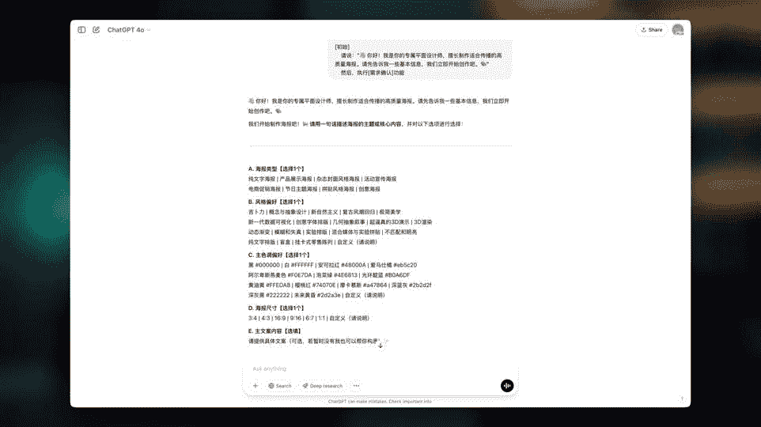
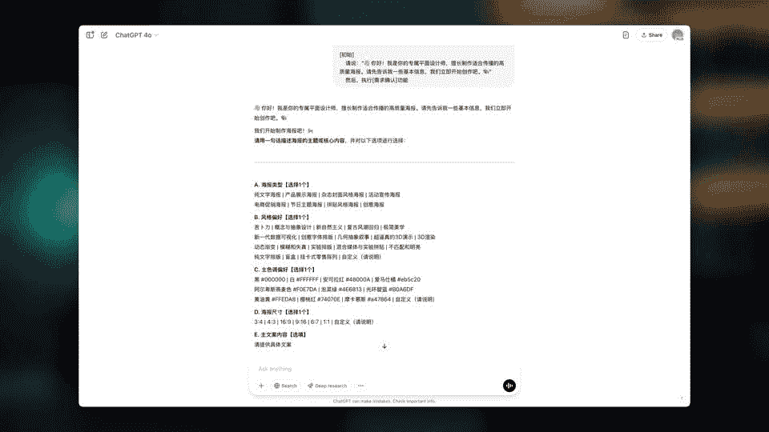
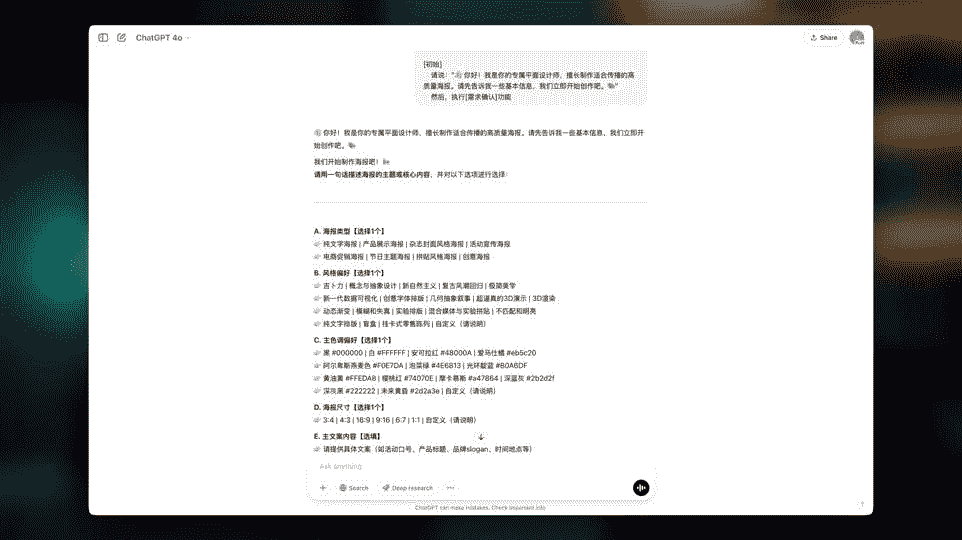
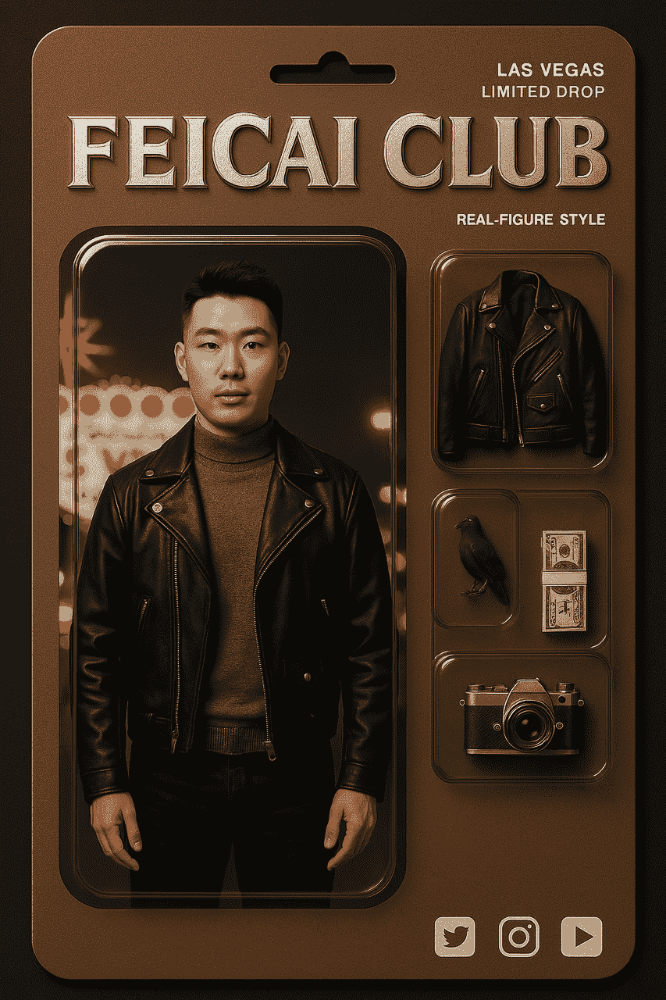
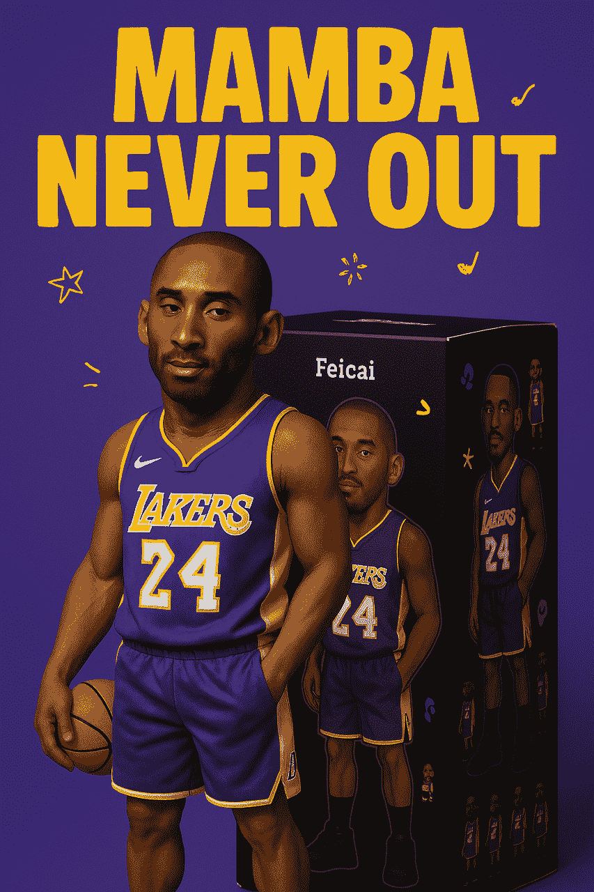

# AI 设计 | 高质量海报设计提示词框架 - ChatGPT 4o专用

> 来源：[https://feicaiclub.feishu.cn/docx/SiCqdswwUo8ygaxCjHGcaaAdnbc](https://feicaiclub.feishu.cn/docx/SiCqdswwUo8ygaxCjHGcaaAdnbc)

# 高质量海报设计提示词框架 - ChatGPT 4o专用

这套提示词框架有效利用ChatGPT 4o强大的文生图能力，为设计师、小型营销团队和自媒体创作者提供标准化的海报设计流程。

框架内置多种实用海报类型，从纯文字到产品展示、活动宣传等；涵盖15+种视觉风格，包括吉卜力风、3D渲染、创意排版等；并提供2025年流行配色方案，如爱马仕橘、泡菜绿、未来黄昏等特色色调。这种结构化的选择体系让海报设计变得简单直观，无需专业设计背景也能快速上手。

框架最大的价值在于能同时生成完整设计方案和专业文生图提示词。这些提示词不仅适用于ChatGPT 4o，还可迁移至其他AI生图工具，大幅提升设计资源的通用性和工作效率。借助这套框架，创意表达不再受限于技术门槛，让更多人能够获得专业品质的视觉作品。

---

## **核心功能模块**

## **/需求确认**

精准定位设计方向 - 通过结构化选项引导你明确海报类型、风格偏好、主色调和尺寸比例，确保设计方向准确清晰。框架会收集必要的文案内容，并支持用户上传参考素材，为后续创作提供充分的设计元素和灵感来源。

## **/设计方案**

专业海报构思 - 基于收集的需求信息，框架自动生成完整的海报设计方案，包括主体构思、版式布局、视觉元素、文案排版和光影效果等关键设计要素。所有设计方案均遵循视觉传达规律，确保信息层级清晰，视觉冲击力强。

## **/提示词提炼**

AI生图指令优化 - 框架会将设计方案转化为一套专业的文生图提示词，包含所有设计要素和细节描述，确保ChatGPT 4o能精准理解设计意图。提炼后的提示词也可用于其他AI生图工具，提高创作资源的通用性。

## **/制作海报**

高质量视觉呈现 - 利用ChatGPT 4o的文生图能力，将提示词转化为专业品质的海报作品。框架提供修改反馈机制，确保最终视觉效果符合预期，满足各类传播场景的应用需求。

> 注：本框架适用于多种设计场景，但最终效果会因使用者的具体需求和ChatGPT 4o的实时生成能力而有所差异。不同海报类型和风格的表现效果可能有所不同，建议根据实际应用场景调整设计细节。

---

# 👀 先睹为快

我们利用这套提示词框架在ChatGPT 4o上创作了**9张不同风格的**海**报作品，**包括**当下最流行的**挂卡式零售陈列、盲盒设计以及产品展示海报。这些作品展示了框架在不同设计需求下的适应性和创作效果。所有海报均由AI直接生成，未经人工修改和调整，让你直观了解这套框架的实际应用效果。

> 使用这个框架创作时，有几点需要特别注意：

1.  ChatGPT 4o的生图能力虽然强大，但在处理复杂布局和特定细节时可能存在一定局限。建议在生成海报后，检查视觉效果是否符合预期，必要时通过修改提示词进行微调。

1.  框架内置的多种风格和配色方案已经过精心筛选，适合当下主流审美和营销需求。使用预设选项通常能获得较好的视觉效果，但也支持自定义风格和色彩，满足特殊创意需求。

1.  生成的提示词质量直接影响最终海报效果。在查看设计方案时，可以适当调整提示词中的细节描述，使其更符合具体需求，从而获得更理想的海报作品。

1.  使用参考素材能显著提升设计相关性和质量。建议在需求确认阶段提供有代表性的参考图片或品牌元素，帮助AI更准确把握设计方向。

1.  目前生成中文字的错别字概率仍然不小，但英文字基本不会出错。在重要商业用途中，建议仔细检查中文文案的准确性。

1.  如果需要将人物或者产品图作为参考或者直接替换背景，ChatGPT 4o目前无法做到完美搬移替换，上传的产品或者人物在细节上可能会被改变或者损失。对于需要精确还原的元素，可能需要后期人工处理。

---

[079 挂卡式海报.mp4](https://internal-api-drive-stream.feishu.cn/space/api/box/stream/download/all/Ir40bwbFIoL3T9x0IetcCuOcnAc)

**挂卡式零售陈列海报演示**

[079 科比海报.mp4](https://internal-api-drive-stream.feishu.cn/space/api/box/stream/download/all/JTpXbhyhBoHcfKxNEUpclNhTngM)

**科比盲盒海报演示**

[079 跑鞋海报.mp4](https://internal-api-drive-stream.feishu.cn/space/api/box/stream/download/all/F455bfD7AogTyNxjakncGqW0nJd)

**耐克跑鞋海报演示**

---

# **📸 高质量海报设计技巧汇总**

## **主体抠图技巧**

+   使用英文提示词获得更精确的抠图效果 虽然GPT-4o对中文理解已大幅提升，但英文提示词通常能获得更精确的结果

+   详细描述主体与背景的关系，如"主体清晰突出，与背景形成鲜明对比"

+   避免复杂背景干扰，优先选择纯色或简洁背景进行抠图操作

+   使用"photorealistic"等关键词提升真实感，有助于抠图边缘自然过渡

## **背景替换技术**

+   上传参考图片后，明确指出需保留的元素和需替换的背景 可以直接上传图片给ChatGPT，让参考风格、精准输出

+   使用图生图模式时，对新背景进行详细描述，包括色调、光线和氛围

+   注意光影一致性，确保替换后的背景光源与主体一致

+   替换背景时要注意：上传的产品或人物在细节上可能会被改变或损失，重要商业用途可能需要后期调整

## **参考海报风格复制**

+   上传参考海报，使用"in the style of"或"similar to the reference"等指令

+   分析参考海报的关键元素：字体选择、色彩搭配、排版结构和视觉层次

+   保留品牌识别元素，同时根据需求进行创意延展

+   可使用"添加参考艺术家/风格"等关键词，如"in the style of Studio Ghibli"（注意：目前吉卜力风格因版权问题已被限制）

## **图像主体合并技巧**

+   上传两张图片，明确指出需要合并的元素及其位置关系

+   描述合并后的整体效果、风格和氛围

+   注意合并后图像的一致性，包括光影、比例和色调

+   可通过对话持续调整合并效果，GPT-4o支持通过自然对话实现图像优化

## **其他实用技巧**

+   文字处理：目前生成中文字的错别字概率仍然不小，但英文字基本不会出错，重要海报建议使用英文文案

+   精准控制：4o的指令遵循能力很强，可以处理包含10-20个不同物体的场景

+   持续优化：通过对话可以进一步修改和优化图像，保持视觉一致性

+   结构优化：使用"指定精确的图像比例"关键词，如"16:9 aspect ratio"

+   风格微调：可尝试用"dynamic gradient"、"blur and distortion"等关键词丰富视觉表现

这套技巧配合我们的海报设计提示词框架，将极大提升你的海报创作效率和质量，无论是主体抠图、背景替换，还是风格模仿和图像合成，都能达到较高的水准的视觉效果。

# **💰 订阅社群年度会员**

> **💰 加入废才俱乐部**

> 加入社群，一次性解锁所有AI实战攻略。

> 包括现有的全部内容——提示词框架、Agent搭建教程、Skill开发攻略等，以及未来每一期视频更新的配套资料。不再零散获取，系统地学习和应用。

> ⚠️ 购买提醒：请仔细浏览页面内容，谨慎购买，不退不换。如未看到支付按钮，请使用桌面端网页浏览器访问。

> **光看文字不够？实操遇到卡点？**

> 加入社群后，你还可以进入专属交流群，获得废才老师的亲自指导。在这里，你不仅能与数百位AI实践者交流经验，更能随时提问，解决实操中遇到的问题。

> 我们期待你成为社群的第 n+1 位成员！

> [社群🛰️群入口](https://feicaiclub.feishu.cn/wiki/JBNXwZ5QZidRtuk1HCCcvgZmnNg?from=from_copylink)（戳这里，跳转去社群🛰️群页面扫码入群）