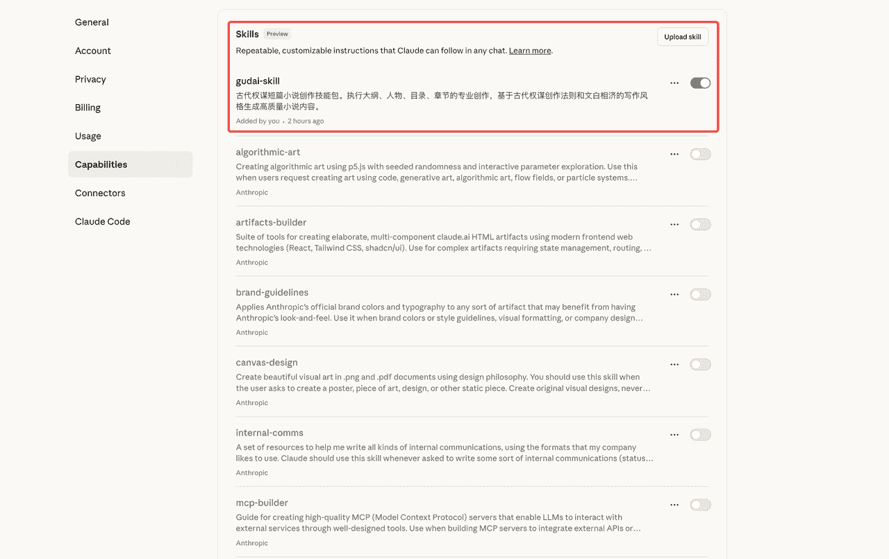

# 小说 | 现代言情类 短篇小说创作 Claude Skill

> 来源：[https://feicaiclub.feishu.cn/docx/Qb5UdwYZ0o6i1cxMMOMciXPVnBh](https://feicaiclub.feishu.cn/docx/Qb5UdwYZ0o6i1cxMMOMciXPVnBh)


<https://player.bilibili.com/player.html?bvid=1M12cBeEv1&share_source=copy_web&vd_source=1adb0321bdfa6d9eb5d1bf5665ffc381>

# 用 Claude Agent Skill 写现代言情类短篇小说 - 让故事灵感快速落地

这套方案主要解决一个问题：有了故事灵感后，从构思到完成一个完整短篇小说往往需要几天甚至更久。传统流程是想大纲、设计人物、规划章节、写正文，每一步都需要反复打磨，效率很低。

所以我们通过 Claude 的 Skill 功能搭建了一个专业的创作助手。把现代言情的创作方法论、文档模板、写作风格、实战示例都打包进 Claude Skill，让 Claude 在每个创作环节都能调用这些专业知识。你只需要回答几个问题，剩下的大纲、人物、章节就由 AI 按照专业标准自动生成。

工作流程按照小说创作的自然顺序推进：故事大纲 → 人物小传 → 章节目录 → 章节正文。CLAUDE.md 负责整体流程管控，skill 提供创作标准。从有灵感到生成完整初稿，整个过程可以在一两小时内完成。

这个方案让故事灵感从脑海里的想法变成可以直接阅读的小说初稿，大幅提升创作效率。不过要注意，生成的内容是初稿，还需要根据个人风格润色调整。

---

# 核心功能模块

**Skill调用机制**

通过 skill 技能包为 Claude 提供专业创作知识。每个创作阶段开始前，主Agent会自动调用对应的资源文件：大纲阶段读取 outline-method.md（方法论）+ outline-template.md（模板）+ outline-example.md（示例），章节阶段读取 output-style.md（写作风格）+ chapter-template.md（模板）。这种模块化设计让 Claude 不是凭感觉写作，而是基于明确的创作标准和范式进行输出。

**分阶段创作流程**

创作严格遵循"故事大纲 → 人物小传 → 章节目录 → 章节正文"的流程，每个阶段对应独立文档。用户通过 /character、/catalog、/write 命令推进流程，系统会自动读取前序文档确保连贯性。比如创作章节时，会同时读取 outline.md、character.md、chapter_index.md，确保情节不偏离大纲、人物行为符合设定。这种阶段性管理避免了一次性生成导致的前后矛盾。

**模板驱动生成**

所有文档格式由 templates/ 目录下的模板文件定义，包括大纲、人物小传、章节目录、章节正文四类。Claude 创作时严格遵循模板结构，确保输出格式统一、信息完整。比如人物小传必须包含"主要角色→重要配角→其他角色"的层级。

**上下文连贯性**

每个阶段创作前都会读取已有文档内容。人物创作基于大纲设定，章节创作基于大纲+人物+目录，形成递进式上下文积累。系统通过文档驱动而非对话记忆来维护上下文，即使对话被清空，只要文件还在，就能通过 /status 命令查看进度并继续创作。

**文档结构管理**

项目采用标准化目录结构：outline.md（大纲）、character.md（人物）、chapter_index.md（目录）、chapters/Chapter-XX.md（各章节）。固定5章结构对应起承转合布局，每章2000-3000字。这种结构化存储让创作过程可追溯、可修改，文档本身就是交付物，而不需要从对话记录中复制粘贴整理。

> **注**：AI生成的是初稿，能帮你快速把故事框架搭起来，但最终还需要人工润色才能达到发布标准。输入质量直接决定输出质量——你在Q1-Q3提供的核心创意、冲突设定越详细具体，生成的大纲和人物就越贴合预期。AI的工作是基于你的创意进行填充和扩展，而不是100%从零创造，所以前期构思越清晰，后期调整成本越低。另外，固定的5章结构适合短篇，如果需要更长篇幅，需要调整模板和方法论。

---

# 如何配置

## 配置步骤：

### 方式一：在 Claude.ai 网页版配置（推荐新手）



1.  **进入Skills设置**

+   选择 "Settings" → "Capabilities" → "Skills"

+   点击 "Upload file" 按钮

1.  **上传技能包**

+   选择 zip 压缩包文件

+   系统会自动解压并识别skill结构

1.  **启用技能包**

+   在Skills列表中找到新创建的技能

+   确保状态为 "Enabled"（已启用）

1.  **开始创作**

+   回到对话界面，开始新对话

+   直接向Claude说明你的创作需求即可

+   Claude会自动调用进行创作

### 方式二：在 Claude Code 中配置（适合熟练）

请按照以下步骤配置创作系统，配置完成后，你的项目结构应该是这样：

```
project/
├── outline.md                           # 故事大纲（创作后生成）
├── character.md                         # 人物小传（创作后生成）
├── chapter_index.md                     # 章节目录（创作后生成）
├── chapters/                            # 章节正文目录（创作后生成）
│   ├── Chapter-01.md
│   ├── Chapter-02.md
│   └── ...
└── .claude/
    ├── CLAUDE.md                        # 项目规则和主Agent配置（必须创建）
    └── skills/
        └── xianyan-skill/               # 现代言情创作技能包（必须创建）
            ├── SKILL.md                 # 技能包核心配置
            ├── outline-method.md        # 大纲创作方法论
            ├── output-style.md          # 写作风格
            ├── templates/               # 文档格式模板
            │   ├── outline-template.md
            │   ├── character-template.md
            │   ├── chapter-index-template.md
            │   └── chapter-template.md
            └── examples/                # 创作示例
                ├── outline-example.md
                ├── character-example.md
                └── chapter-example.md
```

1.  **创建项目规则**

+   在 .claude/ 目录下创建 CLAUDE.md 文件

+   粘贴完整的项目规则内容，包含角色定义、工作流程、指令集

+   确保包含初始化脚本和所有创作阶段的流程定义

1.  **创建 Skill 技能包**

+   在 .claude/skills/ 目录下创建 xianyan-skill/ 文件夹

+   创建 SKILL.md 作为技能包核心配置

+   粘贴技能包说明和执行流程

1.  **添加创作方法论**

+   在 xianyan-skill/ 目录下创建 outline-method.md

+   粘贴大纲创作方法论，包含起承转合结构、人物塑造、爽点设计等内容

1.  **配置写作风格**

+   创建 output-style.md 文件

+   粘贴写作风格定义和具体行为规范

1.  **添加文档模板**

+   在 xianyan-skill/templates/ 目录下创建四个模板文件

+   包括大纲、人物小传、章节目录、章节正文的格式定义

+   这些模板会严格约束 AI 的输出格式

1.  **添加创作示例**

+   在 xianyan-skill/examples/ 目录下创建示例文件

## 重要配置细节：

+   **Skill调用**：CLAUDE.md 中定义了何时调用 xianyan-skill，每个创作阶段会自动调用对应资源

+   **模板约束**：templates/ 中的格式是强制性的，AI 必须按照模板结构输出

+   **方法论指导**：outline-method.md 是核心，定义了起承转合、人物塑造、冲突设计等创作标准

+   **风格一致性**：output-style.md 确保文白相济风格贯穿全文，避免出现现代口语

+   **示例学习**：examples/ 提供具体范式，让 AI 理解什么是符合标准的输出

+   **固定结构**：短篇固定5章对应起承转合，不支持自定义章节数

+   **人工润色**：AI生成初稿后仍需人工调整细节、润色语言、补充情节

---

# 核心设计理念

```
┌─────────────────────────┐
│  skill                  │ ← 知识层：提供专业创作指导
│  ├─ outline-method.md   │    方法论、风格、模板、示例
│  ├─ output-style.md     │
│  ├─ templates/          │
│  └─ examples/           │
├─────────────────────────┤
│  CLAUDE.md              │ ← 流程层：控制创作流程
|                         │    定义工作流和指令集
├─────────────────────────┤
│  Main Agent             │ ← 创作层：调用Skill进行创作
|                         │    读取资源→生成内容→写入文档
├─────────────────────────┤
│  outline.md             │ ← 文档层：结构化存储
│  character.md           │    故事大纲
│  chapter_index.md       │    人物小传
│  chapters/*.md          │    章节目录
|                         │    章节正文
└─────────────────────────┘
```

## 工作流程：

1.  **需求收集** - 主Agent询问核心创意、核心冲突、故事调性三个问题

1.  **调用Skill** - 根据创作阶段，调用skill读取对应的方法论、模板、示例

1.  **内容创作** - 基于Skill提供的指导和用户需求，生成符合标准的内容

1.  **文档写入** - 将创作内容写入对应的结构化文档（outline.md / character.md等）

1.  **流程推进** - 通知用户当前阶段完成，引导进入下一个创作阶段

## 关键特性：

+   **Skill驱动** - 每个阶段自动调用对应资源，确保创作有章可循

+   **模板约束** - 严格遵循templates/定义的格式，保证输出规范统一

+   **阶段递进** - 按照"大纲→人物→目录→正文"顺序推进，后续阶段基于前序文档

+   **上下文积累** - 通过文档驱动而非对话记忆维护上下文，支持长期创作

+   **结构化存储** - 所有内容分文件管理，便于查看、修改和复用

+   **快速落地** - 从灵感到初稿，整个流程可在1-2小时内完成

+   **固定框架** - 5章结构对应起承转合，适合快速产出标准化短篇

---

# 👀 先睹为快

我们用这套系统测试了Claude Sonnet 4.5模型，从提出故事创意到生成完整的5章短篇小说，整个过程用了半小时左右。所有内容都是基于框架直接生成的初稿，未经人工润色。这样你可以直观地看到这套系统在实际应用中能达到什么效果。

## **使用时的注意事项：**

1.  **输入质量决定输出质量**。Q1-Q3回答得越详细，生成的内容就越贴合你的预期。比如核心冲突如果只写"职场困境"，生成的内容会很空泛；

1.  **这是初稿，不是成品**。AI生成的内容能帮你快速搭起框架，但语言细节、情节逻辑、人物对话还需要人工润色。特别是情感表达部分，AI有时会写得过于直白或抒情，需要调整成更克制、更贴近日常的自然表达。

1.  **及时反馈和调整**。如果大纲阶段就发现内容偏离预期，直接提出修改意见，不要等到写完5章再推倒重来。每个阶段都可以修改，改得越早成本越低。

1.  **注意版权问题**。虽然这套系统是基于方法论和模板创作，但如果你的故事创意本身借鉴了某部作品，还是要注意避免抄袭。建议用自己的原创构思，或者对经典题材进行充分的改编创新。

## 故事大纲

## 小说信息

+   **书名**：谁陪谁一辈子

+   **类型**：现代都市言情

+   **故事调性**：克制深情、暧昧不清、情感拉扯、文艺向

## 主要人物

+   **李渡（女主）**：28岁，独立摄影师，寡淡疏离，不相信长久的感情，准备出国进修

+   **陈端成（男主）**：34岁，建筑设计公司老板，成熟稳重，对她一见倾心后深情难自拔

+   **方琪（女主闺蜜）**：30岁，杂志编辑，已婚，旁观者视角见证两人关系

## 核心梗概

> 寡情的摄影师偶然搭上陌生男人的车后赖在他身边，他给她深情，她报以暧昧，当她准备出国离开时，他说"欠你一辈子"，她却问"谁又能陪谁一辈子"。

>

## 导语

> 深夜的山路上，李渡搭上了陈端成的车。他以为这只是一场偶遇,她却笑着说："我就跟你走吧。"从此，她住进他的公寓，吃他做的饭，睡在他怀里，听他说爱。他的好她都接受，他的深情她却不信。她一早就订好了出国的机票，却日复一日地和他缠绵度日。他问她："你到底什么时候走？"她反问："你想让我走吗？"这场暧昧不清的关系，是他的自作多情，还是她的欲擒故纵？当离别将至，他终于说出那句："你让我欠吧，欠你一辈子。"她却叹息："在这个世界上，谁又能陪谁一辈子呢？"

>

## 故事大纲

>

### 起：深夜搭车，她赖上了他（第1章）

>

> **偶遇契机**：深秋的深夜，李渡在郊外拍完一组废弃工厂的照片后，发现最后一班公交已经没了。她在路边拦车，陈端成的车经过，她敲窗："我能搭你的车回市区吗？"他看了她一眼，冷淡拒绝："我的车不回市区，你可以让前面加油站的人帮你叫车。"

>

> **意外同行**：李渡没走，就站在路边抽烟。陈端成看着后视镜里那个穿着黑色夹克、抱着相机的女孩，最终还是倒车回来："上车吧。"她笑了，拉开车门坐进副驾驶。一路无话，快到市区时，他问："你要去哪里？"她侧头看他，眼睛亮亮的："我就跟你走吧。"

>

> **赖上他**：陈端成愣住，她却已经自然地说起了自己的处境——房子到期了还没找到新的地方，行李都在朋友那儿寄存着，这几天正好没地方住。"你家有空房间吗？能借我住几天吗？"她问得理所当然。他沉默了很久，最后说："可以。但只是几天。"她笑："当然。"

>

> **暧昧初现**：陈端成的公寓在市中心，两室一厅，简约冷淡。她放下相机，四处打量，像在看自己未来的家。他给她指了客房："浴室在那边,有什么需要的自己拿。"她道谢，然后突然问："你叫什么名字？"他顿了顿："陈端成。""我叫李渡。"她伸出手，"很高兴认识你，陈端成。"那一刻，他握住她的手，心跳莫名快了一拍。

>

> **本章要点**：

+   开场500字内抛出冲突：深夜无车可搭

+   快速让男女主相遇并产生交集

+   埋下女主性格：洒脱、不拘束、有点随性甚至随便

+   埋下男主性格：冷淡、理性、但有底线的善良

+   她主动"赖上他"的设定开启暧昧同居

> ---

>

### 承：暧昧同居，她不信他的深情（第2-3章）

>

#### 第2章：他的好，她照单全收

>

> **日常相处**："几天"变成了半个月。李渡每天早上起来,餐桌上总有他做好的早餐——吐司、煎蛋、咖啡。他去公司前会问她："今天在家还是出去？"她说出去,他就把备用钥匙给她。晚上他回来时，她有时在家，有时不在。在的时候，她会窝在沙发上修图，看到他就笑："回来啦？"

>

> **暖昧升温**：他们像情侣又不是情侣。他会帮她拿快递，她会给他点外卖。他出差回来,她会去机场接他。深夜他加班回家，她还醒着，两人并排坐在沙发上，她靠着他肩膀睡着。他看着她的睡颜，忍不住问自己：这算什么关系？

>

> **第一次表白**：某个周末，陈端成鼓起勇气："李渡，我们在一起吧。"她正在喝咖啡，闻言抬眸看他，眼神很淡："什么叫在一起？""就是……正式交往，做男女朋友。"她笑了："我们现在不就挺好的吗？为什么要定义？"他说："我想对你负责。"她反问："谁让你负责了？"

>

> **她的拒绝**：他坚持："我是认真的。我想和你长久地在一起。"她的笑容淡了下来："陈端成，这个世界上哪有什么长久？你今天说爱我，明天可能就腻了。我不相信那些。"他说："我不会。"她摇头："你会的。所有人都会。"那天晚上，她破天荒地喝醉了，趴在他怀里说："你不要爱我。爱是最不靠谱的东西。"

>

> **本章要点**：

+   展现暧昧同居的日常细节：他做饭、她在家、像情侣的相处

+   男主第一次表白，女主拒绝并说出不信爱的理由

+   埋下女主的过往伤痕：她为什么寡情？

+   情感推进：男主已经爱上,女主还在观望

#### 第3章：出国计划与缠绵度日

>

> **真相曝光**：一天,陈端成无意中看到李渡电脑上的邮件——是某个国外摄影学院的录取通知。"你要出国？"他问。她很平静："嗯，明年三月。早就计划好的。"他的手握紧："所以你一早就知道自己要走？""对啊。"她看着他，"我说过的，我不会留下。"

>

> **明知故犯**：他问："那你为什么还留在这里？"她反问："你为什么要让我留？"他无话可说。她站起来走到他面前："陈端成，我一开始就说了，只是借住几天。是你自己不赶我走的。"他看着她："因为我舍不得。"她叹气："所以这是你的选择。"

>

> **继续缠绵**：从那天起，两人的关系变得更加微妙。他知道她会走，她知道他知道。但他们谁都没提分开。他依然给她做早餐，她依然窝在他怀里看电影。他说"我爱你"的次数越来越多，她从不回应，只是吻他。有一次做完爱，他抱着她问："你对我到底是什么感觉？"她闭着眼睛说："舒服啊，你对我很好。""那是爱吗？"他追问。她睁开眼："我不知道什么是爱。"

>

> **倒计时开始**：十二月，距离她出国还有三个月。方琪约李渡喝咖啡，问她："你真的要走？"李渡点头。"那他怎么办？"李渡搅着咖啡："他会找到新的人。""你就这么狠心？"方琪不解。李渡笑："我没让他爱我。是他自己要爱的。"方琪看着她："李渡，你有没有想过，你其实也爱他？"李渡沉默了很久，最后说："就算爱，又能怎样？爱会变的。与其等它变质，不如早点结束。"

>

> **本章要点**：

+   揭露女主出国计划，时间限定：三个月后

+   男主明知她会走，还是选择继续

+   女主享受关系但拒绝承认爱，展现她的情感恐惧

+   通过闺蜜视角点出女主可能也爱他

+   倒计时感加重，氛围渐渐压抑

> ---

>

### 转：离别将至，深情与寡情的碰撞（第4章）

>

> **倒数三十天**：二月，李渡开始收拾行李。陈端成看着她整理相机、打包衣服，心像被刀割。他想说"别走"，但他知道说了也没用。她做事很有条理，像早就计划好了一切。而他，只是这个计划之外的一个意外。

>

> **最后的挽留**：某个夜晚，陈端成终于忍不住："李渡，留下来。"她正在封箱子，手顿了顿："陈端成……""我知道你不信我，但我可以证明。"他走过去，握住她的手，"给我一个机会，让我证明我能陪你一辈子。"她抬头看他，眼神复杂："你凭什么这么确定？""因为我爱你。"他认真地说，"从你上我车的那一刻，我就爱上你了。"

>

> **她的质疑**：李渡笑了，笑容里有讽刺："爱？陈端成，你知道什么是爱吗？你只是喜欢我给你的新鲜感。等我真的留下，变成你生活的一部分，你就会厌倦。所有的爱都是这样，开始时轰轰烈烈，最后不过是相看两厌。""我不会。"他固执。"你会的。"她抽回手，"我见过太多了。我爸爸当初也说爱我妈妈一辈子，结果呢？五年后就有了小三。我前男友说要娶我，交往三年后劈腿我最好的朋友。陈端成，我不怪你，我只是不相信任何人的'一辈子'。"

>

> **真相揭露**：原来她不是天生寡情，而是受过太深的伤害。陈端成看着她眼里的冷漠，心疼得无法呼吸。他说："李渡，我不是你爸爸，也不是你前男友。""我知道。"她说，"但你也是人。人都会变。""那你就这样一辈子不相信任何人？"他问。她点头："对，这样最安全。"

>

> **他的承诺**：陈端成沉默了很久，最后说："李渡，如果我说，我愿意让你欠着我呢？"她疑惑地看他。他继续："你不相信一辈子，那就不要给我承诺。你欠我的，一辈子慢慢还。这样，我们就永远不会分开了。"她怔住。他认真地看着她："你让我欠吧，欠你一辈子，我们永远不分开。"

>

> **她的回答**：李渡看着他，眼眶有点红，但她还是笑了，笑容苦涩："陈端成，在这个世界上，谁又能陪谁一辈子呢？"那一刻，陈端成知道，她还是要走。

>

> **本章要点**：

+   矛盾爆发：他挽留，她坚持要走

+   揭示女主寡情的原因：父母婚姻失败、前任背叛

+   男主说出"欠你一辈子"的核心台词

+   女主说出"谁又能陪谁一辈子"的回应

+   情感达到最高点，但女主依然选择离开

> ---

>

### 合：离开之后，才懂得什么是失去（第5章）

>

> **她走了**：三月十五日，李渡登上了去伦敦的飞机。陈端成没有去机场送她，不是不想,是她不让。临走前一晚，她吻了他很久，像是要把这个人印在心里。"陈端成，谢谢你。"她说。"不要谢我。"他抱着她，"记得回来。""我会的。"她说，但他们都知道，这是客套。

>

> **各自的生活**：李渡在伦敦的日子忙碌而充实。她进修摄影，认识新朋友，参加各种展览。照理说，她应该很开心。但每天深夜，她都会想起他。想起他做的早餐，想起他拥抱的温度，想起他说"我爱你"的认真模样。她告诉自己这只是习惯，过段时间就好了。但三个月过去了，她还是会想。

>

> **他的等待**：陈端成没有找新的女朋友。朋友给他介绍相亲对象，他都拒绝了。他还住在那个公寓，客房保持着她离开时的样子。他的手机里还存着她的照片，深夜失眠时会翻出来看。方琪有次问他："你还在等她？""嗯。"他说。"万一她不回来呢？""那我就一直等。"他笑了，"反正她欠我一辈子，总得回来还的。"

>

> **转折契机**：六月，李渡在伦敦的一个摄影展上遇到一对老夫妻。他们结婚五十年，还像热恋时一样牵手。她问老太太："你们怎么做到的？"老太太笑着说："因为我们都相信，对方会陪自己一辈子。"李渡愣住："万一不是呢？""那我们就一起努力让它变成真的。"老先生接话，"爱情需要信任，也需要勇气。"

>

> **她的醒悟**：那天晚上，李渡一个人坐在泰晤士河边，突然想通了：她不是不爱陈端成，她只是害怕。害怕再次受伤，害怕被辜负，害怕爱到最后变成失望。但因为害怕就不去爱，那她这辈子还有什么意义？她拿出手机，点开和陈端成的聊天记录。最后一条消息还是三个月前她说的："到了。"他回复："注意安全。"之后再没有任何对话。

>

> **回国**：李渡订了最早的航班回国。飞机落地是凌晨五点，她没告诉任何人。她直接打车去了陈端成的公寓，用他给她留着的钥匙开门。公寓里还是老样子，整洁干净，只是多了一股寂寞的味道。她走进卧室，他在熟睡。她脱掉鞋子，轻轻钻进他被窝。

>

> **重逢**：陈端成醒来时,发现怀里抱着一个人。他愣了一下,然后不敢置信地低头——是她。"李渡？"他的声音还带着睡意和难以置信。"嗯。"她把脸埋进他胸口，声音闷闷的。"你怎么……""我回来了。"她说，"来还债的。""什么？"他还没反应过来。她抬起头看他，眼眶有点红："你不是说让我欠你一辈子吗？我想了想，这笔债太大了，我还是回来慢慢还比较好。"

>

> **告白**：陈端成的眼眶也红了。他紧紧抱住她："你是说……""我想试试。"李渡说，"试试相信你，试试相信'一辈子'。虽然我还是很害怕，但是……我更害怕失去你。"他吻她的额头，声音哽咽："我等了你三个月。""我知道。"她也哭了，"对不起，让你等了。""不。"他摇头，"值得。一辈子都值得。"

>

> **结局**：窗外的晨光透进来，照在他们身上。李渡说："陈端成，我还是不能保证我会爱你一辈子。"他笑了："没关系。"她继续："但我可以保证，我会努力去相信，去试着和你走下去。""这就够了。"他说，"李渡，在这个世界上，也许确实没有谁能陪谁一辈子。但我们可以一起努力，让我们成为那个例外。""好。"她点头，"我们一起努力。"

>

> **未来展望**：一年后，李渡的摄影展在国内开幕，陈端成站在她身边。有记者问："听说你们经历了异地和分离，现在重新在一起，你们相信爱情可以长久吗？"李渡看着陈端成，笑了："我在学着相信。"陈端成握住她的手："而我，一直都相信。"

>

> **本章要点**：

+   分离后各自的生活：她忙碌但想念，他等待

+   通过老夫妻的故事给女主启发

+   女主醒悟：不是不爱，是害怕

+   女主主动回来，双向奔赴

+   告白场景：不是空洞的我爱你，而是"我愿意试试相信"

+   HE结局：他们在一起了，女主学会了相信

+   未来展望：不是完美的童话,而是"我们一起努力"的现实感

## 人物小传

## 主要角色

>

> **李渡（女主）**

>

> 28岁，眼神疏离的独立摄影师，总是穿黑色或深灰色的衣服，留着及肩的黑发，素颜，瘦削，有一双看透世事的眼睛。说话简短直接，很少笑，笑起来也带着点嘲讽意味，像是在看一场荒诞剧。习惯性抽烟，喜欢深夜拍照，独来独往。她不相信任何人的"一辈子"，因为父亲出轨毁了家庭，前男友劈腿她最好的朋友。她自我保护的方式就是不投入感情，永远保持抽离。遇到陈端成后，她一开始只是把他当临时居所，享受他的好但拒绝承认感觉。她从不说"我爱你"，只会说"你对我很好"。她准备出国逃避，但最终在国外的三个月里发现自己其实早就爱上了他。她的转变不是突然的，而是在无数个想起他的夜晚里慢慢醒悟——逃避不是保护自己，而是在折磨自己。最后她主动回国，说出"我想试试相信你"，这对她来说已经是最大的勇气。

>

> **陈端成（男主）**

>

> 34岁，建筑设计公司老板，身材高大，总穿着熨帖的衬衫和西裤，戴着金丝边眼镜，外表斯文冷淡。性格成熟稳重，理性克制，生活规律自律，不擅长表达情感，但遇到李渡后整个人都变了。他第一次见到她就被吸引——不是因为她多美，而是因为她眼神里的那种洒脱和疏离，像一只永远抓不住的猫。他明知道她不相信爱情，明知道她会离开，还是忍不住对她好，给她做早餐，给她钥匙，说"我爱你"。他的深情不是轰轰烈烈的，而是细水长流的陪伴和包容。她说不信一辈子，他就说"你欠我一辈子"，用这种方式把她留在身边。她走后，他没有纠缠没有联系，只是默默等待，因为他相信她会回来——不是相信她会改变，而是相信她心里也有他。他的爱很成熟，知道爱一个人不是要改变她，而是接受她的所有，包括她的恐惧和逃避。

>

> **方琪**

>

> 30岁，时尚杂志编辑，李渡的大学同学兼闺蜜，已婚，丈夫是律师。她是典型的都市女性，会打扮，爱八卦，话多热情，和李渡的性格完全相反。她是李渡唯一能说上几句心里话的人，也是唯一知道李渡前男友出轨细节的人。她一直担心李渡的情感状态，觉得她把自己封闭得太严实。当李渡和陈端成在一起后，方琪是第一个发现李渡其实动心了的人——她能看出李渡提到陈端成时眼神的变化，虽然李渡自己不承认。她劝过李渡不要逃避，说"你有没有想过，你其实也爱他"，但李渡当时听不进去。李渡在国外时，方琪会偶尔和陈端成联系，告诉他"她在伦敦一切都好"，也会旁敲侧击地问陈端成"你还在等她吗"。她是见证者，也是助攻者，相信他们最终会在一起。

>

## 重要配角

>

> **李父**

>

> 55岁，某国企中层管理，已再婚。李渡12岁时出轨下属，和李母离婚后迅速再婚，还生了个儿子。他当初信誓旦旦说爱李母一辈子，婚姻破裂后对李渡的愧疚就是每个月多给点生活费。李渡成年后就不怎么联系他了，偶尔过年见一面也是客套。他是李渡不相信"一辈子"的第一个原因——父亲的背叛让她从小就明白，誓言是最不可靠的东西。

>

> **李母**

>

> 53岁，小学老师，离异后独自抚养李渡长大。她是个温柔坚韧的女人，离婚后没有怨天尤人，而是把所有精力放在女儿身上。但她情感上的保守和封闭也深深影响了李渡——她告诉李渡"不要轻易相信男人"，教会李渡独立，却也无意间让李渡在情感上过度防备。她现在一个人住，偶尔和李渡视频通话，知道女儿和陈端成的事，但她不评价，只是说"你自己决定"。

>

> **张轶（李渡前男友）**

>

> 29岁，广告公司创意总监。李渡23-26岁时的男友，当初追求李渡时很浪漫，说要娶她，但三年后劈腿了李渡当时最好的朋友。分手时他还试图解释"我们只是不合适"，被李渡一个耳光打回去。他是李渡不相信"一辈子"的第二个原因——连说要娶她的人都能背叛，她还能信谁？李渡出国前在机场偶然遇到过他，他已经结婚了，妻子不是那个当年的朋友。她看着他，突然觉得可笑——曾经以为天塌了的事，现在不过是一个陌生人。

>

## 其他角色

>

> **老吴**：60岁，陈端成公司的老工程师，话不多但看人很准。他看出陈端成对李渡的感情，私下劝过陈端成"别太把自己陷进去"，但陈端成笑着说"已经陷进去了"。李渡走后，老吴会偶尔约陈端成喝酒，陪他度过最难熬的那段时间。

>

> **Emma**：26岁，李渡在伦敦认识的英国女孩，同样学摄影。开朗健谈，和李渡成了朋友。她无意中听李渡提起陈端成，建议她"如果喜欢就回去啊，人生那么短，干嘛要逃避"。她是李渡回国的一个小小推动力。

>

> **那对老夫妻**：结婚五十年的伦敦夫妇，在摄影展上偶遇李渡。他们相互扶持的样子让李渡第一次相信——也许真的有人能陪另一个人一辈子。老太太的那句"因为我们都相信，对方会陪自己一辈子"成了李渡的转折点。

## 章节目录

> **第1章** 深夜搭车

>

> 深夜偶遇，她搭上他的车后笑着说"我就跟你走吧"，从此赖在他家，开启了一场暧昧不清的同居生活。

>

> **第2章** 他的好

>

> 他每天给她做早餐，对她百般呵护，终于忍不住表白"我们在一起吧"，她却冷淡拒绝"这世上哪有什么长久"。

>

> **第3章** 倒计时

>

> 她的出国计划曝光，距离三月只剩几个月，他明知她会走还是选择继续，两人开始缠绵度日，享受最后的时光。

>

> **第4章** 欠你一辈子

>

> 离别将至，她说出不信爱情的原因——父亲的背叛和前任的出轨，他说"你让我欠吧，欠你一辈子"，她还是走了。

>

> **第5章** 我们一起努力

>

> 伦敦三个月，她想他想到心碎，终于明白逃避不是答案，她回国重逢，说"我想试着相信你"，他们决定一起努力。

>

> [注：短篇小说固定为5章，与大纲的5个阶段一一对应，每章标题简洁有力，剧情简介30-50字]

## 第1章：深夜搭车

> 深秋的夜里，郊外的风带着寒意。

>

> 李渡站在废弃工厂外的公路边，抽着烟，看着手机上的时间——凌晨一点十五分。最后一班回市区的公交车在半小时前就开走了，而她还在工厂里拍那组金属锈蚀的特写，拍到忘了时间。

>

> 她给几个朋友打了电话，没人接。这个点，正常人都睡了。她看了看周围，前不着村后不着店，路灯都坏了两盏，只有远处加油站的灯还亮着。

>

> 算了，走去加油站叫车吧。

>

> 她背起相机包，刚走了几步，就看到远处有车灯亮起。一辆黑色奥迪，车速不快，像是在夜里散步。李渡站在路边，等车开近了，扬手拦了下来。

>

> 车停了。

>

> 李渡走过去，弯腰敲了敲副驾驶的车窗。车窗缓缓降下，里面坐着个男人，三十多岁，戴着金丝边眼镜，穿着浅灰色衬衫，领口解开两颗扣子。他看了她一眼，眼神很淡，像在看一个路障。

>

> "我能搭你的车回市区吗？"李渡开门见山。

>

> 男人盯着她看了两秒，目光扫过她脸上的疲惫和手里的烟，最后落在她背后的相机包上。他收回视线，冷淡地说："我的车不回市区。"

>

> "不回市区你开这条路干什么？"李渡挑眉。

>

> "前面加油站。"他说，"你可以让前台的人帮你叫车。"

>

> "哦。"李渡点点头，没再说什么，退后一步，朝他挥了挥手，"那谢了。"

>

> 车窗升起来，黑色奥迪开走了。

>

> 李渡看着车尾灯消失在黑暗里，把烟蒂丢在地上，用脚碾灭。她没急着走，就站在原地，点了根新烟。夜风吹过来，她缩了缩脖子，把相机包抱得更紧。

>

> 大概过了五分钟，车灯又亮了起来——那辆奥迪倒车回来了。

>

> 车停在她面前，驾驶座的车窗降下来。男人看着她，声音还是那么冷："上车。"

>

> 李渡笑了，把烟掐灭，拉开副驾驶的门坐进去。车里暖气开着，有淡淡的木质香水味。她把相机包放在腿上，系好安全带，侧头看他："改主意了？"

>

> "顺路。"他说，发动车子。

>

> "顺路到市区？"她语气里带着点揶揄，"你不是说不回市区吗？"

>

> 他没接话，只是把车开得很稳，像是在开会时做报告一样一丝不苟。李渡也不在意，靠在椅背上，看着窗外漆黑的路。车里很安静，只有轮胎压过路面的声音。

>

> 开了大概二十分钟，前方出现了城市的灯光。男人打破沉默："你要去哪里？"

>

> 李渡转头看他，他的侧脸在灯光下有点好看，鼻梁很挺，下巴线条利落。她突然笑了，眼睛亮亮的："我就跟你走吧。"

>

> 车速慢了下来。

>

> 他转头看她，眼镜后面的眼睛带着明显的疑惑和警惕："什么？"

>

> "我说，我就跟你走。"李渡说得很自然，像在说"今天天气不错"，"你家在哪里？送我去你家。"

>

> 男人盯着她，半晌没说话。李渡注意到他握方向盘的手收紧了一点，指关节有点白。

>

> "你喝醉了？"他问。

>

> "没有。"李渡摊手，"我很清醒。"

>

> "那你疯了？"

>

> "也没有。"她笑着说，"我就是暂时没地方住，你家有空房间吗？能借我住几天吗？"

>

> 男人的表情有点精彩，像是在消化这句话的荒诞程度。李渡倒是一点不觉得尴尬，继续说："我租的房子到期了，还没找到新的，行李都在朋友那儿寄存着。这几天我一直在外面拍照，今天本来准备住酒店的，结果拍太晚了，卡又忘在朋友那儿。"她顿了顿，"要不你先送我回朋友家？不过她住得挺远的，在城南，要绕一大圈。"

>

> 男人沉默了。

>

> 车停在路边。他看着前方，没看她，沉默了很久。李渡也不催，就等着。她知道他在纠结——理智告诉他应该拒绝，把这个陌生女人送到最近的酒店或者警察局，但善良又让他犹豫。

>

> 最后，他叹了口气："只是几天？"

>

> "对，就几天。"李渡保证，"等我找到房子就搬走。"

>

> 他重新发动车子，声音很冷："上次说'只是几天'的人，最后住了一年。"

>

> 李渡笑了："你上次也让陌生女人住你家？"

>

> "是我姐。"他说，"离婚后说来住几天，结果住到现在。"

>

> "那我不一样。"李渡说，"我不是你姐。"

>

> 他没说话，只是继续开车。李渡看着窗外掠过的夜景，突然问："你叫什么名字？"

>

> "陈端成。"

>

> "我叫李渡。"她伸出手，"很高兴认识你，陈端成。"

>

> 陈端成看了看她的手，最后还是握了握，很快就松开。他的手掌温热干燥，有薄薄的茧。李渡注意到他的手很好看，指节分明，像是经常画图或者弹琴的手。

>

> "你是建筑师？"她问。

>

> "设计师。"他说，"你呢？"

>

> "摄影师。"

>

> "难怪。"他点点头，像是明白了什么。

>

> 车子开进市中心，停在一栋高层公寓楼下。陈端成下车，李渡跟着下来，抬头看了看这栋楼——三十几层，外立面是玻璃幕墙，典型的中产阶级住所。她跟着他进电梯，上到二十六层。

>

> 公寓的门开了，李渡走进去，四处打量。两室一厅，装修简约，几乎全是黑白灰三色，家具不多但都很有质感。客厅的落地窗能看到城市夜景，阳台上放着几盆绿植。整个空间很干净，干净到有点冷清。

>

> "客房在那边。"陈端成指了指左手边的房间，"浴室在走廊尽头，有什么需要的自己拿。"

>

> "谢谢。"李渡走进客房，放下相机包。房间不大，一张单人床，一个衣柜,一张书桌。床上的被子叠得整整齐齐，像酒店一样。

>

> 她转身走出来，陈端成正在厨房倒水。他递给她一杯温水："明天我八点出门，你可以睡到自然醒。"

>

> 李渡接过水杯，喝了一口，突然想起来："对了，你家wifi密码是多少？"

>

> 陈端成报了一串数字。李渡掏出手机连上，然后看着他，笑了："陈端成，你不问问我是干什么的吗？万一我是坏人呢？"

>

> "你要是坏人，现在我已经被绑了。"他说，"而且你连身份证都没带，能坏到哪里去？"

>

> 李渡挑眉："你怎么知道我没带身份证？"

>

> "你说你卡忘在朋友那儿。"陈端成看着她，"一般人不会把身份证和银行卡放在一起，除非是放在钱包里。你钱包忘了，身份证也就忘了。"

>

> "聪明。"李渡点点头，"不过你不怕我是其他坏人？比如小偷？"

>

> "我贵重物品都锁保险柜了。"他说，"你偷不到。"

>

> 李渡笑了，眼睛弯成月牙："陈端成，你人挺好的。"

>

> "你如果真这么想，明天就搬走。"他说完，转身回卧室，"早点睡，晚安。"

>

> "晚安。"

>

> 卧室的门关上了。李渡站在客厅里，喝完那杯温水，看了看这个陌生的家。落地窗外，城市的灯火还亮着，像碎掉的星星落在地上。她走到窗边，点了根烟，想起陈端成刚才握她手的那一刻——他手心有点热，握得不重，但很稳。

>

> 她吐出一口烟，看着烟雾在玻璃上散开。

>

> 其实她不是真的没地方住。她有个表姐住在城西，随时可以去借住。她也不是真的忘了银行卡，卡就在相机包的夹层里。她只是突然不想一个人待着，不想回到那个空荡荡的酒店房间，不想面对又一个孤独的深夜。

>

> 所以当陈端成问"你要去哪里"的时候，她想也没想就说"我就跟你走吧"。

>

> 这个男人看起来冷淡疏离，但眼神里有种可靠的东西。而且他犹豫了很久才答应让她上车，犹豫了更久才答应让她住下——这种犹豫说明他是个正常人，一个有界限感的正常人。

>

> 李渡掐灭烟，回客房睡觉。躺在陌生的床上，她闻到被子里有阳光和洗衣液的味道。她闭上眼睛，突然想起陈端成说的那句话："只是几天？"

>

> 她在心里回答：对，只是几天。

>

> 但她自己也不知道，这"几天"到底是几天。

>

> ---

>

> 隔天早上，李渡被厨房的声音吵醒。她看了看手机，七点半。她起床走出去，看到陈端成正在做早餐——煎蛋、吐司、咖啡，动作熟练得像在完成一个工作流程。

>

> "早。"她靠在厨房门框上。

>

> 陈端成回头看她，愣了一下。她穿着昨天的T恤和牛仔裤，头发乱糟糟的，脸上还有睡痕。但晨光从窗户照进来，落在她脸上，让她看起来没那么疏离了，多了点烟火气。

>

> "早。"他说，"要吃早餐吗？"

>

> "可以吗？"

>

> "顺便的。"

>

> 李渡笑了，走过去坐在餐桌前。陈端成把煎蛋和吐司放在她面前，又倒了杯咖啡。她咬了一口吐司，味道不错，火候刚好。

>

> "你手艺不错。"她说。

>

> "一个人住久了。"陈端成坐在对面，吃自己的那份，"习惯了。"

>

> "你一个人住多久了？"

>

> "五年。"

>

> "没想过找个人一起住？"李渡问。

>

> 陈端成抬眼看她，眼神有点探究："你是在问我有没有女朋友？"

>

> "算是。"李渡很坦然，"我得知道自己有没有破坏别人感情。"

>

> "没有。"陈端成说，"单身两年了。"

>

> "分手了？"

>

> "嗯。"他不想多说，岔开话题，"你呢？"

>

> "单身三年。"李渡喝了口咖啡，"不打算再谈了。"

>

> 陈端成看着她，想说什么，最后还是没说。他看了看表："我得走了。钥匙在鞋柜上，你出去记得带上。晚上不确定几点回来。"

>

> "好。"

>

> 陈端成拿起公文包，走到门口，突然停下来，回头看她："李渡，认真的，你最好尽快找房子。"

>

> "我会的。"她笑着说，"陈端成，谢谢你。"

>

> 他点点头,出门了。

>

> 门关上的那一刻，李渡突然觉得这个家又变得很安静。她坐在餐桌前，看着对面陈端成坐过的椅子，想起他刚才说"一个人住久了"时的表情——淡淡的，像在说一件微不足道的事,但眼神里有点落寞。

>

> 她端起咖啡杯，对着空荡荡的客厅说："陈端成，也许我会多住几天。"

## 第2章：他的好

> "几天"变成了半个月。

>

> 李渡的行李从朋友那里拿回来了，放在陈端成家的客房里。她说过几天就搬走，但每次陈端成问她"找到房子了吗"，她都说"还在看"。他也不催，像是默许了她的存在。

>

> 这半个月里，他们形成了一种微妙的默契。

>

> 早上七点半，陈端成起床做早餐。李渡通常会在他煎蛋的声音里醒来，披着睡乱的头发走出来，坐在餐桌前等他。他会给她倒咖啡，煎两个蛋，烤两片吐司。她吃得很慢，他吃得很快。

>

> "今天在家还是出去？"他每天都会问。

>

> 如果她说在家，他就把备用钥匙留在桌上。如果她说出去，他就什么都不说，只是点点头。

>

> 晚上七点左右，陈端成下班回家。如果李渡在家，客厅的灯会是亮的，她会窝在沙发上修图，听到门响就抬头看他："回来啦？"语气像妻子在问丈夫，但又不完全是。

>

> 如果她不在家，公寓就是黑的。陈端成开了灯，一个人吃外卖，然后继续加班。但他会留意手机，等她发消息说"我回来了"，他才会真正放松下来。

>

> 有时候她回来得很晚，凌晨一两点。陈端成已经睡了，但客厅的小夜灯还开着——是他留给她的。她关掉夜灯，回自己房间，路过他卧室时会停一下，听到里面均匀的呼吸声，才继续走。

>

> 这种生活很奇怪。他们不是情侣，甚至连朋友都算不上，只是两个住在同一个屋檐下的陌生人。但陈端成发现自己已经习惯了她的存在——习惯早上有人和他一起吃早餐，习惯晚上回家有灯光等着他，习惯在深夜听到她开门的声音。

>

> 这不太对。

>

> 陈端成知道这不对。他不该对一个只是借住的陌生女人产生依赖。但每次看到她穿着他的T恤（因为她的衣服还没干）坐在沙发上，或者看到她站在阳台上抽烟，背影在夜色里显得很单薄，他就觉得心里软了一块。

>

> ---

>

> 第十天的时候，陈端成出差去了上海，三天两夜。

>

> 临走前，他问李渡："你这几天自己在家没问题吧？"

>

> "我又不是小孩。"她笑，"放心吧。"

>

> "冰箱里有菜，饿了自己做。"他说，"不想做就叫外卖，钱我转给你。"

>

> "不用。"李渡摆手，"我自己有钱。"

>

> 陈端成看着她，犹豫了一下，还是说："那你注意安全。"

>

> "你也是。"

>

> 陈端成提着行李箱出门了。李渡坐在沙发上，看着关上的门，突然觉得公寓变得很空。她打开电视，但什么都看不进去。她拿起相机，想修图，但也没心情。

>

> 最后她给方琪打了电话。

>

> "怎么了？"方琪的声音很吵，像是在商场，"想我了？"

>

> "陈端成出差了。"李渡说。

>

> "所以呢？"方琪笑，"你舍不得他？"

>

> "别瞎说。"李渡否认得很快，"我就是觉得一个人有点无聊。"

>

> "李渡啊李渡。"方琪叹气，"你都住他家半个月了，还说没感觉？"

>

> "就是借住。"李渡说，"我找到房子就搬走。"

>

> "你看了几套房子？"

>

> 李渡沉默了。

>

> "一套都没看吧？"方琪说，"李渡，你骗谁呢？你就是不想走。"

>

> 李渡没说话。方琪继续："你有没有想过，也许你喜欢他？"

>

> "我不喜欢任何人。"李渡说得很平静，"你知道的。"

>

> "我知道。"方琪说，"但陈端成不知道。你这样赖在他家，他会以为你对他有意思。"

>

> "那他想多了。"

>

> "可是你确实对他有意思啊。"方琪说，"不然你为什么不搬走？李渡，三年了，你该试着走出来了。"

>

> 李渡挂了电话。

>

> 她坐在沙发上，看着空荡荡的客厅。方琪说得对，她确实没看房子。她甚至没打算看。但那不代表什么。她只是觉得这里住着舒服，仅此而已。

>

> 真的只是这样吗？

>

> 李渡想起陈端成每天早上给她煎蛋的样子，想起他下班回来看到她时眼神里的放松，想起他说"注意安全"时的认真。她突然有点慌。

>

> 不行。不能这样。

>

> 她不能喜欢任何人。她早就决定了，这辈子不再相信任何人的承诺。陈端成对她好，只是因为他人好，仅此而已。她不能误会，更不能动心。

>

> 李渡站起来，走进客房，打开电脑，开始认真地搜房源。

>

> 但搜了半个小时，她一个电话都没打。

>

> ---

>

> 陈端成第二天晚上回来的时候，李渡正在做饭。

>

> 他开门进来，闻到厨房里飘出的香味，愣了一下。李渡探头出来："回来了？饿了吧？快去洗手，饭马上好。"

>

> 陈端成放下行李箱，走进厨房。李渡正在炒青菜，动作有点生疏，但很认真。灶台上还有一碗番茄蛋汤，一盘糖醋里脊。

>

> "你做的？"他问。

>

> "不然呢？"李渡瞪他，"我看起来像不会做饭的人吗？"

>

> "不是。"陈端成说，"就是没想到。"

>

> "你天天给我做早餐，我总得回报一下。"她说，"快去洗手，别站在这里碍事。"

>

> 陈端成去洗手了。回来的时候，李渡已经把菜端上桌。他坐下来，尝了一口糖醋里脊，味道有点偏甜，但还不错。

>

> "怎么样？"李渡看着他。

>

> "好吃。"陈端成说。

>

> "真的假的？"她不太信，"我妈说我做菜味道怪。"

>

> "你妈挑剔。"陈端成又吃了一口，"真的好吃。"

>

> 李渡笑了，眼睛弯起来。陈端成看着她笑，突然觉得心跳快了一拍。她笑起来的样子和平时那种嘲讽的笑不一样，这次的笑是真的开心，像个小孩得到了表扬。

>

> 他们安静地吃完饭。李渡收拾碗筷的时候，陈端成去阳台抽烟。李渡洗完碗出来，看到他站在阳台上，背影在夜色里有点落寞。

>

> 她走过去，也点了根烟："陈端成，我找到房子了。"

>

> 陈端成转头看她，眼神里有一瞬间的慌乱，但很快就恢复平静："哦。什么时候搬？"

>

> "下周吧。"李渡说，"房东说要先打扫一下。"

>

> "那挺好的。"陈端成说，声音很平，"你也该有自己的地方了。"

>

> 李渡看着他，想说什么，最后还是没说。她只是吐出一口烟，看着烟雾在夜色里散开。

>

> 其实她没找房子。她刚才是随口说的。但看到陈端成的反应，她突然觉得有点不对劲。他刚才眼神里的慌乱，是什么意思？

>

> 他不想让她走？

>

> 还是她想多了？

>

> ---

>

> 又过了三天。

>

> 那天晚上，陈端成加班到很晚，回家的时候已经快十二点了。他以为李渡睡了，但客厅的灯还亮着，她穿着睡衣坐在沙发上，抱着抱枕看电视。

>

> "还没睡？"他问。

>

> "睡不着。"她说，"你吃了吗？"

>

> "吃了。"陈端成换了鞋，走过去坐在沙发另一端。

>

> 电视里在放一部老电影，黑白的，画面很美。李渡看得很专注，陈端成也跟着看了一会儿。不知道过了多久，他感觉到肩膀一沉——李渡靠过来了，头搭在他肩上。

>

> 陈端成的身体僵了一下，但他没动。他能闻到她头发上的洗发水味道，能感觉到她均匀的呼吸。她睡着了。

>

> 他保持着这个姿势，不敢乱动。电视里的电影还在继续，但他什么都看不进去了。他低头看她的睡颜，她的睫毛很长，鼻梁很挺，嘴唇有点干。他突然很想亲她，但理智告诉他不行。

>

> 不能这样。

>

> 她只是借住的房客。她说了下周要搬走。他不能越界。

>

> 但他的心跳出卖了他。他的心跳得很快，快到他觉得李渡肯定能听见。他深呼吸，想让自己冷静下来，但没用。

>

> 他终于承认了。

>

> 他喜欢她。

>

> 从她第一次笑着说"我就跟你走吧"的时候，他就喜欢上她了。他喜欢她的洒脱，喜欢她的独立,喜欢她抽烟时的侧脸，喜欢她窝在沙发上修图的样子，喜欢她说"回来啦"时的语气。

>

> 他喜欢她。

>

> 但他不知道她喜不喜欢他。她对他很自然，自然得像对待一个室友，或者一个哥哥。她从来没有表现出任何暧昧的意思。她只是住在这里，仅此而已。

>

> 陈端成看着她，轻轻叹了口气。

>

> 半小时后，李渡醒了。她睁开眼睛，发现自己靠在陈端成肩上，整个人愣了一下，然后迅速坐直："对不起，我睡着了。"

>

> "没事。"陈端成说，声音有点哑，"你回房间睡吧。"

>

> 李渡站起来，但没走。她看着他，突然问："陈端成，我们算什么关系？"

>

> 陈端成抬头看她，眼神很复杂。

>

> "室友？"他试探性地问。

>

> "室友会给对方做早餐吗？"她反问。

>

> "朋友？"

>

> "朋友会住在一起吗？"

>

> 陈端成沉默了。李渡也沉默了。空气突然变得很安静，安静到能听见彼此的呼吸。

>

> 最后，陈端成站起来，看着她，认真地说："李渡，我们在一起吧。"

>

> 李渡愣住了。

>

> "什么？"她以为自己听错了。

>

> "我说，我们在一起吧。"陈端成重复了一遍，"正式交往，做男女朋友。"

>

> 李渡看着他，眼神慢慢变冷："陈端成，你知道你在说什么吗？"

>

> "我知道。"他说，"我喜欢你。从你上我车的那天开始，我就喜欢上你了。这半个月，我每天都在压抑这种感觉，但我今天突然不想压抑了。李渡，我想对你负责。"

>

> "谁让你负责了？"李渡的声音有点冷，"陈端成，我只是借住而已。"

>

> "我知道。"他说，"但我还是喜欢你。"

>

> 李渡后退一步，和他拉开距离："我不喜欢你。"

>

> "那你为什么不搬走？"陈端成问，"你说找到房子了，但这三天你连个箱子都没收拾。"

>

> 李渡被戳中了。她咬了咬嘴唇，最后说："好，我明天就搬。"

>

> "李渡。"陈端成叫住她，"你能不能诚实一点？你对我真的一点感觉都没有吗？"

>

> "没有。"她看着他，"陈端成，这个世界上哪有什么长久？你今天说喜欢我，明天可能就腻了。我不相信那些。"

>

> "我不会腻。"陈端成说。

>

> "你会的。"李渡的声音很平静，"所有人都会。"

>

> "那你就这样一辈子不相信任何人？"他问。

>

> "对。"她点头，"这样最安全。"

>

> 陈端成看着她，突然觉得心疼。她说这话的时候，眼神是冷的，但冷得让人难受。他想问她经历过什么，让她变得这么防备，但他知道现在不是时候。

>

> "好。"他说，"我不逼你。但李渡，你不用搬走。我可以当这话没说过，我们还和以前一样。"

>

> "不一样了。"李渡说，"你说出来了，就不一样了。"

>

> 她转身回了房间。

>

> 陈端成站在客厅里，看着她关上的房门，突然觉得很累。他坐回沙发上，看着还开着的电视,电影已经放完了，屏幕上是演职员表。

>

> 他拿起手机，想给她发条消息，但他不知道该说什么。最后他只是把手机锁屏，靠在沙发上闭上眼睛。

>

> 他第一次表白，就被拒绝了。

>

> 但他不后悔。至少他说出来了。

>

> 至少她知道了，有个人喜欢她。

## 第3章：倒计时

> 李渡没有搬走。

>

> 表白之后的第二天早上，陈端成起床的时候，看到她的房门还关着。他没敢敲门，只是照常做了两份早餐，放在桌上，然后出门了。

>

> 晚上回来，早餐还在桌上，没动过。她的房门还是关着的。

>

> 陈端成敲了敲门："李渡？"

>

> 没人回应。

>

> 他有点慌，推开门——房间是空的，床铺整齐，行李还在，但人不在。他给她打电话，响了很久才接通。

>

> "喂？"她的声音有点吵，像在酒吧。

>

> "你在哪里？"陈端成问。

>

> "外面。"李渡说，"怎么了？"

>

> "没事。"他说，"注意安全。"

>

> "好。"

>

> 电话挂了。陈端成站在她房间门口，看着那些还没收拾的行李，突然松了口气。行李还在，说明她还会回来。

>

> 李渡凌晨两点才回来。陈端成没睡，坐在客厅等她。听到开门声，他站起来。李渡进门，看到他，愣了一下。

>

> "还没睡？"她问。

>

> "等你。"陈端成说，"喝酒了？"

>

> "嗯。"李渡身上有酒味，但人很清醒。她脱了鞋，走到沙发前坐下。陈端成去厨房倒了杯温水给她。

>

> "陈端成。"她接过水杯，看着他，"我们谈谈吧。"

>

> "好。"

>

> 陈端成坐在她对面。李渡喝了口水，然后说："我不搬走了。"

>

> 陈端成的心跳漏了一拍。

>

> "但我们不能在一起。"她继续说，"你昨天说的话，我当你没说过。我们还是和以前一样，室友，或者朋友，可以吗？"

>

> "为什么？"陈端成问，"你对我真的一点感觉都没有？"

>

> 李渡看着他，沉默了很久，最后说："有。"

>

> 陈端成愣住。

>

> "我对你有感觉。"李渡说，"但那不是爱。陈端成，我只是习惯了你的存在，习惯了你对我好。这不是爱，只是依赖。"

>

> "那也够了。"陈端成说，"我们可以从依赖开始。"

>

> "不行。"李渡摇头，"因为我会走。"

>

> 空气突然凝固了。

>

> 陈端成盯着她："你说什么？"

>

> 李渡放下水杯，从包里拿出手机，点开一封邮件，递给他。陈端成接过来，看到屏幕上是一封英文邮件——某个伦敦摄影学院的录取通知。

>

> "明年三月，我要去伦敦进修。"李渡说，"为期两年。"

>

> 陈端成的手握紧了手机。

>

> "你什么时候决定的？"他问。

>

> "半年前。"李渡说，"陈端成，我一早就计划好了。我来你这里，只是借住。我从来没打算留下。"

>

> "所以你从一开始就知道自己要走？"

>

> "对。"

>

> 陈端成把手机还给她，站起来走到落地窗前。城市的灯火还亮着，但他突然觉得很冷。他背对着她，声音很平静："那你为什么还要留在这里？"

>

> "因为我还没找到其他地方住。"李渡说。

>

> "李渡。"陈端成转身看她，"别骗自己了。你如果真想找房子，半个月够你找一百套了。你留下来，是因为你也不想走。"

>

> 李渡沉默了。

>

> 陈端成走回来，在她面前蹲下，抬头看她："李渡，我不介意你要出国。我可以等你。两年而已，我等得起。"

>

> "那两年之后呢？"李渡看着他，"陈端成，我可能不会回来。"

>

> "为什么？"

>

> "因为我不属于这里。"她说，"我不属于任何地方。我这辈子都在逃，逃离家庭，逃离过去，逃离所有会让我受伤的东西。我不会停下来，也不会为任何人停下来。"

>

> 陈端成看着她的眼睛，突然明白了什么。她不是不会爱，她只是不敢爱。她把自己包裹得太紧，紧到连她自己都以为自己没有心了。

>

> "好。"他说，"那就这样吧。"

>

> 李渡愣住："什么？"

>

> "你说不能在一起，那我们就不在一起。"陈端成站起来，"但你也不用搬走。你想住到什么时候就住到什么时候。"

>

> "陈端成……"

>

> "我知道你要走。"他打断她，"但在你走之前，我想照顾你。就当是朋友之间的帮忙，可以吗？"

>

> 李渡看着他，眼眶有点红。

>

> "你为什么对我这么好？"她问。

>

> "因为我喜欢你。"陈端成说得很平静，像在说一个事实，"这个理由够吗？"

>

> 李渡没说话，只是低下头。陈端成看着她，轻声说："李渡，我不逼你。你想走就走，想留就留。我只是希望，在你走之前，能让我对你好一点。"

>

> 那天晚上，他们谁都没再说话。李渡回了房间，陈端成也回了卧室。但谁都没睡着。

>

> ---

>

> 从那天起，他们之间的氛围变了。

>

> 陈端成还是每天给她做早餐，但他不再问她"找到房子了吗"。李渡还是住在客房，但她开始主动做一些家务——洗碗、拖地、收拾客厅。他们像两个心照不宣的室友，小心翼翼地维持着平衡。

>

> 但有些东西已经不一样了。

>

> 比如，李渡不再刻意避开他。以前她总是等他出门了才起床，现在她会和他一起吃早餐，聊一些无关紧要的话题。

>

> 比如，陈端成开始带她出门。周末他会开车带她去郊外拍照，在车里等她拍完，然后一起吃饭。他不说这是约会，她也不问。

>

> 比如，他们开始有了肢体接触。看电影的时候她会靠在他肩上，他会自然地搂着她。她不说什么，他也不说什么。

>

> 这种暧昧不清的关系维持了一个月。

>

> ---

>

> 十二月的某个晚上，陈端成加班到很晚回家，发现李渡在发烧。她蜷在沙发上，脸通红，浑身发抖。

>

> "李渡？"他冲过去摸她额头，烫得吓人，"你怎么不给我打电话？"

>

> "没事，就是有点冷。"她说话的声音都在抖。

>

> 陈端成二话不说，抱起她往卧室走。李渡挣扎："我自己能走……"

>

> "别动。"他说。

>

> 他把她放在床上，给她盖好被子，然后去找退烧药和温度计。量了体温——三十九度二。他喂她吃了药，又倒了热水让她喝。

>

> "我去给你煮粥。"他说。

>

> "不用……"李渡想拒绝，但他已经出去了。

>

> 半小时后，陈端成端着一碗白粥进来。李渡靠在床头，看着他坐在床边，一勺一勺喂她。

>

> "我自己能吃。"她说。

>

> "你手在抖。"陈端成说，"别逞强。"

>

> 李渡没再拒绝，乖乖张嘴。粥很烫，陈端成每勺都会吹凉了才喂给她。她看着他认真的侧脸，突然觉得鼻子有点酸。

>

> "陈端成。"她说。

>

> "嗯？"

>

> "你为什么对我这么好？"

>

> 陈端成停下动作，看着她："我说过了。因为我喜欢你。"

>

> "可我明年就要走了。"李渡说，"你这样对我，值得吗？"

>

> "值得。"陈端成笑了，"李渡，我从来没有后悔过让你上我的车。"

>

> 李渡的眼泪突然掉下来。

>

> 陈端成愣住，手足无措地放下碗："你怎么哭了？是不是我说错什么了？"

>

> "没有。"李渡擦了擦眼泪，"我只是突然觉得，我好像欠你很多。"

>

> "你不欠我。"陈端成说，"这都是我自愿的。"

>

> 李渡看着他，突然伸手拉住他的衣服："陈端成，你抱抱我。"

>

> 陈端成僵了一下，然后轻轻把她抱进怀里。她把脸埋在他胸口，眼泪打湿了他的衬衫。他没问她为什么哭，只是拍着她的背，像哄小孩一样。

>

> 那天晚上，李渡第一次在他怀里睡着。陈端成抱着她，一夜没睡。天快亮的时候，他低头看她的睡颜，轻声说："李渡，我可以等你。不管多久，我都可以等。"

>

> 她没听见。她睡得很沉，眉头终于舒展开了。

>

> ---

>

> 第二天，李渡的烧退了。她醒来的时候发现自己躺在陈端成的床上，而他坐在床边的椅子上睡着了，脖子都歪了。

>

> 她看着他，心里突然很乱。

>

> 方琪说得对。她对他不只是习惯，是喜欢。但她不敢承认。因为一旦承认，她就会动摇。而她不能动摇。她必须走。

>

> 李渡轻手轻脚下床，给陈端成盖了条毯子，然后回了客房。

>

> ---

>

> 十二月中旬，方琪约李渡喝咖啡。

>

> 她们坐在咖啡厅的角落，方琪点了杯拿铁，李渡点了杯美式。

>

> "你脸色不太好。"方琪说，"最近怎么样？"

>

> "还行。"李渡说。

>

> "还住陈端成那里？"

>

> "嗯。"

>

> "你们……"方琪试探地问，"在一起了吗？"

>

> "没有。"李渡摇头。

>

> "为什么？"方琪不解，"李渡，你明明喜欢他。"

>

> "我明年要出国。"李渡说，"你知道的。"

>

> "那又怎样？"方琪说，"你可以两年后回来啊。"

>

> "我不一定会回来。"李渡搅着咖啡，"方琪，我跟你说过，我不会为任何人停下来。"

>

> "所以你打算就这样伤害他？"方琪的语气有点重，"李渡，陈端成是个好人。他对你那么好，你不能这样利用他。"

>

> "我没有利用他。"李渡说，"我一开始就说清楚了，我会走。是他自己选择对我好的。"

>

> "那是因为他爱你！"方琪说，"李渡，你有没有想过他的感受？你让他爱上你，然后转身就走，你觉得这公平吗？"

>

> 李渡沉默了。

>

> "我知道你害怕。"方琪叹气，"你爸妈的事，张轶的事，我都知道。但李渡，陈端成不是他们。你不能因为以前受过伤，就把所有人都推开。"

>

> "我没有推开他。"李渡说，"我还住在他家。"

>

> "但你不给他希望。"方琪说，"你享受他的好，但你不承认你爱他。李渡，这比推开他更残忍。"

>

> 李渡握着咖啡杯的手收紧了。

>

> "你知道吗？"方琪继续说，"真正的勇敢不是逃避，而是敢于面对。你一直在逃，从家里逃到外地，从上一段感情逃到下一段感情。现在你又要逃到国外。但李渡，你逃得了一时，逃不了一辈子。你的心会记得他的。"

>

> 李渡的眼眶红了："那我该怎么办？留下来吗？然后呢？等他哪天腻了？等他变心？"

>

> "不是所有人都会变心。"方琪说，"李渡，你得相信，这个世界上有人是可以陪你一辈子的。"

>

> "可是谁又能陪谁一辈子呢？"李渡的声音有点哽咽，"方琪，我见过太多了。我爸当初也说爱我妈一辈子，结果呢？张轶说要娶我，结果呢？我不敢赌了。"

>

> 方琪看着她，突然不知道该说什么。她知道李渡受过的伤，也知道这些伤有多深。但她还是希望李渡能走出来。

>

> "李渡。"方琪最后说，"至少在你走之前，对他好一点。他值得被好好对待。"

>

> 李渡点点头，眼泪掉下来。

>

> ---

>

> 那天晚上，李渡回到陈端成家的时候，他正在做饭。

>

> "回来了？"他回头看她，笑了，"今天做你喜欢的糖醋排骨。"

>

> "陈端成。"李渡站在厨房门口，"我想问你一个问题。"

>

> "什么？"

>

> "如果我不走，你会一直对我这么好吗？"

>

> 陈端成放下锅铲，走到她面前："会。"

>

> "如果我变了呢？"李渡问，"如果我变得不可爱了，变得很烦人，你还会喜欢我吗？"

>

> "会。"陈端成认真地说，"李渡，我喜欢的不是你现在的样子,而是你这个人。"

>

> 李渡看着他，突然踮起脚尖，吻了他。

>

> 陈端成愣住，但很快就回应了她。他抱住她，加深了这个吻。这是他们第一次接吻，带着小心翼翼的试探和克制不住的渴望。

>

> 吻结束的时候，李渡靠在他怀里，声音很轻："陈端成，我还是会走的。"

>

> "我知道。"他说。

>

> "你不介意吗？"

>

> "介意。"陈端成抱紧她，"但我更介意失去现在和你在一起的时间。"

>

> 李渡闭上眼睛，眼泪又掉下来："我不知道我爱不爱你。"

>

> "没关系。"陈端成说，"我知道我爱你就够了。"

>

> 那天晚上，他们没有做爱，只是抱在一起睡了一夜。李渡第一次睡得那么安稳。而陈端成抱着她，在心里默默计算——距离明年三月，还有四个月。

>

> 他还有四个月的时间，让她爱上他。

>

> 或者至少，让她舍不得走。

## 第4章：欠你一辈子

> 二月到了。

>

> 距离李渡出国，还有三十天。

>

> 公寓里多了一些纸箱。李渡开始收拾行李，把这几个月买的东西、拍的照片、用过的东西一件件装进箱子里。陈端成每天下班回来，都能看到客房门口堆着的纸箱越来越多。

>

> 他没说什么，只是每次经过那些箱子时，脚步会慢一点。

>

> 他们没有再提过"走不走"的话题。李渡默默地收拾，陈端成默默地看着她收拾。他们像是达成了某种默契——在她走之前，不谈分离，只谈当下。

>

> 这一个月，他们几乎每天都腻在一起。

>

> 陈端成推掉了所有不必要的应酬，每天准时下班回家。李渡也减少了外出拍照的时间，多数时候待在公寓里。他们一起做饭，一起看电影，一起在阳台上抽烟看夜景。

>

> 周末，陈端成会开车带她去周边的小城市。他们去过苏州，在园林里拍照；去过杭州，在西湖边散步；去过南京，爬了明城墙。每次出门，李渡都会带着相机，拍很多照片。但她拍得最多的，是陈端成。

>

> 陈端成开车的侧脸，陈端成看风景的背影，陈端成给她拍照时的笑容。她把这些照片存在电脑里，没告诉他。

>

> 晚上回到酒店，他们会做爱。李渡从来没有对任何人这么主动过。她会吻他，会抱着他，会在他耳边说"我想要你"。陈端成每次都会问："你确定吗？"她总是回答："确定。"

>

> 他们都知道这意味着什么。这是在抓住最后的时光，用身体记住彼此。

>

> 但他们从不说"我爱你"。

>

> 李渡不说，是因为她不确定。陈端成不说，是因为他怕说了她会更内疚。

>

> ---

>

> 二月十五号，距离李渡出国还有十五天。

>

> 那天晚上，陈端成下班回来，看到李渡正在封最后一个箱子。她蹲在地上，用胶带一圈圈缠着，动作很慢，像在拖延时间。

>

> 陈端成站在门口看了她很久，最后走过去，蹲在她身边："需要帮忙吗？"

>

> "不用。"李渡说，"我自己能行。"

>

> "机票订了？"

>

> "嗯，三月一号早上九点的飞机。"

>

> "我送你去机场。"陈端成说。

>

> "不用了。"李渡抬头看他，"陈端成，我们在家里告别吧。不要去机场。"

>

> 陈端成愣了一下，然后点头："好。"

>

> 李渡继续封箱子。陈端成看着她，突然问："李渡，你真的一定要走吗？"

>

> 李渡的手停了一下，但很快恢复："嗯。"

>

> "为什么？"陈端成问，"你明明也舍不得。"

>

> 李渡没说话。

>

> "昨晚你抱着我哭了。"陈端成说，"你以为我睡着了，但我没有。李渡，你明明也舍不得，为什么还要走？"

>

> 李渡放下胶带，坐在地上，靠着墙。她看着天花板，沉默了很久，最后说："因为我必须走。"

>

> "为什么必须？"

>

> "因为如果我不走，我会陷进去。"李渡看着他，眼神很复杂，"陈端成，我不能陷进去。"

>

> "为什么不能？"陈端成也坐下来，和她并排靠着墙，"李渡，喜欢一个人有什么不好？"

>

> "不好的地方太多了。"李渡说，"喜欢一个人，就会依赖他，会期待他，会害怕失去他。然后有一天，他变了，不再喜欢你了，你就会崩溃。"

>

> "我不会变。"陈端成说。

>

> "你会的。"李渡笑了，笑容很苦，"所有人都会。"

>

> "你怎么这么确定？"

>

> 李渡沉默了很久，最后说："因为我见过。"

>

> ---

>

> 那天晚上，李渡第一次跟陈端成说起她的家庭。

>

> "我十二岁那年，我爸出轨了。"她说得很平静，像在讲别人的故事，"对象是他单位的下属，比我妈小十岁。我妈发现的时候，他们已经好了两年。"

>

> 陈端成握住她的手。

>

> "我爸妈结婚的时候，我爸写过一封信给我妈。"李渡继续说，"信里说'我会爱你一辈子，永远不背叛你'。那封信我妈一直留着，就放在抽屉里。离婚那天，我妈把信拿出来，撕成碎片，当着我爸的面扔进垃圾桶。"

>

> "李渡……"

>

> "从那以后，我妈就变了。"李渡说，"她不再相信任何男人，也不让我相信。她告诉我，男人的话不能信，誓言都是骗人的。她说，女人只能靠自己。"

>

> 陈端成把她拥进怀里。

>

> "后来我长大了，遇到了张轶。"李渡靠在他胸口，声音有点哽咽，"他追我追了一年，说要娶我，说要给我一个家。我信了。我们交往了三年，我甚至开始想象我们结婚后的样子。"

>

> "然后呢？"

>

> "然后他出轨了。"李渡说，"对象是我当时最好的朋友。我发现的时候，他们已经好了半年。分手的时候，张轶还跟我说'对不起，我们真的不合适'。"

>

> 陈端成抱紧她，心疼得无法呼吸。

>

> "陈端成，你知道那种感觉吗？"李渡抬头看他，眼泪在眼眶里打转，"就是你以为抓住了什么，但最后发现只是一场空。我爸背叛我妈的时候，我才十二岁，但我已经知道'一辈子'是谎言了。张轶背叛我的时候，我彻底不信了。"

>

> "所以你不敢再相信任何人。"陈端成说。

>

> "对。"李渡点头，"我不敢赌了。陈端成，我知道你现在喜欢我，我也相信你是真心的。但我不知道这份喜欢能维持多久。一年？两年？五年？然后呢？你会不会也像我爸一样，像张轶一样，遇到更年轻更漂亮的女孩，然后觉得我腻了？"

>

> "我不会。"陈端成认真地说，"李渡，我跟他们不一样。"

>

> "每个男人都这么说。"李渡笑了，"我爸当初也说他跟别的男人不一样，张轶也说他会永远爱我。但最后呢？"

>

> 陈端成沉默了。他不知道该怎么证明。他想说"我可以证明"，但他知道，对于一个受过太多伤害的人来说，任何保证都是苍白的。

>

> "所以我必须走。"李渡说，"趁我还没有完全爱上你，趁我还能走，我必须离开。不然等我陷进去了，等你变心了，我会崩溃的。"

>

> "那如果我一直不变心呢？"陈端成问，"李渡，你有没有想过，也许我真的能陪你一辈子？"

>

> 李渡摇头："没有也许。陈端成，这个世界上没有一辈子。"

>

> ---

>

> 二月二十五号，距离李渡出国还有五天。

>

> 那天是周六，他们没有出门，就待在家里。李渡在修最后一批照片，陈端成在旁边看书。阳光从落地窗照进来,落在他们身上，画面很温馨。

>

> 李渡修完照片，伸了个懒腰，侧头看他："陈端成。"

>

> "嗯？"

>

> "我们去拍张合照吧。"

>

> 陈端成抬头看她，有点意外。这几个月，李渡给他拍了很多照片，但从来没提过合照。

>

> "好。"他说。

>

> 他们把相机架在三脚架上，调好定时。然后站在落地窗前，陈端成搂着李渡的腰，她靠在他肩上。快门响起的瞬间，他吻了她的额头。

>

> 照片洗出来的时候，李渡看着里面的自己——她在笑，笑得很真。陈端成也在笑，眼神很温柔。他们看起来像一对真正的情侣，像那种会走到最后的情侣。

>

> 但他们都知道，这只是一张照片。

>

> ---

>

> 二月二十八号，距离李渡出国还有两天。

>

> 晚上，他们一起做了最后一顿饭。李渡做糖醋排骨，陈端成做番茄蛋汤。他们在厨房里忙活，偶尔碰到手,都会停一下，然后相视一笑。

>

> 吃饭的时候，陈端成给她夹菜，她也给他夹菜。他们吃得很慢，像是想把这顿饭吃成永恒。

>

> 饭后，李渡主动洗碗。陈端成站在她身后，从背后抱住她。

>

> "李渡。"他说，声音有点哑。

>

> "嗯？"

>

> "留下来。"

>

> 李渡的手停了一下，然后继续洗碗："陈端成……"

>

> "我知道你不信我。"陈端成把下巴搭在她肩上，"我也知道你害怕。但李渡，我可以等。我可以用一辈子的时间证明给你看，我是真的能陪你一辈子。"

>

> 李渡闭上眼睛，眼泪掉进洗碗池里。

>

> "给我一个机会好不好？"陈端成说，"让我证明，不是所有男人都会变心。让我证明，这个世界上真的有人可以陪你一辈子。"

>

> 李渡转过身，看着他。她的眼泪止不住地流："陈端成，你凭什么这么确定？"

>

> "因为我爱你。"陈端成第一次说出这三个字，"从你上我车的那一刻，我就爱上你了。这几个月，我每天都在更加确定这件事。李渡，我爱你，所以我确定。"

>

> 李渡哭了，哭得很厉害："可是爱会变的。"

>

> "那我们就一起努力，让它不变。"陈端成擦掉她的眼泪，"李渡，爱情不是一个人的事。你不相信我，是因为以前那些人让你失望了。但我不是他们。你可以考验我，可以怀疑我，可以用一辈子的时间观察我。只要你留下来，我都愿意。"

>

> 李渡看着他，心里天人交战。

>

> 她想留下。真的很想。她想每天早上醒来都能看到他，想每天晚上都能和他一起吃饭，想一直住在这个有他的地方。

>

> 但她不敢。

>

> "陈端成。"她最后说，"如果我说，我愿意让你欠着我呢？"

>

> 陈端成愣住。

>

> 李渡擦掉眼泪，看着他："你刚才说，让我留下来，你可以用一辈子证明。但我不敢赌这一辈子。陈端成，我害怕。"

>

> "我知道。"

>

> "但我也舍不得你。"李渡说，"所以我在想，如果我走了，你欠我的。等我想回来的时候，你再还给我，好不好？"

>

> 陈端成看着她，突然明白了她的意思。她还是要走，但她在给自己留后路。她在说，也许有一天，她会回来。

>

> "好。"陈端成说，"你让我欠吧，欠你一辈子。这样我们就永远不会分开了。"

>

> 李渡哭着笑了："陈端成，你傻不傻？"

>

> "傻。"他说，"为你傻一辈子，我愿意。"

>

> 李渡抱住他，在他怀里哭。陈端成也抱紧她，眼眶发红。

>

> "但是李渡。"他在她耳边说，"在这个世界上，谁又能陪谁一辈子呢？"

>

> 他用她的话反问她。

>

> 李渡愣住，抬头看他。

>

> "你不是说，没有人能陪谁一辈子吗？"陈端成笑了，眼里有泪，"那我们就一起努力，让我们成为那个例外。好不好？"

>

> 李渡看着他，心脏像被什么东西狠狠撞击了一下。

>

> "李渡，你可以不信我。"陈端成说，"但至少，信我们。信我们在一起的感觉，信我们这几个月建立的东西。那不是假的对吧？"

>

> "不是假的。"李渡哽咽。

>

> "那就够了。"陈端成吻她的额头，"你去吧。去伦敦，去实现你的梦想。我在这里等你。等你想回来的时候，我还在。"

>

> 李渡哭得更厉害了。

>

> "但李渡。"陈端成看着她的眼睛，"你得答应我一件事。"

>

> "什么？"

>

> "如果有一天，你发现你其实也爱我，就回来。"他说，"不要因为害怕就逃避。爱一个人，是需要勇气的。但李渡，你值得被爱，也值得去爱。"

>

> 李渡没说话，只是紧紧抱住他。

>

> 那天晚上，他们做了最后一次爱。李渡很主动，也很激烈，像是要把他印在身体里。结束后，她趴在他胸口，听着他的心跳。

>

> "陈端成。"她说。

>

> "嗯？"

>

> "在这个世界上，谁又能陪谁一辈子呢？"

>

> 这是她的回答。她还是不信。

>

> 陈端成听着这句话，心像被刀割了一样疼。但他还是抱紧她，在她耳边说："至少今晚，我陪你。"

>

> 李渡闭上眼睛，眼泪滑落："够了。今晚就够了。"

>

> 但他们都知道，不够。

>

> 一个今晚，怎么够。

>

> ---

>

> 三月一号早上，李渡拖着行李箱站在玄关。

>

> 陈端成帮她叫了车，车已经在楼下等了。他们说好在家告别，不去机场。

>

> "我走了。"李渡看着他。

>

> "嗯。"陈端成点头，"注意安全。"

>

> "你也是。"

>

> 他们就这样看着对方,谁都没有再说什么。最后还是李渡先转身，拉开门。

>

> "李渡。"陈端成叫住她。

>

> 她回头。

>

> "记得回来。"他说，"我等你。"

>

> 李渡的眼泪掉下来。她点了点头，转身走出去。

>

> 门关上了。

>

> 陈端成站在门口，听着她的脚步声渐渐远去，听着电梯门开了又关。他走到落地窗前，看着楼下。李渡把行李放进车里，然后抬头看了一眼这栋楼。

>

> 她看不到他，但他看得到她。

>

> 车开走了。

>

> 陈端成站在窗前，站了很久很久。公寓突然变得很安静，安静到他能听到自己的心碎声。

>

> 他走进她住过的客房。被子叠得整整齐齐，桌上放着一个信封。他打开，里面是那张他们的合照,背后写着一行字：

>

> "陈端成，谢谢你让我相信，至少有一个今晚。——李渡"

>

> 陈端成握着照片，终于忍不住，蹲下来抱住自己，眼泪掉在地板上。

>

> 她走了。

>

> 真的走了。

## 第5章：我们一起努力

> 李渡到伦敦的时候，是当地时间晚上九点。

>

> 她拖着行李箱走出机场，伦敦下着小雨，空气里有潮湿的味道。她站在雨里，突然觉得很茫然。

>

> 她给陈端成发了条消息："到了。"

>

> 三秒后，他回复："注意安全。"

>

> 就像他每次说的那样。

>

> 李渡收起手机，打车去了学校安排的公寓。公寓很小，一室一厅，家具齐全但很冷清。她放下行李，坐在床上，看着陌生的房间，突然很想哭。

>

> 但她没哭。她告诉自己，这是她的选择。

>

> ---

>

> 伦敦的生活很忙碌。

>

> 李渡每天上课、拍照、做作业，把自己的时间填得满满的。她认识了新朋友，一个叫Emma的英国女孩，开朗健谈，总是拉着她去各种地方玩。

>

> "李，你的照片拍得真好。"Emma看着李渡的作品，"但总觉得有点忧郁。你是不是有心事？"

>

> "没有。"李渡说。

>

> "骗人。"Emma笑，"是感情问题对吧？"

>

> 李渡没说话。

>

> "我猜对了。"Emma说，"李，如果你想他，就给他打电话啊。"

>

> "他在中国。"李渡说。

>

> "那又怎样？"Emma说，"现在科技这么发达，视频通话很方便的。"

>

> 李渡摇头："我们说好了，不联系。"

>

> "为什么？"Emma不解，"你们分手了？"

>

> "没有。"李渡说，"我们从来没在一起过。"

>

> Emma更困惑了："那你为什么要来伦敦？"

>

> 李渡看着窗外，沉默了很久，最后说："因为我害怕。"

>

> ---

>

> 前两个月，李渡没有主动联系过陈端成。

>

> 但她每天都会看手机，看他有没有发消息。他也没发。他们像约定好的一样，保持着沉默。

>

> 但有时候深夜，李渡会点开他们的聊天记录，翻到很早以前。那些简短的对话，"今天在家还是出去"，"注意安全"，"我做了你喜欢的菜"，现在看起来都像情话。

>

> 她想他。

>

> 想得心疼。

>

> 但她不敢联系他。她怕一旦联系，她就会崩溃，就会想回去。而她不能回去。她必须证明，她可以离开他，可以一个人生活。

>

> 方琪有时会给她发消息，告诉她国内的事。

>

> "陈端成还好吗？"李渡有一次忍不住问。

>

> "挺好的。"方琪说，"工作很忙，上次见到他瘦了一圈。"

>

> 李渡看着这条消息，心像被揪住了。

>

> "你有没有问他……"李渡打了一半，又删掉。她不知道该问什么。问他想不想她？问他还在不在等她？

>

> "他还在等你。"方琪像是知道她想问什么，主动说，"李渡，他每次提起你，眼神都很温柔。"

>

> 李渡的眼泪掉下来。

>

> "如果想他就回来吧。"方琪说，"人生那么短，干嘛要逃避。"

>

> 但李渡没回。她关掉手机，把脸埋进枕头里，压抑着哭声。

>

> ---

>

> 转折发生在六月。

>

> 那天，李渡去参加一个摄影展。展览的主题是"永恒"，展出的都是一些关于时间和爱情的照片。

>

> 她在一组照片前停下了。

>

> 照片的主角是一对老夫妻。第一张照片是他们年轻时的婚礼，新郎搂着新娘，笑得很灿烂。第二张是他们中年时的样子，在厨房里一起做饭，动作很默契。第三张是他们老年时，坐在公园的长椅上，手牵着手看夕阳。

>

> 照片下面有一行字："结婚五十年，我们还在热恋。"

>

> 李渡看着那组照片，突然哭了。

>

> "很美对吧？"旁边有人说话。

>

> 李渡转头，看到一位老太太站在她身边。正是照片里的那位。

>

> "这是你们？"李渡问。

>

> "是的。"老太太笑了，皱纹都笑开了，"我和我先生。他今天身体不太舒服，没能来。"

>

> "你们……怎么做到的？"李渡问，"结婚五十年，还这么相爱。"

>

> 老太太看着她，眼神很温柔："因为我们都相信，对方会陪自己一辈子。"

>

> 李渡愣住。

>

> "年轻人，你是不是在为感情烦恼？"老太太问。

>

> 李渡点头，眼泪止不住："我不知道该不该相信他。"

>

> "为什么不相信？"

>

> "因为我害怕。"李渡说，"我怕他会变，怕他会离开我，怕到最后我会失望。"

>

> 老太太叹了口气："孩子，爱情本来就是一场赌博。你不下注，永远不知道结果。"

>

> "可是万一输了呢？"李渡问。

>

> "万一赢了呢？"老太太反问，"如果你不试，你永远不知道，他会不会真的陪你一辈子。但如果你试了，至少你不会后悔。"

>

> 李渡看着老太太，突然想起陈端成说过的话："我们可以一起努力，让我们成为那个例外。"

>

> 她一直在逃避，是因为她不敢赌。但她突然意识到，不赌，她已经输了。

>

> 输掉的是和陈端成在一起的可能，是那些本该一起度过的时光，是那些本该说出口的"我也爱你"。

>

> "谢谢您。"李渡对老太太说。

>

> "不客气。"老太太笑，"孩子，听我一句劝，如果你爱他，就回去。人生很短，不要等到失去了才后悔。"

>

> 那天晚上，李渡一个人坐在泰晤士河边。

>

> 河水缓缓流淌,岸边的灯火倒映在水面上，很美，但也很孤独。她想起在国内的时候，陈端成会带她去看夜景。她总是靠在他肩上，他总是搂着她。

>

> 她想起他做的早餐，想起他说"回来啦"时的笑容，想起他抱着她说"我爱你"的认真。

>

> 她突然明白了。

>

> 她不是不爱陈端成。她是太爱了，爱到害怕。

>

> 但爱一个人，本来就是需要勇气的。她可以选择逃避，用一辈子保护自己不受伤害。但那样的话，她也永远不会得到爱。

>

> 李渡拿出手机，点开和陈端成的聊天记录。最后一条消息还是三个月前她说的"到了"，他回复的"注意安全"。

>

> 她打了一行字："陈端成，我想你了。"

>

> 但她又删掉了。

>

> 她不想在手机里说这些。她想当面告诉他。

>

> 李渡站起来，走回公寓，打开电脑，订了最早回国的机票。

>

> ---

>

> 六月十五号早上五点，李渡的飞机落地。

>

> 她没告诉任何人。她拖着行李箱，直接打车去了陈端成的公寓。路上，她紧张得手心都是汗。

>

> 她不知道他还在不在等她。三个月了，也许他已经放弃了。也许他已经有了新的生活，新的人。

>

> 但她必须回来。至少，她要告诉他，她愿意试试。

>

> 车停在公寓楼下。李渡付了钱，拖着行李上楼。她站在熟悉的门前，深呼吸，然后掏出钥匙——那把陈端成给她留着的备用钥匙，她一直带在身上。

>

> 钥匙插进锁孔，转动，门开了。

>

> 公寓还是老样子。客厅很整洁，阳台上的绿植长高了一些。她走进去，放下行李，看着这个离开了三个月的地方。

>

> 然后她听到了声音——是陈端成的声音，从卧室传来。他在打电话。

>

> "嗯，项目下周一交。"他说，声音有点疲惫，"我知道，我会按时的。"

>

> 李渡站在客厅，不知道该不该进去。她突然有点害怕。害怕他看到她会很惊讶，害怕他会问她为什么回来，害怕他会说"你不是要两年后才回来吗"。

>

> 但她已经回来了。

>

> 李渡脱掉鞋，光着脚走向卧室。门半开着，她能看到陈端成坐在床边，还穿着睡衣，头发有点乱。他背对着门，还在打电话。

>

> "行，我知道了。"他说，"你先忙吧。"

>

> 电话挂了。陈端成放下手机，揉了揉眼睛。李渡能看到他瘦了，真的瘦了。他的背影看起来有点孤独。

>

> 李渡走进去。

>

> 陈端成听到脚步声，回头，整个人愣住了。

>

> "李渡？"他以为自己看错了，揉了揉眼睛再看，"你……你怎么……"

>

> 李渡站在门口，看着他，突然不知道该说什么。她准备了一路要说的话，现在全忘了。

>

> "我回来了。"她最后说，声音有点抖。

>

> 陈端成站起来，走到她面前。他盯着她，像在确认她是真的。

>

> "你怎么回来了？"他问，"不是还有一年多吗？"

>

> "我想回来。"李渡说。

>

> "为什么？"

>

> 李渡看着他，眼泪突然掉下来："因为我想你了。"

>

> 陈端成的眼眶瞬间红了。他伸手想抱她，但又停住，像是不敢相信这是真的。

>

> "陈端成。"李渡主动抱住他，把脸埋进他胸口，"对不起，让你等了。"

>

> 陈端成这才回抱她，抱得很紧，像是怕她又跑了。他的声音哽咽："我以为你不会回来了。"

>

> "我也以为。"李渡说，"但我在伦敦的这三个月，每天都在想你。我想你做的早餐，想你说'回来啦'的声音，想你抱着我的感觉。陈端成，我发现我离不开你。"

>

> 陈端成把她抱得更紧。

>

> "我遇到了一对老夫妻。"李渡继续说，"他们结婚五十年了，还在热恋。我问他们怎么做到的，他们说，因为他们相信对方会陪自己一辈子。"

>

> 陈端成没说话,只是听着。

>

> "陈端成，我还是不能保证我会爱你一辈子。"李渡抬起头看他，眼泪模糊了视线，"但我可以保证，我想试试。我想试着相信你，试着相信我们。"

>

> 陈端成擦掉她的眼泪，声音很轻："李渡，这就够了。"

>

> "够吗？"她问，"我还是很害怕。我怕你会变，怕我会失望。"

>

> "那我们就一起努力。"陈端成说，"一起努力让我不变，一起努力让你不失望。李渡，在这个世界上，也许确实没有谁能陪谁一辈子。但我们可以一起努力，让我们成为那个例外。"

>

> 李渡哭着笑了："你还记得这句话。"

>

> "我一直记得。"陈端成说，"我记得你说过的每一句话。"

>

> 李渡踮起脚尖，吻了他。陈端成也吻回来，这个吻带着三个月的思念，带着失而复得的珍惜。

>

> 吻结束的时候，李渡靠在他怀里，声音很轻："陈端成，我欠你的，这辈子慢慢还，好不好？"

>

> "好。"陈端成笑了，"你慢慢还，我慢慢等。"

>

> "那我们就永远不会分开了。"李渡说。

>

> "永远不会。"

>

> 他们站在窗前拥抱。窗外是清晨的阳光，照在他们身上，温暖而明亮。

>

> ---

>

> 一年后。

>

> 李渡的摄影展在国内开幕，主题是"陪伴"。

>

> 展览的照片都是她这一年拍的——陈端成做早餐的背影，陈端成在阳台浇花的侧脸，陈端成开车时的专注，陈端成睡着时的安详。还有他们一起旅行的照片，一起在家看电影的照片，一起在厨房做饭的照片。

>

> 最后一张照片，是他们在那个老夫妻摄影展前的合影。陈端成搂着她，她靠在他肩上，两个人都在笑。

>

> 照片下面有一行字："我们在一起的第365天。"

>

> 开幕式上，有记者问李渡："听说你们经历了分离和重逢，现在还在一起，你们相信爱情可以长久吗？"

>

> 李渡看着站在旁边的陈端成，笑了："我在学着相信。"

>

> 陈端成握住她的手："而我，一直都相信。"

>

> "那你们打算结婚吗？"记者又问。

>

> 李渡和陈端成对视一眼。

>

> "会的。"陈端成说，"等她准备好了。"

>

> "那我呢？"记者笑着问李渡，"你什么时候会准备好？"

>

> 李渡想了想，看着陈端成，认真地说："也许明年，也许后年。但不管什么时候，我知道他会等我。"

>

> "那万一你一直没准备好呢？"

>

> "那我就一直等。"陈端成接话，"反正她欠我一辈子，总得还的。"

>

> 所有人都笑了。

>

> 那天晚上，他们回到公寓。李渡洗完澡出来，陈端成正在阳台上抽烟。她走过去，从背后抱住他。

>

> "陈端成。"她说。

>

> "嗯？"

>

> "在这个世界上，谁又能陪谁一辈子呢？"

>

> 这是她第三次说这句话。第一次是拒绝，第二次是逃避，这次，是疑问。

>

> 陈端成转身，抱住她，在她耳边轻声说："至少我们可以试试。"

>

> "好。"李渡点头，"我们一起试。"

>

> 她终于愿意相信了。

>

> 不是相信"一定会有一辈子"，而是相信"我们可以一起努力"。

>

> 这就够了。

>

> ---

>

> 多年后，李渡翻出那张他们在伦敦老夫妻摄影展前的合影。照片已经有点泛黄，但他们的笑容还是那么真。

>

> 她在照片背后写了一行字："我们在一起的第3650天。陈端成，谢谢你等我长大。——李渡"

>

> 她把照片放进相框，摆在床头。

>

> 陈端成走进来，看到那张照片，笑了："都十年了，你还留着这张照片。"

>

> "当然。"李渡说，"这是我们的开始。"

>

> "那我们的结束是什么？"陈端成坐在床边，把她拉进怀里。

>

> 李渡靠在他肩上，想了想："没有结束。我们的故事，一直在继续。"

>

> "听起来像童话。"

>

> "但这是真的。"李渡抬头看他，"陈端成，你真的陪了我十年。"

>

> "那我们再陪十年，好不好？"

>

> "好。"李渡笑了，"再十年，再十年，一直到我们变成那对老夫妻的样子。"

>

> "然后呢？"

>

> "然后我们去拍一组照片，主题叫'永恒'。"李渡说，"照片下面写：'结婚五十年，我们还在热恋。'"

>

> 陈端成吻了她的额头："一言为定。"

>

> "一言为定。"

>

> 窗外，城市的灯火还亮着。他们拥抱在一起，就像十年前的每一个夜晚。

>

> 有些东西确实会变，但有些东西，不会。

>

> 比如他对她的爱。

>

> 比如她终于学会的勇气。

>

> 比如他们一起努力，让彼此成为对方的"一辈子"。

>

> ——全文完——

订阅年度会员解锁

CLAUDE.md

SKILL.md

创作方法论、规则和模板

...

# **💰 订阅社群年度会员**

> **💰 加入废才俱乐部**

> 加入社群，一次性解锁所有AI实战攻略。

> 包括现有的全部内容——提示词框架、Agent搭建教程、Skill开发攻略等，以及未来每一期视频更新的配套资料。不再零散获取，系统地学习和应用。

> ⚠️ 购买提醒：请仔细浏览页面内容，谨慎购买，不退不换。如未看到支付按钮，请使用桌面端网页浏览器访问。

> **光看文字不够？实操遇到卡点？**

> 加入社群后，你还可以进入专属交流群，获得废才老师的亲自指导。在这里，你不仅能与数百位AI实践者交流经验，更能随时提问，解决实操中遇到的问题。

> 我们期待你成为社群的第 n+1 位成员！

> [社群🛰️群入口](https://feicaiclub.feishu.cn/wiki/JBNXwZ5QZidRtuk1HCCcvgZmnNg?from=from_copylink)（戳这里，跳转去社群🛰️群页面扫码入群）