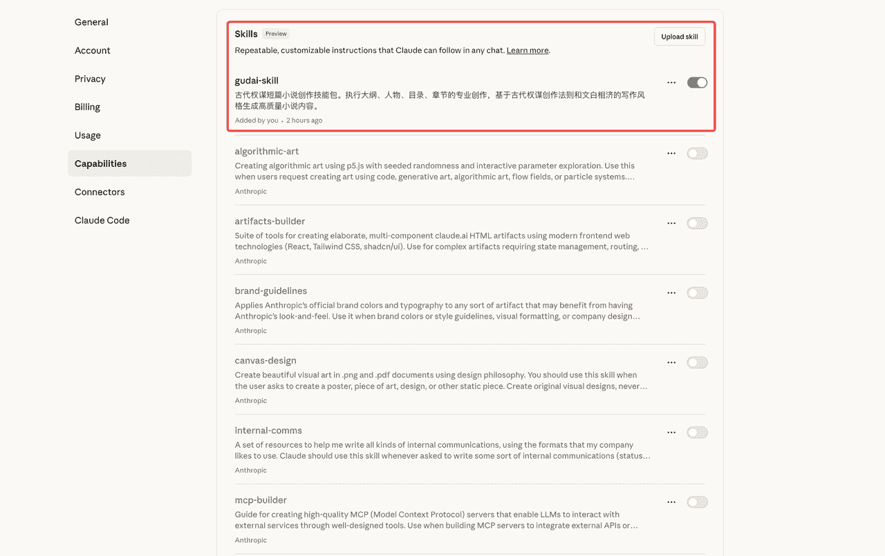

# 小说 | 古代权谋类 短篇小说创作 Claude Skill

> 来源：[https://feicaiclub.feishu.cn/docx/JSf2dvhHqo8O72xR4IjcXE4snXb](https://feicaiclub.feishu.cn/docx/JSf2dvhHqo8O72xR4IjcXE4snXb)


<https://player.bilibili.com/player.html?bvid=1M12cBeEv1&share_source=copy_web&vd_source=1adb0321bdfa6d9eb5d1bf5665ffc381>

# 用 Claude Agent Skill 写古代权谋短篇小说 - 让故事灵感快速落地

这套方案主要解决一个问题：有了故事灵感后，从构思到完成一个完整短篇小说往往需要几天甚至更久。传统流程是想大纲、设计人物、规划章节、写正文，每一步都需要反复打磨，效率很低。

所以我们通过 Claude 的 Skill 功能搭建了一个专业的创作助手。把古代权谋的创作方法论、文档模板、写作风格、实战示例都打包进 gudai-skill，让 Claude 在每个创作环节都能调用这些专业知识。你只需要回答几个问题，剩下的大纲、人物、章节就由 AI 按照专业标准自动生成。

工作流程按照小说创作的自然顺序推进：故事大纲 → 人物小传 → 章节目录 → 章节正文。CLAUDE.md 负责整体流程管控，gudai-skill 提供创作标准。从有灵感到生成完整初稿，整个过程可以在一两小时内完成。

这个方案让故事灵感从脑海里的想法变成可以直接阅读的小说初稿，大幅提升创作效率。不过要注意，生成的内容是初稿，还需要根据个人风格润色调整。

---

# 核心功能模块

**Skill调用机制**

通过 gudai-skill 技能包为 Claude 提供专业创作知识。每个创作阶段开始前，主Agent会自动调用对应的资源文件：大纲阶段读取 outline-method.md（方法论）+ outline-template.md（模板）+ outline-example.md（示例），章节阶段读取 output-style.md（写作风格）+ chapter-template.md（模板）。这种模块化设计让 Claude 不是凭感觉写作，而是基于明确的创作标准和范式进行输出。

**分阶段创作流程**

创作严格遵循"故事大纲 → 人物小传 → 章节目录 → 章节正文"的流程，每个阶段对应独立文档。用户通过 /character、/catalog、/write 命令推进流程，系统会自动读取前序文档确保连贯性。比如创作章节时，会同时读取 outline.md、character.md、chapter_index.md，确保情节不偏离大纲、人物行为符合设定。这种阶段性管理避免了一次性生成导致的前后矛盾。

**模板驱动生成**

所有文档格式由 templates/ 目录下的模板文件定义，包括大纲、人物小传、章节目录、章节正文四类。Claude 创作时严格遵循模板结构，确保输出格式统一、信息完整。比如人物小传必须包含"主要角色→重要配角→其他角色"的层级。

**上下文连贯性**

每个阶段创作前都会读取已有文档内容。人物创作基于大纲设定，章节创作基于大纲+人物+目录，形成递进式上下文积累。系统通过文档驱动而非对话记忆来维护上下文，即使对话被清空，只要文件还在，就能通过 /status 命令查看进度并继续创作。

**文档结构管理**

项目采用标准化目录结构：outline.md（大纲）、character.md（人物）、chapter_index.md（目录）、chapters/Chapter-XX.md（各章节）。固定5章结构对应起承转合布局，每章2000-3000字。这种结构化存储让创作过程可追溯、可修改，文档本身就是交付物，而不需要从对话记录中复制粘贴整理。

> **注**：AI生成的是初稿，能帮你快速把故事框架搭起来，但最终还需要人工润色才能达到发布标准。输入质量直接决定输出质量——你在Q1-Q3提供的核心创意、冲突设定越详细具体，生成的大纲和人物就越贴合预期。AI的工作是基于你的创意进行填充和扩展，而不是100%从零创造，所以前期构思越清晰，后期调整成本越低。另外，固定的5章结构适合短篇，如果需要更长篇幅，需要调整模板和方法论。

---

# 如何配置

## 配置步骤：

### 方式一：在 Claude.ai 网页版配置（推荐新手）



1.  **进入Skills设置**

+   选择 "Settings" → "Capabilities" → "Skills"

+   点击 "Upload file" 按钮

1.  **上传技能包**

+   选择 zip 压缩包文件

+   系统会自动解压并识别skill结构

1.  **启用技能包**

+   在Skills列表中找到新创建的技能

+   确保状态为 "Enabled"（已启用）

1.  **开始创作**

+   回到对话界面，开始新对话

+   直接向Claude说明你的创作需求即可

+   Claude会自动调用进行创作

### 方式二：在 Claude Code 中配置（适合熟练）

请按照以下步骤配置创作系统，配置完成后，你的项目结构应该是这样：

```
project/
├── outline.md                           # 故事大纲（创作后生成）
├── character.md                         # 人物小传（创作后生成）
├── chapter_index.md                     # 章节目录（创作后生成）
├── chapters/                            # 章节正文目录（创作后生成）
│   ├── Chapter-01.md
│   ├── Chapter-02.md
│   └── ...
└── .claude/
    ├── CLAUDE.md                        # 项目规则和主Agent配置（必须创建）
    └── skills/
        └── gudai-skill/                 # 古代权谋创作技能包（必须创建）
            ├── SKILL.md                 # 技能包核心配置
            ├── outline-method.md        # 大纲创作方法论
            ├── output-style.md          # 写作风格
            ├── templates/               # 文档格式模板
            │   ├── outline-template.md
            │   ├── character-template.md
            │   ├── chapter-index-template.md
            │   └── chapter-template.md
            └── examples/                # 创作示例
                ├── outline-example.md
                ├── character-example.md
                └── chapter-example.md
```

1.  **创建项目规则**

+   在 .claude/ 目录下创建 CLAUDE.md 文件

+   粘贴完整的项目规则内容，包含角色定义、工作流程、指令集

+   确保包含初始化脚本和所有创作阶段的流程定义

1.  **创建 Skill 技能包**

+   在 .claude/skills/ 目录下创建 gudai-skill/ 文件夹

+   创建 SKILL.md 作为技能包核心配置

+   粘贴技能包说明和执行流程

1.  **添加创作方法论**

+   在 gudai-skill/ 目录下创建 outline-method.md

+   粘贴大纲创作方法论，包含起承转合结构、人物塑造、爽点设计等内容

1.  **配置写作风格**

+   创建 output-style.md 文件

+   粘贴写作风格定义和具体行为规范

1.  **添加文档模板**

+   在 gudai-skill/templates/ 目录下创建四个模板文件

+   包括大纲、人物小传、章节目录、章节正文的格式定义

+   这些模板会严格约束 AI 的输出格式

1.  **添加创作示例**

+   在 gudai-skill/examples/ 目录下创建示例文件

## 重要配置细节：

+   **Skill调用**：CLAUDE.md 中定义了何时调用 gudai-skill，每个创作阶段会自动调用对应资源

+   **模板约束**：templates/ 中的格式是强制性的，AI 必须按照模板结构输出

+   **方法论指导**：outline-method.md 是核心，定义了起承转合、人物塑造、冲突设计等创作标准

+   **风格一致性**：output-style.md 确保文白相济风格贯穿全文，避免出现现代口语

+   **示例学习**：examples/ 提供具体范式，让 AI 理解什么是符合标准的输出

+   **固定结构**：短篇固定5章对应起承转合，不支持自定义章节数

+   **人工润色**：AI生成初稿后仍需人工调整细节、润色语言、补充情节

---

# 核心设计理念

```
┌─────────────────────────┐
│  skill                  │ ← 知识层：提供专业创作指导
│  ├─ outline-method.md   │    方法论、风格、模板、示例
│  ├─ output-style.md     │
│  ├─ templates/          │
│  └─ examples/           │
├─────────────────────────┤
│  CLAUDE.md              │ ← 流程层：控制创作流程
|                         │    定义工作流和指令集
├─────────────────────────┤
│  Main Agent             │ ← 创作层：调用Skill进行创作
|                         │    读取资源→生成内容→写入文档
├─────────────────────────┤
│  outline.md             │ ← 文档层：结构化存储
│  character.md           │    故事大纲
│  chapter_index.md       │    人物小传
│  chapters/*.md          │    章节目录
|                         │    章节正文
└─────────────────────────┘
```

## 工作流程：

1.  **需求收集** - 主Agent询问核心创意、核心冲突、故事调性三个问题

1.  **调用Skill** - 根据创作阶段，调用skill读取对应的方法论、模板、示例

1.  **内容创作** - 基于Skill提供的指导和用户需求，生成符合标准的内容

1.  **文档写入** - 将创作内容写入对应的结构化文档（outline.md / character.md等）

1.  **流程推进** - 通知用户当前阶段完成，引导进入下一个创作阶段

## 关键特性：

+   **Skill驱动** - 每个阶段自动调用对应资源，确保创作有章可循

+   **模板约束** - 严格遵循templates/定义的格式，保证输出规范统一

+   **阶段递进** - 按照"大纲→人物→目录→正文"顺序推进，后续阶段基于前序文档

+   **上下文积累** - 通过文档驱动而非对话记忆维护上下文，支持长期创作

+   **结构化存储** - 所有内容分文件管理，便于查看、修改和复用

+   **快速落地** - 从灵感到初稿，整个流程可在1-2小时内完成

+   **固定框架** - 5章结构对应起承转合，适合快速产出标准化短篇

---

# 👀 先睹为快

我们用这套系统测试了Claude Sonnet 4.5模型，从提出故事创意到生成完整的5章短篇小说，整个过程用了半小时左右。所有内容都是基于框架直接生成的初稿，未经人工润色。这样你可以直观地看到这套系统在实际应用中能达到什么效果。

## **使用时的注意事项：**

1.  **输入质量决定输出质量**。Q1-Q3回答得越详细，生成的内容就越贴合你的预期。比如核心冲突如果只写"朝堂斗争"，生成的内容会很空泛；但如果写"太后欲改立幼子，大皇子掌兵符，三皇子握密诏，关键证物在中立派手中"，生成的内容就会具体很多。

1.  **这是初稿，不是成品**。AI生成的内容能帮你快速搭起框架，但语言细节、情节逻辑、人物对话还需要人工润色。特别是对话部分，AI有时会写得过于直白，需要调整成更符合古代语境的含蓄表达。

1.  **及时反馈和调整**。如果大纲阶段就发现内容偏离预期，直接提出修改意见，不要等到写完5章再推倒重来。每个阶段都可以修改，改得越早成本越低。

1.  **注意版权问题**。虽然这套系统是基于方法论和模板创作，但如果你的故事创意本身借鉴了某部作品，还是要注意避免抄袭。建议用自己的原创构思，或者对经典题材进行充分的改编创新。

## 故事大纲

## 小说信息

+   **书名**：算天局

+   **类型**：古代权谋

+   **故事调性**：大女主向·爽感智斗（复仇/反转/打脸推进，节奏快）

## 主要人物

+   **顾星澜（主角）**：23岁,太史局历算女官,擅天象推算与时刻预报,师从太史令沈钧白,卷入军饷挪用案

+   **沈钧白**：65岁,太史令,因持有灾年预报原卷被摄政王陷害,三日后问斩

+   **萧景琛**：35岁,摄政王,掌兵符握军权,以"灾年减税"为名挪用军饷充私库

+   **谢时行**：42岁,户部尚书,掌税簿与军饷拨付,是摄政王心腹,实际经手挪用

+   **庄恒之**：28岁,御史台御史,暗中查案,与顾星澜结盟

## 核心梗概

> 太史局历算女官顾星澜发现朝廷以"灾年减税"为名挪走军饷,师父沈钧白因持有证据被陷害入狱。她必须在三日禁足期内,用天象推算与税簿暗号对照,逼出真凶。大朝会上,她以可预报的日食时刻设计"时辰守门局",让摄政王在众目睽睽下自证其罪。

## 导语

> 开元十七年三月,太史令沈钧白因"妖言灾异"罪下狱,三日后问斩。其弟子顾星澜翻阅师父遗卷,发现去年"灾年减税"所减税银与军饷缺口数目相合,而税簿中藏有以二十四节气为钥的暗号。摄政王萧景琛掌兵符握军权,若揭案则师父可洗冤,但自己必成所有派系弃子;若不揭,师父三日后人头落地。初六申时,太史局预报有日食,正值大朝会。顾星澜决定以天象为局,用"时辰守门"之计,让摄政王在日食之时自证其罪。

## 故事大纲

### 起：师陷冤狱,算学破疑（第1章）

> **权力僵局**：开元十七年三月初三,太史令沈钧白因在上月奏对中言"今岁恐有西北边患,当备军资"被摄政王萧景琛以"妖言灾异,扰乱朝纲"罪名下狱,定于初六午时问斩。太史局上下噤声,无人敢为沈钧白辩护。摄政王掌兵符握军权,小皇帝年仅十二岁,朝中无人敢与其抗衡。沈钧白的罪名看似"妖言",实则触及军饷问题。

> **顾星澜处境**：太史局历算女官顾星澜,二十三岁,十年前父亲顾怀玉因直言军饷亏空被贬,郁郁而终。星澜随母入京,十三岁考入太史局,拜沈钧白为师,专司天象推算与时刻预报。她性子执拗,不善逢迎,在太史局中只专心算学,不问朝堂派系。师父入狱当日,她正在司天台校核节气时刻,闻讯赶回,师父书房已被查封。

> **疑点初现**：星澜趁夜潜入师父书房,在暗格中取出一卷师父临被捕前藏下的文稿。文稿中夹着去年户部税簿副本,其中"灾年减税"条目被师父用朱笔标注。开元十六年,朝廷以"陕甘大旱"为由减免税银三十七万两。然而师父在旁批注:"此年陕甘雨量正常,无大旱之灾。税簿所减之数,恰与兵部军饷缺口相合。"星澜心中一震——这不是灾年减税,而是有人借减税之名,挪用军饷!

> **暗号发现**：星澜细看税簿副本,发现每页页角有细微墨点,似有规律。她按太史局惯用的二十四节气顺序排列墨点位置,竟拼出一行字:"谢时行经手,萧景琛授意,户部-兵部转账,银入私库。"这是师父留下的暗号!谢时行是户部尚书,萧景琛正是摄政王。师父不是妖言惑众,而是掌握了摄政王挪用军饷的证据,所以才被陷害入狱。

> **时间压迫**：初三夜,星澜盘算:师父三日后问斩,若要救师父,必须揭发此案。但摄政王势大,手握兵符,若贸然上奏,不仅师父救不得,自己也会被灭口。更棘手的是,税簿副本只是旁证,没有实据。她需要找到真正的转账记录,或者让摄政王自己露出马脚。而初六午时,正是师父问斩之时;初六申时,太史局预报将有日食,届时全朝文武齐聚太和殿观日食、议大事。这是唯一的机会。

> **章末钩子**：星澜望向窗外,初三夜的月亮被云遮住半边。她想起师父曾说:"算天象者,当知天时不可违,但人事可为。"她决定以天象为剑,在那场日食中,设一个局。

### 承：禁足对算,暗中取证（第2-3章）

#### 第2章

> **禁足令下**：初四清晨,太史局接到摄政王手令:太史局上下不得擅离职守,所有人禁足局内,专司初六日食观测,不得与外界通信。名为"专心职守",实为软禁。星澜明白,摄政王在防备太史局的人为沈钧白鸣冤。禁足三日,她失去了出局查证的机会,也无法递消息给外界。

> **御史暗访**：当日午后,御史台御史庄恒之以"校核日食时刻"为由造访太史局。他是星澜父亲生前好友之子,两家有世交。庄恒之在司天台与星澜单独对话:"沈太史被捕,恐非妖言之罪。我在御史台查到,去年陕甘无旱灾,却减税三十七万两。此事蹊跷,我欲查证,但户部账目严密,无从下手。"星澜压低声音:"我手中有师父留下的税簿副本,上有暗号,指向谢时行与摄政王。但我被禁足,无法出局取证。"

> **结盟与分工**：庄恒之道:"我在外查账,你在内算时。初六申时日食,届时大朝会,若能当众揭发,摄政王再大也遮不住。"星澜:"关键是如何让他自证其罪。"庄恒之:"你是算天象的,可有办法用天象做局?"星澜沉思片刻,眼中闪过一丝精光:"有了。你去查户部与兵部的银两转账记录,我来设这个局。"

> **时刻推算**：星澜回到算房,翻出历年日食记录。日食有定时,可提前推算。初六申时日食,食甚时刻在申正三刻(约下午四点三刻)。她又翻出宫中起居注副本,发现摄政王每日在申初(下午三点)离开政事堂回府。若日食食甚在申正三刻,而摄政王在申初离开,他将错过日食观测,无法在朝会上解释"军饷挪用"之事。但若摄政王改在申正才离开,正好撞上日食食甚,便可设局。问题是:如何让摄政王改变作息,在申正三刻还留在太和殿?

> **守门之计**：星澜想起一个古老的权术手段:"时辰守门局"。在关键时刻,用礼制规矩将对方困在特定地点。她需要让摄政王在申正三刻时,因某种礼制原因无法离开太和殿,而日食食甚时,她当众宣布日食时刻,再揭发税簿暗号,让摄政王在天象威压下自证其罪。但这需要一个引子——一个让摄政王必须在申正三刻留在殿中的理由。

> **章末钩子**：初四夜,星澜在算房中反复推演。她在纸上写下:"申初—申正—日食食甚—时辰守门—自证其罪"。她需要找到那个"引子"。

#### 第3章

> **庄恒之取证**：初五清晨,庄恒之潜入户部档案库,翻出去年账目。户部的账面上,陕甘减税三十七万两的去向写的是"退还各州府",但各州府的收银记录中并无此笔银两。他再查兵部账目,发现去年军饷拨付短缺三十七万两,兵部尚书曾上奏询问,户部回复"国库吃紧,延后拨付",但此后再无下文。庄恒之找到关键证据:户部与兵部之间有一笔"内库周转"记录,经手人正是谢时行,批文上有萧景琛的私印。这笔银两名为"周转",实为挪用,最终流入摄政王私库。

> **传递消息**：庄恒之将账册副本藏在袖中,以"再校日食时刻"为由二访太史局。他在司天台与星澜交接,将账册副本递给她:"铁证在此。户部至兵部的银两转账,谢时行经手,萧景琛批文,银入私库。"星澜接过账册,心中有了底:"证据有了,现在就差那个'引子'。"

> **引子设计**：星澜问庄恒之:"摄政王每日申初离开政事堂回府,是为何?"庄恒之:"因申初至申正,他要去私库查银两账目。这是他的习惯,雷打不动。"星澜眼睛一亮:"若初六大朝会,皇上下旨议'西北军饷调拨'事宜,摄政王作为掌兵之人,必须在场。按祖制,大朝会中,皇上未宣散,臣子不得擅离。这就是'时辰守门'。"庄恒之:"但如何让皇上在初六议此事?"星澜:"我去求太后。"

> **太后结盟**：初五午后,星澜托太史局内侍传话给太后宫中,言"有关军饷急事,请太后垂询"。太后召见星澜。太后对摄政王早有不满,小皇帝年幼,摄政王权倾朝野,太后虽贵为太后,却处处受制。星澜跪地禀告:"娘娘,臣女掌握摄政王挪用军饷之证,但需娘娘助臣女在初六大朝会上设局。"太后:"你要哀家如何助你?"星澜:"请娘娘劝皇上在初六大朝会上议'西北军饷调拨',令摄政王留殿议事至申正三刻。届时日食食甚,臣女当众揭发。"

> **太后应允**:太后沉吟片刻:"哀家明白了。你是要用祖制困住萧景琛,让他在日食威压下无处可逃。"星澜:"正是。日食乃天象示警,古人以为'日食于申,主君不明,臣有私心'。若在日食时揭发军饷挪用,摄政王便是'天谴之臣',朝中谁还敢护他?"太后:"好。哀家这就去劝皇上。"

> **局势明朗**：初五夜,星澜回到算房,将所有证据与推算整理成卷。税簿副本上的二十四节气暗号、户部与兵部的银两转账记录、日食食甚时刻推算,以及"时辰守门局"的设计,全部一一列明。她在卷末写下:"初六申正三刻,日食食甚,天象为局,证据齐备,只待揭发。"

> **师父托梦**：当夜,星澜梦见师父沈钧白。师父对她说:"星澜,为师这条命不足惜。但你要明白,揭发此案,你将失去太史局的容身之地,成为所有派系的弃子。摄政王倒了,会有新的权臣,他们不会容许一个女官坏了朝堂规矩。你当真要这么做?"星澜在梦中答:"弟子明白。但师父,若弟子不做,天下还有谁会做?算天象者,当知天理不可欺。"

> **章末钩子**：初六清晨,星澜在司天台望向东方,天色微明。今日午时,师父将被问斩。今日申正三刻,日食将至。她深吸一口气,整理衣襟,准备进宫。

### 转：日食大朝,对证翻盘（第4章）

> **大朝会开**：初六辰时,太和殿大朝会。小皇帝端坐龙椅,太后垂帘听政。摄政王萧景琛立于班首,户部尚书谢时行紧随其后。皇帝宣旨:"近日边关急报,西北军饷不足,恐生兵变。今召百官议此事。"萧景琛奏道:"臣以为当从户部调银,速发边关。"谢时行附和:"户部愿拨银五十万两。"御史台御史庄恒之出班奏道:"臣查户部账目,去年陕甘减税三十七万两,此笔银两至今下落不明。若此事不查清,恐边关军饷亦有亏空。"

> **首轮交锋**：萧景琛色变,沉声道:"去年陕甘大旱,朝廷减税乃恤民之举,何来下落不明?"庄恒之:"臣查陕甘雨量记录,去年雨量正常,无大旱。减税之举,恐有蹊跷。"谢时行急道:"雨量记录岂可轻信?太史局的记录,谁知真假?"此时,太后开口:"太史令沈钧白,不正是因'妖言灾异'被捕?不如传太史局女官顾星澜入殿,当面对质。"

> **星澜入殿**：顾星澜被传唤入殿。她着太史局官服,手捧算卷,移笏叩首。皇帝问:"顾女官,去年陕甘可有大旱?"星澜:"回禀陛下,臣女查太史局雨量记录,去年陕甘雨量在七寸至一尺二寸之间,属正常年景,无大旱之灾。"萧景琛:"你一女官,如何证明记录无误?"星澜:"臣女可将十年雨量记录呈上,陛下可命他官复核。"

> **二十四节气暗号揭示**：庄恒之接过话头:"臣手中有去年户部税簿副本,上有沈太史亲笔批注。"他将税簿副本呈上。星澜道:"税簿中藏有二十四节气暗号,臣女已破解。暗号所示:谢时行经手,萧景琛授意,户部至兵部银两转账,银入私库。"满殿哗然。谢时行急道:"一派胡言!何来暗号?"星澜:"税簿每页页角有墨点,按节气顺序排列,可拼出此句。臣女可当众演示。"她在殿中展开税簿,用毛笔在墨点处标注,按立春、雨水、惊蛰……大寒的顺序连线,果然拼出那行字。

> **账册对质**：萧景琛强自镇定:"即使有暗号,也不能证明银两入私库。"庄恒之:"臣手中有户部与兵部银两转账记录。"他将账册副本呈上。"记录显示,去年减税之银,名为'内库周转',实则挪用,经谢时行之手,入萧景琛私库。账上有谢尚书印,批文上有摄政王私印。"谢时行脸色煞白,萧景琛沉默不语。

> **时辰守门局**：此时已至申初,萧景琛欲告退,皇帝却道:"此事关乎军饷,关乎边关安危,摄政王掌兵符,岂可中途离去?着留殿议事至日落。"这正是太后劝皇帝下的旨。萧景琛无法违抗,只得留殿。时间一刻一刻过去,申正、申正一刻、申正二刻……殿外天色渐暗。

> **日食食甚**：申正三刻,殿外突然昏暗如夜,日轮被蚕食,天狗食日。百官惊惧,有人惊呼:"日食!日食!"星澜在殿中朗声道:"臣女奉太史局之命,预报初六申时有日食,食甚在申正三刻。日食于申,古籍载:'日食于申,主君不明,臣有私心。'今日日食恰在大朝会议军饷之时,岂非天象示警?"满殿肃然。太后道:"天象昭昭,不可欺也。摄政王,你可有话说?"

> **摄政王自证**：萧景琛在日食的昏暗中,终于开口:"臣……臣确曾挪用军饷。去年边关无战事,臣以为国库吃紧,借减税之名挪银入私库,待来年再还。不想被沈钧白察觉,故将其下狱。臣知罪。"他跪地请罪。谢时行见主子认罪,也跪地道:"臣附和摄政王,经手挪用,臣亦知罪。"太后:"沈钧白所言非妖言,而是忠言。着即刻释放沈钧白,恢复太史令之职。萧景琛挪用军饷,谢时行经手贪墨,着削职查办,交大理寺审理。"

> **本章要点**：

+   大朝会议军饷,引出陕甘减税疑案

+   星澜入殿对质,揭示二十四节气暗号

+   账册对质,铁证如山

+   时辰守门局:皇帝令摄政王留殿至申正三刻

+   日食食甚,天象威压,摄政王自证其罪

+   三步翻盘:暗号揭示—账册对质—日食逼供

### 合：师出冤狱,代价明晰（第5章）

> **师父获释**：初六午后,沈钧白被释放出狱,恢复太史令之职。他回到太史局,星澜在门口迎接。师徒相见,沈钧白拍拍星澜的肩:"你做得好。为师这条命,是你算回来的。"星澜:"师父,弟子只是用您教的算学,推演了一局棋。"沈钧白叹息:"但这局棋,你自己也下进去了。"

> **代价呈现**：当夜,星澜接到太后懿旨:念其揭发有功,赏黄金百两,但着即刻离任太史局,不得再任朝廷官职。太后在懿旨后附言:"女官坏朝堂规矩,虽有功,不可留。你救了沈钧白,也断了自己的仕途。"星澜接旨,面色平静。她明白,自己揭发摄政王,虽扳倒了一个权臣,却也让所有派系都忌惮她——一个女官,用天象算计权贵,谁还敢留她在朝中?

> **师父相送**：沈钧白送星澜出太史局。师父说:"你当初问我,若揭案,你将成为所有派系弃子,值得吗?现在你有答案了吗?"星澜答:"师父,弟子这十年在太史局,学的不仅是算天象,更是懂天理。天理不可欺,人心也不可欺。若弟子不做,师父人头落地,那些挪用的军饷永远不会被追回,边关将士会因此送命。弟子这条仕途,换师父一命,换边关安稳,值。"

> **庄恒之告别**：庄恒之来送星澜。他递给她一封信:"这是御史台的推荐信,你若愿意,可去江南书院教算学。那里需要你这样的人。"星澜接过信,笑道:"多谢庄御史。弟子本就是算天象的,在哪里算,都一样。"庄恒之:"你用日食设局,天下第一算。"星澜:"不是弟子算得准,是天象本就在那里。弟子只是顺势而为。"

> **意象照应**：星澜离开太史局,最后一次登上司天台。她望向天空,初七的月亮清冷明净。她想起初三夜,那晚月亮被云遮住半边,如今云散月明,一如她心境。师父曾说:"算天象者,当知天时不可违,但人事可为。"她做到了。司天台上的日晷,指向申正三刻,正是昨日日食食甚的时刻。她笑了笑,转身下台。

> **尾声**：开元十七年三月,太史局女官顾星澜以日食设局,揭发摄政王萧景琛挪用军饷,沈钧白冤狱得雪。星澜离任太史局,南下江南,在书院教授算学。史书载:"顾氏女官,以算学破权谋,以天象正朝纲,虽离仕途,名传后世。"

> **本章要点**：

+   师父获释,恢复太史令

+   代价呈现:星澜虽有功,却被所有派系忌惮,离任太史局

+   师徒对话:确认选择的意义,术与义的平衡

+   庄恒之告别:留有后路,但星澜已无悔

+   意象照应:司天台、日晷、申正三刻,月圆云散

+   史笔收尾:功成身退,名传后世,有得有失

## 人物小传

## 主要角色

> **顾星澜（主角）**

> 二十三岁，太史局历算女官，专司天象推算与时刻预报。束发簪笄，常着太史局青色官服，袖中常备算筹与日晷图。性子执拗，不善逢迎，唯于算学一道心无旁骛。十岁时父亲顾怀玉因直言军饷亏空被贬，郁郁而终，她随母入京，十三岁考入太史局，拜沈钧白为师。十年苦学，于节气推算、日月交食皆有独到见解，尤擅以天象反推时刻，以时刻定人事。师父被捕后，她于三日禁足期内破解税簿暗号，与御史庄恒之结盟取证，在日食大朝会上设"时辰守门局"，以天象威压逼摄政王自证其罪。成局之后被太后以"女官坏朝堂规矩"为由勒令离任，虽有功却断仕途。她南下江南书院教授算学，终身未嫁。她说："算天象者，当知天时不可违，但人事可为。弟子这条仕途，换师父一命，换边关安稳，值。"

> **沈钧白（师父）**

> 六十五岁，太史令，三朝元老，执掌太史局二十余年。须发皆白，着朝服时腰佩算盘与铜壶滴漏。为人严谨，不苟言笑，唯对天象算学倾注毕生心血。他发现去年"灾年减税"实为军饷挪用，在税簿副本上用二十四节气暗号标注真相，却被摄政王以"妖言灾异"罪名下狱，定于初六午时问斩。他临被捕前将证据藏于暗格，寄望弟子能查明真相。在狱中他曾托梦星澜："为师这条命不足惜，但你要明白，揭发此案，你将成为所有派系弃子。"获释后恢复太史令之职，对星澜说："你做得好，为师这条命是你算回来的。"他是星澜的道德镜子，亦师亦父，教会她"天理不可欺，人心也不可欺"的信条。

> **庄恒之（盟友）**

> 二十八岁，御史台御史，掌风纪监察。面容清瘦，着御史袍服，腰悬玉笏。他是星澜父亲生前好友之子，两家有世交。为人正直不阿，暗中查证陕甘减税疑案，发现去年无旱灾却减税三十七万两，遂起疑心。他在太史局被禁足时以"校核日食时刻"为由入局，与星澜结盟，分工明确："我在外查账，你在内算时。"他潜入户部档案库，翻出银两转账记录，查实谢时行经手、萧景琛批文的铁证。在大朝会上，他配合星澜揭发暗号与账册，促成证据链闭合。成局后，他赠星澜江南书院推荐信，言："你用日食设局，天下第一算。"他代表朝堂中仍存的正义之士，虽势单力薄，却敢于查案。

> **太后（结盟者）**

> 五十八岁，小皇帝祖母，垂帘听政。着凤袍，坐慈宁宫，掌内廷诏令。她对摄政王早有不满——小皇帝年幼，萧景琛权倾朝野，她虽贵为太后，却处处受制。星澜托内侍传话"有关军饷急事"，她召见星澜，听闻可借此扳倒摄政王，遂应允助力。她劝小皇帝在初六大朝会上议"西北军饷调拨"，令摄政王留殿至申正三刻，成就"时辰守门局"。日食食甚时，她以太后身份发问："天象昭昭，不可欺也。摄政王，你可有话说？"逼出萧景琛认罪。成局后，她赏星澜黄金百两，却勒令其离任太史局，懿旨附言："女官坏朝堂规矩，虽有功，不可留。"她是权力场中的老手，既借星澜扳倒政敌，又维护朝堂秩序，不容女官开创坏例。

## 反派角色

> **萧景琛（主要反派）**

> 三十五岁，摄政王，掌兵符握军权。身着蟒袍，腰佩玉带，出入仪仗森严。小皇帝年仅十二，朝中无人敢与其抗衡。他以"陕甘大旱"为名减免税银三十七万两，实则挪用军饷入私库，由户部尚书谢时行经手转账。沈钧白察觉真相，他便以"妖言灾异"罪名将其下狱。初四，他下手令禁足太史局，名为"专心职守"，实为防备鸣冤。他每日申初离开政事堂回府查私库账目，雷打不动。初六大朝会，他被皇帝"时辰守门"困于殿中至申正三刻，日食食甚时，星澜揭发暗号与账册，他在天象威压下认罪："臣确曾挪用军饷。去年边关无战事，臣以为国库吃紧，借减税之名挪银入私库，待来年再还。不想被沈钧白察觉，故将其下狱。臣知罪。"他被削职查办，交大理寺审理。代表权倾一时的权臣，却败于一个女官的天象算计。

> **谢时行（次要反派）**

> 四十二岁，户部尚书，掌税簿与军饷拨付，是摄政王心腹。着朝服，腰佩算盘，精于账目往来。他实际经手"灾年减税"挪用，在账册上做"内库周转"名目，将银两转入摄政王私库，批文上有萧景琛私印。庄恒之潜入户部档案库时查到这笔转账记录。大朝会上，庄恒之揭发暗号，他辩驳"一派胡言，何来暗号"。星澜当众演示二十四节气墨点拼字，他脸色渐白。庄恒之再呈账册副本，上有他的印信，他无话可说。萧景琛认罪后，他见主子已倒，也跪地道："臣附和摄政王，经手挪用，臣亦知罪。"他被削职查办，同交大理寺。代表依附权贵的贪官，主子倒，他也难逃。

## 重要配角

> **小皇帝**

> 十二岁，开元帝，年幼登基，祖母太后垂帘听政。着龙袍端坐龙椅，但朝政实由摄政王把持。初六大朝会，他在太后劝说下宣旨议"西北军饷调拨"，并下令："摄政王掌兵符，岂可中途离去？着留殿议事至日落。"此令成就"时辰守门局"。日食后，他依太后意旨释放沈钧白，削职萧景琛与谢时行。他是名义上的君主，实际是太后与权臣博弈的棋子。

> **顾怀玉**

> 星澜父亲，已故。十年前任职兵部，因直言军饷亏空被贬，郁郁而终。他临终前嘱咐妻女："朝堂险恶，切莫卷入权争。"然星澜性如其父，终究走上父亲未竟之路。庄恒之是他生前好友之子，因这层世交，庄恒之对星澜多有照拂。

> **星澜母亲**

> 寡居京城，靠刺绣度日。女儿入太史局后，她常劝："莫要多管闲事，保全自己。"初六后，星澜被勒令离任，她陪女儿南下江南，在书院旁开绣坊，母女相依。她代表普通百姓的生存智慧——乱世中，活着比正义更重要。

## 其他角色

> **太史局内侍**：四十余岁，在太史局当差二十年。师父被捕时奉命查封书房，但他念及旧情，故意放慢脚步，让星澜有时间进暗格取文稿。他对星澜说："沈大人待我不薄，这是老奴唯一能做的。"

> **户部书吏**：庄恒之查账时遇到的小吏，他暗示庄恒之："去年有笔'内库周转'，账目不对，但上面不许查。"没有他的提示，庄恒之未必能这么快找到证据。

> **司天台值守**：太史局年轻算官，负责初六日食观测。他对星澜的算学推导佩服不已，叹道："顾女官推算日食时刻，分毫不差，当世无双。"

## 章节目录

> **第1章** 师陷冤狱，暗号破疑

> 太史令沈钧白因"妖言灾异"下狱，三日后问斩。弟子顾星澜潜入师父书房，从税簿副本中破解二十四节气暗号，发现摄政王挪用军饷真相，决意以天象设局相救。

> **第2章** 禁足对算，御史结盟

> 摄政王下令禁足太史局，防备鸣冤。御史庄恒之以查账为由入局，与星澜结盟分工：他查户部转账铁证，她设"时辰守门局"，约定初六日食大朝会上当众揭发。

> **第3章** 太后结盟，守门成局

> 庄恒之取得户部账册铁证，星澜求见太后，说服其在大朝会上议军饷事，令摄政王留殿至申正三刻。"时辰守门局"布成，只待日食食甚天象威压下揭发真相。

> **第4章** 日食大朝，天象逼供

> 初六大朝会，星澜当众演示税簿暗号，庄恒之呈上账册铁证。申正三刻日食食甚，天象示警"主君不明，臣有私心"，摄政王在众目睽睽下认罪，师父沈钧白冤狱得雪。

> **第5章** 功成身退，算尽天机

> 师父获释恢复太史令，摄政王削职查办。星澜虽结案有功，却被太后以"女官坏朝堂规矩"勒令离任。她南下江南书院教授算学，用仕途换师父一命，术与义的代价终成定局。

## 第1章：师陷冤狱，暗号破疑

> 开元十七年三月初三，寅时三刻，太史令沈钧白被御林军自府中押走。

> 消息传至太史局时，顾星澜正在司天台校核春分节气时刻。她手中算筹落地，珠子滚过石阶，叮当作响。同僚皆面露惊惧，无人敢言。星澜未及收拾算筹,便匆匆下台奔回局中。

> 师父书房外，已有内侍守门。

> "沈大人书房奉旨查封，闲人莫入。"守门内侍年约四旬，在太史局当差二十年，识得星澜。他垂眼不视，声音却压得极低，"顾女官，此乃摄政王手令。"

> 星澜移笏半寸，微微颔首："劳烦公公转告，弟子只取师父日常所用历算之物，不敢擅动他物。"

> 内侍沉默片刻，侧身让开半步："老奴去净房，一炷香时间。"

> 星澜入室。书房中案几整齐，笔墨未干，墙上挂着的星图被揭去大半，地上散落着撕碎的奏折。她心下一沉——这般情景，分明是师父仓促间毁去关键文书。

> 她在书房中快速巡视。师父性情严谨，凡要事必有备份。她记得师父曾于深夜独自在书房中整理卷宗,次日便言"已妥当"。妥当二字，必有深意。

> 星澜蹲下身,手指在书架底部摸索。青砖微凉,忽地有一处松动。她屏息取出一块砖,暗格中藏着一卷文稿,外包油纸,未染尘埃。

> 油纸上,师父亲笔所书："星澜亲启。"

> 她展开文稿,入目第一行："为师若有不测,此卷可证清白。"

> 文稿中夹着去年户部税簿副本数页,其上"灾年减税"条目被朱笔重重标注。开元十六年,朝廷以"陕甘大旱"为由减免税银三十七万两。师父在旁批注工整："此年陕甘雨量七寸至一尺二寸,属正常年景,无大旱之灾。查太史局雨量记录可证。税簿所减之数,恰与兵部军饷缺口相合。"

> 星澜手指微颤。三十七万两,这不是小数。若是真有大旱,减税恤民乃朝廷德政;若无旱灾却减税,这银两去了何处?

> 她继续往下看。文稿末页,师父用更小的字迹写道:"此案若查,恐触权贵。为师已年迈,不惧死;你年轻,莫要卷入。但若为师蒙冤,此卷可为证据。"

> 星澜闭眼片刻,睁眼时已决然。师父待她如父,授她算学十年,如何能坐视师父蒙冤?

> 她将文稿收入袖中,正欲离开,目光却被税簿副本上的细节吸引。每页页角,皆有细微墨点,似有规律。她取出算筹,在地上按二十四节气顺序排列墨点位置。

> 立春、雨水、惊蛰、春分……

> 墨点连线,竟拼出一行字:"谢时行经手,萧景琛授意,户部-兵部转账,银入私库。"

> 星澜倒吸一口凉气。谢时行,户部尚书;萧景琛,摄政王。师父用二十四节气做暗号,将挪用军饷的关键人物藏于税簿之中。这般机巧,若非太史局中人,断无法破解。

> 她快速将墨点位置记于心中,收好税簿副本。门外传来脚步声,是那内侍归来。

> "多谢公公。"星澜出门时,对内侍郑重一礼。

> 内侍摆手:"沈大人待老奴不薄,这是老奴唯一能做的。"他顿了顿,"女官,摄政王势大,你莫要……"他未说完,只是叹息一声,转身离去。

> 星澜回到自己的算房。太史局中,她这间算房最是简陋,只一案一榻,墙上挂着的是她自己绘制的星图。她将文稿藏于榻下暗格,取出税簿副本细细研读。

> 师父被捕的罪名是"妖言灾异"。上月奏对,师父曾言"今岁恐有西北边患,当备军资"。此言一出,摄政王当殿驳斥:"太史令职司观象授时,何以妄言军国大事?此乃妖言惑众。"次日,师父便被下狱。

> 如今看来,师父所言非虚。若军饷被挪用三十七万两,边关如何不生变故?师父是在警示朝廷,却被摄政王以"妖言"之名压下。

> 星澜在纸上列出时间线:

> 开元十六年,陕甘"大旱",朝廷减税三十七万两; 同年,兵部军饷短缺三十七万两; 师父发现端倪,在税簿上用暗号标注; 开元十七年二月,师父奏对言边患,被驳为妖言; 三月初三,师父被捕,定于初六午时问斩。

> 今日是初三,距离师父问斩只有三日。

> 星澜望向窗外。初三夜,月亮被云遮住半边,天色晦暗。她想起师父常说的话:"算天象者,当知天时不可违,但人事可为。"

> 天时不可违——初六申时,太史局已预报有日食,食甚时刻在申正三刻。这是天象,无法改变。

> 但人事可为——她可以用这场日食,设一个局。

> 星澜取出纸笔,开始推演。日食于申时,古籍载:"日食于申,主君不明,臣有私心。"若能在日食时揭发军饷挪用案,摄政王便是"天谴之臣",朝中谁还敢护他?

> 但关键在于:如何让摄政王在日食时,在众目睽睽之下,自证其罪?

> 她翻出宫中起居注副本。摄政王每日申初离开政事堂回府,雷打不动。若日食在申正三刻,摄政王早已离开,如何能让他当众对质?

> 除非……用祖制困住他。

> 星澜眼中闪过一丝精光。大朝会时,皇上未宣散,臣子不得擅离。若初六大朝会上议要事,摄政王必须留殿。只要让他留到申正三刻,日食食甚之时,便可当众揭发。

> 这便是"时辰守门局"。

> 但这需要两个条件:其一,有人在大朝会上提出议题,让摄政王无法脱身;其二,有铁证在手,让摄政王无法辩驳。

> 星澜将税簿副本上的暗号誊抄一份,又在纸上写下:"需查户部与兵部银两转账记录,此为铁证。需人在初六大朝会上议军饷事,令摄政王留殿至申正三刻。"

> 第一条,她无法独力完成。户部账目严密,她一个太史局女官,如何能潜入查证?

> 她需要盟友。

> 星澜想起父亲生前好友之子,如今在御史台任御史的庄恒之。御史职司风纪监察,查账正是其职责。且庄家与顾家有世交,当年父亲被贬,庄家曾暗中接济。

> 天将明时,星澜在纸上写下最后一行字:"三日之内,必救师父。"

> 她将纸条焚于烛火,看着纸灰飘散。窗外,东方既白,初四将至。

> 星澜整理衣襟,准备去司天台继续观测。她必须表现得一如往常,不能引起怀疑。但她心中已有定计——她要以天象为剑,在那场日食中,为师父讨回清白。

> 临出门时,她回望书房。案上的算筹还未收拾,珠子散落一地。她蹲下身,将珠子一颗颗拾起,放回算筹盒中。

> 每一颗珠子,都是一步棋。

> 而这局棋,她已经开始布了。

## 第2章：禁足对算，御史结盟

> 初四清晨，卯时初刻，太史局大门外来了御林军。

> 星澜正在司天台校核昨夜星象记录，便听得楼下一阵喧哗。她放下手中圭表，探身望去，只见一队甲士持摄政王手令，将太史局四门俱封。

> 太史局正卿匆匆登台，面色煞白："顾女官，摄政王有令，太史局上下不得擅离职守，专司初六日食观测，不得与外界通信。"他压低声音，"这是禁足令。"

> 星澜心下一沉。摄政王动作如此之快，分明是在防备太史局的人为沈钧白鸣冤。三日之内，她失去了出局查证的机会，也无法递消息给外界。

> "正卿所言极是。"星澜移笏应道，"臣女定当专心职守，不负圣命。"

> 正卿叹息一声，转身下台。星澜望向太史局外，御林军把守各门，滴水不漏。她回到算房，将昨夜所写的那些推演藏于更隐秘处。

> 禁足三日，她需要另寻他法。

> 午后，太史局来了访客。

> 守门甲士通传："御史台御史庄恒之，奉旨校核日食时刻。"

> 星澜在算房中听到这个名字，手中算筹微微一顿。庄恒之，正是她昨夜想到的那个人。他怎会在此时造访？

> 她快步走到正堂。庄恒之着御史袍服，腰悬玉笏，正与正卿说话："下官奉旨复核初六日食时刻，以备大朝会观测。还请正卿安排精于推算之人，与下官同登司天台校验。"

> 正卿自是应允："本局历算女官顾星澜最擅时刻推演，正卿这就命她随御史上台。"

> 星澜上前一礼："御史大人，这边请。"

> 两人同登司天台。台上无他人，唯有风声猎猎。庄恒之负手立于台沿，望向远处宫阙，半晌方开口："顾女官，多年未见，可还记得在下？"

> 星澜垂眼："庄御史与家父有旧，星澜岂敢忘？"

> 庄恒之转身，面容清瘦而正气："令尊当年因直言军饷亏空被贬，临终前曾托家父照拂你们母女。如今沈太史被捕，在下不能坐视不理。"他顿了顿，"沈太史被捕，恐非妖言之罪。"

> 星澜心中一动，却不露声色："御史何出此言？"

> "在下在御史台查到，去年陕甘并无旱灾，太史局雨量记录可证。然朝廷却减税三十七万两，此事蹊跷。"庄恒之压低声音，"在下欲查证此案，但户部账目严密，无从下手。"

> 星澜看了看台下，确认无人偷听，方从袖中取出一张纸："这是家师留下的税簿副本誊抄，上有暗号。"

> 她将纸张展开，指着页角的墨点："以二十四节气为序，可拼出一行字：'谢时行经手，萧景琛授意，户部-兵部转账，银入私库。'"

> 庄恒之接过纸张，仔细端详。他眉头紧锁，半晌方道："若此事为真，沈太史便是因掌握证据才被陷害。"他抬眼看向星澜，"但暗号只是旁证，需找到户部与兵部的转账记录，方为铁证。"

> "正是。"星澜道，"然星澜被禁足局内，无法出去查证。"

> "在下可去。"庄恒之将纸张收好，"御史台有查账之权，在下可以查验军饷拨付为由，翻阅户部档案。"

> 星澜心中稍定："若能寻得铁证，还需在大朝会上揭发。初六午时，家师便要问斩。"

> 庄恒之沉思片刻："初六大朝会在辰时，距午时尚有两个时辰。若能在大朝会上揭案，自可免家师一死。"他看向星澜，"但如何让摄政王在朝会上对质？以他的权势，恐会压下此案。"

> 星澜走到台边，指着地上的铜壶滴漏："御史可知，初六申时有日食？"

> "太史局已有预报。"

> "日食食甚，在申正三刻。"星澜道，"古籍载：'日食于申，主君不明，臣有私心。'若能在日食时揭发军饷挪用，天象示警，摄政王便是'天谴之臣'。"

> 庄恒之眼中闪过一丝赞许："此计甚妙。但摄政王每日申初便离开政事堂回府，如何能让他留到申正三刻？"

> "这便需用'时辰守门局'。"星澜取出随身携带的宫中起居注副本，"大朝会时，皇上未宣散，臣子不得擅离。若有人在朝会上提出议题，需摄政王留殿议事，按祖制他不得中途告退。"

> 庄恒之接过起居注，翻看几页，恍然："你是说，要让朝会从辰时一直议到申正三刻？"

> "不必如此久。"星澜在地上用石子排列，"辰时朝会开始，先议常务，约一个时辰。巳时至午时，可休朝用膳。午时三刻，皇上下令继续议要事——譬如'西北军饷调拨'。此事关乎边防，摄政王掌兵符，必须在场。"

> 她又添了几颗石子："午时至未时，议军饷事，各方奏对。未时至申时，查证账目。申正三刻，日食食甚，届时揭发暗号与账册，天象威压之下，摄政王无处可逃。"

> 庄恒之看着地上的石子阵，如同一张精密的时刻表，不由点头："此局精妙。但如何让皇上在午时三刻下旨议军饷？"

> 星澜沉默片刻："这需要有人劝皇上。"

> "太后。"庄恒之道，"小皇帝年幼，凡事听太后。若能说动太后，此事可成。"

> "太后与摄政王素有龃龉。"星澜道，"摄政王权倾朝野，太后虽贵为太后，却处处受制。若能以此为饵，或可结盟。"

> 庄恒之看向星澜："你打算如何见太后？你被禁足局内。"

> "太史局内侍每日入宫报时刻，可托他传话。"星澜道，"只需言'有关军饷急事，请太后垂询'，太后自会召见。"

> 两人沉默片刻。庄恒之忽道："顾女官，此局若成，沈太史可洗冤。但你可想过代价？"

> 星澜抬眼："何谓代价？"

> "你一女官，用天象算计权贵，揭发挪用军饷。虽是为师伸冤，但此例一开，朝中诸公会如何看你？"庄恒之正色道，"太后或会借你扳倒摄政王，但绝不会容许你继续留在朝中。女官坏朝堂规矩，前所未有。"

> 星澜静静看着他，半晌道："御史是在劝星澜莫要多事？"

> "不是。"庄恒之摇头，"在下只是要你明白，此局一旦开始，便无回头路。"

> "星澜明白。"星澜转身望向远方，"家师待星澜如父，授星澜算学十年。如今家师蒙冤，三日后便要人头落地。若星澜不做，还有谁会做？"她回头，眼神坚定，"御史，星澜这条仕途，换家师一命，值。"

> 庄恒之看着眼前这个二十三岁的女官，想起当年她父亲顾怀玉也是如此决绝。他长叹一声："既如此，在下便助你一臂之力。"

> "多谢御史。"星澜一礼，"那我们分工如下：御史去户部查转账记录，星澜在局内推算时刻，托内侍传话给太后。初六大朝会，你我配合，一举揭发。"

> "好。"庄恒之道，"在下今夜便去户部档案库。明日若有结果，再寻机会来太史局传讯。"

> 两人又商议了些细节。庄恒之临下台时，回头道："顾女官，你用日食设局，当真算无遗策？"

> 星澜淡淡一笑："天象本就在那里，星澜不过顺势而为。"

> 庄恒之点头，转身下台。星澜目送他离去，直到身影消失在台阶尽头。

> 午后的阳光斜照在司天台上，地上的石子阵依然整齐排列。星澜蹲下身，将石子一颗颗收起。每一颗石子，都是一个时辰；每一个时辰，都是一步棋。

> 她望向西方。初四午后，距离初六申正三刻，还有不到两天。

> 回到算房，星澜取出历年日食记录，重新核算食甚时刻。圭表、漏壶、算筹，一样一样摆开。她要确保推算分毫不差——若日食时刻有误，这局便散了。

> 她在纸上写下： "初六申时，日食起。申初一刻，初亏。申正三刻，食甚。申正三刻，正是揭发之时。"

> 纸上又添一行： "托内侍传话太后：有关军饷急事，请太后垂询。"

> 夜幕降临，太史局内灯火通明。因禁足令，所有人都留在局内，准备初六日食观测。星澜独自在算房中推演，算筹拨动的声音在寂静中格外清晰。

> 她想起师父教她的第一堂课："算天象者，当知天时不可违，但人事可为。天象是死的，人心是活的。你要学的，不仅是算天象，更是算人心。"

> 如今她要算的，是摄政王的心，是太后的心，是这满朝文武的心。

> 她又想起父亲临终前的话："朝堂险恶，切莫卷入权争。"

> 可她终究还是卷入了。

> 不是为了权，而是为了天理。

> 窗外，初四的月亮比昨夜更圆了些。星澜望着那轮明月，喃喃道："师父，弟子必救您出狱。三日之内，定还您清白。"

> 她转身继续推算。案上的算筹密密麻麻，每一颗珠子都在诉说着一个时刻。

> 而所有的时刻，都指向初六申正三刻。

> 那场日食，那个局。

## 第3章：太后结盟，守门成局

> 初五子时，户部档案库。

> 庄恒之持御史台勘牌，推开库房厚重的铁门。守库小吏见是御史，不敢阻拦，只躬身引路："御史大人要查何年账目？"

> "开元十六年，户部与兵部银两往来。"庄恒之道。

> 小吏取出几本厚重的账册，放在案上："大人请查。"

> 庄恒之挥手："你下去吧，本官独自翻阅便可。"

> 小吏退出，带上门。库房中只余烛火摇曳，照得一排排账册书架影影绰绰。庄恒之翻开账册，逐页细看。

> 户部的账面工整，每笔银两的来源去向都记载得清清楚楚。开元十六年三月，"陕甘减税"条目赫然在目：减免税银三十七万两，去向写的是"退还各州府"。

> 庄恒之又翻出各州府的收银记录。陕西布政司、甘肃布政司，所有州府的账目中，皆无此笔银两入账。

> 这三十七万两，凭空消失了。

> 他继续往下查，在六月的账目中找到一笔"内库周转"记录。户部拨银三十七万两，名为"周转"，经手人签字：谢时行。批文上有一枚私印，虽小却清晰，正是萧景琛的私印。

> 庄恒之又翻出兵部账目。开元十六年，兵部军饷拨付短缺三十七万两。兵部尚书曾上奏询问，户部回复"国库吃紧，延后拨付"。此后再无下文。

> 账目对照，真相昭然：户部借"灾年减税"之名挪出三十七万两，名为"内库周转"实则入了摄政王私库，导致兵部军饷短缺。谢时行经手，萧景琛批文，一切都对上了。

> 庄恒之将关键几页账目誊抄，收入袖中。正欲离开，忽听门外有声响。他迅速将账册归位，吹熄烛火，闪身藏于书架后。

> 门被推开，进来的竟是户部一名书吏。那书吏提着灯笼，在库房中翻找什么。他找到开元十六年账册，翻到"内库周转"那一页，停住了。

> "就是这笔。"书吏喃喃自语，"若是有人查到这里……"他犹豫片刻，似乎想撕掉那一页，但终究没敢动手，只是叹息一声，合上账册离去。

> 庄恒之待他走远，方从书架后现身。他心中一凛——连户部小吏都知道这笔账有问题，可见此事非谢时行一人所为，必是上下皆知，却无人敢言。

> 他快步离开档案库，回到府中时已是丑时。他将誊抄的账目藏好，躺在榻上却难以入眠。明日，便是初五。距离初六大朝会，只剩一日。

> 初五卯时，太史局。

> 星澜早早起身，在算房中等候。按约定，今日庄恒之若查到证据，会再来太史局传讯。

> 辰时初刻，守门甲士通传："御史台御史庄恒之，复核日食观测仪器。"

> 星澜快步迎出。庄恒之神色如常，只对正卿道："下官需再登司天台，查看圭表是否精准。"

> 两人再登司天台。庄恒之环顾四周，确认无人，方从袖中取出誊抄的账目："铁证在此。"

> 星澜接过，仔细查看。户部"内库周转"三十七万两，谢时行签字，萧景琛私印；兵部军饷短缺三十七万两，数目分毫不差。

> "有此证据，可与家师留下的暗号互相印证。"星澜将账目收好，"如今万事俱备，只欠太后一诺。"

> "你打算何时见太后？"庄恒之问。

> "今日。"星澜道，"太史局内侍午时入宫报时刻，星澜已托他传话。若太后应允，便会召见。"

> 两人又商定了明日大朝会上的配合细节。庄恒之临下台时道："顾女官，此局成败，在明日一搏。"

> "星澜明白。"她望向天边，"天象已定，人事亦将定。"

> 午时三刻，慈宁宫。

> 太后倚在榻上，手中捻着佛珠。太史局内侍跪地禀报："太史局历算女官顾星澜，托老奴传话娘娘，言有关军饷急事，请太后垂询。"

> 太后眼皮微抬："军饷？一个太史局女官，与军饷何干？"

> "老奴不知详情，只传女官原话。"内侍道，"女官言，此事关乎摄政王。"

> 太后手中佛珠一顿。她挥退左右，只留心腹嬷嬷："宣她入宫。"

> 未时，星澜被引入慈宁宫。她着太史局官服，腰悬算筹盒，移笏叩首："民女顾星澜，叩见太后娘娘。"

> "起来吧。"太后打量着眼前的女官，"你说有关军饷急事，与摄政王有关？"

> 星澜起身，从袖中取出两份文稿："请娘娘过目。"

> 一份是税簿副本上的二十四节气暗号誊抄，一份是庄恒之誊抄的账册。太后接过，细细看了半晌，面色渐沉。

> "你是说，萧景琛挪用军饷三十七万两入私库？"

> "正是。"星澜道，"去年陕甘并无大旱，朝廷却以'灾年减税'为名减税三十七万两。此银不入州府，却经谢时行之手，以'内库周转'名目入了摄政王私库。民女师父沈钧白察觉此事，故被陷害入狱。"

> 太后将文稿放下，冷笑一声："萧景琛权倾朝野，哀家早就看他不顺眼了。小皇帝年幼，朝政尽在他手，哀家虽为太后，却处处受制。"她看向星澜，"你拿着这些证据来找哀家，是想让哀家助你扳倒萧景琛？"

> "民女不敢。"星澜道，"民女只想为师父洗冤。但此案若揭，确可让摄政王失势。民女斗胆请太后助一臂之力，于明日大朝会上议'西北军饷调拨'事，令摄政王留殿议事至申正三刻。届时民女当众揭发，天象示警，摄政王便无处可逃。"

> "天象示警？"太后微微挑眉。

> "明日申时有日食，食甚在申正三刻。"星澜道，"古籍载：'日食于申，主君不明，臣有私心。'若在日食时揭发军饷挪用，天下人都会以为是天降示警，摄政王便是'天谴之臣'。"

> 太后沉吟片刻，忽而笑了："好一个'天谴之臣'。你这女官，倒是机巧。"她站起身，负手踱步，"但你可想过，此事若成，你自己会如何？"

> 星澜垂眸："民女已有觉悟。"

> "觉悟？"太后转身看她，"你用天象算计权贵，揭发挪用军饷，虽为师伸冤，却开了女官干政的先例。哀家可以借你扳倒萧景琛，但绝不会容许你继续留在朝中。懂吗？"

> "民女明白。"星澜叩首，"民女只求师父洗冤，其他不敢奢求。"

> 太后看着跪地的星澜，半晌道："好。哀家应你。明日大朝会，哀家会劝皇上在午时三刻下旨议'西北军饷调拨'，令萧景琛留殿至申正。但事成之后，你必须离任太史局，不得再任朝廷官职。"

> "民女谢娘娘。"星澜叩首。

> "起来吧。"太后道，"明日大朝会，哀家会让皇上传你入殿对质。你把握时机，莫要让哀家失望。"

> 星澜告退出宫。暮色渐沉，她在宫门外站了许久，望着远处的太和殿。明日辰时，那里将聚集满朝文武。而她，将在日食之时，揭开这桩挪用军饷的大案。

> 回到太史局时，已是酉时。星澜回到算房，将所有证据重新整理。税簿暗号、账册副本、日食时刻推算，一一列明。她在最后写下：

> "初六辰时，大朝会开始。 午时三刻，皇上下旨议军饷，摄政王留殿。 申正三刻，日食食甚，揭发真相。 时辰守门局，至此成矣。"

> 她将纸张收好，又取出圭表，最后一次核算日食时刻。申时初刻初亏，申正三刻食甚，申正五刻复圆。时刻分毫不差，她已推算了无数次。

> 窗外，初五的月亮已近满月。星澜望着那轮明月，想起师父曾说："算天象，最要紧的是耐心。天象不会骗人，但人会骗人。你要算的，不是天，而是人心。"

> 如今她算的，正是人心。

> 夜深人静，太史局上下皆已歇息。唯有星澜的算房中，烛火依然亮着。她在纸上写下明日的每一个时辰，每一刻推进：

> 辰时：朝会开始，议常务 巳时：休朝用膳 午时三刻：皇上下旨议军饷，摄政王留殿 未时至申时：各方奏对 申正三刻：日食食甚，揭发暗号与账册

> 每一个时辰，都是一步棋。 每一步棋，都不容有误。

> 她望向窗外，东方天际已露出鱼肚白。初六，到了。

> 星澜整理衣襟，将所有证据收入袖中。她要去司天台做最后的准备——那场日食，那个局，已经等她很久了。

> 临出门时，她回望案上的算筹。那些珠子静静躺在盒中，仿佛在等待着最后的拨动。

> 而她，已经准备好拨动这最后一局。

> 师父，弟子今日便为您讨回清白。

> 天理不可欺，人心亦不可欺。

> 这一局，她算了三日。

> 今日，便是破局之时。

## 第4章：日食大朝，天象逼供

> 初六辰时，太和殿。

> 鸣钟九响，百官齐聚。小皇帝端坐龙椅，太后于帘后垂帘听政。摄政王萧景琛立于班首，蟒袍玉带，威仪赫赫。户部尚书谢时行紧随其后，面色如常。

> 星澜立于殿外廊下，与其他候召官员一起等候。她手捧算卷，袖中藏着税簿副本与账册誊抄。庄恒之在御史班中，与她隔着数丈，却彼此心照不宣。

> 大朝会按例开始。吏部奏报官员升迁，礼部奏报祭祀事宜，兵部奏报边关军情。辰时过半，皇帝宣布："巳时休朝，用膳后继续。"

> 百官退出太和殿。星澜在廊下静立不动，她知道，真正的较量在午后。

> 午时三刻，钟声再起。

> 百官重入太和殿。皇帝端坐龙椅，太后于帘后轻咳一声。小皇帝会意，朗声道："朕近日得边关急报，西北军饷不足，恐生兵变。今召百官议此事，摄政王掌兵符，当留殿详议。"

> 萧景琛出班奏道："臣以为当从户部调银，速发边关。"

> 谢时行附和："户部愿拨银五十万两，解边关之急。"

> 此时，御史台御史庄恒之出班："臣有本奏。"

> 皇帝："讲。"

> "臣查户部账目，发现去年陕甘减税三十七万两，此笔银两至今下落不明。"庄恒之声音清晰，"若此事不查清，恐边关军饷亦有亏空。"

> 满殿哗然。萧景琛脸色微变，沉声道："去年陕甘大旱，朝廷减税乃恤民之举，何来下落不明？"

> "臣查太史局雨量记录，去年陕甘雨量正常，并无大旱。"庄恒之不急不缓，"减税之举，恐有蹊跷。"

> 谢时行急道："雨量记录岂可轻信？太史局的记录，谁知真假？"

> 太后于帘后开口："太史令沈钧白，不正是因'妖言灾异'被捕？不如传太史局女官顾星澜入殿，当面对质。"

> 皇帝："宣太史局历算女官顾星澜入殿。"

> 星澜被引入殿中。她着太史局官服，手捧算卷，移笏叩首："民女顾星澜，叩见陛下。"

> "平身。"皇帝道，"顾女官，去年陕甘可有大旱？"

> 星澜起身，展开算卷："回禀陛下，民女查太史局雨量记录，去年陕甘雨量在七寸至一尺二寸之间，属正常年景，无大旱之灾。此为民女师父沈钧白所记，每月观测，从无差错。"

> 萧景琛冷声道："你一女官，如何证明记录无误？"

> "民女可将十年雨量记录呈上，陛下可命他官复核。"星澜不卑不亢，"且民女师父留有文稿，其中记载去年陕甘雨量详情，可资证明。"

> 庄恒之接过话头："臣手中亦有证据。"他从袖中取出一份文稿，"此为沈太史留下的税簿副本，上有亲笔批注。"

> 太监接过文稿，呈于御前。皇帝翻看几页，疑惑道："这税簿上，有何蹊跷？"

> "陛下请看页角。"星澜上前，"每页皆有细微墨点，似是无意，实则暗藏玄机。"

> 她取出算筹，跪于殿中，将税簿几页并列展开："民女以二十四节气为序，按立春、雨水、惊蛰、春分……排列墨点位置，可拼出一行字。"

> 她用算筹在墨点处标注，按节气顺序连线。满殿文武皆伸颈观看，只见墨点连线，竟拼出："谢时行经手，萧景琛授意，户部-兵部转账，银入私库。"

> 殿中寂然。

> 谢时行脸色煞白，强自镇定："一派胡言！何来暗号？这不过是墨迹偶然，如何能证明什么？"

> "若只是墨迹偶然，为何恰好拼出此句？"庄恒之道，"且臣手中尚有铁证。"

> 他从袖中取出另一份文稿："此为户部与兵部银两转账记录誊抄。记录显示，去年减税之银，名为'内库周转'，实则挪用。经谢尚书之手，入萧景琛私库。账上有谢尚书印信，批文上有摄政王私印。"

> 太监将账册誊抄呈上。皇帝翻看，面色渐沉。太后于帘后道："让百官皆看看，这账目可有假？"

> 账册在殿中传阅。户部侍郎看后，跪地道："此确为户部账册笔迹，并无差错。"兵部侍郎亦道："兵部去年确有军饷短缺三十七万两，与此数相合。"

> 萧景琛沉默不语。谢时行额头渗出冷汗。

> 皇帝看向萧景琛："摄政王，你可有话说？"

> 萧景琛深吸一口气，正欲开口，忽听殿外传来惊呼声："陛下！日食！日食开始了！"

> 此时已至申时初刻。殿外天色渐暗，日轮开始被蚕食。太阳的右下方，出现了一个黑色的缺口，如同被天狗咬去一角。

> 百官纷纷转头望向殿外，惊惧之色溢于言表。有人失声道："日食于申，这是天象示警！"

> 萧景琛面色铁青。他每日申初便离开政事堂回府，今日却因皇帝"留殿议事"之令，被困于殿中。如今日食当前，他想离开也不能了。

> 太后于帘后道："太史局预报初六申时有日食，食甚在申正三刻。如今果然应验。顾女官，你可知日食于申，古人如何解说？"

> 星澜朗声道："回禀娘娘，古籍载：'日食于申，主君不明，臣有私心。'今日日食恰在大朝会议军饷之时，岂非天象昭示，有臣子心怀不轨？"

> 满殿肃然。日轮的缺口越来越大，天色越来越暗。殿中虽燃着蜡烛，却也难掩那股来自天际的威压。

> "荒谬！"萧景琛终于开口，"日食乃天象常事，何来示警之说？"

> "若是常事，为何今日日食，恰在议军饷之时？"庄恒之道，"摄政王，民间皆传，日食乃天谴之兆。您身为摄政，若无亏心事，何惧天象？"

> 萧景琛咬牙不语。

> 时间一刻一刻过去。申正、申正一刻、申正二刻……日轮的缺口越来越大，殿外已昏暗如夜。百官皆不敢出声，只听得彼此粗重的呼吸声。

> 申正三刻，日食食甚。

> 天地一片昏黑，唯有殿中烛火微弱闪烁。日轮几乎全被遮住，只余一圈微弱的光晕，如同黑色的天眼，俯视着太和殿。

> 星澜在这昏暗中，声音清晰而坚定："陛下，古人云：'日食修德，月食修刑。'今日日食当空，正是上天示警朝堂。民女师父沈钧白察觉军饷挪用，却被陷害入狱，三日后便要问斩。此事若不昭雪，天理何在？"

> 太后道："沈钧白所言，究竟是妖言，还是忠言？如今证据俱在，账目清晰。摄政王，你还有何话说？"

> 萧景琛在昏暗中站立良久。殿外日食威压，殿内百官注视。他终于长叹一声，跪地道："臣……臣确曾挪用军饷。"

> 满殿哗然。

> "去年边关无战事，臣以为国库吃紧，借减税之名挪银三十七万两，入私库周转，待来年再还。"萧景琛声音低沉，"不想被沈钧白察觉，恐事发获罪，故以'妖言灾异'之名将其下狱。臣……臣知罪。"

> 谢时行见主子认罪，亦跪地道："臣附和摄政王，经手挪用，将户部银两转入私库。臣亦知罪。"

> 皇帝："何以至此！"

> 太后于帘后冷声道："萧景琛身为摄政，却挪用军饷，陷害忠臣。沈钧白所言非妖言，而是忠言。着即刻释放沈钧白，恢复太史令之职。萧景琛、谢时行挪用军饷，着削职查办，交大理寺审理。"

> "臣等遵旨。"百官齐声应道。

> 此时，殿外日轮开始复圆。黑色的阴影缓缓退去，光明重新洒向人间。申正五刻，日食复圆，天地重归清明。

> 星澜跪在殿中，望着殿外渐渐复明的天色。她算了三日的这一局，终于在日食之时，破了。

> 皇帝看向殿外，日食已复圆，天地重归清明。他朗声道："传朕旨意：即刻放出沈钧白，恢复太史令之职。宣沈钧白入宫，朕要当面赔罪。"

> "臣等遵旨。"

> 太监领旨疾行出殿。百官陆续退出太和殿。星澜随众官离去，步履稳健却掩不住心中激动。庄恒之在人群中与她对视一眼，微微颔首。

> 她知道，师父得救了。

> 但她也知道，自己的代价，即将到来。

> 申时末，刑部天牢。

> 沈钧白坐在牢房中，须发凌乱，衣衫破旧。三日囹圄，他已做好了午时问斩的准备。只是不知星澜那孩子，有没有看到他留下的文稿。

> 忽听牢外传来急促的脚步声。

> "圣旨到——"尖细的太监嗓音在牢道中回响。

> 沈钧白一愣。圣旨？莫非是提前问斩？他缓缓站起身，整理了一下衣襟。

> 牢门被打开。一名太监捧着明黄圣旨，身后跟着刑部官员。太监朗声宣读："奉天承运皇帝诏曰：太史令沈钧白忠心耿耿，直言军饷亏空，非妖言而是忠言。着即刻释放，官复原职，入宫面圣。钦此。"

> 沈钧白愣在原地，半晌才反应过来。他跪地接旨："臣……臣接旨。"

> 刑部官员上前解开镣铐。沈钧白手腕上的铁环落地，发出清脆的响声。他活动了一下僵硬的手腕，抬头问太监："敢问公公，这是……"

> "沈大人，今日大朝会上，令徒顾星澜揭发了摄政王挪用军饷之案。"太监笑道，"摄政王当殿认罪，您的冤屈洗清了。"

> 沈钧白心中一震："星澜……她……"

> "您那徒弟了不得，用二十四节气暗号破案，还算准了日食时刻，在天象威压下逼得摄政王认罪。"太监啧啧称奇，"满朝文武都服了。"

> 沈钧白闭上眼睛，深吸一口气。那孩子，终究还是做了。他既欣慰，又心疼。

> "沈大人，皇上还在宫中等您，快随老奴入宫吧。"太监催促道。

> 沈钧白整理衣襟，跟着太监出狱。步出牢门时，夕阳的余晖洒在他身上，暖洋洋的。他眯起眼睛，看向太史局的方向。

> 牢门外，星澜已等候多时。

> 师徒四目相对，千言万语，最终只化作一句："师父，您无事便好。"

> 沈钧白走到星澜面前，仔细打量着她。三日不见，这孩子清瘦了些，眼中却多了一种坚定。他伸手想拍拍她的肩，却发现自己的手还在微微颤抖。

> "你做得好。"沈钧白声音有些哽咽，"为师这条命，是你算回来的。"他顿了顿，"但这局棋，你自己也下进去了，可曾后悔？"

> 沈钧白看着星澜，眼中有欣慰，也有心疼："你做得好。为师这条命，是你算回来的。"他顿了顿，"但这局棋，你自己也下进去了。"

> 星澜淡淡一笑："师父教导，天理不可欺。弟子不过是遵师教而已。"

> 沈钧白叹息一声，拍了拍她的肩："回太史局吧。"

> 两人并肩而行。夕阳西斜，照在师徒二人身上，拉出长长的影子。

> 星澜回望太和殿方向。那场日食，那个局，已经过去了。

> 但她知道，属于她的结局，还未到来。

## 第5章：功成身退，算尽天机

> 酉时，太和殿偏殿。

> 沈钧白整理了衣襟，由太监引入殿中。小皇帝已在殿中等候，太后亦在。

> "臣沈钧白，叩见陛下。"沈钧白跪地。

> "平身。"小皇帝亲自走下御阶，扶起沈钧白，"太史令，朕错怪你了。你所言西北边患，非妖言而是忠言。朕不察，险些铸成大错。"

> 沈钧白垂首："陛下圣明，臣不敢居功。"

> 太后于帘后道："沈太史，你那徒儿顾星澜，了不得。三日之内破案，用天象设局，逼得摄政王认罪，当真是奇女子。"

> 沈钧白道："顾星澜自幼聪慧，专心算学，是臣门下最得意的弟子。"

> "正因如此，哀家才惋惜。"太后叹息一声，"女官干政，前所未有。她虽为你伸冤，却开了坏例。哀家已有懿旨，让她离任太史局。"

> 沈钧白心中一沉，却也知这是必然。他沉默片刻，躬身道："臣明白。还请娘娘、陛下恕臣多言，顾星澜此举，非为功名，只为救师。还望娘娘、陛下给她留条后路。"

> "哀家自有安排。"太后道，"赏她黄金百两，算是酬功。至于以后，她自有去处。"

> 沈钧白叩谢。小皇帝又安慰几句，命人送他回太史局。

> 戌时，太史局。

> 星澜在算房中整理算卷，忽听门外太监通传："太后娘娘懿旨到。"

> 她心中一凛，整理衣襟出门。太监展开懿旨："太后娘娘懿旨：历算女官顾星澜，揭发摄政王挪用军饷，救太史令沈钧白于狱中，忠心可嘉。然女官干政，开坏先例。着即刻离任太史局，不得再任朝廷官职。赏黄金百两，以酬其功。钦此。"

> 星澜跪地接旨："民女接旨，谢娘娘恩典。"

> 太监将懿旨交给她，又低声道："顾女官，太后娘娘让老奴传话：你做得好，但规矩不能坏。这黄金收着，往后自有用处。"

> 星澜点头："多谢公公。"

> 太监离去。星澜捧着懿旨回到算房，将黄金收好。她早知会有这一天，所以并不意外，心中甚至有种解脱的轻松。

> 夜深时，沈钧白来到她的算房。师徒二人相对而坐，烛火摇曳。

> "你不怪为师？"沈钧白问，"若非为师留下那些文稿，你也不会卷入此事。"

> "师父这话说得，弟子如何能怪您？"星澜摇头，"您教导弟子十年，授以算学，更授以做人。您说'天理不可欺，人心亦不可欺'，弟子铭记于心。今日所为，不过是遵师教而已。"

> 沈钧白看着她，半晌道："你父亲当年也是如此说的。'天理不可欺。'结果被贬官，郁郁而终。如今你又走了他的老路。"

> "弟子不悔。"星澜平静道，"父亲当年直言军饷亏空，虽被贬，但他守住了良心。弟子今日揭发挪用军饷，虽离任，但也守住了师父教的天理。这条仕途，换师父一命，换边关安稳，值。"

> 沈钧白眼眶微红，拍了拍她的手："你母亲那边……"

> "母亲已知。她虽担心，但也理解。"星澜道，"弟子打算南下江南，去书院教授算学。庄御史已给了推荐信。"

> "江南书院？"沈钧白点头，"那里倒是个好去处。你在那里教算学，也算传承为师一脉。"他从袖中取出一本算书，"这是为师毕生所学，你拿着。"

> 星澜接过算书，郑重一礼："弟子定不辱师门。"

> 两人又说了许久话，直到夜深。沈钧白临走时，回头道："星澜，为师这一生，收徒无数，唯你最像为师年轻时的样子。执拗，较真，不肯变通。但也正因如此，你才是最配得上'算天象'三字的人。"

> 星澜目送师父离去，独自在算房中坐了许久。窗外月色如水，洒在案上的算筹上，泛着淡淡的光。

> 她站起身，最后一次整理这间算房。十年太史局，十年算学，都在这间小小的算房中。墙上的星图是她自己绘制的，案上的算筹是师父赠的，窗边的圭表是她入局时便立下的。

> 她一样一样收拾好，只留下那幅星图在墙上。或许将来，会有新的女官住进这间算房，继续推算天象。

> 次日卯时，太史局门外。

> 庄恒之已在那里等候。他手持一封信："这是江南书院的推荐信，你拿着。那里的夫子都是饱学之士，你去教授算学，必受欢迎。"

> 星澜接过信："多谢庄御史这些日子的相助。"

> "不必谢我。"庄恒之摇头，"你用日食设局，天下第一算。在下只是做了分内之事。"他顿了顿，"你此去江南，前程未定，这些银两你拿着。"

> 他递过一个袋子。星澜推辞不过，只得收下："庄御史大恩，星澜铭记。"

> "去吧。"庄恒之道，"江南山水好，你在那里教书，也算是另一种天高地阔。"

> 星澜向他一礼，转身离去。

> 她最后一次登上司天台。晨曦微露，东方天际泛起鱼肚白。她望着那座陪伴了她十年的观星台，想起无数个夜晚在这里推算天象的日子。

> 司天台中央，那座日晷静静矗立。她走过去，看着日晷上的刻度。申正三刻，那个她推算了无数次的时刻，在日晷上只是一个小小的刻痕。

> 但就是这一刻，改变了一切。

> 她伸手抚摸日晷，冰凉的触感让她想起三日前，她在这里与庄恒之商议时辰守门局的情景。那时她用石子摆阵，一颗石子一个时辰，推演到申正三刻。

> 如今石子早已收起，但那个局，成了。

> "顾女官。"身后传来沈钧白的声音。

> 星澜转身，师父已登上司天台。他手中拿着一卷文稿："这是为师这十年的观测记录，你带着。说不定将来用得上。"

> 星澜接过："师父，您保重。"

> "你也是。"沈钧白道，"记住，算天象者，当知天时不可违，但人事可为。你已经做到了。"

> 星澜深深一礼。转身下台时，她没有再回头。

> 太史局门外，母亲已在马车旁等候。星澜登车，马车缓缓启动。

> 她掀开车帘，最后望了一眼太史局。那座高耸的司天台，在晨光中如同一座灯塔。她在那里学了十年算学，也在那里算成了一局棋。

> 马车渐行渐远。太史局越来越小，最终消失在京城的街巷中。

> 数月后，江南。

> 顾星澜在江南书院教授算学。她讲授节气推算、时刻预报、日月交食，学生们听得入迷。

> 有学生问："先生，您当年如何算准日食时刻，分毫不差？"

> 星澜淡淡一笑："日食本有定时，只需推算便可。难的不是算天象，而是算人心。"

> "何谓算人心？"

> "知道某事必然发生，便顺势而为。"星澜道，"日食必在申正三刻，这是天象。摄政王必在申初离开，这是人心。只需让他在申正三刻还留在殿中，天象与人心便合了。"

> 学生们似懂非懂。星澜不再多说，继续讲授算学。

> 夜深时，她独自坐在书院的观星台上。江南的星空与京城不同，更加澄净。她望着满天星辰，想起师父教她的第一堂课："天象无言，但有定数。人心善变，但有定理。你要学的，是在定数与定理之间，找到那条路。"

> 她找到了。

> 虽然代价是离开太史局，断了仕途。但她救了师父，揭了贪案，守住了天理。

> 这一局棋，她不悔。

> 远处传来更鼓声，二更天。星澜站起身，准备下台。临走时，她回望天际，那里有一颗明亮的星辰，正是北斗七星中的天璇。

> 师父说过，天璇主算。

> 她笑了笑，转身下台。

> **尾声**

> 开元十七年三月，太史局女官顾星澜以日食设局，揭发摄政王萧景琛挪用军饷三十七万两，太史令沈钧白冤狱得雪。萧景琛、谢时行削职查办，交大理寺审理，后流放边疆。

> 顾星澜离任太史局，南下江南，于书院教授算学。终身未嫁，传算学一脉，门生遍及江南。

> 史书载："顾氏女官，以算学破权谋，以天象正朝纲。三日设局，申时破局，虽离仕途，名传后世。世人皆云：算天下事者多，能算天时人心者，唯顾星澜一人而已。"

> 沈钧白恢复太史令之职，又任职十年，七十五岁致仕。临终前，他对门人说："吾一生所学，尽传星澜。她虽为女子，却最懂'天理不可欺'四字。"

> 太史局司天台上，那座日晷依然矗立。申正三刻的刻痕依然清晰，仿佛在诉说着多年前那场日食，那个局。

> 而在江南书院的观星台上，顾星澜依然每夜观星，推算节气，教授算学。

> 她曾用三日时间，算出一个局。

> 用一场日食，救了一位师父。

> 用一条仕途，换了一世清白。

> 天理不可欺，人心亦不可欺。

> 此生，不悔。

> 【全文完】

单篇付费解锁剩余内容

CLAUDE.md

SKILL.md

创作方法论、规则和模板

...

# **💰 订阅社群年度会员**

> **💰 加入废才俱乐部**

> 加入社群，一次性解锁所有AI实战攻略。

> 包括现有的全部内容——提示词框架、Agent搭建教程、Skill开发攻略等，以及未来每一期视频更新的配套资料。不再零散获取，系统地学习和应用。

> ⚠️ 购买提醒：请仔细浏览页面内容，谨慎购买，不退不换。如未看到支付按钮，请使用桌面端网页浏览器访问。

> **光看文字不够？实操遇到卡点？**

> 加入社群后，你还可以进入专属交流群，获得废才老师的亲自指导。在这里，你不仅能与数百位AI实践者交流经验，更能随时提问，解决实操中遇到的问题。

> 我们期待你成为社群的第 n+1 位成员！

> [社群微信群入口](https://feicaiclub.feishu.cn/wiki/JBNXwZ5QZidRtuk1HCCcvgZmnNg?from=from_copylink)（戳这里，跳转去社群微信群页面扫码入群）