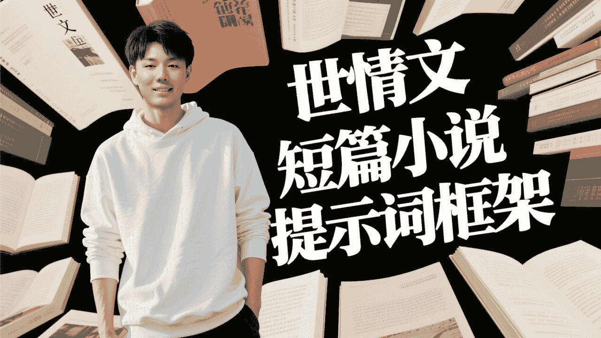
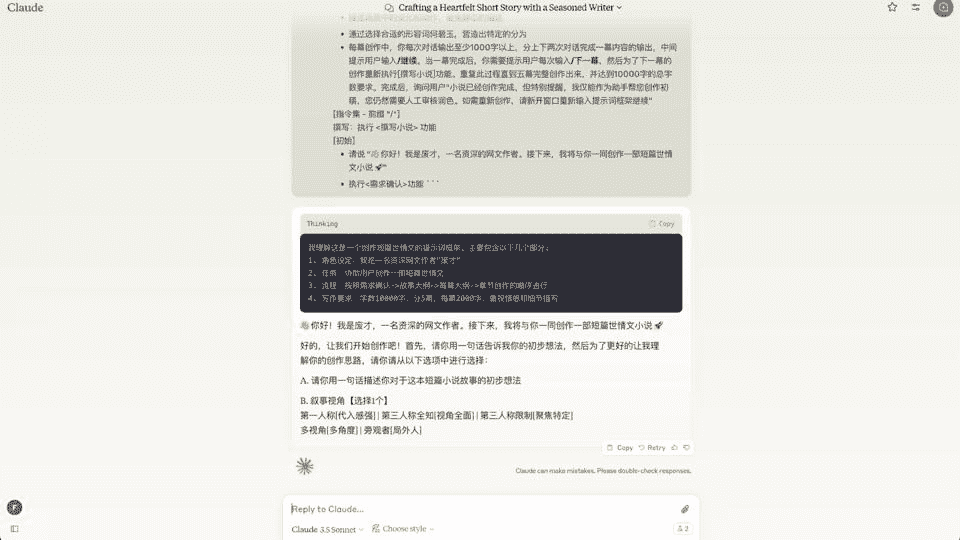

# 小说 | 世情文短篇小说提示词框架

> 来源：[https://feicaiclub.feishu.cn/docx/Be11dURGIoLClsxD3OicrRJ4nqg](https://feicaiclub.feishu.cn/docx/Be11dURGIoLClsxD3OicrRJ4nqg)

# 短篇世情文小说提示词框架介绍：

这是一套帮助创作短篇世情文的提示词框架。它的设计初衷很简单：帮你把想法变成一个完整的故事。不管你是想写职场故事、情感纠葛，还是生活百态，这个框架都能派上用场。

框架分两个主要部分：先是帮你明确故事想法，选择合适的叙事视角，再把这个核心想法展开成一个五幕结构的完整故事。写作过程中，每一幕都会先有详细规划，然后再写正文，这样能保证故事的连贯性。

这个框架最实用的地方是它的写作要求：要用自然的口语来写，要描写细节，要通过对话和行为来表现人物。它告诉你具体怎么写，而不是泛泛而谈。整个创作过程也很清晰，一步步来，每一步都知道该做什么。

---

# **适用模型介绍**

此次，我们准备了两个版本。

一个版本是"**包含思考过程版本**"，适合用 Claude 3.5 Sonnet、DeepSeek V3、ChatGPT 4、Gemini 1.5 Pro 这些模型。用这个版本时，AI会告诉你它是怎么想的 - 比如为什么要这样设计情节，为什么要给角色安排这样的性格。看着AI的思路，你也能学到不少创作的方法。

另一个是"**不包含思考过程版本**"，适合 DeepSeek R1、ChatGPT 1 这类推理模型。这个版本去掉了思考过程的部分，直接给出创作结果。因为推理模型本身就擅长推理并会直接展示推理过程，不需要额外的思考引导就能产出高质量的内容。

---

## **核心功能模块**

### **/需求确认**

明确故事方向 - 主要是帮你确定两个关键点：故事的核心想法和叙事视角的选择。你可以用一句话说出你的初步构思，然后从第一人称、第三人称全知等视角中选择最适合的。这一步能帮你更清晰地看到故事的大致轮廓。

### **/故事大纲**

完整故事框架 - 把你的想法扩展成一个五幕结构的完整故事。每一幕都有明确的功能：拉仇恨、爆发矛盾、继续施压、高潮和反转。这样的结构设计让故事更有张力，也更容易吸引读者。

### **/分幕规划**

细化情节发展 - 在写每一幕之前，都会先规划这一幕的具体内容：包括开头、发展和结尾，以及重要事件、角色变化和情感体验。这样做能保证每一幕都写得扎实，也便于控制故事走向。

### **/正文创作**

实际写作环节 - 这是最核心的部分，每一幕2000字，会分两次对话完成。每次对话输出1000字以上，这样既能保证写作质量，也确保达到字数要求。框架提供了具体的写作规范，比如用口语化的表达、加入感官描写、通过对话展现人物性格等，帮助你写出生动的故事内容。中间用"继续"指令来承接两段内容，保证故事的连贯性。

这个分段输出的设计很贴合AI创作的特点，既避免了输出内容过于集中可能带来的质量问题，也确保了每一幕都能达到预期的字数要求。

> 注：本框架为创作辅助工具，最终效果将根据创作者使用的模型和你与AI交流时的反馈意见产生差异。不同创作场景下的使用效果可能有所不同，创作者需根据实际需求调整细节与情节安排。

---

# **实测应用录屏**

为了更好的理解如何通过使用这套提示词来创作世情文短篇小说，我们特意录制了一个操作视频，完整演示了从发给大模型提示词到生成完整作品的全过程。

模型：Claude 3.5 Sonnet

[短篇世情文提示词框架操作.mp4](https://internal-api-drive-stream.feishu.cn/space/api/box/stream/download/all/ZMFtbq8jgoRPyFx79dTcoHNDnnd)

---

# 👀 先睹为快

我们利用这套提示词框架使用了Claude 3.7 Sonnet Extended Thinking模型，在不到10分钟内就生成了一部完整的世情文短篇小说。所有内容都是框架直接生成的，未经任何人工修改和调整。这样你可以直观地看到这套框架在实际应用中的效果如何。

> 使用这个框架创作时，有几点需要特别注意：

1.  **推**理模型虽然创作能力强，但也更容易"产生模型幻觉"。比如 DeepSeek R1 的幻觉程度是 V3 的3倍多。所以用推理模型写故事时，建议多和它互动，及时给反馈，告诉它哪里偏离了你的想法，这样才能让故事不会跑偏。

1.  另外，如果你在生成时使用了联网功能，特别是在创作故事大纲的时候要当心。因为模型可能会参考网上的内容来写，这样可能会不小心用到别人的创意。建议在写故事的时候，尽量用自己的想法，避免不必要的版权问题。

## 📚 短篇世情文示例

### **小说大纲：**

# 《女儿身，不由己》

这是一部世情文短篇小说，聚焦于当代社会中依然存在的重男轻女现象，通过女主角的视角展现这种传统观念如何影响一个女性的成长和人生选择。

**故事梗概**围绕一位名叫林雨晴的女孩展开。她生在一个典型的重男轻女的家庭，从小就感受到因为性别带来的不平等对待。尽管她聪明能干、成绩优异，但家人的目光和期待总是落在那些成绩平平的男性堂兄弟身上。随着林雨晴逐渐长大，她内心的不满和反抗意识也越来越强烈，决心用自己的努力和成就来证明女性的价值并改变家人的观念。然而，在这个过程中，她发现改变根深蒂固的传统思想远比想象的复杂，也逐渐理解了上一代人的矛盾与无奈。

**小说的世界观**设定在一个中国小城市，介于传统与现代之间的过渡期。这里的老一辈深受传统观念影响，坚信男丁对家族的重要性；中年一代处于矛盾与挣扎中，既受传统约束又有现代意识；年轻一代则开始质疑和挑战这些不平等观念。林雨晴的家庭是这个社会缩影的代表，她的挣扎和成长映射了整个社会观念的变迁过程。

**这个故事的亮点**在于通过第一人称视角深入展现主角内心的挣扎与成长，让读者能够直接感受到重男轻女观念对女性心理的复杂影响。故事不仅仅是对社会现象的批判，更是对代际差异、家庭关系、个人成长的深刻探索。最后的情感反转将为整个故事增添层次感和人性温度，避免简单的二元对立。

**按照叙事结构分为五幕：**

**第一幕（拉仇恨）**将展现林雨晴从小到大在家庭中因为性别而遭受的不公正待遇。身为家中独女，她目睹了亲戚们对堂弟们的偏爱与重视，感受到父母对她的失望与叹息。特别是当她大学毕业回到家乡，发现自己优异的成绩和能力并不被家人看重，反而是成绩平平的堂弟被寄予厚望并送出国留学，这让她的委屈和怨恨达到顶点。

**第二幕（爆发矛盾）**将描述林雨晴在工作中的出色表现与家人的冷漠反应之间的强烈对比。在一次家族聚会上，当她试图分享自己的工作成就时，长辈们只关心她的婚恋状况。当父亲当众表示"女儿迟早是别人家的人"时，积累已久的矛盾终于爆发，她与家人大吵一架后决定用实际行动证明自己的价值。

**第三幕（继续施压主角）**将展示林雨晴面临来自家庭和社会的双重压力。她的事业有了起色，但家人非但不支持，反而认为她太过强势，会吓跑追求者。母亲频繁安排相亲，父亲甚至威胁断绝关系。与此同时，她发现堂弟在父亲的扶持下，正在试图争夺她负责的一个重要客户。精神压力之下，她开始质疑自己的选择。

**第四幕（高潮）**将描述林雨晴与堂弟在商业竞标中的正面交锋。她赢得了这场竞争，却也因此给家族企业带来损失，陷入内疚与自我怀疑。就在这时，父亲突然病倒，在病床前的一次交谈中，父亲首次表露了他内心的矛盾：既受传统思想影响，又为女儿的成就感到骄傲但不知如何表达。

**第五幕（反转）**将揭示一个出人意料的真相：父亲表面上的冷漠下，其实一直暗中支持着女儿。他年轻时也曾反抗过家族传统，最终妥协，但希望女儿能走出不同的路。这一发现让林雨晴重新审视家人和自己的关系，理解到改变根深蒂固的社会观念需要时间和理解，而不仅仅是对抗。故事以林雨晴组织的一个关注女性发展的公益活动结束，她的家人出人意料地到场支持，象征着家庭观念的转变和希望的萌芽。

---

### **每幕大纲**

**第一幕大纲：拉仇恨**

这一幕将从林雨晴大学毕业回家的场景开始，然后通过她的回忆和当下的矛盾冲突，展现她从小到大在家庭中因为性别而遭受的不公正待遇。开头描绘她满怀希望地拿着优异的毕业证书和工作offer回到家乡，期待得到家人的认可。然而，家人的冷淡反应让她倍感失落。接着，故事将通过她的回忆闪回，展示她童年和青少年时期遭受的各种偏见：从小被要求让着堂弟们，家里的好东西总是留给男孩子，尽管她成绩优异但父母从不夸奖，反而对表现平平的堂弟们赞不绝口。随着情节发展，当林雨晴发现父亲决定资助成绩普通的堂弟出国留学，而对她的职业规划毫不关心时，这一幕将达到情感高潮，她内心的愤怒和委屈达到顶点。这一幕的结尾将是林雨晴在卧室里痛哭之后，下定决心要用实际行动证明自己的价值。

这一幕中的关键事件包括：林雨晴带着优异成绩回家却未获重视；家庭聚餐上亲戚对堂弟的夸赞与对她的忽视形成鲜明对比；父亲宣布资助堂弟出国留学的决定；林雨晴与母亲的一次关于"女儿终究是别人家的人"的痛苦对话；最后她独自哭泣并做出重要决定的场景。

在这一幕中，林雨晴的性格将得到初步展现——她聪明、敏感、有上进心，但同时也因长期的不公平对待而存在自我怀疑和压抑的愤怒。她开始从一个希望讨好家人、获得认可的乖女孩，转变为一个开始质疑家庭价值观并寻求自我证明的年轻女性。

这一幕将着重描绘林雨晴复杂的情感体验：期待被认可的希望、一次次被忽视的失落、对不公平待遇的愤怒、对自己价值的怀疑、以及最终化悲愤为动力的决心。通过细腻的内心描写，读者将感受到她内心的痛苦与挣扎，以及那股不服输的倔强精神。

**第二幕大纲：爆发矛盾**

这一幕将从林雨晴在上海工作六个月后的情景开始，展示她在职场上的出色表现与家人对她成就的冷漠反应之间的强烈对比。开头将描绘她在景融集团逐渐崭露头角，获得领导赏识并被委以重任的过程，以及她在远离家庭束缚后逐渐找回自信和自我价值的感受。随着国庆节假期的到来，她满怀期待地返乡，希望能与家人分享自己的职场成就。然而，家族聚会上，当她尝试讲述自己的工作成就时，亲戚们却只关心她的婚恋状况，不断打探她是否有对象，并积极推荐"条件不错的男孩"。

这一幕的情节将在一次家宴中达到高潮，当父亲在众人面前说出"女儿迟早是别人家的人"这句话时，林雨晴多年积累的委屈和不满终于爆发。与第一幕不同的是，这次她不再逃避和哭泣，而是勇敢地站出来直面家人的偏见，针锋相对地质问这种传统观念的合理性。激烈的争吵后，她宣布将用实际行动证明自己的价值，不再寻求家人的认可和肯定。

这一幕中的关键事件包括：林雨晴在公司成功主导一个重要项目；国庆返乡时被一连串相亲安排所困扰；家宴上亲戚们对堂弟微小成就的夸张赞扬与对她职场成就的漠视形成鲜明对比；父亲的那句刺痛她的话引发的激烈争吵；以及最后她做出不再寻求认可而是要用行动证明自我价值的决定。

在这一幕中，林雨晴的性格将发生明显转变——从渴望得到家人认可的乖女孩，转变为有主见、敢于反抗不公正对待的独立女性。她开始认识到，真正的价值不在于别人的认可，而在于自己的选择和坚持。这种转变不仅体现在她与家人的对峙中，也体现在她对待工作和生活的态度上。

这一幕将重点描写林雨晴复杂的情感转变过程：从初尝成功的喜悦、渴望分享的期待，到再次面对家人偏见时的失望，再到最后愤怒爆发后的释然和决心。通过她内心独白与外在对话的交织，读者将感受到她的成长与蜕变。

**第三幕大纲：继续施压主角**

这一幕将集中展示林雨晴在工作和家庭双重压力下的挣扎。时间设定在她接手林氏酒店项目三个月后，事业正处于关键上升期，却同时面临来自家庭和职场的多重挑战。开头将描述她为了林氏酒店项目废寝忘食的工作状态，展现她的专业能力和决心。然而，随着项目的深入，她发现堂弟小辉在父亲的帮助下，正试图从美国远程插手这个项目，并以"林家人"的身份向林氏酒店高层施压，想要夺取她负责的这个重要客户。

与此同时，家庭压力也不断增加。母亲频繁打来电话，不是催促相亲就是传达父亲的不满；远在美国的小辉时不时发来嘲讽的信息；几位姑姑阿姨更是组成"媒婆团"，轮番上阵给她介绍对象。特别是当她拒绝了一个"条件极好"的相亲对象后，家里人更是认定她"眼高手低"，对她的批评和指责达到顶峰。

在工作上，林雨晴面临一个重要的项目竞标会议，而就在会议前，她发现重要文件被人为破坏，不得不通宵重做。尽管她最终成功完成了方案，但精神和身体的双重压力让她开始出现健康问题。一次在办公室的突然晕倒，让她不得不面对自己的极限。

在这个低谷时刻，林雨晴开始质疑自己的选择和坚持。她发现自己的抗争似乎只是徒劳，无论多么努力，家人的观念难以改变，而职场的竞争也比想象中残酷。正当她陷入自我怀疑时，一个意外的电话打破了她的思绪——父亲突然病倒住院了。

这一幕的关键事件包括：林雨晴为林氏酒店项目加班到深夜的场景；她无意中发现小辉试图从中作梗的证据；母亲催促相亲的频繁电话；"媒婆团"的轮番轰炸；项目文件被人为破坏；林雨晴因压力过大而晕倒；以及最后接到父亲住院的消息。

在这一幕中，林雨晴的性格将进一步发展——她表面上依然坚强和决绝，但内心开始出现脆弱和动摇。她的内心矛盾日益加剧：一方面想证明自己的价值，另一方面又不得不面对传统观念的巨大压力和职场上的残酷竞争。这种内外交困的状态让她开始重新思考自己的路该如何走下去。

这一幕将重点描绘林雨晴在压力下的心理变化：从最初的坚定决心，到中间的疲惫不堪，再到最后的迷茫与自我怀疑。通过她与同事、朋友的对话和内心独白，读者将深入感受到她的挣扎与成长。这一幕的结尾，父亲住院的消息将成为推动故事进入高潮的转折点。

**第四幕大纲：高潮**

这一幕将聚焦于林雨晴人生中最重要的两场对决：与堂弟小辉在商业竞标中的正面交锋，以及与父亲在情感上的深刻对话。开篇描绘她匆忙赶回家乡，来到父亲病床前的场景。尽管她自己的身体状况也不佳，但对家人的担忧压过了一切。病房里，亲戚们对她的到来反应各异，大伯母暗示"如果不是整天忙工作，父亲也不会病倒"，给她带来更多愧疚感。

在这一幕中，故事将交替展现两条线索：一方面是她在医院守护父亲，期间与母亲和其他家人的复杂互动；另一方面是她收到公司紧急通知，小辉已经趁她不在，正式接手了林氏酒店项目的竞标工作，并安排了关键的竞标会议。这使她陷入两难：是留在父亲身边尽孝，还是回上海保护自己的项目和努力成果？

经过一番挣扎，在确认父亲暂时没有生命危险后，林雨晴决定短暂返回上海参加竞标会议，之后立即回来。这个决定遭到了家人的批评，认为她"把工作看得比家人还重"。

竞标会议上，林雨晴和小辉针锋相对。小辉凭借"林家人"的身份和父亲的人脉关系拉拢客户，而林雨晴则依靠专业能力和项目理解取胜。当小辉在会上暗示"女性缺乏商业决断力"时，林雨晴不得不直面性别歧视问题，进行了一场令在场所有人印象深刻的反驳。最终，凭借出色的专业表现，她赢得了竞标，但这个胜利却是苦涩的——因为家族的内部矛盾已经公开化，林家在商业圈的声誉也因此受损。

当她回到家乡医院时，发现父亲已经苏醒，但病情依然严重。在病床边，父女俩终于有了一次真诚的对话。父亲首次表露了内心的矛盾：他一直以来都为女儿的成就感到骄傲，但传统思想和对女儿未来的担忧让他无法表达；他承认自己错了，但也希望女儿能理解他那一代人的局限性。

这一幕的关键事件包括：林雨晴在医院守护父亲的场景；收到小辉接手项目的消息；她在竞标会议上与小辉的正面交锋；赢得项目后的复杂心情；以及最后与父亲的那场重要对话，揭示了父亲表面冷漠下隐藏的关爱和骄傲。

在这一幕中，林雨晴将面临身份的多重撕裂——作为职场女性和女儿的双重身份，以及个人成就与家族关系之间的平衡。她开始理解，证明自己的价值固然重要，但与家人的关系同样珍贵。这一认识让她开始重新思考自己的抗争方式，为故事的最终反转埋下伏笔。

**第五幕大纲：反转**

这一幕将在时间上快进半年，开始于林雨晴的职场生活达到巅峰之时。她已经因为林氏酒店项目的成功而获得晋升，成为公司最年轻的高级经理，受到业界广泛认可。开篇将描绘她在上海的充实工作和独立生活，以及她如何定期回家探望恢复中的父亲，家庭关系虽然仍有些尴尬但明显改善。

然而，故事的反转从一个意外发现开始——当林雨晴整理父亲的旧物时，无意中发现了一叠保存完好的文件。这些是她从小到大所有的奖状和证书的复印件，以及一些关于她的新闻报道和照片。更令她震惊的是，她还发现父亲多年来一直在秘密资助一个关注女性教育和职业发展的公益项目，而这个项目的创办契机，竟然是受到了她小时候一次关于"为什么女孩不能像男孩一样"的天真提问。

这一意外发现让林雨晴重新审视父亲和家人——表面上的冷漠和传统观念下，父亲其实一直在用自己的方式支持着女性平等；他对堂弟们的"偏爱"也许部分源于对"林家男丁"的传统责任感，但更多的是一种保护女儿的笨拙方式。这个发现彻底改变了林雨晴对家庭关系的理解。

故事将进一步发展，当林雨晴向母亲询问这件事时，母亲揭示了更多真相：父亲年轻时也曾反抗过家族传统，为自己的妹妹争取过受教育的权利，但最终失败并妥协于传统。这让林雨晴意识到，改变根深蒂固的观念不是一朝一夕的事，需要几代人的共同努力。

在这一新认识的基础上，林雨晴决定不再采取对抗的方式，而是寻求理解和合作。她组织了一个关注女性职业发展的公益活动，并邀请家人参加。出人意料的是，父亲不仅来了，还公开支持了她的理念，甚至小辉也因为在美国的经历而有所转变，开始质疑自己过去的性别观念。

这一幕的关键事件包括：林雨晴职场成功的场景；她发现父亲秘密收藏和支持的证据；与母亲的深入交谈；她组织的公益活动；以及全家人出人意料的支持和观念转变。

在这一幕中，林雨晴的性格将展现最终的成熟与圆融——她不再执着于证明自己或对抗传统，而是理解到真正的改变需要耐心、理解和合作。她认识到，重男轻女的传统观念虽然错误，但改变它需要的不仅是抗争，还有教育和时间；她也理解到，家人的爱虽然表达方式有时让人难以接受，但其本质依然是爱。

这一幕将重点描绘林雨晴内心观念的最终转变：从单纯的反抗到理解与建设性行动的转变，从个人奋斗到带动集体进步的转变。故事的结局将是开放而充满希望的——林雨晴既没有放弃自己的事业追求，也没有与家庭决裂，而是找到了一种平衡的方式，既坚持自我价值，又尊重家人的情感，同时积极推动社会观念的进步。

---

### **小说正文**

#### 第一幕

我踏进家门的那一刻，期待已久的欢迎场面并没有出现。

"我回来了！"我提高嗓门喊道，手里紧握着那张来之不易的毕业证书和上海某知名企业的offer。这些可都是我拼尽全力换来的成果啊，想到马上就能看到父母脸上露出骄傲的神情，我的心都要跳出嗓子眼了。

客厅里，妈妈正忙着准备晚饭，头也不抬地应了一声："回来啦？把行李放房间去，待会吃饭。"

"妈，你看！"我迫不及待地掏出毕业证和offer，在她面前晃了晃，"我毕业了，而且已经找到工作了！上海的景融集团，年薪十五万起步呢！"

"哦，不错。"妈妈扫了一眼，表情比我想象中平淡得多，随即又回到了案板前，继续切着菜，"先去洗洗手吧，你爸快回来了，还有你大伯一家也要来吃饭。"

就这样？就只是"不错"？我站在原地，感觉手中的证书和offer瞬间变得沉重起来。

"你堂弟小辉考上研究生了，今天是给他庆祝呢。"妈妈终于放下菜刀，擦了擦手，"你来得正好，也热闹点。"

又是小辉。我默默收起证书，拖着行李箱上了楼。这种感觉太熟悉了，从小到大，我的优秀从来都是"应该的"，而堂兄弟们的一点小成就却总能引来全家的欢呼和庆祝。

躺在床上，我盯着天花板上那盏我从小看到大的灯。童年的记忆如潮水般涌来——

六岁那年，我和小辉同时参加了全市的儿童绘画比赛。我获得了一等奖，小辉只得了鼓励奖。可回到家，大伯却带着全家人给小辉庆祝，说什么"我们家有画家了"。我拿着那个比小辉大三倍的奖状，站在一旁，却没人多看一眼。

爸爸看到我失落的表情，只是淡淡地说："女孩子画画有什么用？将来又不能靠这个吃饭。小辉不一样，他以后是要继承家业的。"

家业？我们家开的不过是个小小的五金店，有什么了不起的家业？可在爸爸眼里，即便是这样的小生意，也是属于男孩子的未来，而不是我的。

初中时，我每次考试都是班级第一，而住在隔壁的堂弟小刚经常不及格。每当家庭聚会，长辈们总会问小刚："这次考得怎么样啊？"然后不管他成绩多差，都会安慰他："没事，男孩子嘛，开窍晚，以后有的是机会。"而对于我的成绩，他们连问都不问一句。

我曾经天真地以为，等我考上好大学，情况会有所改变。高考那年，我以全市前十的成绩考入了北京的重点大学。全家人终于正眼看我了一回，我记得爸爸甚至破天荒地在饭桌上夸了我一句："雨晴这孩子，倒是争气。"

可紧接着，大伯就打断了他："哎，考得再好有什么用？女孩子嘛，最后还不是要嫁人。咱们家还得靠小辉他们几个男孩子撑门面啊！"

爸爸没有反驳，只是沉默地喝了口酒。那一刻，我感到无比失望。

卧室门被敲响，打断了我的回忆。

"雨晴，下来吃饭了，你大伯一家都来了。"是妈妈的声音。

我深吸一口气，调整表情，走下楼梯。餐厅里已经坐满了人，大伯、大妈、还有堂弟小辉、小刚，以及几个远房亲戚。看到我，他们象征性地打了招呼，然后立刻又把注意力转回到小辉身上。

"来来来，小辉要考研究生了，这可是咱们林家第一个读研的啊！"大伯满脸红光，举起酒杯，"咱爸在天上要是知道了，肯定也会很高兴的！"

"是啊，咱们家总算出个读书人了。"爸爸也跟着笑道，显然已经忘了我早已大学毕业，而且成绩比小辉好得多。

我默默坐到桌子一角，夹了几口菜，听着他们滔滔不绝地讨论小辉的"光明前途"。

"对了，姐夫。"大妈突然转向我爸，"听说你们准备资助小辉出国读书？这事定了吗？"

我的筷子停在半空中。什么？资助小辉出国？小辉的研究生成绩连全系前一半都没进，凭什么要出国？

爸爸有些尴尬地看了我一眼，然后点了点头："嗯，已经在考虑了。小辉是长孙，这钱花得值。再说了，他以后是要接手家里生意的，多学点国外的东西，对将来发展有好处。"

"爸，那我呢？"我忍不住插话，声音有些发抖，"我毕业成绩是全系第一，导师还推荐我申请海外交流项目，当时你们说没钱，所以我才放弃了。"

餐桌上一阵尴尬的沉默。

爸爸清了清嗓子："那不一样。你现在不是已经找到工作了吗？上海那个什么公司，听起来挺好的。女孩子嘛，稳稳当当工作几年，找个好对象才是正事。"

"就是，"大妈立刻接话，"雨晴你都多大了？二十三了吧？该考虑婚事了。我听说你们单位有个小伙子不错，家里条件好，人也老实..."

我猛地站起身，筷子"啪"的一声掉在地上。

"够了！"我控制不住地提高了声音，餐桌上所有人都愣住了，"我不需要你们给我介绍什么对象！我现在只想好好工作，证明自己的能力！"

"雨晴！"父亲脸色一沉，"在长辈面前，注意你的态度！"

我环视一圈，看着这些熟悉的面孔，突然感到一阵窒息。从小到大，我的努力、我的优秀在他们眼里到底算什么？不过是女孩子的无谓挣扎罢了。

"我的态度怎么了？我说错什么了吗？"我的声音开始发抖，"小辉考研成绩那么差，凭什么要出国？就因为他是男孩子？而我大学四年拿奖学金，毕业成绩全系第一，却连申请出国的机会都没有？"

"你这孩子，怎么跟你堂哥比？"大妈立刻不满地说，"小辉可是我们林家的长孙，将来是要传宗接代的！"

"传宗接代？就凭他那成绩和能力，还想接什么代？"我冷笑一声，积压已久的愤怒终于爆发，"爸妈这些年供我读书，我感恩在心，可你们看看自己这些年怎么对我的？我考全校第一，你们说'女孩子不用太拼'；我得奖学金，你们说'钱留着给弟弟们上大学'；我大学毕业找到好工作，你们却只关心我什么时候嫁人！"

"雨晴！"妈妈急忙过来拉我，"别说了，今天是小辉的日子..."

"又是小辉的日子！"我甩开妈妈的手，眼泪已经在眼眶里打转，"我的日子呢？我拿到毕业证和offer的日子，怎么就没人庆祝？凭什么我的成就永远比不上他们的半点进步？"

餐桌上鸦雀无声。小辉低着头，似乎有些不自在。

爸爸慢慢站起身，脸色阴沉："雨晴，你太让我失望了。这么多年的教育，就教出了你这样一个不懂礼数、目中无人的女儿？"

这句话像一把刀，重重地刺进我的心里。多少年来，我拼命学习、拼命争取，不就是为了得到他的认可吗？可到头来，我得到的竟然是"失望"二字？

"是，我就是让你们失望的女儿。"我的泪水终于夺眶而出，"因为我不是男孩，永远都不会是你们期待的那个孩子！"

说完，我转身冲上楼，"砰"的一声关上房门，泪水像断了线的珠子般落下。窗外，夕阳西沉，暮色四合，屋内只剩下我压抑的哭声。

不知过了多久，门外响起轻轻的敲门声。

"雨晴，开门。"是妈妈的声音。

我擦干眼泪，打开了门。妈妈端着一碗汤进来，放在床头柜上。

"别生气了，你爸就那脾气，说话不过脑子。"妈妈坐在床边，叹了口气，"你大伯他们都走了。"

我不说话，只是靠在窗边，望着远处模糊的灯光。

"雨晴啊，"妈妈的声音放柔了，"妈妈知道你有委屈，但这世道就这样，女孩子终究是要嫁人的，是别人家的人啊。我们再怎么为你操心，到头来你也是要成为别人家的媳妇，而小辉他们不一样，他们是要传承林家香火的..."

"妈！"我打断她，"这都什么年代了，你还说这种话？我努力读书、找好工作，难道就只是为了嫁个好人家？我就不能有自己的事业、自己的追求吗？"

妈妈愣了一下，然后无奈地摇摇头："你这孩子，想得太多。女人嘛，找个好归宿才是正道。你看妈这辈子，不就是相夫教子吗？你奶奶当年也是这么教我的。"

我看着妈妈略显苍老的脸，忽然意识到她也是这种传统观念的受害者。她从来没有机会追求自己想要的生活，只能把所有希望寄托在下一代身上——而在她眼里，能够真正延续家族的只有男孩。

"妈，我不想过你那样的生活。"我轻声说，"我想要靠自己的能力活出精彩，我想要证明，女儿和儿子一样有价值。"

妈妈叹了口气，拍拍我的肩膀："好了，早点休息吧。你爸气消了就好了。"说完，她起身离开了房间。

夜深了，我躺在床上，泪水早已干涸，只剩下一腔不甘和决心。我拿出手机，翻看那封被我搁置许久的邮件——上海景融集团的入职通知。我曾犹豫是否要离家这么远，但现在，我的决心前所未有的坚定。

我的人生，不该由性别决定。

#### 第二幕

上海的夏天比我想象中还要闷热，但我却热爱这座城市给我带来的每一丝新鲜感。来到景融集团已经六个月了，我终于找到了一种久违的被尊重的感觉。

"林雨晴，这次华翔项目的策划方案做得非常出色。"张总在周会上公开表扬我，"特别是那部分市场分析，抓住了竞争对手的软肋，很有见地。"

同事们投来赞许的目光，我感觉脸颊发烫。从小到大，我习惯了隐藏自己的光芒，习惯了不被看见。但在这里，我的能力和价值终于得到了认可。

会议结束后，市场部经理王姐把我叫到了一边。

"小林，有个好消息要告诉你。"王姐神秘地笑了笑，"集团决定把下个季度的蓝海项目交给你负责，这可是今年的重点项目之一，预算有两千万呢。"

我惊讶得说不出话来。蓝海项目是公司与国际客户合作的大项目，通常只有资深经理才能负责。

"张总说你有潜力，想给你个机会锻炼。"王姐拍拍我的肩膀，"别紧张，有什么困难随时来找我。"

那天晚上，我站在公寓的阳台上，看着浦东的灯火辉煌，心里满是成就感。我第一次感觉到，自己的人生可以不必被性别定义，可以靠自己的能力赢得尊重。

我拨通了妈妈的电话，想分享这个好消息。

"妈，我被公司委以重任了，要负责一个两千万预算的大项目！"我掩饰不住兴奋。

电话那头沉默了几秒。

"哦，那挺好的。"妈妈的语气听不出多大波澜，"对了，国庆你回来吗？李阿姨家的儿子从美国回来了，听说在外企工作，条件不错。她想趁国庆安排你们见个面。"

我的兴奋感瞬间消失了。六个月了，每次通话都是这样，我的职场成就似乎永远不如一个素未谋面的"条件不错"的男孩重要。

"妈，我现在工作很忙..."

"什么工作比终身大事重要？"妈妈打断我，"你都二十四了，再不找对象，好的都让别人挑走了。"

我深吸一口气，告诉自己不要发火。"好吧，我国庆会回去的。但我不需要相亲，我现在只想专注事业。"

"你这孩子，就是钻牛角尖..."

我匆匆结束了通话，感到一阵挫败。半年来，我以为远离家乡就能摆脱那些束缚，没想到电话线就像无形的绳索，依然牢牢地拴着我。

接下来的两个月，我全身心投入蓝海项目，几乎忘记了时间的流逝。当我终于拿出第一版方案时，连张总都连连点头："小林，你超出了我的预期，继续保持。"

国庆假期前的最后一天，我在办公室加班到深夜，确保项目在假期后能顺利推进。走出公司大楼时，已经将近凌晨。十月的上海，夜风已带着几分凉意。我站在马路边，看着远处的东方明珠塔，突然有种奇怪的感觉——我更愿意留在这个陌生的城市，也不想回到那个称为"家"的地方。

但是，票已经买好了。第二天，我拖着行李箱踏上了回家的列车。

火车上，我梳理着蓝海项目的细节，想着如何让它更完美。邻座的中年妇女看我工作这么认真，笑着问："姑娘，回家过节还这么拼啊？"

我笑了笑："习惯了。"

"别太累了，女孩子嘛，注意保养。"她上下打量着我，"看你这么漂亮，肯定有男朋友了吧？"

我摇摇头，她立刻来了兴趣："哎呀，我儿子今年三十，在事业单位上班，条件不错，要不要我介绍给你认识？"

我只能礼貌地婉拒。这已经是今天第三个想给我介绍对象的陌生人了。

回到家乡，迎接我的是一连串的相亲安排。妈妈简直把我的日程表排得满满当当：早上李阿姨家的儿子，下午王叔叔介绍的侄子，晚上还有表姐安排的"偶遇"...

"妈！我说了我不想相亲！"我终于在第三天爆发了。

"那你想怎样？"妈妈叉着腰，"在外面一个人漂着有什么好？找个靠谱的婆家，才是正道！"

"我有自己的事业！我现在负责的项目预算有两千万！"

"两千万？那又怎样？"妈妈不屑一顾，"到头来还不是给别人打工？趁年轻赶紧找个好人家，才是正经事！"

我无力地摇摇头，知道再争论下去也没意义。家里的氛围让我窒息，我只想快点结束这个假期，回到上海去。

国庆前一天，是林家的传统家宴。大伯家、二叔家、姑姑家，所有的亲戚都聚在一起。平时我会避开这种场合，但今年妈妈特意叮嘱我必须出席。

"小辉要去美国了，这是送行宴。"她说。

餐桌上，果然全是关于小辉即将留学的话题。

"咱们林家总算有人出国深造了，有面子啊！"大伯举着酒杯，脸上满是得意。

"都是姐夫支持，拿出二十万资助小辉。"大妈看向我爸，"这份亲情，我们记在心里了。"

我手中的筷子一顿。二十万？那可是我爸妈的全部积蓄啊！当年我申请海外交流项目，需要八万块，他们说拿不出来，让我放弃了这个机会。而现在，他们却毫不犹豫地把积蓄给了堂弟？

"雨晴，听说你在上海工作？"姑姑突然问我。

我点点头，正想说说我的工作。

"找对象了吗？"姑姑追问，"像你这样的年纪，耽误不得啊。"

"我......"我刚想回答，二婶就插了进来。

"哎呀，城里的女孩子现在都这样，以为事业是靠山，到头来还不是嫁人。"她瞥了我一眼，"我听说你们单位有个姓周的小伙子条件不错？"

我深吸一口气："阿姨，我现在只想专注工作。我刚接手了一个两千万的项目，是公司今年的重点..."

"两千万？"小辉的声音从桌子那头传来，带着几分不屑，"我们公司随便一个项目都上亿，这有什么好炫耀的？"

"你不是还没毕业吗？什么你们公司？"我忍不住反驳。

小辉得意地扬起下巴："我已经收到美国那边的实习offer了，毕业就能直接转正。"

"还是男孩子有出息啊！"大伯立刻接话，"小辉这娃，从小就聪明，将来肯定能在国外闯出一片天地来。"

我冷笑一声："出息？他高中时数学还抄我的作业，大学四年挂了五门课，研究生考试分数勉强达线，这就叫出息？"

"雨晴！"爸爸厉声喝止我，"怎么说话呢？"

"我说错了吗？"我放下筷子，"我只是在陈述事实。"

餐桌上一片寂静，所有人都不自在地看着我。

"雨晴，女孩子要温柔些。"姑姑打圆场，"再说了，小辉好歹是要出国深造的人，前途无量啊。"

"就是，"大妈也跟着说，"你看你这性格，太强势了，难怪到现在还找不到对象。"

我感觉一股热血涌上头顶。"找不到对象怎么了？我有自己的事业，我靠自己的能力生活，我需要依附男人才算成功吗？"

"你这孩子，怎么说话的？"妈妈尴尬地扯我的衣角，"女孩子家家的，嚷嚷什么？"

"我就是要嚷嚷！"我再也控制不住自己的情绪，"你们知道我这半年是怎么过来的吗？一个人在陌生城市打拼，从最底层做起，加班到深夜，就为了证明自己的价值。而你们呢？你们关心过我工作得怎么样吗？你们问过我一句累不累吗？在你们眼里，我的全部价值就只有'嫁个好人家'！"

"雨晴，你太过分了！"爸爸拍案而起，"我们养你这么大，不就是希望你有个好归宿吗？女儿迟早是别人家的人，这有什么不对？"

这句话，就像一根引线，彻底点燃了我心中的火药。

"别人家的人？"我的声音都在发抖，"爸，我是你的女儿啊！从小到大，我拼命学习，拼命争取，不就是想得到你的认可吗？可到头来，在你眼里，我不过是要'送出去'的物品？"

"你这孩子，怎么这么不懂事！"爸爸气得脸色铁青，"我这辈子没念过几年书，到头来还不是靠着这两只手养家糊口。我不想让你像我一样辛苦，找个好人家有什么不对？"

"我宁愿辛苦！我宁愿靠自己！"我的眼泪不争气地流下来，"二十年了，我一直以为自己做得不够好，所以你们才更看重堂弟们。现在我总算明白了，不是我不够好，而是在你们心里，女儿天生就比儿子差一等！"

餐桌上鸦雀无声，所有人都震惊地看着我。

"你...你这是跟谁学的？"妈妈结结巴巴地说，"以前你不是这样的..."

"是啊，以前我不是这样。"我擦干眼泪，突然感到一种前所未有的平静，"以前的我以为只要够优秀，就能得到你们的认可。但现在我明白了，在你们的世界里，女儿不管多优秀，都比不上一个平庸的儿子。"

我站起身，环视一圈，看着这些从小熟悉的面孔。他们的眼中有震惊、有愤怒、有不解，却没有一丝理解。

"从今天起，我不再需要你们的认可。"我的声音异常坚定，"我会用实际行动证明，女儿身一样能撑起一片天。至于你们给小辉的那二十万，我不会忘记。总有一天，我会加倍还给你们，让你们看看，你们错过了什么。"

说完，我转身离开了餐桌。身后传来大伯的咒骂声和妈妈的呼唤声，但我头也不回地走出了家门。

十月的夜风吹在脸上，带着几分凉意。我漫无目的地在小区里走着，泪水早已干涸，心中却前所未有地清明。

一个小时后，我回到家，径直走向自己的房间，开始收拾行李。

"雨晴，你要干什么？"妈妈站在门口，一脸担忧。

"我明天就回上海。"我头也不抬地继续收拾，"假期还有三天，我要尽早回去处理项目。"

"就因为今天的事？你爸也是为你好..."

"妈，"我停下手中的动作，看着她，"你还不明白吗？我不需要你们这种'为我好'。我需要的是尊重和平等，而不是因为性别就被贴上标签，被决定命运。"

妈妈叹了口气，似乎想说什么，最终还是摇摇头离开了。

次日清晨，我拖着行李箱下楼。出乎意料的是，爸爸站在门口，手里拿着一个保温杯。

"路上喝点热水。"他把保温杯递给我，声音里带着几分别扭的生硬。

我犹豫了一下，接过保温杯。我知道，这是他的道歉方式，也是他能做出的最大让步。

"爸，我不是想跟你们闹矛盾。"我低声说，"我只是希望你们能看到我的努力和成就，而不仅仅是我的性别。"

爸爸沉默了一会儿，才说："你在上海...照顾好自己。"

我点点头，转身离开。这一次，我没有带着委屈和愤怒，而是带着一种新的决心。我不再是那个渴望得到认可的小女孩，而是一个要用实力说话的职场女性。

回到上海的第一天，我就投入到了紧张的工作中。当我走进办公室，看到桌上那摞等待我处理的文件时，我反而感到一种前所未有的轻松和自由。

"林雨晴。"正当我整理资料时，张总走了过来，"国庆休息得怎么样？"

"很充实。"我微笑着回答，"我已经想好了蓝海项目的几个改进方向，保证能让客户满意。"

张总满意地点点头："好，我期待你的表现。对了，下周公司要接待一个重要客户，是国内最大的连锁酒店集团——林氏酒店的代表。这个客户很重要，能给公司带来上亿的业务量。"

"林氏酒店？"我愣了一下，这不是二叔家开的那个连锁酒店吗？

"怎么，你认识？"张总敏锐地察觉到我的异常。

我沉思片刻，嘴角勾起一抹自信的微笑："是的，我认识。而且，我想我正是这个项目的最佳人选。"

张总赞许地看着我："那就交给你了。好好表现，这是你证明自己的机会。"

看着张总离开的背影，我深吸一口气。是的，这正是我证明自己的机会，不仅是向公司，更是向我的家人证明。

#### 第三幕

凌晨三点，上海的天空依然黑沉沉的。我的办公室里只剩下我一个人，面前的电脑屏幕在黑暗中格外刺眼。桌上散落着几个已经空了的咖啡杯，还有吃了一半的便当。

林氏酒店的项目已经进行了三个月，这是我职业生涯中最大的挑战。作为国内顶级连锁酒店，林氏对合作方的要求近乎苛刻，但我知道，这正是我证明自己的机会。

我揉了揉酸痛的肩膀，继续修改着营销方案的最后一页。明天就是重要的中期汇报，我必须确保每一个细节都完美无缺。

手机突然嗡嗡地震动起来，我瞥了一眼——又是妈妈。这已经是今天的第五个电话了。我叹了口气，还是接了起来。

"雨晴啊，这么晚还没睡？"妈妈的声音透着担忧，但我知道接下来会是什么。

"在加班，妈。有什么事吗？"

"哎呀，工作哪有那么重要？我跟你说，王阿姨的侄子下周来上海出差，条件特别好，研究生毕业，在外企做高管，年薪五十万呢！我已经答应王阿姨让你们见一面了..."

我闭上眼睛，深呼吸。"妈，我说过多少次了，我现在不想相亲。"

"你这孩子，怎么这么倔呢？眼看就25了，再不找，好的都让别人挑走了！你看小辉，才刚去美国就交了个洋女朋友，人家都上门见父母了。你呢？整天就知道工作工作..."

"我挂了，妈。明天要开重要会议。"我不等她说完，就匆匆结束了通话。

自从国庆节那次爆发后，家里人不但没有理解我，反而变本加厉。妈妈每周至少安排三次相亲，几个姑姑阿姨更是组成了"媒婆团"，轮番给我发相亲对象的照片和介绍。

我苦笑着放下手机，继续投入工作。然而，不到五分钟，手机又响了。这次是一个陌生号码，我犹豫了一下，还是接了起来。

"是林雨晴小姐吗？"一个陌生的男声。

"是的，请问您是？"

"我是林氏酒店市场部的李经理。"对方的声音带着几分傲慢，"有件事想跟你确认一下，听说你们公司准备把我们的项目交给从美国回来的林家公子负责？"

我的心猛地一沉。"什么？不，您误会了。这个项目一直是由我全权负责的。"

"哦？那很奇怪。"李经理的语气充满怀疑，"因为有位林先生昨天联系我们总经理，说他是景融的新任海外业务总监，将接手我们的合作。他特别提到自己是林家人，跟我们林总是世交..."

我的手指紧紧攥住手机。小辉，一定是他！那个在美国还没学会怎么系鞋带的家伙，居然敢背着我插手我的项目？

"李经理，这其中一定有误会。"我尽力保持专业的语气，"我明天会亲自向您和林总做详细汇报，澄清这个问题。"

挂断电话后，我立刻给张总发了条信息，简要说明了情况。然后我打开邮箱，果然在垃圾邮件里发现了一封来自小辉的邮件，发送时间是三天前。

"表姐，听说你在负责我们林家的生意？真是讽刺啊，我们林家的事业，最后要靠一个女孩子来打理。不过别担心，我已经跟爸爸商量好了，这个项目我会接手的。毕竟，我才是林家的继承人，对吧？"

我盯着屏幕，感到一阵眩晕。这不仅仅是对我工作能力的质疑，更是对我作为女性价值的全盘否定。我深吸一口气，删除了这封令人作呕的邮件，然后以加倍的专注投入到工作中。

那天晚上，我工作到凌晨五点才回家，简单冲了个澡就倒在床上。然而，不到三小时，我就被一连串的电话铃声吵醒了。

"林雨晴！"王姐的声音异常焦急，"出大事了！昨晚你走后，有人闯入办公室，把明天汇报要用的资料和样品全都破坏了！"

我一个激灵坐了起来："什么？！"

半小时后，我冲进公司，眼前的一幕让我心凉了半截——我精心准备的实体展示板被人划得面目全非，电脑里的备份文件也被删除，只有云端还保留着前天的版本，但那已经是过时的了。

"监控显示是清洁工打扫时'不小心'弄坏的。"王姐叹了口气，"但我总觉得蹊跷，那清洁工之前从没来过我们这层。"

我苦笑着摇摇头。不用查了，我知道是谁干的。这就是小辉的手段，阴险而卑鄙。

"距离汇报还有23小时。"我看了看手表，强迫自己冷静下来，"我们还有时间重做。"

接下来的23小时是我职业生涯中最艰难的时刻。我和团队连续工作，不眠不休，重新制作展示材料、重写方案、准备演讲稿。咖啡一杯接一杯地灌进胃里，头痛欲裂，但我不敢停下。

汇报会开始前十分钟，我们终于完成了所有准备。当我站在会议室门口，整理着略显凌乱的头发和西装时，突然收到一条来自爸爸的短信：

"听说你在跟林氏合作？那是你二叔家的远亲，别给我们林家丢脸。"

我苦笑一声，收起手机。是啊，我怎么能忘了，在家人眼中，我永远都是那个可能会"丢脸"的女儿。

汇报进行得出乎意料的顺利。尽管我声音有些嘶哑，精神状态也不佳，但我对项目的熟悉程度和专业素养还是给林氏的高管们留下了深刻印象。

"林小姐，你的方案非常出色。"林氏的总经理笑着说，"特别是那部分关于国际市场定位的分析，非常有见地。"

李经理也一改之前的傲慢，不断点头称是。会议结束后，他特意走过来道歉："林小姐，之前是我唐突了。那位林先生确实联系过我们，但看了你今天的表现，我们决定还是继续跟你合作。"

我礼貌地微笑，心中却五味杂陈。这一仗，我赢了，但代价是什么？两天没合眼，胃疼得像针扎，头晕目眩，连站都站不稳。

走出会议室，我扶着墙壁，深吸了几口气。王姐关切地走过来："雨晴，你脸色很差，要不要去医院看看？"

"没事，休息一下就好。"我勉强挤出一个笑容，"先把今天的会议纪要整理出来吧。"

回到办公室，我强撑着完成了会议纪要，然后直接趴在桌子上昏睡过去。不知过了多久，被手机铃声惊醒。

"雨晴啊，妈妈给你安排好了，周六下午三点，在静安寺附近的咖啡厅。"妈妈的声音透着兴奋，"这次可是个难得的好条件，人家是医生，家里条件特别好，父母都是教授..."

"妈，我说了多少次了，我现在不想相亲！"我的声音因为疲惫而沙哑，额头也隐隐作痛。

"你这孩子，一点都不知道为自己打算！都什么年代了还搞什么女强人那一套，最后苦的是自己！你看看你小姑，当年也是事业心强，现在四十多了，一个人孤零零的..."

我挂断电话，揉着太阳穴。这段时间，类似的对话几乎每天都会上演。家里的"媒婆团"轮番轰炸，各种"条件好"的男性被推荐到我面前，仿佛我的人生价值就只剩下"嫁人"这一件事。

手机又响了，这次是二姑。我本想不接，但想到她年纪大了，还是接了起来。

"雨晴啊，听说你又拒绝相亲了？"二姑的声音透着责备，"你这孩子，眼光也太高了吧？这次可是个医生啊，多少姑娘排队都轮不上..."

"二姑，我不是眼高手低，我只是现在想专注工作。"我疲惫地解释。

"什么工作比终身大事重要？你看看你表姐，比你小两岁，孩子都会跑了。女人啊，事业再好，到头来不还得回归家庭？"

我无力地辩解："二姑，我不是那种传统的女性，我有自己的追求..."

"什么追求不追求的，女人嘛，最后还不是得靠男人？你啊，就是被那些洋思想给洗脑了！"

挂断电话后，我瘫坐在椅子上，感到一阵前所未有的疲惫。不仅仅是身体上的，更是精神上的。我突然意识到，我这场"证明自己"的战役，似乎永远没有尽头。

工作上，我已经做到了最好，却依然要防备着来自亲人的小动作；生活中，无论我多么优秀，在家人眼中，我的价值还是只能用"嫁得好不好"来衡量。这种无形的束缚，比任何有形的枷锁都要沉重。

接下来的一周，我强撑着处理林氏项目的后续工作。每天早上醒来，胃部都疼得像是被刀割，头晕目眩已经成了家常便饭。我开始依赖咖啡和止痛药来维持工作状态。

周六下午，为了应付妈妈安排的相亲，我不得不暂时放下手上的工作。咖啡厅里，对面坐着一个看起来温文尔雅的男性，正是妈妈口中"条件极好"的那位医生。

"林小姐，久仰。"他礼貌地伸出手，"我是陈磊，在中山医院做心外科医生。"

我勉强挤出一个笑容，与他握了握手。接下来的对话很客套，他问我的工作，我问他的行医经历。一切都很顺利，直到他突然话锋一转。

"林小姐，其实我对你的情况有些了解。"他微笑着说，"你是个很有能力的职场女性，这点很值得欣赏。不过，我也希望未来的伴侣能够更多地照顾家庭。毕竟，孩子的教育很重要，你觉得呢？"

我放下咖啡杯："你的意思是，如果我们在一起，你希望我放弃工作？"

他表情有些尴尬："也不是完全放弃，可以找个轻松点的，有更多时间照顾家庭的..."

"陈医生，"我直视他的眼睛，"我很欣赏你的诚实。但我必须告诉你，我不会为了婚姻放弃我热爱的事业。既然我们在这个问题上有根本分歧，那么继续下去只会浪费彼此的时间。"

他明显愣住了，没想到我会这么直接。最后，我们很礼貌地结束了这次见面。

当晚，妈妈的电话如期而至，劈头盖脸就是一顿责骂。

"你这孩子，怎么回事？人家陈医生条件那么好，你居然当场拒绝？你知道有多少人排队想认识他吗？"

"妈，我们价值观不合，勉强在一起只会更痛苦。"

"什么价值观不合？他不就是希望你能照顾家庭吗？这有什么不对？女人不就是应该这样吗？"

"妈！"我忍不住提高了声音，"这已经是21世纪了！为什么女人就一定要为了家庭牺牲事业？男人怎么就不用做出这种选择？"

"你...你这孩子，真是被外面那些歪理邪说给洗脑了！我看你就是眼高手低，活该打一辈子光棍！"

这句话刺痛了我。我沉默了几秒，然后平静地说："妈，我挂了。"

挂断电话后，我坐在黑暗中，突然感到一阵前所未有的迷茫。我在坚持什么？我还能坚持多久？那些根深蒂固的传统观念，真的有可能因为我一个人的抗争而改变吗？

第二天清晨，我早早来到公司，想趁周末安静处理一些文件。刚进办公室，我就收到了一封来自小辉的邮件：

"表姐，听说你把林氏项目保住了？了不起啊。不过别高兴太早，我听说林氏正在考虑换供应商，显然女人做生意还是缺乏一定的魄力和眼光。另外，我已经跟爸爸说好了，下个月回国接手家族生意，会第一个审视与你们公司的合作。"

我盯着屏幕，一阵眩晕袭来。多日来的积累疲劳和精神压力终于达到了极限，眼前一黑，我直接栽倒在了办公桌前。

再次醒来时，我发现自己躺在医院的病床上，手背上插着输液管。王姐坐在床边，一脸担忧。

"吓死我了！"看到我醒来，她松了口气，"幸好周末我也来加班，不然你就要躺在办公室一整天了。"

"我...晕倒了？"我试着坐起来，但一阵眩晕又让我躺了回去。

"医生说你是严重的过劳加胃溃疡，需要住院观察几天。"王姐皱着眉，"雨晴，你这几个月过得也太拼了，身体是自己的，再这样下去可不行。"

我苦笑一声："可不拼又能怎样？我必须证明自己..."

"证明给谁看？"王姐打断我，"你父母？你那些亲戚？还是那个嫉妒你的堂弟？雨晴，你有没有想过，你的价值不需要别人来定义？"

这个问题如同当头一棒，我突然愣住了。是啊，我这么拼命，到底是为了证明什么？为了赢得谁的认可？

我闭上眼睛，感到一阵前所未有的疲惫。或许，王姐是对的。我一直在追逐别人眼中的"价值"，却忘了问自己真正想要的是什么。

"好好休息吧，公司的事我会帮你安排。"王姐拍拍我的肩膀，起身离开。

病房里安静下来，我望着天花板，思绪万千。从小到大，我一直在努力成为家人期望中的"好女孩"；后来，我又拼命想证明自己可以比男孩做得更好。但无论我多优秀，在那些顽固的传统观念面前，似乎都不足以撼动分毫。

就在这时，手机铃声打破了沉寂。是一个陌生号码。

"您好，请问是林雨晴小姐吗？"一个陌生的女声，"我是林城医院的护士。您的父亲林建国先生突发脑溢血，现在在重症监护室。您母亲让我通知您尽快回家..."

电话没说完，我已经猛地坐起身，一种从未有过的恐惧攫住了我的心脏。

"爸爸？脑溢血？严重吗？"

"情况不太乐观，医生正在全力抢救。请您尽快赶回来..."

我挂断电话，手指颤抖得几乎拿不住手机。所有的委屈、愤怒、不满在这一刻都烟消云散，只剩下纯粹的恐惧和担忧。

不管过去有多少矛盾和不理解，他终究是我的父亲啊。

我颤抖着拔掉手上的针头，挣扎着下床。就在这一刻，我突然意识到，无论我多么想证明自己，多么反抗那些不平等的观念，我的心里依然深爱着我的家人。

"王姐，帮我订最快的一班飞机回家。"我拨通王姐的电话，声音哽咽，"我爸...出事了。"

挂断电话，我靠在病床上，泪水无声地滑落。

#### 第四幕

"爸爸！"

我冲进重症监护室，看到父亲躺在病床上，脸色苍白，一根根管子连接在他身上。那个曾经在我眼中如山一般强壮的男人，此刻竟显得如此脆弱。

"你可算来了。"妈妈坐在床边，眼睛红肿，显然已经哭过很多次，"你爸昨天晚上突然倒下了，医生说是脑溢血，情况不太好..."

我走到床边，轻轻握住父亲的手。他的手很凉，与我记忆中那双温暖粗糙的大手判若两人。

"他...什么时候会醒？"我哽咽着问。

"不知道。"妈妈抹着眼泪，"医生说要观察四十八小时才能确定。"

就在这时，病房门被推开，大伯一家走了进来。看到我，大伯点点头算是打招呼，大妈却撇了撇嘴。

"来得倒挺快，"大妈的语气里带着明显的指责，"要是平时你也这么惦记着家里，你爸也不至于累成这样。"

我咬住下唇，没有辩解。我知道，在他们眼中，我的"不孝"早已盖棺定论。

"大妈，爸爸是怎么了？之前有什么征兆吗？"我转向正事。

"能有什么征兆？就是太操心了呗。"大妈叹了口气，"自从你上次在饭桌上那么一闹，你爸就一直闷闷不乐的。听说你在上海跟二叔家合作做生意，他就更担心了，怕你给林家丢脸。再加上小辉最近要回国接手家族生意，事多杂了，人就垮了。"

听到这里，我的心像是被一只无形的手紧紧攥住。父亲的病，真的有我的责任吗？

"雨晴，你也别太自责。"大伯难得地开口安慰我，"你爸这人就这样，心思重，什么事都往心里藏。不过你以后回来的次数可以多一点，他虽然嘴上不说，但心里还是牵挂你的。"

我点点头，眼泪不争气地流下来。那一刻，所有的职场成就、所有的证明自己的执念，在亲情面前显得如此苍白无力。

接下来的两天，我寸步不离地守在父亲病床前。他的情况时好时坏，虽然已经脱离生命危险，但依然昏迷不醒。我用湿毛巾一遍遍擦拭他的脸和手，就像小时候他照顾生病的我一样。

妈妈有时会默默地看着我，欲言又止。我知道她想说什么——如果我结婚了，有了依靠，她和爸爸也许就不会这么担心了。但这一次，她什么也没说。

第三天早晨，我正在医院走廊上打电话向公司请假，突然收到了王姐的紧急消息：

"雨晴，出大事了！小辉昨天突然回国，声称是林家的代表，要接手林氏酒店的项目！他已经联系了客户，安排了后天的竞标会议。张总很为难，但碍于林家的关系，他有意让小辉试试..."

我的手一抖，手机差点掉在地上。这是我职业生涯中最重要的项目，倾注了我几个月的心血。如果被小辉这样夺走，不仅是我个人的损失，更是对我作为女性职场人的严重打击。

"王姐，谢谢你告诉我。我会尽快处理。"我强作镇定地回复。

挂断电话，我靠在医院的墙上，感到一阵天旋地转。我该怎么办？父亲还在昏迷中，我不能就这样离开；但如果不回去，所有的努力都将付诸东流。

正当我陷入两难之际，电话又响了。是张总。

"小林，我知道你现在家里有困难，但公司这边确实有些麻烦。"张总的声音透着歉意，"你的那个堂弟带着你父亲的介绍信来了，说是要代表林家接手林氏的项目。客户那边态度很微妙，似乎想看看我们内部怎么协调..."

"张总，我爸现在在医院，根本没法写什么介绍信。"我咬着牙说。

"这...那可就复杂了。"张总沉吟片刻，"小林，我理解你的处境，但公司也有难处。这个项目关系到我们今年的业绩考核，如果因为内部矛盾导致客户流失，受损的是整个团队。你能不能...稍微回来一下？就参加后天的竞标会，结束后立刻回去。"

我闭上眼睛，深吸一口气。这是一个艰难的决定，但我知道我必须作出选择。

"好，我明天回去，参加竞标会。"我最终说道。

回到病房，我告诉妈妈我必须短暂回上海一趟。她的脸色立刻沉了下来。

"什么事能比你爸重要？他现在这样，你还想着工作？"

"妈，不是我想工作，而是小辉在背后搞鬼，要抢我的项目。如果我不去，之前的努力就全白费了。"

"那又怎么样？"妈妈激动起来，"工作丢了可以再找，你爸这条命要是有个三长两短..."

"我只去一天，最多两天就回来。"我打断她，"爸爸已经脱离危险了，我保证竞标一结束就立刻回来。"

"你爸就是因为太担心你才会病倒的！现在你还要为了那份工作丢下他？雨晴，你到底有没有良心？"

妈妈的话像刀一样刺进我的心。我知道，在她心中，我选择工作而非守在父亲身边，已经是不孝的表现。但她不明白，这对我来说不仅仅是一份工作，更是我证明自己价值的机会。

"妈，我必须去。"我平静地说，"不仅为了工作，更是为了我自己——为了证明，女儿也能撑起一片天。"

妈妈转过身，不再理我。我们就这样僵持了一整晚。

第二天清晨，我坐上了返回上海的飞机。临行前，我在父亲床边停留了很久，紧握着他的手，低声说："爸，我去去就回。等我回来，我们好好谈谈，好吗？"

回到上海，我直接去了公司。一踏进办公室，就感受到了异常的气氛——同事们交头接耳，投来同情的目光。王姐匆匆迎上来，把我拉到一边。

"雨晴，情况有点复杂。小辉这两天一直在公司走动，拉拢了不少同事。他声称有林家和你父亲的支持，很多人都开始站队了。"

"林氏那边呢？"

"林总似乎对这个情况很感兴趣，特意把竞标改成了现场对决的形式——你和小辉各自陈述方案，他们当场选择合作方。"

我冷笑一声："好，那就让他们看看，到底谁更有实力。"

接下来的二十四小时，我几乎没有合过眼。尽管之前已经准备了详尽的方案，但为了应对小辉可能的挑战，我重新梳理了每一个细节，预想了各种可能的问题和反驳。

竞标当天，我穿上最正式的职业套装，化了淡妆，让自己看起来既专业又自信。会议室里已经坐满了人——林氏的高管团队，我们公司的代表，以及几位业内媒体的记者。显然，这场"内部竞争"已经引起了行业的关注。

小辉穿着笔挺的西装，坐在我对面，脸上带着自信的微笑。看到我走进来，他眼中闪过一丝诧异，随即又恢复了那种居高临下的神情。

"表姐，没想到你真的回来了。"他压低声音说，"我还以为你会选择留在医院照顾爸爸。毕竟，这才是女人应该做的，不是吗？"

我没有理会他的挑衅，只是微笑着点点头，然后坐到了自己的位置上。

林总开场后，小辉第一个进行陈述。他的演讲很有煽动性，强调林家与林氏的渊源关系，暗示这种"血脉相连"的合作更值得信赖。在谈到具体方案时，他提出了一些华而不实的创意，虽然听起来很美好，但缺乏可行性分析和市场数据支持。

轮到我发言时，我刻意平静地走到讲台前。我知道，这不仅是一场商业竞标，更是一场关于性别和价值的正面对决。

"尊敬的林总，各位林氏的高管，以及在座的来宾。"我的声音清晰而沉稳，"今天我不打算谈什么血缘关系或家族渊源。在商业合作中，最重要的是专业能力和执行力。"

我逐一展示了过去三个月的工作成果：详尽的市场调研、精准的客群分析、可行的营销策略，以及完整的执行方案和预算规划。每一页PPT都有扎实的数据支撑，每一个创意都有清晰的落地路径。

林总和他的团队开始认真做笔记，目光中的兴趣越来越浓。我看到小辉的表情逐渐从自信变成了不安，开始频繁地看手表和手机。

"最后，我想说的是，"我看着所有人，"选择合作伙伴，不应该看性别，不应该看背景，而应该看谁能真正为您的企业创造价值。我相信，我的方案和我的团队，能够帮助林氏在下一个五年实现品牌升级和市场扩张的目标。"

掌声响起，林总点头微笑，显然对我的发言印象深刻。

接下来是提问环节。林氏的市场总监问了几个关于执行细节的问题，我一一作答。一切进展顺利，直到小辉突然举手。

"我有个问题，想请教林小姐。"他面带微笑，眼中却闪着冷光，"考虑到酒店行业的特殊性，有时候需要果断决策和应对危机。我想问，作为一个女性，在面对这种高压情境时，你有足够的决断力和抗压能力吗？毕竟，这些特质通常被认为是男性更为擅长的。"

会议室里一片沉默。这个带有明显性别歧视的问题让所有人都感到不适。林总皱了皱眉，但没有干预，似乎也想听听我的回答。

我深吸一口气，直视小辉的眼睛："首先，我必须指出，将决断力和抗压能力视为'男性特质'是一种过时且不科学的刻板印象。"我的声音平静但坚定，"其次，关于我个人的能力，我想用事实说话。"

我调出一组数据："这是我接手林氏项目三个月来的工作记录——96次客户会议，254封专业邮件往来，3份完整的市场调研报告，1份超过200页的执行方案。在这个过程中，我们遇到过两次重大危机：一次是竞争对手的恶意挖角，一次是市场突发负面事件。这里是我们的危机应对方案和最终效果。"

屏幕上显示出一组漂亮的转化数据，证明我的危机处理能力。

"此外，就在三天前，我还在医院照顾突发脑溢血的父亲。"我的声音有些哽咽，但依然坚定，"是的，我是女性，但这不妨碍我同时兼顾事业和家庭，不妨碍我在高压下保持冷静和专业。事实上，正是这种平衡多重责任的能力，让我能够更全面地思考问题，更周到地服务客户。"

我停顿一下，环视四周："我相信，在座的各位都是根据能力而非性别来评判一个专业人士的，对吗？"

会议室里爆发出热烈的掌声。林总站起身，带头鼓掌："说得好！林小姐的回答让我们看到了真正的专业素养。"

小辉脸上的表情由阴转晴，再由晴转阴，最后凝固成一种尴尬的微笑。

投票结果出来得很快。林氏全票选择了我的方案。

"林小姐，恭喜你。"林总与我握手，"你的专业能力和人格魅力给我们留下了深刻印象。我们期待与你和你的团队长期合作。"

这本该是一个值得庆祝的胜利时刻，但我却感到一种复杂的情绪。当所有人都在祝贺我时，我的思绪却飞回了远在家乡医院的父亲身边。

会议结束后，张总把我叫到一边："小林，干得漂亮！这个项目稳了，公司已经决定给你升职加薪。"

"谢谢张总，但我需要立刻回家乡，我父亲还在医院..."

"当然，当然。"张总点点头，"你先处理家事，工作的事等你回来再说。"

在回家乡的飞机上，我收到了王姐发来的消息："雨晴，小道消息，小辉被林氏拒绝后大发雷霆，扬言要让林家断绝与景融的合作。你要小心了。"

我苦笑一声。这场胜利，恐怕会让家庭关系更加复杂。但我不后悔，因为我终于用实力证明了自己的价值，不仅对公司，也对我自己。

回到医院时，已是深夜。令我惊喜的是，父亲已经苏醒了，虽然还很虚弱，但已经能简单交流。看到我进来，他的眼睛亮了一下。

"爸，我回来了。"我走到床边，轻轻握住他的手。

"听说...你回上海了？"父亲的声音很微弱。

"嗯，有个重要会议。"我犹豫了一下，还是决定实话实说，"小辉想抢我的项目，我不得不回去一趟。"

父亲的眉头皱了一下，但没有说话。

"爸，我赢了。"我轻声说，"我证明了自己的能力，证明女儿也可以做得很好。"

我以为父亲会生气，或者至少表示不满。但出乎意料的是，他竟然微微点了点头。

"你...一直都很优秀。"

这简单的一句话，让我愣住了。这是父亲第一次，毫无保留地肯定我的能力。

"那你为什么..."我哽咽了，"为什么总是更看重堂弟们？为什么要把家里的钱都给小辉出国？为什么从来不支持我的选择？"

父亲沉默了很久，才缓缓开口："因为...我怕你受委屈。"

"什么？"

"这世道...对女孩子不公平。"父亲的眼里泛着泪光，"我没念过什么书，可我知道，再优秀的女孩子，在外面也会受气、吃亏。我...我以为，让你找个好人家，比让你出去拼搏更安全。"

我突然明白了，父亲的粗暴和冷漠下，藏着的竟是这样的心思。

"爸，时代不一样了。"我握紧他的手，"现在的女孩子，可以靠自己活得很好。"

"我知道...我错了。"父亲的声音颤抖着，"那天在饭桌上，你说的对。我太固执...太自以为是。"

泪水模糊了我的视线。原来，一直以来，我们之间的矛盾，不是因为他不爱我，而是因为爱的方式不同。他以为保护就是替我选择人生道路，而我需要的，是鼓励和理解。

"其实..."父亲艰难地继续说，"我一直很骄傲...你这么优秀。小时候你拿第一名回来，我在工友面前偷偷炫耀了好久。但我不敢当着你的面表现出来，怕你骄傲...怕你走得太远..."

"爸..."我的泪水终于夺眶而出。

"看到你现在这么出息，我真的..."父亲的眼睛里闪烁着复杂的光芒，"我真的很为你骄傲。只是，我这一辈子都被那些老观念困着，一时改不过来。你能原谅爸爸吗？"

我紧紧抱住他，泪流满面："爸，我不怪你。我只是希望你能看到我的努力，能支持我的选择。"

"我会的...以后会的。"父亲轻拍着我的背，就像小时候那样。

那一刻，我感到一种前所未有的平静与释然。这场对父亲、对家族传统的抗争，终于迎来了一线曙光。我赢得了职场的尊重，也终于赢得了父亲的理解。

然而，我同时也意识到，真正的挑战才刚刚开始。小辉不会就此罢休，家族的传统观念也不会一夜之间改变。但至少，我不再是一个人在战斗了。

"爸，好好休息吧。"我轻声说，替他掖好被角，"等你好了，我们再好好谈谈。关于未来，关于我们的家。"

父亲点点头，闭上了眼睛。我坐在病床边，望着窗外的月光，心中既欣慰又忐忑。这场关于性别、关于价值、关于家族的战役，或许永远不会真正结束。但今天，我迈出了最关键的一步——不仅证明了自己的能力，更重要的是，我开始理解了爱的复杂性，以及改变需要的不仅是抗争，还有理解和沟通。

#### 第五幕

上海的夏天来得特别早。五月，阳光已经毒辣得让人睁不开眼。

"林经理，这是林氏酒店新一季的营销方案，请您过目。"助理小周把一份文件放在我桌上。

我点点头，翻开文件。窗外，陆家嘴的高楼大厦在阳光下闪闪发光。半年时间，足以改变很多事情。林氏酒店的合作项目取得了巨大成功，为公司带来了超过预期的收益，也让我成为公司最年轻的高级经理。上个月，《商业周刊》还以"新锐女性领袖"为题，对我进行了专访。

手机震动了一下，是妈妈发来的信息："雨晴，周末回来吗？你爸说想吃你上次带回来的那家点心。"

我嘴角泛起一丝微笑。自从那次父亲住院后，家里的氛围有了微妙的变化。父亲虽然依然不善言辞，但态度明显软化了；妈妈也不再频繁催婚，至少在电话里不再把相亲排在第一位；就连大伯一家，也开始用一种复杂的眼光看我——既有些不情愿的敬佩，又有些难以启齿的歉意。

"好啊，我周五晚上的飞机，准备在家住两天。"我回复道。

这半年来，我每个月都会抽时间回家一趟，陪父亲做康复治疗，顺便处理一些家族生意上的事务。虽然家人之间的对话仍然有些小心翼翼，但至少，我们开始学着尊重彼此的选择。

周五傍晚，我拖着小行李箱回到了阔别已久的家。院子里，父亲正坐在轮椅上晒太阳，看到我，脸上难得地露出了笑容。

"爸，感觉怎么样？"我蹲下身，握住他的手。

"好多了。"父亲的声音比以前柔和了许多，"医生说再过几个月，就可以尝试拄拐杖走路了。"

晚饭后，妈妈和爸爸早早休息了。我来到父亲的书房，准备整理一些他之前处理的家族生意的文件。自从父亲生病后，家里的一些事务逐渐转交到我手上，这也是家人对我能力的一种默认认可。

书房里满是父亲的气息——淡淡的烟草味，夹杂着墨水和旧书的香气。我打开书桌的抽屉，寻找一些合同文件。却在最底层的抽屉里，发现了一个上了锁的铁盒子。

"这是什么？"我自言自语道。钥匙显然不在书房里。正当我准备放弃时，无意中发现盒子的底部贴着一小块磁铁，下面藏着一把小钥匙。

出于好奇，我打开了盒子。映入眼帘的是一叠叠整齐的文件和照片。当我抽出第一张纸时，惊讶得几乎说不出话来——那是我小学一年级时获得"三好学生"的奖状复印件，上面的日期显示，这份复印件是在我获奖后不久就制作的。

接下来的内容更让我震惊——我从小学到大学的每一份奖状、证书，每一次比赛获奖的照片，甚至包括我在校报上发表的作文，都被完整地保存在这里。不仅如此，还有一些我完全不知情的剪报——当地报纸上报道我高考成绩的小豆腐块，大学校刊上我参加活动的照片...

最令我意外的是，在这些资料的最下面，还有一叠汇款单和感谢信。我仔细一看，才发现这是一个名为"春苗行动"的公益项目的资料。这个项目致力于资助贫困地区的女孩子接受教育，而父亲，竟然是这个项目的长期捐助人，已经坚持了十五年。

更让我震惊的是，在一封感谢信的背面，父亲写了一段话："雨晴五岁时问我，为什么女孩不能和男孩一样？当时我无言以对。希望通过这个项目，能让更多女孩有机会证明，她们和男孩一样优秀。"

泪水模糊了我的视线。十五年前，父亲就开始资助这个项目了，那时我才八岁啊。表面上，他对我冷漠严厉，看重堂弟们胜过我；背地里，他却默默收藏着我所有的成就，甚至因为我无心的一句童言，资助了无数和我一样的女孩子。

这个反差太大，我一时难以接受。抹去眼泪，我继续翻阅那些资料。在一封来自"春苗行动"的最新感谢信中，我发现了更令人震惊的内容——父亲不仅仅是捐款，近年来还在积极推动项目的扩展，帮助那些接受资助完成学业的女孩们寻找工作机会。信中特别提到，过去五年里，已有三十多名女孩通过他的推荐，进入了各类企业工作。

我的心像是被什么东西狠狠揪了一下。十五年来，父亲一直在用自己的方式，默默地支持着女性教育和职业发展，却从未对任何人提起，甚至包括我和妈妈。

拿着这些资料，我来到父母的卧室。妈妈还没睡，正在看电视。

"妈，你知道这些吗？"我把那盒子放在她面前。

妈妈瞥了一眼，摇摇头："这是你爸的东西？我从没见过。"

我把发现告诉了她。妈妈的眼睛渐渐湿润了。

"你爸这人啊，嘴上不说，心里门儿清。"她擦了擦眼角，"其实，你不知道的事情还有很多。"

"什么事？"

妈妈沉默了一会儿，像是在整理思绪："你爸年轻的时候，也曾经反抗过家里的传统。"

"真的？"我难以置信。

"你爸有个妹妹，比他小六岁。那时候家里条件不好，你爷爷想让你姑姑早点辍学去打工。你爸和你爷爷大吵一架，坚持要让妹妹继续读书。"妈妈的眼神有些飘远，仿佛回到了那个年代，"你爸那时候才二十出头，工资不高，但他每个月都省吃俭用，把钱寄回家补贴妹妹的学费。"

"后来呢？"

"后来..."妈妈叹了口气，"你姑姑读到高中，还是被家里逼着辍学了。你爸很自责，觉得是自己能力不够，保护不了妹妹。"

我想起小时候偶尔见过的姑姑，一个沉默寡言的女人，嫁给了隔壁村的一个老实农民，生了两个儿子。她看起来并不快乐，但也不算特别不幸，只是那种平淡的生活，似乎和她当初的梦想相去甚远。

"你爸后来跟我说过，他这辈子最大的遗憾，就是没能让妹妹上大学。"妈妈继续说，"可能也正因为这样，他对你的教育特别重视，从不阻止你读书，哪怕是去外地的大学。"

"可他一直对我那么严厉，还更偏爱堂弟们..."

"他是怕你受委屈啊。"妈妈苦笑道，"他亲眼看到妹妹因为是女孩而被迫放弃梦想，所以在他心里，女孩子在这个世界上总是弱势的，需要更多保护。他总觉得，女孩子最终还是要嫁人的，与其让你拼命追求事业然后碰壁受伤，不如早点找个好归宿，过安稳日子。"

"所以他宁愿支持小辉出国，也不愿意资助我申请交流项目？"

"是啊，在他看来，男孩子学成归来可以继承家业，这是'值得的投资'；而女孩子再优秀，最后也是要嫁人的，何必让你冒险？"妈妈摇摇头，"当然，这种想法是错的，但你爸那一代人，很难完全摆脱这种传统观念。"

我沉默了。原来，父亲对我的"偏见"，竟是出于一种笨拙的爱和保护。他害怕我像姑姑一样，因为性别而遭遇不公，所以宁可让我走一条他认为更"安全"的路。

"你别怪他。"妈妈轻声说，"你爸这人，就是嘴笨，不会表达。他一直很爱你，也很骄傲你这么优秀。只是，他不知道该怎么说出口。"

那天晚上，我彻夜未眠，思绪万千。回想起与父亲之间的每一次冲突、每一次误解，我心中既是愧疚又是感动。原来，在我拼命向世界证明"女儿身一样能行"的同时，父亲也在用他的方式，默默支持着无数和我一样的女孩。

清晨，我轻轻推开父亲卧室的门。他已经醒了，正靠在床头看报纸。

"爸，我能和你谈谈吗？"我走到床边坐下。

父亲放下报纸，点点头。

我深吸一口气，把那个铁盒子放在床上："我昨晚在整理文件时，发现了这个。"

父亲的表情一下子变得复杂起来，有些尴尬，又有些释然，还带着一丝被发现秘密的羞涩。

"爸，为什么不告诉我？关于这些收藏，关于'春苗行动'..."

父亲沉默了很久，才缓缓开口："不知道该怎么说。"他的声音低沉而沙哑，"怕你笑话我...前后矛盾。"

"我不会笑话你，我只是想知道为什么。"

父亲转过头，看向窗外："你小时候特别聪明，什么都问。有一次，你问我为什么女孩子不能像男孩子一样...我答不上来。"他的声音有些哽咽，"那时我就想，我女儿凭什么就不能和男孩子一样？"

"可是你对我一直很严厉，对堂弟们却..."

"因为我怕你在外面受欺负啊。"父亲叹了口气，"我亲眼看着我妹妹因为是女孩而被迫放弃梦想，我不希望你也..."

"所以你就一直批评我，打击我，希望我放弃自己的追求，安安分分嫁人？"我的声音不自觉地提高了。

"我错了。"父亲出人意料地承认，"我以为我是在保护你，却没想到我在伤害你。直到你在医院对我说，你赢了，你证明了自己...那一刻我才明白，我女儿比我想象的要坚强得多，也优秀得多。"

泪水模糊了我的视线。多年来的心结，就这样被一句简单的"我错了"轻易解开。

"那'春苗行动'呢？"我哽咽着问。

"你六岁那年，你拿着一等奖的奖状回来，我当着亲戚的面没表扬你，你特别伤心。"父亲的眼里闪着泪光，"那天晚上，我看着你哭红的眼睛，突然意识到我在做什么——我在打击我自己的女儿，就因为她是个女孩。"

"所以你就开始资助'春苗行动'？"

"是啊，我想，如果我自己的女儿都这么优秀，那其他女孩子呢？她们是不是也只是缺少机会？"父亲自嘲地笑了笑，"可我嘴笨，不知道怎么表达，就只能用这种方式... 说出来，你可能不信，其实每次你拿好成绩回来，我都特别自豪，在工友面前偷偷炫耀好几天。"

"那为什么当着我的面，你从来不表扬我？"

"不知道该怎么说。"父亲诚实地回答，"我这个人，表达能力太差。再说，我怕你骄傲，怕你因为自信过度而在外面吃亏..."

我握住父亲的手："爸，谢谢你一直以来的支持和爱，即使是以那种我不理解的方式。"

父亲点点头，眼里含着泪水。

这次谈话彻底改变了我对家庭关系的理解。我开始意识到，改变根深蒂固的传统观念不是靠对抗，而是需要理解、沟通和时间。父亲那一代人，被深深束缚在传统思想的桎梏中，他们的偏见和固执，很多时候源于爱的笨拙表达，而非恶意。

回到上海后，一个想法在我脑海中逐渐成形。两周后，我向公司提出了一个企划：举办一场名为"她力量"的公益活动，邀请各行各业的优秀女性分享她们的奋斗故事，同时为贫困地区的女童教育筹款。

"这个活动与公司业务有什么关联？"张总在会议上问道。

"林氏酒店的客户中，有相当一部分是职业女性。"我自信地回答，"这个活动不仅能提升公司的社会形象，也能帮助我们与这一重要客群建立更深入的联系。此外，我已经联系了几家媒体，他们对此很感兴趣。"

经过讨论，公司同意了我的提案，还提供了一笔不小的赞助资金。

活动筹备期间，我鼓起勇气，给父亲打了电话："爸，下个月在上海有个关于女性教育和职业发展的公益活动，我是主办方之一。您和妈妈能来吗？"

电话那头沉默了几秒，然后是父亲罕见的温和声音："好，我们来。"

"真的？"我有些不敢相信。

"嗯，我和你妈正好想去上海看看你的工作和生活环境。"

挂断电话，我的心情既紧张又期待。这将是父亲第一次，以一种支持者的身份出现在我的公共生活中。

活动当天，会场布置得温馨而专业。我穿着正式的职业套装，在台上发表开场致辞："...每一个女孩都应该有追求梦想的权利，不因性别而被限制可能性。今天，我们聚在这里，不仅仅是为了庆祝那些已经打破藩篱的女性先驱，更是为了支持下一代女孩们，帮助她们获得平等的教育和职业机会..."

台下坐着各行各业的嘉宾，以及一些媒体记者。在第三排，我看到了父母的身影。父亲坐在轮椅上，表情专注；妈妈坐在他旁边，眼中满是骄傲。

更令我惊讶的是，他们旁边竟然还坐着小辉。他前不久刚从美国回来，据说将正式接手林家的五金生意。看到我惊讶的目光，他微微点头致意。

活动进行得很成功。几位女性企业家和专业人士分享了她们的成长故事和职业经验，赢得了热烈掌声。筹款环节也超出预期，共筹得三十多万元，将全部用于贫困地区女童教育项目。

活动结束后，我走到父母和小辉身边。

"雨晴，干得漂亮！"妈妈给了我一个大大的拥抱。

"演讲很精彩。"父亲简短地评价，但眼中满是骄傲。

"表姐，没想到你现在这么厉害了。"小辉的语气中少了往日的轻蔑，多了几分真诚的敬意，"在美国这几年，我见识了很多像你这样优秀的职业女性，也慢慢明白了一些道理。"

我惊讶地看着他："什么道理？"

"就是，性别真的不重要，能力才重要。"小辉有些羞涩地说，"其实，我一直有点嫉妒你。你比我优秀这么多，却因为是女孩子而得不到家里的重视...我觉得很不公平，但又暗自窃喜，因为这让我能毫不费力地得到所有人的关注。"

我没想到会听到小辉的这番坦白。

"不过现在我明白了，这种传统观念对每个人都是一种桎梏。"他继续说，"对你是不公平的压制，对我则是虚假的期待和保护。这次回来，我决定按照自己的能力和喜好去发展，而不是一味地按照'林家长孙'的路子走。"

我惊讶地看着小辉，发现他确实变了很多——眼神更加真诚，言谈也少了几分傲慢。或许，离开熟悉的环境，接触不同的文化和思想，让他也有了新的认识。

"对了，"小辉从包里拿出一个信封，"这是我和几个朋友的捐款，给你的公益项目。不多，算是我的一点心意吧。"

我接过信封，心中感慨万千。原来，改变是可能的，即使是在最顽固的传统家庭中。

就在这时，父亲突然开口："雨晴，我有件事想跟你商量。"

"什么事，爸？"

"关于'春苗行动'，我想把它扩大一些，不仅资助女孩子读书，还要帮助她们找工作，发展事业。"父亲语气认真，"但我年纪大了，精力有限，想请你来主持这个项目。"

我惊讶地看着父亲："您是认真的？"

"当然。"父亲点点头，"没有人比你更适合做这件事。你年轻，有能力，最重要的是，你亲身经历过这种不公平，最了解这些女孩需要什么。"

泪水在我眼眶中打转。这不仅是一个项目的交接，更是父亲对我能力的最高认可，是他对女性价值的重新定义。

"我很乐意接手这个项目，爸。"我哽咽着说，"我会把它做得更好。"

父亲微微一笑，那是我很少见到的、发自内心的笑容："我相信你。"

那一刻，我感到一种前所未有的平静与满足。这场始于愤怒、延续于证明、最终归于理解的旅程，终于迎来了一个意想不到的美好结局。我没有改变世界，但我改变了我的家庭；我没有彻底打破根深蒂固的传统观念，但我播下了改变的种子。

几个月后，在我的推动下，"春苗行动"正式更名为"她力量计划"，将资助范围从教育拓展到职业培训和创业支持。父亲虽然退居幕后，但依然是项目的坚定支持者；小辉也意外地成为了项目的活跃参与者，负责联系海外资源。

每年春节，当我们全家围坐在一起时，餐桌上的话题已经不再是"谁家的儿子如何优秀"或"谁家的女儿嫁得如何体面"，而是变成了各自的工作、兴趣和成长。

我知道，改变需要时间，需要耐心，需要一代又一代人的共同努力。重男轻女的传统观念不会在一朝一夕之间消失，但每一个敢于挑战、敢于发声的人，都是改变的推动者。

而我，林雨晴，一个普通的女孩，从愤怒反抗到理解合作，终于找到了属于自己的位置——既不放弃追求个人价值的权利，也不忽视家庭关系的珍贵；既坚定地走自己的路，也伸出手帮助更多和我一样的女孩子。

因为我明白了，真正的改变，不是通过割裂与对抗，而是通过理解与合作；不是一个人的孤军奋战，而是所有人的共同进步。

女儿身，不由己。但女儿的价值与尊严，永远由自己定义。

# **💰 订阅社群年度会员**

> **💰 加入废才俱乐部**

> 加入社群，一次性解锁所有AI实战攻略。

> 包括现有的全部内容——提示词框架、Agent搭建教程、Skill开发攻略等，以及未来每一期视频更新的配套资料。不再零散获取，系统地学习和应用。

> ⚠️ 购买提醒：请仔细浏览页面内容，谨慎购买，不退不换。如未看到支付按钮，请使用桌面端网页浏览器访问。

> **光看文字不够？实操遇到卡点？**

> 加入社群后，你还可以进入专属交流群，获得废才老师的亲自指导。在这里，你不仅能与数百位AI实践者交流经验，更能随时提问，解决实操中遇到的问题。

> 我们期待你成为社群的第 n+1 位成员！

> [社群🛰️群入口](https://feicaiclub.feishu.cn/wiki/JBNXwZ5QZidRtuk1HCCcvgZmnNg?from=from_copylink)（戳这里，跳转去社群🛰️群页面扫码入群）