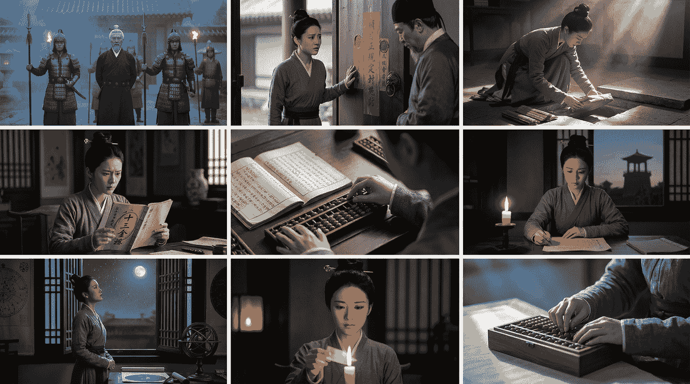
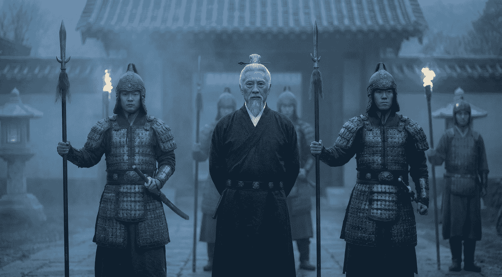
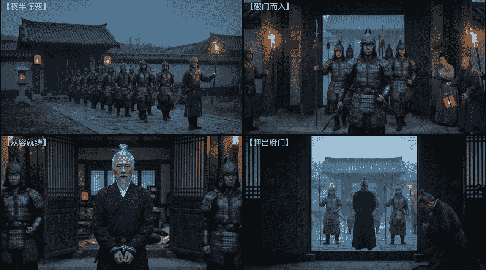
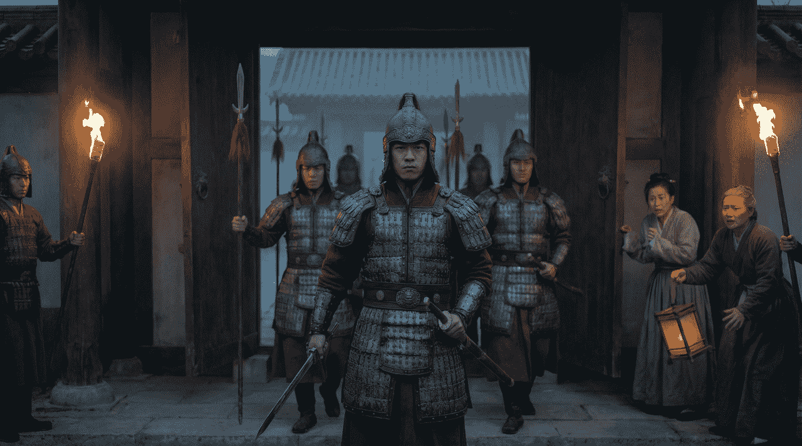

# AI 短剧 | AI分镜师 Agent，Claude Agent+Skill方法

> 来源：[https://feicaiclub.feishu.cn/docx/NdmWdXpOJoSecZxTWGJcL2E4nfh](https://feicaiclub.feishu.cn/docx/NdmWdXpOJoSecZxTWGJcL2E4nfh)


<https://player.bilibili.com/player.html?bvid=1y8qMBsER8&share_source=copy_web&vd_source=1adb0321bdfa6d9eb5d1bf5665ffc381>

# **用 Claude Agent Skill 搭**建 AI 分镜师 - 提升分镜出图有效率

做 AI 视频的应该都有体会，分镜是最烧钱的环节之一。分镜数量本来就大，生图又是抽卡——单张图要控制人物、场景、光影的一致性，多张图之间还要基于剧本拆解出连贯的镜头序列。这两件事都不容易，大量时间和成本都浪费在重复抽卡上。

所以我们用 Claude 的 Agent + Skill 功能搭建了一个 AI 分镜师，核心思路是把影视分镜的方法论（清晰、简洁、连贯、分层渐进）写进 Skill，让 AI 按照专业标准去拆解剧情、设计镜头、生成提示词。你只需要上传剧本并确定视觉风格，剩下的节拍拆解、九宫格提示词、四宫格提示词、动态提示词就自动完成。

整体架构是一个制片人加三个 Subagent：分镜师负责生成，导演负责审核，动画师负责动态提示词。流程按分层渐进的原则推进——先锁定 9 个关键剧情点，再确定视觉基准，然后展开连续镜头，最后生成动态提示词。每个阶段完成后导演都会介入审核，不通过就打回修改，直到符合方法论标准。

---

# **核心功能模块**

Agent + Skill 解耦设计

整套系统的核心思路是把「谁来做」和「怎么做」分开。Agent 只负责调度——制片人管流程，分镜师管生成，导演管审核，动画师管动态提示词。而专业知识全部放在 Skill 里：分镜方法论、验收清单、提示词模板、Gemini 出图指南。这样设计的好处是灵活，比如你想换一套自己的分镜方法论，只需要替换 storyboard-methodology-playbook.md，不用动 Agent 配置。

**分层渐进的生成逻辑**

流程设计遵循分镜的「分层渐进」原则：先用节拍拆解锁定 9 个关键剧情点，再用九宫格确定视觉基准（人物、场景、光色），然后用四宫格把需要展开的关键帧拆成连续镜头，最后生成动态提示词用于视频模型。每一层都基于上一层的产物，信息逐层细化，一致性逐层继承。

**导演审核作为质量阀门**

每个阶段完成后，导演会按 review-checklist.md 逐项检查。九宫格要查一致性、覆盖度、清晰度；四宫格要查动作连贯、轴线稳定、剪接风险；动态提示词要查长度、聚焦度、物理合理性。不通过就打回修改，循环直到通过。这个机制保证了产出不是「生成完就算」，而是「符合标准才算」。

Resumable Subagents 保持上下文

Claude Code 的 Subagent 默认每次调用都是全新上下文。但分镜是连续工作，分镜师生成四宫格时需要记得之前九宫格的设计意图。所以我们用 .agent-state.json 记录每个 Subagent 的 agentId，后续调用用 resume 恢复，让 Agent 能延续之前的完整对话。

**文档驱动而非对话驱动**

所有产物都写入 outputs/ 目录的独立文件，而不是只存在对话里。这意味着你可以随时中断、随时恢复，只要文件还在，输入 /status 就能看到进度。生成的提示词文件可以直接复制到 AI 出图工具使用。

> **注**：这套方案能快速生成结构化的分镜提示词，但不要期待一步到位的完美结果。生成的提示词是起点，不是终点——你仍然需要根据实际出图效果去调整、优化、迭代。另外，这套流程涉及剧情拆解、关键帧提取、连续镜头设计，对模型的理解能力要求比较高，建议使用 Claude Opus 或 Sonnet 级别的模型。模型能力和输出质量是正相关的，用更强的模型，生成的提示词质量也会更高。

---

# 在 Claude Code 中配置

请按照以下步骤配置分镜师系统，配置完成后，你的项目结构应该是这样：

```
project/
├── script/                              # 剧本源文件（用户上传）
│   └── ep01-xxx.md
├── outputs/                             # 生成产物（自动创建）
│   ├── beat-breakdown-ep01.md
│   ├── beat-board-prompt-ep01.md
│   ├── sequence-board-prompt-ep01.md
│   └── motion-prompt-ep01.md
├── .agent-state.json                    # Agent 状态记录（自动创建）
└── .claude/
    ├── CLAUDE.md                        # 制片人主Agent配置（必须创建）
    ├── agents/                          # Subagent 配置（必须创建）
    │   ├── storyboard-artist.md
    │   ├── director.md
    │   └── animator.md
    └── skills/                          # 技能包（必须创建）
        ├── film-storyboard-skill/       # 分镜师技能包
        │   ├── SKILL.md
        │   ├── storyboard-methodology-playbook.md
        │   ├── gemini-image-prompt-guide.md
        │   └── templates/
        │       ├── beat-breakdown-template.md
        │       ├── beat-board-template.md
        │       └── sequence-board-template.md
        ├── storyboard-review-skill/     # 导演技能包
        │   ├── SKILL.md
        │   └── review-checklist.md
        └── animator-skill/              # 动画师技能包
            ├── SKILL.md
            ├── motion-prompt-methodology.md
            └── templates/
                └── motion-prompt-template.md
```

1.  **创建主 Agent 配置**

1.  在 .claude/ 目录下创建 CLAUDE.md 文件

1.  粘贴制片人角色定义、工作流程、指令集

1.  包含项目状态检测、Resumable Subagents 机制、四个阶段的流程定义

1.  **创建 Subagent 配置**

1.  在 .claude/agents/ 目录下创建三个 Agent 文件

1.  storyboard-artist.md：分镜师，负责生成节拍拆解和分镜提示词

1.  director.md：导演，负责审核所有产出

1.  animator.md：动画师，负责生成动态提示词

1.  **创建分镜师技能包**

1.  在 .claude/skills/ 目录下创建 film-storyboard-skill/ 文件夹

1.  创建 SKILL.md 定义技能包配置和调用规则

1.  创建 storyboard-methodology-playbook.md 包含完整的分镜方法论

1.  创建 gemini-image-prompt-guide.md 包含提示词写法指南

1.  在 templates/ 下创建节拍拆解、九宫格、四宫格三个模板文件

1.  **创建导演技能包**

1.  在 .claude/skills/ 目录下创建 storyboard-review-skill/ 文件夹

1.  创建 SKILL.md 定义审核流程

1.  创建 review-checklist.md 包含各阶段的验收清单

1.  **创建动画师技能包**

1.  在 .claude/skills/ 目录下创建 animator-skill/ 文件夹

1.  创建 SKILL.md 定义技能包配置

1.  创建 motion-prompt-methodology.md 包含动态提示词方法论

1.  在 templates/ 下创建动态提示词模板

## 重要配置细节

+   **Subagent 调度**：CLAUDE.md 定义了调度规则，生成任务由分镜师或动画师执行，审核任务全部由导演执行

+   **Resumable 机制**：每个 Subagent 首次调用后记录 agentId 到 .agent-state.json，后续调用用 resume 恢复上下文

+   **分层渐进流程**：严格按节拍拆解 → 九宫格 → 四宫格 → 动态提示词的顺序推进，每阶段基于上游产物

+   **导演审核循环**：每个阶段完成后导演自动审核，FAIL 则打回修改，循环直到 PASS

+   **模板约束**：templates/ 中的格式是强制性的，所有输出必须按照模板结构

+   **方法论驱动**：分镜师和导演共享 storyboard-methodology-playbook.md，确保生成和审核标准一致

+   **一致性继承**：四宫格必须继承九宫格对应格的人物、场景、光色描述

+   **多集支持**：通过文件名集数标识（如 ep01）区分不同集的产物

+   **文档驱动**：所有产物写入 outputs/ 目录，对话中断后可通过 /status 恢复进度

+   **项目状态检测**：启动时自动扫描 script/ 和 outputs/，检测每集进度并路由到对应阶段

---

# **核心设计理念**

```
┌─────────────────────────────────────────────────────────────────────────┐
│  CLAUDE.md（制片人）                                                     │ ← 流程层：控制生产流程
│                                                                         │    定义工作流、指令集、Subagent 调度规则
├─────────────────────────────────────────────────────────────────────────┤
│  Subagents（子Agent）                                                    │ ← 执行层：分工协作
│  ├─ storyboard-artist          生成节拍拆解、九宫格、四宫格提示词        │
│  ├─ director                   审核所有产出，PASS/FAIL 把关              │
│  └─ animator                   生成动态提示词                            │
├─────────────────────────────────────────────────────────────────────────┤
│  Skills（技能包）                                                        │ ← 知识层：提供专业能力
│  ├─ film-storyboard-skill      分镜方法论、提示词写法、模板              │
│  ├─ storyboard-review-skill    验收清单、审核标准                        │
│  └─ animator-skill             动态提示词方法论、模板                    │
├─────────────────────────────────────────────────────────────────────────┤
│  outputs/                                                               │ ← 文档层：结构化存储
│  ├─ beat-breakdown-ep01.md     节拍拆解表                                │
│  ├─ beat-board-prompt-ep01.md  九宫格提示词                              │
│  ├─ sequence-board-prompt-ep01.md  四宫格提示词                          │
│  └─ motion-prompt-ep01.md      动态提示词                                │
└─────────────────────────────────────────────────────────────────────────┘
```

## 工作流程

1.  **上传剧本** — 将剧本/梗概放入 script/ 目录

1.  **配置项目** — 确定视觉风格、目标媒介、画幅比例

1.  **节拍拆解** — /breakdown 分镜师从剧本中提取关键剧情点，选出 9 个锚点

1.  **导演审核** — 检查完整性、清晰性、选点合理性，FAIL 则打回修改

1.  **九宫格提示词** — /beatboard 基于锚点生成 Beat Board，确定视觉基准

1.  **导演审核** — 检查清晰度、覆盖度、一致性，FAIL 则打回修改

1.  **四宫格提示词** — /sequence 展开连续镜头序列，继承九宫格的人物/场景/光色

1.  **导演审核** — 检查动作连贯、轴线稳定、剪接风险，FAIL 则打回修改

1.  **动态提示词** — /motion 动画师生成用于视频模型的 Motion Prompt

1.  **导演审核** — 检查简洁性、聚焦度、物理合理性，FAIL 则打回修改

1.  **AI 出图** — 用九宫格提示词生成关键帧，用四宫格提示词展开镜头序列

1.  **AI 生成视频** — 用动态提示词驱动图生视频模型

## 关键特性

+   Agent + Skill 解耦 — Agent 负责调度，Skill 负责专业知识，可独立替换

+   Resumable Subagents — 通过 .agent-state.json 保持上下文连续，中断后可恢复

+   **导演审核循环** — 每阶段自动审核，不通过就打回修改，直到符合标准

+   **分层渐进流程** — 先锁定关键点，再展开细节，信息逐层细化

+   **模板约束** — 严格遵循 templates/ 定义的格式，保证输出规范统一

+   **方法论驱动** — 分镜师和导演共享同一份方法论，生成和审核标准一致

+   **一致性继承** — 四宫格必须继承九宫格的人物、场景、光色描述

+   **多集支持** — 通过文件名集数标识区分不同集的产物

+   **文档驱动** — 所有产物写入 outputs/，对话中断后可通过 /status 恢复进度

+   **项目状态检测** — 启动时自动扫描目录，检测每集进度并路由到对应阶段

---

# 模型选择说明

这套方案依赖 Claude Code 的 Agent + Skill 功能来实现自动化分镜流程。但考虑到 Claude 账号的使用限制，你可以选择在 Claude Code 中配置其他大语言模型的 API，比如 Gemini 3 Pro、Kimi K2、GLM 4.7 Minimax M2等。这样可以使用 Claude Code 的完整项目管理和 Skill 调用能力，但实际分镜工作由你配置的模型完成，不会占用 Claude 的使用额度。

需要注意的是，不同模型在理解分镜方法论、执行复杂指令、保持长上下文一致性等方面的能力存在差异。从实测效果来看：

+   **理解能力**：模型对 storyboard-methodology-playbook.md 中分镜法则的理解深度会影响节拍拆解的准确性，比如能否准确识别叙事拐点、判断镜头目的

+   **执行能力**：模型遵循模板格式、应用叙事描述式提示词写法的严格程度会影响输出质量

+   **一致性维护**：模型在多阶段生成过程中保持人物外观、场景光色、镜头连贯的能力会影响最终分镜的可用性

建议选择支持长上下文的模型。初次使用时可以先用一个短剧本测试分镜效果，确认该模型能否满足你的质量要求，再进行完整项目。如果发现生成内容偏离方法论标准较多，可以尝试更换模型或调整配置。

---

# **👀 先睹为快**

我们使用 Claude 4.5 Opus 生成分镜提示词，然后用 Nano Banana（Gemini 图像生成）生成九宫格和四宫格分镜图。从上传剧本到完成节拍拆解、九宫格提示词、四宫格提示词、动态提示词，整个提示词生成过程用了约 15 分钟。所有内容都是基于分镜方法论直接生成的初稿，未经人工润色。每个阶段完成后，导演会自动审核——节拍拆解检查完整性、选点合理性；九宫格检查清晰度、覆盖度、一致性；四宫格检查动作连贯、轴线稳定、剪接风险；动态提示词检查简洁性、聚焦度、物理合理性，确保分镜质量符合标准。这样你可以直观地看到这套系统在实际应用中能达到什么效果。

## 第1章：师陷冤狱，暗号破疑

> 开元十七年三月初三，寅时三刻，太史令沈钧白被御林军自府中押走。

> 消息传至太史局时，顾星澜正在司天台校核春分节气时刻。她手中算筹落地，珠子滚过石阶，叮当作响。同僚皆面露惊惧，无人敢言。星澜未及收拾算筹,便匆匆下台奔回局中。

> 师父书房外，已有内侍守门。

> "沈大人书房奉旨查封，闲人莫入。"守门内侍年约四旬，在太史局当差二十年，识得星澜。他垂眼不视，声音却压得极低，"顾女官，此乃摄政王手令。"

> 星澜移笏半寸，微微颔首："劳烦公公转告，弟子只取师父日常所用历算之物，不敢擅动他物。"

> 内侍沉默片刻，侧身让开半步："老奴去净房，一炷香时间。"

> 星澜入室。书房中案几整齐，笔墨未干，墙上挂着的星图被揭去大半，地上散落着撕碎的奏折。她心下一沉——这般情景，分明是师父仓促间毁去关键文书。

> 她在书房中快速巡视。师父性情严谨，凡要事必有备份。她记得师父曾于深夜独自在书房中整理卷宗,次日便言"已妥当"。妥当二字，必有深意。

> 星澜蹲下身,手指在书架底部摸索。青砖微凉,忽地有一处松动。她屏息取出一块砖,暗格中藏着一卷文稿,外包油纸,未染尘埃。

> 油纸上,师父亲笔所书："星澜亲启。"

> 她展开文稿,入目第一行："为师若有不测,此卷可证清白。"

> 文稿中夹着去年户部税簿副本数页,其上"灾年减税"条目被朱笔重重标注。开元十六年,朝廷以"陕甘大旱"为由减免税银三十七万两。师父在旁批注工整："此年陕甘雨量七寸至一尺二寸,属正常年景,无大旱之灾。查太史局雨量记录可证。税簿所减之数,恰与兵部军饷缺口相合。"

> 星澜手指微颤。三十七万两,这不是小数。若是真有大旱,减税恤民乃朝廷德政;若无旱灾却减税,这银两去了何处?

> 她继续往下看。文稿末页,师父用更小的字迹写道:"此案若查,恐触权贵。为师已年迈,不惧死;你年轻,莫要卷入。但若为师蒙冤,此卷可为证据。"

> 星澜闭眼片刻,睁眼时已决然。师父待她如父,授她算学十年,如何能坐视师父蒙冤?

> 她将文稿收入袖中,正欲离开,目光却被税簿副本上的细节吸引。每页页角,皆有细微墨点,似有规律。她取出算筹,在地上按二十四节气顺序排列墨点位置。

> 立春、雨水、惊蛰、春分……

> 墨点连线,竟拼出一行字:"谢时行经手,萧景琛授意,户部-兵部转账,银入私库。"

> 星澜倒吸一口凉气。谢时行,户部尚书;萧景琛,摄政王。师父用二十四节气做暗号,将挪用军饷的关键人物藏于税簿之中。这般机巧,若非太史局中人,断无法破解。

> 她快速将墨点位置记于心中,收好税簿副本。门外传来脚步声,是那内侍归来。

> "多谢公公。"星澜出门时,对内侍郑重一礼。

> 内侍摆手:"沈大人待老奴不薄,这是老奴唯一能做的。"他顿了顿,"女官,摄政王势大,你莫要……"他未说完,只是叹息一声,转身离去。

> 星澜回到自己的算房。太史局中,她这间算房最是简陋,只一案一榻,墙上挂着的是她自己绘制的星图。她将文稿藏于榻下暗格,取出税簿副本细细研读。

> 师父被捕的罪名是"妖言灾异"。上月奏对,师父曾言"今岁恐有西北边患,当备军资"。此言一出,摄政王当殿驳斥:"太史令职司观象授时,何以妄言军国大事?此乃妖言惑众。"次日,师父便被下狱。

> 如今看来,师父所言非虚。若军饷被挪用三十七万两,边关如何不生变故?师父是在警示朝廷,却被摄政王以"妖言"之名压下。

> 星澜在纸上列出时间线:

> 开元十六年,陕甘"大旱",朝廷减税三十七万两; 同年,兵部军饷短缺三十七万两; 师父发现端倪,在税簿上用暗号标注; 开元十七年二月,师父奏对言边患,被驳为妖言; 三月初三,师父被捕,定于初六午时问斩。

> 今日是初三,距离师父问斩只有三日。

> 星澜望向窗外。初三夜,月亮被云遮住半边,天色晦暗。她想起师父常说的话:"算天象者,当知天时不可违,但人事可为。"

> 天时不可违——初六申时,太史局已预报有日食,食甚时刻在申正三刻。这是天象,无法改变。

> 但人事可为——她可以用这场日食,设一个局。

> 星澜取出纸笔,开始推演。日食于申时,古籍载:"日食于申,主君不明,臣有私心。"若能在日食时揭发军饷挪用案,摄政王便是"天谴之臣",朝中谁还敢护他?

> 但关键在于:如何让摄政王在日食时,在众目睽睽之下,自证其罪?

> 她翻出宫中起居注副本。摄政王每日申初离开政事堂回府,雷打不动。若日食在申正三刻,摄政王早已离开,如何能让他当众对质?

> 除非……用祖制困住他。

> 星澜眼中闪过一丝精光。大朝会时,皇上未宣散,臣子不得擅离。若初六大朝会上议要事,摄政王必须留殿。只要让他留到申正三刻,日食食甚之时,便可当众揭发。

> 这便是"时辰守门局"。

> 但这需要两个条件:其一,有人在大朝会上提出议题,让摄政王无法脱身;其二,有铁证在手,让摄政王无法辩驳。

> 星澜将税簿副本上的暗号誊抄一份,又在纸上写下:"需查户部与兵部银两转账记录,此为铁证。需人在初六大朝会上议军饷事,令摄政王留殿至申正三刻。"

> 第一条,她无法独力完成。户部账目严密,她一个太史局女官,如何能潜入查证?

> 她需要盟友。

> 星澜想起父亲生前好友之子,如今在御史台任御史的庄恒之。御史职司风纪监察,查账正是其职责。且庄家与顾家有世交,当年父亲被贬,庄家曾暗中接济。

> 天将明时,星澜在纸上写下最后一行字:"三日之内,必救师父。"

> 她将纸条焚于烛火,看着纸灰飘散。窗外,东方既白,初四将至。

> 星澜整理衣襟,准备去司天台继续观测。她必须表现得一如往常,不能引起怀疑。但她心中已有定计——她要以天象为剑,在那场日食中,为师父讨回清白。

> 临出门时,她回望书房。案上的算筹还未收拾,珠子散落一地。她蹲下身,将珠子一颗颗拾起,放回算筹盒中。

> 每一颗珠子,都是一步棋。

> 而这局棋,她已经开始布了。









订阅年度会员解锁

CLAUDE.md 项目规则

Subagents

SKILL.md

分镜方法论、模板、规则等

...

# **💰 订阅社群年度会员**

> **💰 加入废才俱乐部**

> 加入社群，一次性解锁所有AI实战攻略。

> 包括现有的全部内容——提示词框架、Agent搭建教程、Skill开发攻略等，以及未来每一期视频更新的配套资料。不再零散获取，系统地学习和应用。

> ⚠️ 购买提醒：请仔细浏览页面内容，谨慎购买，不退不换。如未看到支付按钮，请使用桌面端网页浏览器访问。

> **光看文字不够？实操遇到卡点？**

> 加入社群后，你还可以进入专属交流群，获得废才老师的亲自指导。在这里，你不仅能与数百位AI实践者交流经验，更能随时提问，解决实操中遇到的问题。

> 我们期待你成为社群的第 n+1 位成员！

> [社群微信群入口](https://feicaiclub.feishu.cn/wiki/JBNXwZ5QZidRtuk1HCCcvgZmnNg?from=from_copylink)（戳这里，跳转去社群微信群页面扫码入群）