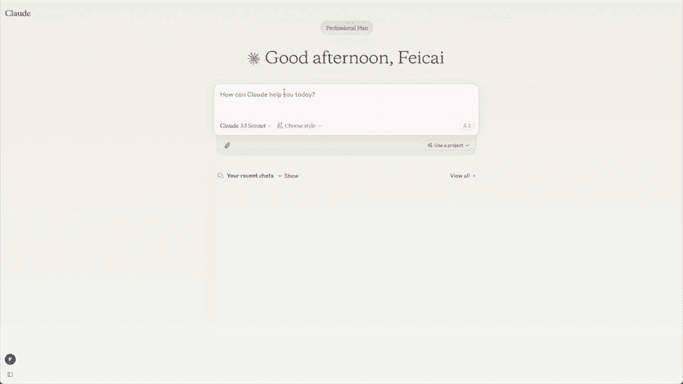

# AI 剧本 | 爽文短剧提示词框架

> 来源：[https://feicaiclub.feishu.cn/docx/LycSdVFcroUHgMxKlEOc2vjSnGe](https://feicaiclub.feishu.cn/docx/LycSdVFcroUHgMxKlEOc2vjSnGe)

# 视频链接

> **B 站：**https://b23.tv/xIuNxQi

> **📕： **http://xhslink.com/a/2PvCZONvmBL1

> **抖音：**https://v.douyin.com/CeiJSDpew/

> **Youtube：**https://www.youtube.com/watch?v=1MMmHtHtmxs

---

# 爽文短剧提示词框架 - 网文作者的新方向

这套专**为爽**文短剧创作设计的提示词框架，旨在帮助编剧在短时间内完成高质量的短剧创作。无论是新手还是经验丰富的编剧，都能够借助这套框架迅速进入创作状态，保持高效输出。框架通过明确的创作步骤和规范化的流程，确保作品情节紧凑、冲突激烈、节奏快速，完美契合“爽文”类型短剧的需求。

---

## 核心功能模块

### **/题材设定** - 确定爽文短剧的核心题材

框架提供了15个热门爽文题材选项，比如都市逆袭、复仇情仇、霸道总裁、战神归来等，帮你轻松挑选适合的主题。每个题材背后都有一整套结构化的创作指导，专注于剧情冲突和爽点的设计。在每一集的剧本中，框架要求直接进入高潮部分，迅速引发情感冲突和激烈对抗，最大限度地满足观众的“爽感”需求。尤其强调“反转”和“高强度冲突”，确保每集至少有两个大爽点，比如逆袭翻盘、背叛复仇等经典爽文桥段。

### **/角色开发** - 生成短剧角色信息与关系

框架帮助你快速设计出有戏剧冲突的角色，确保每个角色的动机清晰，目标明确，同时角色间的关系和冲突直接推动故事发展。每个角色都会有独特的个性和鲜明的特征，这样剧情就能迅速展开，让每个角色的互动都充满张力和看点。无论是主角逆袭还是配角反转，都能充分激发观众的情感。

### **/目录生成** - 规划短剧分集目录

通过这个模块，框架帮你规划每一集的核心情节，确保每集都围绕单一冲突展开，避免了无关紧要的铺垫。每集的内容设计都紧凑，冲突和情感的波动快速铺开，强烈的反转和高潮设计让观众在观看时始终保持紧张感和期待感。

### **/分集剧本** - 生成符合爽文节奏的剧本内容

目录确定后，框架会自动生成每集的剧本内容。每集剧本都强调快速展开的情节和高强度的情感冲突，台词直接有力，情节紧凑无拖沓。每集剧本里的反转、爽点和冲突，都会让剧情不断推进，确保观众每一集都能体验到剧烈的情感波动。

---

### 主要特点

### **适应短剧创作需求的高效流程**

框架的创作流程简单明了，模块化设计帮助你高效完成短剧创作。无论是新人编剧还是老手，都能轻松上手，迅速进入创作状态，保持高效输出。

### **快速确定短剧题材**

框架帮你快速确定短剧的整体题材，避免了创作时因选题不明确而产生的拖延和迷茫。无论是爱情、复仇、还是战斗，框架都会引导你选择最适合的情节背景和冲突类型，确保创作始终有明确的方向。

### **快速构建冲突与爽点**

框架专注于帮你高效地搭建核心冲突和爽点。每集的剧情从一开始就进入高强度冲突，避免无聊的铺垫。每集的情节都快速升温，确保观众始终被刺激到，比如主角逆袭、反派被打脸，或者几番反转等，每个元素都尽可能激发观众的爽感。

### **情节紧凑、节奏快速**

框架帮助你去掉冗余的情节，确保每集的剧情紧凑、高效。每集大约2-3分钟，剧情瞬间进入高潮，避免拖沓冗长，确保观众从开场就能感受到强烈的情绪波动。节奏设计上，框架让你不浪费一分钟的时间，直接抓住观众的注意力。

### **个性化角色与互动**

每个角色都会有鲜明的个性，框架特别注重角色之间的互动和冲突设计。每个角色都围绕着明确的目标和动机展开，角色间的矛盾和对抗也会推动剧情发展。框架帮助你塑造一个个性鲜明、关系错综复杂的角色阵容，让每一集都充满戏剧张力。

### **多重反转和情绪起伏**

每集剧本都有反转和高潮设计，帮助你调动观众的情绪。无论是主角逆袭，还是反派当场翻车，框架会帮助你设计出刺激又满足的剧情，让每一集都能给观众带来强烈的情绪波动和满足感。

### **精准的情感共鸣**

框架特别注重情感设计，每一集都要触动观众的内心。从角色的羞辱、反击到复仇，每个情感波动的设定都能激发观众的共鸣。通过这些情感节点，框架确保你每一集的高潮部分都能带给观众情感上的释放。

### **强化创作效率与质量**

框架的创作流程标准化且模块化，可以独立运作，也能无缝衔接。这样不仅提高了创作效率，还保证了剧本质量的稳定性。每个模块都经过精心设计，可以帮助你在保持高质量的前提下，提高创作效率，让你在短时间内完成一部精彩的短剧。

> 注：本框架为创作辅助工具，最终效果将根据创作者的应用和优化产生差异。不同创作场景下的使用效果可能有所不同，创作者需根据实际需求调整细节与情节安排。

---

# 实测应用录屏

为了更好的理解如何通过使用指令出发创作流程，我们特意录制了一个操作视频，完整演示了从发给大模型提示词到分写每集剧本的完整过程。

Claude 3.5 Sonnet：

[短剧提示词框架-录屏操作.mp4](https://internal-api-drive-stream.feishu.cn/space/api/box/stream/download/all/DErSbgfVhollcMxhsVjcDbAKnSb)

> 短剧的题材、风格、精彩程度完全取决于创作者并需要作者进行相应反馈和输入，AI仅作为辅助工具。为了让大家对反馈方式有基本了解，以下是常见情况的反馈方式：

1.  在题材设定阶段，如AI给你的设定有部分内容不满意，你可以针对这部分内容提出反馈：

“**设定不够爽，我希望故事始终围绕观众的情绪需求展开，满足**“解压”“娱乐”或“代入感”的观看目的。”

“**设定不够爽，我希望一分钟3个翻转，每集都有爽点如反派被打**脸，主角被扇巴掌，总裁高能护妻等情节设计”

1.  在**角色开发阶段，当AI设**计的**人物数量，人物关系，或者人**物特点不满意时，可以提出反馈：
“我需要设计3个次要角色”“人物特点不够突出，没有快感”“主要角色人物关系太复杂，我希望更无脑一些”

1.  小程序短剧平均在70集左右，如果AI生成了100集剧情，你可以要求他缩短到50集或者70集，这样剧情推进会更快，高潮场次相连，你可以这样反馈：
“100集太长了，只需要70集，但请保留所有的高潮、高能、和爽点”

1.  短**剧一般播放时长为2-3分钟，因此每集剧本基本在500-800**字左右。当每集剧本输出字数不满800字时，你可以在对话中反馈：
“剧本不满足800字，请你重新生成符合800字字数要求的内容（不包含Thinking代码框中内容字数）”

---

# 👀 先睹为快

我们利用这套提示词框架使用了Claude 3.5 So**nnet模型创作了16**集短剧作为试读剧集，包含完整题材设定、角色和目录。整套试读内容未经任何人工干预和反馈，目的是真实展示这套框架在0反馈情况下的创作水平。生成全部内容仅用了10分钟。

> AI创作在语言表达、逻辑连贯、创意输出等方面都高度依赖底层模型。经过大量测试，只有Claude 3.5 Sonnet效果最理想，其次是ChatGPT4o，其他模型在文案流畅度和创意表达上都表现不够稳定。因此这套框架强烈推荐使用Claude 3.5 Sonnet模型来创作。

> **特别注意：**请使用官方网页版或APP版Claude 3.5 Sonnet模型。镜像、套皮、或者第三方提供的模型可能存在虚假宣传或功能受限的风险。特别需要说明的是，Anthropic官方对Claude网页版和APP预设了system prompt，而API并没有预设system prompt，因此通过第三方API开发的AI工具（如Cursor和Windsurf）的输出效果会与官方网页版和APP有较大差异。请务必使用官方渠道以获得最佳创作体验，或自行设置及测试system prompt。

## 题材设定

<https://feicaiclub.feishu.cn/sync/QUxRdDHUBsLn7NbztRrchq81n6e>

## 角色开发

<https://feicaiclub.feishu.cn/sync/HAVedmckJssVvlbt3fwcNCbBnCM>

---

## 目录

<https://feicaiclub.feishu.cn/sync/IFRudUXwBsL1V0boiQMcWi0LnPd>

---

## 第1集 命中注定的咖啡相遇

<https://feicaiclub.feishu.cn/sync/CLs0duXXVswIanb4Kzocdcj5n0e>

## 第2集 总裁的专属关照

<https://feicaiclub.feishu.cn/sync/LG0HdEUtSscf3ebX1QscohyGnAc>

## 第3集 意外闯入的下属

<https://feicaiclub.feishu.cn/sync/Nh3edMncesYkXjbNyRQc36dAnTb>

## 第4集 办公室的暧昧气息

<https://feicaiclub.feishu.cn/sync/NCzSdhasms9h1SbmbaBcJ51Jntg>

## 第5集 总裁的突然邀约

<https://feicaiclub.feishu.cn/sync/FrMqdyhHGsFgQgb8XrDcRWh2nUf>

## 第6集 意外同框的晚宴

<https://feicaiclub.feishu.cn/sync/UhxXdfxJvsk65absKVocULbUn1g>

## 第7集 青梅竹马的刁难

<https://feicaiclub.feishu.cn/sync/W4XudX45TsH24zbwx3Fc6ykWnIf>

## 第8集 总裁的贴心解围

<https://feicaiclub.feishu.cn/sync/S4T5daxjUsRO5BbaynMc3rafn8b>

## 第9集 错误的距离感

<https://feicaiclub.feishu.cn/sync/QAjSdXnyMsiac8bknHOcsG13nuh>

## 第10集 雨中的偶遇战

<https://feicaiclub.feishu.cn/sync/PGSAdFxozs6t1Rb4zNocwWh9nxh>

## 第11集 专属司机的身份

<https://feicaiclub.feishu.cn/sync/Khq3d5I1Oss2t2bc39Gcr8wGnof>

## 第12集 暗生情愫的午餐

<https://feicaiclub.feishu.cn/sync/TyAOd5fZ7sxKbAbG7JzcciFznIe>

## 第13集 总裁的生日计划

<https://feicaiclub.feishu.cn/sync/AxTKdobRLsdhXob8qCmc1uBIn7f>

## 第14集 完美礼物的惊喜

<https://feicaiclub.feishu.cn/sync/SJFZdghc8szIOEbwXEPchrkQnpI>

## 第15集 心动瞬间的告白

<https://feicaiclub.feishu.cn/sync/Mb9sdfKxCs6rE0bqHqXce8PJn2f>

## 第16集 试探性的约会

<https://feicaiclub.feishu.cn/sync/UPJpdkWB6slu7YbyhWEc1IXgnrg>

# **💰 订阅社群年度会员**

> **💰 加入废才俱乐部**

> 加入社群，一次性解锁所有AI实战攻略。

> 包括现有的全部内容——提示词框架、Agent搭建教程、Skill开发攻略等，以及未来每一期视频更新的配套资料。不再零散获取，系统地学习和应用。

> ⚠️ 购买提醒：请仔细浏览页面内容，谨慎购买，不退不换。如未看到支付按钮，请使用桌面端网页浏览器访问。

> **光看文字不够？实操遇到卡点？**

> 加入社群后，你还可以进入专属交流群，获得废才老师的亲自指导。在这里，你不仅能与数百位AI实践者交流经验，更能随时提问，解决实操中遇到的问题。

> 我们期待你成为社群的第 n+1 位成员！

> [社群🛰️群入口](https://feicaiclub.feishu.cn/wiki/JBNXwZ5QZidRtuk1HCCcvgZmnNg?from=from_copylink)（戳这里，跳转去社群🛰️群页面扫码入群）