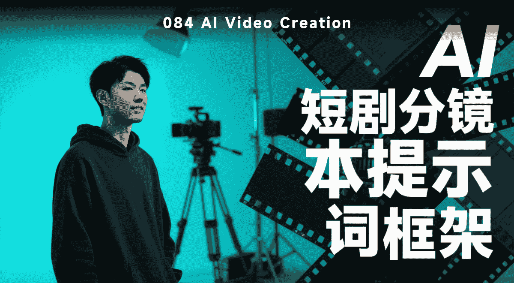

# AI短剧 ｜ 分镜脚本提示词框架

> 来源：[https://feicaiclub.feishu.cn/docx/FzqWdmDLJoJWWvxMLMFcXEnbnkD](https://feicaiclub.feishu.cn/docx/FzqWdmDLJoJWWvxMLMFcXEnbnkD)

<https://player.bilibili.com/player.html?bvid=1yngkzNEK1&share_source=copy_web&vd_source=1adb0321bdfa6d9eb5d1bf5665ffc381>

在过去的一个多礼拜里我花了¥1000多，深入的研究了一下 AI 短剧制作。总结出了一套 AI 短剧制作的完整流程，这一期视频，我会从这几个方面把我总结的经验和技巧分享给你。

**AI短剧制作主要分成三个部分：**

1.  生成分镜图和掌握文生图的提示词技巧；

1.  生成视频和图生视频的提示词技巧；

1.  使用剪映的AI对口型以及AI音效功能。

每个环节都有技巧，但跟着这期视频多练习几次，我相信你很快就能做出你的第一条视频啦。

# **💰 订阅社群年度会员**

> **💰 加入废才俱乐部**

> 加入社群，一次性解锁所有AI实战攻略。

> 包括现有的全部内容——提示词框架、Agent搭建教程、Skill开发攻略等，以及未来每一期视频更新的配套资料。不再零散获取，系统地学习和应用。

> ⚠️ 购买提醒：请仔细浏览页面内容，谨慎购买，不退不换。如未看到支付按钮，请使用桌面端网页浏览器访问。

> **光看文字不够？实操遇到卡点？**

> 加入社群后，你还可以进入专属交流群，获得废才老师的亲自指导。在这里，你不仅能与数百位AI实践者交流经验，更能随时提问，解决实操中遇到的问题。

> 我们期待你成为社群的第 n+1 位成员！

> [社群🛰️群入口](https://feicaiclub.feishu.cn/wiki/JBNXwZ5QZidRtuk1HCCcvgZmnNg?from=from_copylink)（戳这里，跳转去社群🛰️群页面扫码入群）