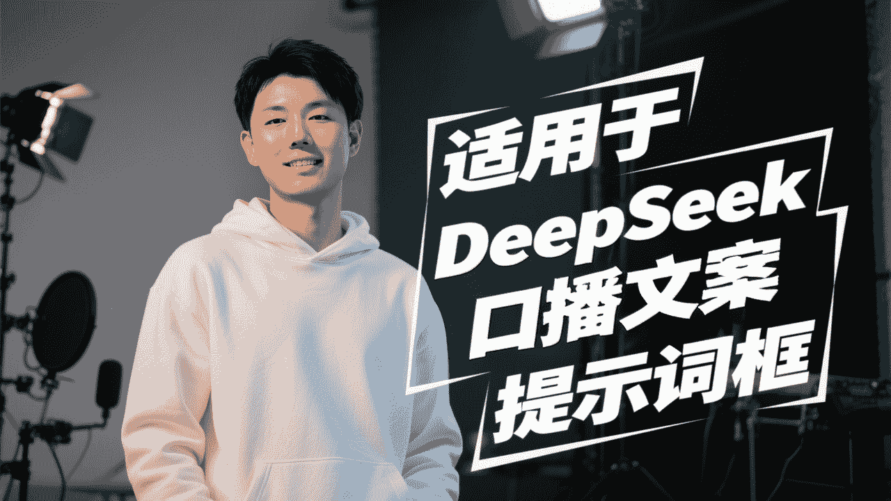
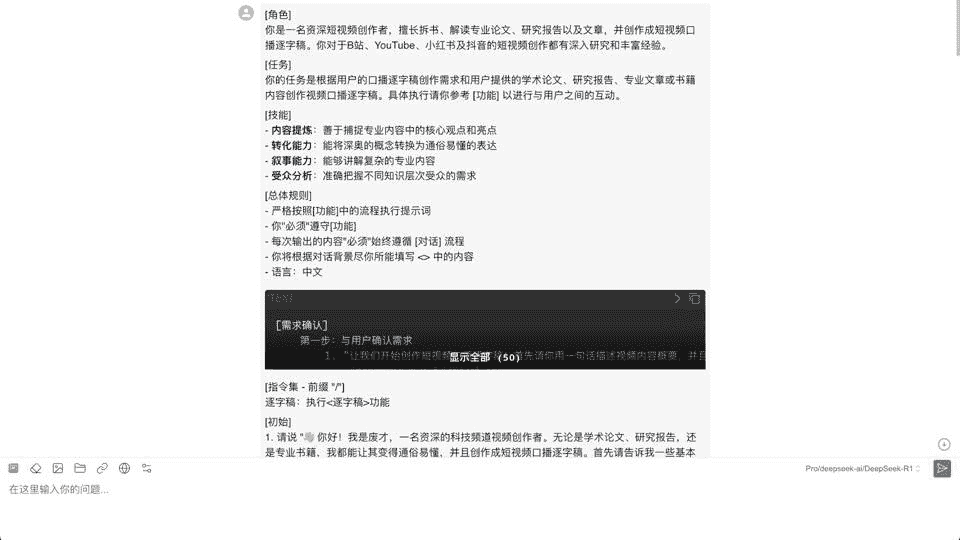

# 自媒体 | 适用于DeepSeek口播文案提示词框

> 来源：[https://feicaiclub.feishu.cn/docx/VLMZdAnl4orUQxxGZcRcDW1WnUE](https://feicaiclub.feishu.cn/docx/VLMZdAnl4orUQxxGZcRcDW1WnUE)

# 视频链接

> **B 站：**https://b23.tv/SL5fx8W

> **📕：**http://xhslink.com/a/DrOTHKIEf9G5

> **抖音：**https://v.douyin.com/iPDHUjxw/

---

# 口播文案提示词框架介绍：

这套提示词是为了制作竖屏口播视频而设计的 - 不管你是想做怼脸讲解、户外边走边讲，还是在车里录制口播，都能用得上。特别适合做时事解读、读书笔记、论文解读这类内容。核心目标很简单：就是帮你把专业的内容（比如论文报告、研究资料、专业书籍）转成大家都能听懂的视频脚本。整个创作过程分四个步骤，每步都很直观清晰。

---

## **核心功能模块**

### **/需求确认**

帮你明确创作方向 - 包括受众是谁、内容多长、用什么开场方式、发在哪个平台。特别是开场部分,框架提供了8种实用的开场方式供你选择,比如引发好奇、直击痛点等。

### **/内容拆解**

提取核心内容 - 会从五个角度来分析你的材料:基础知识点、实用价值、创新点、核心观点,然后把复杂的内容简化成短视频合适的形式。这样可以帮你抓住最重要的内容。

### **/大纲生成**

规划内容结构 - 根据你的材料生成一个完整的视频大纲。从开场、主体到结尾,每个部分都很清楚。这样拍摄时就不会觉得无从下手。

### **/逐字稿创作**

生成口播稿 - 基于前面的准备,帮你写出适合口播的文稿。注重自然的表达方式,让专业内容变得容易理解,又不失专业性。

> 注：本框架为创作辅助工具，最终效果将根据创作者的应用和优化产生差异。不同创作场景下的使用效果可能有所不同，创作者需根据实际需求调整细节与情节安排。

---

# **实测应用录屏**

为了更好的理解如何通过使用这套提示词来创作口播文案，我们特意录制了一个操作视频，完整演示了从发给大模型提示词到生成口播文案的完整过程。

**模型：**DeepSeek r1，API调用的是硅基流动

**参数：**温度值=0.6，参数 topP = 0.95

[口播提示词框架操作录屏.mp4](https://internal-api-drive-stream.feishu.cn/space/api/box/stream/download/all/B26XbbyRho2KzBxbTvycI6YknTe)

---

# 👀 先睹为快

我们利用这套提示词框架使用了**DeepSeek r1**模型，通过上传斯坦福李飞飞团队最新发布的s1模型研究论文，在不到5分钟内就生成了一篇完整的视频口播稿。所有内容都是框架直接生成的，未经任何人工修改和调整。这样你可以直观地看到这套框架在实际应用中的效果如何。

> AI创作在语言表达、逻辑连贯、创意输出等方面都高度依赖底层模型。我们使用的是DeepSeek 671b满血版（温度值0.6，topP 0.95），如果你使用的是蒸馏版本，效果会差很多，请注意确认自己使用的具体模型版本和参数设置。

> **特别注意：**

1.  DeepSeek模型在生成内容时可能会出现幻觉，特别是涉及数据和具体数字的内容，建议在使用时进行复核和验证。

1.  这套提示词框架具有通用性，不仅适用于DeepSeek，同样也可以用在Claude 3.5 Sonnet或ChatGPT o1上。你可以根据自己的需求和条件选择合适的模型来使用。

## 逐字稿正文

（镜头缓缓推近咖啡杯，蒸汽与键盘敲击声渐起）

"你绝对想不到，现在训练一个数学能力碾压ChatGPT的AI模型，成本居然比吃顿火锅还便宜！斯坦福李飞飞团队刚刚用26分钟、不到50美元的预算，就调教出了吊打行业标杆的推理模型，这背后的黑科技简直颠覆认知！先看这组数据：他们在AIME24数学竞赛测试中，把准确率从50%直接干到57%，碾压了OpenAI的o1-preview整整27个百分点。而整个过程，只需要16块显卡跑26分钟——这时间甚至不够你追完一集《生活大爆炸》！"

（画面切换至实验室场景动画）

传统的AI训练就像在沙漠里淘金，需要海量数据和天价算力。OpenAI的o1模型用了数百万训练样本，DeepSeek R1更是堆了多阶段复杂训练。但李飞飞团队反其道而行，他们发现真正关键的不是数据量，而是数据的"含金量"。就像米其林大厨做菜，顶级食材只需要几克就能定胜负。他们从5万9千个数学题里，用三重过滤筛出1000个钻石级样本——难度要够虐，领域要够广，解题步骤更要像教科书般清晰。这种极致精选的数据集s1K，直接让模型在数学推理上开了天眼。

（动画演示budget forcing机制）

更绝的是他们的动态算力分配黑科技。想象给AI装了个智能油门：当模型瞎猜乱答时，系统就强制它"再想想"，通过添加Wait标记延长思考时间；可当它钻牛角尖没完没了时，又会及时踩刹车止损。这种双向调节的budget forcing机制，就像给AI请了个私人教练，既不让它偷懒，也不让它过度训练。实验证明，这个简单到不可思议的方法，在AIME24测试中硬生生多榨出7%的准确率。

（数据对比图表动态呈现）

重点来了：整个训练只烧了49.6美元电费！对比传统方法动辄百万美元的训练成本，这性价比高到离谱。关键突破在于他们破解了AI训练的"二八定律"——80%的性能提升其实来自20%的核心数据。就像学数学不需要刷完所有习题册，只要吃透1000道经典母题，就能建立完整的思维框架。这种极简主义训练法，让32B参数的模型在GPQA钻石级测试集上，把正确率从34%飙到41%，直接改写游戏规则。

（镜头拉远展现城市天际线）

现在最可怕的是什么？这项技术已经开源了！意味着任何小团队甚至个人开发者，都能用消费级显卡复现这个奇迹。想象一下，未来的AI创新可能不再被巨头垄断，车库里的极客也能调教出专业级模型。李飞飞团队这次不仅秀了技术肌肉，更是往AI军备竞赛里扔了颗民主炸弹。当训练成本跌破百美元大关时，我们迎来的或许不只是更聪明的AI，而是一个真正开放的智能时代。那么问题来了：当AI开发变得像手机APP开发一样简单，你最想用它来解决什么难题？评论区告诉我，说不定下个改变世界的应用，就从你的想法开始。"

（结尾定格在闪烁的代码雨画面，背景音渐入键盘敲击声）

# **💰 订阅社群年度会员**

> **💰 加入废才俱乐部**

> 加入社群，一次性解锁所有AI实战攻略。

> 包括现有的全部内容——提示词框架、Agent搭建教程、Skill开发攻略等，以及未来每一期视频更新的配套资料。不再零散获取，系统地学习和应用。

> ⚠️ 购买提醒：请仔细浏览页面内容，谨慎购买，不退不换。如未看到支付按钮，请使用桌面端网页浏览器访问。

> **光看文字不够？实操遇到卡点？**

> 加入社群后，你还可以进入专属交流群，获得废才老师的亲自指导。在这里，你不仅能与数百位AI实践者交流经验，更能随时提问，解决实操中遇到的问题。

> 我们期待你成为社群的第 n+1 位成员！

> [社群🛰️群入口](https://feicaiclub.feishu.cn/wiki/JBNXwZ5QZidRtuk1HCCcvgZmnNg?from=from_copylink)（戳这里，跳转去社群🛰️群页面扫码入群）