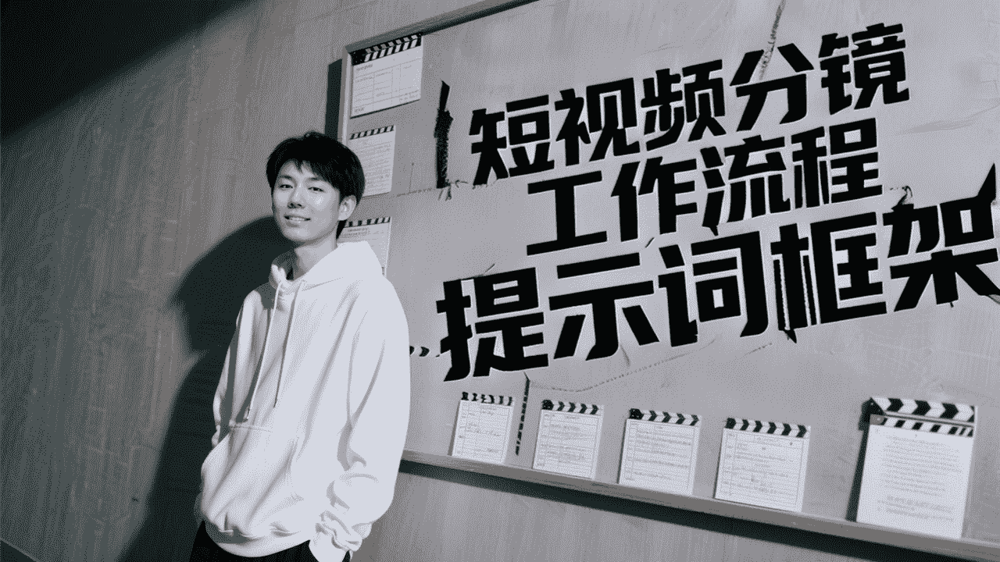

# 自媒体 | 短视频拍摄分镜工作流程提示词框架

> 来源：[https://feicaiclub.feishu.cn/docx/BOY9dBzFIo95zqxTszccBiHinxb](https://feicaiclub.feishu.cn/docx/BOY9dBzFIo95zqxTszccBiHinxb)

# 视频链接

> **B站： **https://b23.tv/9PRB7nX

> **📕：**http://xhslink.com/a/O4ExUKdZufVX

> **抖音：**https://v.douyin.com/Cei55x92/

---

# 短视频拍摄工作流程提示词框架介绍

在当前瞬息万变的短视频市场中，创作者通常面临两个主要挑战：创作时间过长，以及难以有效满足观众需求。对于新人创作者而言，在激烈的平台竞争中，快速创作出高质量的视频尤其困难。

为了解决这些痛点，特别是针对拍摄过程中分镜脚**本编写和分镜图生成的难题，我**们设计了这套短视频拍摄工作流程提示词框架。该框架通过明确分镜的分场、景别、镜头衔接等环节，并提供详细的指导和自动化提示，极大地减少了编剧在分镜设计和绘图上的复杂度，显著提高整体效率。该框架为您提供从创意构思到分镜脚本编写，再到分镜图生成的全流程支持，旨在帮助您快速完成复杂的分镜任务，并在最短的时间内制作出高质量、吸引力强的短视频。

+   **高效创作文案和分镜脚本**：使用框架中提到的标准化文案创作方法（335方法）和详细的分镜脚本格式，帮助您创作出贴合观众兴趣且具有吸引力的内容。

+   **全面管理短视频创作过程**：从需求沟通、方向定位，到文案创作、分镜脚本编写，再到分镜配图，逐步推进创作，确保流程有序且高效。

+   **轻松实现视觉呈现**：借助框架内的分镜配图模块，让短视频在视觉呈现上同样出色，与文案风格相辅相成，提升整体视频质量。

## 框架核心结构与详解

1.  **需求确认：清晰明确的沟通**

短视频制作的第一步是明确需求。了解视频的目标、目标受众以及用户品牌的特性，确保创作内容准确满足观众需求。

+   **示例问题**：短视频的目标是什么？目标受众的特点是什么？

+   **详解**：通过充分的沟通，了解创作的目的和用户的特性，确保每一步的设计和内容创作都能符合需求。

1.  **视频定位：找准方向，赢得观众**

确定短视频的整体方向，找准“给谁看”和“他们关心什么”的问题。通过对用户品牌、个人特点的分析，确定短视频的核心方向和内容定位。

+   **示例**：目标观众喜欢怎样的内容风格？幽默？励志？还是教育性强的干货？

+   **详解**：通过深入分析受众的兴趣点和品牌特征，帮助确定视频的风格和表达方式，使其与目标观众产生共鸣。

1.  **视频类型：内容与风格的精准选择**

根据需求和定位，选择适合的视频类型，并进一步确定具体的主题。

+   **类型包括**：剧情类、治愈类、创意类、干货类等。

+   **示例**：视频类型是剧情类，具体主题可以是职场生活中的搞笑瞬间。

+   **详解**：类型与主题的确定帮助创作者迅速明确视频的方向，减少创作时的犹豫和反复。

1.  **视频文案：高效创作的秘诀**

使用335方法撰写视频文案，该方法包含3个创作规则、3个创作方法和5个创作思路，帮助创作者编写简洁、直观、有感染力的文案。

+   **示例**：使用“结果前置+证明结果”的方法创作文案，使观众在视频开头就知道视频的核心内容。

+   **详解**：文案的高效创作直接影响短视频的传播效果。通过335方法，可以确保文案结构紧凑，内容清晰，能够在短时间内抓住观众的注意力。

1.  分镜脚本：分场次与镜头的精确设计

根据文案内容，编写分镜脚本，详细规划每一个镜头的内容、景别、时长以及镜头之间的衔接方式，确保视频的逻辑性和连贯性。

+   **使用格式**：包括镜号、机号、景别、摄法、画面内容、解说词、音乐、音效等，确保每个细节都得到周全设计。

+   **示例**：镜号1，景别为特写，内容为主角惊讶的表情，配合画外音说明当前情况。

+   **详解**：分镜脚本的作用是为视频拍摄提供清晰的拍摄计划，确保每一个场景的拍摄都有具体的指导。

1.  **分镜配图：增强视频的视觉表现力**

在分镜脚本完成后，生成相应的配图。根据用户的要求，确定图片质量和风格，确保最终效果符合预期。

+   **示例**：镜号1.0的画面为主角房间内的全景图，风格温暖明亮。

+   **详解**：分镜配图模块让创作者可以提前预览每个镜头的视觉效果，方便与用户沟通和调整，确保最终呈现的画面符合预期。

## 为什么要使用这套框架？

这套**短视频拍摄工作流程提示词框架**，不仅帮助你系统地管理整个短视频创作过程，尤其是在分镜脚本编写和分镜图生成环节中提供了高效支持，还为每一个创作环节提供了标准化和结构化的指导。这意味着你可以将更多的精力放在创意的实现上，而不必为创作流程和细节而烦恼。它尤其适合那些希望提高创作效率、快速适应市场需求的短视频创作者。

**重要说明：**这套提示词框架专为 ChatGPT-4 模型优化，其他模型可能无法提供相同的创作支持效果。这些模型具备强大的语言生成能力，能够理解复杂的创作需求、叙事风格和视觉表达。如果使用其他模型，可能无法达到预期的创作效果。

# **💰 订阅社群年度会员**

> **💰 加入废才俱乐部**

> 加入社群，一次性解锁所有AI实战攻略。

> 包括现有的全部内容——提示词框架、Agent搭建教程、Skill开发攻略等，以及未来每一期视频更新的配套资料。不再零散获取，系统地学习和应用。

> ⚠️ 购买提醒：请仔细浏览页面内容，谨慎购买，不退不换。如未看到支付按钮，请使用桌面端网页浏览器访问。

> **光看文字不够？实操遇到卡点？**

> 加入社群后，你还可以进入专属交流群，获得废才老师的亲自指导。在这里，你不仅能与数百位AI实践者交流经验，更能随时提问，解决实操中遇到的问题。

> 我们期待你成为社群的第 n+1 位成员！

> [社群🛰️群入口](https://feicaiclub.feishu.cn/wiki/JBNXwZ5QZidRtuk1HCCcvgZmnNg?from=from_copylink)（戳这里，跳转去社群🛰️群页面扫码入群）