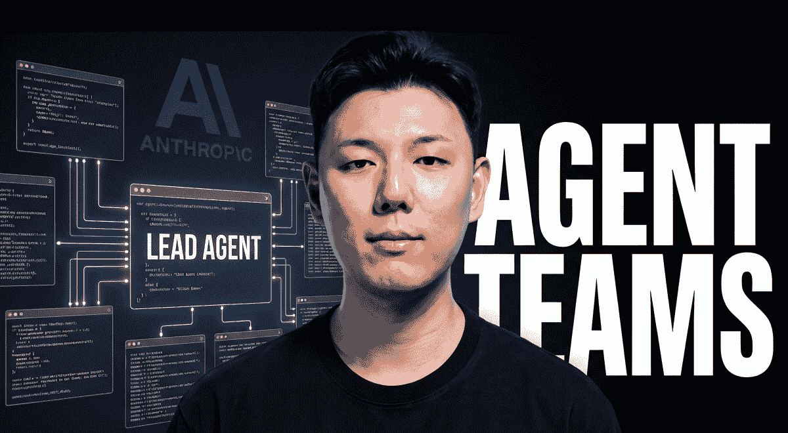

# AI Agent｜文章编辑部 Agent Teams

> 来源：[https://feicaiclub.feishu.cn/docx/XpagdmeqpokQ8fxeyZycLktlnJd](https://feicaiclub.feishu.cn/docx/XpagdmeqpokQ8fxeyZycLktlnJd)



<https://player.bilibili.com/player.html?bvid=1Q3cnzbE4P&share_source=copy_web&vd_source=1adb0321bdfa6d9eb5d1bf5665ffc381>

# **用 Claude Code Agent Teams 搭**建 AI 编辑部——让深度长文自动化生产

用 AI 写过长文的应该都有体会，写作本身只是冰山一角。

一篇好的深度文章从来不是一个人闷头写出来的。你得先调研，搜集足够深的素材和论据；然后设计结构，让几千字的内容形成递进而不是堆砌；写完初稿还要反复审核打磨。这几件事串在一起，大量时间花在了来回折腾上。

所以我们用 Claude Code 的 Agent Teams 功能搭了一个 AI 编辑部。核心思路是把写作方法论和研究方法论写进 Skill，让 AI 按照从范文中提取的专业标准去调研选题、设计大纲、撰写初稿、审核修订。你只需要提供选题和参考素材，剩下的从研究简报到终稿交付全部自动完成。

整体架构是一个总编加两个 Teammate：写手同时承担研究员和撰稿人，编辑负责审核和讨论。流程按分层递进的原则推进——先做选题研究搜集七类写作原料，再设计递进式章节大纲，然后撰写初稿，最后进入多轮审核修订。每个阶段编辑都会介入审核，不通过就触发讨论协议，写手和编辑互相质疑、达成共识后再改，循环直到通过。

---

# **核心功能模块**

**四层分离架构**

整套系统把配置文件分成四层，每层管一件事。

第一层是 CLAUDE.md、SOUL.md、USER.md——分别管流程、文化和你的个人偏好。第二层是 SKILL.md，定义每个角色的执行步骤和文件读写规则。第三层是方法论和验收清单，这才是真正的核心——writing-methodology.md 定义怎么写，review-checklist.md 定义怎么判断好坏。第四层是模板，定义产出格式。

好处是解耦。你想换写作风格，只改 writing-methodology.md；想调验收标准，只改 review-checklist.md。不用动流程，不用动技能配置。

**讨论协议**

编辑审核不通过不是一句 FAIL 就完了。

编辑必须引用具体位置、说明违反了哪条标准、给出修改方向；写手可以接受，也可以反驳，但必须给理由或提出替代方案；谈不拢，总编裁决。

这也是为什么用 Agent Teams 而不是 Subagent。Subagent 之间没法直接沟通，但写作需要真正的来回讨论，只有 Agent Teams 的独立上下文和直接通信才能支持。

**系统演进**

每次项目结束后，总编会回顾整个生产过程，识别反复出现的问题或反馈模式，向你提议写入对应文件。写作标准的变化更新 writing-methodology.md，你的个人偏好更新 USER.md。

经你确认后写入，下次新项目自动遵循。用得越多，团队越懂你。

**文档驱动**

所有产物写入 outputs/ 目录的独立文件——研究简报、大纲、每一版稿件各自独立。可以随时中断、随时恢复，输入 ～status 就能看到进度。

> 注：这套方案能大幅提升深度长文的生产效率，但不要期待一步到位。团队产出的稿件是高质量的起点，你仍然需要审阅终稿、调整细节。另外，这套流程涉及深度研究、结构设计、风格控制、多轮讨论审核，对模型能力要求很高，建议使用 Opus 或 Sonnet 级别的模型。Agent Teams 本身每个 Teammate 都是独立的上下文窗口，token 消耗会随团队规模线性增长——这是真正协作的成本。

---

# 在 Claude Code 中配置

按照以下步骤配置编辑部系统，配置完成后，你的项目结构应该是这样：

```
project/
├── source/                              # 选题素材（用户上传）
│   ├── topic-xxx.md                    # 选题描述
│   └── materials/                      # 参考素材
├── outputs/                             # 生成产物（自动创建）
│   ├── research-brief-xxx.md           # 研究简报
│   ├── outline-xxx.md                  # 文章大纲
│   ├── draft-v1-xxx.md                 # 第一稿
│   ├── draft-v2-xxx.md                 # 第二稿（审核后修改）
│   └── draft-v3-xxx.md                 # 第三稿…最后一版即终稿
└── .claude/
    ├── CLAUDE.md                        # 总编配置（团队章程）
    ├── SOUL.md                          # 团队文化与沟通风格
    ├── USER.md                          # 主编画像（你的偏好）
    ├── CONVENTIONS.md                   # 项目规范与设计规则
    ├── settings.json                    # Agent Teams 启用配置
    └── skills/
        ├── research-skill/              # 写手研究技能包
        │   ├── SKILL.md
        │   ├── research-methodology.md
        │   └── templates/
        │       └── research-brief-template.md
        ├── writing-skill/               # 写手写作技能包
        │   ├── SKILL.md
        │   ├── writing-methodology.md
        │   └── templates/
        │       └── outline-template.md
        └── review-skill/                # 编辑审核技能包
            ├── SKILL.md
            └── review-checklist.md
```

1. 启用 Agent Teams 在 .claude/settings.json 中设置 CLAUDE_CODE_EXPERIMENTAL_AGENT_TEAMS 为 "1"，teammateMode 设为 "auto"。这一步必须做，否则 Agent Teams 功能不会生效。设置完后重启终端。

**2. 创建团队章程** 在 .claude/ 目录下创建 CLAUDE.md。定义三个角色：总编（Team Lead，只协调不动手）、写手（Teammate，负责研究和撰写）、编辑（Teammate，负责审核和讨论）。写明四个环节的工作流程：选题研究 → 大纲设计与审核 → 初稿撰写与团队审核 → 主编审阅与终稿交付。包含讨论协议、项目状态检测与路由逻辑。

**3. 创建团队文化和用户画像** SOUL.md 定义团队做事风格（先做再问、有主见、干练直接）、讨论原则（有理有据、读者视角、对事不对人）、各角色性格、总编的沟通风格。USER.md 记录你的写作偏好、审稿关注点、不喜欢的风格——这个文件不是一次写死的，每次项目结束后团队会帮你补充。

**4. 创建写手技能包** research-skill/：SKILL.md 定义研究流程，research-methodology.md 包含七类写作原料框架（痛点与张力、哲学语境、可引用的思想家、反直觉真相、类比素材、可综合的框架、日常化的例子），templates/ 下放研究简报模板。

writing-skill/：SKILL.md 定义写作流程，writing-methodology.md 是核心——从范文中提取的完整写作系统，覆盖声音与身份、结构架构、段落规则、节奏与张力、六大核心技法、知识层面、格式规范。templates/ 下放大纲模板。

**5. 创建编辑技能包** review-skill/：SKILL.md 定义审核流程，review-checklist.md 包含大纲验收、初稿验收、终稿验收三套清单。⭐ 标记的关键项任何一条不通过即判定 FAIL，非关键项允许 2 项以内不通过但需标注为「建议修改」。

## **重要配置细节**

+   Agent Teams 而非 Subagent：写手和编辑是 Teammate，有独立上下文，可以直接互相发消息和讨论

+   总编用 delegate 模式（Shift+Tab）：只协调不执行，不写一行内容

+   Plan approval：大纲阶段写手必须先交方案，总编审批通过才能进入撰写

+   讨论协议：编辑 FAIL 后自动进入讨论环节，写手和编辑来回讨论直到达成共识

+   四层分离：CLAUDE.md 只写流程，SKILL.md 只写步骤编排，方法论和标准放在 methodology/checklist 里，模板只定义格式

+   单一来源原则：每条规则只在一个文件里定义，其他地方只引用不复制

+   文档驱动：所有产物写入 outputs/，可随时中断恢复，输入 ～status 查看进度

+   系统演进：项目结束后总编提议规则更新，经你确认后写入对应文件

---

# **核心设计理念**

```
┌─────────────────────────────────────────────────────────────────────────┐
│  第一层：CLAUDE.md + SOUL.md + USER.md                                  │ ← 章程层
│  流程、文化、用户画像                                                     │   「谁做什么、怎么相处、你要什么」
├─────────────────────────────────────────────────────────────────────────┤
│  第二层：SKILL.md × 3                                                   │ ← 技能层
│  ├─ research-skill     研究流程编排                                      │   「第几步做什么、读哪个文件」
│  ├─ writing-skill      写作流程编排                                      │
│  └─ review-skill       审核流程编排                                      │
├─────────────────────────────────────────────────────────────────────────┤
│  第三层：methodology.md + checklist.md                                  │ ← 方法论层
│  ├─ research-methodology.md    七类写作原料框架                          │   「具体怎么做、怎么判断好坏」
│  ├─ writing-methodology.md     声音/结构/节奏/技法规则体系               │
│  └─ review-checklist.md        大纲/初稿/终稿验收清单                    │
├─────────────────────────────────────────────────────────────────────────┤
│  第四层：templates/                                                     │ ← 模板层
│  ├─ research-brief-template.md   研究简报格式                            │   「输出长什么样」
│  └─ outline-template.md          文章大纲格式                            │
└─────────────────────────────────────────────────────────────────────────┘
```

## **工作流程**

1.  提供选题 — 将选题描述和参考素材放入 source/ 目录

1.  团队自动组建 — 总编创建写手和编辑 Teammate，启用 delegate 模式

1.  选题研究 — 写手按 research-methodology.md 搜集七类原料，产出研究简报

1.  大纲设计 — 写手按 writing-methodology.md 设计递进式章节结构

1.  编辑审核大纲 — 检查递进关系、已赚取的建议模式、原创框架规划，FAIL 则讨论修改

1.  总编审批大纲 — plan approval，通过后才进入撰写

1.  初稿撰写 — 写手执行声音、结构、节奏、技法的全部规则

1.  编辑审核初稿 — 按 review-checklist.md 逐项检查，FAIL 则讨论修改，循环直到 PASS

1.  主编审阅 — 团队向你呈交稿件，你提出修改意见或确认通过

1.  终稿交付 — 最后一版 draft 即终稿

1.  经验沉淀 — 总编回顾项目，提议规则更新，经你确认后写入

## **关键特性**

+   四层分离架构 — 流程、技能、方法论、模板各管各的，可独立替换

+   Agent Teams 协作 — 每个 Teammate 有独立上下文，可直接通信和讨论

+   讨论协议 — 编辑打回必须引用具体位置和标准，写手可反驳，总编裁决

+   写作方法论驱动 — 从范文提取的规则体系，写手和编辑共享同一基准

+   分层递进流程 — 研究 → 大纲 → 初稿 → 审核修订，每层基于上层产物

+   delegate 模式 — 总编只协调不动手，不写一行内容

+   plan approval — 大纲必须审批通过才能进入撰写

+   文档驱动 — 所有产物写入 outputs/，可随时中断恢复

+   系统演进 — 每次项目结束沉淀经验，更新方法论和用户画像

+   项目状态检测 — 启动时自动扫描目录，检测进度并路由到对应环节

---

# **模型选择说明**

这套方案基于 Claude Code 的 Agent Teams 功能，每个 Teammate 都是独立的 Claude Code session。token 消耗会随团队规模线性增长——三人团队意味着三倍的上下文开销。

模型能力对产出质量影响很大：

+   研究深度：模型对七类原料框架的理解程度，直接影响素材搜集的质量和覆盖度

+   写作执行：模型对声音、结构、节奏、技法规则的遵循程度，决定初稿的完成度

+   审核精度：模型按验收清单逐项检查时的判断力，决定审核环节能否真正把住质量关

+   讨论质量：写手和编辑互相质疑时的推理能力，决定讨论协议是走过场还是真正提升文章质量

建议使用 Opus 或 Sonnet 级别的模型。初次使用可以先用一个简短选题跑一遍全流程，确认产出质量，再投入完整项目。

# **💰 订阅社群年度会员**

> **💰 加入废才俱乐部**

> 加入社群，一次性解锁所有AI实战攻略。

> 包括现有的全部内容——提示词框架、Agent搭建教程、Skill开发攻略等，以及未来每一期视频更新的配套资料。不再零散获取，系统地学习和应用。

> ⚠️ 购买提醒：请仔细浏览页面内容，谨慎购买，不退不换。如未看到支付按钮，请使用桌面端网页浏览器访问。

> **光看文字不够？实操遇到卡点？**

> 加入社群后，你还可以进入专属交流群，获得废才老师的亲自指导。在这里，你不仅能与数百位AI实践者交流经验，更能随时提问，解决实操中遇到的问题。

> 我们期待你成为社群的第 n+1 位成员！

> [社群🛰️群入口](https://feicaiclub.feishu.cn/wiki/JBNXwZ5QZidRtuk1HCCcvgZmnNg?from=from_copylink)（戳这里，跳转去社群🛰️群页面扫码入群）