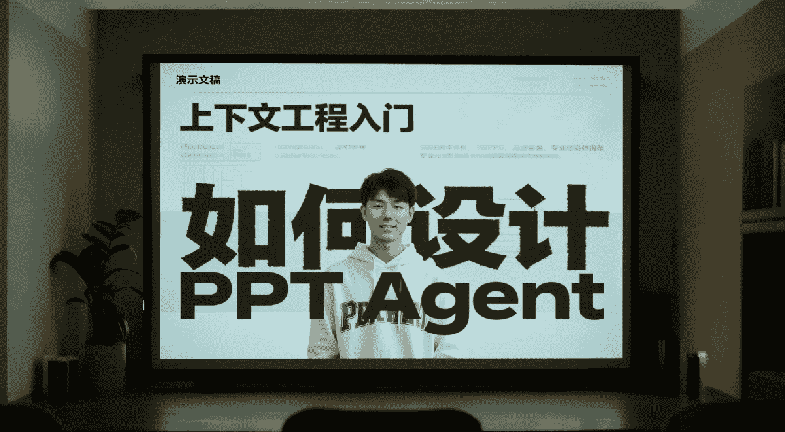
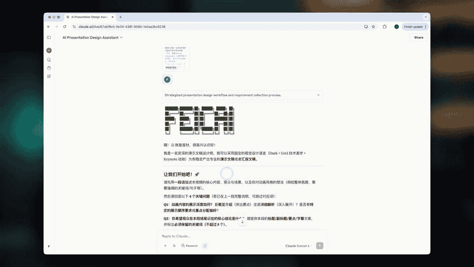
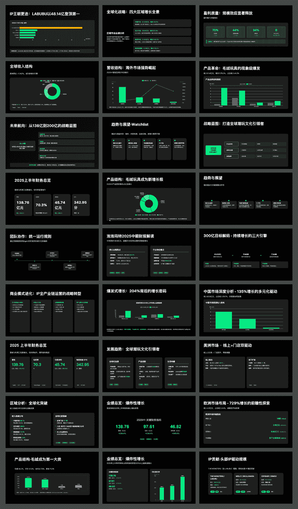

# AI Agent | 如何开发生成定制化 PPT 的 Agent

> 来源：[https://feicaiclub.feishu.cn/docx/Bdjgduzz5oXHTSxSCssciKPZnQf](https://feicaiclub.feishu.cn/docx/Bdjgduzz5oXHTSxSCssciKPZnQf)



<https://player.bilibili.com/player.html?bvid=1JThqzwE7W&share_source=copy_web&vd_source=1adb0321bdfa6d9eb5d1bf5665ffc381>

---

# Claude Code定制化PPT生成Agent构建方法

这套方法主要解决一个长期困扰很多人的问题：市面上的AI PPT工具基本都是套模板，千篇一律没有个性。传统AI PPT工具的问题在于缺乏专业的设计思维和制作流程。通常是一步生成，无法深度定制，结果就是做出来的PPT要么内容空洞，要么设计平庸，很难满足我们平时的定制需求。

所以我通过Claude Code构建了一个专业的PPT设计Agent。它具备真正的设计师思维，会先收集需求、制定内容大纲、规划分镜方案，最后才生成代码。整个过程严格按照专业流程执行，每一步都可以人工确认和调整。

技术核心是"上下文工程"的应用：通过思考引擎进行专业分析决策，工具系统读取文档和搜索信息，外部记忆机制保存完整设计方案。最关键的是有一套完整的视觉设计语言，包括配色系统、布局规范、动效策略，确保输出质量一致性。

Agent会根据内容复杂度智能规划页数和布局，支持数据可视化、流程图、对比分析等多种展示形式。生成的是基于Web技术的演示文稿，支持动效和PDF导出，特别适合录屏制作。

这套方法适合经常学生、白领、自媒体等对做 PPT有高频和速度要求的用户，用严格的规则和流程驾驭AI创造力，让它能够像专业设计师一样工作，从根本上解决了AI PPT工具"能用但不够好"的问题。

---

## **核心功能模块**

### /需求分析

Agent会通过结构化问询收集演示需求，包括内容深度、受众场景、风格偏好等关键信息。支持直接上传PDF、Word等文档进行内容解析，并主动使用web_search补充专业背景信息。通过内容复杂度评估和信息层次分析，为后续分镜规划提供准确的基础数据。

### /智能分镜

基于内容特征和复杂度，Agent会智能选择最适合的布局类型：数据展示用ChartFocus、概念解释用Grid布局、流程展示用Flow布局等。内置决策树会根据时间维度、构成关系、对比分析等因素自动匹配布局，并严格控制每页内容密度，超量时自动拆分。

### /视觉系统

采用CSS变量系统实现统一的视觉规范，包括Dark+Grid技术美学、16:9画面比例、严格的空间分配机制。所有设计元素都通过参数化控制，主题色、字体、间距等可以通过修改变量实现一键调整，确保整套PPT的视觉一致性。

### /动效实现

Keynote级别动画, 集成GSAP动画库，实现专业的入场动效：标题用Dissolve、卡片用Push/Zoom、数据用Counter动画。严格按照时间线编排，支持逐字、逐词、逐行的Kinetic Typography效果。所有动效都针对60fps优化，确保流畅的演示体验。

### /外部记忆

通过独立的Slides.md 文件保存完整的分镜方案，作为Agent的"外部大脑"。用户可以直接编辑这个文件来调整任何细节，Agent会准确读取并生成对应代码。这种机制让复杂的多步骤创作过程变得可控和可迭代。

### /成果交付

输出完整的HTML+CSS+GSAP代码，支持浏览器直接预览。内置PDF导出功能，可生成16:9横向格式的PDF文件。特别适合录屏制作和在线展示，相比传统PPT格式更加灵活和现代化。

> 注：本方法基于严格的设计流程和参数化视觉系统，适合对PPT设计质量有较高要求的场景。生成效果主要取决于输入内容的质量和完整度，建议准备详细的素材和明确的需求描述。技术实现基于Web标准，在现代浏览器中兼容性良好。

## 配置方法

### 方法一：Claude Code版本（推荐）

请跟着上方视频中的操作步骤，使用Claude Code创建专业PPT设计Agent。配置完成后，你的项目应该包含以下内容：

```
project/
├── CLAUDE.md                    # PPT设计师系统提示词（手动创建）
├── Slides.md                    # 分镜方案文件（运行时生成）
├── README.md                    # 项目说明文档（运行时生成）
└── presentation.html            # 最终PPT代码（运行时生成）
```

**配置步骤：**

1.  **启动Claude Code** - 在终端输入claude启动Claude Code

1.  **创建系统提示词** - 在项目根目录手动创建CLAUDE.md文件，复制完整的PPT设计师提示词内容

1.  **开始对话** - 直接与Agent对话，它会自动进入PPT设计师角色并开始需求收集流程

1.  **上传素材** - 支持上传PDF、Word、文本等格式的内容素材，Agent会自动解析

**重要注意事项：**

+   **CLAUDE.md** 必须放在项目根目录，文件名大小写严格按要求，这是Claude Code识别Agent角色的关键文件

+   **系统提示词** 要完整复制，包含角色定位、工作流程、视觉设计语言等所有内容，确保Agent理解专业职责

+   **素材准备** 建议提前准备详细的内容素材，包括核心观点、数据、图表等，输入质量直接影响输出效果

+   **流程指令** 使用/分镜和/开发指令控制工作流程，不要跳过中间步骤

+   Agent会自动使用web_search工具补充信息，确保网络连接正常

### **方法二：网页版直接使用**

如果你不想使用Claude Code，也可以在ChatGPT、Gemini、Claude等AI平台直接使用。我专门为网页版调整了系统提示词，去掉了一些Claude Code特有的功能，但保持了核心的PPT设计能力。

在下方"先睹为快"部分有完整的demo视频演示，你可以直接复制调整版的系统提示词到任何AI平台使用。网页版同样支持文档上传和智能分析，只是在文件管理和代码生成方面稍有差异。

这种标准化的配置确保了Agent能够稳定输出专业级PPT，任何配置错误都可能影响最终效果。记住，高质量的PPT需要详细的内容输入和明确的需求描述。

---

# **👀 先睹为快**

使用这套PPT生成Agent方法，我们生成了一份泡泡玛特2025年中期财报分析演示文稿。整个过程展现了从上传PDF财报文件到生成专业级PPT的完整流程，整个Agent在独立的工作流程中展现了完整的设计思维，需求分析、内容规划、分镜设计和代码实现，每个环节都可以人工确认和调整，确保最终效果符合预期。

这份演示文稿包含从核心财务摘要的关键数据展示，到行业地位分析的图表对比，再到全球化战略的布局规划。每一页都采用统一的Dark+Grid技术美学，配合动感的Keynote级别动效，呈现出专业且现代的视觉效果。Agent还自动搜索了泡泡玛特的行业背景信息，确保内容的专业性和完整性。

> **重要说明：**

1.  **大模型是基石**。这套方法的核心是上下文工程和系统提示词设计，理论上可以在任何具备代码生成和文档处理能力的大模型上使用。无论是Claude、GPT、Gemini还是其他模型，关键在于提示词的质量和工作流程的设计。我们测试过多个模型，都能获得不错的效果。

1.  **内容质量决定输出效果**。Agent的专业能力很强，但需要详细的输入素材。建议准备完整的内容资料，包括核心观点、关键数据、图表素材等，输入越详细，生成的PPT质量越高。

1.  **严格按照流程操作**。必须按照"需求收集→内容大纲→分镜方案→生成演示"的四步流程执行，使用/分镜和/开发指令控制进度，不要跳过中间环节。

1.  **善用外部记忆机制**。Slides.md文件是整个工作的核心，你可以直接编辑这个文件来调整任何细节，Agent会准确读取并更新代码。这让复杂的设计过程变得可控和可迭代。

1.  **浏览器兼容性良好**。生成的代码基于现代Web标准，在Chrome、Safari、Firefox等主流浏览器中都能正常运行，动效流畅度达到60fps。

1.  **适合多种使用场景**。特别适合商业汇报、学术展示、产品发布、培训教学等需要专业设计的场景。Web格式也让它在录屏制作和在线分享方面更有优势。

1.  **两种配置方式可选**。推荐使用Claude Code版本获得完整功能，也可以在各大AI平台直接使用网页版。网页版功能相同，只是在文件管理方面稍有差异。

1.  **从简单内容开始尝试**。如果是第一次使用，建议先用相对简单的内容进行测试，熟悉整个流程后再处理复杂的商业演示。

1.  **合理预期生成效果**。Agent能够产出专业级的设计质量，但仍需要你提供准确的需求描述和完整的内容素材。最终效果取决于输入质量和需求明确度。



[089 飞书先睹为快.mp4](https://internal-api-drive-stream.feishu.cn/space/api/box/stream/download/all/F8llbstMpoZZUDxAZ4Dc4AA6ntO)



# **💰 订阅社群年度会员**

> **💰 加入废才俱乐部**

> 加入社群，一次性解锁所有AI实战攻略。

> 包括现有的全部内容——提示词框架、Agent搭建教程、Skill开发攻略等，以及未来每一期视频更新的配套资料。不再零散获取，系统地学习和应用。

> ⚠️ 购买提醒：请仔细浏览页面内容，谨慎购买，不退不换。如未看到支付按钮，请使用桌面端网页浏览器访问。

> **光看文字不够？实操遇到卡点？**

> 加入社群后，你还可以进入专属交流群，获得废才老师的亲自指导。在这里，你不仅能与数百位AI实践者交流经验，更能随时提问，解决实操中遇到的问题。

> 我们期待你成为社群的第 n+1 位成员！

> [社群微信群入口](https://feicaiclub.feishu.cn/wiki/JBNXwZ5QZidRtuk1HCCcvgZmnNg?from=from_copylink)（戳这里，跳转去社群微信群页面扫码入群）