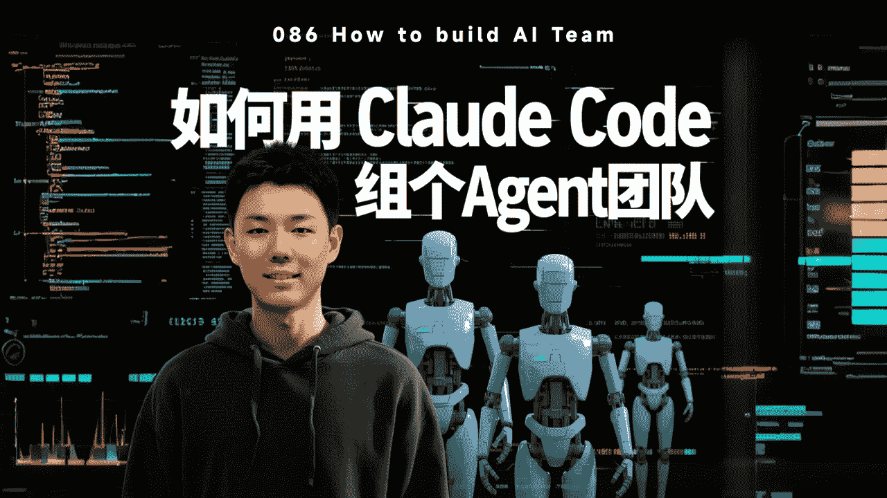
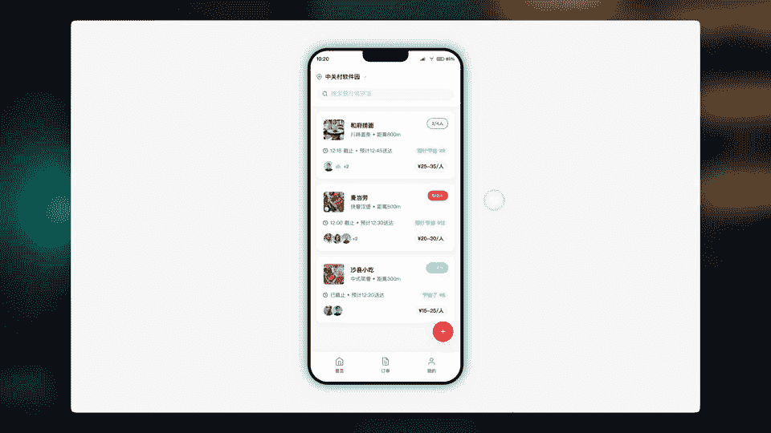

# AI Agent ｜如何用 Claude Code 搭建 Agent 团队

> 来源：[https://feicaiclub.feishu.cn/docx/I3Shd7cBHokWwbxEDitc9vo7nTb](https://feicaiclub.feishu.cn/docx/I3Shd7cBHokWwbxEDitc9vo7nTb)



<https://player.bilibili.com/player.html?bvid=14e8JzdEgH&share_source=copy_web&vd_source=1adb0321bdfa6d9eb5d1bf5665ffc381>

---

# Claude Code AI数字员工团队搭建方法

这套方法主要是为了解决一个痛点：当我们面对复杂的多专业协作任务时，传统的AI一问一答模式往往力不从心。

无论你是要做产品开发、内容创作、营销策划、财务分析，还是任何需要多个专业角色配合的工作，都会遇到这种情况 - 单个AI既要懂产品又要会设计还要能编程，或者既要写文案又要做策略还要懂数据分析。结果就是什么都做得不够专业，而且聊着聊着还会"失忆"，前面分析的内容后面就忘了。这就像让一个人同时胜任团队里所有岗位，效果肯定不理想。

所以我们做了这套AI团队搭建方法，用Claude Code组建一个专业分工的数字员工团队。你可以根据自己的需求定义任何专业角色 - 产品经理、设计师、程序员、文案策划、数据分析师、财务专员等等，让每个AI Agent专注做自己最擅长的事，同时还能无缝协作传递工作成果。

比如你想做营销活动，可以组建"市场调研员+文案策划+设计师"的团队；想写研究报告，可以搭配"数据分析师+内容编辑+格式排版员"；想开发产品，就用"产品经理+UI设计师+前端工程师"。每种场景都能找到最合适的专业组合。

方法的核心是基于Claude Code的/commands自定义指令功能，把每个专业角色都定义成一个"指令"，需要谁工作就召唤谁。每个角色都有独立的专业提示词，会按照标准化流程输出工作成果，并自动传递给下一个环节。所有AI Agent还会主动搜索最新信息，确保输出内容专业且前沿。

用这套方法，你可以根据任何工作场景自由组建AI团队，从想法到最终交付物，大大提升工作效率和质量。特别适合那些需要多专业协作但缺乏相应团队的个人或小企业，让你拥有一个24小时在线、随叫随到、比真员工还靠谱的AI数字团队。

以下作为案例，我们会用产品开发作为完整案例来演示这套方法，但你完全可以按照同样的逻辑搭建任何你需要的专业团队。

---

## **核心功能模块**

### /团队协调

**角色调度机制** - 基于Claude.md的协调规则，当用户输入指令时，系统会读取对应的角色提示词文件并切换到该角色模式。按照"需求分析→设计规范→代码实现"的基本流程执行，每个Agent完成当前阶段工作后会提示用户进入下一步。协调者负责引导用户使用正确的指令，当用户直接描述想法时会推荐从产品经理开始。

### /角色召唤

**专业Agent切换** - 通过/产品、/设计、/开发等指令，系统读取.claude/prompts目录下对应的提示词文件，加载角色的专业设定和工作流程。每个Agent有自己的初始化内容，包括角色介绍和工作说明。切换过程中会保持对话的连续性，让后续Agent能够基于前面的工作成果继续推进。

### /文档传递

**标准化工作成果** - 每个Agent按照预设格式输出工作文档：产品经理生成PRD.md、设计师输出DESIGN_SPEC.md、开发工程师交付项目代码。这些文档既是工作记录，也是下一个Agent的工作基础。通过标准化的文档格式，确保不同角色间能够理解和使用彼此的工作成果。

### /信息调研

**网络搜索辅助** - 各个Agent在工作过程中会使用web_search工具查找相关信息，比如产品经理搜索市场趋势、设计师查找设计灵感、开发工程师寻找技术方案。这有助于基于较新的信息来完成工作，而不是仅依赖训练数据。

### /反馈调整

**修改响应机制** - 用户可以在任何阶段提出修改意见，当前的Agent会根据反馈更新相应的文档或工作成果。Agent会尽量保持修改前后的一致性，但复杂的修改可能需要重新调整整体方案。这种反馈机制让最终结果更符合用户的实际需求。

### /流程管理

**工作进度跟踪** - 通过Claude Code 中的To-Do 帮助跟踪当前的工作进展，特别是在复杂任务中明确还有哪些环节需要完成。每个阶段都有相对明确的完成标准，用户可以根据提示决定是否继续下一步或进行调整。

> 注：本方法专为Claude Code AI数字员工团队设计，特别适合需要多专业协作但缺乏相应团队的个人或小企业。你可以根据任何工作场景自定义专业角色和团队规则，最终的协作效果和交付质量将根据你的具体需求和角色提示词设计水平确定。

---

## 配置团队规则和角色

请你跟着视频中进行操作，将团队规则和角色提示词添加到项目中。配置完成后，你的项目目录结构应该是这样的：

```
project/
├── CLAUDE.md                    # 团队协调规则
├── .claude/prompts/
│   ├── product_manager.md       # 产品经理Agent提示词
│   ├── designer.md              # 设计师Agent提示词
│   └── developer.md             # 开发工程师Agent提示词
├── PRD.md                       # (运行时生成)
├── DESIGN_SPEC.md               # (运行时生成)
└── ...
```

**重要注意事项：**

+   **CLAUDE.md** 必须放在项目根目录，文件名大小写严格按照要求，这是Claude Code识别团队规则的关键文件

+   .claude/prompts/ 目录结构固定，不能随意更改路径或文件夹名称

+   **角色提示词文件名** 必须与CLAUDE.md中指定的文件名完全一致，包括大小写和下划线，否则会导致角色召唤失败

+   如果你要添加新的角色（如后端工程师、测试工程师等），需要同时在CLAUDE.md中添加对应的召唤指令，并在prompts目录下创建相应的.md文件

+   具体你可以仔细研究参照我们提供的团队规则提示词、产品经理系统提示词、设计师系统提示词、和前端开发工程师系统提示词

这种标准化的目录结构确保了Claude Code能够正确读取和执行你的AI团队配置，任何文件位置或命名的错误都可能导致整个系统无法正常工作。

---

# **👀 先睹为快**

使用这套AI数字员工团队搭建方法，我们组建了一个三人专业开发团队，并用Claude Code成功开发了一个完整的拼饭APP前端静态页面。整个团队包括产品经理Agent负责需求挖掘、设计师Agent制定视觉规范、开发工程师Agent编写前端代码，完全展现了从模糊想法到产品需求文档(PRD.md)，再到设计规范(DESIGN_SPEC.md)和完整前端项目代码的全流程协作。

这个拼饭APP前端静态页面实现了完整的界面展示和交互效果：用户可以浏览进行中的午餐拼单，点击感兴趣的餐厅选择菜品并模拟加入拼单，也可以体验发起新的拼单活动，设置截止时间、参与人数和人均预算。APP还包含了订单管理页面，支持按状态筛选历史订单，以及个人中心和群组聊天功能的界面展示。每个AI Agent都展现了专业的工作能力：产品经理进行市场调研和功能拆解，设计师搜索最新UI趋势制定视觉规范，开发工程师编写高质量的HTML/CSS/JavaScript代码，最终交付了一个可直接在浏览器中运行的前端静态页面。

需要说明的是，这个演示案例专注于前端静态页面开发，如果你需要后端API开发、数据库设计、测试等功能，完全可以用同样的方法添加后端工程师Agent、测试工程师Agent等角色，组建更完整的开发团队。

> **提示词质量决定团队能力**。每个AI Agent的专业水平完全取决于你编写的角色提示词质量。建议先使用我们提供的基础版本，在实际使用中根据效果逐步优化角色设定、工作流程和输出标准，这样团队协作效果会越来越好。

> **严格按照目录结构配置**。Claude.md文件必须放在根目录，.claude/prompts/下的角色文件名必须与召唤指令完全对应，任何路径或命名错误都会导致角色召唤失败。建议严格按照视频演示的步骤操作，避免自己随意修改。

> **建议从简单任务开始**。如果你是第一次搭建AI团队，先从相对简单的项目入手，比如写作团队做个人简历、营销团队做活动策划等，逐步尝试更复杂的产品开发协作，这样能更好地理解团队配合的逻辑。

> **AI输出需要人工把关**。虽然每个Agent都很专业，但生成的PRD、设计规范和代码仍需要你的审核和调整。特别是涉及具体业务逻辑的部分，要根据实际需求进行优化，不要完全依赖AI的判断。

> **充分利用反馈机制**。在任何环节发现问题都可以直接提出修改意见，对应的Agent会立即响应。不要等到最后才发现问题，及时的反馈能让最终结果更符合你的期望。

> **理解协作而非替代**。这套方法是让AI团队协助你完成工作，而不是完全替代人工思考。你仍需要提供清晰的需求描述、做出关键决策、把控整体方向，AI团队负责执行和细化。

> **保持学习和优化心态**。随着使用经验的积累，你会发现更好的角色搭配和提示词写法。建议持续优化你的AI团队配置，让它们更符合你的工作习惯和业务需求。

## 拼饭 App 静态页面 Demo



[086 - 5.mp4](https://internal-api-drive-stream.feishu.cn/space/api/box/stream/download/all/VtThbhRDEoP7YgxmwLEcQxKknPe)

# **💰 订阅社群年度会员**

> **💰 加入废才俱乐部**

> 加入社群，一次性解锁所有AI实战攻略。

> 包括现有的全部内容——提示词框架、Agent搭建教程、Skill开发攻略等，以及未来每一期视频更新的配套资料。不再零散获取，系统地学习和应用。

> ⚠️ 购买提醒：请仔细浏览页面内容，谨慎购买，不退不换。如未看到支付按钮，请使用桌面端网页浏览器访问。

> **光看文字不够？实操遇到卡点？**

> 加入社群后，你还可以进入专属交流群，获得废才老师的亲自指导。在这里，你不仅能与数百位AI实践者交流经验，更能随时提问，解决实操中遇到的问题。

> 我们期待你成为社群的第 n+1 位成员！

> [社群微信群入口](https://feicaiclub.feishu.cn/wiki/JBNXwZ5QZidRtuk1HCCcvgZmnNg?from=from_copylink)（戳这里，跳转去社群微信群页面扫码入群）