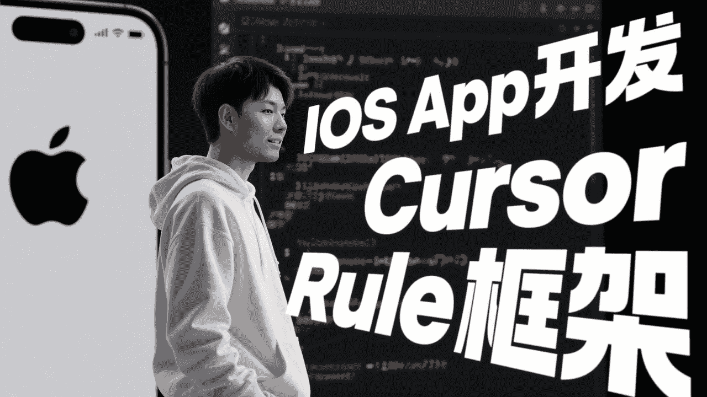
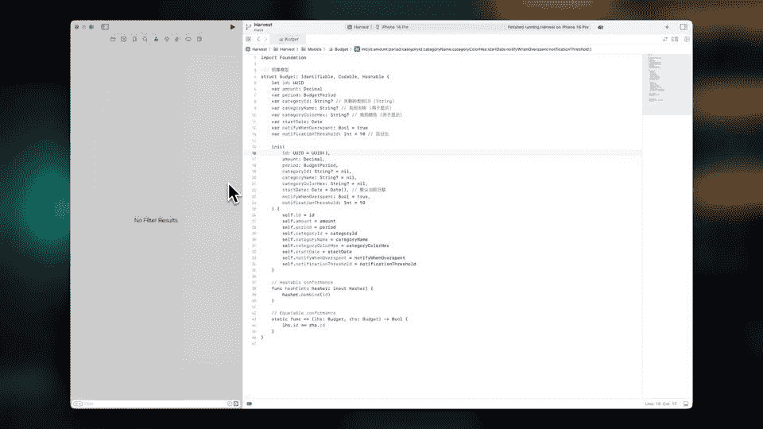

# AI 编程 ｜ IOS App开发Cursor Rule框架

> 来源：[https://feicaiclub.feishu.cn/docx/HEdPdp7CwouNH8xKEOHcJq3mnig](https://feicaiclub.feishu.cn/docx/HEdPdp7CwouNH8xKEOHcJq3mnig)

<https://player.bilibili.com/player.html?bvid=1T3jwzrEq2&spm_id_from=333.1387.homepage.video_card.click>

---

# iOS应用开发Cursor Rule 框架介绍

这套iOS应用开发Cursor Rule Framework为个人开发者特别是没有编程基础的个人设计，帮助他们通过AI对话将iOS应用创意转化为实际代码。

Cursor Rule设计了结构化的开发流程：首先收集应用需求、目标用户和核心功能，然后AI会根据这些信息构建应用页面结构和技术方案。随后，为每个页面生成UI设计方案、数据管理策略和交互实现，创建符合Apple设计规范的Swift代码。该规则还包含代码质量检查和测试生成功能，确保应用质量。

这一流程简化了从创意到代码实现的转化过程，让没有编程基础的个人能专注于产品创意而非技术细节。规则中融入了iOS开发实践，包括合理的架构设计、自适应布局和可访问性支持。

用户可以通过简单指令如"/开发"、"/检查"等控制开发流程，选择批量生成所有页面或专注开发单个功能。项目文档会自动保存在README.md文件中，提供清晰的项目结构和进度信息。

这套Cursor Rule适合个人开发者快速验证应用创意、构建最小可行产品，让iOS应用开发变得更加平易近人，即使对编程知识有限的个人也能在AI引导下开发出功能相对完整的iOS应用。

---

## **核心功能模块**

### /需求收集

需求分析与规划 - 通过结构化提问引导用户明确应用定位、目标用户群体和核心功能需求，确保开发聚焦于关键用户价值。系统会自动分析技术可行性，并基于用户回答生成完整的iOS应用页面结构规划，包括用途、核心功能和导航流程，为后续开发奠定清晰基础。

### /开发

Swift代码实现 - 针对每个页面，系统会先构思技术方案（包括UI设计、数据管理和交互实现），再自动创建符合Apple人机界面指南的Swift代码。所有界面遵循暗色科技风格，融合毛玻璃效果与霓虹元素，提供既美观又功能完备的用户体验。用户可选择批量开发所有页面或单独开发特定功能模块。

### /检查

代码质量保障 - 自动执行全面的代码检查流程，包括Swift语法与结构检查、UI与布局检查、自适应与响应式检查等多个维度，确保生成的代码结构合理、功能正常且可维护性高。这一步骤保证了应用可以在Xcode中顺利编译运行，为用户提供可靠的开发体验。

### /测试

测试用例生成 - 根据页面功能自动创建单元测试和UI测试，覆盖主要功能点和边缘情况，提高应用的稳定性和可靠性。测试文件会被正确放置在项目的测试目录中，便于用户在Xcode中进行测试执行和验证。

> 注：本Cursor Rule为iOS应用开发辅助规则，适合个人开发者快速实现应用创意。最终效果将根据使用者的需求复杂度和应用场景产生差异。使用者可能需要根据实际需求对生成的代码进行适当调整。

---

# 👀 先睹为快

使用这套Cursor Rule，我们通过Claude 3.7 Sonnet Thinking 模型使用 Cursor开发了一个简单的个人记账iOS应用。这款应用具有记录日常收支、分类统计和数据可视化等基本功能，完全由AI生成代码实现，展现了从需求收集到页面设计再到代码实现的完整开发流程。

这款个人记账应用实现了记账快速、按分类统计、按日期查看、支持备注等核心功能，同时还能进行按日统计、按月统计、按年统计和按金额大小查看等数据分析。这让你能直观地了解如何利用这套Cursor Rule帮助没有编程经验的个人开发者实现iOS应用开发。

> 使用这个Cursor Rule进行开发时，有几点需要特别注意：

1.  建议一个页面一个页面地开发，这样更容易控制和调整每个页面的内容，也符合实际开发需求。逐页开发能让你在每一步都有机会调整和完善功能细节。

1.  虽然准备了批量开发的功能，可以一次性生成所有页面代码，但这样做等同于完全让AI来设计每个页面的功能，中间你没有机会及时修改或添加功能。等到所有页面都写完了再进行修改效率会大大降低。

1.  建议完成一个页面的代码生成后，立即在Xcode上查看代码、页面效果以及可能的报错信息，不要积攒到最后一起处理。否则报错信息量过大，解决会需要更多时间。而且有些顽固的错误可能无法通过AI修复，需要手动处理。

1.  没有编程基础的独立开发者建议从最简单的app和场景入手，不要一开始就尝试开发复杂功能。AI虽然会引导你完成开发流程，但并不意味着你完全不需要任何Know How。从简单应用开始，逐步积累经验会更有成效。

1.  对于Swift和iOS开发的基础概念，建议在开发过程中向AI提问，这样可以在实践中逐步了解相关知识，提高后续独立解决问题的能力。

1.  批量开发或者逐个页面开发完成后，仍然需要测试和细节上的调整。AI只能帮你把APP的框架搭起来，对于产品的细节、交互、用户体验、功能的完整度，以及后端服务上的支持仍然需要用户进一步优化和调整。最终产品质量取决于你对细节的把控和优化投入。

---

## **需求输入**

### Q1：请简述您的iOS应用是什么，它解决了什么问题？

我想开发一款记账软件，记录我的每日花销，并且能形成月报统计

### Q2：您希望应用包含哪些核心功能？

我希望可以记录每日花销

可以进行日、月、季度、和年统计分析

剩余你也可以帮我构思补充。

### Q3：您的目标用户是谁？他们有哪些特点和需求？

我自己使用

### Q4：您的项目叫什么？

Harvest

## **录屏效果展示**

[080 - 3.mp4](https://internal-api-drive-stream.feishu.cn/space/api/box/stream/download/all/XQsobUuWRocGDUx6RfzcXIGXnTb)

# **💰 订阅社群年度会员**

> **💰 加入废才俱乐部**

> 加入社群，一次性解锁所有AI实战攻略。

> 包括现有的全部内容——提示词框架、Agent搭建教程、Skill开发攻略等，以及未来每一期视频更新的配套资料。不再零散获取，系统地学习和应用。

> ⚠️ 购买提醒：请仔细浏览页面内容，谨慎购买，不退不换。如未看到支付按钮，请使用桌面端网页浏览器访问。

> **光看文字不够？实操遇到卡点？**

> 加入社群后，你还可以进入专属交流群，获得废才老师的亲自指导。在这里，你不仅能与数百位AI实践者交流经验，更能随时提问，解决实操中遇到的问题。

> 我们期待你成为社群的第 n+1 位成员！

> [社群微信群入口](https://feicaiclub.feishu.cn/wiki/JBNXwZ5QZidRtuk1HCCcvgZmnNg?from=from_copylink)（戳这里，跳转去社群微信群页面扫码入群）