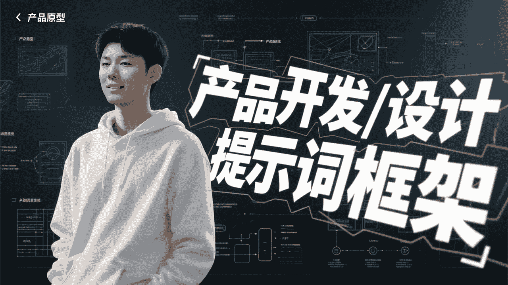
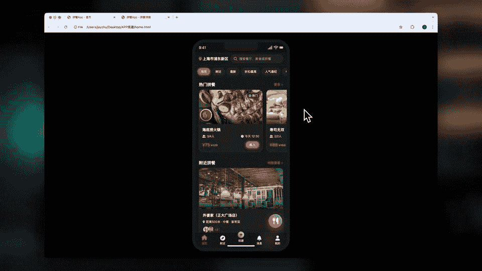
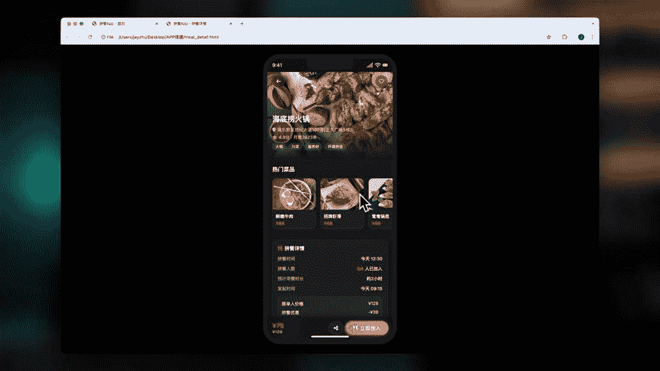
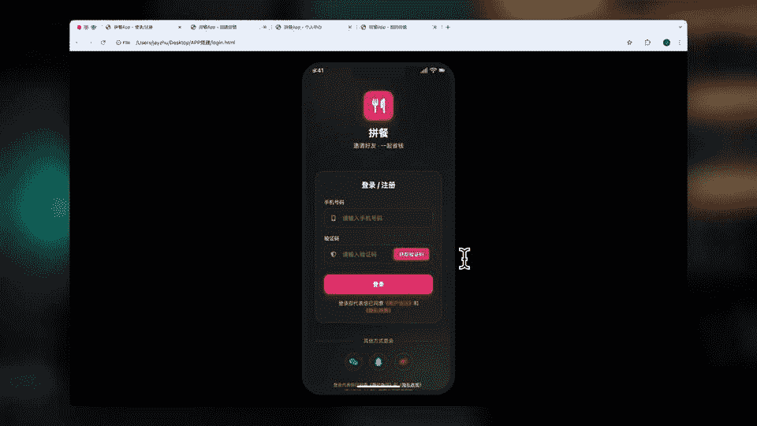
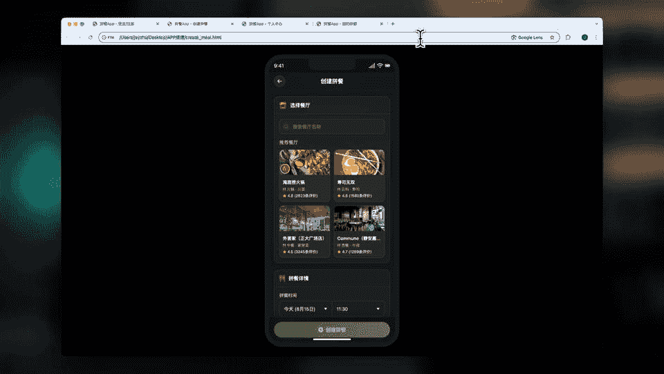
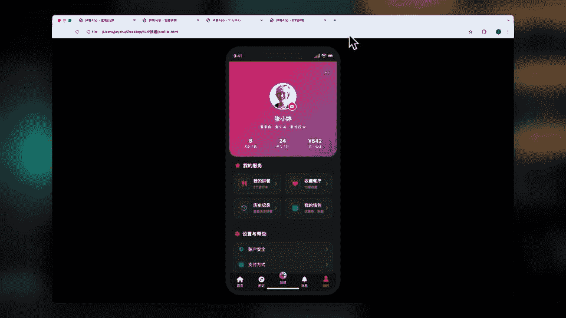
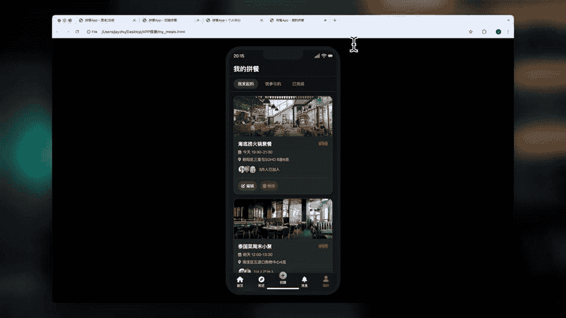

# AI编程 | 产品开发/设计提示词框架

> 来源：[https://feicaiclub.feishu.cn/docx/QvnGdGKzmoObCqxsqCgcAyFnn0g](https://feicaiclub.feishu.cn/docx/QvnGdGKzmoObCqxsqCgcAyFnn0g)

# **视频链接**

> **B 站：** https://b23.tv/FWm4uWp

> **小红书：**http://xhslink.com/a/WDJP0EYVHhK7

> **抖音：**https://v.douyin.com/i5ppMVFn/

---

# **产品开发/设计提示词框架介绍**

这份产品开发/设计提示词框架是为产品经理和设计团队打造的实用工具，帮助他们将产品创意快速转化为可交互的原型设计。

框架采用了结构化的工作流程：首先引导用户明确产品需求和目标用户特征，然后由AI根据这些需求自主判断合适的技术方案并规划页面结构。接着，针对每个页面生成独立的设计方案并创建可交互的HTML原型。最后，将所有设计整合为一个完整的预览页面，展示整体用户流程。

这个过程简化了从需求到原型的转化过程，让团队无需过多关注技术细节和设计规范，便能高效地获得可视化的产品原型，加速产品迭代和沟通效率。

---

## **核心功能模块**

### **/需求收集**

明确产品方向 - 通过系统化提问帮助你明确产品定位、目标用户、核心功能和设计偏好，确保设计工作聚焦于最关键的用户需求。框架会自动进行技术方案判断，并基于你的回答生成完整的页面结构规划，为后续设计奠定基础。

### **/设计**

交互原型创作 - 针对每个页面，框架会先构思完整的设计方案（包括布局、色彩和交互），然后根据确认的方案自动创建高保真交互原型。每个页面设计都保存为独立文件，既有美观的视觉效果，又具备完整的交互功能。

### **/预览**

整体原型展示 - 自动创建一个九宫格布局的预览页面，将所有设计的页面整合在一起，并生成清晰的用户流程示意图展示页面间的关系和跳转路径。这让你能够全局把握产品结构，确保用户体验的连贯性和一致性。

> 注：本框架为辅助工具，最终效果将根据使用者的应用和优化产生差异。不同产品设计场景下的使用效果可能有所不同，使用者需根据实际需求调整设计细节与交互逻辑。

---

# 👀 先睹为快

我们利用这套提示词框架使用了**Cursor编辑器和Claude** 3.7 Sonnet Thinking模型作为产品设计和原型生成工具。所有展示的6个原型图都是框架直接生成的，未经任何人工修改和调整。这样你可以直观地看到这套框架在实际应用中的效果如何。

> 使用这个框架创作时，有几点需要特别注意：

1.  大语言模型虽然设计能力强，但也可能在技术实现上有所局限。建议在生成原型后检查代码的可行性和交互逻辑的合理性。

1.  此框架适用于主流大语言模型，但因各家模型设计能力的不同，最终原型质量也会有所差异。Claude 3.7 Sonnet在视觉设计和交互逻辑上表现尤为出色。

**产品需求输入：**

Q1：请简述您的产品是什么，它解决了什么问题？

答案：主打拼餐，可以邀请朋友拼饭，可以更省钱

Q2：您的目标用户是谁？他们有哪些特点和需求？

答案：主要是服务于上班族 白领

Q3：您希望产品包含哪些核心功能？

答案：要有邀请和拼饭功能

Q4：您是否有参考的产品或设计风格偏好？

答案：我希望风格像抖音一样的风格

Q5：您的产品是面向网页端还是移动端/App？"

答案：移动端 app

[001.mp4](https://internal-api-drive-stream.feishu.cn/space/api/box/stream/download/all/SkHBbibAro5nbBxbNFkcLMBhnlf)

[002.mp4](https://internal-api-drive-stream.feishu.cn/space/api/box/stream/download/all/TCNVbZjwuoeXQPxxnfZcUrvXnNm)

[076 录屏 7.mp4](https://internal-api-drive-stream.feishu.cn/space/api/box/stream/download/all/GcmIbaS3io0b38xnnXOcEzlwn4g)

[076 录屏 8.mp4](https://internal-api-drive-stream.feishu.cn/space/api/box/stream/download/all/CjMlbO7kdojkRpxiHsEcQYHSnkb)

[076 录屏 9.mp4](https://internal-api-drive-stream.feishu.cn/space/api/box/stream/download/all/Dgm0bbRQZo8fmMxItBocAmSInDf)

[076 录屏 10.mp4](https://internal-api-drive-stream.feishu.cn/space/api/box/stream/download/all/O2SGbmG2Ho6VfyxPMZlciFaWnVc)

# **💰 订阅社群年度会员**

> **💰 加入废才俱乐部**

> 加入社群，一次性解锁所有AI实战攻略。

> 包括现有的全部内容——提示词框架、Agent搭建教程、Skill开发攻略等，以及未来每一期视频更新的配套资料。不再零散获取，系统地学习和应用。

> ⚠️ 购买提醒：请仔细浏览页面内容，谨慎购买，不退不换。如未看到支付按钮，请使用桌面端网页浏览器访问。

> **光看文字不够？实操遇到卡点？**

> 加入社群后，你还可以进入专属交流群，获得废才老师的亲自指导。在这里，你不仅能与数百位AI实践者交流经验，更能随时提问，解决实操中遇到的问题。

> 我们期待你成为社群的第 n+1 位成员！

> [社群微信群入口](https://feicaiclub.feishu.cn/wiki/JBNXwZ5QZidRtuk1HCCcvgZmnNg?from=from_copylink)（戳这里，跳转去社群微信群页面扫码入群）