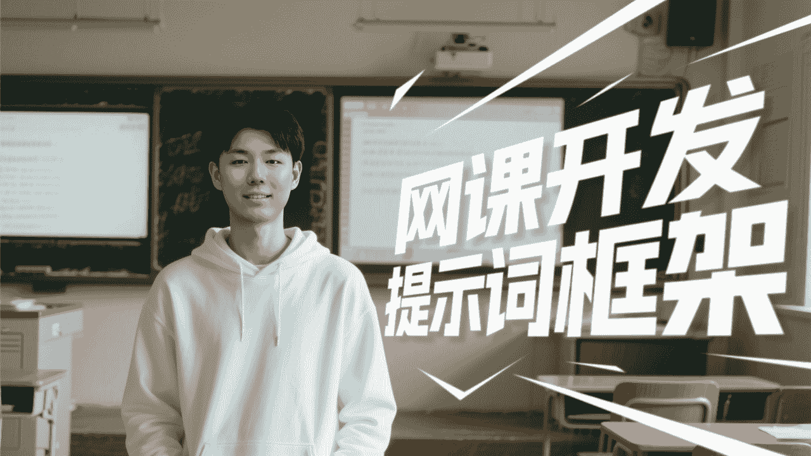

# 知识付费 | 网课开发提示词框架

> 来源：[https://feicaiclub.feishu.cn/docx/CRnsd7u7Jo3sx8xKKEHc0F2lnyd](https://feicaiclub.feishu.cn/docx/CRnsd7u7Jo3sx8xKKEHc0F2lnyd)

# 网课开发提示词框架讲解

这套提示词框架除了用于个性化教学外，还特别适用于网课项目的开发和设计。通过设定学生的需求和知识背景，该框架不仅能提升学习体验，还能有效帮助教育工作者设计出符合多样化需求的在线课程。

在当今数字化时代，人工智能（AI）已经成为教育中的重要工具。然而，**许多学习者在使用 AI 辅助学习时，经常会发现教学内容过于标准化，无法满足个人需求，或教学进度难以适应自己的学习节奏**。即便是面对相同的学习主题，不同的学习者在理解能力和学习风格上都有显著差异，这使得传统教学模式难以实现真正的个性化。

这套个性化 AI 教学提示词框架正是为了解决这些问题而设计。该框架通过深度了解学生的学习需求，提供高度个性化的教学体验。借助此框架，AI 将动态调整教学内容和方式，确保符合学习者的需求与节奏。通过这套框架，您将能够：

+   **个性化教学内容**：根据学习者的学习配置（如课程深度、内容密度、教学风格），量身定制教学内容，使每个学习者获得适合自己的学习路径。

+   **动态适应学习反馈**：AI 会基于学习过程中的反馈，不断调整教学内容和进度，确保学习过程与学习者的理解能力保持一致。

+   **基于明确的思考过程进行教学**：在每次教学互动之前，AI 都会展示其详细的思考过程，使教学步骤透明化，帮助学习者深入理解知识的逻辑关系。

## 提示词框架功能模块详解

该框架由以下几个主要模块组成，每个模块旨在实现个性化的学习体验，确保学习者的需求得到满足：

1.  **课程设定**：在这一阶段，AI 会首先与学习者沟通，明确他们的学习目标和兴趣点。这有助于确保后续的教学内容更具针对性，并符合学习者的需求。

1.  **课程大纲**：课程设定完成后，AI 会基于学习者的需求生成全面的课程大纲，帮助学习者理解整个学习流程。课程大纲包括各个单元的详细规划和学习路径，以确保学习过程清晰有序。

1.  **单元学习**：每个单元的学习中，AI 将逐步展开教学内容，涉及概念引入、核心内容的深入讲解、理论探讨以及实践应用。这样的模块化教学方式能够帮助学习者系统性地掌握知识，并确保知识点之间的逻辑性和联系。

1.  **学习评估**：在每个学习阶段，AI 都会通过自适应测试来评估学习者对知识的掌握程度。测试内容会根据学习者的表现进行动态调整，帮助明确学习中的强项和需要进一步改进的部分。

1.  **知识图谱**：AI 会在学习的过程中创建和更新知识图谱，帮助学习者直观理解知识点之间的联系。通过这种可视化的图谱，学习者能够更好地建立系统化的知识结构。

1.  **自适应测试**：根据学习进度，AI 会动态生成个性化的测试题目，以评估知识掌握程度。这些测试的结果会影响后续教学内容的安排，以确保学习者的体验是最优的。

1.  **配置管理**：在整个学习过程中，学习者可以根据自身需求或学习进展动态调整学习配置，包括课程深度、内容密度和教学风格。这样，学习者始终能获得最适合自己的学习体验。

## 为什么这套框架独特？

这套提示词框架的设计目标是真正**实现个性化和自适应学习**。传统的 AI 教学内容通常是标准化的，无法满足个体学习者的特定需求，而这套框架通过动态调整和详细的思考过程展示，确保每个学习者的体验都是个性化的并且符合其学习风格与需求。

**重要说明：**该框架特别适用于具备强大个性化和自适应能力的 AI 模型（如 Claude 3.5 Sonnet 或 ChatGPT-4）。其他模型可能无法完全实现此框架的动态个性化功能，可能导致学习体验不佳。此外，教学内容完全依赖于模型的预训练数据，因此用户需注意数据的更新时点以及模型产生幻觉（即生成不准确或虚构内容）的可能性。学习者应对生成的内容进行判断和验证，以确保知识的准确性与可靠性。

# **💰 订阅社群年度会员**

> **💰 加入废才俱乐部**

> 加入社群，一次性解锁所有AI实战攻略。

> 包括现有的全部内容——提示词框架、Agent搭建教程、Skill开发攻略等，以及未来每一期视频更新的配套资料。不再零散获取，系统地学习和应用。

> ⚠️ 购买提醒：请仔细浏览页面内容，谨慎购买，不退不换。如未看到支付按钮，请使用桌面端网页浏览器访问。

> **光看文字不够？实操遇到卡点？**

> 加入社群后，你还可以进入专属交流群，获得废才老师的亲自指导。在这里，你不仅能与数百位AI实践者交流经验，更能随时提问，解决实操中遇到的问题。

> 我们期待你成为社群的第 n+1 位成员！

> [社群🛰️群入口](https://feicaiclub.feishu.cn/wiki/JBNXwZ5QZidRtuk1HCCcvgZmnNg?from=from_copylink)（戳这里，跳转去社群🛰️群页面扫码入群）